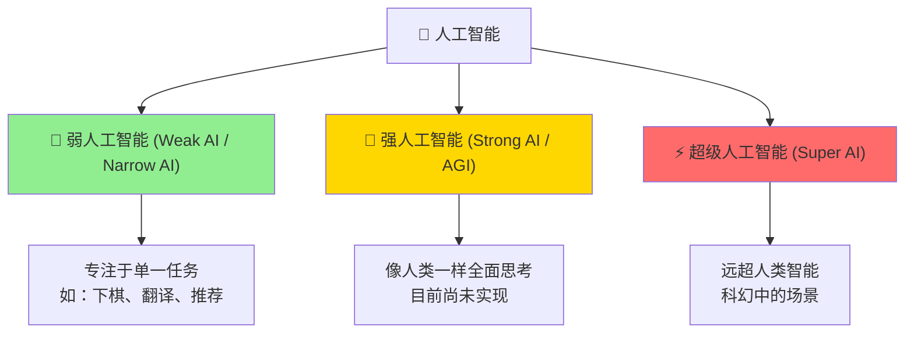
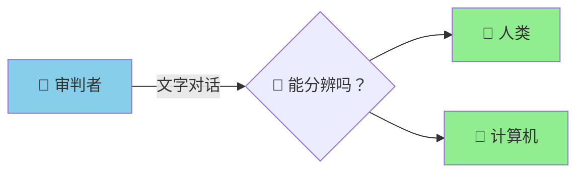
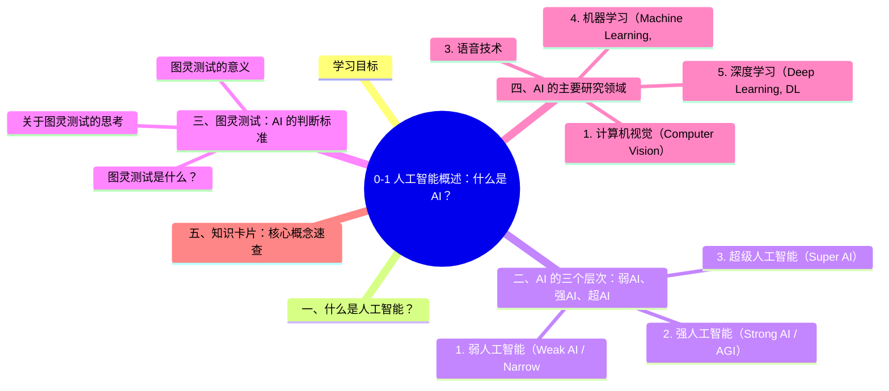

# 0-1 人工智能概述：什么是 AI？

## 学习目标

你有没有想过，Siri 为什么能听懂你说话？抖音为什么能精准推荐你喜欢的视频？这些看似平常的应用，背后都离不开**人工智能（Artificial Intelligence，简称 AI）**。本章我们就来搞清楚：AI 到底是什么，它有哪些分类，以及它主要研究哪些领域。

---

## 一、什么是人工智能？

**人工智能**是指让机器具有人类智能的技术——让机器能够**感知、思考、学习和决策**。

这听起来有点抽象，我们来举例：

- **感知**：计算机能"看懂"一张照片（计算机视觉），能"听懂"你说的话（语音识别）
- **思考**：能理解你说的话是什么意思（自然语言处理）
- **学习**：能从大量数据中发现规律（比如从你的购买记录中学到你的喜好）
- **决策**：能做出预测或建议（比如推荐你可能想买的商品）

我们每天都在和 AI 打交道：刷抖音、点外卖、语音助手、智能推荐……这些都是 AI 的应用。

---

## 二、AI 的三个层次：弱AI、强AI、超AI

按照能力高低，人工智能通常分为三个层次：

### 1. 弱人工智能（Weak AI / Narrow AI）

> **现在能做到的 AI，基本都是弱人工智能。**

弱人工智能专注于**某个特定任务**，在这件事上可能比人类还强，但在其他事情上一窍不通。

**举例：**
- AlphaGo：下棋无敌，但不会帮你订外卖
- 语音助手：能听懂你的命令，但不会自己写代码
- 人脸识别系统：能识别人脸，但不知道这个人是谁

### 2. 强人工智能（Strong AI / AGI）

> **理想中的 AI，能像人类一样全面思考。**

强人工智能也叫**通用人工智能（AGI）**，指具有人类全部智能的机器——能理解、会学习、会创造、会情感感知。目前**还没有真正实现**，是科学家努力的方向。

**举例：**
- 科幻电影中的机器人（如《Her》中的萨曼莎）—— 能对话、能情感交流
- 接近人类思维的 AI 系统

### 3. 超级人工智能（Super AI）

> **假想中远超人类智能的 AI。**

这是科幻作品里最常出现的场景——AI 的智能在所有领域都超过人类，甚至可能超越人类 control。但这只是理论假设，距离我们非常遥远。

---

## 三、图灵测试：AI 的判断标准

既然 AI 要模拟人类智能，那怎么判断一台机器是否真的"智能"呢？

1950 年，计算机科学之父**艾伦·图灵（Alan Turing）**提出了一个著名的测试方法：**图灵测试（Turing Test）**。

### 图灵测试是什么？

想象这样一个场景：

> 一个人类审判者坐在幕后，通过文字和两个对象交流：
> - 一个是真实的人类
> - 一个是计算机
>
> 如果审判者**无法分辨哪个是人、哪个是机器**，就说明这台机器具有人工智能。

**关键点：** 判断标准不是"机器会不会说话"，而是"审判者能不能区分"。

### 图灵测试的意义

- 提出了一种**可操作**的智能判断方式
- 奠定了 AI 研究的方法论基础
- 至今仍是 AI 领域的重要参考

### 关于图灵测试的思考

> 一个能通过图灵测试的程序，是否就真的"理解"了世界？
> 这涉及到 AI 哲学中的一个核心争论：**机器能否真正"理解"，还是只是在"模拟"理解？**

这个问题没有标准答案，也推动着 AI 不断向前发展。

---

## 四、AI 的主要研究领域

人工智能是一个广泛的学科，包含多个研究方向。下面这张图展示了 AI 的核心领域：

### 1. 计算机视觉（Computer Vision）

**目标**：让机器"看懂"图像和视频。

**常见任务**：
- **图像分类**：判断一张图片里是什么（如：这是猫还是狗？）
- **目标检测**：标出图片中物体的位置（如：在一张街景中圈出所有行人）
- **人脸识别**：识别是谁（如：手机解锁、考勤系统）
- **图像生成**：AI 生成逼真的图片（如：Midjourney、DALL-E）

**应用场景**：美颜相机、自动驾驶、医学影像分析、监控系统。

### 2. 自然语言处理（Natural Language Processing, NLP）

**目标**：让机器"读懂"和"生成"人类语言。

**常见任务**：
- **机器翻译**：把一种语言翻译成另一种（Google 翻译）
- **情感分析**：判断一段文字是正面还是负面（评论舆情监控）
- **问答系统**：回答用户问题（智能客服）
- **文本生成**：AI 写文章、写代码（ChatGPT）

**应用场景**：搜索引擎、智能客服、内容推荐、机器翻译。

### 3. 语音技术

**目标**：让机器"听懂"和"会说"。

**常见任务**：
- **语音识别**：把语音转成文字（语音输入法）
- **语音合成**：把文字转成语音（Siri 朗读）
- **声纹识别**：识别说话人是谁（身份验证）

**应用场景**：语音助手、电话客服、有声书生成、会议记录。

### 4. 机器学习（Machine Learning, ML）

**目标**：让机器从数据中**自动学习**规律，而不是人工编写规则。

> 传统编程：人写规则 → 计算机执行  
> 机器学习：数据 + 算法 → 计算机自动发现规则

**三大类型**：
- **监督学习**：用标注好的数据训练（如：给图片打上"猫"或"狗"的标签）
- **无监督学习**：从无标签数据中发现规律（如：把用户按行为分成不同群体）
- **强化学习**：通过试错和奖励信号学习（如：AlphaGo 下棋）

### 5. 深度学习（Deep Learning, DL）

**深度学习是机器学习的一个分支**，使用**深度神经网络**（很多层连接在一起的神经网络）来学习。

> 机器学习 → 需要人工特征工程  
> 深度学习 → 自动从数据中提取特征

**为什么叫"深度"？**
- "深度"指神经网络的层数很多（几十层甚至上百层）
- 层数越多，能学习越复杂的规律，但也需要更多数据和算力

**代表网络结构**：
- CNN（卷积神经网络）—— 擅长处理图像
- RNN/LSTM（循环神经网络）—— 擅长处理序列数据（文本、语音）
- Transformer（变换器）—— 当下最火的架构，支撑了大语言模型

---

## 五、知识卡片：核心概念速查

| 概念 | 英文 | 定义 | 举例 |
|------|------|------|------|
| 人工智能 | AI | 让机器具有人类智能的技术 | Siri、抖音推荐 |
| 弱人工智能 | Weak AI / Narrow AI | 专注单一任务的 AI | AlphaGo、下棋很强 |
| 强人工智能 | Strong AI / AGI | 具有人类全部智能的 AI | 尚未实现 |
| 超级人工智能 | Super AI | 远超人类智能的 AI | 科幻场景 |
| 图灵测试 | Turing Test | 判断机器是否具有智能的测试 | 审判者无法分辨 |
| 计算机视觉 | CV | 让机器看懂图像和视频 | 人脸识别、自动驾驶 |
| 自然语言处理 | NLP | 让机器理解和生成语言 | 机器翻译、ChatGPT |
| 机器学习 | ML | 从数据中自动学习规律 | 推荐系统 |
| 深度学习 | DL | 用深度神经网络学习的分支 | AlexNet、ChatGPT |

---

## 本章小结

1. **人工智能**是让机器具有感知、思考、学习、决策能力的技术
2. AI 按能力分三类：**弱 AI**（现在主流）、**强 AI**（理想目标）、**超 AI**（科幻设想）
3. **图灵测试**是判断机器是否具有智能的经典方法
4. AI 主要研究领域包括：**计算机视觉、自然语言处理、语音技术、机器学习、深度学习**

---

## 章节预告

下一节，我们将回顾人工智能波澜壮阔的发展历史——从 1950 年代感知机的诞生，到 2012 年深度学习的爆发，再到如今大语言模型的横空出世。带你站在历史的角度，理解 AI 为什么是今天这个样子。

---

## 知识图谱

## 参考资料

3. 斯坦福大学人工智能课程（Stanford CS229）
4. Ian Goodfellow, Yoshua Bengio, Aaron Courville, 《Deep Learning》，MIT Press, 2016
5. Turing, A. M. (1950). "Computing Machinery and Intelligence", Mind, 59(236), 433-460.

