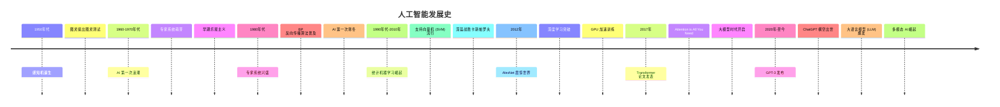
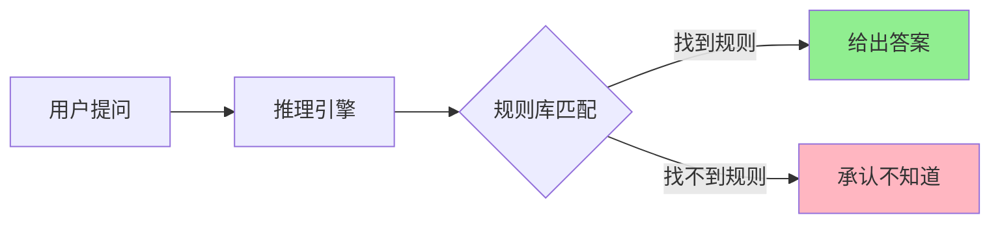
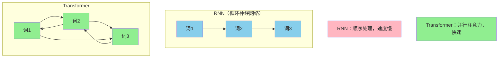
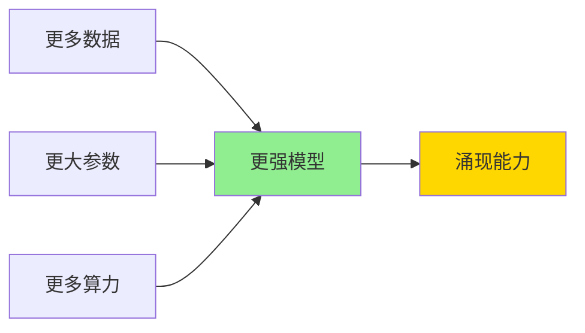
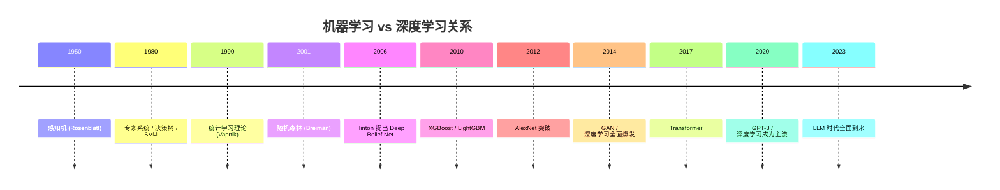
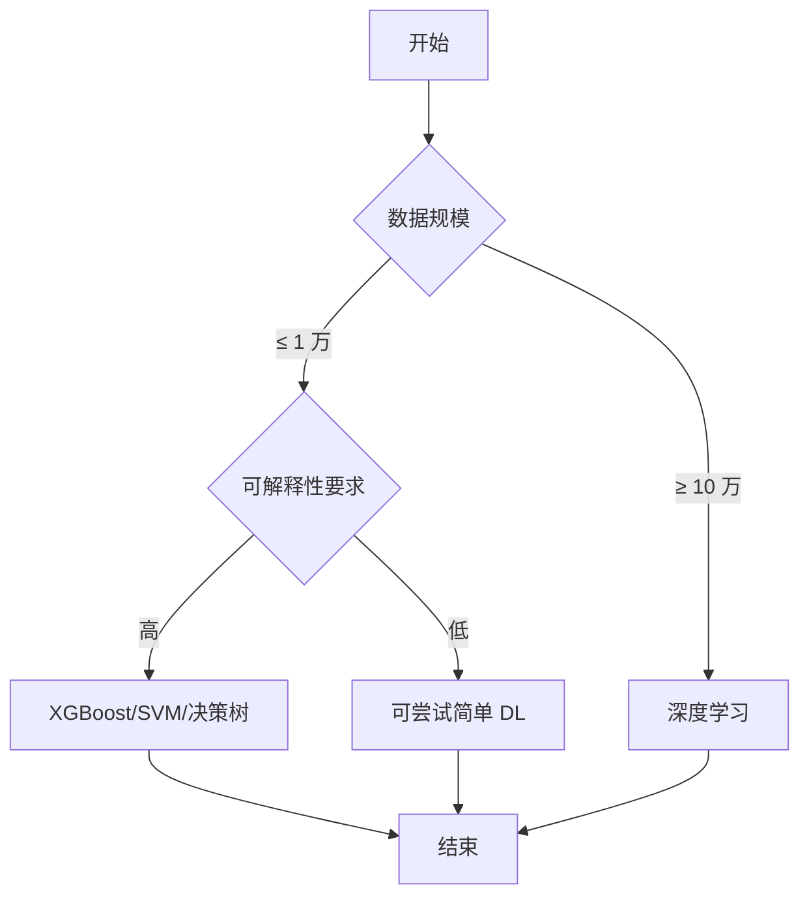
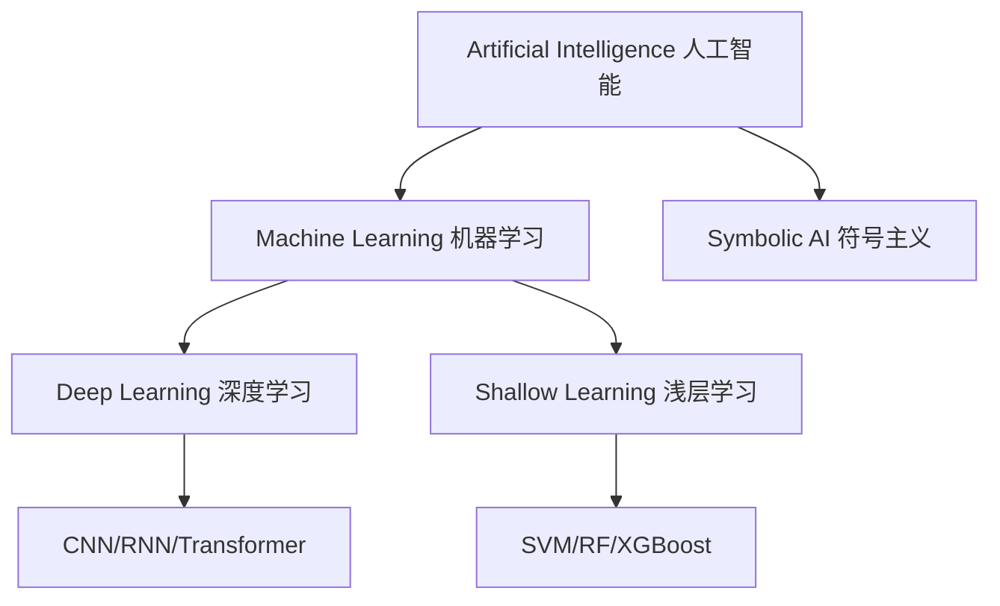
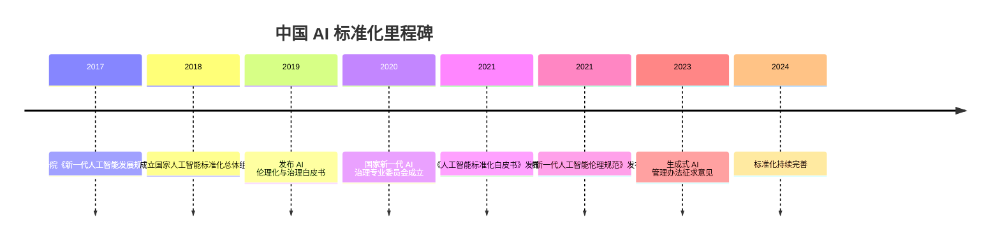
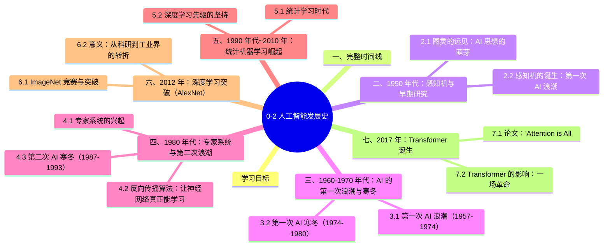

# 0-2 人工智能发展史

## 学习目标

人工智能的发展并非一帆风顺，而是经历了**三次浪潮两次寒冬**。从 1950 年代感知机的诞生，到 1980 年代专家系统的兴衰，再到 2012 年深度学习的爆发，最后到今天大语言模型的风起云涌——每一次技术突破，都深刻改变了 AI 的走向。

本章用时间线的方式，带你回顾 AI 发展史上的关键时刻，理解**为什么是这些人和这些事件，塑造了今天的 AI**。

---

## 一、完整时间线



---

## 二、1950 年代：感知机与早期研究

### 2.1 图灵的远见：AI 思想的萌芽

**1946-1950 年代**，计算机刚刚发明，科学家们开始思考：机器能不能思考？

1950 年，**艾伦·图灵（Alan Turing）**发表了划时代的论文《Computing Machinery and Intelligence》，提出了著名的**图灵测试**，为"什么是人工智能"这个问题提供了第一个可操作的判断标准。

> 核心问题：**机器能否表现出与人类无法区分的智能行为？**

### 2.2 感知机的诞生：第一次 AI 浪潮

**1957 年**，美国心理学家**弗兰克·罗森布拉特（Frank Rosenblatt）**提出了**感知机（Perceptron）**——这是世界上第一个**真正意义上的人工神经网络**。

**什么是感知机？**

感知机是一种**线性二分类模型**，类似于一个简化的大脑神经元：

```
输入 → 权重相乘 → 累加 → 激活函数 → 输出
```

它能学习：给定数据，自动调整权重，完成分类任务。

**意义**：
- 证明了**机器可以从数据中学习**
- 开启了神经网络研究的大门
- 引发了 AI 的第一次浪潮（1957-1974）

> **⚠️ 一个小问题**：单层感知机有一个致命的缺陷——**无法解决非线性问题（如 XOR 异或运算）**。这为后来的 AI 寒冬埋下了伏笔。

---

## 三、1960-1970 年代：AI 的第一次浪潮与寒冬

### 3.1 第一次 AI 浪潮（1957-1974）

这一时期，研究者对 AI 充满乐观：

- **1964 年**：ELIZA——世界上第一个聊天机器人诞生
- **1966 年**：MIT 开发了第一个计算机视觉系统
- **1968 年**：电影《2001：太空漫游》上映，HAL 9000 成为 AI 的文化符号

**资金涌入**：美国国防部大力资助 AI 研究，期望 AI 能快速改变战争方式。

### 3.2 第一次 AI 寒冬（1974-1980）

然而，事情并不顺利：

- **算力不足**：当时的计算机太慢，无法处理复杂 AI 任务
- **预期过高**：研究者承诺的"5 年内实现通用 AI"没有兑现
- **批评声音**：1969 年，AI 先驱**明斯基（Marvin Minsky）**和**帕佩特（Seymour Papert）**在《感知机》一书中证明了单层感知机的局限性，导致资金大量撤出。

> 第一次寒冬的特征：资金减少、研究停滞、舆论批评

---

## 四、1980 年代：专家系统与第二次浪潮

### 4.1 专家系统的兴起

**1980 年代**，AI 迎来第二次浪潮——**专家系统（Expert System）**成为主角。

**什么是专家系统？**

专家系统是一种**基于规则的 AI 程序**，它把某个领域专家的知识整理成"如果...那么..."的规则，让计算机像专家一样做决策。



**例子**：
- **MYCIN**（1970 年代末）：医学诊断专家系统，能诊断血液感染病
- **XCON**（1980 年代）：DEC 公司用专家系统配置计算机订单，准确率高达 95%

### 4.2 反向传播算法：让神经网络真正能学习

**1986 年**，**大卫·鲁梅哈特（David Rumelhart）**等人提出了**反向传播（Backpropagation，BP）算法**——这是深度学习史上最重要的算法之一。

**BP 算法解决了什么问题？**

之前的感知机只能学习一层权重，无法解决复杂问题。BP 算法让**多层神经网络**能够有效学习，从而解决非线性问题。

> 通俗理解：BP 算法就是"**从错误中学习**"——先把数据往前传（Forward），算出错误；再把错误往回传（Backward），调整每个权重。重复多次，网络的预测越来越准。

### 4.3 第二次 AI 寒冬（1987-1993）

专家系统也有严重缺陷：

- **知识获取瓶颈**：专家知识难以提取，规则维护成本极高
- **无法自适应**：无法从数据中自动学习，只能人工编写规则
- **硬件进步**：个人电脑崛起，专用 AI 计算机失去市场

1987 年，AI 寒冬再次降临。

---

## 五、1990 年代~2010 年：统计机器学习崛起

### 5.1 统计学习时代

**1990 年代**，AI 风格转变：从"规则驱动"转向"**数据驱动**"。

**核心技术**：
- **支持向量机（SVM）**：一种强大的分类算法，在文本分类、手写识别等任务上表现优异
- **隐马尔可夫模型（HMM）**：用于语音识别
- **概率图模型**：贝叶斯网络等

**里程碑事件**：
- **1997 年**：IBM 深蓝战胜国际象棋冠军**卡斯帕罗夫**，成为 AI 史上的标志性事件
- **1990-2000 年代**：垃圾邮件过滤、搜索引擎排序——机器学习开始真正商业化

### 5.2 深度学习先驱的坚持

在寒冬期，有一批科学家坚持研究深度学习：

- **杰弗里·辛顿（Geoffrey Hinton）**：坚持研究深度神经网络，提出**深度置信网络（DBN）**和**玻尔兹曼机**
- **约书亚·本希奥（Yoshua Bengio）**：研究深度学习在文本理解中的应用
- **杨立昆（Yann LeCun）**：完善了**卷积神经网络（CNN）**，用于手写识别

> 这三位科学家后来被称为"深度学习之父"，并在 2018 年共同获得**图灵奖**。

---

## 六、2012 年：深度学习突破（AlexNet）

### 6.1 ImageNet 竞赛与突破

**2012 年**，AI 史上的重要转折点——**深度学习时代正式开启**。

**背景**：
- **ImageNet** 是一个拥有 1400 万张图片的数据库，每年举办图像识别竞赛（ImageNet Large Scale Visual Recognition Challenge, ILSVRC）
- 2010 年，第一名准确率是 74.3%（传统方法）
- 2011 年，第一名准确率是 83.6%

**2012 年，AlexNet 来了**：

由**亚历克斯·克里泽夫斯基（Alex Krizhevsky）**、**辛顿**和**伊利亚·苏茨克维尔（Ilya Sutskever）**设计的 **AlexNet**，以 **84.6%** 的准确率横扫全场，**碾压第二名 73.8%** 的准确率。

| 年份 | 方法 | 准确率 |
|------|------|--------|
| 2010 | 传统方法 | 74.3% |
| 2011 | 传统方法 | 83.6% |
| 2012 | AlexNet | 84.6% |
| 2013 | ZFNet | 87.1% |
| 2014 | VGG/GoogLeNet | 92.7% |
| 2015 | ResNet | 96.4% |

**AlexNet 的关键技术**：
1. **深层 CNN**：8 层网络（之前没有人用这么深的）
2. **GPU 加速训练**：用 NVIDIA GPU 大幅加速训练，绕过算力瓶颈
3. **ReLU 激活函数**：比 Sigmoid 快很多
4. **Dropout 正则化**：防止过拟合

### 6.2 意义：从科研到工业界的转折

AlexNet 证明了：**深度神经网络 + 大数据 + GPU = 革命性突破**

从 2013 年开始，Google、Facebook 等科技巨头开始疯狂投入深度学习，AI 进入了**工业落地时代**。

---

## 七、2017 年：Transformer 诞生

### 7.1 论文："Attention is All You Need"

**2017 年 6 月**，Google 发表了论文《Attention is All You Need》，提出了 **Transformer（变换器）**架构。

**作者**：Ashish Vaswani、Noam Shazeer、Niki Parmar 等（Google Brain）

**核心思想**：用**自注意力机制（Self-Attention）**完全替代了之前的 RNN（循环神经网络）。

> **为什么 Transformer 重要？**
> - RNN 的问题：必须**顺序处理**，无法并行化，且容易**梯度消失**
> - Transformer：用注意力机制**并行处理所有词**，训练效率大幅提升

**架构对比**：



### 7.2 Transformer 的影响：一场革命

Transformer 诞生后，迅速成为 AI 领域的主流架构：

- **2018 年**：BERT（Google）——刷新 NLP 各项基准
- **2018 年**：GPT（OpenAI）——第一个 GPT
- **2019 年**：GPT-2——大规模语言模型
- **2020 年**：GPT-3——1750 亿参数，震惊世界

---

## 八、2020 年~至今：大语言模型时代

### 8.1 大语言模型的爆发

**2020 年**，OpenAI 发布 **GPT-3**，1750 亿参数，首次展示了"**规模法则（Scaling Law）**"的力量——模型越大，效果越强。



**关键事件时间线**：

| 年份 | 事件 | 意义 |
|------|------|------|
| 2020 | GPT-3 发布 | 1750 亿参数，展示规模法则 |
| 2021 | CLIP、DALL-E | 多模态 AI 开始 |
| 2022 | ChatGPT 发布 | 对话 AI 出圈 |
| 2022 | Stable Diffusion 开源 | AI 绘画民主化 |
| 2023 | GPT-4 发布 | 多模态大模型 |
| 2023 | Claude 2、LLaMA 2 | 开源大模型竞争 |
| 2024 | GPT-4o、多模态 | 端到端多模态 |
| 2025 | Reasoning Models | 推理能力增强 |

### 8.2 中国 AI 的发展

在 AI 发展浪潮中，中国快速跟进：

- **2017 年**：百度发布 DuerOS，布局语音 AI
- **2019 年**：华为发布昇腾 AI 芯片
- **2021 年**：商汤、云从等 AI 公司上市
- **2023-2024 年**：百度文心、阿里通义、字节豆包、智谱 GLM 等大模型密集发布

### 8.3 多模态 AI：看见、听见、说话

2023 年后，AI 进入了**多模态时代**——不仅能处理文字，还能处理图像、音频、视频。

**代表应用**：
- GPT-4V：能看懂图片
- Sora：能生成视频
- GPT-4o：实时语音对话
- 各种 AI 音乐生成（如 Suno）

---

## 九、AI 发展史的关键人物

---

## 十、知识卡片：核心概念速查

| 概念 | 时间 | 提出者 | 意义 |
|------|------|--------|------|
| 图灵测试 | 1950 | 艾伦·图灵 | 判断机器是否智能 |
| 感知机 | 1957 | 罗森布拉特 | 第一个神经网络 |
| BP 算法 | 1986 | 鲁梅哈特 | 多层神经网络能学习 |
| 专家系统 | 1980s | 多位学者 | 规则驱动 AI 商业化 |
| SVM | 1990s | Vapnik 等 | 统计学习时代 |
| AlexNet | 2012 | 克里泽夫斯基等 | 深度学习突破 |
| Transformer | 2017 | Google 团队 | 并行注意力架构 |
| GPT-3 | 2020 | OpenAI | 1750 亿参数大模型 |
| ChatGPT | 2022 | OpenAI | 对话 AI 出圈 |

---

## 本章小结

1. **1950 年代**：图灵提出 AI 思想，感知机诞生——第一次浪潮
2. **1970-80 年代**：AI 寒冬，随后专家系统兴起，BP 算法普及——第二次浪潮
3. **1990-2010 年代**：统计机器学习崛起，深蓝战胜卡斯帕罗夫
4. **2012 年**：AlexNet + GPU + 大数据 → 深度学习突破
5. **2017 年**：Transformer 论文发表——并行注意力架构成为主流
6. **2020 年至今**：大语言模型（LLM）爆发，ChatGPT 引发 AI 变革，多模态 AI 成为新方向

---

## 十一、机器学习 vs 深度学习的演进对比

 的内容。

### 1. 概念对比

| 维度 | 机器学习 (ML) | 深度学习 (DL) |
|------|---------------|---------------|
| **定义** | 算法从数据中学习规律 | 深层神经网络自动学习特征 |
| **特征工程** | 需要人工设计 | 自动学习 |
| **数据需求** | 较少（千-万级） | 大量（万-亿级） |
| **算力需求** | CPU 即可 | GPU/TPU 必需 |
| **可解释性** | 较高（决策树等） | 较差（黑盒）|
| **成熟度** | 成熟稳定 | 快速发展 |
| **典型算法** | SVM, RF, XGBoost, K-Means | CNN, RNN, Transformer, GAN |

### 2. 历史关系



### 3. 选择决策



**经验法则**：
- 表格数据 + 中小规模：XGBoost/LightGBM 仍占优
- 图像/语音/文本：深度学习占优
- 实时性要求 + 边缘：MobileNet/小型模型
- 强可解释性：传统 ML

### 4. 为什么更多人选择"机器学习"标题

现实原因：
- "机器学习"范围更广（包括 DL）
- 行业招聘更多用"机器学习工程师"
- 业务问题中表格数据更常见
- 传统 ML 仍是工业流水线主力

**AI > ML > DL** 范围关系：



---

## 十二、AI 标准化与治理发展史

 的内容。

### 1. 中国 AI 标准化发展



### 2. 关键政策与文件

| 年份 | 文件 | 意义 |
|------|------|------|
| 2017 | 《新一代人工智能发展规划》 | 国家战略 |
| 2019 | 《新一代人工智能治理原则——发展负责任的人工智能》 | 8 项治理原则 |
| 2021 | 《新一代人工智能伦理规范》 | 6 项基本伦理要求 |
| 2021 | 《人工智能标准化白皮书》 | 标准体系框架 |
| 2023 | 《生成式人工智能服务管理暂行办法》 | 中国首个 AIGC 法规 |
| 2024 | 全球 AI 治理对话机制 | 跨国合作 |

### 3. AI 治理国际比较

| 维度 | 中国 | 欧盟 | 美国 |
|------|------|------|------|
| **治理模式** | 发展与安全并重 | 风险预防优先 | 创新优先 + 行业自律 |
| **核心法规** | 生成式 AI 管理办法 | EU AI Act | AI 行政命令、NIST 框架 |
| **风险分级** | 分类分级监管 | 风险 4 级分类 | 软性指导 |
| **落地节奏** | 渐进式 | 全面 | 部门化 |
| **重点** | 内容安全、未成年人保护 | 基本权利保护 | 创新领先、出口管制 |

### 4. AI 标准化白皮书要点

**标准体系**：

**国际标准组织**：

- **ISO/IEC JTC1/SC42**：ISO 的人工智能专门委员会
- **IEEE**：发布 AI 伦理标准
- **NIST**：美国 AI 风险管理框架
- **CEN-CENELEC**：欧洲标准化组织
- **中国信通院（CAICT）**：中国 AI 智库

### 5. AI 治理对开发者的启示

- **合规优先**：了解相关法规（GDPR、个人信息保护法、AIGC 管理办法）
- **可解释性**：在高风险场景提供解释
- **数据合规**：用户授权、最小化原则
- **可追溯**：模型版本、训练数据、决策日志
- **持续监控**：性能 + 公平 + 安全

---

## 十三、补充：历史上重要的人物与思想

### 1. 关键人物补充

参考 `素材/用ai的人.md` 和相关人物故事：

- **Geoffrey Hinton**（"深度学习之父"）：神经网络先驱
- **Yann LeCun**：CNN 工业化（Caffe / PyTorch 推动者）
- **Yoshua Bengio**：序列建模先驱
- **Ian Goodfellow**：GAN 发明者
- **Andrej Karpathy**：特斯拉前 AI 总监，OpenAI 创始成员
- **Geoffrey Hinton + Alex Krizhevsky + Ilya Sutskever**：AlexNet 三人组
- **Dario Amodei、Daniela Amodei**：Anthropic 创始人

### 2. 重要事件

| 年份 | 事件 |
|------|------|
| 1997 | 深蓝战胜卡斯帕罗夫 |
| 2011 | Watson 战胜人类 Jeopardy 冠军 |
| 2012 | AlexNet 突破 |
| 2016 | AlphaGo 战胜李世石 |
| 2017 | AlphaGo Zero 自我学习击败 AlphaGo |
| 2020 | GPT-3 发布 |
| 2022 | ChatGPT 发布，2 个月用户破亿 |
| 2023 | GPT-4、文心一言、通义千问 |
| 2024 | Sora 视频生成、Claude 3.5 |

### 3. 中国 AI 大事记

- 2017：国务院发布《新一代人工智能发展规划》
- 2020：百度文心大模型发布
- 2022：ChatGPT 引领全球 AIGC 浪潮
- 2023：百度文心一言、阿里通义千问、商汤日日新、讯飞星火等百花齐放
- 2024：DeepSeek 出圈，可灵视频生成发布

### 4. 综述类资料

- `素材/人工智能的噩梦.md`：AI 风险反思
- `素材/2019 年，医疗 AI 的热潮将会退去.md`：医疗 AI 冷静思考
- `素材/微柱结构.md`：神经科学启发
- `素材/simpread-人工智能的历史、现状和未来 - 求是网.md`：政策视角
- `素材/sr-强人工智能和弱人工智能有什么区别？.md`：AGI 哲学

## 下章预告

到这里，AI 的历史就回顾完了。接下来我们将进入**机器学习基础**部分，了解 AI 是怎么"学习"的——从最基础的线性回归，到神经网络的核心原理，为后面的深度学习打下基础。

---


## 知识图谱



## 参考资料

2. 《Attention is All You Need》，Ashish Vaswani 等，Google Brain，2017
3. Alex Krizhevsky, Ilya Sutskever, Geoffrey Hinton, "ImageNet Classification with Deep Convolutional Neural Networks", 2012
4. Ian Goodfellow, Yoshua Bengio, Aaron Courville, 《Deep Learning》，MIT Press, 2016

6. History of AI, Stanford Encyclopedia of Philosophy
