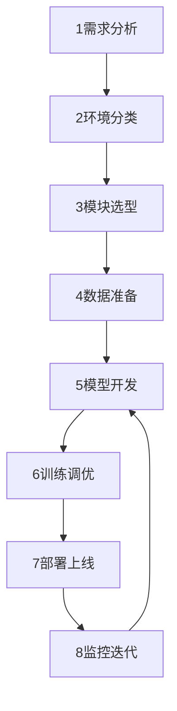
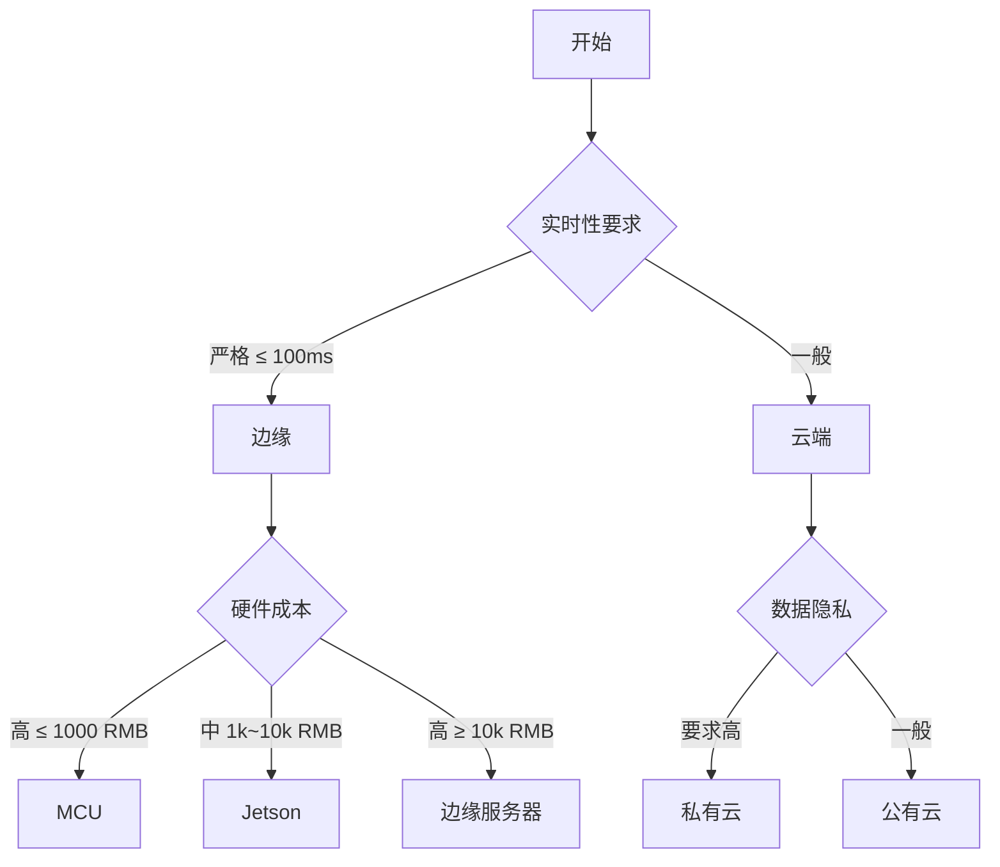
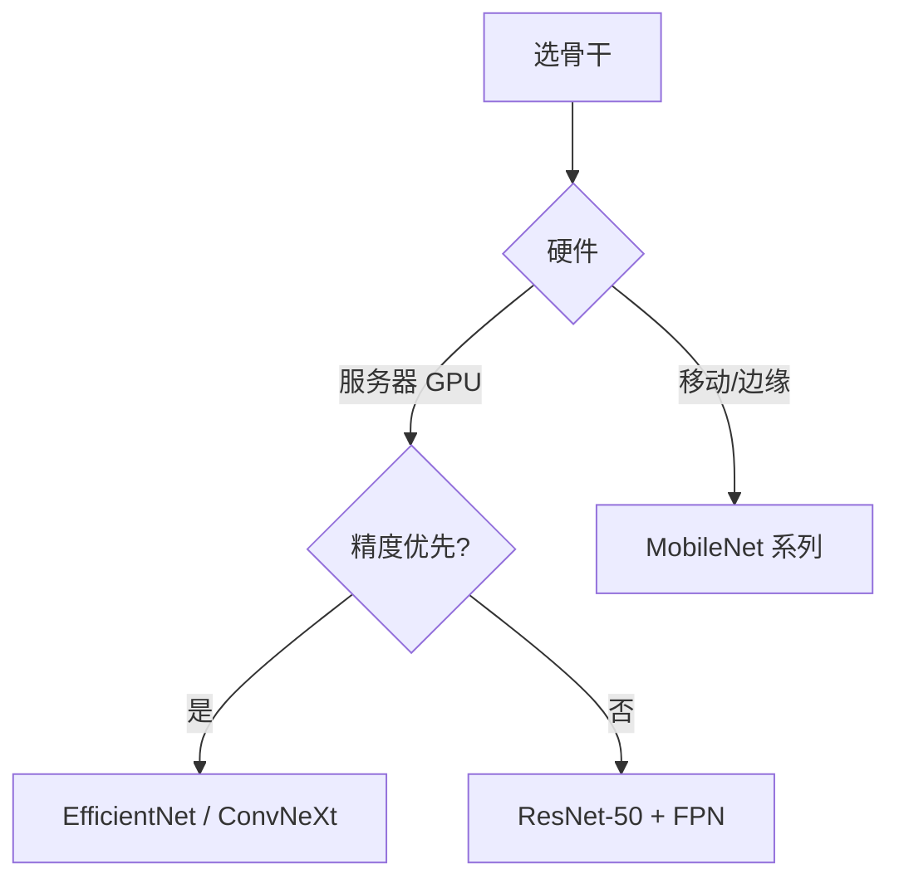
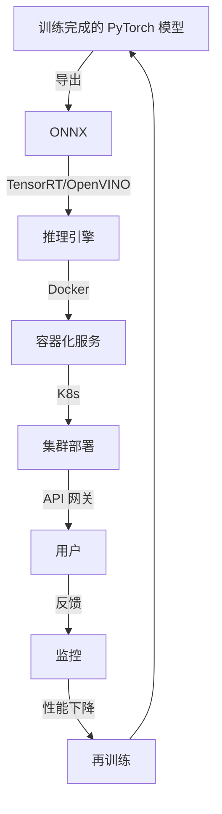
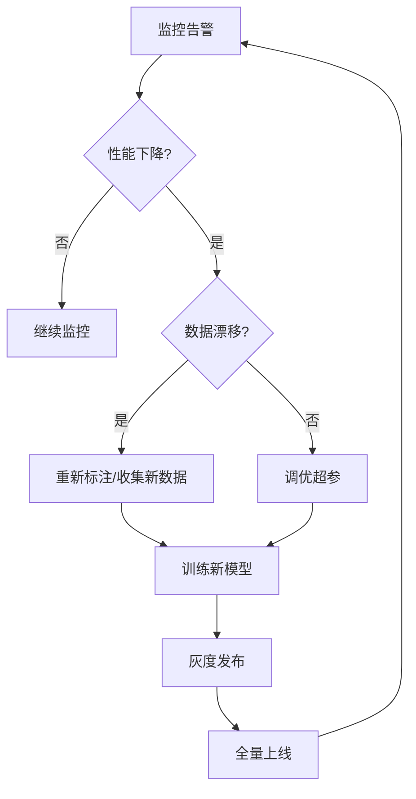
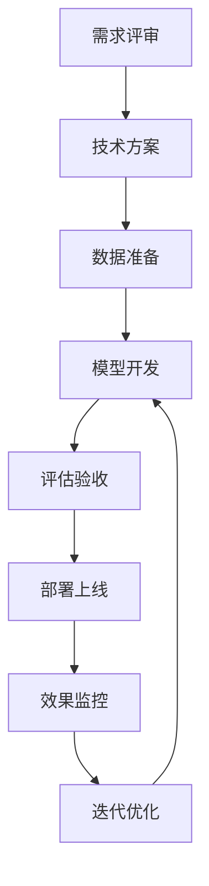
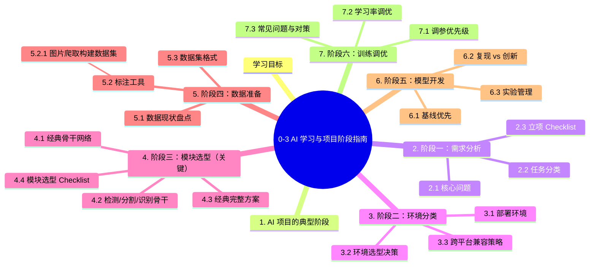

# 0-3 AI 学习与项目阶段指南

## 学习目标

- 了解一个完整的 AI 项目从立项到落地的全流程
- 理解需求分析、环境选型、模块设计的工程方法
- 掌握经典骨干网络（Inception / VGG / MobileNet / SSD）的实战选型
- 理解训练、部署、监控的完整闭环
- 能够将本教程知识应用到实际项目

---

## 1. AI 项目的典型阶段

一个完整的 AI 项目通常经历以下阶段：



每阶段都有**具体目标和可交付物**。

---

## 2. 阶段一：需求分析

### 2.1 核心问题

**"我要用 AI 解决什么问题？"**

| 维度 | 问题 | 示例 |
|------|------|------|
| **业务目标** | 为什么要做？ | 质检效率提升 50% |
| **输入输出** | 输入数据？输出结果？ | 摄像头画面 → 缺陷位置 |
| **精度要求** | mAP/准确率/召回率 | mAP > 85% |
| **延迟要求** | 单次推理时间 | < 100ms |
| **成本约束** | 预算 / 硬件 | Jetson Orin Nano |
| **数据情况** | 有多少数据？标注如何？ | 5000 张已标注 |
| **上线环境** | 云/边/端 | 边缘部署 |

### 2.2 任务分类

把业务问题**翻译**为 AI 任务：

| 业务问题 | AI 任务 |
|----------|---------|
| 产品缺陷检测 | 目标检测 / 异常检测 |
| 客户咨询 | 文本分类 / LLM RAG |
| 销量预测 | 时序预测 |
| 人脸识别 | 分类 + 验证 |
| 自动驾驶感知 | 检测 + 跟踪 + 分割 |
| 医学影像诊断 | 分割 + 分类 |
| 智能客服 | LLM + RAG |
| 推荐系统 | 推荐 + 多任务学习 |

### 2.3 立项 Checklist

```
□ 业务目标明确、可衡量
□ 输入输出定义清晰
□ 精度/延迟/成本约束合理
□ 数据现状盘点
□ 团队技术栈匹配
□ 风险评估（数据/技术/合规）
□ ROI 估算
```

---

## 3. 阶段二：环境分类

### 3.1 部署环境

| 环境 | 典型硬件 | 特点 |
|------|----------|------|
| **云端 GPU** | A100 / H100 | 高性能、贵 |
| **数据中心 CPU** | Xeon 服务器 | 通用、便宜 |
| **边缘 GPU** | Jetson Orin | 实时、嵌入式 |
| **移动端** | 手机 ARM | 极致轻量 |
| **浏览器** | WebGL/WebGPU | 跨平台 |
| **MCU** | STM32 / Arduino | 资源极小 |

### 3.2 环境选型决策



### 3.3 跨平台兼容策略

```python
# 1. 模型用 ONNX 通用格式
model = torch.export(model, example_input)  # PyTorch 2.x
onnx_program.save("model.onnx")

# 2. 推理用多后端
def infer(onnx_path, hardware):
    if hardware == 'jetson':
        import tensorrt as trt
        # TensorRT 推理
    elif hardware == 'cpu':
        import onnxruntime as ort
        # ONNX Runtime 推理
    elif hardware == 'mobile':
        # ncnn / TFLite
```

详见 10-6 / 10-7 章节。

---

## 4. 阶段三：模块选型（关键）

### 4.1 经典骨干网络

，经典骨干的选型参考：

**选型决策树**：



**性能与效率对比**（ImageNet）：

| 骨干 | Top-1 | FLOPs | 参数量 | 适用 |
|------|-------|-------|--------|------|
| VGG-16 | 71.3% | 15.4G | 138M | 教学 |
| Inception V3 | 77.3% | 11.5G | 24M | 经典 |
| ResNet-50 | 76.0% | 4.1G | 25M | 工业标准 |
| MobileNet V2 | 72.0% | 300M | 3.4M | 移动端 |
| EfficientNet-B0 | 77.3% | 390M | 5.3M | 平衡 |
| EfficientNet-B3 | 81.7% | 1.8G | 12M | 高精度 |
| ConvNeXt-T | 82.1% | 4.5G | 29M | 高精度 |

### 4.2 检测/分割/识别骨干

| 任务 | 经典骨干 | 备注 |
|------|----------|------|
| **目标检测** | ResNet-50/101 + FPN | 工业标准 |
| **实例分割** | ResNet + FPN + Mask Head | Mask R-CNN |
| **语义分割** | ResNet-101 + Dilated | DeepLab |
| **关键点检测** | Hourglass / HRNet | 人体姿态 |
| **图像分类** | 上述骨干均可 | 看精度需求 |
| **ReID** | OSNet | 多尺度 |
| **OCR** | CRNN + ResNet | 文本识别 |

### 4.3 经典完整方案

### 4.4 模块选型 Checklist

```
□ 骨干网络（按精度/速度选）
□ 损失函数（任务相关）
□ 数据增强（任务相关）
□ 优化器（Adam/AdamW）
□ 学习率策略（Cosine/Warmup）
□ 评估指标（任务相关）
□ 后处理（NMS/CRF/...）
□ 推理后端（TensorRT/OpenVINO/...）
```

---

## 5. 阶段四：数据准备

数据是 AI 项目的最大瓶颈。详见 2-4 特征工程 与 10-x 训练优化。

### 5.1 数据现状盘点

| 维度 | 问题 | 行动 |
|------|------|------|
| 数量 | 有多少样本？ | 是否够（参考 2-4 经验）|
| 质量 | 噪声多吗？ | 数据清洗 |
| 标注 | 已标注？ | 标注工具 / 众包 |
| 分布 | 类别均衡？ | 重采样 / 加权 |
| 隐私 | 含敏感信息？ | 脱敏 |

### 5.2 标注工具

> **深入阅读**：工具使用详见 2-4 章节；**目标检测的标注原则**（Tight Box、遮挡/截断处理、Cohen's κ 质量门槛、预标注 SOP）详见 [11-1 §1.3 目标检测数据标注原则](../PART11-计算机视觉进阶/11-1-目标检测进阶.md#13-目标检测数据标注原则)。

详见 2-4 章节：LabelMe、labelImg、Label Studio、LabelBee、CVAT。

### 5.2.1 图片爬取：快速构建自定义数据集

当你需要训练一个图像分类器（如"猫 vs 狗"、"不同品种的花"），但没有现成数据集时，**搜索引擎图片爬取**是最快的起步方式。fast.ai 课程的第一课就是用这种方法构建了一个熊分类器。

**方法一：DuckDuckGo 图片搜索（推荐，无需 API Key）**

```python
from fastai.vision.all import *
from fastbook import search_images_ddg

# 搜索并下载图片
def download_images_for_class(search_term, path, max_n=150):
    """用 DuckDuckGo 搜索图片并下载到指定目录"""
    dest = path / search_term
    dest.mkdir(exist_ok=True)
    urls = search_images_ddg(search_term, max_images=max_n)
    download_images(dest, urls=urls)
    # 验证图片完整性
    failed = verify_images(get_image_files(dest))
    failed.map(Path.unlink)
    print(f"{search_term}: 下载 {len(urls)} 张，失败 {len(failed)} 张")

# 构建多类别数据集
path = Path('bear_dataset')
for bear_type in ['grizzly bear', 'black bear', 'teddy bear']:
    download_images_for_class(bear_type, path, max_n=200)

# 创建 DataLoaders 并训练
dls = DataBlock(
    blocks=(ImageBlock, CategoryBlock),
    get_items=get_image_files,
    splitter=RandomSplitter(valid_pct=0.2, seed=42),
    get_y=parent_label,
    item_tfms=Resize(224)
).dataloaders(path)

learn = cnn_learner(dls, resnet34, metrics=error_rate)
learn.fine_tune(3)
```

**方法二：纯 Python（不依赖 fast.ai）**

```python
import requests, os, time
from pathlib import Path
from bs4 import BeautifulSoup

def scrape_bing_images(query, num_images=100, save_dir='images'):
    """通过 Bing 图片搜索爬取（需代理）"""
    save_dir = Path(save_dir) / query
    save_dir.mkdir(parents=True, exist_ok=True)
    
    headers = {'User-Agent': 'Mozilla/5.0'}
    downloaded = 0
    
    for offset in range(0, num_images, 35):
        url = f"https://www.bing.com/images/search?q={query}&first={offset+1}&count=35"
        resp = requests.get(url, headers=headers, timeout=10)
        soup = BeautifulSoup(resp.text, 'html.parser')
        
        for img_tag in soup.find_all('img', class_='mimg'):
            if downloaded >= num_images: break
            img_url = img_tag.get('src') or img_tag.get('data-src')
            if not img_url or not img_url.startswith('http'): continue
            try:
                img_data = requests.get(img_url, timeout=5).content
                with open(save_dir / f'{downloaded:04d}.jpg', 'wb') as f:
                    f.write(img_data)
                downloaded += 1
            except (requests.RequestException, IOError): continue
            time.sleep(0.1)  # 礼貌爬取
    
    print(f"下载 {downloaded}/{num_images} 张图片到 {save_dir}")
```

**爬取数据集的质量保障**：

| 步骤 | 操作 | 工具 |
|------|------|------|
| 1. 下载 | 搜索 + 下载 | DuckDuckGo / Bing |
| 2. 验证 | 删除损坏图片 | `verify_images()` / `PIL.Image.open()` |
| 3. 清洗 | 人工审查错误标签 | `ImageClassifierCleaner`（见 2-3 §3.8） |
| 4. 去重 | 删除重复/近似图片 | `imagehash` 库 |
| 5. 检查 | 确认类别均衡 | `Counter(parent_label(f) for f in files)` |

> **法律与伦理提醒**：爬取的图片仅限**个人学习和研究**使用。商业用途需获得版权授权。建议优先使用开源数据集（Kaggle、HuggingFace Datasets、Academic Torrents）。

### 5.3 数据集格式

| 任务 | 主流格式 | 工具 |
|------|----------|------|
| 检测 | VOC XML / COCO JSON / YOLO txt | labelImg / CVAT |
| 分类 | ImageFolder | 无需特殊工具 |
| 分割 | mask 图（PNG）| LabelMe |
| 关键点 | COCO Keypoint | CVAT |
| 文本 | JSON / CSV | 人工标注 |

### 5.4 训练数据量快速决策

> **核心问题**："我到底需要多少数据？"——这是数据准备阶段**最常见**但**最难以精确回答**的问题。本节给出工业级启发式决策。

#### 5.3.1 "需要多少数据"的 4 个核心要素

$$
\text{数据量} \approx f(\text{问题复杂度}, \text{算法复杂度}, \text{特征维度}, \text{类别数})
$$

| 要素 | 影响 | 经验 |
|------|------|------|
| **问题复杂度** | 越难 → 越多 | MNIST < CIFAR < ImageNet |
| **算法复杂度** | 越强 → 越多 | 线性模型 < 深度学习 |
| **特征维度** | 越高 → 越多 | 10 维 < 1000 维 |
| **类别数** | 越多 → 越多 | 10 类 < 1000 类 |

#### 5.3.2 8 大经验法则

**法则 1：通用起点**
- **每个类别至少 1,000 个样本**（小项目最低线）
- **深度学习每个类别 5,000-10,000 个样本**（理想起点）
- **"硬"问题（自监督/医疗/罕见病）需要 10,000-100,000+**

**法则 2：与参数量的关系**
- 参数量 N 的网络至少需要 **10N 个训练样本**（防止过拟合）
- 7B LLM × 10 = 70B token（Llama-3 训练用了 15T token，远超 10N）

**法则 3：与特征数的关系**
- 样本数 ≥ 10 × 特征维度（统计学"10 倍规则"）
- 高维数据（图像/文本）需要更多样本或正则化

**法则 4：与类别数的关系**
- 二分类：每个类别 ≥ 1000 样本
- 10 分类：每个类别 ≥ 500 样本
- 100 类：每个类别 ≥ 100-200 样本
- 1000 类（ImageNet）：每个类别 ≥ 1000 样本 = 1M 总样本

**法则 5：工业 vs 学术**
- 学术（小论文）：10K-100K 样本
- 工业（小产品）：100K-1M 样本
- 工业（大规模）：1M-1B+ 样本
- 深度学习 SOTA（GPT/Claude）：**数万亿 token**

**法则 6：与迁移学习**
- 使用预训练模型：**1K-10K 样本就够 fine-tune**
- 从头训练：100× 上述数字

**法则 7：学习曲线验证**
- **永远画学习曲线**（详见 2-3 §3.10）
- 如果曲线已饱和 → 不要再加数据，先调模型
- 如果曲线还在上升 → 加数据有效

**法则 8：朴素经验**
> "Get and use as much data as you can." —— Jason Brownlee

#### 5.3.3 5 大数据规模决策表

| 数据量 | 适合 | 算法建议 | 工业含义 |
|--------|------|----------|----------|
| **< 100** | 教学 / POC | 线性模型 / KNN / SVM | 不上深度学习 |
| **100-1K** | 简单分类 | 决策树 / Random Forest | 个人学习项目 |
| **1K-10K** | 严肃分类 | XGBoost / LightGBM | 学术 benchmark |
| **10K-100K** | 中型项目 | CNN / ResNet | 中小企业产品 |
| **100K-1M** | 大型项目 | 预训练 + 微调 | 大公司产品 |
| **1M+** | 大规模 LLM | 大模型 + 分布式 | 工业前沿 / 学术 SOTA |

#### 5.3.4 实战：如何判断"数据够不够"

```python
from sklearn.model_selection import learning_curve
import numpy as np

def assess_data_sufficiency(model, X, y, train_sizes=np.linspace(0.1, 1.0, 10)):
    """用学习曲线判断数据是否足够"""
    train_sizes, train_scores, val_scores = learning_curve(
        model, X, y, cv=5, train_sizes=train_sizes,
        scoring='accuracy', n_jobs=-1
    )
    
    train_mean = train_scores.mean(axis=1)
    val_mean = val_scores.mean(axis=1)
    gap = train_mean[-1] - val_mean[-1]  # 最后一点的 train-val gap
    
    if val_mean[-1] < 0.7:
        print("⚠️ 整体性能太低 → 加数据 + 调模型")
    elif gap > 0.1:
        print("⚠️ 过拟合严重 → 加数据 / 加正则 / 减模型")
    elif np.diff(val_mean).max() > 0.02:
        print("⚠️ 性能还在涨 → 加数据有效！")
    else:
        print("✓ 数据已饱和 → 不必再加，可调模型")
    
    return train_sizes, val_mean
```

#### 5.3.5 数据不够时的 7 大补救

| 方案 | 适用 | 效果 |
|------|------|------|
| **数据增强** | 图像/音频/文本 | +50-200% 等效数据 |
| **预训练 + 微调** | 几乎所有 | 减少 10-100× 数据需求 |
| **迁移学习** | 同领域 | 同上 |
| **半监督学习** | 少量标注 + 大量未标注 | 5-10× 提升 |
| **自监督预训练** | 无标注数据 | 推到工业级 |
| **合成数据** | 仿真 / GAN / Diffusion | 10-100× |
| **主动学习** | 标注贵 | 减少 50% 标注成本 |

> **详细对比数据增强与迁移学习**：[2-4 §2.5 图像数据增强工具](../PART2-机器学习基础/2-4-特征工程.md) 和 [3-6 正则化](../PART3-深度学习核心/3-6-正则化.md)。

#### 5.3.6 实战 Checklist

```
□ 1. 先画学习曲线判断数据是否足够
□ 2. 不够时优先数据增强（成本最低）
□ 3. 还是不够 → 预训练模型 + 微调
□ 4. 还不够 → 主动学习（挑最有价值的样本标）
□ 5. 还不够 → 弱监督 / 半监督
□ 6. 还不够 → 合成数据 / 外部数据
□ 7. 永远不要从"小数据 + 复杂模型"开始
□ 8. 关键：数据质量 > 数据数量（参考 2-3 §3.8 数据清洗）
```

> **核心金句**：**"Better data > More data. Better model > More compute."** —— 数据质量比数量更重要。

---

## 6. 阶段五：模型开发

### 6.1 基线优先

**原则**：**先 baseline，再迭代**。

```python
# Step 1: 选一个主流 baseline
model = torchvision.models.detection.fasterrcnn_resnet50_fpn(weights="DEFAULT")

# Step 2: 在自己的数据上微调
# Step 3: 评估
# Step 4: 对标 SOTA 改进
```

**基线 vs SOTA**：

| 阶段 | 模型 | 预期 |
|------|------|------|
| **Baseline** | ResNet-50 预训练 | mAP 50-60% |
| **SOTA** | ConvNeXt + 各种 tricks | mAP 60-70% |

### 6.2 复现 vs 创新

**项目早期**：复现主流方案，建立 baseline
**项目中期**：在 baseline 基础上加 trick
**项目后期**：尝试创新（结合业务）

### 6.3 实验管理

强烈建议使用 **实验管理工具**：

| 工具 | 特点 |
|------|------|
| **W&B (Weights & Biases)** | 行业标准，UI 友好 |
| **TensorBoard** | TensorFlow 系，PyTorch 也支持 |
| **MLflow** | 开源，本地部署 |
| **DVC** | 数据 + 模型版本管理 |

```python
import wandb

wandb.init(project="my-project", config={
    "learning_rate": 1e-4,
    "epochs": 100,
    "batch_size": 32,
    "model": "resnet50"
})

for epoch in range(100):
    train_loss = train_one_epoch()
    val_acc = evaluate()
    wandb.log({
        "train/loss": train_loss,
        "val/accuracy": val_acc,
        "lr": optimizer.param_groups[0]['lr']
    })

wandb.finish()
```

---

## 7. 阶段六：训练调优

### 7.1 调参优先级

### 7.2 学习率调优

详见 10-1 学习率与 Batch-Size 章节。

### 7.3 常见问题与对策

| 问题 | 表现 | 解决 |
|------|------|------|
| **Loss 不下降** | 模型没学到 | 检查数据 / 学习率 |
| **Loss 震荡** | 学习率太大 | 降低 LR |
| **过拟合** | train 降，val 升 | 数据增强 / Dropout / Early Stop |
| **欠拟合** | 两者都高 | 增大模型 / 减少正则化 |
| **类别不平衡** | 多数类准确率高 | 加权损失 / 重采样 |
| **推理慢** | 延迟高 | 量化 / 蒸馏 / TensorRT |

---

## 8. 阶段七：部署上线

详见 10-4 至 10-7 章节。

### 8.1 部署流程



### 8.2 部署检查清单

```
□ 1. ONNX 导出 + 验证
□ 2. 推理引擎转换（FP16/INT8）
□ 3. 精度验证（与 PyTorch 一致）
□ 4. 性能压测（延迟/吞吐）
□ 5. Docker 镜像构建
□ 6. API 设计（REST/gRPC）
□ 7. 鉴权 + 限流
□ 8. 监控埋点（Prometheus + Grafana）
□ 9. 日志聚合
□ 10. 灰度发布
```

详见 10-4 / 10-6 章节。

---

> **深入**：这一阶段的工程细节（漂移检测阈值、告警分级、灰度最小样本量、成本监控）见 [16-3 线上监控与持续回归](../PART16-评测监控与治理/16-3-线上监控与持续回归.md)。

## 9. 阶段八：监控迭代

### 9.1 监控指标

| 指标 | 工具 | 含义 |
|------|------|------|
| **请求量 / 延迟** | Prometheus | 流量与性能 |
| **成功率 / 错误率** | Prometheus | 稳定性 |
| **模型指标漂移** | 自建 | 输入分布变化 |
| **业务指标** | 自建 | 用户行为 |
| **资源利用** | node-exporter | GPU/CPU/内存 |

### 9.2 模型更新策略



### 9.3 A/B 测试

```python
# 流量分配
def route_request(user_id, model_a="v1", model_b="v2"):
    # 50/50 流量
    if hash(user_id) % 100 < 50:
        return model_a
    return model_b

# 收集指标
metrics = {
    'v1': {'ctr': 0.12, 'latency_ms': 50},
    'v2': {'ctr': 0.15, 'latency_ms': 55}
}

# 如果 v2 显著更好，灰度替换
```

---

## 10. 项目阶段与骨干选型（综合参考表）

| 项目阶段 | 骨干 | 备注 |
|---------|------|------|
| **原型验证（POC）** | Inception V3 / ResNet-50 | 快速出活 |
| **预生产** | ResNet-50 + FPN | 工业标准 |
| **移动端** | MobileNet V2/V3 | 轻量 |
| **高并发服务** | RepVGG / EfficientNet-B0 | 速度快 |
| **离线分析** | ConvNeXt-B / Swin-B | 高精度 |
| **工业质检** | ResNet-50 + 检测 | 鲁棒 |
| **ReID** | OSNet | 多尺度 |
| **OCR** | CRNN + ResNet | 文本识别 |

---

## 11. 常见项目陷阱

### 11.1 数据相关

| 陷阱 | 解决 |
|------|------|
| 训练集 / 测试集分布不一致 | 严格按时间或场景分层抽样 |
| 标注错误率高 | 多标注员交叉验证 |
| 类别不平衡 | 加权 / 重采样 / Focal Loss |
| 数据量不够 | 数据增强 / 合成数据 / 迁移学习 |
| 隐私数据不能上云 | 联邦学习 / 本地训练 |

### 11.2 模型相关

| 陷阱 | 解决 |
|------|------|
| 训练 loss 抖动 | 降低学习率 / 梯度裁剪 |
| 推理和训练结果不一致 | 预处理对齐 / 归一化一致 |
| 模型太大 | 蒸馏 / 量化 / 剪枝 |
| 推理慢 | 推理引擎（TensorRT） / 模型简化 |
| 效果不达预期 | 数据质量 > 模型复杂度 |

### 11.3 部署相关

| 陷阱 | 解决 |
|------|------|
| 内存 OOM | 减小 batch / 混合精度 |
| 端口冲突 | 检查端口使用 |
| Docker 镜像过大 | 多阶段构建 / 精简基础镜像 |
| GPU 不可用 | 装 nvidia-container-toolkit |
| 模型加载慢 | 预加载 / 模型量化 |
| 跨平台崩溃 | 用 ONNX / 容器化 |

---

## 12. 团队与流程

### 12.1 角色分工

### 12.2 项目流程



### 12.3 沟通技巧

- **算法 → 业务**：用业务指标（CTR、ROI）说话，不只讲 mAP
- **业务 → 算法**：明确精度 / 延迟 / 成本约束
- **跨团队**：建立统一评估标准

---

## 13. 适用本教程的实战路径

读完本教程后，建议按以下路径做实战项目：

### 13.1 入门项目（1-2 周）

1. **图像分类**（2-1 章）：CIFAR-10 训练 ResNet
2. **目标检测**（11-1）：YOLOv8 训练自定义数据集
3. **图像生成**（8-1）：训练 GAN 生成手写数字

### 13.2 进阶项目（2-4 周）

1. **异常检测**（11-8）：用 MVTec 训练 PatchCore
2. **目标跟踪**（11-7）：用 YOLOv8 + ByteTrack 跟踪车辆
3. **本地 LLM 应用**（7-5）：Ollama + RAG 知识库

### 13.3 工业项目（4-8 周）

1. **工业质检系统**：检测 + 异常检测 + 边缘部署
2. **智能客服**：LLM + RAG + 知识图谱
3. **自动驾驶感知**：BEV + 多任务 + TensorRT
4. **视频分析平台**：跟踪 + ReID + 行为识别

---

## 本章小结

本章作为本教程的**实战起点**，给出了 AI 项目的完整阶段：

1. **需求分析**：把业务问题翻译为 AI 任务，明确精度/延迟/成本约束
2. **环境分类**：云端/边缘/移动端/嵌入式，硬件决定算法选择
3. **模块选型**：骨干网络按精度/速度选（Inception/VGG/ResNet/MobileNet/SSD）
4. **数据准备**：质量 > 数量，标注工具与数据增强
5. **模型开发**：先 baseline，再迭代；用实验管理工具
6. **训练调优**：数据 > 学习率 > 模型规模 > 损失 > 正则化
7. **部署上线**：ONNX 通用化 + 推理引擎（TensorRT/OpenVINO）
8. **监控迭代**：监控告警 + A/B 测试 + 持续优化

**核心原则**：
- **数据质量 > 模型复杂度**
- **先 baseline，再 SOTA**
- **简单可解释 > 复杂高深**
- **可复现 > 跑分高**
- **工程化思维 > 算法研究**

---


## 知识图谱



## 参考资料

2. Andrew Ng. AI Transformation Playbook. Landing AI, 2018.
3. ML-Ops Guide: https://ml-ops.org
4. Weights & Biases：https://wandb.ai
5. MLflow：https://mlflow.org
6. DVC：https://dvc.org

8. 本教程其他章节的相互引用

