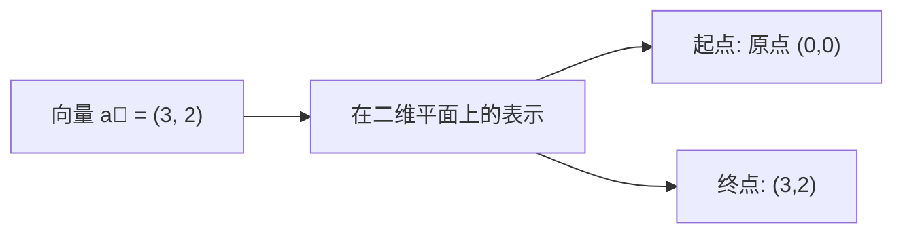
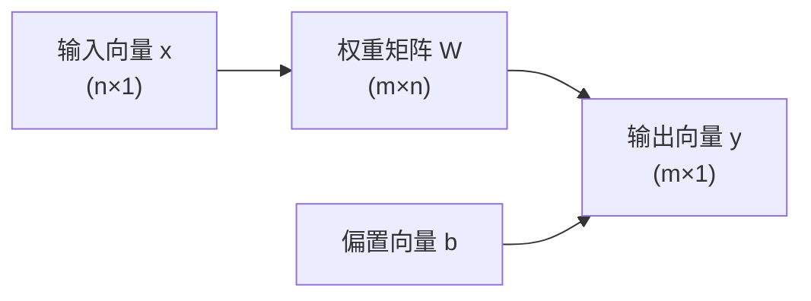
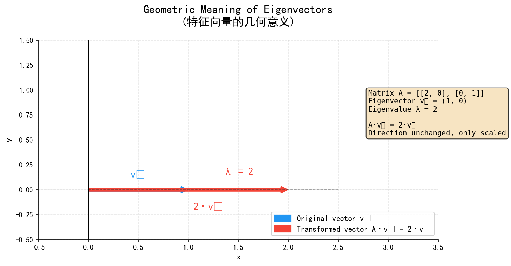
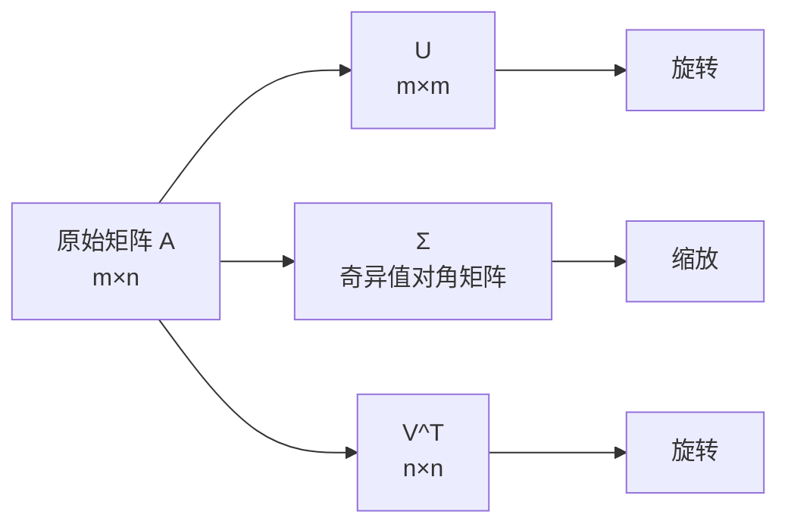
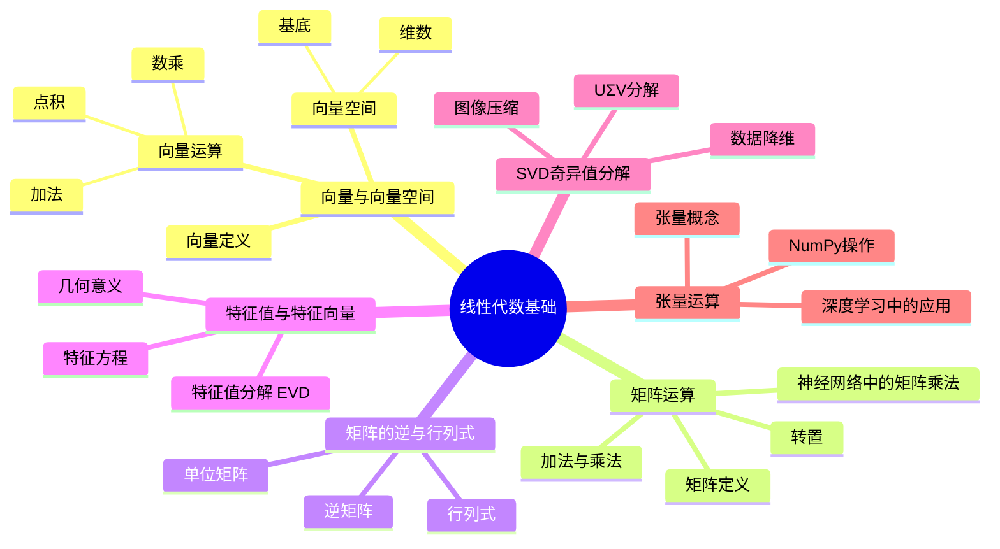

# 第1-1章 线性代数基础

## 学习目标

- 理解向量与向量空间的基本概念
- 掌握矩阵的加法、乘法、转置运算
- 理解矩阵的逆、行列式的概念与计算
- 掌握特征值与特征向量的含义
- 理解SVD奇异值分解的原理
- 掌握神经网络中张量运算的概念

---

## 1. 向量与向量空间

### 1.1 向量的定义

**向量（Vector）** 是既有大小又有方向的量，是线性代数最基本的概念之一。

在数学上，一个 $n$ 维向量可以表示为：

$$\vec{a} = (a_1, a_2, \ldots, a_n)$$

其中 $a_i$ 是向量的第 $i$ 个分量。



**向量的几何意义：**
- 在2D平面：一个从原点指向坐标点的有向线段
- 在3D空间：立体坐标系中的一个有向线段
- 在高维空间：无法可视化，但概念相同

### 1.2 向量的基本运算

**（1）向量加法**

$$\vec{c} = \vec{a} + \vec{b} = (a_1+b_1, a_2+b_2, \ldots, a_n+b_n)$$

**（2）向量数乘**

$$k \cdot \vec{a} = (k \cdot a_1, k \cdot a_2, \ldots, k \cdot a_n)$$

**（3）向量点积（内积）**

$$\vec{a} \cdot \vec{b} = \sum_{i=1}^{n} a_i \cdot b_i = |\vec{a}| \cdot |\vec{b}| \cdot \cos\theta$$

其中 $\theta$ 是两个向量之间的夹角。

**（4）向量模长**

$$|\vec{a}| = \sqrt{a_1^2 + a_2^2 + \cdots + a_n^2}$$

### 1.3 向量空间

**向量空间（Vector Space）** 是由向量组成的集合，满足以下性质：

| 性质 | 描述 |
|------|------|
| 加法封闭 | 两个向量相加仍在空间内 |
| 数乘封闭 | 向量与标量相乘仍在空间内 |
| 零向量存在 | 存在加法单位元 |
| 存在相反向量 | 每个向量都有对应的相反向量 |

**基底与维数：**
- **基底（Basis）**：空间中一组线性无关的向量，可以线性表示空间中的任意向量
- **维数（Dimension）**：基底中向量的个数

---

## 2. 矩阵运算

### 2.1 矩阵的定义

**矩阵（Matrix）** 是一个按照矩形阵列排列的复数集合：

$$A_{m \times n} = \begin{bmatrix} a_{11} & a_{12} & \cdots & a_{1n} \\ a_{21} & a_{22} & \cdots & a_{2n} \\ \vdots & \vdots & \ddots & \vdots \\ a_{m1} & a_{m2} & \cdots & a_{mn} \end{bmatrix}$$

- $m$：行数
- $n$：列数
- $m \times n$：矩阵的维度

### 2.2 矩阵的转置

矩阵转置：将矩阵的行列互换

$$(A^T)_{ij} = A_{ji}$$

$$\begin{bmatrix} 1 & 2 & 3 \\ 4 & 5 & 6 \end{bmatrix}^T = \begin{bmatrix} 1 & 4 \\ 2 & 5 \\ 3 & 6 \end{bmatrix}$$

### 2.3 矩阵加法

两个矩阵对应元素相加（维度必须相同）：

$$C_{ij} = A_{ij} + B_{ij}$$

```ascii
矩阵加法示意：

[1 2]   [5 6]   [1+5  2+6]   [6  8]
[3 4] + [7 8] = [3+7  4+8] = [10 12]
```

### 2.4 矩阵乘法

**矩阵相乘 $C = A \times B$ 的条件：**

- $A$ 的列数 = $B$ 的行数
- 结果矩阵 $C$ 的维度：$m \times p$，其中 $A$ 是 $m \times n$，$B$ 是 $n \times p$

**乘法规则：**

$$C_{ij} = \sum_{k=1}^{n} A_{ik} \cdot B_{kj}$$

```ascii
矩阵乘法示意 (2×2 × 2×2 = 2×2)：

[1 2]   [5 6]   [1×5+2×7  1×6+2×8]   [19 22]
[3 4] × [7 8] = [3×5+4×7  3×6+4×8] = [43 50]
```

**重要性质：**
- 矩阵乘法通常 **不满足交换律**：$A \times B \neq B \times A$
- 满足结合律：$(A \times B) \times C = A \times (B \times C)$
- 满足分配律：$A \times (B + C) = A \times B + A \times C$

### 2.5 神经网络中的矩阵乘法

在神经网络中，矩阵乘法是核心运算。每一层的计算本质上就是输入向量与权重矩阵的乘法：

$$y = W \cdot x + b$$



---

## 3. 矩阵的逆与行列式

### 3.1 单位矩阵

单位矩阵 $I$ 是主对角线元素为1，其余元素为0的方阵：

$$I_n = \begin{bmatrix} 1 & 0 & \cdots & 0 \\ 0 & 1 & \cdots & 0 \\ \vdots & \vdots & \ddots & \vdots \\ 0 & 0 & \cdots & 1 \end{bmatrix}$$

性质：$A \times I = I \times A = A$

### 3.2 矩阵的逆

**逆矩阵定义：** 若存在矩阵 $B$ 使得 $A \times B = B \times A = I$，则称 $B$ 为 $A$ 的逆矩阵，记作 $A^{-1}$。

**逆矩阵存在的条件：** 矩阵是方阵，且行列式不为零（满秩）

**性质：**
- $(A^{-1})^{-1} = A$
- $(A \times B)^{-1} = B^{-1} \times A^{-1}$
- $(A^T)^{-1} = (A^{-1})^T$

### 3.3 行列式

行列式是一个从矩阵计算得到的标量值：

$$\det(A) = |A|$$

**2×2 矩阵的行列式：**

$$\det\begin{bmatrix} a & b \\ c & d \end{bmatrix} = ad - bc$$

**几何意义：** 行列式的绝对值等于由矩阵列向量张成的平行四边形的面积（2D）或平行六面体的体积（3D）。

### 3.4 逆矩阵的计算

对于 2×2 矩阵：

$$A^{-1} = \frac{1}{ad - bc} \begin{bmatrix} d & -b \\ -c & a \end{bmatrix}$$

**注意：** 当 $ad - bc = 0$ 时，矩阵不可逆（奇异矩阵）

---

## 4. 特征值与特征向量

### 4.1 定义

对于方阵 $A$，如果存在非零向量 $\vec{v}$ 和标量 $\lambda$ 满足：

$$A \vec{v} = \lambda \vec{v}$$

则：
- $\lambda$ 是矩阵 $A$ 的 **特征值（Eigenvalue）**
- $\vec{v}$ 是对应 $\lambda$ 的 **特征向量（Eigenvector）**

### 4.2 特征值的计算

特征值通过特征方程求得：

$$\det(A - \lambda I) = 0$$

**计算步骤：**
1. 计算矩阵 $A - \lambda I$
2. 求其行列式，得到特征多项式
3. 解特征方程，得到特征值 $\lambda_i$
4. 将每个 $\lambda_i$ 代入 $(A - \lambda I)\vec{v} = 0$，求解特征向量

### 4.3 特征值的性质

| 性质 | 公式/描述 |
|------|----------|
| 迹（Trace） | $\text{tr}(A) = \sum \lambda_i$ |
| 行列式 | $\det(A) = \prod \lambda_i$ |
| 对角化 | $A = PDP^{-1}$，$D$ 为特征值对角矩阵 |

### 4.4 特征向量的几何意义



*图：特征向量经过矩阵变换后方向不变，仅长度缩放λ倍。原始向量 v⃗ 经矩阵 A 变换后变为 A·v⃗ = λ·v⃗。*

### 4.5 特征值分解（EVD）

若矩阵 $A$ 可对角化，则：

$$A = Q \Lambda Q^{-1}$$

- $Q$：特征向量组成的矩阵
- $\Lambda$：特征值组成的对角矩阵

---

## 5. SVD奇异值分解

### 5.1 什么是SVD

**奇异值分解（Singular Value Decomposition, SVD）** 是任意矩阵的一种分解方式：

$$A = U \Sigma V^T$$

- $U$：$m \times m$ 正交矩阵（左奇异向量）
- $\Sigma$：$m \times n$ 对角矩阵（奇异值）
- $V^T$：$n \times n$ 正交矩阵（右奇异向量）

### 5.2 SVD的几何意义



### 5.3 奇异值与特征值的关系

对于 $A^TA$ 和 $AA^T$：
- $A^TA$ 和 $AA^T$ 的特征值 $\lambda_i$ 的平方根 = 奇异值 $\sigma_i$
- 奇异值 $\sigma_i = \sqrt{\lambda_i}$

### 5.4 SVD的应用

| 应用场景 | 说明 |
|---------|------|
| 数据降维 | 取前 $k$ 个最大奇异值，实现PCA |
| 图像压缩 | 保留主要奇异值，减少存储 |
| 推荐系统 | 协同过滤中的矩阵分解 |
| 求解线性方程组 | 伪逆计算 |

---

## 6. 张量运算

### 6.1 张量的概念

**张量（Tensor）** 是向量和矩阵的推广：
- 0阶张量：标量（单个数）
- 1阶张量：向量（一维数组）
- 2阶张量：矩阵（二维数组）
- 3阶及更高阶：张量

在深度学习中：
- 一张彩色图片 → 3阶张量（高度 × 宽度 × 通道）
- 一个batch的图片 → 4阶张量（batch × 高度 × 宽度 × 通道）

### 6.2 神经网络中的张量运算

神经网络中的卷积操作本质上是对张量的多维运算：

```ascii
卷积神经网络中的张量流动：

输入张量 (batch, height, width, channels)
        ↓
    卷积层
        ↓
输出张量 (batch, new_height, new_width, filters)
```

### 6.3 张量运算规则

| 运算 | 说明 |
|------|------|
| 张量加法 | 对应元素相加 |
| 张量乘法 | 元素-wise乘法 或 矩阵乘法（爱因斯坦求和） |
| reshape | 改变张量形状但不改变数据 |
| transpose | 交换张量的维度 |

### 6.4 NumPy中的张量操作

```python
import numpy as np

# 创建3阶张量 (3D数组)
A = np.random.randn(2, 3, 4)  # shape: (2, 3, 4)

# Reshape
B = A.reshape(6, 4)  # 展平为2D矩阵

# 转置
C = np.transpose(A, (2, 0, 1))  # 交换维度

# 矩阵乘法
W = np.random.randn(4, 8)
output = np.matmul(A.reshape(-1, 4), W)  # 展平后相乘
```

---

## 7. Python代码实现

以下是本章核心概念的Python代码示例，帮助你更好地理解和实践线性代数运算。

### 7.1 向量和矩阵基本运算

```python
import numpy as np

# 1. 向量运算示例
print("1. 向量运算示例:")
print("-" * 40)

# 创建向量
a = np.array([1, 2, 3])
b = np.array([4, 5, 6])

print(f"向量 a = {a}")
print(f"向量 b = {b}")

# 向量加法
c = a + b
print(f"a + b = {c}")

# 向量数乘
k = 2
d = k * a
print(f"2 * a = {d}")

# 向量点积
dot_product = np.dot(a, b)
print(f"a · b (点积) = {dot_product}")

# 向量模长
norm_a = np.linalg.norm(a)
print(f"|a| (模长) = {norm_a:.4f}")

print()

# 2. 矩阵运算示例
print("2. 矩阵运算示例:")
print("-" * 40)

# 创建矩阵
A = np.array([[1, 2], [3, 4]])
B = np.array([[5, 6], [7, 8]])

print(f"矩阵 A = \n{A}")
print(f"矩阵 B = \n{B}")

# 矩阵加法
C = A + B
print(f"A + B = \n{C}")

# 矩阵乘法
D = np.dot(A, B)
print(f"A × B = \n{D}")

# 矩阵转置
A_T = A.T
print(f"A的转置 = \n{A_T}")

# 矩阵行列式
det_A = np.linalg.det(A)
print(f"det(A) = {det_A:.4f}")

print()

# 3. 逆矩阵示例
print("3. 逆矩阵和单位矩阵:")
print("-" * 40)

# 单位矩阵
I = np.eye(2)
print(f"2×2单位矩阵 I = \n{I}")

# 验证 A × I = A
print(f"A × I = \n{np.dot(A, I)}")

# 逆矩阵 (如果存在)
try:
    A_inv = np.linalg.inv(A)
    print(f"A的逆矩阵 = \n{A_inv}")
    # 验证 A × A_inv = I
    print(f"A × A⁻¹ = \n{np.dot(A, A_inv)}")
except np.linalg.LinAlgError:
    print("矩阵不可逆 (奇异矩阵)")
```

### 7.2 特征值和特征向量

```python
# 4. 特征值和特征向量
print("\n4. 特征值和特征向量:")
print("-" * 40)

# 创建对称矩阵
S = np.array([[2, 1], [1, 2]])

print(f"对称矩阵 S = \n{S}")

# 计算特征值和特征向量
eigenvalues, eigenvectors = np.linalg.eig(S)

print(f"特征值: {eigenvalues}")
print(f"特征向量矩阵 (每列是一个特征向量):")
print(eigenvectors)

# 验证特征值方程 A·v = λ·v
for i in range(len(eigenvalues)):
    λ = eigenvalues[i]
    v = eigenvectors[:, i]  # 第i个特征向量
    left_side = np.dot(S, v)
    right_side = λ * v
    print(f"\n验证 λ{i+1} = {λ:.4f}:")
    print(f"S·v{i+1} = {left_side}")
    print(f"λ{i+1}·v{i+1} = {right_side}")
    print(f"是否相等: {np.allclose(left_side, right_side)}")
```

### 7.3 SVD奇异值分解

```python
# 5. SVD奇异值分解
print("\n5. SVD奇异值分解:")
print("-" * 40)

# 创建一个非方阵
M = np.array([[1, 2, 3], [4, 5, 6]])

print(f"矩阵 M (2×3) = \n{M}")

# SVD分解
U, S_diag, Vt = np.linalg.svd(M, full_matrices=False)

print(f"U (2×2) = \n{U}")
print(f"奇异值 (Σ对角线元素) = {S_diag}")
print(f"V转置 (Vt, 2×3) = \n{Vt}")

# 重构矩阵
Sigma = np.diag(S_diag)  # 创建对角矩阵
M_reconstructed = np.dot(U, np.dot(Sigma, Vt))
print(f"重构的 M = \n{M_reconstructed}")
print(f"重构误差: {np.max(np.abs(M - M_reconstructed)):.10f}")

print()

# 数据降维示例 (保留前k个奇异值)
k = 1  # 保留1个主成分
Sigma_k = np.diag(S_diag[:k])
U_k = U[:, :k]
Vt_k = Vt[:k, :]

M_k = np.dot(U_k, np.dot(Sigma_k, Vt_k))
print(f"降维到 k={k} 后的矩阵 = \n{M_k}")
print(f"信息保留比例: {np.sum(S_diag[:k]) / np.sum(S_diag):.2%}")
```

### 7.4 张量运算

```python
# 6. 张量运算示例
print("\n6. 张量运算示例:")
print("-" * 40)

# 创建一个3阶张量 (2×3×4)
tensor = np.random.randn(2, 3, 4)

print(f"3阶张量形状: {tensor.shape}")
print(f"张量内容 (仅显示部分):")
print(tensor[0, :, :2])  # 显示第一张的第一行和前两列

# 张量重塑
tensor_reshaped = tensor.reshape(6, 4)
print(f"重塑为 (6×4) 矩阵: {tensor_reshaped.shape}")

# 批量矩阵乘法
# 创建权重矩阵 (4×5)
W = np.random.randn(4, 5)

# 对每个3×4的切片做矩阵乘法
batch_size = tensor.shape[0]
output = np.zeros((batch_size, 3, 5))

for i in range(batch_size):
    output[i] = np.dot(tensor[i], W)

print(f"批量矩阵乘法输出形状: {output.shape}")

# 使用爱因斯坦求和 (更高效)
output_einsum = np.einsum('ijk,kl->ijl', tensor, W)
print(f"爱因斯坦求和输出形状: {output_einsum.shape}")
print(f"两种方法结果是否一致: {np.allclose(output, output_einsum)}")
```

### 7.5 实用线性代数函数

```python
# 7. 实用线性代数函数
print("\n7. 实用线性代数函数:")
print("-" * 40)

# 创建示例矩阵
X = np.array([[4, -2, 1], 
              [3, 1, -1], 
              [2, 0, 2]])

print(f"示例矩阵 X = \n{X}")

# 矩阵秩
rank = np.linalg.matrix_rank(X)
print(f"矩阵秩: {rank}")

# 矩阵迹
trace = np.trace(X)
print(f"矩阵迹: {trace}")

# 特征值之和等于迹
eigvals = np.linalg.eigvals(X)
print(f"特征值: {eigvals}")
print(f"特征值之和: {np.sum(eigvals):.4f} (应等于迹: {trace})")

# 解线性方程组 Ax = b
A = np.array([[2, 1], [1, 3]])
b = np.array([8, 13])
x = np.linalg.solve(A, b)
print(f"\n解线性方程组 Ax = b:")
print(f"A = \n{A}")
print(f"b = {b}")
print(f"解 x = {x}")
print(f"验证: A·x = {np.dot(A, x)}")

# 最小二乘法解
# 当方程组无精确解时，使用最小二乘
A_over = np.array([[1, 2], [3, 4], [5, 6]])
b_over = np.array([7, 8, 9])
x_ls, residuals, rank, s = np.linalg.lstsq(A_over, b_over, rcond=None)
print(f"\n最小二乘法解:")
print(f"A (3×2) = \n{A_over}")
print(f"b = {b_over}")
print(f"最小二乘解 x = {x_ls}")
print(f"残差平方和: {residuals[0]:.4f}")
```

---

## 8. 重要概念对比表

| 概念 | 定义 | 关键性质 |
|------|------|---------|
| 向量 | 有大小和方向的量 | 可加减、数乘、点积 |
| 矩阵 | 二维数表 | 乘法不满足交换律 |
| 逆矩阵 | $A^{-1}$ 使得 $AA^{-1}=I$ | 仅满秩方阵存在 |
| 行列式 | 矩阵的标量函数 | $\det(AB)=\det(A)\det(B)$ |
| 特征值 | $Av = \lambda v$ | $\sum\lambda_i = \text{tr}(A)$ |
| SVD | $A = U\Sigma V^T$ | 任意矩阵均可分解 |
| 张量 | 高维数组 | 深度学习中的数据格式 |

---

## 本章小结

线性代数是深度学习最核心的数学基础，本章涵盖了从向量空间到张量运算的完整知识体系。

### 核心知识点总结

| 知识点 | 核心概念 | 关键公式 |
|--------|----------|----------|
| 向量 | 有大小和方向的量 | $\vec{a} \cdot \vec{b} = \|\vec{a}\|\|\vec{b}\|\cos\theta$ |
| 矩阵 | 二维数表 | $C_{ij} = \sum_k A_{ik} \cdot B_{kj}$ |
| 矩阵乘法 | 行×列对应相乘求和 | 通常不满足交换律 $AB \neq BA$ |
| 逆矩阵 | $A^{-1}$ 使 $AA^{-1}=I$ | 仅满秩方阵存在 |
| 行列式 | 矩阵的标量函数 | $\det(AB)=\det(A)\det(B)$ |
| 特征值 | $Av = \lambda v$ | $\sum\lambda_i = \text{tr}(A)$ |
| SVD | $A = U\Sigma V^T$ | 任意矩阵均可分解 |
| 张量 | 高维数组 | 深度学习中的数据格式 |

### 思维导图



---

## 参考资料

- 《深度学习》（Ian Goodfellow, Yoshua Bengio, Aaron Courville）
- 《线性代数及其应用》（David C. Lay）
- `/home/david/ML-DL/csdn-gitee/ai2.1/docs/矩阵的概念.md`
- `/home/david/ML-DL/csdn-gitee/ai20-lesson/docs/201-ml-basics/`

### 矩阵分解与张量论文

- Koren, Y., Bell, R., & Volinsky, C. Matrix Factorization Techniques for Recommender Systems. IEEE Computer, 2009. https://arxiv.org/abs/0806.4881
- Kolda, T.G. & Bader, B.W. Tensor Decompositions and Applications. SIAM Review, 2009. https://arxiv.org/abs/0909.4579
- Natarajan, N. & Dhillon, I.S. Inductive Matrix Completion for Predicting Gene-Disease Associations. Bioinformatics, 2014. https://arxiv.org/abs/1304.7537
- Anandkumar, A., et al. Tensor Decompositions for Learning Latent Variable Models. JMLR, 2014. https://arxiv.org/abs/1210.7559
- Sidiropoulos, N.D., et al. Tensor Regression and Classification. Proceedings of the IEEE, 2017. https://arxiv.org/abs/1701.10874
