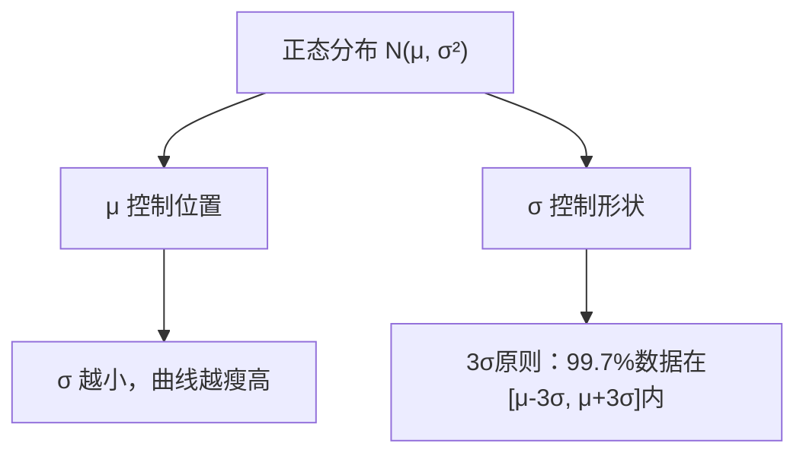
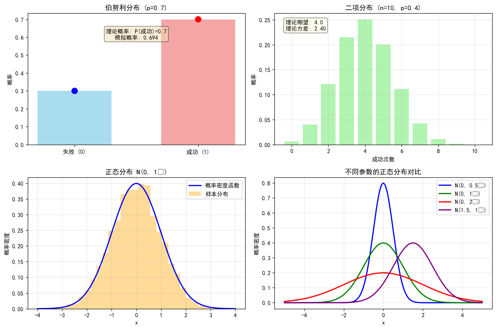
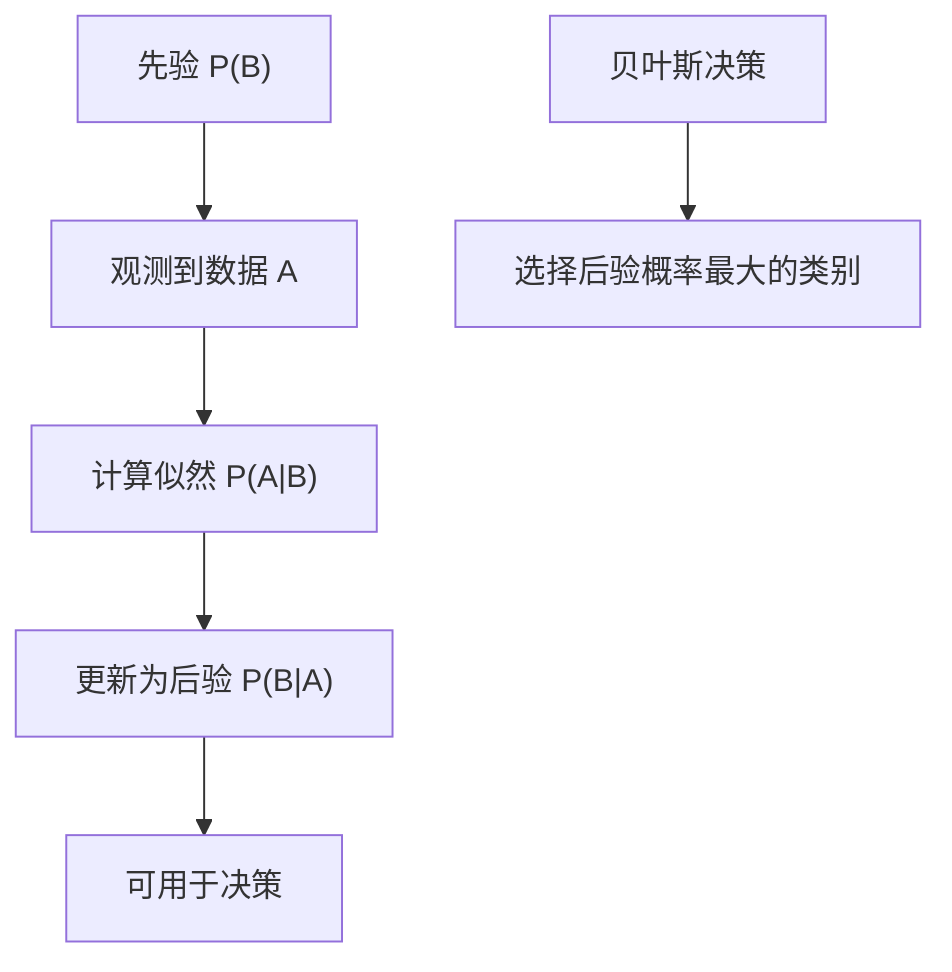
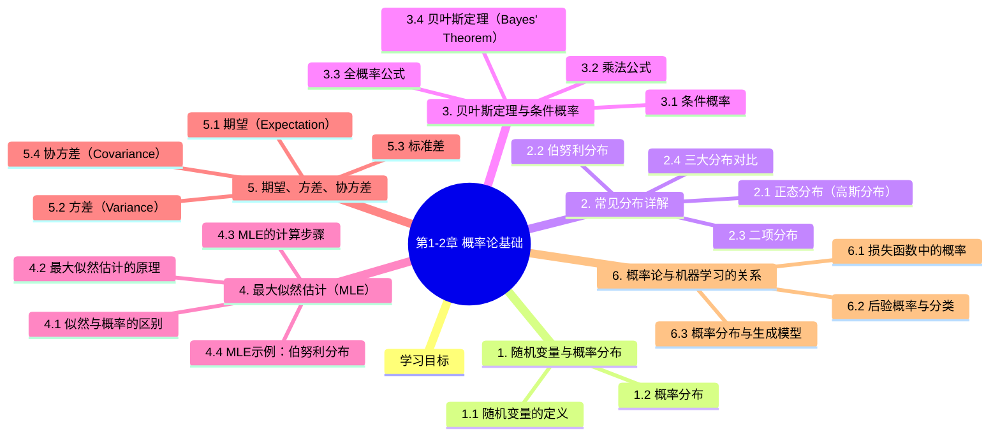

# 第1-2章 概率论基础

## 学习目标

- 理解随机变量与概率分布的概念
- 掌握常见概率分布（正态分布、伯努利分布、二项分布）
- 理解贝叶斯定理与条件概率
- 理解最大似然估计（MLE）的原理
- 掌握期望、方差、协方差的概念与计算
- 理解概率论在机器学习中的应用

---

## 1. 随机变量与概率分布

### 1.1 随机变量的定义

**随机变量（Random Variable）** 是将随机实验的结果映射为数值的函数。

- **离散随机变量**：取值是可数个离散值（掷骰子的点数）
- **连续随机变量**：取值是连续区间内的任意值（人的身高、体重）

### 1.2 概率分布

**概率分布（Probability Distribution）** 描述随机变量取值的概率规律。

#### 离散型分布

| 分布 | 记号 | 取值范围 | 应用场景 |
|------|------|---------|---------|
| 伯努利分布 | Bernoulli($p$) | $\{0, 1\}$ | 一次硬币实验 |
| 二项分布 | Binomial($n, p$) | $\{0, 1, \ldots, n\}$ | $n$次硬币实验 |
| 泊松分布 | Poisson($\lambda$) | $\{0, 1, 2, \ldots\}$ | 稀有事件计数 |

#### 连续型分布

| 分布 | 记号 | 定义域 | 应用场景 |
|------|------|--------|---------|
| 正态分布 | $\mathcal{N}(\mu, \sigma^2)$ | $(-\infty, +\infty)$ | 测量误差、自然现象 |
| 均匀分布 | $U(a, b)$ | $[a, b]$ | 随机数生成 |
| 指数分布 | Exp($\lambda$) | $[0, +\infty)$ | 等待时间 |

---

## 2. 常见分布详解

### 2.1 正态分布（高斯分布）

**正态分布** 是自然界最常见的分布形式，也是在机器学习中最重要的分布。

**概率密度函数：**

$$f(x) = \frac{1}{\sqrt{2\pi\sigma^2}} \exp\left(-\frac{(x-\mu)^2}{2\sigma^2}\right)$$

其中：
- $\mu$：均值（位置参数）
- $\sigma^2$：方差（尺度参数）



**标准正态分布：** $\mathcal{N}(0, 1)$，即 $\mu=0, \sigma=1$

### 2.2 伯努利分布

**伯努利分布（Bernoulli Distribution）** 是最简单的离散分布，描述一次二值实验。

**概率质量函数：**

$$P(X=x) = \begin{cases} p & \text{if } x=1 \\ 1-p & \text{if } x=0 \end{cases}$$

**应用场景：**
- 抛硬币
- 二分类问题的标签建模
- 逻辑回归的基础

### 2.3 二项分布

**二项分布（Binomial Distribution）** 是 $n$ 次独立伯努利实验的成功次数分布。

**概率质量函数：**

$$P(X=k) = C_n^k \cdot p^k \cdot (1-p)^{n-k}$$

其中 $C_n^k = \frac{n!}{k!(n-k)!}$ 是组合数。

**期望与方差：**
- $E[X] = np$
- $\text{Var}(X) = np(1-p)$

### 2.4 三大分布对比

| 分布 | 类型 | 参数 | 适用场景 |
|------|------|------|---------|
| 伯努利 | 离散 | $p$ | 单次二值实验 |
| 二项 | 离散 | $n, p$ | $n$次实验的成功计数 |
| 正态 | 连续 | $\mu, \sigma^2$ | 自然现象、测量误差 |

### 2.5 Python代码示例：概率分布可视化

下图为常见概率分布的可视化（伯努利分布、二项分布、正态分布及其参数对比）：



> 完整绘图代码：[`assets/figures/1-2-probability-distributions.py`](../../assets/figures/1-2-probability-distributions.py)

**代码说明：**
1. **伯努利分布**：模拟抛硬币实验，可视化成功概率
2. **二项分布**：模拟多次独立伯努利实验，展示成功次数分布
3. **正态分布**：展示标准正态分布及其样本分布
4. **参数对比**：比较不同均值和方差对正态分布形状的影响

**运行环境要求：**
```bash
pip install numpy matplotlib seaborn scipy
```

**输出效果：** 代码生成2x2子图，分别展示三种核心概率分布及其特性，帮助直观理解分布的形状、参数影响和实际应用场景。

## 3. 贝叶斯定理与条件概率

### 3.1 条件概率

**条件概率（Conditional Probability）** 是在已知某事件发生的条件下，另一事件发生的概率。

$$P(A|B) = \frac{P(A \cap B)}{P(B)}$$

其中 $P(A|B)$ 表示在事件 $B$ 发生的条件下 $A$ 的概率。

### 3.2 乘法公式

$$P(A \cap B) = P(A|B) \cdot P(B) = P(B|A) \cdot P(A)$$

### 3.3 全概率公式

若事件 $B_1, B_2, \ldots, B_n$ 是样本空间的一个划分，则：

$$P(A) = \sum_{i=1}^{n} P(A|B_i) \cdot P(B_i)$$

### 3.4 贝叶斯定理（Bayes' Theorem）

$$P(B|A) = \frac{P(A|B) \cdot P(B)}{P(A)}$$

**各术语解释：**

| 术语 | 名称 | 含义 |
|------|------|------|
| $P(B)$ | 先验概率（Prior） | 事件$B$在观测前的初始概率 |
| $P(A|B)$ | 似然（Likelihood） | 在$B$发生的条件下$A$发生的条件概率 |
| $P(B|A)$ | 后验概率（Posterior） | 在观测到$A$后对$B$的更新概率 |
| $P(A)$ | 证据（Evidence） | 归一化常数，保证后验概率和为1 |

### 3.5 贝叶斯定理的可视化



### 3.6 贝叶斯定理在机器学习中的应用

**朴素贝叶斯分类器：**

$$P(y|x) = \frac{P(x|y) \cdot P(y)}{P(x)}$$

- $P(y|x)$：给定特征 $x$ 时属于类别 $y$ 的后验概率
- $P(x|y)$：给定类别 $y$ 时观测到特征 $x$ 的似然
- $P(y)$：类别 $y$ 的先验概率

---

## 4. 最大似然估计（MLE）

### 4.1 似然与概率的区别

- **概率**：参数 $\theta$ 固定，讨论数据 $X$ 出现的可能性
- **似然**：数据 $X$ 固定，讨论参数 $\theta$ 的可能性

$$L(\theta|X) = P(X|\theta)$$

### 4.2 最大似然估计的原理

**核心思想：** 找到使观测数据出现概率最大的参数 $\theta$。

$$\hat{\theta}_{MLE} = \arg\max_{\theta} L(\theta|X)$$

### 4.3 MLE的计算步骤

**步骤1：写出似然函数**

对于独立同分布的样本 $X_1, X_2, \ldots, X_n$：

$$L(\theta) = \prod_{i=1}^{n} P(X_i|\theta)$$

**步骤2：取对数（简化计算）**

$$\log L(\theta) = \sum_{i=1}^{n} \log P(X_i|\theta)$$

**步骤3：求导并令导数为零**

$$\frac{\partial \log L(\theta)}{\partial \theta} = 0$$

**步骤4：解方程得到 $\hat{\theta}$**

### 4.4 MLE示例：伯努利分布

假设抛硬币 $n$ 次，正面出现 $k$ 次，求正面概率 $p$ 的MLE。

**似然函数：**

$$L(p) = p^k \cdot (1-p)^{n-k}$$

**对数似然：**

$$\log L(p) = k \log p + (n-k)\log(1-p)$$

**求导：**

$$\frac{\partial \log L(p)}{\partial p} = \frac{k}{p} - \frac{n-k}{1-p} = 0$$

**解得：**

$$\hat{p}_{MLE} = \frac{k}{n}$$

即**观测到的正面比例**就是最大似然估计。

### 4.5 MLE在机器学习中的应用

| 场景 | MLE的应用 |
|------|----------|
| 线性回归 | 最小二乘法是最小化MSE的MLE |
| 逻辑回归 | 最大化似然的参数估计 |
| 高斯混合模型 | EM算法求解 |
| 朴素贝叶斯 | 基于频率的先验概率估计 |

---

## 5. 期望、方差、协方差

### 5.1 期望（Expectation）

**离散型：**

$$E[X] = \sum_{i} x_i \cdot P(X=x_i)$$

**连续型：**

$$E[X] = \int_{-\infty}^{+\infty} x \cdot f(x) \, dx$$

**性质：**
- $E[c] = c$（常数期望是常数本身）
- $E[cX] = cE[X]$
- $E[X + Y] = E[X] + E[Y]$
- 若 $X, Y$ 独立：$E[XY] = E[X]E[Y]$

### 5.2 方差（Variance）

**定义：** 数据与其期望的偏离程度的度量。

$$\text{Var}(X) = E[(X - E[X])^2] = E[X^2] - (E[X])^2$$

**性质：**
- $\text{Var}(c) = 0$
- $\text{Var}(cX) = c^2 \text{Var}(X)$
- 若 $X, Y$ 独立：$\text{Var}(X+Y) = \text{Var}(X) + \text{Var}(Y)$

### 5.3 标准差

$$\sigma = \sqrt{\text{Var}(X)}$$

标准差的量纲与原数据相同，更容易解释。

### 5.4 协方差（Covariance）

**定义：** 两个随机变量联合变异程度的度量。

$$\text{Cov}(X, Y) = E[(X - E[X])(Y - E[Y])] = E[XY] - E[X]E[Y]$$

**协方差的意义：**
- $\text{Cov}(X, Y) > 0$：$X$ 和 $Y$ 同方向变化
- $\text{Cov}(X, Y) < 0$：$X$ 和 $Y$ 反方向变化
- $\text{Cov}(X, Y) = 0$：$X$ 和 $Y$ 不相关

### 5.5 相关系数

**皮尔逊相关系数（Pearson Correlation）：**

$$\rho_{XY} = \frac{\text{Cov}(X, Y)}{\sigma_X \cdot \sigma_Y}$$

取值范围 $[-1, 1]$，衡量线性相关程度。

### 5.6 协方差矩阵

对于 $n$ 维随机向量 $\mathbf{X} = (X_1, X_2, \ldots, X_n)^T$：

$$\text{Cov}(\mathbf{X}) = \begin{bmatrix} \text{Var}(X_1) & \text{Cov}(X_1, X_2) & \cdots & \text{Cov}(X_1, X_n) \\ \text{Cov}(X_2, X_1) & \text{Var}(X_2) & \cdots & \text{Cov}(X_2, X_n) \\ \vdots & \vdots & \ddots & \vdots \\ \text{Cov}(X_n, X_1) & \text{Cov}(X_n, X_2) & \cdots & \text{Var}(X_n) \end{bmatrix}$$

**协方差矩阵在机器学习中非常重要：**
- 用于数据标准化（白化）
- PCA（主成分分析）的核心计算
- 高斯判别分析（GDA）的基础

---

## 6. 概率论与机器学习的关系

### 6.1 损失函数中的概率

| 损失函数 | 概率解释 |
|---------|---------|
| MSE（均方误差） | 假设噪声服从正态分布的最大似然估计 |
| BCE（二值交叉熵） | 伯努利分布的对数似然 |
| Cross-Entropy（交叉熵） | 真实分布与预测分布的差异 |

### 6.2 后验概率与分类

**贝叶斯最优分类器：**

$$\hat{y} = \arg\max_y P(y|x)$$

即选择后验概率最大的类别作为预测结果。

### 6.3 概率分布与生成模型

**判别模型 vs 生成模型：**

| 模型类型 | 学习目标 | 代表算法 |
|---------|---------|---------|
| 判别模型 | $P(y\|x)$ | 逻辑回归、SVM、神经网络 |
| 生成模型 | $P(x\|y)$ 和 $P(y)$ | 朴素贝叶斯、高斯判别分析 |

生成模型通过学习 $P(x|y)$（似然）和 $P(y)$（先验），再利用贝叶斯定理计算后验：

$$P(y|x) = \frac{P(x|y) \cdot P(y)}{P(x)}$$

---

## 7. 重要公式汇总

| 公式 | 名称 |
|------|------|
| $P(A\|B) = \frac{P(A \cap B)}{P(B)}$ | 条件概率 |
| $P(B\|A) = \frac{P(A\|B)P(B)}{P(A)}$ | 贝叶斯定理 |
| $\hat{\theta}_{MLE} = \arg\max_\theta L(\theta\|X)$ | 最大似然估计 |
| $E[X] = \sum x \cdot P(X=x)$ | 期望（离散） |
| $\text{Var}(X) = E[(X-E[X])^2]$ | 方差 |
| $\text{Cov}(X,Y) = E[XY] - E[X]E[Y]$ | 协方差 |

---

## 本章小结

概率论为机器学习提供了不确定性建模的数学框架，是统计学习和贝叶斯方法的基础。

### 核心知识点总结

| 知识点 | 核心公式 | 应用场景 |
|--------|----------|----------|
| 条件概率 | $P(A\|B) = \frac{P(A \cap B)}{P(B)}$ | 事件关联分析 |
| 贝叶斯定理 | $P(B\|A) = \frac{P(A\|B)P(B)}{P(A)}$ | 医学诊断、垃圾邮件过滤 |
| 最大似然估计 | $\hat{\theta}_{MLE} = \arg\max_\theta L(\theta\|X)$ | 参数估计 |
| 期望 | $E[X] = \sum x \cdot P(X=x)$ | 数据中心趋势 |
| 方差 | $\text{Var}(X) = E[(X-E[X])^2]$ | 数据离散程度 |
| 协方差 | $\text{Cov}(X,Y) = E[XY]-E[X]E[Y]$ | 变量相关性 |
---


## 知识图谱



## 参考资料

- 《概率论与数理统计》（盛骤等）
- 《深度学习》（Ian Goodfellow, Yoshua Bengio, Aaron Courville）

### Bayesian Deep Learning 论文引用

1. Blundell, C., Cornebise, J., Kavukcuoglu, K., & Wierstra, D. (2015). **Weight uncertainty in neural networks.** *Proceedings of the 32nd International Conference on Machine Learning (ICML)*, 1613-1622.
2. Gal, Y., & Ghahramani, Z. (2016). **Dropout as a Bayesian approximation: Representing model uncertainty in deep learning.** *Proceedings of the 33rd International Conference on Machine Learning (ICML)*, 1050-1059.
3. Kendall, A., & Gal, Y. (2017). **What uncertainties do we need in Bayesian deep learning for computer vision?** *Advances in Neural Information Processing Systems (NeurIPS)*, 5574-5584.
4. Lakshminarayanan, B., Pritzel, A., & Blundell, C. (2017). **Simple and scalable predictive uncertainty estimation using deep ensembles.** *Advances in Neural Information Processing Systems (NeurIPS)*, 6402-6413.
5. Wilson, A. G., Hu, Z., Salakhutdinov, R., & Xing, E. P. (2016). **Deep kernel learning.** *Proceedings of the 19th International Conference on Artificial Intelligence and Statistics (AISTATS)*, 370-378.

