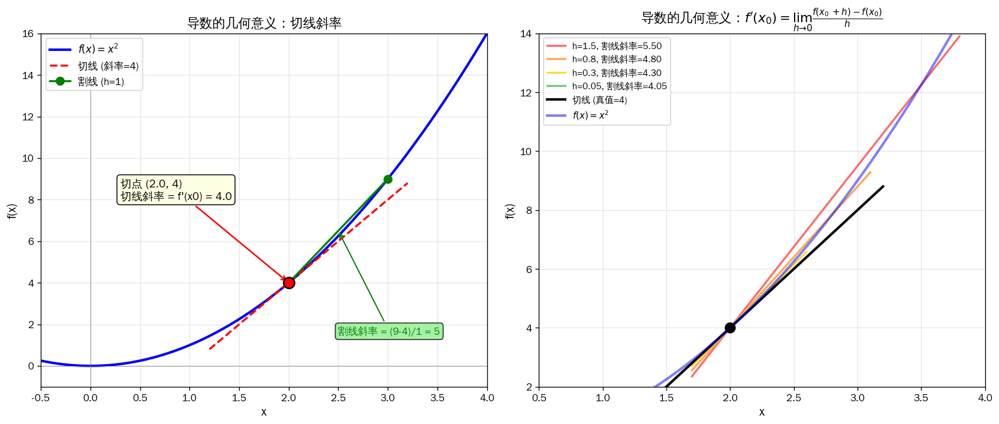
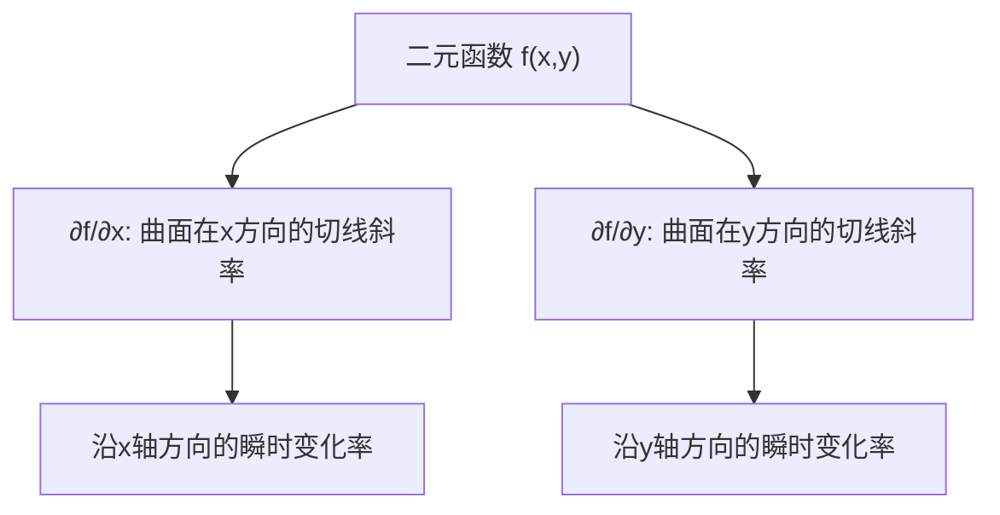
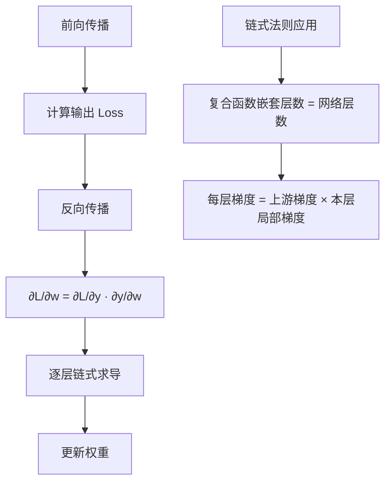
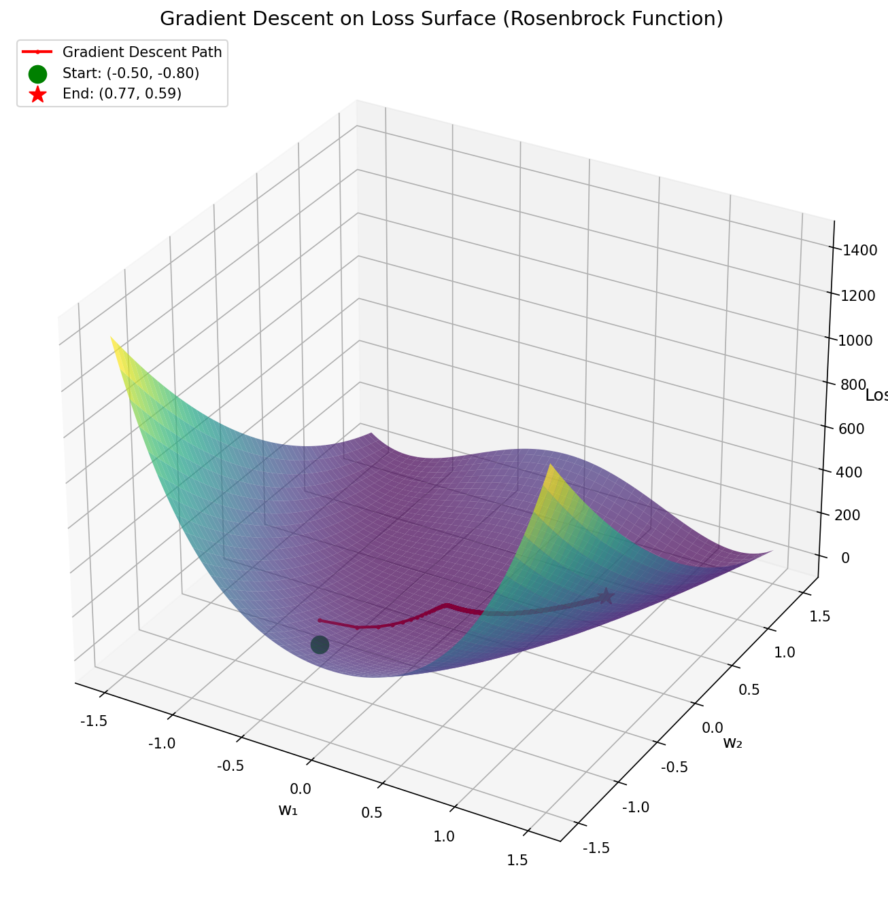
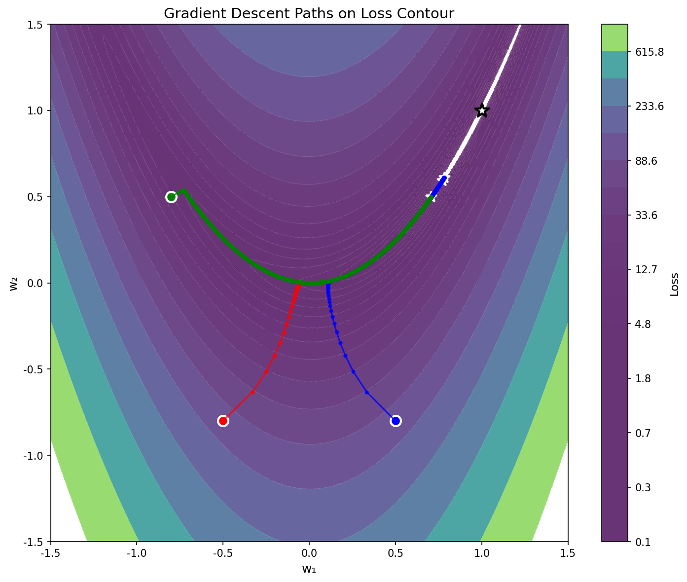
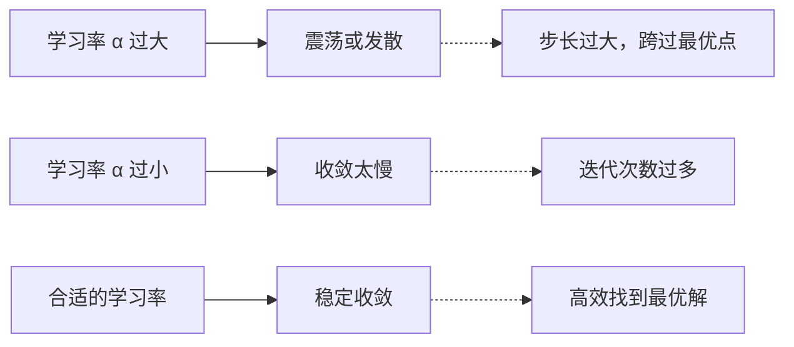
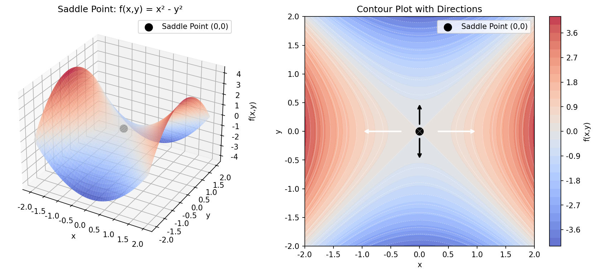
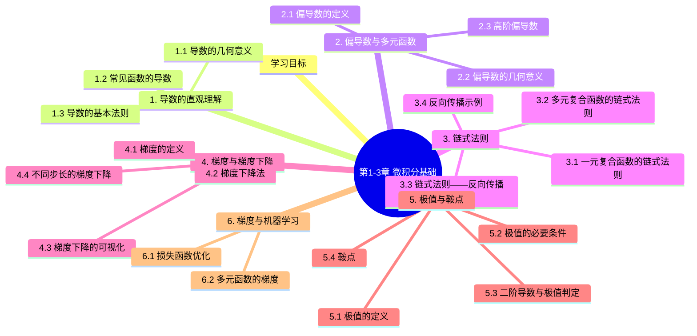

# 第1-3章 微积分基础

## 学习目标

- 理解导数的直观几何意义
- 掌握偏导数与多元函数的分析方法
- 理解链式法则及其在反向传播中的作用
- 掌握梯度与梯度下降法的原理
- 理解极值点与鞍点的概念

---

## 1. 导数的直观理解

### 1.1 导数的几何意义

**导数（Derivative）** 描述的是函数在某一点处的瞬时变化率。

几何上，导数就是函数曲线在该点处的**切线斜率**。

$$f'(x) = \lim_{h \to 0} \frac{f(x+h) - f(x)}{h}$$

> 绘图代码：[`assets/figures/1-3-derivative-geometric.py`](../../assets/figures/1-3-derivative-geometric.py)

### 1.2 常见函数的导数

| 函数 | 导数 |
|------|------|
| $c$（常数） | $0$ |
| $x^n$ | $nx^{n-1}$ |
| $e^x$ | $e^x$ |
| $\ln x$ | $\frac{1}{x}$ |
| $\sin x$ | $\cos x$ |
| $\cos x$ | $-\sin x$ |

### 1.3 导数的基本法则

| 法则 | 公式 |
|------|------|
| 常数乘法 | $(c \cdot f)' = c \cdot f'$ |
| 加减法 | $(f \pm g)' = f' \pm g'$ |
| 乘法 | $(f \cdot g)' = f' \cdot g + f \cdot g'$ |
| 除法 | $\left(\frac{f}{g}\right)' = \frac{f' \cdot g - f \cdot g'}{g^2}$ |

---

## 2. 偏导数与多元函数

### 2.1 偏导数的定义

**偏导数（Partial Derivative）** 是多元函数对其中一个变量求导，而将其他变量视为常数。

对于二元函数 $f(x, y)$：

$$\frac{\partial f}{\partial x} = \lim_{h \to 0} \frac{f(x+h, y) - f(x, y)}{h}$$

$$\frac{\partial f}{\partial y} = \lim_{h \to 0} \frac{f(x, y+h) - f(x, y)}{h}$$

### 2.2 偏导数的几何意义

### 2.3 高阶偏导数

对偏导数再求偏导数，得到高阶偏导数：

$$\frac{\partial^2 f}{\partial x^2}, \quad \frac{\partial^2 f}{\partial y^2}, \quad \frac{\partial^2 f}{\partial x \partial y}, \quad \frac{\partial^2 f}{\partial y \partial x}$$

**注意：** 若函数连续，则 $\frac{\partial^2 f}{\partial x \partial y} = \frac{\partial^2 f}{\partial y \partial x}$

---

## 3. 链式法则

### 3.1 一元复合函数的链式法则

若 $y = f(u)$，$u = g(x)$，则：

$$\frac{dy}{dx} = \frac{dy}{du} \cdot \frac{du}{dx}$$

### 3.2 多元复合函数的链式法则

若 $z = f(u, v)$，$u = g(x)$，$v = h(x)$，则：

$$\frac{dz}{dx} = \frac{\partial z}{\partial u} \cdot \frac{du}{dx} + \frac{\partial z}{\partial v} \cdot \frac{dv}{dx}$$

### 3.3 链式法则——反向传播的数学基础

**反向传播（Backpropagation）** 是神经网络训练的核心算法，其数学基础正是链式法则。

### 3.4 反向传播示例

设神经网络某层的计算为：

$$z = W \cdot x + b, \quad y = \sigma(z)$$

其中 $\sigma$ 是激活函数。

**前向传播：**
$$x \rightarrow W \rightarrow z \rightarrow y \rightarrow L$$

**反向传播（计算 $\frac{\partial L}{\partial W}$）：**

$$\frac{\partial L}{\partial W} = \frac{\partial L}{\partial y} \cdot \frac{\partial y}{\partial z} \cdot \frac{\partial z}{\partial W}$$

$$\frac{\partial L}{\partial W} = \frac{\partial L}{\partial y} \cdot \sigma'(z) \cdot x^T$$

---

## 4. 梯度与梯度下降

### 4.1 梯度的定义

**梯度（Gradient）** 是多元函数所有偏导数组成的向量：

$$\nabla f = \left( \frac{\partial f}{\partial x_1}, \frac{\partial f}{\partial x_2}, \ldots, \frac{\partial f}{\partial x_n} \right)$$

**梯度向量指向函数增加最快的方向。**

### 4.2 梯度下降法

**核心思想：** 沿梯度的相反方向移动，逐步减小函数值。

$$w_{new} = w_{old} - \alpha \cdot \nabla f(w_{old})$$

其中 $\alpha$ 是**学习率（Learning Rate）**。

### 4.3 梯度下降的可视化

*图：梯度下降在Rosenbrock损失曲面上的3D路径图，展示了从起始点沿曲面下坡到达极小值点的过程*

*图：梯度下降在损失函数等高线图上的路径，不同颜色代表不同起始点的下降轨迹*

### 4.4 不同步长的梯度下降

### 4.5 梯度下降的变种

| 方法 | 公式 | 特点 |
|------|------|------|
| SGD | $w = w - \alpha \nabla f$ | 单样本，随机性好 |
| Batch GD | $w = w - \alpha \frac{1}{m}\sum\nabla f_i$ | 全量样本，稳定 |
| Mini-batch GD | 折中 | 实际最常用 |
| Momentum | $v = \beta v + (1-\beta)\nabla f$ $w = w - \alpha v$ | 加速收敛 |
| Adam | 自适应学习率 | 最常用 |

---

## 5. 极值与鞍点

### 5.1 极值的定义

**极小值：** 若存在 $\delta > 0$，使得对所有 $0 < |x - x_0| < \delta$，有 $f(x) \geq f(x_0)$，则 $x_0$ 是极小值点。

**极大值：** 若存在 $\delta > 0$，使得对所有 $0 < |x - x_0| < \delta$，有 $f(x) \leq f(x_0)$，则 $x_0$ 是极大值点。

### 5.2 极值的必要条件

若 $f(x)$ 在 $x_0$ 处可导，则极值点的必要条件是：

$$f'(x_0) = 0$$

### 5.3 二阶导数与极值判定

对于一元函数，使用二阶导数判断：

| 条件 | 结论 |
|------|------|
| $f'(x_0) = 0$ 且 $f''(x_0) > 0$ | 极小值点 |
| $f'(x_0) = 0$ 且 $f''(x_0) < 0$ | 极大值点 |
| $f'(x_0) = 0$ 且 $f''(x_0) = 0$ | 需要更高阶导数判断 |

### 5.4 鞍点

**鞍点（Saddle Point）** 是函数在某点处导数为零，但既不是极大值也不是极小值的点。

*图：鞍点示意图。x方向呈极大值行为（先增后减），y方向呈极小值行为（先减后增），在(0,0)处形成鞍形结构*

### 5.5 深度学习中的鞍点问题

神经网络训练中，损失函数 landscape 非常复杂，鞍点分布广泛。

| 问题 | 影响 |
|------|------|
| 鞍点附近梯度接近零 | 收敛变慢 |
| 高维空间中鞍点更多 | 比极小值更常见 |

**解决方案：**
- 使用动量（Momentum）逃离鞍点
- 自适应学习率方法（Adam）
- 初始化技巧

---

## 6. 梯度与机器学习

### 6.1 损失函数优化

机器学习的核心任务是最小化损失函数：

$$\hat{\theta} = \arg\min_{\theta} L(\theta)$$

梯度下降法是求解这个优化问题的基本方法。

### 6.2 多元函数的梯度

以线性回归为例，损失函数为 MSE：

$$L(\theta) = \frac{1}{2m} \sum_{i=1}^{m} (h_\theta(x^{(i)}) - y^{(i)})^2$$

**梯度：**

$$\frac{\partial L}{\partial \theta_j} = \frac{1}{m} \sum_{i=1}^{m} (h_\theta(x^{(i)}) - y^{(i)}) \cdot x_j^{(i)}$$

**更新规则：**

$$\theta_j := \theta_j - \alpha \frac{\partial L}{\partial \theta_j}$$

---

## 7. 重要公式汇总

| 公式 | 名称 |
|------|------|
| $f'(x) = \lim_{h \to 0} \frac{f(x+h)-f(x)}{h}$ | 导数定义 |
| $\frac{dy}{dx} = \frac{dy}{du} \cdot \frac{du}{dx}$ | 链式法则 |
| $\nabla f = (\frac{\partial f}{\partial x_1}, \ldots, \frac{\partial f}{\partial x_n})$ | 梯度定义 |
| $w_{new} = w_{old} - \alpha \nabla f$ | 梯度下降 |
| $f'(x_0)=0$ 且 $f''(x_0)>0$ | 极小值判定 |

---

## 本章小结

微积分，特别是链式法则和梯度下降法，是深度学习反向传播算法的数学核心。

### 核心知识点总结

| 知识点 | 核心公式 | 关键应用 |
|--------|----------|----------|
| 导数 | $f'(x) = \lim_{h \to 0} \frac{f(x+h)-f(x)}{h}$ | 瞬时变化率 |
| 偏导数 | $\frac{\partial f}{\partial x}$ | 多元函数分析 |
| 链式法则 | $\frac{dy}{dx} = \frac{dy}{du} \cdot \frac{du}{dx}$ | 反向传播 |
| 梯度 | $\nabla f = (\frac{\partial f}{\partial x_1}, \ldots, \frac{\partial f}{\partial x_n})$ | 最速上升方向 |
| 梯度下降 | $w_{new} = w_{old} - \alpha \nabla f$ | 参数优化 |
| 极值判定 | $f'(x_0)=0$ 且 $f''(x_0)>0$ | 极小值判断 |
---

## 知识图谱

## 参考资料

- 《微积分》（James Stewart）
- 《深度学习》（Ian Goodfellow, Yoshua Bengio, Aaron Courville）
- Kingma, D. P., & Ba, J. (2014). Adam: A Method for Stochastic Optimization. *arXiv preprint arXiv:1412.6980*. (Adam优化器原始论文)
- Reddi, S. J., Kale, S., & Kumar, S. (2018). On the Convergence of Adam and Beyond. *International Conference on Learning Representations (ICLR)*. (AMSGrad - 解决Adam收敛问题)
- Loshchilov, I., & Hutter, F. (2019). Decoupled Weight Decay Regularization. *International Conference on Learning Representations (ICLR)*. (AdamW - 带权重衰减的Adam)
- Zeiler, M. D. (2012). ADADELTA: An Adaptive Learning Rate Method. *arXiv preprint arXiv:1212.5701*. (Adadelta自适应学习率)
- Tieleman, T., & Hinton, G. (2012). Lecture 6.5 - rmsprop: Divide the gradient by a running average of its recent magnitude. *COURSERA: Neural Networks for Machine Learning*. (RMSProp自适应学习率)

