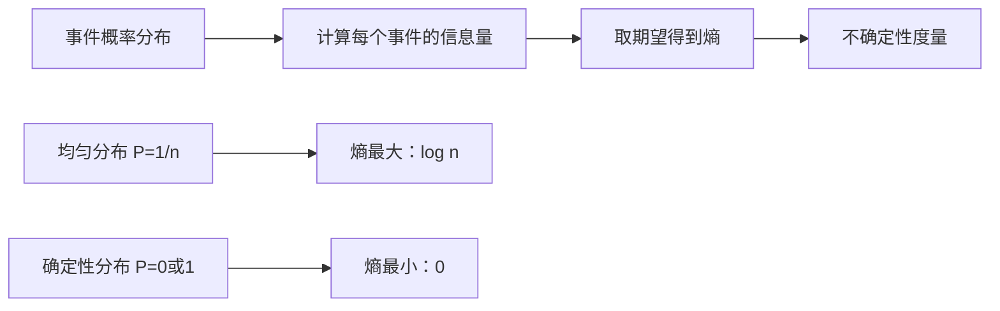
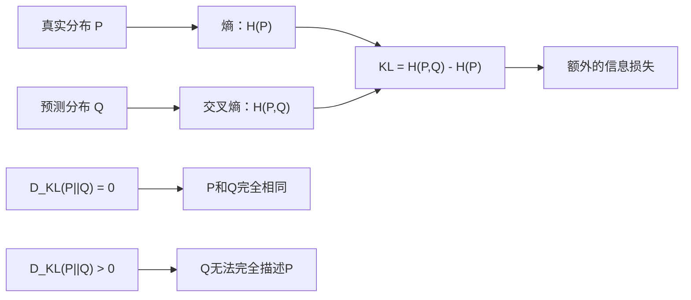
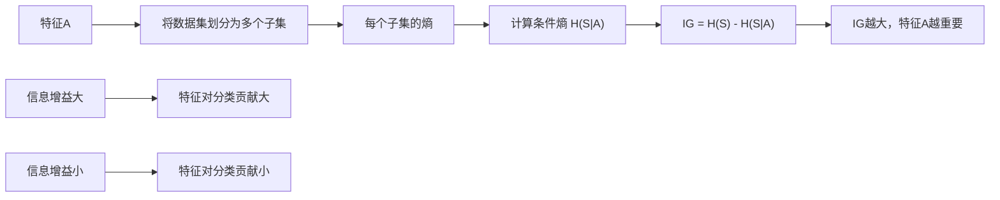
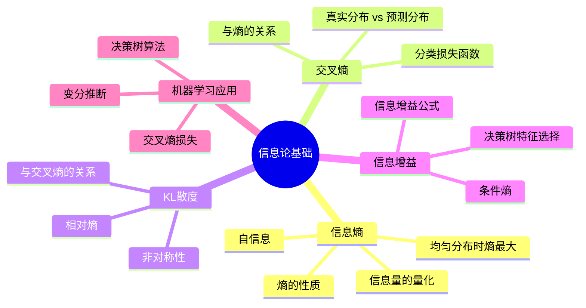

# 第1-4章 信息论基础

## 学习目标

- 理解信息熵的定义与物理意义
- 掌握交叉熵（Cross Entropy）的概念与计算
- 理解KL散度的定义与性质
- 掌握信息增益的概念与计算
- 理解信息论在机器学习中的应用

---

## 1. 信息熵的定义

### 1.1 信息量的量化

一条信息的信息量大小取决于它的**意外程度**（不确定性）。

**直观例子：**
- "太阳从东方升起" → 信息量极低（几乎确定）
- "明天股市大涨10%" → 信息量很高（非常意外）

**信息量的数学定义：**

对于事件 $x$ 其概率为 $P(x)$，则该事件的信息量（自信息）为：

$$I(x) = -\log_2 P(x)$$

**对数底数选择：**
- 底数为 2：信息量的单位是 **bit**（比特）
- 底数为 $e$：信息量的单位是 **nat**（纳特）

### 1.2 信息熵的定义

**信息熵（Information Entropy）** 是对随机变量不确定性的整体度量，是信息量的期望。

$$H(X) = E[I(x)] = -\sum_{i=1}^{n} P(x_i) \log P(x_i)$$

**离散随机变量的熵：**

$$H(X) = -\sum_{x} P(x) \log_2 P(x)$$

### 1.3 信息熵的性质

| 性质 | 描述 |
|------|------|
| 非负性 | $H(X) \geq 0$ |
| 对称性 | 熵与随机变量的标记顺序无关 |
| 极值性 | 当所有事件概率相等时，熵最大 |
| 可加性 | 两个独立事件的联合熵等于各自熵之和 |

### 1.4 熵的最大值

当 $P(x_i) = \frac{1}{n}$（均匀分布）时，熵达到最大值：

$$H_{max}(X) = \log_2 n$$

**物理意义：** 均匀分布时不确定性最大，预测最难。

### 1.5 信息熵的可视化

### 1.6 熵的计算示例

**抛一枚均匀硬币：**
- $P(正) = P(反) = 0.5$
- $H = -[0.5 \log_2 0.5 + 0.5 \log_2 0.5] = 1 \text{ bit}$

**抛一枚不均匀硬币（正概率0.9）：**
- $P(正) = 0.9, P(反) = 0.1$
- $H = -[0.9 \log_2 0.9 + 0.1 \log_2 0.1] \approx 0.47 \text{ bit}$

**结论：** 分布越集中（不确定越小），熵越小。

---

## 2. 交叉熵（Cross Entropy）

### 2.1 交叉熵的定义

**交叉熵（Cross Entropy）** 衡量两个概率分布之间的差异。

对于真实分布 $P$ 和预测分布 $Q$：

$$H(P, Q) = -\sum_{x} P(x) \log Q(x)$$

### 2.2 交叉熵与熵的关系

**交叉熵的展开：**

$$H(P, Q) = -\sum_{x} P(x) \log Q(x)$$

$$= -\sum_{x} P(x) \log P(x) - \sum_{x} P(x) \log \frac{Q(x)}{P(x)}$$

$$= H(P) + D_{KL}(P \| Q)$$

其中 $D_{KL}(P \| Q)$ 是 KL 散度。

### 2.3 交叉熵的性质

| 性质 | 说明 |
|------|------|
| 非负性 | $H(P, Q) \geq 0$ |
| 当 $P=Q$ 时 | $H(P, Q) = H(P)$ |
| 通常 $H(P, Q) \neq H(Q, P)$ | 不对称 |

### 2.4 交叉熵损失函数

在机器学习中，交叉熵常作为分类问题的损失函数。

**二分类交叉熵（Binary Cross Entropy, BCE）：**

$$L_{BCE} = -\frac{1}{N} \sum_{i=1}^{N} [y_i \log \hat{y}_i + (1-y_i) \log (1-\hat{y}_i)]$$

**多分类交叉熵（Categorical Cross Entropy）：**

$$L_{CE} = -\sum_{i=1}^{N} y_i \log \hat{y}_i$$

其中 $y_i$ 是真实标签，$\hat{y}_i$ 是预测概率。

---

## 3. KL散度

### 3.1 KL散度的定义

**KL散度（Kullback-Leibler Divergence）**，也称相对熵，衡量使用 $Q$ 近似 $P$ 时的信息损失。

$$D_{KL}(P \| Q) = \sum_{x} P(x) \log \frac{P(x)}{Q(x)}$$

或写作积分形式（连续分布）：

$$D_{KL}(P \| Q) = \int_{-\infty}^{+\infty} P(x) \log \frac{P(x)}{Q(x)} \, dx$$

### 3.2 KL散度的物理意义

### 3.3 KL散度的性质

| 性质 | 公式/说明 |
|------|----------|
| 非负性 | $D_{KL}(P \| Q) \geq 0$ |
| 非对称性 | $D_{KL}(P \| Q) \neq D_{KL}(Q \| P)$ |
| 不满足三角不等式 | $D_{KL}(P \| Q) + D_{KL}(Q \| R) \geq D_{KL}(P \| R)$ |
| 当 $P=Q$ 时 | $D_{KL}(P \| Q) = 0$ |

**注意：** KL散度不是真正的距离度量（因为不对称）。

### 3.4 KL散度与交叉熵的关系

$$H(P, Q) = H(P) + D_{KL}(P \| Q)$$

$$D_{KL}(P \| Q) = H(P, Q) - H(P)$$

**实际应用：** 当真实分布 $P$ 固定时，$H(P)$ 是常数，所以最小化交叉熵等价于最小化 KL 散度。

---

## 4. 信息增益

### 4.1 信息增益的定义

**信息增益（Information Gain）** 是在已知某特征信息的条件下，目标变量不确定性的减少量。

$$IG(S, A) = H(S) - H(S|A)$$

其中：
- $H(S)$：目标变量的熵（划分前的信息量）
- $H(S|A)$：已知特征 $A$ 后目标变量的条件熵
- $IG(S, A)$：特征 $A$ 带来的信息增益

### 4.2 条件熵的计算

$$H(S|A) = \sum_{a \in A} P(a) \cdot H(S|a)$$

其中 $H(S|a)$ 是在特征 $A=a$ 的条件下，目标变量的熵。

### 4.3 信息增益的计算示例

**场景：** 判断是否打球（$S$），特征是天气（$A$）

| 天晴 | 温度 | 有风 | 打球？ |
|------|------|------|-------|
| 是 | 热 | 否 | 否 |
| 是 | 热 | 是 | 否 |
| 否 | 热 | 否 | 是 |
| 否 | 适中 | 否 | 是 |

**计算过程：**

1. $H(S) = -[P(是)\log P(是) + P(否)\log P(否)]$

2. 按"天晴=是"划分：$H(S|天晴=是)$
3. 按"天晴=否"划分：$H(S|天晴=否)$
4. $H(S|天晴) = P(天晴=是) \cdot H(S|天晴=是) + P(天晴=否) \cdot H(S|天晴=否)$

5. $IG(S, 天晴) = H(S) - H(S|天晴)$

### 4.4 信息增益的物理意义

---

## 5. 与机器学习的关系

### 5.1 交叉熵损失函数的物理意义

**均方误差（MSE）的问题：** 当预测值远离真实值时，梯度接近零，收敛慢。

**交叉熵的优势：**
- 当预测错误时，梯度大，学习快
- 当预测接近真实值时，梯度平滑下降

| 损失函数 | 物理含义 | 适用场景 |
|---------|---------|---------|
| MSE | 假设噪声服从正态分布 | 回归任务 |
| BCE/CE | 衡量预测分布与真实分布的差异 | 分类任务 |

### 5.2 信息增益在决策树中的应用

**ID3算法** 使用信息增益来选择最优特征作为划分属性。

$$IG(S, A) = H(S) - \sum_{a \in A} \frac{|S_a|}{|S|} H(S_a)$$

**划分过程：**
1. 计算当前节点的熵 $H(S)$
2. 计算每个候选特征的信息增益
3. 选择信息增益最大的特征进行划分
4. 递归处理子节点

### 5.3 KL散度在变分推断中的应用

变分自编码器（VAE）中使用 KL 散度作为正则项：

$$L = -\mathbb{E}_{q(z|x)}[\log p(x|z)] + D_{KL}(q(z|x) \| p(z))$$

- 第一项：重构损失（似然）
- 第二项：正则项（使潜在表示接近先验分布）

### 5.4 各概念在机器学习中的应用总结

| 信息论概念 | 机器学习应用 |
|---------|------------|
| 熵 $H(P)$ | 数据不确定性度量、异常检测 |
| 交叉熵 $H(P,Q)$ | 分类任务的损失函数 |
| KL散度 $D_{KL}(P\|Q)$ | 变分推断、分布约束 |
| 信息增益 $IG$ | 决策树特征选择 |

---

## 6. 公式汇总

| 公式 | 名称 |
|------|------|
| $I(x) = -\log P(x)$ | 自信息 |
| $H(X) = -\sum P(x)\log P(x)$ | 信息熵 |
| $H(P,Q) = -\sum P(x)\log Q(x)$ | 交叉熵 |
| $D_{KL}(P\|Q) = \sum P\log \frac{P}{Q}$ | KL散度 |
| $IG(S,A) = H(S) - H(S\|A)$ | 信息增益 |
| $H(P,Q) = H(P) + D_{KL}(P\|Q)$ | 熵与KL的关系 |

---

## 本章小结

信息论提供了量化信息量和衡量概率分布差异的统一框架，是机器学习中损失函数设计的理论基础。

### 核心知识点总结

| 知识点 | 核心公式 | 应用场景 |
|--------|----------|----------|
| 自信息 | $I(x) = -\log P(x)$ | 单个事件的信息量 |
| 信息熵 | $H(X) = -\sum P(x)\log P(x)$ | 不确定性度量 |
| 交叉熵 | $H(P,Q) = -\sum P(x)\log Q(x)$ | 分类损失函数 |
| KL散度 | $D_{KL}(P\\|Q) = \sum P\log \frac{P}{Q}$ | 分布差异度量 |
| 信息增益 | $IG(S,A) = H(S) - H(S\|A)$ | 决策树特征选择 |

### 关键关系

$$H(P, Q) = H(P) + D_{KL}(P\|Q)$$

- 当真实分布 $P$ 固定时，$H(P)$ 是常数
- 因此**最小化交叉熵等价于最小化KL散度**

### 思维导图

---

## 参考资料
### 信息论与机器学习论文引用
- Shannon, C.E. (1948). A Mathematical Theory of Communication. Bell System Technical Journal, 27(3), 379-423.
- Cover, T.M. & Thomas, J.A. (2006). Elements of Information Theory (2nd ed.). Wiley-Interscience.
- Tishby, N., Pereira, F.C. & Bialek, W. (2001). The Information Bottleneck Method. arXiv:physics/0004057
- Hjelm, R.D. et al. (2019). Learning Deep Representations by Mutual Information Estimation and Maximization. ICLR 2019. arXiv:1808.06670
- Alemi et al. (2016). Deep Variational Information Bottleneck. ICLR 2017. arXiv:1612.00410
- O'Neill, J. (2020). Information Theoretic Clustering. arXiv:2006.14002
- Peng et al. (2022). Infomax Principle for Distributed Systems. arXiv:2205.05044

## 原先的参考资料
- 《信息论与编码》（傅祖芸）
- 《深度学习》（Ian Goodfellow, Yoshua Bengio, Aaron Courville）