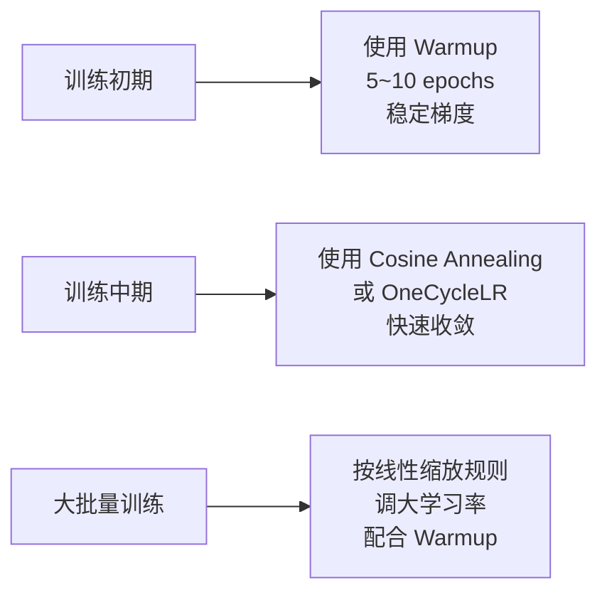
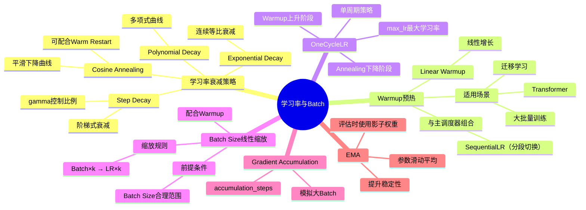

# 10-1 学习率与 Batch Size

## 学习目标

- 理解学习率衰减的常见策略（Step、Cosine、Exponential）
- 掌握 Warmup 与 OneCycleLR 的原理与适用场景
- 理解 Batch Size 与学习率的线性缩放规则及其理论依据
- 了解 EMA 在训练稳定与评估阶段的实用作用

---

## 1. 学习率衰减策略

在训练深度学习模型时，学习率是最重要的超参数之一。训练初期使用较大学习率可以快速接近最优解，随着训练的进行，逐步降低学习率可以帮助模型更精细地收敛。典型的学习率衰减策略如下。

### 1.1 Step Decay（阶梯衰减）

最直观的方式，按照预设的epoch节点一次性降低学习率。

```python
optimizer = torch.optim.SGD(model.parameters(), lr=0.1, momentum=0.9)
scheduler = torch.optim.lr_scheduler.StepLR(optimizer, step_size=30, gamma=0.1)
# 第 30、60、90 个 epoch 时学习率乘以 gamma
```

数学公式：

```
lr_t = lr_0 × γ^(floor(t / T))
```

其中 γ 通常取 0.1、0.5 等值，T 为衰减步长。适合在训练进入稳定期后做阶段性调整。

### 1.2 Cosine Annealing（余弦退火）

学习率按照余弦曲线的形状平滑下降，从初始值缓慢降到最小值。

```python
scheduler = torch.optim.lr_scheduler.CosineAnnealingLR(optimizer, T_max=100, eta_min=1e-6)
```

公式：

```
lr_t = eta_min + (lr_0 - eta_min) × (1 + cos(π·t/T_max)) / 2
```

Cosine Annealing 在整个训练周期内持续、温和地调整学习率，理论上有助于逃离 sharp minimum，泛化性能更好。结合 Warm restart 衍生出 CosineAnnealingWarmRestarts，可在训练中多次重启继续优化。

### 1.3 Exponential Decay（指数衰减）

每个 epoch 按固定比例连续衰减。

```python
scheduler = torch.optim.lr_scheduler.ExponentialLR(optimizer, gamma=0.95)
```

公式：

```
lr_t = lr_0 × γ^t
```

### 1.4 Polynomial Decay（多项式衰减）

```python
scheduler = torch.optim.lr_scheduler.PolynomialLR(optimizer, total_iters=100, power=2.0)
```

公式：

```
lr_t = lr_0 × (1 - t/total_iters)^power
```

---

## 2. Warmup（学习率预热）

如果直接从极小的学习率开始，模型训练速度会很慢；如果一开始就用大学习率，则可能导致训练不稳定甚至发散。Warmup 的思想是：在训练初期从一个很小的学习率逐步增加到设定的初始学习率，然后再按主调度器衰减。

### 2.1 Linear Warmup

```python
scheduler = torch.optim.lr_scheduler.LinearLR(
    optimizer, start_factor=0.1, end_factor=1.0, total_iters=10
)
```

在开始的 10 个 iteration 内，学习率从 `lr×0.1` 线性增长到 `lr`。

### 2.2 Warmup + 主调度器组合

```python
# 先 warmup 5 epochs，再使用 cosine 衰减（分段调度）
warmup_scheduler = torch.optim.lr_scheduler.LinearLR(
    optimizer, start_factor=0.1, end_factor=1.0, total_iters=5
)
main_scheduler = torch.optim.lr_scheduler.CosineAnnealingLR(
    optimizer, T_max=95, eta_min=1e-6
)
# 在第 5 个 epoch 后切换到主调度器
scheduler = torch.optim.lr_scheduler.SequentialLR(
    optimizer,
    schedulers=[warmup_scheduler, main_scheduler],
    milestones=[5]
)
```

### 2.3 Warmup 的适用场景

- 大批量（Large Batch）训练：梯度更平滑，需要更大的有效学习率
- Transformer 类模型（如 BERT）：参数众多，训练初期梯度波动大
- 迁移学习微调：预训练权重已接近最优，开始用过大 lr 会破坏特征

---

## 3. OneCycleLR（单周期学习率）

OneCycleLR 由 Leslie Smith 在 2017 年提出，是一种比传统衰减更激进的策略。整个训练过程分为两个阶段：

1. **Warmup 阶段**：从很小的学习率（如 1e-7）线性增加到最大学习率（通常比初始 lr 高 10 倍）
2. **Annealing 阶段**：从最大学习率快速下降到很小的值（如 1e-6），通常使用余弦退火

```python
scheduler = torch.optim.lr_scheduler.OneCycleLR(
    optimizer,
    max_lr=0.01,          # 最大学习率
    epochs=100,
    steps_per_epoch=len(train_loader),
    pct_start=0.3,         # 前 30% 作为 warmup 阶段
    anneal_strategy='cos'
)
```

**优点：**
- 收敛更快，最终精度往往更高
- 不需要手动调试多个超参数（只需设置 max_lr）
- 隐式地实现了学习率的范围搜索（search for optimal lr）

**注意：**OneCycleLR 要求每个 epoch 的 step 数固定，且 pct_start 不宜设得过大（通常 0.3 左右效果最好）。

---

## 4. Batch Size 与学习率的线性缩放规则

经验表明，当增加 Batch Size 时，如果直接使用相同的学习率，梯度估计的噪声会降低且每个 epoch 中参数更新次数减少，这会改变训练动态并可能导致收敛行为的差异。Goyal et al. (2018) 提出了线性缩放规则：

> **当 Batch Size 增大 k 倍时，学习率也应增大 k 倍。以常用基线 Batch Size=256 作为中等规模参考；如果批量远大于此，需要配合 Warmup 并密切监控训练稳定性。**

### 4.1 理论依据

- 增大 Batch Size 会减少梯度估计的方差（噪声），使梯度更稳定；因此较大 Batch 往往伴随梯度噪声降低，需要相应调整学习率以保持训练的信噪比。
- 为了保持梯度信噪比（signal-to-noise ratio），需要相应放大学习率

### 4.2 线性缩放规则的实际应用

| 原 Batch Size | 新 Batch Size | 缩放倍数 | 原 LR | 新 LR |
|---|---|---|---|---|
| 32 | 256 | ×8 | 0.1 | 0.8 |
| 64 | 512 | ×8 | 0.05 | 0.4 |

### 4.3 注意事项

- **上限**：当 Batch Size 非常大（如 > 4096）时，线性缩放不再适用，需要更高阶的调整策略
- **与 Warmup 配合**：大 Batch + 大 LR 训练初期更容易不稳定，建议配合 Warmup
- **不同优化器表现不同**：SGD 对 Batch Size 变化更敏感，Adam 系列相对更鲁棒

### 4.4 Gradient Accumulation（梯度累积）

当 GPU 显存不足时，可以用梯度累积来模拟大 Batch：

```python
effective_batch_size = batch_size * accumulation_steps
# 学习率按 effective_batch_size 缩放
```

## 5. EMA（Exponential Moving Average，指数滑动平均）

EMA 维护一份参数的平滑影子副本：

$$
\theta_{ema} \leftarrow \beta \theta_{ema} + (1-\beta)\theta
$$

其中 `β` 通常取 0.999、0.9999 等。训练时仍更新原始参数，评估或保存模型时使用 EMA 参数，通常能让验证指标更平稳、泛化更好。

EMA 特别适合：

- 训练后期 loss 抖动明显的任务
- 检测、分割、生成这类对评估稳定性比较敏感的任务
- 与 Warmup、Cosine、OneCycleLR 等调度策略配合使用，作为训练稳定性的“辅助器”，而不是替代学习率调度


---

## 6. 综合实践建议



常用 PyTorch 调度器组合：

```python
# 组合一：Cosine Warm Restarts（带重启的余弦退火）
scheduler = torch.optim.lr_scheduler.CosineAnnealingWarmRestarts(
    optimizer, T_0=10, T_mult=2, eta_min=1e-6
)

# 组合二：Step Decay
scheduler = torch.optim.lr_scheduler.MultiStepLR(
    optimizer, milestones=[60, 80, 90], gamma=0.2
)

# 组合三：OneCycleLR（一站式）
scheduler = torch.optim.lr_scheduler.OneCycleLR(
    optimizer, max_lr=0.01, epochs=100, steps_per_epoch=len(train_loader)
)
```

---

## 本章小结

1. **学习率衰减策略**：Step Decay适合阶段性调整，Cosine Annealing适合长时间训练并有助于逃离sharp minimum，Exponential Decay提供连续平滑的衰减，Polynomial Decay提供更灵活的衰减曲线。

2. **Warmup技术**：训练初期使用线性增长的学习率可以稳定梯度，特别适用于大批量训练、Transformer模型和迁移学习场景，能有效避免训练初期的梯度不稳定问题。

3. **OneCycleLR**：将学习率从极小值先升后降，形成完整的"上升-峰值-下降"周期，收敛快、精度高，是一站式解决方案。

4. **Batch Size与学习率线性缩放规则**：Batch Size增大k倍时，学习率也应相应增大k倍，但需注意上限（通常Batch Size < 4096），并配合Warmup使用。Gradient Accumulation可模拟大Batch训练。

5. **EMA**：通过维护参数的滑动平均影子副本来平滑训练波动，常用于提升验证稳定性和最终泛化表现，可与现有学习率调度策略叠加使用。

---

## 知识点思维导图



---

## 参考资料

1. Goyal, P., et al. (2018). "Accurate, Large Minibatch SGD: Training ImageNet in 1 Hour." *arXiv:1706.02677*
2. Loshchilov, I., & Hutter, F. (2017). "SGDR: Stochastic Gradient Descent with Warm Restarts." *ICLR 2017*
3. Smith, L. N. (2017). "Cyclical Learning Rates for Training Neural Networks." *WACV 2017*
4. He, T., et al. (2019). "Bag of Tricks for Image Classification with Convolutional Neural Networks." *CVPR 2019*
