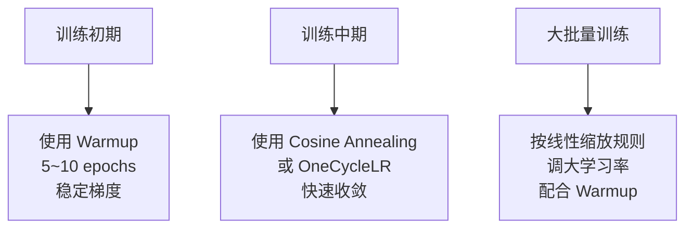
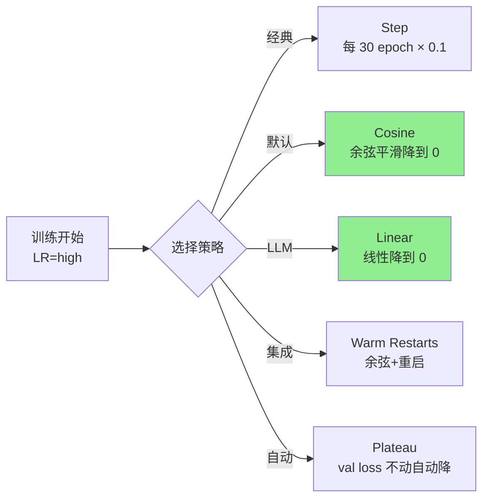
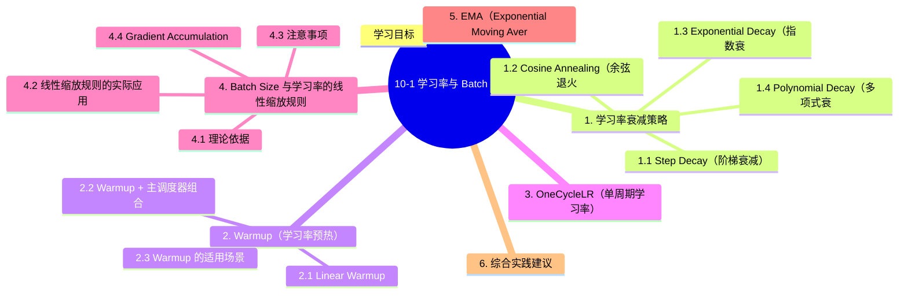

# 10-1 学习率与 Batch Size

## 学习目标

- 理解学习率衰减的常见策略（Step、Cosine、Exponential）
- 掌握 Warmup 与 OneCycleLR 的原理与适用场景
- 理解 Batch Size 与学习率的线性缩放规则及其理论依据
- 了解 EMA 在训练稳定与评估阶段的实用作用

---

## 1. 学习率衰减策略

在训练深度学习模型时，学习率是最重要的超参数之一。训练初期使用较大学习率可以快速接近最优解，随着训练的进行，逐步降低学习率可以帮助模型更精细地收敛。典型的学习率衰减策略如下。

### 1.1 Step Decay（阶梯衰减）

最直观的方式，按照预设的epoch节点一次性降低学习率。

```python
optimizer = torch.optim.SGD(model.parameters(), lr=0.1, momentum=0.9)
scheduler = torch.optim.lr_scheduler.StepLR(optimizer, step_size=30, gamma=0.1)
# 第 30、60、90 个 epoch 时学习率乘以 gamma
```

数学公式：

```
lr_t = lr_0 × γ^(floor(t / T))
```

其中 γ 通常取 0.1、0.5 等值，T 为衰减步长。适合在训练进入稳定期后做阶段性调整。

### 1.2 Cosine Annealing（余弦退火）

学习率按照余弦曲线的形状平滑下降，从初始值缓慢降到最小值。

```python
scheduler = torch.optim.lr_scheduler.CosineAnnealingLR(optimizer, T_max=100, eta_min=1e-6)
```

公式：

```
lr_t = eta_min + (lr_0 - eta_min) × (1 + cos(π·t/T_max)) / 2
```

Cosine Annealing 在整个训练周期内持续、温和地调整学习率，理论上有助于逃离 sharp minimum，泛化性能更好。结合 Warm restart 衍生出 CosineAnnealingWarmRestarts，可在训练中多次重启继续优化。

### 1.3 Exponential Decay（指数衰减）

每个 epoch 按固定比例连续衰减。

```python
scheduler = torch.optim.lr_scheduler.ExponentialLR(optimizer, gamma=0.95)
```

公式：

```
lr_t = lr_0 × γ^t
```

### 1.4 Polynomial Decay（多项式衰减）

```python
scheduler = torch.optim.lr_scheduler.PolynomialLR(optimizer, total_iters=100, power=2.0)
```

公式：

```
lr_t = lr_0 × (1 - t/total_iters)^power
```

---

## 2. Warmup（学习率预热）

如果直接从极小的学习率开始，模型训练速度会很慢；如果一开始就用大学习率，则可能导致训练不稳定甚至发散。Warmup 的思想是：在训练初期从一个很小的学习率逐步增加到设定的初始学习率，然后再按主调度器衰减。

### 2.1 Linear Warmup

```python
scheduler = torch.optim.lr_scheduler.LinearLR(
    optimizer, start_factor=0.1, end_factor=1.0, total_iters=10
)
```

在开始的 10 个 iteration 内，学习率从 `lr×0.1` 线性增长到 `lr`。

### 2.2 Warmup + 主调度器组合

```python
# 先 warmup 5 epochs，再使用 cosine 衰减（分段调度）
warmup_scheduler = torch.optim.lr_scheduler.LinearLR(
    optimizer, start_factor=0.1, end_factor=1.0, total_iters=5
)
main_scheduler = torch.optim.lr_scheduler.CosineAnnealingLR(
    optimizer, T_max=95, eta_min=1e-6
)
# 在第 5 个 epoch 后切换到主调度器
scheduler = torch.optim.lr_scheduler.SequentialLR(
    optimizer,
    schedulers=[warmup_scheduler, main_scheduler],
    milestones=[5]
)
```

### 2.3 Warmup 的适用场景

- 大批量（Large Batch）训练：梯度更平滑，需要更大的有效学习率
- Transformer 类模型（如 BERT）：参数众多，训练初期梯度波动大
- 迁移学习微调：预训练权重已接近最优，开始用过大 lr 会破坏特征

---

## 3. OneCycleLR（单周期学习率）

OneCycleLR 由 Leslie Smith 在 2017 年提出，是一种比传统衰减更激进的策略。整个训练过程分为两个阶段：

1. **Warmup 阶段**：从很小的学习率（如 1e-7）线性增加到最大学习率（通常比初始 lr 高 10 倍）
2. **Annealing 阶段**：从最大学习率快速下降到很小的值（如 1e-6），通常使用余弦退火

```python
scheduler = torch.optim.lr_scheduler.OneCycleLR(
    optimizer,
    max_lr=0.01,          # 最大学习率
    epochs=100,
    steps_per_epoch=len(train_loader),
    pct_start=0.3,         # 前 30% 作为 warmup 阶段
    anneal_strategy='cos'
)
```

**优点：**
- 收敛更快，最终精度往往更高
- 不需要手动调试多个超参数（只需设置 max_lr）
- 隐式地实现了学习率的范围搜索（search for optimal lr）

**注意：**OneCycleLR 要求每个 epoch 的 step 数固定，且 pct_start 不宜设得过大（通常 0.3 左右效果最好）。

---

## 4. Batch Size 与学习率的线性缩放规则

经验表明，当增加 Batch Size 时，如果直接使用相同的学习率，梯度估计的噪声会降低且每个 epoch 中参数更新次数减少，这会改变训练动态并可能导致收敛行为的差异。Goyal et al. (2018) 提出了线性缩放规则：

> **当 Batch Size 增大 k 倍时，学习率也应增大 k 倍。以常用基线 Batch Size=256 作为中等规模参考；如果批量远大于此，需要配合 Warmup 并密切监控训练稳定性。**

### 4.1 理论依据

- 增大 Batch Size 会减少梯度估计的方差（噪声），使梯度更稳定；因此较大 Batch 往往伴随梯度噪声降低，需要相应调整学习率以保持训练的信噪比。
- 为了保持梯度信噪比（signal-to-noise ratio），需要相应放大学习率

### 4.2 线性缩放规则的实际应用

| 原 Batch Size | 新 Batch Size | 缩放倍数 | 原 LR | 新 LR |
|---|---|---|---|---|
| 32 | 256 | ×8 | 0.1 | 0.8 |
| 64 | 512 | ×8 | 0.05 | 0.4 |

### 4.3 注意事项

- **上限**：当 Batch Size 非常大（如 > 4096）时，线性缩放不再适用，需要更高阶的调整策略
- **与 Warmup 配合**：大 Batch + 大 LR 训练初期更容易不稳定，建议配合 Warmup
- **不同优化器表现不同**：SGD 对 Batch Size 变化更敏感，Adam 系列相对更鲁棒

### 4.4 Gradient Accumulation（梯度累积）

当 GPU 显存不足时，可以用梯度累积来模拟大 Batch：

```python
effective_batch_size = batch_size * accumulation_steps
# 学习率按 effective_batch_size 缩放
```

## 5. EMA（Exponential Moving Average，指数滑动平均）

EMA 维护一份参数的平滑影子副本：

$$
\theta_{ema} \leftarrow \beta \theta_{ema} + (1-\beta)\theta
$$

其中 `β` 通常取 0.999、0.9999 等。训练时仍更新原始参数，评估或保存模型时使用 EMA 参数，通常能让验证指标更平稳、泛化更好。

EMA 特别适合：

- 训练后期 loss 抖动明显的任务
- 检测、分割、生成这类对评估稳定性比较敏感的任务
- 与 Warmup、Cosine、OneCycleLR 等调度策略配合使用，作为训练稳定性的“辅助器”，而不是替代学习率调度

---

## 6. 综合实践建议



常用 PyTorch 调度器组合：

```python
# 组合一：Cosine Warm Restarts（带重启的余弦退火）
scheduler = torch.optim.lr_scheduler.CosineAnnealingWarmRestarts(
    optimizer, T_0=10, T_mult=2, eta_min=1e-6
)

# 组合二：Step Decay
scheduler = torch.optim.lr_scheduler.MultiStepLR(
    optimizer, milestones=[60, 80, 90], gamma=0.2
)

# 组合三：OneCycleLR（一站式）
scheduler = torch.optim.lr_scheduler.OneCycleLR(
    optimizer, max_lr=0.01, epochs=100, steps_per_epoch=len(train_loader)
)
```

---

## 7. Large Batch 与 Learning Rate 的关系（深度剖析）

> **核心问题**：为什么大 batch 训练要按比例调大 learning rate？背后的数学和实验依据是什么？什么时候不适用？

### 7.1 线性缩放规则（Linear Scaling Rule）

**核心公式**（Krizhevsky 2014, Goyal 2017）：

$$
\text{LR}_{\text{new}} = \text{LR}_{\text{base}} \times \frac{B_{\text{new}}}{B_{\text{base}}}
$$

**直觉解释**：
- **小 batch**：每次梯度估计**噪声大**（用小样本算的），需要小 LR 防止震荡
- **大 batch**：每次梯度估计**准确**（用大样本算的），可以承受大 LR
- **保持 "每 epoch 走过的总距离" 不变**：大 batch 走一步 = 小 batch 走 B/B_base 步

### 7.2 实战数据：ImageNet 训练

| Batch Size | Learning Rate | Top-1 Acc | 训练时长 | 备注 |
|-----------|---------------|-----------|----------|------|
| 256 | 0.1 | 76.3% | 24h | 基线 |
| 1024 | 0.4 | 76.3% | 6h | 4× 加速 |
| 8192 | 3.2 | 76.1% | 1h | 32× 加速 |
| 32768 | 12.8 | 75.5% | 0.5h | 极限 batch |

> **关键发现**：batch size 从 256 → 8192（32×）时，**acc 几乎不变（76%），训练时间从 24h → 1h**！

### 7.3 为什么不总是按比例放大？3 大限制

| 限制 | 阈值 | 后果 |
|------|------|------|
| **泛化下降** | B > 8192 | 大 batch 倾向于 sharp minimum，泛化差 |
| **优化效率饱和** | B > 16384 | 收益递减 |
| **显存/通信** | 取决于硬件 | 8×H100 是物理上限 |

### 7.4 Large Batch 训练 5 大必备技巧

1. **Warmup**：前 5-10% epoch 用小 LR（如 0.001）线性升到目标 LR
2. **Linear Scaling**：按 batch_size 比例放大 LR
3. **LARS / LAMB**：分层自适应 LR（每层独立缩放）
4. **Gradient Accumulation**：模拟大 batch（不增加显存）
5. **Mixed Precision**：FP16/BF16 训练省显存

```python
# 1. Linear Scaling Rule 实战
batch_size = 1024
base_lr = 0.1
base_batch = 256
scaled_lr = base_lr * (batch_size / base_batch)  # = 0.4
optimizer = torch.optim.SGD(model.parameters(), lr=scaled_lr, momentum=0.9)

# 2. Warmup
scheduler = torch.optim.lr_scheduler.LinearLR(
    optimizer, start_factor=0.01, end_factor=1.0, total_iters=len(train_loader) * 5
)

# 3. LAMB (大 batch 友好)
from torch_optimizer import LAMB
optimizer = LAMB(model.parameters(), lr=1e-3, weight_decay=0.01)
```

### 7.5 实战决策

| 你的硬件 | 最大 Batch Size | 推荐做法 |
|----------|---------------|----------|
| RTX 4090 (24GB) | 256-512 | 梯度累积模拟 4096 |
| A100 80G × 1 | 1024-2048 | 直接大 batch |
| H100 × 8 | 32768 | 分布式 + LAMB |
| Mac M2 | 64-128 | 梯度累积 |

### 7.6 Gradient Accumulation（梯度累积）

```python
accumulation_steps = 4  # 模拟 4× batch
optimizer.zero_grad()
for i, (x, y) in enumerate(train_loader):
    # 前向 + 反向（梯度累加）
    loss = criterion(model(x), y) / accumulation_steps
    loss.backward()
    
    if (i + 1) % accumulation_steps == 0:
        optimizer.step()
        optimizer.zero_grad()
        # 此时相当于 1 次 "有效 iteration"，batch = 4× 单次 batch
```

> **关键洞察**：**gradient accumulation 不是真大 batch**，梯度是顺序算的（不像真 DDP 是并行算），但**效果上等价于大 batch**（更新方向一致）。

---

## 8. 九大学习率衰减策略

> **核心洞察**：**学习率调度是深度学习训练的"另一半魔法"**。一个好的调度可以让模型收敛到更平坦的极小值（泛化更好）。

### 8.1 九大策略对比

| 策略 | 衰减曲线 | 适用 | 优点 | 缺点 |
|------|----------|------|------|------|
| **1. Step Decay (阶梯)** | 阶梯形 | 经典 CNN | 简单 | 不平滑 |
| **2. Multi-Step** | 阶梯（多个）| ResNet 训练 | 灵活 | 需手动选节点 |
| **3. Exponential (指数)** | 指数下降 | RNN | 平滑 | 末期 LR 太小 |
| **4. Cosine Annealing** | 余弦曲线 | 几乎所有 | 平滑 + 末期小 LR | 无 |
| **5. Cosine Annealing Warm Restarts** | 余弦 + 重启 | 集成学习 | 多模型 | 需设周期 |
| **6. Linear Decay** | 线性下降 | LLM | 简单 | 末期线性 |
| **7. Polynomial** | 多项式 | 检测 | 灵活 | 需调幂次 |
| **8. Cyclic LR** | 循环 | 集成 | 跳出局部最优 | 末期不变 |
| **9. ReduceLROnPlateau** | 自适应 | 不确定场景 | 自动 | 滞后 |

### 8.2 各策略可视化



### 8.3 5 大工业首选策略

#### 8.3.1 Cosine Annealing（⭐ 默认首选）

```python
optimizer = torch.optim.AdamW(model.parameters(), lr=1e-3)
scheduler = torch.optim.lr_scheduler.CosineAnnealingLR(
    optimizer, T_max=100, eta_min=1e-6
)
for epoch in range(100):
    train_one_epoch()
    scheduler.step()
```

**优点**：末期 LR 自然降到 0，**帮助跳出尖锐极小值，找平坦极小值**。

#### 8.3.2 Linear Decay（⭐ LLM 首选）

```python
from transformers import get_linear_schedule_with_warmup
optimizer = torch.optim.AdamW(model.parameters(), lr=3e-4, weight_decay=0.1)
scheduler = get_linear_schedule_with_warmup(
    optimizer,
    num_warmup_steps=100,           # 100 步 warmup
    num_training_steps=10000,      # 10000 步总训练
)
```

#### 8.3.3 Cosine Annealing Warm Restarts（集成学习）

```python
scheduler = torch.optim.lr_scheduler.CosineAnnealingWarmRestarts(
    optimizer, T_0=20,           # 第 1 个周期 20 epoch
    T_mult=1,                    # 后续周期不变
    eta_min=1e-6
)
# 每 20 epoch 重启一次 = 一个 snapshot
```

#### 8.3.4 Step LR（经典 CNN）

```python
scheduler = torch.optim.lr_scheduler.StepLR(
    optimizer, step_size=30, gamma=0.1
)
# 每 30 epoch LR 降 10×
```

#### 8.3.5 ReduceLROnPlateau（自适应）

```python
scheduler = torch.optim.lr_scheduler.ReduceLROnPlateau(
    optimizer, mode='min', factor=0.5, patience=5
)
for epoch in range(100):
    val_loss = validate()
    scheduler.step(val_loss)  # val loss 不动 5 epoch 就降 LR
```

### 8.4 9 大策略选型决策

| 任务 | 推荐策略 | 关键参数 |
|------|----------|----------|
| **图像分类** | CosineAnnealing | T_max=epochs |
| **目标检测** | StepLR 或 WarmRestart | step_size=30, gamma=0.1 |
| **LLM 预训练** | Linear Decay | warmup=0.5-1% |
| **LLM 微调** | Linear Decay | warmup=3-10% |
| **GAN** | Step + 监控 | step_size=20 |
| **强化学习** | CosineAnnealing + Plateau | 双保险 |
| **集成学习** | Warm Restarts | T_0=20 |
| **超参搜索** | 多策略并行 | Hyperband + ASHA |
| **训练不稳定** | ReduceLROnPlateau | patience=5-10 |

### 8.5 实战组合策略

```python
# 工业最常用：Warmup + CosineAnnealing
optimizer = torch.optim.AdamW(model.parameters(), lr=1e-3, weight_decay=0.01)
warmup_steps = int(0.05 * total_steps)  # 5% warmup
scheduler = torch.optim.lr_scheduler.SequentialLR(
    optimizer,
    schedulers=[
        torch.optim.lr_scheduler.LinearLR(optimizer, 0.01, 1.0, warmup_steps),  # warmup
        torch.optim.lr_scheduler.CosineAnnealingLR(optimizer, T_max=total_steps - warmup_steps, eta_min=1e-6),
    ],
    milestones=[warmup_steps]
)
```

> **一句话**：**图像任务用 Cosine，LLM 用 Linear，不确定时用 Cosine + Warmup**。

---

## 本章小结

1. **学习率衰减策略**：Step Decay适合阶段性调整，Cosine Annealing适合长时间训练并有助于逃离sharp minimum，Exponential Decay提供连续平滑的衰减，Polynomial Decay提供更灵活的衰减曲线。

2. **Warmup技术**：训练初期使用线性增长的学习率可以稳定梯度，特别适用于大批量训练、Transformer模型和迁移学习场景，能有效避免训练初期的梯度不稳定问题。

3. **OneCycleLR**：将学习率从极小值先升后降，形成完整的"上升-峰值-下降"周期，收敛快、精度高，是一站式解决方案。

4. **Batch Size与学习率线性缩放规则**：Batch Size增大k倍时，学习率也应相应增大k倍，但需注意上限（通常Batch Size < 4096），并配合Warmup使用。Gradient Accumulation可模拟大Batch训练。

5. **EMA**：通过维护参数的滑动平均影子副本来平滑训练波动，常用于提升验证稳定性和最终泛化表现，可与现有学习率调度策略叠加使用。

---


## 知识图谱



## 参考资料

1. Goyal, P., et al. (2018). "Accurate, Large Minibatch SGD: Training ImageNet in 1 Hour." *arXiv:1706.02677*
2. Loshchilov, I., & Hutter, F. (2017). "SGDR: Stochastic Gradient Descent with Warm Restarts." *ICLR 2017*
3. Smith, L. N. (2017). "Cyclical Learning Rates for Training Neural Networks." *WACV 2017*
4. He, T., et al. (2019). "Bag of Tricks for Image Classification with Convolutional Neural Networks." *CVPR 2019*
