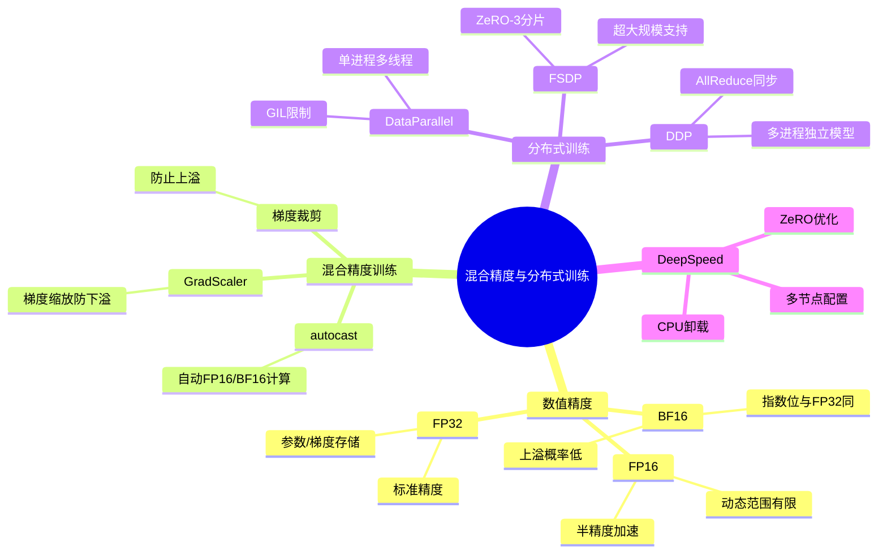

# 10-2 混合精度与分布式训练

## 学习目标

- 理解 FP16/BF16 与 FP32 的区别及各自适用场景
- 掌握 PyTorch 中 DataParallel 与 DistributedDataParallel 的用法与区别
- 了解 PyTorch FSDP 和 DeepSpeed 的基本概念与适用场景

---

## 1. 数值精度基础：FP16/BF16/FP32

训练深度学习模型时，数值精度直接影响显存占用、训练速度和最终精度。

| 格式 | 符号位 | 指数位 | 尾数位 | 范围 | 精度 |
|---|---|---|---|---|---|
| FP32 | 1 | 8 | 23 | ~1e38 | 很高（单精度） |
| FP16 | 1 | 5 | 10 | ~65504 | 中等（半精度） |
| BF16 | 1 | 8 | 7 | ~3.4e38 | 近似 FP32 范围，中等精度 |

### 1.1 FP16（半精度）

- 显存占用：FP32 的 1/2
- 动态范围有限（最大约 65504），容易出现上溢（overflow）和下溢（underflow）
- 混合精度训练时，前向/反向计算用 FP16，参数更新用 FP32（避免梯度精度不足）

### 1.2 BF16（BFloat16）

- Google 为 TPU 设计，指数位与 FP32 相同（8位），因此范围远大于 FP16
- 尾数位只有 7 位，精度略低于 FP16，但上溢概率大大降低
- A100、H100 以及部分较新的 RTX / 数据中心 GPU 支持 BF16，但不同显卡架构差异较大，实战中需要先确认硬件与驱动兼容性

### 1.3 FP32（单精度）

- 深度学习训练的标准精度，参数、梯度、优化器状态通常以 FP32 存储
- 混合精度中"保持 FP32 Master Weights"指的是将模型权重保持在 FP32 以避免精度损失

---

## 2. 混合精度训练（Mixed Precision Training）

### 2.1 PyTorch 原生支持：torch.cuda.amp

```python
from torch.cuda.amp import autocast, GradScaler

scaler = GradScaler()

for epoch in range(epochs):
    for batch in train_loader:
        optimizer.zero_grad()
        
        with autocast(dtype=torch.float16):
            outputs = model(batch)
            loss = criterion(outputs, target)
        
        # 缩放损失，防止下溢
        scaler.scale(loss).backward()
        
        # 梯度裁剪，防止上溢
        scaler.unscale_(optimizer)
        torch.nn.utils.clip_grad_norm_(model.parameters(), max_norm=1.0)
        
        scaler.step(optimizer)
        scaler.update()
```

关键点：
- `autocast` 自动将支持的操作转换为 FP16/BF16 执行
- `GradScaler` 将损失放大（通常 2^16），使梯度在 FP16 范围内有效
- 梯度裁剪（clip_grad_norm_）在 unscale_ 后执行，因为缩放后的梯度更容易检测上溢

### 2.2 BF16 混合精度（PyTorch ≥ 1.10）

```python
with autocast(dtype=torch.bfloat16):
    outputs = model(batch)
    loss = criterion(outputs, target)

scaler = GradScaler()  # BF16 也使用 GradScaler
scaler.scale(loss).backward()
```

BF16 不需要担心上溢问题，因此 GradScaler 不是必须的，但保留它可以兼容不同的精度设置。

### 2.3 适用场景

| 场景 | 推荐精度 |
|---|---|
| 大模型（>7B 参数）多卡训练 | BF16（更稳定）|
| 中等模型（~1B）单卡/多卡 | FP16（速度更快）|
| 推理部署 | INT8/FP16（量化后）|

---

## 3. 分布式训练：DataParallel vs DistributedDataParallel

### 3.1 DataParallel（DP）

单进程多线程，数据并行。简单但存在以下问题：
- GIL 锁限制，多线程效率低
- 梯度汇总在主 GPU，通信成为瓶颈
- 不支持分布式采样器（可能导致数据不均匀）

```python
model = torch.nn.DataParallel(model, device_ids=[0, 1, 2, 3])
outputs = model(inputs)
```

### 3.2 DistributedDataParallel（DDP）

多进程，每进程独立模型，通过 AllReduce 同步梯度，是当前主流方案。

**启动方式（torchrun）：**

```bash
torchrun --nnodes=1 --nproc_per_node=4 train.py
```

**DDP 初始化：**

```python
import torch.distributed as dist
import os

dist.init_process_group(backend="nccl")  # NCCL 用于 GPU 通信
local_rank = int(os.environ["LOCAL_RANK"])  # 当前进程绑定的本地 GPU 编号
torch.cuda.set_device(local_rank)
model = model.cuda(local_rank)

# 包装模型
model = torch.nn.parallel.DistributedDataParallel(
    model, device_ids=[local_rank]
)
```

**关键参数说明：**

| 参数 | 说明 |
|---|---|
| `backend` | `"nccl"`（GPU 推荐），`"gloo"`（CPU/混合）|
| `device_ids` | 当前进程使用的 GPU 编号 |
| `broadcast_buffers` | 是否在 forward 前同步 buffer（通常 False 省通信）|

### 3.3 数据采样器（DistributedSampler）

```python
from torch.utils.data import DistributedSampler

train_sampler = DistributedSampler(
    train_dataset,
    num_replicas=world_size,
    rank=rank,
    shuffle=True
)
train_loader = DataLoader(
    train_dataset, batch_size=batch_size,
    sampler=train_sampler, num_workers=4
)
```

确保每个 GPU 看到不同的数据分片。

---

## 4. PyTorch FSDP（Fully Sharded Data Parallel）

当模型显存超出单卡时，需要对模型分片存储。FSDP 是 ZeRO-3 的 PyTorch 原生实现。

### 4.1 基本用法

```python
from torch.distributed.fsdp import FullyShardedDataParallel as FSDP
from torch.distributed.fsdp import MixedPrecision, ShardingStrategy

mp_policy = MixedPrecision(
    param_dtype=torch.bfloat16,
    reduce_dtype=torch.float32,     # AllReduce 使用 FP32
    buffer_dtype=torch.bfloat16,
)

model = FSDP(
    model,
    sharding_strategy=ShardingStrategy.FULL_SHARD,  # 分片全部参数
    mixed_precision=mp_policy,
    device_id=torch.cuda.current_device(),
)
```

### 4.2 Sharding Strategy（分片策略）

| 策略 | 说明 |
|---|---|
| `FULL_SHARD` | 梯度、参数、激活值全部分片（ZeRO-3）|
| `SHARD_GRAD_OP` | 仅分片优化器状态和梯度（ZeRO-2）|
| `NO_SHARD` | 不分片，等同于 DDP（ZeRO-0）|

### 4.3 CPU Offloading（CPU 卸载）

```python
model = FSDP(
    model,
    cpu_offload=CPUOffload(offload_params=True),  # 参数分片存储到 CPU
)
```

当 GPU 显存不够时，可将部分参数卸载到 CPU，但会显著增加通信开销。

---

## 5. DeepSpeed 集成

DeepSpeed 是微软的高性能训练库，提供 ZeRO 优化、通信优化和混合精度支持。

### 5.1 基本配置（ds_config.json）

```json
{
  "zero_optimization": {
    "stage": 3,
    "offload_optimizer": {
      "device": "cpu"
    },
    "offload_param": {
      "device": "cpu"
    }
  },
  "bf16": {
    "enabled": true
  },
  "gradient_clipping": 1.0,
  "train_batch_size": 256,
  "train_micro_batch_size_per_gpu": 4
}
```

### 5.2 使用方式

```python
from deepspeed import Engine

model, optimizer, _, _ = deepspeed.initialize(
    model=model,
    optimizer=optimizer,
    config="ds_config.json"
)

for batch in train_loader:
    outputs = model(batch)
    loss = criterion(outputs, target)
    model.backward(loss)
    model.step()
```

---

## 6. 多节点训练

多节点（多台机器）训练时，需要配置 master 地址和端口：

```bash
torchrun \
    --nnodes=2 \
    --node_rank=0 \
    --nproc_per_node=4 \
    --master_addr="192.168.1.10" \
    --master_port=29500 \
    train.py
```

注意：
- 所有节点需要网络互通，通常使用 InfiniBand 或高速以太网
- NCCL 会在内部自动选择最优通信路径

---

---

## 本章小结

本章介绍了深度学习训练的两大核心优化技术：混合精度训练与分布式训练。

1. **数值精度基础**：FP32 是标准精度，FP16 显存占用减半但动态范围有限（最大约65504），BF16 保持与 FP32 相同的指数位因此范围更大，尾数位更少。不同精度适用于不同场景。

2. **混合精度训练**：核心思想是前向/反向计算用 FP16/BF16 加速，参数更新用 FP32 保持精度。PyTorch 的 `torch.cuda.amp` 提供了 `autocast` 和 `GradScaler` 来自动处理精度转换和梯度缩放，防止下溢。

3. **分布式训练**：DataParallel（DP）单进程多线程，存在 GIL 限制；DistributedDataParallel（DDP）多进程独立模型，通过 AllReduce 同步梯度，是当前主流方案。FSDP 在 DDP 基础上进一步分片模型参数，支持超大规模训练。

4. **DeepSpeed**：提供 ZeRO-3 分片、CPU Offloading 等高级特性，适合百亿参数级大模型训练。多节点训练需配置 master 地址和 NCCL 通信。



---

## 参考资料

1. Micikevicius, P., et al. (2018). "Mixed Precision Training." *arXiv:1710.03740*
2. Li, S., et al. (2021). "PyTorch FSDP: Training Large Models at Scale." *MLSys 2021*
3. Rasley, J., et al. (2020). "DeepSpeed: System Optimizations Enable Training Deep Learning Models with Over 100 Billion Parameters." *KDD 2020*
4. PyTorch Distributed Overview: https://pytorch.org/tutorials/beginner/dist_overview.html

---
