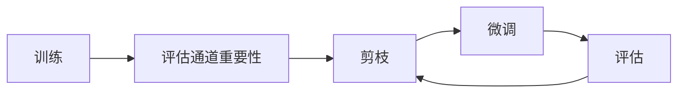
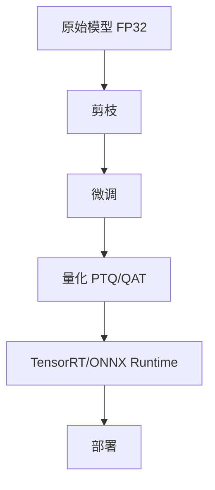
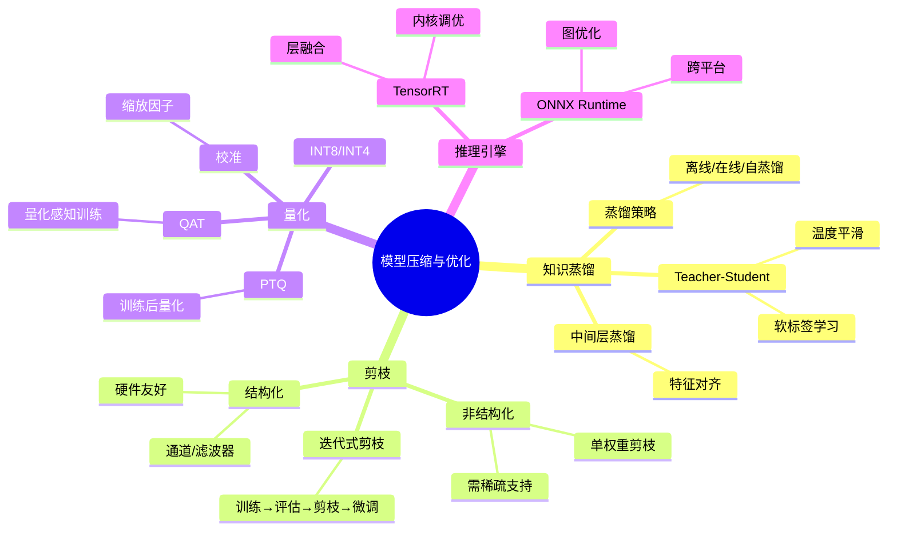

# 10-3 模型压缩与优化

## 学习目标

- 理解知识蒸馏（Teacher-Student）的原理与实现方法
- 掌握剪枝（Pruning）和量化（INT8/INT4）的基本概念和常用方法
- 了解 TensorRT 和 ONNX Runtime 在模型部署中的性能优化原理

---

## 1. 知识蒸馏（Knowledge Distillation）

知识蒸馏的核心思想是用一个参数量大、精度高的"教师模型"（Teacher）去指导一个参数量小的"学生模型"（Student）学习，使小模型也能获得接近大模型的精度。

### 1.1 软标签（Soft Labels）与硬标签（Hard Labels）

传统训练只使用硬标签（one-hot 标签），蒸馏会额外引入教师网络输出的软标签：

```python
import torch
import torch.nn.functional as F

def distillation_loss(student_logits, teacher_logits, labels, temperature=4.0, alpha=0.5):
    # 软标签损失（KL Divergence）：学生模仿教师
    soft_loss = F.kl_div(
        F.log_softmax(student_logits / temperature, dim=-1),
        F.softmax(teacher_logits / temperature, dim=-1),
        reduction='batchmean'
    ) * (temperature ** 2)  # 温度平方补偿因子
    
    # 硬标签损失（Cross Entropy）
    hard_loss = F.cross_entropy(student_logits, labels)
    
    return alpha * soft_loss + (1 - alpha) * hard_loss
```

- `temperature`：温度参数，越高软标签分布越平滑，学生能学到更多"dark knowledge"
- `alpha`：软硬标签损失的权重平衡

### 1.2 蒸馏温度的作用

```
温度 T=1 → 接近原始 logits，分布尖锐
温度 T=4 → 分布更平滑，类别间的相对关系更明显
温度 T=20 → 几乎接近均匀分布（信息过少）
```

实践中 T 通常取 2~8。

### 1.3 常见蒸馏策略

| 策略 | 说明 |
|---|---|
| 离线蒸馏（Offline）| 先训练 Teacher，再蒸馏 Student（最常用）|
| 在线蒸馏（Online）| Teacher 和 Student 同时训练，互相学习 |
| 自蒸馏（Self-Distillation）| 同一模型不同深度的层之间互相学习（如 Be Your Own Teacher）|

### 1.4 中间层蒸馏

不仅在输出层蒸馏，还可以在隐藏层对齐 Teacher 和 Student 的中间表示：

```python
def layer_distillation_loss(student_feat, teacher_feat):
    return F.mse_loss(student_feat, teacher_feat.detach())
```

通常用于 Student 和 Teacher 宽度/深度相近时的中间特征对齐。

---

## 2. 剪枝（Pruning）

剪枝通过删除不重要的参数（权重接近零）来减少模型参数量和计算量。

### 2.1 非结构化剪枝（Unstructured Pruning）

直接剪掉单个权重，不考虑结构规整性。压缩率高，但需要稀疏计算支持。

```python
# 简单幅度剪枝：剪掉绝对值小于阈值的权重
def magnitude_pruning(model, threshold=0.01):
    for name, param in model.named_parameters():
        if 'weight' in name:
            mask = torch.abs(param.data) > threshold
            param.data *= mask.float()
```

### 2.2 结构化剪枝（Structured Pruning）

剪掉结构化的单元（如整个通道、整个滤波器），可以直接利用硬件加速。

**通道剪枝示例：**

```python
# L1 正则化驱动的通道重要性评估
def compute_channel_importance(model):
    importance = {}
    for name, module in model.named_modules():
        if isinstance(module, torch.nn.Conv2d):
            # 对每个输出通道，计算对应 kernel 的 L1 范数
            channel_l1 = module.weight.data.abs().sum(dim=(1, 2, 3))
            importance[name] = channel_l1
    return importance
```

**迭代式剪枝流程：**



通常采用"少量多次"而非"一次性剪掉大量"，避免精度大幅下降。

### 2.3 剪枝率的选择

- 10%~30%：对精度影响小，适合边缘部署
- 50%~70%：中等压缩，需要微调恢复精度
- 70%+：极端压缩，精度下降明显，适合对精度要求不高的场景

---

## 3. 量化（Quantization）

量化通过降低权重和激活值的表示精度（如 FP32 → INT8）来减少显存和加速推理。

### 3.1 量化方案分类

| 类型 | 说明 | 精度损失 |
|---|---|---|
| INT8 量化 | 8 位整数，最常用 | 较小 |
| INT4 量化 | 4 位整数，极端压缩 | 较大 |
| 混合精度 | 敏感层保留 FP16/BF16，不敏感层量化到 INT8 | 适中 |
| PTQ（训练后量化）| 无需重新训练，直接量化预训练模型 | 视情况 |
| QAT（量化感知训练）| 在训练中模拟量化效果 | 最小 |

### 3.2 PyTorch 动态量化

```python
import torch.quantization

# 动态量化（权重 INT8，激活 FP16/FP32，在推理时动态转换）
model_int8 = torch.quantization.quantize_dynamic(
    model,  # 模型必须是 Python 对象
    {torch.nn.Linear, torch.nn.LSTM},  # 指定要量化的层类型
    dtype=torch.qint8
)
```

### 3.3 PyTorch 静态量化（Post-Training Quantization）

```python
# 1. 插入量化 stub
model.qconfig = torch.quantization.get_default_qconfig('fbgemm')
torch.quantization.prepare(model, inplace=True)

# 2. 校准（用代表性数据）
for batch in calibration_loader:
    model(batch)

# 3. 转换
torch.quantization.convert(model, inplace=True)
```

### 3.4 INT8 量化的挑战

- ** activism 范围**：INT8 动态范围约 -128 ~ 127，需要合理缩放（通常通过校准数据集自动确定）
- ** per-channel vs per-tensor**：per-channel 对每个输出通道独立缩放，精度更高
- **特殊算子**：Conv+BN+ReLU 融合、Pooling 等特殊融合模式可以减少内存访问

---

> **落地到具体硬件**：本节讲压缩与推理引擎的原理，具体的 ONNX 导出、TensorRT/OpenVINO/TFLite 多后端部署步骤见 [10-4 模型部署实战](./10-4-模型部署实战.md)。

## 4. TensorRT 与 ONNX Runtime

### 4.1 TensorRT

NVIDIA 的推理优化引擎，将 ONNX 或 TensorFlow 等模型转换为高效的 NVIDIA GPU 推理引擎（.engine 文件）。

**核心优化手段：**
- 层间融合（Layer Fusion）：将多个层合并为一个，减少 GPU kernel 调用开销
- 精度校准（Precision Calibration）：自动选择最优精度（FP16/INT8/FP64）
- 内核自动调优（Kernel Auto-Tuning）：根据硬件选择最优 CUDA kernel
- 动态形状支持（Dynamic Shapes）：支持可变输入尺寸

**导出流程：**

```python
import torch.onnx

# 1. PyTorch → ONNX
torch.onnx.export(model, dummy_input, "model.onnx")

# 2. ONNX → TensorRT
# 使用 trtexec 或 TensorRT Python API
```

**使用示例：**

```python
import tensorrt as trt

logger = trt.Logger(trt.Logger.WARNING)
builder = trt.Builder(logger)
network = builder.create_network(1 << int(trt.NetworkDefinitionCreationFlag.EXPLICIT_BATCH))
parser = trt.OnnxParser(network, logger)
```

### 4.2 ONNX Runtime

跨平台的推理引擎（支持 CPU/GPU/NPU），无需特定硬件。

```python
import onnxruntime as ort

session = ort.InferenceSession("model.onnx", providers=['CUDAExecutionProvider', 'CPUExecutionProvider'])
outputs = session.run(None, {"input": input_data})
```

**ONNX Runtime 优化手段：**
- Graph 优化：算子融合、constant folding、公共子表达式消除
- 算子调度优化：多线程/向量化调度
- 内存规划：共享内存池、显存复用

---

## 5. 综合实践：模型优化 Pipeline



常用工具链：

| 工具 | 用途 |
|---|---|
| PyTorch torch.quantization | PTQ/QAT 量化 |
| Intel PyTorch-LLGA | CPU 量化优化 |
| NVIDIA TensorRT | GPU 推理优化 |
| ONNX Runtime | 跨平台推理 |
| Distiller（Sparse ML）| 剪枝框架 |

---

---

## 本章小结

本章介绍了模型压缩与优化的三大核心技术以及部署推理引擎。

1. **知识蒸馏**：通过让小模型（Student）学习大模型（Teacher）的软标签（概率分布），保留更多"暗知识"。温度参数 T 越高，软标签分布越平滑，学生能学到更多类别间的相对关系。常见策略包括离线蒸馏、在线蒸馏和自蒸馏。

2. **剪枝**：删除不重要的权重或结构单元。非结构化剪枝压缩率高但需稀疏计算支持；结构化剪枝（通道/滤波器剪枝）可直接利用硬件加速。剪枝率需要权衡压缩率与精度损失，通常采用迭代式少量多次剪枝。

3. **量化**：降低权重和激活值精度（FP32 → INT8 → INT4）。PTQ 训练后直接量化，QAT 量化感知训练精度损失更小。INT8 需通过校准确定合适的缩放因子，per-channel 量化精度更高。

4. **推理优化引擎**：TensorRT 通过层融合、精度校准、内核自动调优等手段加速 NVIDIA GPU 推理；ONNX Runtime 提供跨平台（CPU/GPU/NPU）的统一推理接口，支持图优化、算子调度优化等。


## 知识图谱



---

## 参考资料

1. Hinton, G., et al. (2015). "Distilling the Knowledge in a Neural Network." *NIPS 2014 Workshop*
2. Molchanov, P., et al. (2019). "Importance Estimation for Neural Network Pruning." *CVPR 2019*
3. Jacob, B., et al. (2018). "Quantization and Training of Neural Networks for Efficient Integer-Arithmetic-Only Inference." *CVPR 2018*
4. TensorRT Documentation: https://docs.nvidia.com/deeplearning/tensorrt/
5. ONNX Runtime: https://onnxruntime.ai/

---
