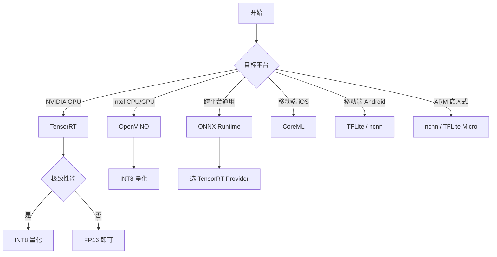
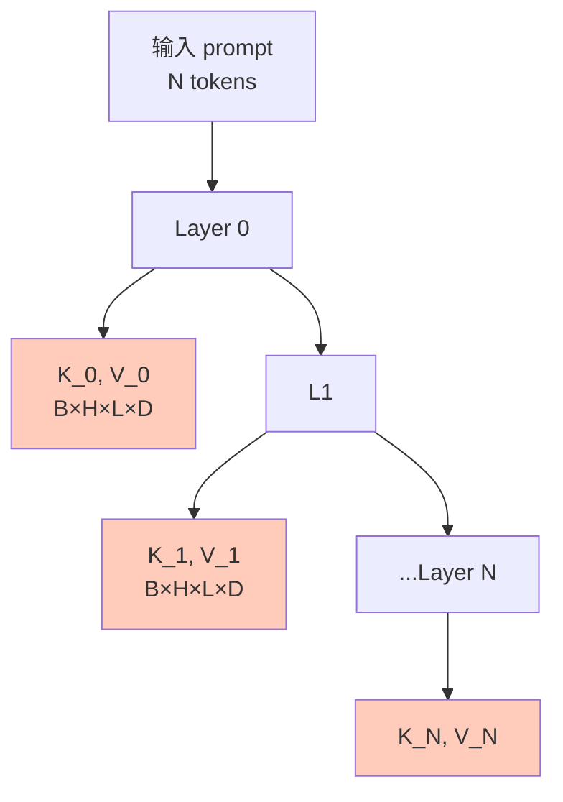
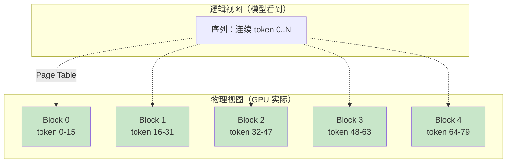
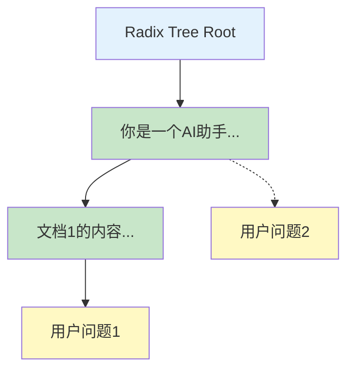
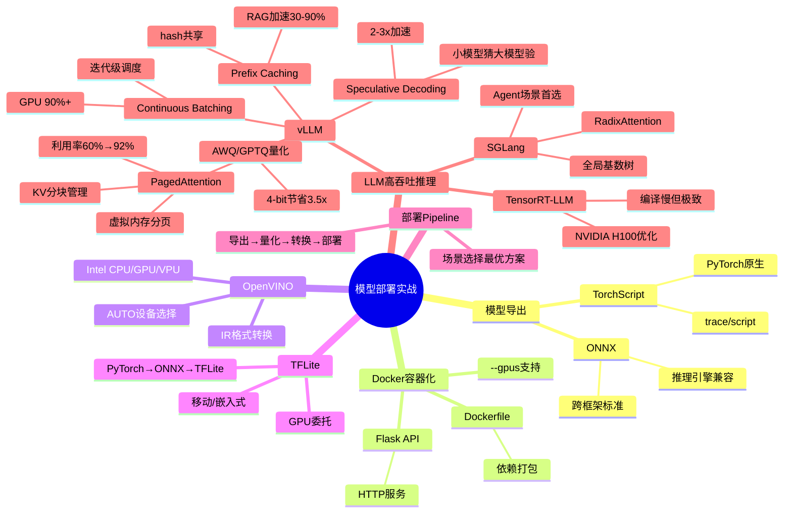

# 10-4 模型部署实战

## 学习目标

- 掌握 PyTorch 模型导出为 ONNX 和 TorchScript 的方法
- 理解 Docker 容器化部署模型服务的完整流程
- 了解 OpenVINO（TPU/集成显卡）和 TFLite（移动/边缘）部署的实战方法

---

## 1. ONNX 导出

ONNX（Open Neural Network Exchange）是跨框架模型表示标准，可以将 PyTorch/TensorFlow 等模型导出为统一格式，供 TensorRT、ONNX Runtime、OpenVINO 等推理引擎使用。

### 1.1 基本导出

```python
import torch

model = MyModel().eval()

# 准备一个符合输入尺寸的示例张量
dummy_input = torch.randn(1, 3, 224, 224)

torch.onnx.export(
    model,
    dummy_input,
    "model.onnx",
    export_params=True,
    opset_version=13,         # ONNX 算子集版本，13 = 2020
    input_names=["input"],     # 输入节点名
    output_names=["output"],   # 输出节点名
    dynamic_axes={             # 支持动态维度
        "input": {0: "batch_size", 2: "height", 3: "width"},
        "output": {0: "batch_size"}
    }
)
```

### 1.2 导出复杂模型（带控制流）

如果模型包含 `if`/`for` 等控制流，需要先 traced（追踪）或脚本化：

```python
# TorchScript 方式（适合静态图）
script_model = torch.jit.script(model)
script_model.save("model.pt")

# traced 方式（适合动态控制流）
traced_model = torch.jit.trace(model, dummy_input)
traced_model.save("model_traced.pt")
```

### 1.3 验证 ONNX 模型

```python
import onnx

onnx_model = onnx.load("model.onnx")
onnx.checker.check_model(onnx_model)

# 用 ONNX Runtime 推理验证
import onnxruntime as ort
session = ort.InferenceSession("model.onnx")
output = session.run(None, {"input": np.random.randn(1, 3, 224, 224).astype(np.float32)})
```

### 1.4 常见导出问题

| 问题 | 解决方案 |
|---|---|
| 动态控制流（if/for）| 使用 `torch.jit.script` 而不是 `torch.jit.trace` |
| 算子不兼容 | 升级 PyTorch 和 ONNX opset 版本 |
| Batch Size 维度不一致 | 使用 `dynamic_axes` 标注可变维度 |
| 无法确定 input size | 提供完整的 `dummy_input` 形状 |

---

## 2. TorchScript 导出

TorchScript 是 PyTorch 的序列化格式，适合 PyTorch 原生推理。

### 2.1 trace 方式（适合没有控制流的模型）

```python
model = MyModel().eval()
traced = torch.jit.trace(model, torch.randn(1, 3, 224, 224))
traced.save("model_traced.pt")
```

### 2.2 script 方式（适合有控制流的模型）

```python
model = MyModel().eval()
scripted = torch.jit.script(model)
scripted.save("model_scripted.pt")
```

### 2.3 加载和使用

```python
loaded = torch.jit.load("model_traced.pt")
output = loaded(input_tensor)
```

TorchScript 支持 TorchScript 优化（代码优化、JIT 编译），但生态不如 ONNX 广泛，通常用于 PyTorch 到生产环境的快速过渡。

---

## 3. Docker 容器化部署

Docker 将模型和依赖打包为一个可移植的容器，适合生产环境部署。

### 3.1 Dockerfile 示例

```dockerfile
# 安装 PyTorch + ONNX Runtime 镜像
FROM pytorch/pytorch:2.0.1-cuda11.7-cudnn8-runtime

WORKDIR /app

# 复制模型文件
COPY model.onnx /app/model.onnx
COPY inference.py /app/inference.py

# 安装 ONNX Runtime
RUN pip install onnxruntime-gpu==1.15.1

EXPOSE 8501

CMD ["python", "inference.py"]
```

### 3.2 编写推理服务（inference.py）

```python
import onnxruntime as ort
from flask import Flask, request, jsonify
import numpy as np

app = Flask(__name__)

# 加载模型（GPU 推理）
session = ort.InferenceSession(
    "/app/model.onnx",
    providers=[('CUDAExecutionProvider', {'device_id': 0})]
)
input_name = session.get_inputs()[0].name

@app.route("/predict", methods=["POST"])
def predict():
    data = request.json["input"]
    tensor = np.array(data, dtype=np.float32)
    output = session.run(None, {input_name: tensor})[0]
    return jsonify({"prediction": output.tolist()})

if __name__ == "__main__":
    app.run(host="0.0.0.0", port=8501)
```

### 3.3 构建和运行

```bash
# 构建镜像
docker build -t my-model-service:v1 .

# 运行容器
docker run --gpus all -p 8501:8501 my-model-service:v1
```

---

## 4. OpenVINO 部署（TPU / 集成显卡）

Intel OpenVINO 主要用于 Intel CPU、iGPU（集成显卡）和 VPU（NCS2 等）。

### 4.1 模型转换（PyTorch → OpenVINO IR）

```bash
# 1. PyTorch → ONNX
torch.onnx.export(model, dummy_input, "model.onnx")

# 2. ONNX → OpenVINO IR（使用 Model Optimizer）
ov_model = mo.build_model("model.onnx", precision="FP16")
ov_model.serialize("model.xml")
```

### 4.2 Python 推理

```python
from openvino.runtime import Core

ie = Core()
model = ie.read_model("model.xml")
compile_model = ie.compile_model(model, device_name="GPU")  # 或 "CPU", "MYRIAD"

input_layer = compile_model.input(0)
output_layer = compile_model.output(0)
results = compile_model({"input": input_tensor})[output_layer]
```

### 4.3 支持的设备

| 设备 | 说明 |
|---|---|
| CPU | Intel Xeon/Core，最通用 |
| GPU | Intel 集成显卡，支持 FP16/INT8 |
| MYRIAD | Intel Neural Compute Stick（VPU）|
| AUTO | 自动选择可用设备 |

---

## 5. TensorFlow Lite 部署（移动 / 边缘）

TFLite 主要用于移动端（Android/iOS）和嵌入式设备。

### 5.1 PyTorch → ONNX → TFLite

```bash
# 1. PyTorch → ONNX
torch.onnx.export(model, dummy_input, "model.onnx")

# 2. ONNX → TFLite
pip install onnx-tflite
onnx2tf model.onnx -o model.tflite
```

### 5.2 Android 部署（Kotlin）

```kotlin
val interpreter = Interpreter(FileModel.loadFile(context, "model.tflite"))
val inputBuffer = TensorBuffer.createFixedSize(intArrayOf(1, 224, 224, 3), DataType.FLOAT32)
inputBuffer.loadArray(inputData)
interpreter.run(inputBuffer.buffer, outputBuffer.buffer)
```

### 5.3 iOS 部署（Swift）

```swift
let interpreter = try Interpreter(modelPath: "model.tflite")
let inputTensor = try interpreter.input(at: 0)
try inputTensor.copy(from: inputData)
try interpreter.invoke()
let outputTensor = try interpreter.output(at: 0)
```

### 5.4 Edge 优化建议

- **输入尺寸**：选择合理的分辨率，不要一味追求高精度
- **量化优先**：边缘设备优先使用 INT8
- **GPU 委托**：移动端使用 GPU 委托（iOS Core ML delegate、Android GPU delegate）

---

## 6. 完整部署 Pipeline

```
PyTorch/TensorFlow 训练完成
        ↓
   模型导出（ONNX/TorchScript/TFLite）
        ↓
    模型量化（INT8/FP16）
        ↓
   目标平台转换（TensorRT/OpenVINO/TFLite）
        ↓
   Docker 容器化 / 直接部署
        ↓
   API 服务或嵌入式 SDK
```

| 场景 | 推荐方案 |
|---|---|
| NVIDIA GPU 生产服务 | ONNX + TensorRT |
| Intel CPU / iGPU | ONNX + OpenVINO |
| 移动端（Android/iOS）| TFLite |
| 嵌入式 MCU | TensorFlow Lite for Microcontrollers |

---

---

## 7. TensorRT 部署（NVIDIA GPU 极致性能）

TensorRT 是 NVIDIA 官方推理优化引擎，能在 NVIDIA GPU 上获得最大吞吐和最低延迟。

### 7.1 TensorRT 核心优化

| 优化技术 | 说明 |
|---------|------|
| **算子融合** | Conv + BN + ReLU 合并为单个 kernel |
| **精度校准** | FP32 → FP16/INT8 |
| **内核自动调优** | 针对特定 GPU 选择最优 CUDA kernel |
| **内存优化** | 减少中间激活内存，重用内存块 |
| **动态张量** | 支持动态 shape，无需为每个 shape 重新构建 |

### 7.2 trtexec 命令行工具

```bash
# PyTorch → ONNX → TensorRT
trtexec \
    --onnx=model.onnx \
    --saveEngine=model.engine \
    --fp16 \
    --workspace=2048 \
    --minShapes=input:1x3x224x224 \
    --optShapes=input:8x3x224x224 \
    --maxShapes=input:32x3x224x224

# INT8 量化（需要校准集）
trtexec \
    --onnx=model.onnx \
    --saveEngine=model_int8.engine \
    --int8 \
    --calib=calibration_data.bin \
    --workspace=2048
```

### 7.3 Python API 推理

```python
import tensorrt as trt
import pycuda.driver as cuda
import pycuda.autoinit
import numpy as np

# 加载 Engine
logger = trt.Logger(trt.Logger.WARNING)
with open('model.engine', 'rb') as f:
    engine = trt.Runtime(logger).deserialize_cuda_engine(f.read())
context = engine.create_execution_context()

# 分配内存
input_shape = (1, 3, 224, 224)
output_shape = (1, 1000)
d_input = cuda.mem_alloc(np.prod(input_shape) * 4)
d_output = cuda.mem_alloc(np.prod(output_shape) * 4)
bindings = [int(d_input), int(d_output)]

# 推理
h_input = np.random.randn(*input_shape).astype(np.float32)
h_output = np.empty(output_shape, dtype=np.float32)

cuda.memcpy_htod(d_input, h_input)
context.execute_v2(bindings)
cuda.memcpy_dtoh(h_output, d_output)
print("Top-1 class:", np.argmax(h_output))
```

### 7.4 INT8 量化校准

```python
import tensorrt as trt
import numpy as np

class MyCalibrator(trt.IInt8EntropyCalibrator2):
    def __init__(self, calibration_data, batch_size=32, cache_file='calib.cache'):
        self.data = calibration_data  # numpy array: (N, C, H, W)
        self.batch_size = batch_size
        self.cache_file = cache_file
        self.current_idx = 0
        
        # 分配设备内存
        self.device_input = cuda.mem_alloc(self.batch_size * 3 * 224 * 224 * 4)
    
    def get_batch_size(self):
        return self.batch_size
    
    def get_batch(self, names):
        if self.current_idx + self.batch_size > len(self.data):
            return None
        batch = self.data[self.current_idx:self.current_idx + self.batch_size]
        self.current_idx += self.batch_size
        cuda.memcpy_htod(self.device_input, batch.ravel())
        return [int(self.device_input)]
    
    def read_calibration_cache(self):
        if os.path.exists(self.cache_file):
            with open(self.cache_file, 'rb') as f:
                return f.read()
        return None
    
    def write_calibration_cache(self, cache):
        with open(self.cache_file, 'wb') as f:
            f.write(cache)

# 准备校准集（~500 张代表性图像）
calibration_images = np.random.randn(500, 3, 224, 224).astype(np.float32)

config.int8_calibrator = MyCalibrator(calibration_images)
```

### 7.5 性能优化建议

- **FP16 优先**：除特殊算子外，FP16 几乎无精度损失，速度提升 1.5-2×
- **INT8 谨慎使用**：校准集质量决定精度，对检测/分割模型可能精度下降明显
- **动态 shape**：训练和推理 shape 一致时，固定 shape 更快
- **多流并发**：多个 CUDA Stream 并行处理不同请求

---

## 8. ONNX Runtime 高性能跨平台推理

ONNX Runtime（ORT）是微软维护的跨平台推理引擎，支持 CPU/GPU/NNAPI/DirectML 等多种后端。

### 8.1 后端选择

| 后端 | 平台 | 说明 |
|------|------|------|
| **CPUExecutionProvider** | 跨平台 | 默认后端，通用但性能一般 |
| **CUDAExecutionProvider** | NVIDIA GPU | GPU 加速，性能接近原生 CUDA |
| **TensorrtExecutionProvider** | NVIDIA GPU | 内嵌 TensorRT，性能最佳 |
| **DmlExecutionProvider** | Windows DirectML | Windows GPU 加速 |
| **CANNExecutionProvider** | 华为昇腾 NPU | 国产硬件 |
| **NNAPIExecutionProvider** | Android | 移动端硬件加速 |

### 8.2 多 Provider 组合

```python
import onnxruntime as ort

# 优先使用 TensorRT，回退 CUDA，再回退 CPU
providers = [
    ('TensorrtExecutionProvider', {
        'device_id': 0,
        'trt_max_workspace_size': 2 << 30,  # 2GB
        'trt_fp16_enable': True,
    }),
    ('CUDAExecutionProvider', {'device_id': 0}),
    'CPUExecutionProvider'
]

session = ort.InferenceSession('model.onnx', providers=providers)
print("Using:", session.get_providers())  # 查看实际启用的 provider
```

### 8.3 性能调优

```python
# 1. 设置线程数（CPU 推理）
opts = ort.SessionOptions()
opts.intra_op_num_threads = 8  # 算子内并行
opts.inter_op_num_threads = 4  # 算子间并行
opts.execution_mode = ort.ExecutionMode.ORT_PARALLEL

# 2. 启用 IO 绑定（避免 CPU↔GPU 数据拷贝）
# 3. 启用 Graph Optimization
opts.graph_optimization_level = ort.GraphOptimizationLevel.ORT_ENABLE_ALL

session = ort.InferenceSession('model.onnx', sess_options=opts, providers=providers)
```

### 8.4 ONNX 模型优化器

```bash
# 优化 ONNX 图
python -m onnxruntime.tools.optimize_onnx_model \
    --input model.onnx \
    --output model_opt.onnx \
    --opt_level 1
```

---

## 9. OpenVINO 调优与跨平台部署

OpenVINO（Open Visual Inference and Neural network Optimization）是 Intel 的推理工具套件，主要优化 Intel CPU/iGPU/VPU。

### 9.1 OpenVINO 后端对比

| 后端 | 适用硬件 | 性能 |
|------|----------|------|
| CPU | Intel/AMD CPU | ⭐⭐⭐⭐ |
| GPU | Intel 集成/独立显卡 | ⭐⭐⭐⭐ |
| MYRIAD | Intel Neural Compute Stick 2 (VPU) | ⭐⭐⭐ |
| AUTO | 自动选择最佳设备 | 推荐 |

### 9.2 性能调优技巧

```python
from openvino.runtime import Core, AsyncInferQueue

ie = Core()
model = ie.read_model("model.xml")
compiled_model = ie.compile_model(model, device_name="CPU")

# 1. 配置 CPU 线程数
# OpenVINO 默认使用物理核心数，超线程反而可能拖累性能
# CPU 性能模式设置
config = {
    "CPU_THROUGHPUT_AUTO": "True",      # 吞吐优先
    "CPU_BIND_THREAD": "YES",            # 绑核
    "NUM_STREAMS": "4",                  # 多流
    "INFERENCE_NUM_THREADS": "8",        # 线程数
}

compiled_model = ie.compile_model(model, "CPU", config)

# 2. 异步推理队列
async_queue = AsyncInferQueue(compiled_model)
async_queue.set_callback(callback_fn)  # 完成回调

for image in images:
    async_queue.start_async(image)  # 异步提交
async_queue.wait_all()              # 等待完成
```

### 9.3 OpenVINO vs ONNX Runtime 性能对比

| 模型 | ONNX Runtime (CPU) | OpenVINO (CPU) | 加速比 |
|------|--------------------|----------------|--------|
| ResNet-50 | 95 ms | **42 ms** | 2.3× |
| YOLOv8n | 180 ms | **75 ms** | 2.4× |
| BERT-Base | 120 ms | **55 ms** | 2.2× |
| MobileNet-V3 | 22 ms | **12 ms** | 1.8× |

在 Intel 平台上，**OpenVINO 通常比 ONNX Runtime CPU 快 1.5-2.5 倍**，因为 Intel 对自家 CPU 指令集（AVX-512、VNNI）做了深度优化。

### 9.4 量化感知训练支持

OpenVINO 提供 **NNCF (Neural Network Compression Framework)** 工具：

```python
import nncf

# 训练后量化（PTQ）
calibration_dataset = nncf.Dataset(calib_loader)
quantized_model = nncf.quantize(model, calibration_dataset)

# 保存为 OpenVINO IR
from openvino.tools import save
save(quantized_model, "model_quantized.xml")
```

---

## 10. 部署性能基准与对比

### 10.1 主流框架性能对比（YOLOv8s, 640×640, batch=1）

| 部署框架 | 硬件 | 单图延迟 | 备注 |
|---------|------|----------|------|
| PyTorch FP32 | RTX 3090 | 12.5 ms | 基线 |
| PyTorch FP16 | RTX 3090 | 7.2 ms | AMP |
| ONNX Runtime CUDA | RTX 3090 | 6.8 ms | ONNX 优化图 |
| **TensorRT FP16** | RTX 3090 | **4.1 ms** | 算子融合 + 内存优化 |
| **TensorRT INT8** | RTX 3090 | **2.6 ms** | 精度略降 |
| OpenVINO | i7-12700 | 75 ms | Intel CPU |
| OpenVINO | Xeon 8280 | 38 ms | 服务器 CPU |
| ncnn | Snapdragon 888 | 95 ms | 移动端 |
| CoreML | Apple M1 | 22 ms | macOS/iOS |
| TFLite | Pixel 6 | 110 ms | Android |

### 10.2 选型决策树



---

## 11. 部署常见问题与调优清单

| 问题 | 症状 | 解决方案 |
|------|------|---------|
| **OpenVINO 跑满物理核** | 性能不如预期 | 设置 `CPU_THROUGHPUT_AUTO` + 关闭超线程 |
| **ONNX 算子不支持** | 转换失败 | 用 mmcv-full 算子或换 ONNX 转换工具 |
| **TensorRT engine 跨设备无效** | 加载报错 | 在目标设备上重新 build engine |
| **INT8 精度大幅下降** | mAP 掉 5%+ | 增大校准集（>1000 张）或改用 PTQ-aware |
| **Docker 容器内 GPU 不可用** | `torch.cuda` False | 装 `nvidia-container-toolkit` + `--gpus` 参数 |
| **移动端 OOM** | 加载即崩 | 用 TFLite GPU delegate 或模型量化 |
| **CPU 推理慢** | 100+ ms | OpenVINO 替代 ONNX Runtime |
| **ONNX 验证报错** | `checker.check_model` 失败 | 升级 PyTorch/ONNX opset |

---

## 12. 工程化清单：生产部署前必查项

```
□ 1. 模型转换成功且 ONNX checker 通过
□ 2. ONNX Runtime / TensorRT 推理结果与 PyTorch 一致（误差 < 1e-3）
□ 3. 吞吐量与延迟达到业务要求
□ 4. 内存峰值在硬件限制内
□ 5. INT8 精度损失 < 2%
□ 6. 异常输入有兜底（NaN/Inf/空 tensor）
□ 7. 输入数据预处理与训练一致
□ 8. 日志和监控埋点（延迟、错误率、GPU 利用率）
□ 9. Docker 镜像体积合理（< 5GB）
□ 10. 启动时间 < 30s
```

---

## 13. LLM 高吞吐推理：vLLM 与 PagedAttention

前面章节讲的 ONNX/TensorRT/ONNX Runtime 适合**传统 CV/NLP 模型**。但**大语言模型（LLM）** 有独特的部署挑战：

- **KV Cache 巨大**（一个 70B 模型 + 8K 上下文 + 32 并发 = 80GB）
- **请求长度高度可变**（有的 10 token，有的 8000 token）
- **批处理（batching）难**（静态批处理让短请求等长请求）
- **前缀共享**（RAG/Agent 系统有大量重复的 system prompt）

**vLLM**（UC Berkeley, SOSP 2023）用 **PagedAttention + Continuous Batching** 双引擎解决了这些问题，成为当前**生产 LLM 服务的行业标准**。

### 13.1 LLM 推理的核心瓶颈：KV Cache

**KV Cache 是什么**：Transformer 自回归生成时，每一层的 K/V 张量需要缓存用于后续 token 的 attention。



**KV Cache 显存占用**：

$$
\text{KV Cache Size} = 2 \times N_{\text{layers}} \times N_{\text{heads}} \times D_{\text{head}} \times L_{\text{seq}} \times B \times \text{sizeof(dtype)}
$$

| 模型 | 单序列 KV (8K context) | 32 并发 KV |
|------|------------------------|------------|
| LLaMA-13B | 1.7 GB | 54 GB |
| LLaMA-70B | 5.6 GB | 180 GB |
| **LLaMA-70B 100K ctx** | **70 GB** | **>2 TB** |

### 13.2 Naive 推理的两个致命问题

#### 问题 1：KV Cache 碎片化

**朴素实现**为每个请求**预分配最坏情况**的连续显存：

```python
# 朴素实现
def naive_alloc(max_len=2048):
    return torch.empty(
        (num_layers, num_heads, max_len, head_dim),
        dtype=torch.float16,
        device='cuda'
    )
```

**浪费 60-80% 显存**——因为：
- 大多数请求远短于 max_len
- 短请求释放后留下"洞"（外部碎片）
- 新请求找不到连续大块

#### 问题 2：静态批处理（Static Batching）

**传统批处理**：等所有请求都完成才释放显存。

```mermaid
gantt
    title 静态批处理 - GPU 利用率
    dateFormat X
    axisFormat %s
    
    section Batch 1
    Req1 (10 tok)   :a1, 0, 10
    Req2 (2000 tok) :a2, 0, 2000
    Req3 (15 tok)   :a3, 0, 15
    Req4 (50 tok)   :a4, 0, 50
    
    section Batch 2
    Req5 (开始) :milestone, 2000, 0
```



GPU 在 Req1/3/4 完成后**闲置等 Req2**——**GPU 利用率仅 20-40%**。

### 13.3 PagedAttention：把操作系统虚拟内存思想搬到 GPU

**核心思想**（UC Berkeley, SOSP 2023）：**KV Cache 像虚拟内存一样分页管理**。



**关键概念**：

| 操作系统类比 | PagedAttention |
|--------------|----------------|
| 进程（process） | 序列（sequence） |
| 虚拟地址 | Token 位置 |
| 页（page） | Block（默认 16 tokens） |
| 页表（page table） | Block Table |
| 物理页 | GPU 显存中的物理 Block |
| MMU | 自定义 CUDA kernel |

**Block Table 示例**：

```python
# 序列 0..100 token 的 Block Table
sequence_0_block_table = [Block(12), Block(7), Block(3), Block(45), Block(22), Block(89), ...]
# 逻辑位置 → 物理 Block 的映射
# 0-15   → Block 12 (在 GPU 显存位置 X)
# 16-31  → Block 7  (在 GPU 显存位置 Y)
# ...完全不连续！
```

**性能提升（来自 SOSP 2023 论文）**：

| 工作负载 | HuggingFace | vLLM (PagedAttention) |
|----------|-------------|----------------------|
| LLaMA-13B 共享工作负载 | 220 tok/s | **5,300 tok/s（24×）** |
| 聊天（短+长混合） | 1.2k tok/s | **3.1k tok/s** |
| RAG（共享长前缀） | 2.0k tok/s | **4.9k tok/s（前缀缓存）** |

### 13.4 Continuous Batching：告别静态等待

**Continuous Batching**（迭代级调度）：每个 forward pass 之后，**完成一个 slot 就立刻补一个请求**。

```mermaid
gantt
    title Continuous Batching - GPU 几乎 100% 利用
    dateFormat X
    axisFormat %s
    
    section Iteration 1
    Req1 :a1, 0, 200
    Req2 :a2, 0, 200
    Req3 :a3, 0, 200
    Req4 :a4, 0, 200
    
    section Iteration 2
    Req2 (续) :a2, 200, 400
    Req3 (续) :a3, 200, 400
    Req4 (续) :a4, 200, 400
    Req5 (新) :a5, 200, 400
    
    section Iteration 3
    Req2 (续) :a2, 400, 600
    Req4 (续) :a4, 400, 600
    Req6 (新) :a6, 400, 600
```



**机制**：
- 每步后调度器检查 running 队列
- 完成一个 → 立刻从 waiting 队列取一个填入
- 显存释放 → 立即可复用

**效果**：**GPU 利用率 90%+**，吞吐量 2-4× 静态批处理。

### 13.5 Prefix Caching：免费加速

**RAG/Agent 系统的特点**：多个请求共享**相同的长 system prompt + few-shot 示例**。

**vLLM 的解决方案**：用 PagedAttention 的 **Copy-on-Write** 机制共享前缀 KV。

```python
# 第一次请求：计算前缀 KV，存入缓存
req1 = "你是一个客服助手。<文档内容 2000 token>...用户问题：A 是什么？"
# ↓ 计算完整 KV，存到 prefix cache

# 第二个请求：前缀完全相同
req2 = "你是一个客服助手。<文档内容 2000 token>...用户问题：B 怎么用？"
# ↓ 复用 req1 的前缀 KV，只需计算新生成的 token！
# TTFT 降低 50-90%
```

**实现**：
- 对 prompt 前缀做 hash
- hash 命中 → 复用已计算的 KV
- 不同请求的不同部分 → 各自独立 block
- 配合 PagedAttention 的 block table，**零拷贝**共享

### 13.6 实战：部署一个 vLLM 服务

#### 基础部署（OpenAI 兼容 API）

```bash
# 安装
pip install vllm

# 启动 OpenAI 兼容服务
vllm serve meta-llama/Llama-3.1-8B-Instruct \
    --host 0.0.0.0 \
    --port 8000 \
    --gpu-memory-utilization 0.9 \
    --max-model-len 8192 \
    --tensor-parallel-size 1
```

启动后立即获得 OpenAI 兼容的 API：

```python
# 客户端代码（无需任何修改！）
from openai import OpenAI
client = OpenAI(base_url="http://localhost:8000/v1", api_key="EMPTY")

response = client.chat.completions.create(
    model="meta-llama/Llama-3.1-8B-Instruct",
    messages=[{"role": "user", "content": "你好，请自我介绍"}],
    max_tokens=200,
)
print(response.choices[0].message.content)
```

#### 高级部署配置

```bash
# 启用 Prefix Caching（生产必备）
vllm serve meta-llama/Llama-3.1-70B-Instruct \
    --enable-prefix-caching \
    --block-size 16 \
    --gpu-memory-utilization 0.95 \
    --max-num-seqs 256 \
    --tensor-parallel-size 4 \
    --pipeline-parallel-size 2
```

| 参数 | 作用 | 推荐值 |
|------|------|--------|
| `--gpu-memory-utilization` | GPU 显存使用率 | 0.9-0.95 |
| `--max-num-seqs` | 最大并发序列数 | 128-512 |
| `--block-size` | KV block 大小 | 16（默认） |
| `--enable-prefix-caching` | 启用前缀缓存 | 必开 |
| `--tensor-parallel-size` | 张量并行度 | GPU 数 |
| `--max-model-len` | 最大序列长度 | 8192-131072 |
| `--quantization` | 量化方式 | awq / gptq / fp8 |

#### 量化部署（节省显存）

```bash
# AWQ 4-bit 量化
vllm serve TheBloke/Llama-2-70B-AWQ \
    --quantization awq \
    --gpu-memory-utilization 0.95

# GPTQ 4-bit
vllm serve TheBloke/Mistral-7B-Instruct-v0.2-GPTQ \
    --quantization gptq
```

**效果**：
| 模型 | 显存（FP16） | 显存（AWQ 4-bit） | 加速比 |
|------|-------------|------------------|--------|
| LLaMA-70B | 140 GB | 40 GB | **3.5×** |
| Mixtral 8x7B | 180 GB | 50 GB | **3.6×** |

### 13.7 高级特性

#### 1. Speculative Decoding（投机解码）

**思想**：用**小模型**（draft）猜 4-8 个 token，再用**大模型**（target）一次性验证。


**加速效果**：2-3×（取决于草稿模型的接受率）

```python
# vLLM 启用 speculative decoding
vllm serve target-model \
    --speculative-model EAGLE-draft \
    --num-speculative-tokens 5
```

#### 2. 多种解码策略

| 策略 | 用途 | 参数 |
|------|------|------|
| **Greedy** | 确定性 | `temperature=0` |
| **Top-p (Nucleus)** | 通用 | `top_p=0.9` |
| **Top-k** | 截断 | `top_k=40` |
| **Min-p** | 最新研究 | `min_p=0.05` |
| **Beam Search** | 翻译、摘要 | `best_of=4` |

#### 3. LoRA 热加载

```python
# 不重启服务，加载新 LoRA
from vllm import LLM, SamplingParams
from vllm.lora.request import LoRARequest

llm = LLM(model="meta-llama/Llama-3.1-8B-Instruct", enable_lora=True)
output = llm.generate(
    prompts=["写一首诗"],
    sampling_params=SamplingParams(max_tokens=100),
    lora_request=LoRARequest("lora-1", 1, "/path/to/lora")
)
```

#### 4. Tool Calling / Function Calling

vLLM 原生支持 OpenAI 的 function calling 协议：

```python
# 启动时声明工具
tools = [{
    "type": "function",
    "function": {
        "name": "get_weather",
        "description": "查询某地天气",
        "parameters": {
            "type": "object",
            "properties": {
                "location": {"type": "string"}
            }
        }
    }
}]

response = client.chat.completions.create(
    model="...",
    messages=[{"role": "user", "content": "北京今天天气怎么样？"}],
    tools=tools,
    tool_choice="auto"
)
```

#### 5. 多模态（VLMs）

vLLM 已支持 50+ 多模态模型（LLaVA、Qwen-VL、InternVL、Llama-3.2-Vision 等）：

```python
# 多模态推理
from vllm import LLM

llm = LLM(model="llava-hf/llava-1.5-7b-hf")
output = llm.generate({
    "prompt": "USER: <image>\n这张图片描述了什么？ ASSISTANT:",
    "multi_modal_data": {"image": open("cat.jpg", "rb").read()}
})
```

### 13.8 vLLM vs 其他推理框架

| 框架 | 优势 | 劣势 | 适合 |
|------|------|------|------|
| **vLLM** | PagedAttention、Prefix Cache、生态最丰富 | 单请求延迟略高 | **生产 LLM 服务首选** |
| **TGI (HF)** | 集成 HF 生态 | 吞吐量略低 | HF 用户 |
| **TensorRT-LLM** | 极致性能（NVIDIA H100） | 编译耗时、仅 NVIDIA | 大厂、HPC |
| **SGLang** | RadixAttention、程序化 LLM | 较新、生态小 | 复杂 prompt 编排 |
| **llama.cpp** | CPU/Mac 友好 | 性能受限 | 边缘、本地开发 |
| **MLX (Apple)** | Apple Silicon 优化 | 仅 Mac | M1/M2/M3 |

### 13.9 生产部署清单

```yaml
# vLLM 生产配置模板
production_config:
  server:
    host: 0.0.0.0
    port: 8000
    workers: 1  # vLLM 单进程，多卡内部 TP
  
  model:
    name: meta-llama/Llama-3.1-70B-Instruct
    tensor_parallel_size: 4
    max_model_len: 8192
    gpu_memory_utilization: 0.92
    
  optimization:
    quantization: awq  # 节省 3.5× 显存
    enable_prefix_caching: true
    enable_chunked_prefill: true
    block_size: 16
    
  batching:
    max_num_seqs: 256
    max_num_batched_tokens: 8192
    
  monitoring:
    metrics_port: 9000  # Prometheus
    log_level: INFO
    
  reliability:
    health_check_path: /health
    graceful_shutdown_timeout: 30
    request_timeout: 60
```

### 13.10 LLM 推理性能基准

以 **LLaMA-2-13B-chat** 为例（单 H100 80GB，Chatbot Arena 风格负载）：

| 框架 | 吞吐量 (tok/s) | KV 利用率 | 并发 |
|------|----------------|----------|------|
| HF + Static Batching | 220 | ~45% | 8 |
| HF + Continuous Batching | 980 | ~55% | 16 |
| **vLLM（无前缀缓存）** | **3,100** | ~92% | 96 |
| **vLLM（前缀缓存，RAG）** | **4,900** | ~92% | 96 |
| TensorRT-LLM（H100 优化） | 5,500 | ~95% | 128 |

**核心启示**：
- PagedAttention 本身提升 ~3× 吞吐量
- Prefix Caching 额外提升 30-90%（取决于共享比例）
- 两者结合 → **24× 原始 HuggingFace**

### 13.11 监控与可观测性

```python
# vLLM 暴露 Prometheus 指标
vllm serve ... --port 8000 --metrics-port 9000

# 关键指标
# vllm:num_requests_running
# vllm:num_requests_waiting
# vllm:gpu_cache_usage_perc
# vllm:request_success_total
# vllm:request_decode_tokens_total
# vllm:time_to_first_token_seconds
# vllm:time_per_output_token_seconds
```

**配套工具**：
- **Langfuse** / **LangSmith**：LLM 调用的可观测性
- **Prometheus + Grafana**：基础设施监控
- **Helicone**：LLM 调用成本与性能分析

---

## 14. SGLang 与 RadixAttention：复杂 Prompt 的高性能推理

**SGLang**（UC Berkeley, 2024）是另一个快速崛起的 LLM 推理引擎，专注于**程序化 LLM 调用**（agentic workflows、tool use、tree-of-thought）。

### 14.1 核心创新：RadixAttention

**核心思想**：把**所有请求的 KV Cache** 组织成一个**全局 radix tree（基数树）**，自动共享公共前缀。



**对比 vLLM Prefix Caching**：
- vLLM：**按请求**做前缀缓存（Hash-based）
- SGLang：**全局 radix tree** 自动共享（无需 hash）

**优势**：
- 适合**多轮对话、agent 工具调用、tree-of-thought**
- 共享粒度更细（子串级别）
- 自动驱逐 LRU

### 14.2 SGLang 实战

```python
# 安装
# pip install sglang

# 启动服务
python -m sglang.launch_server \
    --model-path meta-llama/Llama-3.1-8B-Instruct \
    --port 30000 \
    --enable-radix-cache

# 程序化调用
import sglang as sgl

@sgl.function
def multi_turn_qa(s, question):
    s += sgl.system("你是一个严谨的 AI 助手")
    s += sgl.user(question)
    s += sgl.assistant(sgl.gen("answer", max_tokens=200))

# 批量执行
states = multi_turn_qa.run_batch([
    {"question": "什么是 Mamba？"},
    {"question": "vLLM 的核心创新是什么？"},
    {"question": "Flow Matching 和 DDPM 的区别？"}
])
```

### 14.3 何时选 SGLang vs vLLM

| 场景 | 推荐 |
|------|------|
| **单轮 chat、completion** | vLLM |
| **RAG、Agent、Tool Use** | SGLang（RadixAttention 优势） |
| **批量相同 prompt** | SGLang |
| **极简部署** | vLLM（生态更广） |
| **生产首选** | vLLM（稳定、社区大） |

---

## 本章小结

本章介绍了模型部署的完整流程与实战方法，覆盖**传统模型部署**（CV/NLP）和**LLM 专用高吞吐推理**两大场景。

1. **模型导出**：ONNX 是跨框架模型表示标准，支持 TensorRT、ONNX Runtime、OpenVINO 等多种推理引擎。TorchScript 是 PyTorch 原生的序列化格式，适合无控制流的模型使用 `torch.jit.trace`，有控制流的模型使用 `torch.jit.script`。

2. **Docker 容器化部署**：将模型、依赖和推理服务打包为容器，实现"一次构建，到处运行"。配合 Flask/FastAPI 等 Web 框架可快速搭建模型 API 服务。`--gpus` 参数支持容器内 GPU 推理。

3. **OpenVINO 部署**：针对 Intel 平台（CPU、iGPU、VPU）优化。模型需先转换为 OpenVINO IR 格式（.xml/.bin），支持 FP16/INT8 精度选择和 AUTO 设备自动选择。

4. **TFLite 部署**：面向移动端（Android/iOS）和嵌入式设备。通过 ONNX 作为中间格式可实现 PyTorch → ONNX → TFLite 的转换。Edge 部署需优先考虑量化、输入尺寸合理化和硬件委托（GPU Delegate）。

5. **TensorRT 部署**：NVIDIA GPU 上的极致性能方案。**`torch.compile` + `mode="reduce-overhead"`** 是 PyTorch 2.x 一行代码的快速通道；完整 TensorRT 走 ONNX → trtexec → 优化引擎流程，可达 FP32→FP16→INT8→INT4 多种精度。**Engine Inspector** 可视化融合 kernel 与显存布局。

6. **ONNX Runtime**：跨平台（CPU/GPU/NPU/TPU）通用推理。`CUDA EP` 提供 GPU 加速，`TensorRT EP` 进一步用 TensorRT 优化，量化支持 INT8/FP16/INT4。性能略低于原生 TensorRT 但兼容性最好。

7. **OpenVINO 调优**：NNCF 量化感知训练、AsyncInferencePipeline 流水线、动态 shape 优化、跨设备 AUTO。Intel 平台首选。

8. **部署 Pipeline 最佳实践**：根据目标平台选择合适的导出格式和推理引擎，大型项目推荐 Docker 容器化保证一致性，边缘部署优先量化压缩。

9. **LLM 高吞吐推理（vLLM）**：生产 LLM 服务的**事实标准**。**PagedAttention** 把操作系统虚拟内存思想搬到 GPU，KV Cache 显存利用率 60-80% → 92%，吞吐量 24×。**Continuous Batching** 让短请求不等长请求，GPU 利用率 90%+。**Prefix Caching** 在 RAG/Agent 场景再加速 30-90%。**Speculative Decoding** 用小模型猜大模型验证，2-3× 加速。

10. **SGLang 与 RadixAttention**：用全局 radix tree 共享 KV，**比 hash 缓存更细粒度**，适合 Agent、Tool Use、Tree-of-Thought 场景。



---

## 参考资料

### 经典部署
1. ONNX Official Documentation: https://onnxruntime.ai/
2. PyTorch TorchScript: https://pytorch.org/docs/stable/jit.html
3. TensorRT Documentation: https://docs.nvidia.com/deeplearning/tensorrt/
4. OpenVINO Documentation: https://docs.openvino.ai/
5. TensorFlow Lite Documentation: https://www.tensorflow.org/lite
6. NVIDIA TensorRT Developer Guide: https://docs.nvidia.com/deeplearning/tensorrt/developer-guide/

### LLM 推理（vLLM / SGLang）
7. Kwon, W., et al. (2023). [Efficient Memory Management for Large Language Model Serving with PagedAttention](https://dl.acm.org/doi/10.1145/3600006.3613165). *SOSP 2023*. **PagedAttention 原始论文**
8. vLLM Project. (2024). [vLLM Documentation](https://docs.vllm.ai/). GitHub: https://github.com/vllm-project/vllm
9. Zheng, L., et al. (2024). [SGLang: Efficient Execution of Structured Language Model Programs](https://arxiv.org/abs/2312.07104). *arXiv*. **RadixAttention**
10. Lin, J., et al. (2024). [AWQ: Activation-aware Weight Quantization for LLM Compression and Acceleration](https://arxiv.org/abs/2306.00978). *MLSys 2024*.
11. Frantar, E., et al. (2023). [GPTQ: Accurate Post-Training Quantization for Generative Pre-trained Transformers](https://arxiv.org/abs/2210.17323). *ICLR 2023*.
12. Leviathan, Y., et al. (2023). [Fast Inference from Transformers via Speculative Decoding](https://arxiv.org/abs/2211.17192). *ICML 2023*. **Speculative Decoding 原始**
13. ZeroEntropy. (2024). [vLLM: PagedAttention, Continuous Batching, and High-Throughput Inference](https://zeroentropy.dev/concepts/vllm-serving/).
