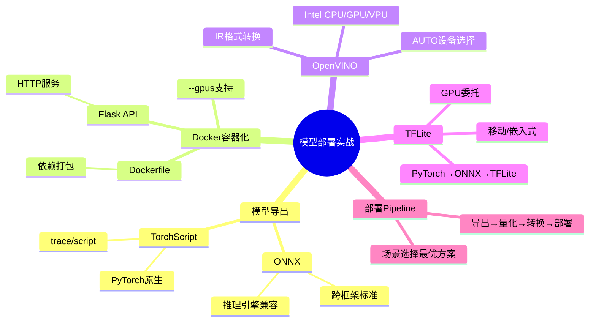
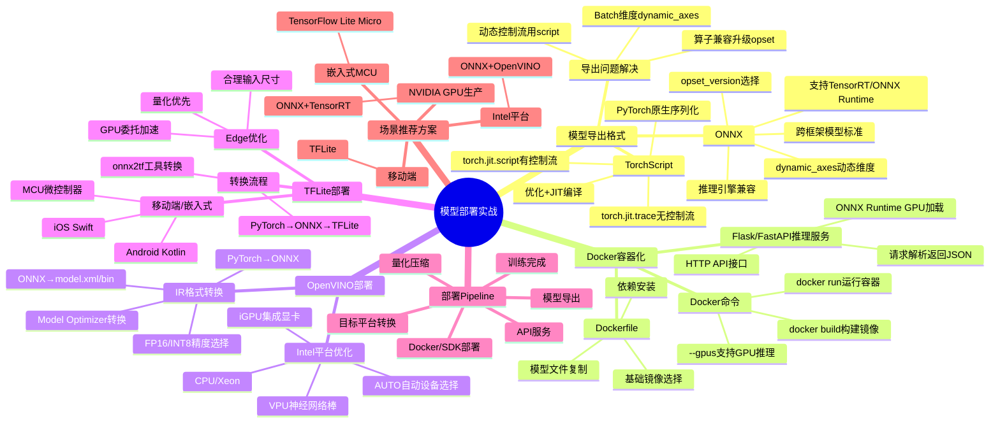

# 10-4 模型部署实战

## 学习目标

- 掌握 PyTorch 模型导出为 ONNX 和 TorchScript 的方法
- 理解 Docker 容器化部署模型服务的完整流程
- 了解 OpenVINO（TPU/集成显卡）和 TFLite（移动/边缘）部署的实战方法

---

## 1. ONNX 导出

ONNX（Open Neural Network Exchange）是跨框架模型表示标准，可以将 PyTorch/TensorFlow 等模型导出为统一格式，供 TensorRT、ONNX Runtime、OpenVINO 等推理引擎使用。

### 1.1 基本导出

```python
import torch

model = MyModel().eval()

# 准备一个符合输入尺寸的示例张量
dummy_input = torch.randn(1, 3, 224, 224)

torch.onnx.export(
    model,
    dummy_input,
    "model.onnx",
    export_params=True,
    opset_version=13,         # ONNX 算子集版本，13 = 2020
    input_names=["input"],     # 输入节点名
    output_names=["output"],   # 输出节点名
    dynamic_axes={             # 支持动态维度
        "input": {0: "batch_size", 2: "height", 3: "width"},
        "output": {0: "batch_size"}
    }
)
```

### 1.2 导出复杂模型（带控制流）

如果模型包含 `if`/`for` 等控制流，需要先 traced（追踪）或脚本化：

```python
# TorchScript 方式（适合静态图）
script_model = torch.jit.script(model)
script_model.save("model.pt")

# traced 方式（适合动态控制流）
traced_model = torch.jit.trace(model, dummy_input)
traced_model.save("model_traced.pt")
```

### 1.3 验证 ONNX 模型

```python
import onnx

onnx_model = onnx.load("model.onnx")
onnx.checker.check_model(onnx_model)

# 用 ONNX Runtime 推理验证
import onnxruntime as ort
session = ort.InferenceSession("model.onnx")
output = session.run(None, {"input": np.random.randn(1, 3, 224, 224).astype(np.float32)})
```

### 1.4 常见导出问题

| 问题 | 解决方案 |
|---|---|
| 动态控制流（if/for）| 使用 `torch.jit.script` 而不是 `torch.jit.trace` |
| 算子不兼容 | 升级 PyTorch 和 ONNX opset 版本 |
| Batch Size 维度不一致 | 使用 `dynamic_axes` 标注可变维度 |
| 无法确定 input size | 提供完整的 `dummy_input` 形状 |

---

## 2. TorchScript 导出

TorchScript 是 PyTorch 的序列化格式，适合 PyTorch 原生推理。

### 2.1 trace 方式（适合没有控制流的模型）

```python
model = MyModel().eval()
traced = torch.jit.trace(model, torch.randn(1, 3, 224, 224))
traced.save("model_traced.pt")
```

### 2.2 script 方式（适合有控制流的模型）

```python
model = MyModel().eval()
scripted = torch.jit.script(model)
scripted.save("model_scripted.pt")
```

### 2.3 加载和使用

```python
loaded = torch.jit.load("model_traced.pt")
output = loaded(input_tensor)
```

TorchScript 支持 TorchScript 优化（代码优化、JIT 编译），但生态不如 ONNX 广泛，通常用于 PyTorch 到生产环境的快速过渡。

---

## 3. Docker 容器化部署

Docker 将模型和依赖打包为一个可移植的容器，适合生产环境部署。

### 3.1 Dockerfile 示例

```dockerfile
# 安装 PyTorch + ONNX Runtime 镜像
FROM pytorch/pytorch:2.0.1-cuda11.7-cudnn8-runtime

WORKDIR /app

# 复制模型文件
COPY model.onnx /app/model.onnx
COPY inference.py /app/inference.py

# 安装 ONNX Runtime
RUN pip install onnxruntime-gpu==1.15.1

EXPOSE 8501

CMD ["python", "inference.py"]
```

### 3.2 编写推理服务（inference.py）

```python
import onnxruntime as ort
from flask import Flask, request, jsonify
import numpy as np

app = Flask(__name__)

# 加载模型（GPU 推理）
session = ort.InferenceSession(
    "/app/model.onnx",
    providers=[('CUDAExecutionProvider', {'device_id': 0})]
)
input_name = session.get_inputs()[0].name

@app.route("/predict", methods=["POST"])
def predict():
    data = request.json["input"]
    tensor = np.array(data, dtype=np.float32)
    output = session.run(None, {input_name: tensor})[0]
    return jsonify({"prediction": output.tolist()})

if __name__ == "__main__":
    app.run(host="0.0.0.0", port=8501)
```

### 3.3 构建和运行

```bash
# 构建镜像
docker build -t my-model-service:v1 .

# 运行容器
docker run --gpus all -p 8501:8501 my-model-service:v1
```

---

## 4. OpenVINO 部署（TPU / 集成显卡）

Intel OpenVINO 主要用于 Intel CPU、iGPU（集成显卡）和 VPU（NCS2 等）。

### 4.1 模型转换（PyTorch → OpenVINO IR）

```bash
# 1. PyTorch → ONNX
torch.onnx.export(model, dummy_input, "model.onnx")

# 2. ONNX → OpenVINO IR（使用 Model Optimizer）
ov_model = mo.build_model("model.onnx", precision="FP16")
ov_model.serialize("model.xml")
```

### 4.2 Python 推理

```python
from openvino.runtime import Core

ie = Core()
model = ie.read_model("model.xml")
compile_model = ie.compile_model(model, device_name="GPU")  # 或 "CPU", "MYRIAD"

input_layer = compile_model.input(0)
output_layer = compile_model.output(0)
results = compile_model({"input": input_tensor})[output_layer]
```

### 4.3 支持的设备

| 设备 | 说明 |
|---|---|
| CPU | Intel Xeon/Core，最通用 |
| GPU | Intel 集成显卡，支持 FP16/INT8 |
| MYRIAD | Intel Neural Compute Stick（VPU）|
| AUTO | 自动选择可用设备 |

---

## 5. TensorFlow Lite 部署（移动 / 边缘）

TFLite 主要用于移动端（Android/iOS）和嵌入式设备。

### 5.1 PyTorch → ONNX → TFLite

```bash
# 1. PyTorch → ONNX
torch.onnx.export(model, dummy_input, "model.onnx")

# 2. ONNX → TFLite
pip install onnx-tflite
onnx2tf model.onnx -o model.tflite
```

### 5.2 Android 部署（Kotlin）

```kotlin
val interpreter = Interpreter(FileModel.loadFile(context, "model.tflite"))
val inputBuffer = TensorBuffer.createFixedSize(intArrayOf(1, 224, 224, 3), DataType.FLOAT32)
inputBuffer.loadArray(inputData)
interpreter.run(inputBuffer.buffer, outputBuffer.buffer)
```

### 5.3 iOS 部署（Swift）

```swift
let interpreter = try Interpreter(modelPath: "model.tflite")
let inputTensor = try interpreter.input(at: 0)
try inputTensor.copy(from: inputData)
try interpreter.invoke()
let outputTensor = try interpreter.output(at: 0)
```

### 5.4 Edge 优化建议

- **输入尺寸**：选择合理的分辨率，不要一味追求高精度
- **量化优先**：边缘设备优先使用 INT8
- **GPU 委托**：移动端使用 GPU 委托（iOS Core ML delegate、Android GPU delegate）

---

## 6. 完整部署 Pipeline

```
PyTorch/TensorFlow 训练完成
        ↓
   模型导出（ONNX/TorchScript/TFLite）
        ↓
    模型量化（INT8/FP16）
        ↓
   目标平台转换（TensorRT/OpenVINO/TFLite）
        ↓
   Docker 容器化 / 直接部署
        ↓
   API 服务或嵌入式 SDK
```

| 场景 | 推荐方案 |
|---|---|
| NVIDIA GPU 生产服务 | ONNX + TensorRT |
| Intel CPU / iGPU | ONNX + OpenVINO |
| 移动端（Android/iOS）| TFLite |
| 嵌入式 MCU | TensorFlow Lite for Microcontrollers |

---

---

## 本章小结

本章介绍了模型部署的完整流程与实战方法。

1. **模型导出**：ONNX 是跨框架模型表示标准，支持 TensorRT、ONNX Runtime、OpenVINO 等多种推理引擎。TorchScript 是 PyTorch 原生的序列化格式，适合无控制流的模型使用 `torch.jit.trace`，有控制流的模型使用 `torch.jit.script`。

2. **Docker 容器化部署**：将模型、依赖和推理服务打包为容器，实现"一次构建，到处运行"。配合 Flask/FastAPI 等 Web 框架可快速搭建模型 API 服务。`--gpus` 参数支持容器内 GPU 推理。

3. **OpenVINO 部署**：针对 Intel 平台（CPU、iGPU、VPU）优化。模型需先转换为 OpenVINO IR 格式（.xml/.bin），支持 FP16/INT8 精度选择和 AUTO 设备自动选择。

4. **TFLite 部署**：面向移动端（Android/iOS）和嵌入式设备。通过 ONNX 作为中间格式可实现 PyTorch → ONNX → TFLite 的转换。Edge 部署需优先考虑量化、输入尺寸合理化和硬件委托（GPU Delegate）。

5. **部署 Pipeline 最佳实践**：根据目标平台选择合适的导出格式和推理引擎，大型项目推荐 Docker 容器化保证一致性，边缘部署优先量化压缩。



---

## 参考资料

1. ONNX Official Documentation: https://onnxruntime.ai/
2. PyTorch TorchScript: https://pytorch.org/docs/stable/jit.html
3. TensorRT Documentation: https://docs.nvidia.com/deeplearning/tensorrt/
4. OpenVINO Documentation: https://docs.openvino.ai/
5. TensorFlow Lite Documentation: https://www.tensorflow.org/lite

---

## 知识点思维导图

