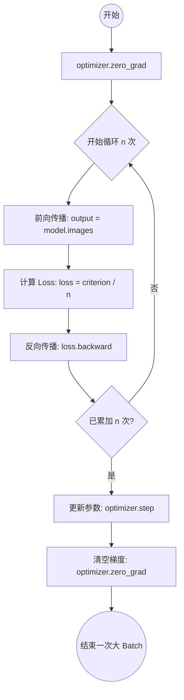
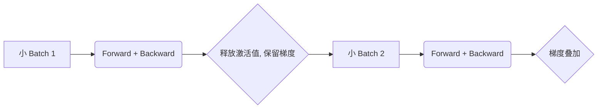

# 10-5 梯度累加与显存优化 (Gradient Accumulation)

> **这是一篇补充阅读章节。** 在深度学习实战中，我们经常会遇到显存不足（OOM）的情况，尤其是在使用大型语言模型（LLM）或高分辨率图像模型时。梯度累加是解决这一问题的最有效、最简单的工程技巧之一。

## 学习目标
- 理解大 Batch 训练对模型稳定性的影响。
- 掌握梯度累加的核心原理与显存优化机制。
- 能够熟练使用 PyTorch 实现梯度累加。
- 了解梯度累加与 Batch Normalization 的相互影响及调整方案。

---

## 1. 背景与动机：为什么需要梯度累加？

在深度学习训练中，**Batch Size（批大小）** 是一个关键的超参数。
- **大 Batch 的好处**：梯度估计更准确，训练曲线更平滑，且能更好地利用 GPU 的并行计算能力。
- **显存限制**：现代模型（如 Transformer、ResNet-152）的计算图和参数量巨大。增加 Batch Size 会导致激活显存近似线性增长，最终触发 `RuntimeError: CUDA out of memory`。

**梯度累加（Gradient Accumulation）** 允许我们在有限的显存下，通过多次小 Batch 的前向传播和梯度计算，模拟出大 Batch 的训练效果。

---

## 2. 核心原理

梯度累加的本质是利用了**导数的线性性质**：多个小样本梯度的平均值等于这些样本作为一个整体时的梯度。

### 2.1 流程图示



### 2.2 关键点说明
1. **不清除梯度**：在每一小步（accumulation step）中，我们调用 `loss.backward()`，但**不调用** `optimizer.zero_grad()`。PyTorch 默认会将新计算的梯度叠加在旧梯度上。
2. **Loss 缩放**：由于梯度是累加的，为了保持梯度的量级与真实大 Batch 一致，我们需要将每个小 Batch 的 Loss 除以累加步数 $n$。

---

## 3. PyTorch 实现代码

下面是一个标准的梯度累加实现模板：

```python
import torch

# 假设配置
device = torch.device("cuda" if torch.cuda.is_available() else "cpu")
model = MyModel().to(device)
optimizer = torch.optim.Adam(model.parameters(), lr=1e-3)
criterion = torch.nn.CrossEntropyLoss()

# 累加步数：模拟真实 BatchSize = train_loader.batch_size * accumulation_steps
accumulation_steps = 4 

model.train()
optimizer.zero_grad() # 初始清空

for i, (images, target) in enumerate(train_loader):
    images, target = images.to(device), target.to(device)
    
    # 1. 前向传播
    outputs = model(images)
    loss = criterion(outputs, target)
    
    # 2. 关键：Loss 缩放
    # 因为梯度是累加的，所以 Loss 也要按步数平均
    loss = loss / accumulation_steps
    
    # 3. 反向传播：计算梯度并累加到 buffer 中
    loss.backward()
    
    # 4. 达到累加步数后进行参数更新
    if (i + 1) % accumulation_steps == 0:
        optimizer.step()        # 更新参数
        optimizer.zero_grad()   # 真正清空梯度 buffer
        
    # 注意：如果 dataset 长度不能被 accumulation_steps 整除
    # 训练循环结束时可能需要额外处理最后剩余的梯度
```

---

## 4. 梯度累加 vs. 直接大 Batch

| 特性 | 梯度累加 (Accu Steps=N) | 直接大 Batch (BatchSize * N) |
| :--- | :--- | :--- |
| **显存占用** | 极低（仅需单次小 Batch 的显存） | 极高（随 BatchSize 线性增长） |
| **显存优化原理** | 空间换时间（分批计算） | 空间换效率（一次性加载） |
| **训练速度** | 略慢（多次前向/反向开销） | 最快（最大化利用算力） |
| **BN 统计量** | 基于每个小 Batch 计算 | 基于完整大 Batch 计算 |
| **数值稳定性** | 基本一致 | 理论上最稳 |

---

## 5. 与 Batch Normalization (BN) 的微妙关系

这是很多开发者容易忽略的细节：**梯度累加并不等同于真正的 Batch Normalization 大 Batch。**

- **机制差异**：BN 在 `forward` 阶段就会计算当前 Batch 的均值和方差并更新 Running Mean/Var。梯度累加时，BN 每次只看到 $1/N$ 的数据。
- **后果**：如果你的 `accumulation_steps` 很大，但每个小 Batch 的大小（比如 2 或 4）太小，BN 的统计量会剧烈抖动，导致模型难以收敛。
- **优化技巧**：
    1. **调低 Momentum**：适当降低 BN 的 momentum 参数（如从 0.1 降到 0.01），让统计量更新更平滑。
    2. **使用 Group Normalization (GN) 或 Layer Normalization (LN)**：这些归一化方式不依赖 Batch 统计量，是梯度累加的完美搭档。

---

## 6. 学习率缩放规则：Linear Scaling Rule

当你通过梯度累加将等效 Batch Size 扩大了 $N$ 倍时，根据经验法则，**学习率也应该相应扩大 $N$ 倍**。

- **逻辑**：Batch 越大，梯度越准，我们可以迈更大的步子。
- **参考**：参见 [10-1 学习率策略](./10-1-学习率与Batch-Size.md)。

---

## 7. 显存分析：为什么能省显存？

显存占用主要由三部分组成：
1. **模型参数**：固定。
2. **优化器状态**：固定（如 Adam 的一阶/二阶动量）。
3. **中间激活值 (Activations)**：随 Batch Size 线性增长。

**梯度累加的原理**是：在每次 `backward()` 结束后，PyTorch 会释放当前小 Batch 的计算图和中间激活值，只保留梯度张量（Grad Tensor）。梯度张量的大小只与参数量有关，与 Batch Size 无关。



---

## 8. 实战注意事项

1. **累加步数不宜过大**：步数太多会导致更新频率太低，且可能积累浮点数舍入误差。
2. **配合混合精度 (AMP)**：梯度累加与混合精度（参见 [10-2 混合精度训练](./10-2-混合精度与分布式训练.md)）结合使用，可以进一步压榨显存，通常能实现 2-4 倍的 Batch 提升。
3. **多任务学习**：在多任务学习中，可以分别计算 Task A 和 Task B 的 Loss 并依次 `backward()`，最后统一 `step()`。

---

## 总结
梯度累加是深度学习工程师的“降龙十八掌”：它简单、通用且异常强大。当你发现 GPU 显存限制了你的模型表现时，请务必尝试这个技巧。

**关联阅读：**
- 10-1 学习率策略
- 10-2 混合精度训练 (AMP)
