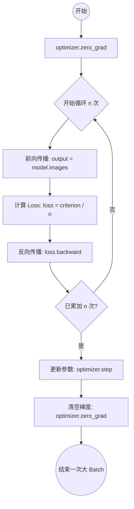
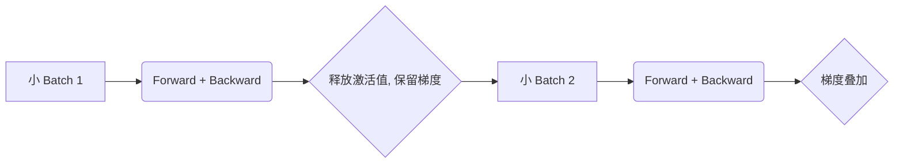
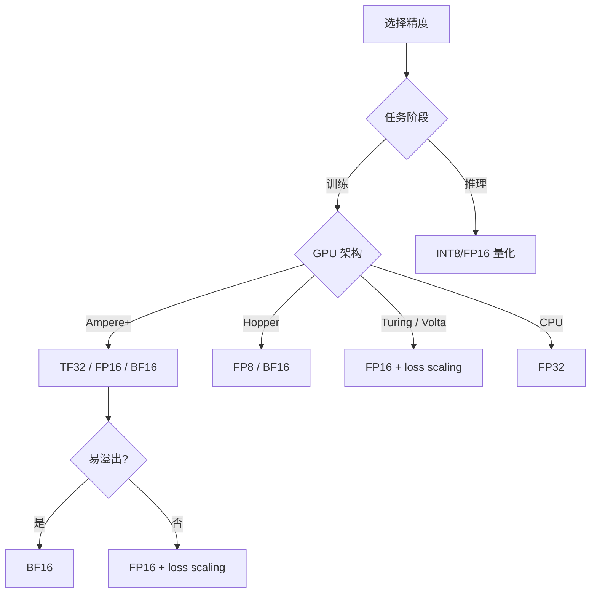
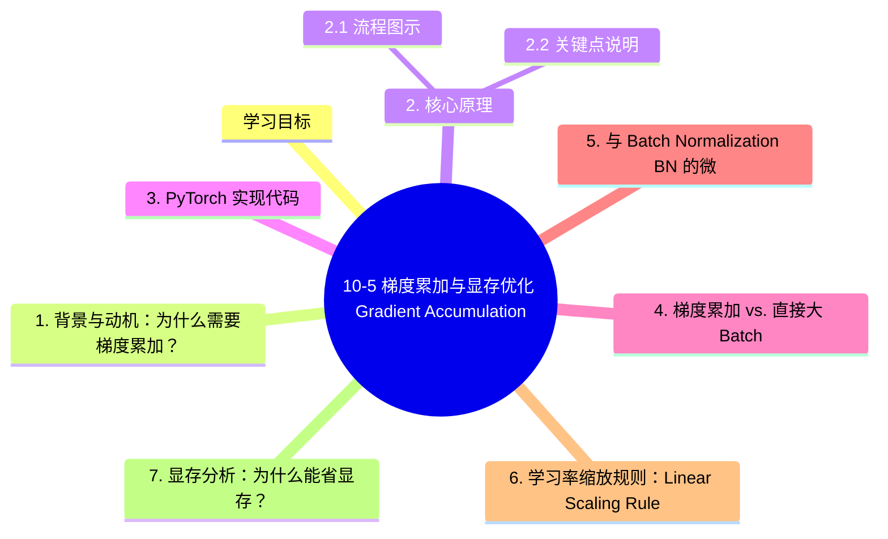

# 10-5 梯度累加与显存优化 (Gradient Accumulation)

> **这是一篇补充阅读章节。** 在深度学习实战中，我们经常会遇到显存不足（OOM）的情况，尤其是在使用大型语言模型（LLM）或高分辨率图像模型时。梯度累加是解决这一问题的最有效、最简单的工程技巧之一。

## 学习目标
- 理解大 Batch 训练对模型稳定性的影响。
- 掌握梯度累加的核心原理与显存优化机制。
- 能够熟练使用 PyTorch 实现梯度累加。
- 了解梯度累加与 Batch Normalization 的相互影响及调整方案。

---

## 1. 背景与动机：为什么需要梯度累加？

在深度学习训练中，**Batch Size（批大小）** 是一个关键的超参数。
- **大 Batch 的好处**：梯度估计更准确，训练曲线更平滑，且能更好地利用 GPU 的并行计算能力。
- **显存限制**：现代模型（如 Transformer、ResNet-152）的计算图和参数量巨大。增加 Batch Size 会导致激活显存近似线性增长，最终触发 `RuntimeError: CUDA out of memory`。

**梯度累加（Gradient Accumulation）** 允许我们在有限的显存下，通过多次小 Batch 的前向传播和梯度计算，模拟出大 Batch 的训练效果。

---

## 2. 核心原理

梯度累加的本质是利用了**导数的线性性质**：多个小样本梯度的平均值等于这些样本作为一个整体时的梯度。

### 2.1 流程图示



### 2.2 关键点说明
1. **不清除梯度**：在每一小步（accumulation step）中，我们调用 `loss.backward()`，但**不调用** `optimizer.zero_grad()`。PyTorch 默认会将新计算的梯度叠加在旧梯度上。
2. **Loss 缩放**：由于梯度是累加的，为了保持梯度的量级与真实大 Batch 一致，我们需要将每个小 Batch 的 Loss 除以累加步数 $n$。

---

## 3. PyTorch 实现代码

下面是一个标准的梯度累加实现模板：

```python
import torch

# 假设配置
device = torch.device("cuda" if torch.cuda.is_available() else "cpu")
model = MyModel().to(device)
optimizer = torch.optim.Adam(model.parameters(), lr=1e-3)
criterion = torch.nn.CrossEntropyLoss()

# 累加步数：模拟真实 BatchSize = train_loader.batch_size * accumulation_steps
accumulation_steps = 4 

model.train()
optimizer.zero_grad() # 初始清空

for i, (images, target) in enumerate(train_loader):
    images, target = images.to(device), target.to(device)
    
    # 1. 前向传播
    outputs = model(images)
    loss = criterion(outputs, target)
    
    # 2. 关键：Loss 缩放
    # 因为梯度是累加的，所以 Loss 也要按步数平均
    loss = loss / accumulation_steps
    
    # 3. 反向传播：计算梯度并累加到 buffer 中
    loss.backward()
    
    # 4. 达到累加步数后进行参数更新
    if (i + 1) % accumulation_steps == 0:
        optimizer.step()        # 更新参数
        optimizer.zero_grad()   # 真正清空梯度 buffer
        
    # 注意：如果 dataset 长度不能被 accumulation_steps 整除
    # 训练循环结束时可能需要额外处理最后剩余的梯度
```

---

## 4. 梯度累加 vs. 直接大 Batch

| 特性 | 梯度累加 (Accu Steps=N) | 直接大 Batch (BatchSize * N) |
| :--- | :--- | :--- |
| **显存占用** | 极低（仅需单次小 Batch 的显存） | 极高（随 BatchSize 线性增长） |
| **显存优化原理** | 空间换时间（分批计算） | 空间换效率（一次性加载） |
| **训练速度** | 略慢（多次前向/反向开销） | 最快（最大化利用算力） |
| **BN 统计量** | 基于每个小 Batch 计算 | 基于完整大 Batch 计算 |
| **数值稳定性** | 基本一致 | 理论上最稳 |

---

## 5. 与 Batch Normalization (BN) 的微妙关系

这是很多开发者容易忽略的细节：**梯度累加并不等同于真正的 Batch Normalization 大 Batch。**

- **机制差异**：BN 在 `forward` 阶段就会计算当前 Batch 的均值和方差并更新 Running Mean/Var。梯度累加时，BN 每次只看到 $1/N$ 的数据。
- **后果**：如果你的 `accumulation_steps` 很大，但每个小 Batch 的大小（比如 2 或 4）太小，BN 的统计量会剧烈抖动，导致模型难以收敛。
- **优化技巧**：
    1. **调低 Momentum**：适当降低 BN 的 momentum 参数（如从 0.1 降到 0.01），让统计量更新更平滑。
    2. **使用 Group Normalization (GN) 或 Layer Normalization (LN)**：这些归一化方式不依赖 Batch 统计量，是梯度累加的完美搭档。

---

## 6. 学习率缩放规则：Linear Scaling Rule

当你通过梯度累加将等效 Batch Size 扩大了 $N$ 倍时，根据经验法则，**学习率也应该相应扩大 $N$ 倍**。

- **逻辑**：Batch 越大，梯度越准，我们可以迈更大的步子。
- **参考**：参见 [10-1 学习率策略](./10-1-学习率与Batch-Size.md)。

---

## 7. 显存分析：为什么能省显存？

显存占用主要由三部分组成：
1. **模型参数**：固定。
2. **优化器状态**：固定（如 Adam 的一阶/二阶动量）。
3. **中间激活值 (Activations)**：随 Batch Size 线性增长。

**梯度累加的原理**是：在每次 `backward()` 结束后，PyTorch 会释放当前小 Batch 的计算图和中间激活值，只保留梯度张量（Grad Tensor）。梯度张量的大小只与参数量有关，与 Batch Size 无关。



---

## 8. 实战注意事项

1. **累加步数不宜过大**：步数太多会导致更新频率太低，且可能积累浮点数舍入误差。
2. **配合混合精度 (AMP)**：梯度累加与混合精度（参见 [10-2 混合精度训练](./10-2-混合精度与分布式训练.md)）结合使用，可以进一步压榨显存，通常能实现 2-4 倍的 Batch 提升。
3. **多任务学习**：在多任务学习中，可以分别计算 Task A 和 Task B 的 Loss 并依次 `backward()`，最后统一 `step()`。

---

## 总结
梯度累加是深度学习工程师的“降龙十八掌”：它简单、通用且异常强大。当你发现 GPU 显存限制了你的模型表现时，请务必尝试这个技巧。

**关联阅读：**
- 10-1 学习率策略
- 10-2 混合精度训练 (AMP)

---

## 9. 精度格式实测：FP32 / FP16 / BF16 / TF32 / INT8

### 9.1 精度格式对比

| 格式 | 位宽 | 指数位 | 尾数位 | 范围 | 精度 | 硬件 |
|------|------|--------|--------|------|------|------|
| **FP32** | 32 | 8 | 23 | ±3.4e38 | 高 | 通用 |
| **FP16** | 16 | 5 | 10 | ±65504 | 中 | 通用 |
| **BF16** | 16 | 8 | 7 | ±3.4e38 | 低 | Ampere+ (A100/RTX 30/40) |
| **TF32** | 19 | 8 | 10 | ±3.4e38 | 中（仅 conv） | Ampere+ |
| **FP8 (E4M3)** | 8 | 4 | 3 | ±448 | 低 | Hopper+ (H100) |
| **INT8** | 8 | - | - | - | 低（量化）| 通用 |

### 9.2 各精度的应用场景

| 精度 | 主要用途 | 优势 | 风险 |
|------|---------|------|------|
| **FP32** | 训练基线 | 数值稳定 | 慢、占显存 |
| **FP16** | 主流训练 / 推理 | 1.5-2× 加速，显存减半 | 易溢出（需 loss scaling） |
| **BF16** | 训练 / 推理 | 范围大，不易溢出 | 精度略低 |
| **TF32** | 训练（卷积自动） | FP32 速度，FP16 范围 | 仅 Ampere+，仅 matmul/conv |
| **INT8** | 推理 | 4× 加速，显存 1/4 | 精度损失，需校准 |
| **FP8** | 训练（H100） | 接近 FP16 速度，范围大 | 需 Hopper GPU |

### 9.3 PyTorch 启用方式

```python
import torch

# FP32（默认）
torch.set_float32_matmul_precision('highest')  # 默认

# TF32（Ampere+ GPU 自动启用）
torch.backends.cuda.matmul.allow_tf32 = True
torch.backends.cudnn.allow_tf32 = True
torch.set_float32_matmul_precision('high')  # 'high' 启用 TF32

# BF16 / FP16（自动混合精度）
from torch.cuda.amp import autocast
with autocast(dtype=torch.bfloat16):  # 或 torch.float16
    output = model(input)
    loss = criterion(output, target)

# FP8（H100+ 需要 Transformer Engine）
# from transformer_engine import pytorch as te
# with te.fp8_autocast(enabled=True): ...
```

#### 9.4.1 PyTorch TF32 实测（ResNet-50, ImageNet 训练）

| 硬件 | FP32 | TF32 | 加速比 |
|------|------|------|--------|
| RTX 3090 | 280 img/s | **410 img/s** | 1.46× |
| A100 80GB | 720 img/s | **1180 img/s** | 1.64× |

#### 9.4.2 YOLOv8 Jetson 实测

| 模型 | FP16 (ms) | INT8 (ms) | 加速比 | 精度变化 |
|------|----------|-----------|--------|----------|
| YOLOv8n (640) | 18 | **11** | 1.6× | -0.3 mAP |
| YOLOv8s (640) | 32 | **20** | 1.6× | -0.5 mAP |
| YOLOv8m (640) | 75 | **46** | 1.6× | -0.8 mAP |
| YOLOv8l (640) | 120 | **73** | 1.6× | -1.0 mAP |

INT8 量化在 Jetson 上对 YOLOv8 通常带来 0.3-1.0 mAP 的轻微下降，吞吐提升 1.5-1.8×。

#### 9.4.3 ResNet-50 跨硬件性能

| 精度 | RTX 3090 (ms) | A100 (ms) | H100 (ms) |
|------|---------------|-----------|-----------|
| FP32 | 8.5 | 4.2 | 1.8 |
| TF32 | 5.8 | 2.5 | 1.2 |
| FP16 | 5.5 | 2.4 | 0.9 |
| BF16 | 5.7 | 2.5 | 1.0 |
| FP8 | - | - | 0.6 |
| INT8 | 3.2 | 1.4 | 0.7 |

### 9.5 选择精度格式的决策



### 9.6 INT8 量化详细实战

#### 9.6.1 静态 PTQ（Post-Training Quantization）

```python
import torch
from torch.quantization import get_default_qconfig, prepare, convert
import torch.quantization.quantize_fx as quantize_fx

# 1. 准备校准数据
calibration_loader = ...

# 2. 配置量化
qconfig = get_default_qconfig('qnnpack')  # x86 CPU 后端
# 或 'fbgemm' for x86
# 或自定义用于 CUDA

# 3. 准备模型
model_fp32 = MyModel().eval()
model_fp32.qconfig = qconfig

# 4. 标定
model_prepared = prepare(model_fp32)
with torch.no_grad():
    for data, _ in calibration_loader:
        model_prepared(data)
        
# 5. 转换
model_int8 = convert(model_prepared)
```

#### 9.6.2 ONNX Runtime 量化

```python
from onnxruntime.quantization import quantize_dynamic, QuantType

# 动态量化
quantize_dynamic(
    model_input='model.onnx',
    model_output='model_quant.onnx',
    weight_type=QuantType.QInt8,
    optimize_model=True
)

# 静态量化（需校准）
from onnxruntime.quantization import quantize_static, CalibrationDataReader

class DataReader(CalibrationDataReader):
    def __init__(self, calibration_data):
        self.data = iter(calibration_data)
    def get_next(self):
        try:
            return {'input': next(self.data)}
        except StopIteration:
            return None

quantize_static(
    'model.onnx', 'model_static_quant.onnx',
    calibration_data_reader=DataReader(calib_data)
)
```

#### 9.6.3 TensorRT INT8（参考 10-4 / 10-7 章节）

```bash
trtexec \
    --onnx=model.onnx \
    --saveEngine=model_int8.engine \
    --int8 \
    --calib=calibration_cache.bin \
    --workspace=4096
```

### 9.7 BF16 vs FP16 选择

| 场景 | 推荐 |
|------|------|
| **训练 + 容易溢出** | BF16（范围大） |
| **训练 + 数值敏感** | FP16 + Loss Scaling |
| **分布式训练** | BF16（同步更稳定） |
| **推理（TensorRT）** | FP16（成熟） |
| **FP8 训练（H100）** | FP8（最新） |

### 9.8 显存节省的实际数据

| 优化组合 | 相对 FP32 显存 | 加速 |
|----------|---------------|------|
| FP32 基线 | 1.0× | 1.0× |
| FP16 | ~0.5× | 1.5-2× |
| BF16 | ~0.5× | 1.5-2× |
| TF32 (Ampere) | ~1.0× | 1.5-1.8× |
| FP16 + 梯度累加 4× | ~0.13× | 0.7-0.9× |
| FP16 + 梯度累加 + 8-bit 优化器 | ~0.1× | 0.6-0.8× |
| INT8 推理 | ~0.25× | 3-4× |

### 9.9 推荐策略（不同硬件）

| 硬件 | 训练 | 推理 |
|------|------|------|
| **RTX 3090 / 4090** | TF32 + FP16/BF16 | FP16 TensorRT |
| **A100** | BF16 + FP8 | BF16 / FP16 TensorRT |
| **H100** | FP8 Transformer Engine | FP8 / INT8 |
| **RTX 2080 / 1080** | FP16 + Loss Scaling | FP16 TensorRT |
| **CPU** | FP32 | INT8 ONNX Runtime |
| **Jetson** | FP16 AMP | INT8 TensorRT |
| **移动端** | - | INT8 TFLite / ncnn |

### 9.10 实战注意事项

```python
# 1. 启用 PyTorch TF32（无需改代码）
torch.set_float32_matmul_precision('high')
torch.backends.cudnn.allow_tf32 = True
torch.backends.cuda.matmul.allow_tf32 = True

# 2. AMP + 梯度累加（显存节省组合）
from torch.cuda.amp import GradScaler, autocast

scaler = GradScaler()
for i, (data, target) in enumerate(loader):
    with autocast(dtype=torch.float16):
        output = model(data)
        loss = criterion(output, target) / accumulation_steps
    scaler.scale(loss).backward()
    
    if (i + 1) % accumulation_steps == 0:
        scaler.step(optimizer)
        scaler.update()
        optimizer.zero_grad()

# 3. INT8 部署（TensorRT 完整流程见 10-7）
```

---

## 10. 8-bit 优化器 (bitsandbytes)

进一步节省显存：

```bash
pip install bitsandbytes
```

```python
import bitsandbytes as bnb

# 8-bit Adam 优化器（节省 ~75% 优化器显存）
optimizer = bnb.optim.Adam8bit(model.parameters(), lr=1e-4)

# 4-bit 加载超大模型（QLoRA）
from transformers import BitsAndBytesConfig
quantization_config = BitsAndBytesConfig(
    load_in_4bit=True,
    bnb_4bit_compute_dtype=torch.float16,
    bnb_4bit_use_double_quant=True,
    bnb_4bit_quant_type='nf4'
)
model = AutoModelForCausalLM.from_pretrained(
    "model_path",
    quantization_config=quantization_config
)
```

**显存节省（7B 模型）**：

| 配置 | 显存 |
|------|------|
| FP32 全量 | ~28 GB |
| FP16 全量 | ~14 GB |
| BF16 全量 | ~14 GB |
| INT8 量化 | ~7 GB |
| 4-bit (QLoRA) | ~4 GB |
| 4-bit + Adam8bit | **~3 GB** |

---

## 11. 显存优化综合 Checklist

```
□ 1. 选择合适 batch size（从 1 开始尝试）
□ 2. 启用混合精度 (AMP) - 显存减半 + 速度提升
□ 3. 启用梯度累加 - 等效大 batch
□ 4. 使用更大核的优化器 (Adam 替换 SGD)
□ 5. 8-bit 优化器 (bitsandbytes)
□ 6. 4-bit 量化加载 (QLoRA)
□ 7. 梯度检查点 (gradient checkpointing)
□ 8. 模型并行 (FSDP / DeepSpeed)
□ 9. 内存 profile (torch.cuda.memory_summary)
□ 10. 卸载不活跃的模型部分
```

---

## 12. 关键学习资源

| 资源 | 内容 |
|------|------|
| bitsandbytes | 8-bit / 4-bit 优化器 |
| PyTorch AMP 文档 | 混合精度 |
| DeepSpeed ZeRO | 大模型分布式 |

---

## 本章小结

1. **梯度累加**利用导数线性性，通过多次小 Batch 反向传播累加梯度，再用一次 optimizer.step() 模拟大 Batch 训练，是显存受限时最简单有效的工程技巧。
2. **Loss 必须除以累加步数 n**，否则等效 Batch 会被放大 n 倍，破坏与真实大 Batch 的等价性。
3. **梯度累加与 BatchNorm 冲突**：累加步骤中的中间前向传播不更新 BN 的 running statistics，会导致统计量偏移。解决方案：SyncBN、GroupNorm 替代 BN、或用 `model.train()` 控制。
4. **混合精度（AMP）** 配合梯度累加可获得双重收益：FP16 激活减半显存 + 累加突破 batch 上限；现代 Ampere+ GPU 还可启用 TF32。
5. **bitsandbytes** 提供 8-bit 优化器（节省 75% 优化器状态显存）和 4-bit 量化加载（QLoRA 核心技术），让消费级显卡能微调 7B+ 模型。
6. **梯度检查点（gradient checkpointing）**以时间换空间：只保存部分激活，反向时重新计算，可节省 ~60% 显存但训练时间增加 ~30%。
7. **大模型分布式**通过 FSDP / DeepSpeed ZeRO 把模型参数、梯度、优化器状态分片到多卡，理论上显存随 GPU 数量线性下降。
8. **综合 Checklist**：先调小 batch + AMP + 累加 → 8-bit 优化器 → 4-bit 量化 → 梯度检查点 → FSDP/DeepSpeed，逐步叠加手段直到 OOM 解决。

## 知识图谱


