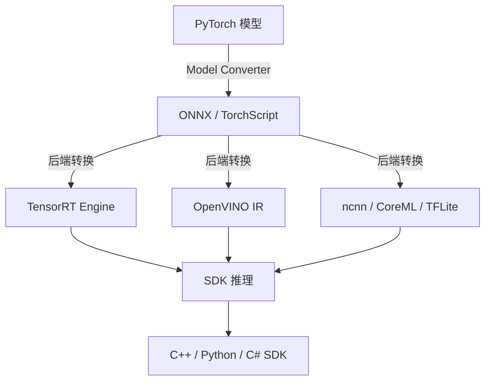
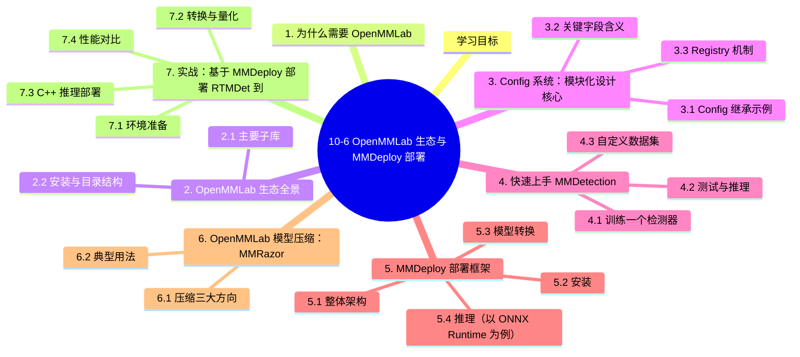

# 10-6 OpenMMLab 生态与 MMDeploy 部署

## 学习目标

- 了解 OpenMMLab 生态的整体结构与各子库定位
- 掌握 mmdetection / mmsegmentation / mmpretrain / mmrazor 的使用场景
- 理解 MMDeploy 的工作原理（模型转换 → 推理后端 → SDK）
- 能够基于 MMDeploy 完成检测/分割模型的部署 Pipeline
- 了解 ONNX → TensorRT/OpenVINO/ncnn 的多后端落地策略

---

## 1. 为什么需要 OpenMMLab

深度学习项目从研究到落地，往往要跨越训练框架、模型实现、推理后端、硬件适配四道关卡。OpenMMLab 是上海人工智能实验室开源的**算法仓库体系**，覆盖检测、分割、分类、姿态、超分、3D、关键点等几乎所有主流视觉任务，并提供统一的训练接口和模块化配置。

**核心价值：**

| 价值 | 说明 |
|------|------|
| **统一接口** | 所有子库使用同一套 Config + Registry 机制 |
| **模块化设计** | Backbone、Neck、Head、Loss 可自由组合 |
| **算法覆盖广** | 包含 SOTA 模型（RTMDet、Mask2Former、InternImage 等）|
| **可复现性强** | 公开训练日志与权重，方便复现和对比 |
| **工业落地导向** | 配套 MMDeploy 做模型转换与多后端部署 |

---

## 2. OpenMMLab 生态全景

### 2.1 主要子库

| 子库 | 任务 | 典型模型 |
|------|------|----------|
| **MMDetection** | 目标检测、实例分割、全景分割 | Faster R-CNN、YOLOX、RTMDet、DETR、Mask2Former |
| **MMSegmentation** | 语义分割 | FCN、U-Net、DeepLabV3+、Mask2Former、Segmenter |
| **MMPretrain** | 图像分类、自监督预训练 | ResNet、ViT、Swin、MAE、BEiT |
| **MMPose** | 人体姿态估计 | HRNet、SimCC、RTMPose |
| **MMTracking** | 视频目标跟踪、多目标跟踪 | SORT、ByteTrack |
| **MMOCR** | 文字检测、识别 | DBNet、CRNN、SVTR |
| **MMagic** | 图像/视频生成、超分辨率、编辑 | Stable Diffusion、BasicSR、Real-ESRGAN |
| **MMRazor** | 模型剪枝、量化、知识蒸馏 | AutoSlim、DSMQ |
| **MMDeploy** | 模型转换与多后端部署 | ONNX/TensorRT/OpenVINO/ncnn |

### 2.2 安装与目录结构

```bash
# 推荐：先装 mim（包管理器）
pip install -U openmim
mim install mmengine
mim install "mmcv>=2.0.0"
mim install mmdet            # 检测
mim install mmsegmentation  # 分割
mim install mmpretrain       # 分类
mim install mmdeploy         # 部署
```

典型项目结构（以 MMDetection 为例）：

```
mmdetection/
├── configs/                 # 模型配置文件
│   ├── _base_/              # 基础配置（数据集、模型、调度器等）
│   ├── faster_rcnn/         # Faster R-CNN 系列
│   ├── yolox/               # YOLOX 系列
│   └── rtmdet/              # RTMDet 系列
├── mmdet/                   # 核心代码
│   ├── models/              # 模型实现
│   ├── datasets/            # 数据集处理
│   ├── engine/              # 训练/测试引擎
│   └── evaluation/          # 评估指标
├── tools/
│   ├── train.py
│   ├── test.py
│   └── analysis_tools/
└── checkpoints/             # 预训练权重
```

---

## 3. Config 系统：模块化设计核心

OpenMMLab 的配置系统是其最强大的特性之一。它通过 Python 文件 + 继承机制实现灵活组合。

### 3.1 Config 继承示例

```python
# configs/rtmdet/rtmdet_l_8xb32-300e_coco.py
_base_ = [
    '../_base_/datasets/coco_detection.py',     # 数据集
    '../_base_/default_runtime.py',             # 运行时
    '../_base_/schedules/schedule_1x.py',       # 调度器
    '../_base_/models/rtmdet_l.py'              # 模型
]

# 覆盖或新增
model = dict(
    bbox_head=dict(num_classes=80)  # COCO 80 类
)

# 自定义训练参数
optim_wrapper = dict(
    optimizer=dict(type='AdamW', lr=0.001, weight_decay=0.05),
    paramwise_cfg=dict(
        custom_keys={'backbone': dict(lr_mult=0.1)}
    )
)
```

### 3.2 关键字段含义

| 字段 | 说明 |
|------|------|
| `model` | 模型结构（backbone/neck/head/train_cfg/test_cfg） |
| `dataset_type` | 数据集类型（`CocoDataset`、`VOCDataset` 等） |
| `data_root` | 数据根目录 |
| `train_pipeline` / `test_pipeline` | 数据增强与预处理 pipeline |
| `optim_wrapper` | 优化器配置（lr、weight_decay、grad_clip） |
| `paramwise_cfg` | 参数分组（如 backbone 用小学习率） |
| `train_cfg` / `val_cfg` / `test_cfg` | 各阶段配置（loop、interval、evaluator） |
| `default_hooks` | 日志、checkpoint、early stopping 等钩子 |
| `visualizer` | 可视化器（训练日志、图像、特征图） |
| `log_processor` | 日志处理（窗口大小、平滑） |

### 3.3 Registry 机制

OpenMMLab 用 `Registry` 实现模块即插即用：

```python
# 注册一个新 Backbone
from mmengine.registry import MODELS

@MODELS.register_module()
class MyBackbone(BaseModule):
    def __init__(self, ...):
        super().__init__()
        ...
    def forward(self, x):
        return x

# 在 Config 中使用
model = dict(
    backbone=dict(type='MyBackbone', ...),  # 按字符串查找
    ...
)
```

---

## 4. 快速上手 MMDetection

### 4.1 训练一个检测器

```bash
# 单卡
python tools/train.py configs/rtmdet/rtmdet_l_8xb32-300e_coco.py

# 多卡
bash tools/dist_train.sh configs/rtmdet/rtmdet_l_8xb32-300e_coco.py 8
```

### 4.2 测试与推理

```python
from mmdet.apis import init_detector, inference_detector
import mmcv

# 加载配置和权重
config_file = 'configs/rtmdet/rtmdet_l_8xb32-300e_coco.py'
checkpoint_file = 'checkpoints/rtmdet_l_8xb32-300e_coco_20220719_112030-5a0be7c4.pth'

model = init_detector(config_file, checkpoint_file, device='cuda:0')

# 单张图像推理
result = inference_detector(model, 'demo.jpg')

# 可视化
from mmdet.visualization import DetLocalVisualizer
visualizer = DetLocalVisualizer()
visualizer.add_datasample(
    'result', mmcv.imread('demo.jpg'),
    data_sample=result, draw_gt=False,
    out_file='result.jpg'
)
```

### 4.3 自定义数据集

```python
# 1. 准备数据集（YOLO/COCO 格式均可）
dataset = dict(
    type='CocoDataset',
    data_root='data/my_dataset',
    metainfo=dict(classes=('cat', 'dog', 'bird')),  # 类别
    ann_file='annotations/instances_train.json',     # 标注
    data_prefix=dict(img='images/train/')            # 图像
)
```

也可继承 `BaseDataset` 自定义数据加载逻辑。常见实践：

- `mmdet/datasets/coco_dataset.py` → 继承为自定义数据集
- `mmdet/datasets/transforms/loading.py` → 自定义加载逻辑
- `mmdet/datasets/transforms/transforms.py` → 自定义数据增强

---

## 5. MMDeploy 部署框架

MMDeploy 是 OpenMMLab 的部署引擎，将训练好的模型转换为多种推理后端格式。

### 5.1 整体架构



**核心模块：**

| 模块 | 功能 |
|------|------|
| **Model Converter** | PyTorch → ONNX / TorchScript |
| **Backend Adapter** | ONNX → 各后端格式（TensorRT、OpenVINO、ncnn） |
| **SDK** | 各后端的统一推理接口 |
| **Profiler** | 模型性能分析（FLOPs、Params、Latency） |

### 5.2 安装

```bash
mim install mmdeploy

# 安装后端依赖（按需）
pip install onnxruntime                   # CPU ONNX 推理
pip install onnxruntime-gpu               # GPU ONNX 推理
# TensorRT（需 NVIDIA 环境）
pip install mmdeploy-python-backend-tensorrt
# OpenVINO（需 Intel 环境）
pip install mmdeploy-python-backend-openvino
```

### 5.3 模型转换

```python
from mmdeploy.apis import torch2onnx
import torch

# 配置
deploy_cfg = 'configs/mmdet/detection/detection_onnxruntime_dynamic.py'
model_cfg = 'configs/rtmdet/rtmdet_l_8xb32-300e_coco.py'
checkpoint = 'checkpoints/rtmdet_l_8xb32-300e_coco_20220719_112030-5a0be7c4.pth'
img = 'demo.jpg'
work_dir = 'work_dir/rtmdet_onnx'

# 转 ONNX
torch2onnx(
    img=img,
    work_dir=work_dir,
    deploy_cfg=deploy_cfg,
    model_cfg=model_cfg,
    model_checkpoint=checkpoint,
    device='cpu'  # 转换时建议用 CPU
)
```

### 5.4 推理（以 ONNX Runtime 为例）

```python
from mmdeploy.apis.utils import build_task_processor
from mmdeploy.utils import get_input_shape, load_config
import torch

deploy_cfg_path = 'configs/mmdet/detection/detection_onnxruntime_dynamic.py'
model_cfg_path = 'configs/rtmdet/rtmdet_l_8xb32-300e_coco.py'
deploy_cfg, model_cfg = load_config(deploy_cfg_path, model_cfg_path)

task_processor = build_task_processor(model_cfg, deploy_cfg, 'cpu')

# 读取图像并预处理
input_shape = get_input_shape(deploy_cfg)
model_inputs, _ = task_processor.create_input('demo.jpg', input_shape)

# 加载 ONNX 模型
from mmdeploy.backend.onnxruntime import ORTWrapper
model = ORTWrapper('work_dir/rtmdet_onnx/end2end.onnx',
                   'cpu', output_names=['dets', 'labels'])

# 推理
with torch.no_grad():
    result = model(model_inputs)

# 后处理
result = task_processor.postprocessor(result)
print(result)
```

### 5.5 转换为 TensorRT Engine（高性能 GPU 推理）

```bash
python tools/deploy.py \
    torch2engine \
    configs/mmdet/detection/detection_tensorrt_dynamic-320x320-1344x1344.py \
    configs/rtmdet/rtmdet_l_8xb32-300e_coco.py \
    checkpoints/rtmdet_l_8xb32-300e_coco_20220719_112030-5a0be7c4.pth \
    demo.jpg \
    --work-dir work_dir/rtmdet_trt_engine \
    --device cuda:0
```

### 5.6 多后端选择建议

| 后端 | 适用场景 | 优势 | 局限 |
|------|----------|------|------|
| **ONNX Runtime** | 跨平台 CPU/GPU | 通用、Python 友好 | 极致性能不如 TensorRT |
| **TensorRT** | NVIDIA GPU 生产环境 | 极致性能（FP16/INT8） | 仅限 NVIDIA |
| **OpenVINO** | Intel CPU/iGPU/VPU | Intel 平台优化 | 仅限 Intel |
| **ncnn** | 移动端、ARM 设备 | 轻量、跨平台 | 功能相对少 |
| **CoreML** | iOS/macOS | 苹果原生 | 仅苹果设备 |
| **TFLite** | Android | Google 生态 | 转换链路较长 |

---

## 6. OpenMMLab 模型压缩：MMRazor

当部署到资源受限环境（移动端、边缘设备）时，常需要压缩模型。OpenMMLab 提供 MMRazor 做模型压缩。

### 6.1 压缩三大方向

### 6.2 典型用法

```python
# 在 MMDetection Config 中启用剪枝
model = dict(
    _delete_=True,
    data_preprocessor=dict(...),
    backbone=dict(type='MobileNetV2', ...),
    neck=dict(...),
    bbox_head=dict(...),
    # 启用剪枝
    train_cfg=dict(
        pruner=dict(type='RatioPruner', pruning_ratio=0.5)
    )
)
```

---

## 7. 实战：基于 MMDeploy 部署 RTMDet 到 TensorRT

### 7.1 环境准备

```bash
# 基础环境
conda create -n mmdeploy python=3.8 -y
conda activate mmdeploy
pip install torch==1.13.1+cu116 torchvision==0.14.1+cu116 \
    --extra-index-url https://download.pytorch.org/whl/cu116

# OpenMMLab
mim install mmengine mmcv mmdet mmdeploy
```

### 7.2 转换与量化

```bash
# 1. PyTorch → ONNX
python tools/deploy.py torch2onnx \
    configs/mmdet/detection/detection_onnxruntime_dynamic.py \
    configs/rtmdet/rtmdet_l_8xb32-300e_coco.py \
    checkpoints/rtmdet_l_8xb32-300e_coco_20220719_112030-5a0be7c4.pth \
    demo.jpg --work-dir work_dir/rtmdet_onnx --device cpu

# 2. ONNX → TensorRT FP16 Engine
python tools/deploy.py onnx2engine \
    configs/mmdet/detection/detection_tensorrt-fp16_dynamic-320x320-1344x1344.py \
    work_dir/rtmdet_onnx/end2end.onnx \
    --work-dir work_dir/rtmdet_trt_fp16 --device cuda:0
```

### 7.3 C++ 推理部署

```cpp
#include <mmdeploy/framework.h>
#include <opencv2/opencv.hpp>

int main() {
    // 创建模型
    auto model = mmdeploy::Model::Create("work_dir/rtmdet_trt_fp16");
    
    // 创建检测器
    mmdeploy::Detector detector(*model);
    
    // 读取图像
    cv::Mat img = cv::imread("test.jpg");
    
    // 推理
    auto results = detector.Apply(img);
    
    // 打印结果
    for (const auto& det : *results) {
        printf("label=%d score=%.3f bbox=[%d %d %d %d]\n",
               det.label_id, det.score,
               (int)det.bbox.left, (int)det.bbox.top,
               (int)det.bbox.right, (int)det.bbox.bottom);
    }
    return 0;
}
```

### 7.4 性能对比

| 部署方案 | 硬件 | 单图延迟 (RTX 3090) | 备注 |
|---------|------|---------------------|------|
| PyTorch FP32 | GPU | 25 ms | 基准 |
| ONNX Runtime FP32 | GPU | 18 ms | 优化执行图 |
| TensorRT FP32 | GPU | 12 ms | 算子融合 + 内存优化 |
| TensorRT FP16 | GPU | **7 ms** | 精度略降，速度翻倍 |
| TensorRT INT8 | GPU | **4 ms** | 需校准集，精度可控 |

---

## 8. 常用命令速查

```bash
# 训练
python tools/train.py ${CONFIG} [--resume] [--cfg-options]
bash tools/dist_train.sh ${CONFIG} ${GPU_NUM}

# 测试
python tools/test.py ${CONFIG} ${CHECKPOINT} --eval mAP

# 推理
python demo/image_demo.py ${CONFIG} ${CHECKPOINT} ${IMAGE} --out-file ${OUT}

# 部署
python tools/deploy.py torch2onnx ${DEPLOY_CFG} ${MODEL_CFG} ${CHECKPOINT} ${IMAGE} --work-dir ${OUT_DIR} --device cpu
python tools/deploy.py onnx2engine ${DEPLOY_CFG} ${ONNX} --work-dir ${OUT_DIR} --device cuda:0

# 分析（FLOPs/Params）
python tools/analysis_tools/get_flops.py ${CONFIG}
```

---

## 9. 常见问题与坑

| 问题 | 原因 | 解决 |
|------|------|------|
| `MMCV==2.0.0` 兼容性 | MMCV 1.x 与 2.x API 变化大 | 严格按文档锁版本 |
| ONNX 算子不导出 | 用了 MMCV 自定义算子 | 装 mmcv-full 或用 mmdeploy 转换 |
| TensorRT 转换失败 | 输入 shape 不固定 | 用 `dynamic=True` 或固定 shape |
| 后处理报错 | NMS 等自定义算子 | mmdeploy 自动处理一般情况 |
| 精度下降大 | 量化校准不充分 | 提供 ~500 张代表性校准集 |
| 移动端崩溃 | 模型太大 | 压缩 + 量化 + 用 ncnn |

---

## 10. 适用场景总结

| 场景 | 推荐组合 |
|------|----------|
| **学术研究** | MMDetection/MMSegmentation + 原生 PyTorch |
| **云端 GPU 服务** | mmdetection + MMDeploy → TensorRT FP16/INT8 |
| **x86 CPU 服务** | mmdetection + MMDeploy → OpenVINO |
| **移动端** | mmdetection + MMDeploy → ncnn（Android）/ CoreML（iOS） |
| **嵌入式 Jetson** | mmdetection + MMDeploy → TensorRT FP16/INT8 |
| **模型压缩** | MMRazor → 剪枝 + 量化 + 蒸馏 |

---

## 本章小结

1. **OpenMMLab 生态**是面向学术和工业的视觉算法仓库体系，涵盖检测、分割、分类、生成、跟踪、压缩等几乎所有视觉任务。
2. **Config + Registry** 是其模块化设计的核心，所有子库用同一套配置和注册机制，方便灵活组合。
3. **MMDetection / MMSegmentation / MMPretrain** 是训练最常用的三个子库，覆盖主流视觉任务。
4. **MMDeploy** 将训练好的模型转换为 ONNX → TensorRT/OpenVINO/ncnn 等多后端格式，配合 SDK 跨平台部署。
5. **多后端选择**应根据硬件平台：NVIDIA GPU → TensorRT，Intel → OpenVINO，移动端 → ncnn/CoreML。
6. **MMRazor** 提供剪枝、量化、蒸馏三大压缩手段，应对边缘部署资源约束。
7. 实战中，**FP16/INT8 量化 + TensorRT 引擎**是云端 GPU 部署的最优解，INT8 相比 FP32 可获得 ~6× 加速。

---


## 知识图谱



## 参考资料

1. OpenMMLab 官方文档：https://mmengine.readthedocs.io
2. MMDetection GitHub：https://github.com/open-mmlab/mmdetection
3. MMDeploy GitHub：https://github.com/open-mmlab/mmdeploy
4. MMRazor GitHub：https://github.com/open-mmlab/mmrazor
5. LabelBee 标注工具：https://github.com/open-mmlab/labelbee
6. Chen K, et al. MMDetection: Open MMLab Detection Toolbox and Benchmark. arXiv:1906.07155, 2019.
7. mmcv 算子库：https://github.com/open-mmlab/mmcv
