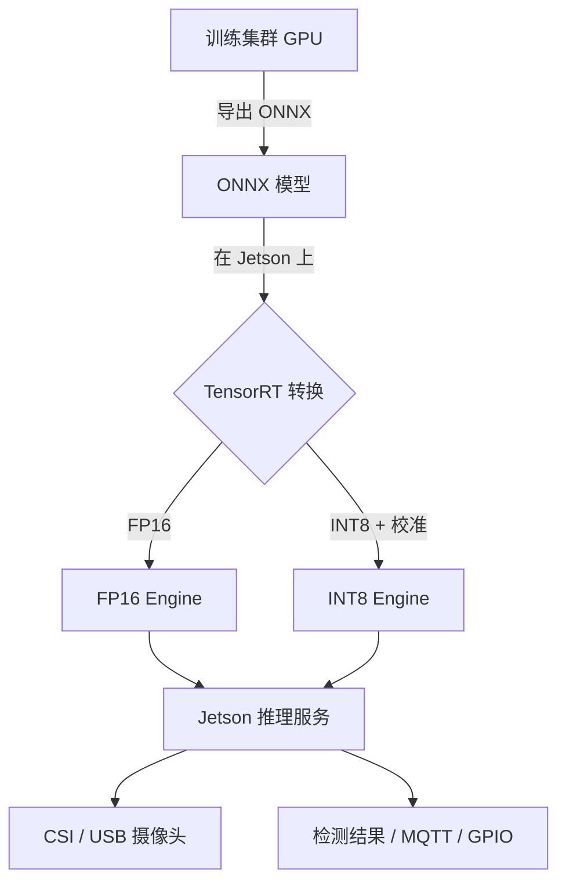
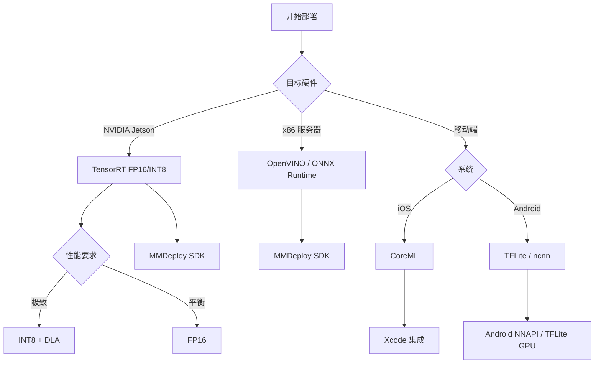
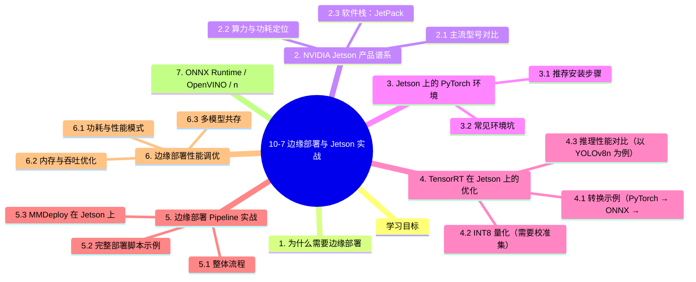

# 10-7 边缘部署与 Jetson 实战

## 学习目标

- 理解边缘 AI 部署的核心挑战（算力、功耗、散热、内存）
- 掌握 NVIDIA Jetson 产品谱系与算力对比
- 能够在 Jetson 设备上完成 JetPack + PyTorch + MMDeploy 部署
- 理解 TensorRT 在 Jetson 上的优化（FP16/INT8）
- 掌握边缘部署的性能调优方法（功耗模式、批处理、流水化）
- 了解 ONNX Runtime / OpenVINO / ncnn 在边缘的取舍

---

## 1. 为什么需要边缘部署

将 AI 模型从云端下沉到端侧设备（边缘），主要出于以下考虑：

但边缘部署也带来独特挑战：

| 挑战 | 说明 |
|------|------|
| **算力受限** | 边缘 GPU 通常 10-100 TOPS，远低于数据中心 A100 (300+ TFLOPS) |
| **功耗限制** | Jetson Orin Nano 仅 7-15W，而 A100 是 300W+ |
| **散热约束** | 小型化设备散热能力差，长时间高负载容易降频 |
| **内存小** | 8GB 起步（Jetson Orin Nano），需精细化内存管理 |
| **软件栈差异** | ARM aarch64 架构，需源码编译、CUDA 版本对齐 |

---

## 2. NVIDIA Jetson 产品谱系

NVIDIA Jetson 是面向边缘 AI 的核心平台，覆盖从 7W 到 60W 的功耗范围。

### 2.1 主流型号对比

| 型号 | CPU | GPU (CUDA Core) | 算力 (INT8) | 内存 | 功耗 | 典型应用 |
|------|-----|----------------|-------------|------|------|----------|
| **Jetson Nano** | 4× Cortex-A57 | 128 | 0.5 TOPS | 4GB | 5-10W | 入门、教学 |
| **Jetson TX2** | 4× Cortex-A57 + 2× Denver | 256 | 1.3 TOPS | 8GB | 7.5-15W | 工业控制 |
| **Jetson Xavier NX** | 6× Carmel | 384 | 21 TOPS | 8/16GB | 10-20W | 机器人、无人机 |
| **Jetson AGX Xavier** | 8× Carmel | 512 | 32 TOPS | 32GB | 10-30W | 自动驾驶 |
| **Jetson Orin Nano** | 6× Cortex-A78AE | 512 | 40 TOPS | 4/8GB | 7-15W | 边缘 AI 中端 |
| **Jetson Orin NX** | 8× Cortex-A78AE | 1024 | 100 TOPS | 8/16GB | 10-25W | 高性能边缘 |
| **Jetson AGX Orin** | 12× Cortex-A78AE | 2048 | 275 TOPS | 32/64GB | 15-60W | 工业、自动驾驶 |

### 2.2 算力与功耗定位


### 2.3 软件栈：JetPack

JetPack 是 Jetson 平台统一软件包，包含：

- **L4T (Linux for Tegra)**：基于 Ubuntu 的 ARM 系统
- **CUDA Toolkit**：GPU 编程接口
- **cuDNN**：深度学习加速库
- **TensorRT**：NVIDIA 推理优化引擎
- **VPI (Vision Programming Interface)**：视觉处理接口
- **DeepStream**：视频流 SDK
- **JetPack SDK Manager**：刷机/管理工具

```bash
# 查看 JetPack 版本
cat /etc/nv_tegra_release
# 或
sudo jetson_release

# 查看 CUDA / TensorRT
nvcc --version
dpkg -l | grep tensorrt
```

---

## 3. Jetson 上的 PyTorch 环境

Jetson 默认是 aarch64 架构，**不能直接用 pip install pytorch 通用 wheel**。需要安装 NVIDIA 提供的预编译版本。

### 3.1 推荐安装步骤

```bash
# 1. 装 JetPack（建议 JetPack 5.x / 6.x，匹配系统版本）
sudo apt-get update
sudo apt-get install nvidia-jetpack

# 2. 装 pip 和基础库
sudo apt-get install python3-pip libopenblas-base libopenmpi-dev
pip3 install --upgrade pip

# 3. 装 PyTorch（以 JetPack 5/6 + PyTorch 2.1 为例）
# 注意：必须用 NVIDIA 专门为 Jetson 编译的 wheel
wget https://developer.download.nvidia.cn/compute/redist/jp/v512/pytorch/torch-2.1.0a0+41361538.nv23.06-cp38-cp38-linux_aarch64.whl
pip install torch-2.1.0a0+41361538.nv23.06-cp38-cp38-linux_aarch64.whl

# 4. 装 torchvision（要匹配 torch 版本）
sudo apt-get install libjpeg-dev zlib1g-dev libpython3-dev libavcodec-dev libavformat-dev libswscale-dev
git clone --branch v0.16.0 https://github.com/pytorch/vision torchvision
cd torchvision
python3 setup.py install --user

# 5. 验证 GPU 可用
python3 -c "import torch; print(torch.cuda.is_available(), torch.version.cuda)"
```

### 3.2 常见环境坑

| 现象 | 原因 | 解决 |
|------|------|------|
| `CUDA_HOME` not set | 路径变量缺失 | `export CUDA_HOME=/usr/local/cuda` |
| `pycuda` 安装失败 | 找不到 cuda.h | `export PATH=$CUDA_HOME/bin:$PATH` |
| 编译 torchvision 报错 | numpy 版本不对 | `pip install numpy==1.23.4` |
| torch.cuda 不可用 | 装错 wheel（用了 x86 版本的） | 重新装 aarch64 版本 |
| TensorRT Engine 加载失败 | 算力不匹配 | 在目标 Jetson 上 build engine |

---

## 4. TensorRT 在 Jetson 上的优化

TensorRT 是 Jetson 上必装的推理加速器，能在 FP16/INT8 下获得 2-10× 加速。

### 4.1 转换示例（PyTorch → ONNX → TensorRT）

```python
# 1. PyTorch → ONNX
import torch
model = YourModel().eval().cuda()
dummy = torch.randn(1, 3, 224, 224, device='cuda')
torch.onnx.export(
    model, dummy, "model.onnx",
    opset_version=13,
    input_names=['input'], output_names=['output'],
    dynamic_axes={'input': {0: 'batch'}, 'output': {0: 'batch'}}
)

# 2. ONNX → TensorRT（trtexec 工具）
trtexec \
    --onnx=model.onnx \
    --saveEngine=model.engine \
    --fp16 \
    --workspace=2048 \
    --minShapes=input:1x3x224x224 \
    --optShapes=input:8x3x224x224 \
    --maxShapes=input:32x3x224x224
```

### 4.2 INT8 量化（需要校准集）

```python
# 使用 Python API 量化
import tensorrt as trt
import pycuda.driver as cuda
import pycuda.autoinit

logger = trt.Logger(trt.Logger.WARNING)
builder = trt.Builder(logger)
network = builder.create_network(1 << int(trt.NetworkDefinitionCreationFlag.EXPLICIT_BATCH))
parser = trt.OnnxParser(network, logger)
with open("model.onnx", "rb") as f:
    parser.parse(f.read())

config = builder.create_builder_config()
config.set_memory_pool_limit(trt.MemoryPoolType.WORKSPACE, 1 << 30)  # 1GB
config.set_flag(trt.BuilderFlag.FP16)
config.set_flag(trt.BuilderFlag.INT8)

# 设置 INT8 校准器
config.int8_calibrator = MyCalibrator(calibration_data)

engine = builder.build_serialized_network(network, config)
with open("model_int8.engine", "wb") as f:
    f.write(engine)
```

### 4.3 推理性能对比（以 YOLOv8n 为例）

| 平台 | 精度 | 单图延迟 | 功耗 |
|------|------|----------|------|
| Jetson Orin Nano | FP32 | 65 ms | 15W |
| Jetson Orin Nano | FP16 | **18 ms** | 15W |
| Jetson Orin Nano | INT8 | **11 ms** | 15W |
| Jetson AGX Orin | FP16 | **6 ms** | 30W |
| Jetson AGX Orin | INT8 | **4 ms** | 30W |
| RTX 4090 (对比) | FP16 | 2 ms | 450W |
| CPU i7-12700 | FP32 | 380 ms | 65W |

INT8 量化通常带来 1-3% 精度损失，但吞吐提升 2-3 倍，对边缘场景是非常划算的。

---

## 5. 边缘部署 Pipeline 实战

### 5.1 整体流程



### 5.2 完整部署脚本示例

```python
# deploy_jetson.py
import cv2
import numpy as np
import tensorrt as trt
import pycuda.driver as cuda
import pycuda.autoinit
import time

class TRTDetector:
    def __init__(self, engine_path, conf_thres=0.5, iou_thres=0.5):
        self.logger = trt.Logger(trt.Logger.WARNING)
        with open(engine_path, 'rb') as f:
            self.engine = trt.Runtime(self.logger).deserialize_cuda_engine(f.read())
        self.context = self.engine.create_execution_context()
        self.conf_thres = conf_thres
        self.iou_thres = iou_thres
        
        # 预分配 GPU/CPU 内存
        self.inputs, self.outputs, self.bindings = [], [], []
        for i in range(self.engine.num_io_tensors):
            name = self.engine.get_tensor_name(i)
            dtype = trt.nptype(self.engine.get_tensor_dtype(name))
            shape = self.engine.get_tensor_shape(name)
            size = trt.volume(shape)
            
            host_mem = cuda.pagelocked_empty(size, dtype)
            device_mem = cuda.mem_alloc(host_mem.nbytes)
            self.bindings.append(int(device_mem))
            
            if self.engine.get_tensor_mode(name) == trt.TensorIOMode.INPUT:
                self.inputs.append({'name': name, 'host': host_mem, 'device': device_mem, 'shape': shape})
            else:
                self.outputs.append({'name': name, 'host': host_mem, 'device': device_mem, 'shape': shape})
    
    def preprocess(self, img):
        # Letterbox resize
        h, w = img.shape[:2]
        scale = min(640/w, 640/h)
        nw, nh = int(w*scale), int(h*scale)
        img_resized = cv2.resize(img, (nw, nh))
        canvas = np.full((640, 640, 3), 114, dtype=np.uint8)
        canvas[:nh, :nw] = img_resized
        # Normalize
        blob = canvas.astype(np.float32) / 255.0
        return np.transpose(blob, (2, 0, 1))[None]  # NCHW
    
    def infer(self, img):
        blob = self.preprocess(img).ravel()
        np.copyto(self.inputs[0]['host'], blob)
        
        # 异步推理
        stream = cuda.Stream()
        cuda.memcpy_htod_async(self.inputs[0]['device'], self.inputs[0]['host'], stream)
        self.context.execute_async_v2(self.bindings, stream.handle)
        for out in self.outputs:
            cuda.memcpy_dtoh_async(out['host'], out['device'], stream)
        stream.synchronize()
        
        return [out['host'].reshape(out['shape']) for out in self.outputs]

# 启动摄像头
detector = TRTDetector('yolov8n_int8.engine')
cap = cv2.VideoCapture(0)  # /dev/video0

while True:
    ret, frame = cap.read()
    if not ret: break
    
    t0 = time.time()
    outputs = detector.infer(frame)
    latency = (time.time() - t0) * 1000
    
    # 后处理（NMS、绘制等）
    # ...
    cv2.putText(frame, f'FPS: {1000/latency:.1f}', (10, 30),
                cv2.FONT_HERSHEY_SIMPLEX, 1, (0, 255, 0), 2)
    cv2.imshow('Jetson Detection', frame)
    if cv2.waitKey(1) & 0xFF == ord('q'): break

cap.release()
cv2.destroyAllWindows()
```

### 5.3 MMDeploy 在 Jetson 上

参考 10-6 章节，在 Jetson 上构建 TensorRT Engine：

```bash
# 1. 准备 PyTorch 模型（建议在 x86 训练，再拷到 Jetson）
scp -r work_dir/rtmdet_onnx jetson@192.168.x.x:~/

# 2. 在 Jetson 上用 trtexec 转换
trtexec --onnx=end2end.onnx --saveEngine=model.engine --fp16

# 3. 用 MMDeploy SDK 加载
python3 -c "
from mmdeploy.backend.onnxruntime import ORTWrapper
m = ORTWrapper('model.engine', 'cuda:0')
print('Engine loaded')
"
```

---

## 6. 边缘部署性能调优

### 6.1 功耗与性能模式

```bash
# 查看当前模式
sudo nvpmodel -q
# 例: NV Power Mode: MODE_15W

# 切换到最大性能模式
sudo nvpmodel -m 0  # Orin Nano: 0=15W MAXN, 1=7W
sudo nvpmodel -m 2  # Orin NX: 0=25W, 1=15W, 2=25W MAXN

# 风扇转速控制（Jetson AGX）
sudo jetson_clocks --fan  # 启动风扇
sudo jetson_clocks        # 锁定最高频率

# 关闭
sudo jetson_clocks --restore
```

### 6.2 内存与吞吐优化

| 优化项 | 方法 | 收益 |
|--------|------|------|
| 批处理 | 增加 batch size | 2-4× 吞吐，但增加延迟 |
| 异步流水线 | 多线程预/后处理 | 提升 30-50% 吞吐 |
| 输入分辨率 | 640→320 | 4× 速度，精度略降 |
| FP16 推理 | TensorRT --fp16 | 1.5-2× 速度 |
| INT8 量化 | 校准后 INT8 | 2-3× 速度（精度可控）|
| CUDA 流 | 多流并行 | 隐藏访存延迟 |
| TensorRT DLA | 专用深度学习加速器 | 仅部分 Jetson 支持 |

### 6.3 多模型共存

边缘设备常需要同时运行多个模型（检测+分类+分割），建议：

```python
# 方案 1：多 TensorRT Context 共享 Engine
engine_a = load_engine('det.engine')
engine_b = load_engine('cls.engine')
ctx_a = engine_a.create_execution_context()
ctx_b = engine_b.create_execution_context()

# 方案 2：MMDeploy 多模型 Pipeline
class MultiModelPipeline:
    def __init__(self):
        self.det = Detector('det.engine')
        self.cls = Classifier('cls.engine')
    
    def process(self, frame):
        boxes = self.det.infer(frame)
        for box in boxes:
            crop = frame[box.y1:box.y2, box.x1:box.x2]
            class_id = self.cls.infer(crop)
            yield box, class_id
```

---

## 7. ONNX Runtime / OpenVINO / ncnn 在边缘的取舍

| 后端 | Jetson 支持 | 移动端 | 性能 | 易用性 |
|------|-------------|--------|------|--------|
| **TensorRT** | ✅ 最佳 | ❌ | ⭐⭐⭐⭐⭐ | ⭐⭐⭐ |
| **ONNX Runtime** | ✅ | ✅ | ⭐⭐⭐⭐ | ⭐⭐⭐⭐⭐ |
| **OpenVINO** | ❌ | ❌ | x86 CPU 上 ⭐⭐⭐⭐⭐ | ⭐⭐⭐ |
| **ncnn** | ⚠️ 需自行编译 | ✅ 移动端 | ⭐⭐⭐ | ⭐⭐⭐ |
| **TFLite** | ⚠️ 部分 | ✅ Android | ⭐⭐⭐ | ⭐⭐⭐⭐ |
| **MNN** | ⚠️ | ✅ 移动端 | ⭐⭐⭐ | ⭐⭐ |

**推荐策略：**
- **Jetson + 高性能场景** → TensorRT（首选）
- **跨平台 + 快速迭代** → ONNX Runtime
- **纯移动端（iOS/Android）** → CoreML / ncnn
- **x86 CPU 部署** → OpenVINO

---

## 8. 监控与运维

边缘设备通常无人值守，需要远程监控：

```python
# 用 Prometheus + MQTT 上报指标
import paho.mqtt.client as mqtt
import psutil

def report_metrics():
    metrics = {
        'cpu_usage': psutil.cpu_percent(),
        'memory_usage': psutil.virtual_memory().percent,
        'gpu_usage': nvmlDeviceGetUtilization(),  # pynvml
        'temperature': read_jetson_temp(),
        'fps': current_fps,
        'latency_ms': current_latency,
    }
    client.publish('edge/metrics', json.dumps(metrics))
```

Jetson 温度读取：

```bash
# 实时温度
cat /sys/devices/virtual/thermal/thermal_zone*/temp
# 或
sudo tegrastats  # 实时功耗、温度、GPU 利用率
```

---

## 9. 常见部署坑

| 问题 | 原因 | 解决 |
|------|------|------|
| 装包编译 1 小时 | aarch64 编译慢 | 用预编译 wheel / Docker 镜像 |
| Engine 跨设备失效 | 算力不匹配 | 在目标设备上 build |
| FP16 精度损失大 | 部分算子对低精度敏感 | 混合精度 / 仅 Conv 量化 |
| 摄像头打开失败 | 权限问题 | `sudo usermod -aG video $USER` |
| CSI 摄像头 vs USB | 协议不同 | 选对应 API（V4L2 / GStreamer） |
| 内存爆掉 | 预分配过大 | 减小 batch / 用动态 shape |

---

## 10. 适用场景决策树



---

## 本章小结

1. **边缘部署**带来实时性、隐私、带宽、可靠性、成本五重收益，但也面临算力、功耗、散热、内存四重约束。
2. **Jetson 产品谱系**覆盖从 Nano（5W, 0.5 TOPS）到 AGX Orin（60W, 275 TOPS）的全场景，Orin 系列是当前主流。
3. **JetPack + PyTorch + MMDeploy** 是 Jetson 上最常用的组合，但需注意 aarch64 wheel 与 CUDA 版本对齐。
4. **TensorRT FP16/INT8 量化**能获得 2-10× 加速，是边缘 GPU 部署的核心；INT8 需校准集。
5. **功耗模式与频率锁定**（`nvpmodel`、`jetson_clocks`）是性能调优的快速手段。
6. **多后端选择**应基于硬件：Jetson 选 TensorRT，移动端选 CoreML/ncnn/TFLite，x86 选 OpenVINO。
7. **监控运维**对边缘设备尤其重要：温度、功耗、FPS、延迟、GPU 利用率都应上报。

---


## 知识图谱



## 参考资料

1. NVIDIA Jetson 官方文档：https://developer.nvidia.com/embedded/jetson
2. JetPack SDK：https://developer.nvidia.com/embedded/jetpack
3. TensorRT 开发者指南：https://docs.nvidia.com/deeplearning/tensorrt/
4. MMDeploy Jetson 部署：https://mmdeploy.readthedocs.io
5. trtexec 工具使用：https://github.com/NVIDIA/TensorRT
6. Jetson Zoo (预编译包)：https://elinux.org/Jetson_Zoo
7. NVIDIA Jetson 性能基准：https://developer.nvidia.com/embedded/jetson-benchmarks
