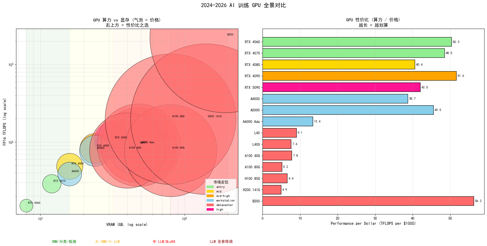
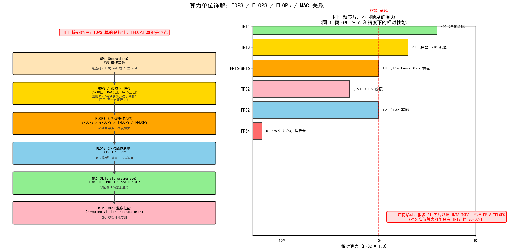
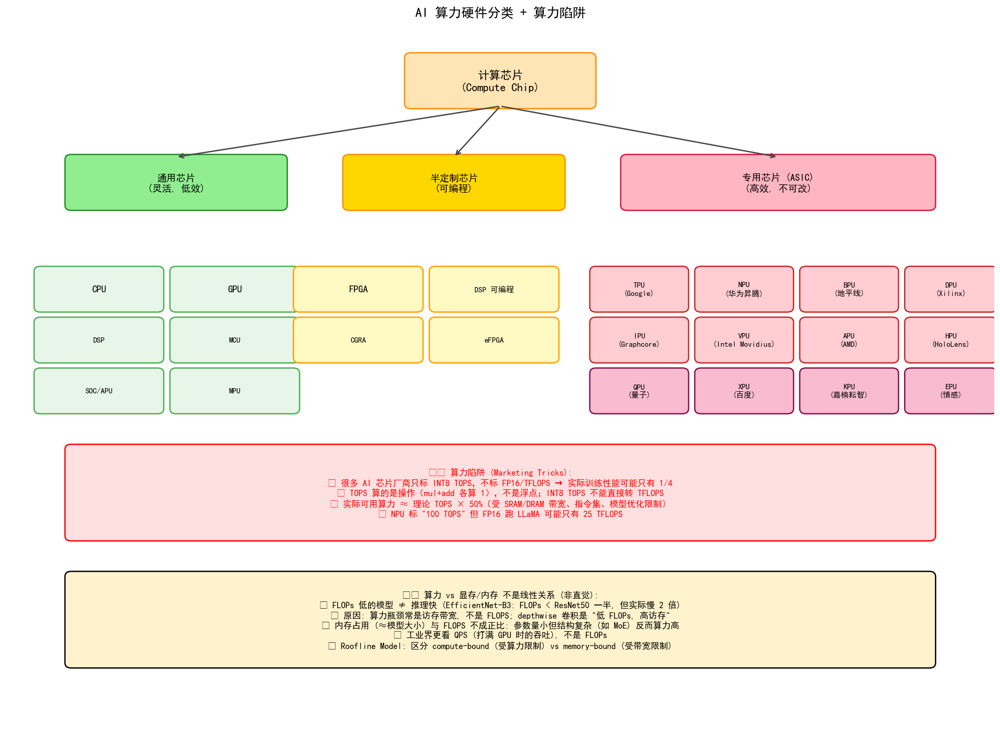
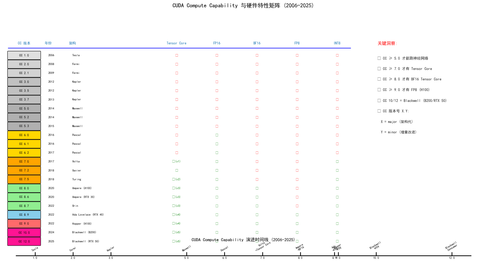
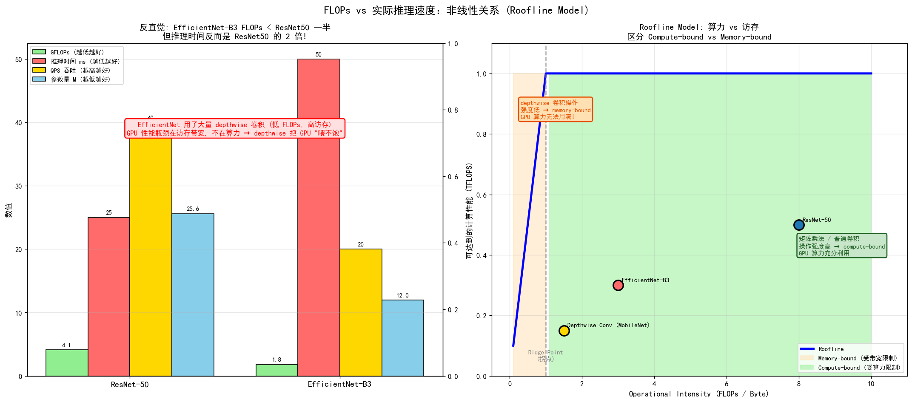
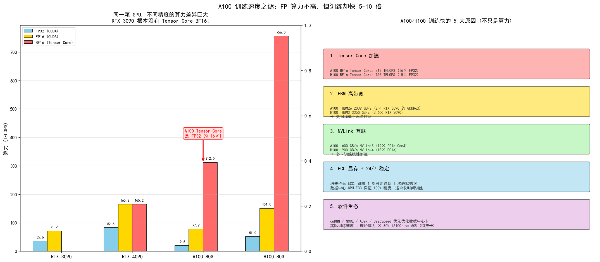
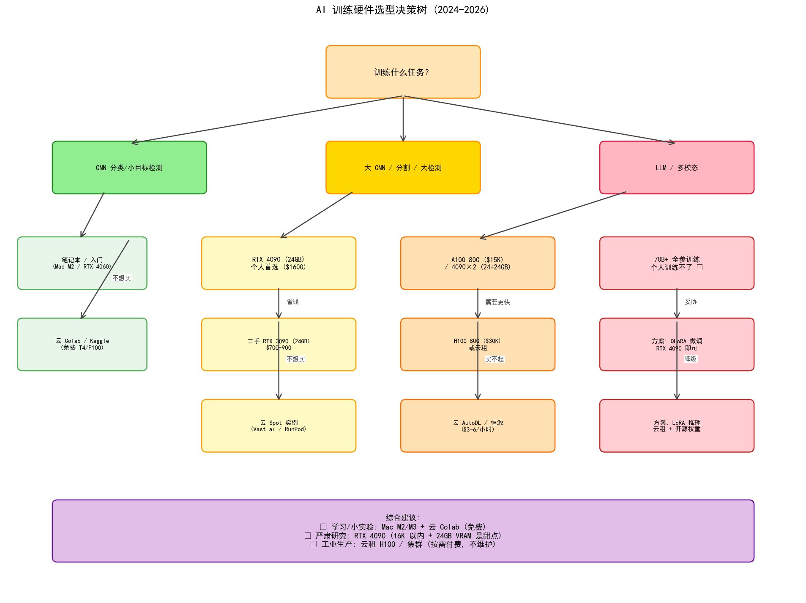
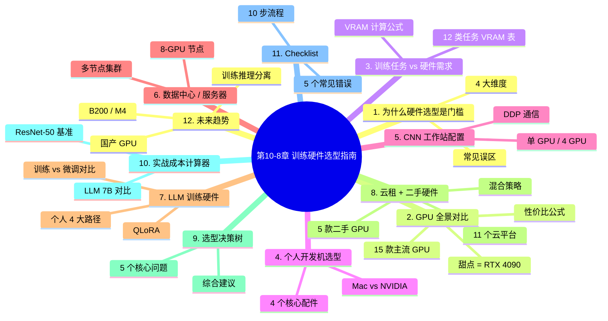

# 第10-8章 训练硬件选型指南：从个人开发机到 LLM 集群

## 学习目标

- **理解** 训练任务与硬件需求的对应关系（VRAM / 算力 / 存储 / 网络）
- **掌握** 个人开发机 / CNN 工作站 / 多 GPU 节点 / 数据中心 GPU 的选型
- **了解** 2024-2026 主流 GPU 的算力与价格对比
- **理解** 为什么 LLM 大模型**个人几乎训练不了**（只能微调或推理）
- **掌握** 云租借 + 二手硬件的替代方案
- **了解** 硬件选型决策树与 7 步 Checklist

---

## 1. 为什么硬件选型是训练的"第一道门槛"

> **真实痛点**：在工业项目中，硬件选型错误造成的损失**比模型选型错误大 10 倍**。选错 GPU 可能导致：
> - 训练时间延长 5-10 倍（错过 deadline）
> - 显存溢出 OOM（无法运行）
> - 算力浪费 50%（多花钱买过剩配置）
> - 多卡通信瓶颈（多买 GPU 反而更慢）

训练硬件选型的 4 个核心维度：

| 维度 | 关键问题 | 量化指标 |
|------|----------|----------|
| **算力 (Compute)** | 训练要多快？ | FP16/BF16 TFLOPS |
| **显存 (VRAM)** | 模型多大？batch 多大？ | GB |
| **内存 (RAM)** | 数据加载瓶颈？ | GB, 带宽 |
| **存储 (Storage)** | 数据集读取速度？ | NVMe SSD, IOPS |
| **网络 (Network)** | 多机训练？ | InfiniBand / 100GbE |

> **常见误区**：只看 GPU 算力，忽略 **CPU 内存、磁盘 IO、网络带宽**。很多训练卡 50% 的时间其实在等数据加载（ImageNet 从机械硬盘读取 vs NVMe SSD 差距 5x）。

---

## 2. 2024-2026 GPU 全景对比



### 2.1 主流 GPU 参数对比

| GPU            | VRAM (GB) | FP16 TFLOPS | 价格 (USD) | 定位   | 推荐用途                    |
| -------------- | --------- | ----------- | -------- | ---- | ----------------------- |
| **RTX 4060**   | 8         | 15.1        | 300      | 入门   | CNN 分类、YOLOv8n          |
| **RTX 4070**   | 12        | 29.1        | 600      | 入门   | CNN 检测、小型 LLM 推理        |
| **RTX 4080**   | 16        | 48.7        | 1200     | 中端   | 大型 CNN 训练               |
| **RTX 4090**   | 24        | 82.6        | 1600     | 中高端  | ⭐ **个人首选**（深度学习甜点）      |
| **RTX 5090**   | 32        | 105.0       | 2500     | 高端   | 2025 新卡，4090 升级版        |
| **A4000**      | 16        | 38.7        | 1000     | 工作站  | ECC 显存，稳定               |
| **A5000**      | 24        | 77.4        | 1700     | 工作站  | ECC 显存，4090 替代          |
| **A6000 Ada**  | 48        | 91.1        | 6800     | 工作站  | 大模型推理 + 中等训练            |
| **L40 / L40S** | 48        | 91-92       | 10-12K   | 数据中心 | 推理为主，性价比中               |
| **A100 40G**   | 40        | 77.9        | 10K      | 数据中心 | 经典 LLM 训练卡              |
| **A100 80G**   | 80        | 77.9        | 15K      | 数据中心 | LLM 训练主力                |
| **H100 80G**   | 80        | 197.9       | 30K      | 数据中心 | **当前 SOTA** LLM 卡       |
| **H200 141G**  | 141       | 197.9       | 40K      | 数据中心 | H100 升级，141GB 大显存       |
| **B200**       | 192       | 2250        | 40K+     | 数据中心 | Blackwell 架构，FP4 算力翻 5x |

### 2.2 性价比公式

$$
\text{性价比} = \frac{\text{FP16 TFLOPS}}{\text{价格}} \times 1000 \;\; (\text{TFLOPS per \$1000})
$$

**性价比之王（2024-2026）**：
- **RTX 4090**：51.6 TFLOPS/$1000（甜点）
- **RTX 4060**：50.3 TFLOPS/$1000（入门）
- **A5000**：45.5 TFLOPS/$1000（工作站）
- **H100**：6.6 TFLOPS/$1000（贵但快 4 倍）
- **A100 80G**：5.2 TFLOPS/$1000（数据中心基准）

> **核心结论**：**RTX 4090 是 2024-2026 个人深度学习的"甜点 GPU"**。24GB VRAM、82.6 TFLOPS、$1600，性价比超过所有竞品。

---

### 2.3 算力单位详解：TOPS / FLOPS / FLOPs / MAC 关系

> **本节目的**：在 10-8 之前的内容中，"算力"一词混用了多个单位。**但这些单位的含义完全不同**，混用是 AI 芯片领域最大的认知陷阱之一。

### 2.5.1 5 大算力单位对比



| 单位 | 含义 | 适用 | 典型范围 |
|------|------|------|----------|
| **OPs** (Operations) | 原始操作次数（mul 或 add 各算 1）| 通用 | 1 次 = 1 mul 或 1 add |
| **GOPS / TOPS** | 每秒 10⁹ / 10¹² 次操作 | NPU / ASIC 营销 | 1-100 TOPS |
| **FLOPS** (浮点/秒) | 每秒浮点运算次数 | GPU / CPU 性能 | 1-1000 TFLOPS |
| **FLOPs** (浮点总量) | 浮点运算**总量**（不是速度）| 模型计算量评估 | 模型 GFLOPs |
| **MAC** (乘加) | 1 MAC = 1 mul + 1 add = 2 OPs | 矩阵乘法 / CNN | 模型 GMACs |
| **DMIPS** | CPU 整数性能（Dhrystone）| CPU 性能 | 1-100K DMIPS |

**单位换算**：
- 1 MFLOPS = 10⁶ FLOPS
- 1 GFLOPS = 10⁹ FLOPS
- 1 TFLOPS = 10¹² FLOPS
- 1 PFLOPS = 10¹⁵ FLOPS
- 1 EFLOPS = 10¹⁸ FLOPS（AI 集群级别）

### 2.5.2 FLOPs 与 FLOPS 的关键区别

> **核心陷阱**：FLOPs (小写 s) ≠ FLOPS (大写 S)

| 名称 | 写法 | 含义 | 例子 |
|------|------|------|------|
| **FLOPS** | F-L-O-P-S (大写) | Floating-point **Operations** Per Second（**速度**）| RTX 4090: 82.6 TFLOPS |
| **FLOPs** | F-L-O-P-s (小写 s) | Floating-point **O**Peration**s**（**总量**）| ResNet-50: 4.1 GFLOPs (处理 1 张图需要 41 亿次浮点运算) |

**关键洞察**：
- **FLOPS** 衡量**硬件算力**（速度）
- **FLOPs** 衡量**模型计算量**（复杂度）
- 训练时间 ≈ 模型 FLOPs / 硬件 FLOPS
- 显存占用 **≠** FLOPs（这是本章最关键的非线性关系，详见 §3.5）

### 2.5.3 同一颗芯片的精度差异

**算力陷阱**：同一颗 GPU 在不同精度下的算力**差异巨大**：

| 精度 | 相对算力 | 说明 |
|------|----------|------|
| **INT4** | 4× | 极致量化（仅推理） |
| **INT8** | 2× | 标准量化 |
| **FP16 / BF16** | 1× | 深度学习主力 |
| **TF32** | 0.5× | FP32 加速版（自动） |
| **FP32** | 1× | 通用基准 |
| **FP64** | 0.0625× | 1/64 (消费卡) / 0.5× (数据中心卡) |

> **厂商陷阱**：很多 AI 芯片厂商**只标 INT8 TOPS**（如 NPU 标 100 TOPS），但**实际训练/推理用 FP16**，可能只有 25 TFLOPS。**看到 TOPS 时必须问精度**。

### 2.5.4 AI 芯片全景分类



| 大类 | 芯片 | 特点 | 代表产品 |
|------|------|------|----------|
| **通用芯片** | CPU | 复杂控制、串行 | Intel Xeon, AMD EPYC |
| | GPU | 大规模并行 | NVIDIA RTX/A100/H100 |
| | DSP | 数字信号处理 | TI C6000, Qualcomm Hexagon |
| | MCU | 微控制（嵌入式）| STM32, ESP32 |
| **半定制** | FPGA | 可编程硬件 | Xilinx Alveo, Intel Stratix |
| | CGRA | 粗粒度可重构 | SambaNova, Cerebras |
| **ASIC** | TPU | Google 设计 | TPU v5e/v5p |
| | NPU | 神经网络处理器 | 华为昇腾, 寒武纪, 联发科 APU |
| | BPU | 地平线机器人 | 征程 5/6 |
| | DPU | 深度学习+Xilinx FPGA | Xilinx DPU |
| | IPU | Graphcore | Bow IPU |
| | VPU | Intel Movidius | Myriad X |

> **"XPU" 命名汇总**：QPU（量子）、XPU（百度+赛灵思）、KPU（嘉楠耘智）、EPU（情感）、PPU（物理）、HPU（HoloLens）、OPU（光流）、WPU（可穿戴）、ZPU（开源 32 位）、UPU（宇宙）。这些多数是**营销命名**，不是工业标准。

---

### 2.4 CUDA Compute Capability 详解与全 NVIDIA GPU 一览表

> **本节核心概念**：**CUDA Compute Capability（CC）** 是 NVIDIA 给每张 GPU 分配的"架构能力等级"（如 8.6、9.0），决定了这张卡能跑哪些 CUDA 特性、用哪些指令、跑哪些深度学习算子。**官方明确指出：CC ≥ 5.0 的 GPU 才能可靠跑神经网络**。

### 2.7.1 什么是 CUDA Compute Capability

**CUDA Compute Capability（计算能力，简称 CC）** 是 NVIDIA GPU 的"版本号"：

- **形式**：用 `X.Y` 表示（X 是主版本，Y 是次版本）
- **X (major)**：表示**架构代**（如 Volta、Turing、Ampere、Ada、Hopper、Blackwell）
- **Y (minor)**：表示**同代内的增量改进**

| CC 主版本 | 架构 | 推出年份 | 代表产品 | Tensor Core 代 |
|----------|------|----------|----------|----------------|
| 1.0 | Tesla | 2006 | GeForce 8800 | 无 |
| 2.0/2.1 | Fermi | 2008-2010 | GTX 480/580 | 无 |
| 3.0/3.5/3.7 | Kepler | 2012-2014 | K20/K40/K80 | 无 |
| 5.0/5.2/5.3 | Maxwell | 2014-2015 | GTX 980/TITAN X/M40 | 无 |
| 6.0/6.1/6.2 | Pascal | 2016-2017 | GTX 1080/Tesla P100 | 无 |
| **7.0** | **Volta** | **2017** | **Tesla V100/TITAN V** | **第 1 代** |
| 7.2 | Volta (Jetson) | 2018 | Jetson AGX Xavier | 第 1 代 |
| **7.5** | **Turing** | **2018** | **RTX 2080/T4** | **第 2 代 (INT8/INT4)** |
| **8.0** | **Ampere (A100)** | **2020** | **Tesla A100** | **第 3 代 (BF16)** |
| 8.6 | Ampere (消费) | 2020 | RTX 3060/3070/3080/3090 | 第 3 代 |
| 8.7 | Ampere (Jetson) | 2022 | Jetson Orin | 第 3 代 |
| **8.9** | **Ada Lovelace** | **2022** | **RTX 4060/4070/4080/4090** | **第 4 代 (FP8)** |
| **9.0** | **Hopper** | **2022** | **Tesla H100/H200** | **第 4 代 (FP8 + Transformer Engine)** |
| 10.0 | Blackwell (B200) | 2024 | B100/B200 | 第 5 代 (FP4) |
| 12.0 | Blackwell (消费) | 2025 | RTX 5070/5080/5090 | 第 5 代 |

> **官方建议**：**CC ≥ 5.0** 的 GPU 才能跑神经网络（深度学习算子依赖）。CC < 5.0 的卡（Kepler/旧 Maxwell）只适合科研 demo，不适合生产。

### 2.7.2 CC 决定的功能特性



| CC 版本 | Tensor Core | FP16 | BF16 | FP8 | FP4 | INT8 | INT4 | 适合训练？|
|---------|-------------|------|------|-----|-----|------|------|----------|
| 1.0-3.7 (Tesla/Kepler) | ✗ | ✗ | ✗ | ✗ | ✗ | ✗ | ✗ | ❌ 不支持 |
| 5.0-5.3 (Maxwell) | ✗ | ✗ | ✗ | ✗ | ✗ | ✗ | ✗ | ⚠ 仅 FP32 |
| 6.0-6.2 (Pascal) | ✗ | ✓ | ✗ | ✗ | ✗ | ✗ | ✗ | ⚠ 入门训练 |
| 7.0 (Volta V100) | ✓ (v1) | ✓ | ✗ | ✗ | ✗ | ✓ | ✗ | ✓ 上一代 |
| 7.5 (Turing RTX 20) | ✓ (v2) | ✓ | ✗ | ✗ | ✗ | ✓ | ✓ | ✓ 入门 |
| 8.0 (Ampere A100) | ✓ (v3) | ✓ | ✓ | ✗ | ✗ | ✓ | ✓ | ✓✓ 数据中心主力 |
| 8.6 (Ampere RTX 30) | ✓ (v3) | ✓ | ✓ | ✗ | ✗ | ✓ | ✓ | ✓✓ 消费卡主力 |
| 8.9 (Ada RTX 40) | ✓ (v4) | ✓ | ✓ | ✓ | ✗ | ✓ | ✓ | ✓✓✓ 消费卡最新 |
| 9.0 (Hopper H100) | ✓ (v4) | ✓ | ✓ | ✓ | ✗ | ✓ | ✓ | ✓✓✓✓ LLM 训练 SOTA |
| 10.0 (Blackwell B200) | ✓ (v5) | ✓ | ✓ | ✓ | ✓ | ✓ | ✓ | ✓✓✓✓✓ SOTA++ |
| 12.0 (Blackwell RTX 50) | ✓ (v5) | ✓ | ✓ | ✓ | ✓ | ✓ | ✓ | ✓✓✓✓✓ 消费最新 |

### 2.7.3 CC 在 PyTorch / TensorFlow 中的实际作用

```python
import torch

# 1. 检测 GPU CC
gpu_cc = torch.cuda.get_device_capability(0)
print(f"GPU Compute Capability: {gpu_cc}")
# 输出: GPU Compute Capability: (8, 6)  → CC 8.6 = RTX 3090

# 2. PyTorch 自动根据 CC 选择最佳算子
# CC < 7.0 → 不使用 Tensor Core，仅 FP32
# CC 7.0+ → 启用 Tensor Core (FP16)
# CC 8.0+ → 启用 BF16 Tensor Core
# CC 9.0+ → 启用 FP8 Transformer Engine

# 3. 编译 PyTorch 时指定 CC
# TORCH_CUDA_ARCH_LIST="8.0;8.6;9.0"  # 编译支持 A100, RTX 30, H100

# 4. nvcc 编译时指定 CC
# nvcc -arch=sm_90 your_kernel.cu  # 编译给 H100 用的 kernel
```

**关键应用**：
- **PyTorch / TensorFlow 安装时**会自动检测 CC 并编译对应 kernel
- **DeepSpeed / Megatron** 等分布式框架会根据 CC 选择通信算法
- **Triton 编译**会针对 CC 选择最快的指令
- **安装 PyTorch 时如遇 "no kernel image is available"**，通常是 CC 不匹配

### 2.7.4 全 NVIDIA GPU × CUDA Compute Capability 一览表

> **覆盖范围**：从 2006 年 Tesla 到 2025 年 Blackwell，含消费卡 / 专业卡 / 数据中心 / 移动 / Jetson 共 **80+ GPU**。

#### 1. GeForce RTX 50 系列（Blackwell, 2025, CC 12.0）

| GPU | Compute Capability | 显存 | 架构 | 备注 |
|-----|-------------------|------|------|------|
| RTX 5090 | 12.0 | 32 GB | Blackwell | 2025 SOTA 消费卡 |
| RTX 5080 | 12.0 | 16 GB | Blackwell | 2025 |
| RTX 5070 Ti | 12.0 | 12 GB | Blackwell | 2025 |
| RTX 5070 | 12.0 | 12 GB | Blackwell | 2025 |
| RTX 5060 | 12.0 | 8 GB | Blackwell | 2025 |

#### 2. GeForce RTX 40 系列（Ada Lovelace, 2022, CC 8.9）

| GPU | Compute Capability | 显存 |
|-----|-------------------|------|
| RTX 4090 | 8.9 | 24 GB |
| RTX 4080 SUPER | 8.9 | 16 GB |
| RTX 4080 | 8.9 | 16 GB |
| RTX 4070 Ti SUPER | 8.9 | 16 GB |
| RTX 4070 Ti | 8.9 | 12 GB |
| RTX 4070 SUPER | 8.9 | 12 GB |
| RTX 4070 | 8.9 | 12 GB |
| RTX 4060 Ti | 8.9 | 8/16 GB |
| RTX 4060 | 8.9 | 8 GB |

#### 3. GeForce RTX 30 系列（Ampere, 2020, CC 8.6）

| GPU | Compute Capability | 显存 |
|-----|-------------------|------|
| RTX 3090 Ti | 8.6 | 24 GB |
| RTX 3090 | 8.6 | 24 GB |
| RTX 3080 Ti | 8.6 | 12 GB |
| RTX 3080 (12GB) | 8.6 | 12 GB |
| RTX 3080 | 8.6 | 10 GB |
| RTX 3070 Ti | 8.6 | 8 GB |
| RTX 3070 | 8.6 | 8 GB |
| RTX 3060 Ti | 8.6 | 8 GB |
| RTX 3060 | 8.6 | 12 GB |
| RTX 3050 Ti | 8.6 | 4 GB |
| RTX 3050 | 8.6 | 8 GB |

#### 4. GeForce RTX 20 系列（Turing, 2018, CC 7.5）

| GPU | Compute Capability | 显存 |
|-----|-------------------|------|
| TITAN RTX | 7.5 | 24 GB |
| RTX 2080 Ti | 7.5 | 11 GB |
| RTX 2080 SUPER | 7.5 | 8 GB |
| RTX 2080 | 7.5 | 8 GB |
| RTX 2070 SUPER | 7.5 | 8 GB |
| RTX 2070 | 7.5 | 8 GB |
| RTX 2060 SUPER | 7.5 | 8 GB |
| RTX 2060 | 7.5 | 6 GB |

#### 5. GeForce GTX 16 系列（Turing, 2019, CC 7.5）

| GPU | Compute Capability | 显存 |
|-----|-------------------|------|
| GTX 1660 Ti | 7.5 | 6 GB |
| GTX 1660 SUPER | 7.5 | 6 GB |
| GTX 1660 | 7.5 | 6 GB |
| GTX 1650 SUPER | 7.5 | 4 GB |
| GTX 1650 | 7.5 | 4 GB |

#### 6. GeForce GTX 10 系列（Pascal, 2016, CC 6.1）

| GPU | Compute Capability | 显存 |
|-----|-------------------|------|
| TITAN Xp | 6.1 | 12 GB |
| TITAN X (Pascal) | 6.1 | 12 GB |
| GTX 1080 Ti | 6.1 | 11 GB |
| GTX 1080 | 6.1 | 8 GB |
| GTX 1070 Ti | 6.1 | 8 GB |
| GTX 1070 | 6.1 | 8 GB |
| GTX 1060 | 6.1 | 6 GB |
| GTX 1050 Ti | 6.1 | 4 GB |
| GTX 1050 | 6.1 | 2/4 GB |

#### 7. GeForce GTX 9 系列（Maxwell, 2014, CC 5.2）

| GPU | Compute Capability |
|-----|-------------------|
| GTX 980 Ti | 5.2 |
| GTX 980 | 5.2 |
| GTX 970 | 5.2 |
| GTX 960 | 5.2 |
| GTX 950 | 5.2 |

#### 8. Tesla / 数据中心 GPU（H100, A100, V100, T4, P100, K80, ...）

| GPU | Compute Capability | 显存 | 架构 | 推出年份 |
|-----|-------------------|------|------|----------|
| H200 | 9.0 | 141 GB | Hopper | 2024 |
| H100 SXM | 9.0 | 80 GB | Hopper | 2022 |
| H100 PCIe | 9.0 | 80 GB | Hopper | 2022 |
| B200 | 10.0 | 192 GB | Blackwell | 2024 |
| B100 | 10.0 | 192 GB | Blackwell | 2024 |
| **A100 SXM** | **8.0** | 40/80 GB | Ampere | 2020 |
| **A100 PCIe** | **8.0** | 40/80 GB | Ampere | 2020 |
| A30 | 8.0 | 24 GB | Ampere | 2021 |
| A40 | 8.6 | 48 GB | Ampere | 2021 |
| A10 | 8.6 | 24 GB | Ampere | 2021 |
| A16 | 8.6 | 64 GB (4×16) | Ampere | 2023 |
| V100 SXM | 7.0 | 16/32 GB | Volta | 2017 |
| V100 PCIe | 7.0 | 16/32 GB | Volta | 2017 |
| T4 | 7.5 | 16 GB | Turing | 2018 |
| P100 SXM | 6.0 | 16 GB | Pascal | 2016 |
| P100 PCIe | 6.0 | 16 GB | Pascal | 2016 |
| P40 | 6.1 | 24 GB | Pascal | 2016 |
| P4 | 6.1 | 8 GB | Pascal | 2016 |
| M60 | 5.2 | 8 GB (2×4) | Maxwell | 2015 |
| M40 | 5.2 | 24 GB | Maxwell | 2015 |
| K80 | 3.7 | 24 GB (2×12) | Kepler | 2014 |
| K40 | 3.5 | 12 GB | Kepler | 2013 |
| K20 | 3.5 | 5 GB | Kepler | 2012 |
| K10 | 3.0 | 8 GB (2×4) | Kepler | 2012 |

#### 9. Quadro / RTX 工作站（专业卡）

| GPU | Compute Capability | 显存 | 架构 |
|-----|-------------------|------|------|
| RTX 6000 Ada | 8.9 | 48 GB | Ada Lovelace |
| RTX 5000 Ada | 8.9 | 32 GB | Ada Lovelace |
| RTX 4000 Ada | 8.9 | 20 GB | Ada Lovelace |
| RTX 4000 SFF Ada | 8.9 | 20 GB | Ada Lovelace |
| RTX A6000 | 8.6 | 48 GB | Ampere |
| RTX A5000 | 8.6 | 24 GB | Ampere |
| RTX A4000 | 8.6 | 16 GB | Ampere |
| RTX A2000 | 8.6 | 12 GB | Ampere |
| Quadro GV100 | 7.0 | 32 GB | Volta |
| Quadro GP100 | 6.0 | 16 GB | Pascal |
| Quadro P6000 | 6.1 | 24 GB | Pascal |
| Quadro P5000 | 6.1 | 16 GB | Pascal |
| Quadro P4000 | 6.1 | 8 GB | Pascal |
| Quadro RTX 8000 | 7.5 | 48 GB | Turing |
| Quadro RTX 6000 | 7.5 | 24 GB | Turing |
| Quadro RTX 5000 | 7.5 | 16 GB | Turing |
| Quadro RTX 4000 | 7.5 | 8 GB | Turing |
| Quadro M6000 24GB | 5.2 | 24 GB | Maxwell |

#### 10. Jetson 嵌入式（边缘 AI）

| 产品 | Compute Capability | 显存 | 架构 |
|------|-------------------|------|------|
| **Jetson Orin Nano** | **8.7** | 8 GB | Ampere |
| **Jetson Orin NX** | **8.7** | 16 GB | Ampere |
| **Jetson AGX Orin** | **8.7** | 32/64 GB | Ampere |
| Jetson Orin | 8.7 | 32/64 GB | Ampere |
| Jetson Xavier NX | 7.2 | 8 GB | Volta |
| Jetson AGX Xavier | 7.2 | 32 GB | Volta |
| Jetson TX2 | 6.2 | 8 GB | Pascal |
| Jetson Nano | 5.3 | 4 GB | Maxwell |
| Jetson TX1 | 5.3 | 4 GB | Maxwell |
| Tegra X1 | 5.3 | 4 GB | Maxwell |

#### 11. 移动 / 笔记本 GPU

| GPU | CC | GPU | CC | GPU | CC |
|-----|----|-----|----|-----|----|
| RTX 5090 Mobile | 12.0 | RTX 4090 Mobile | 8.9 | RTX 3080 Ti Mobile | 8.6 |
| RTX 5080 Mobile | 12.0 | RTX 4080 Mobile | 8.9 | RTX 3080 Mobile | 8.6 |
| RTX 5070 Ti Mobile | 12.0 | RTX 4070 Mobile | 8.9 | RTX 3070 Mobile | 8.6 |
| RTX 5070 Mobile | 12.0 | RTX 4060 Mobile | 8.9 | RTX 3060 Mobile | 8.6 |
| RTX 2080 Mobile | 7.5 | RTX 4050 Mobile | 8.9 | RTX 3050 Ti Mobile | 8.6 |
| RTX 2070 Mobile | 7.5 | GTX 1080 Mobile | 6.1 | RTX 3050 Mobile | 8.6 |
| RTX 2060 Mobile | 7.5 | GTX 1070 Mobile | 6.1 | GTX 980M | 5.2 |

#### 12. NVS 商用显卡（多屏输出，非 AI）

| GPU | CC |
|-----|-----|
| NVS 810 | 5.0 |
| NVS 510 | 3.0 |
| NVS 315 / 310 | 2.1 |

### 2.7.5 5 分钟 CC 速查决策

| 你的需求 | 推荐最低 CC | 推荐 GPU |
|----------|-------------|----------|
| **学习/入门** | 5.0 | GTX 980 / Jetson Nano |
| **小项目** | 6.1 | GTX 1080 / P4 |
| **严肃训练** | 7.5 | RTX 2080 / T4 / V100 |
| **深度学习主力** | 8.0+ | A100 / RTX 3090 / RTX 4090 |
| **LLM 训练** | 8.0+ (A100) / 9.0 (H100) | A100 / H100 / H200 |
| **最新 SOTA** | 9.0 (H100) / 10.0 (B200) | H100 / H200 / B200 |

### 2.7.6 实用代码：检测 + 兼容性检查

```python
import torch

def gpu_ai_compatibility_check():
    """检查当前 GPU 是否适合 AI 训练"""
    if not torch.cuda.is_available():
        print("❌ 无 CUDA GPU")
        return

    props = torch.cuda.get_device_properties(0)
    cc = torch.cuda.get_device_capability(0)
    cc_value = cc[0] + cc[1] / 10

    print(f"GPU: {props.name}")
    print(f"Compute Capability: {cc[0]}.{cc[1]}")
    print(f"VRAM: {props.total_memory / 1024**3:.1f} GB")
    print(f"SMs (流多处理器): {props.multi_processor_count}")

    # Tensor Core 支持
    if cc_value >= 7.0:
        print(f"✓ Tensor Core 支持")
    if cc_value >= 8.0:
        print(f"✓ BF16 Tensor Core 支持")
    if cc_value >= 9.0:
        print(f"✓ FP8 Tensor Core 支持 (Transformer Engine)")

    # 训练建议
    if cc_value < 5.0:
        print(f"⚠  CC < 5.0, 神经网络训练不可靠")
    elif cc_value < 7.0:
        print(f"⚠  CC {cc_value} 适合入门训练，无 Tensor Core")
    elif cc_value < 8.0:
        print(f"✓  CC {cc_value} 适合中等训练，有 FP16 Tensor Core")
    elif cc_value < 9.0:
        print(f"✓✓ CC {cc_value} 适合严肃训练，有 BF16 Tensor Core")
    else:
        print(f"✓✓✓ CC {cc_value} SOTA 训练 (FP8/BF16)")

gpu_ai_compatibility_check()
# 典型输出:
# GPU: NVIDIA GeForce RTX 4090
# Compute Capability: 8.9
# VRAM: 24.0 GB
# SMs (流多处理器): 128
# ✓ Tensor Core 支持
# ✓ BF16 Tensor Core 支持
# ✓ FP8 Tensor Core 支持 (Transformer Engine)
# ✓✓ CC 8.9 适合严肃训练，有 BF16 Tensor Core
```

### 2.7.7 选 CC 的 3 大陷阱

| 陷阱 | 后果 | 避坑 |
|------|------|------|
| **CC < 5.0** | 算子不支持，cuDNN 报错 | 至少 5.0，严肃训练 8.0+ |
| **CC 跨代编译错** | "no kernel image is available" | 安装 PyTorch 时用 `TORCH_CUDA_ARCH_LIST` 指定多个 CC |
| **笔记本 CC 低于桌面** | 同样叫 RTX 4090, 笔记本版可能 CC 不同 | 查 NVIDIA 官网具体型号 |

### 2.7.8 官方文档参考

| 资源 | URL |
|------|-----|
| NVIDIA CUDA GPUs 官方 CC 表 | https://developer.nvidia.com/cuda-gpus |
| cuDNN 支持的 GPU | https://docs.nvidia.com/deeplearning/cudnn/ |
| PyTorch GPU 支持 | https://pytorch.org/get-started/locally/ |
| TensorRT 支持 | https://docs.nvidia.com/deeplearning/tensorrt/ |

> **一句话总结**：**CC 5.0 = AI 入门线，CC 7.5 = 消费卡甜点，CC 8.0+ = 严肃训练，CC 9.0 = LLM 训练 SOTA**。

---

## 3. 训练任务 vs 硬件需求


### 3.1 详细 VRAM / 算力需求

| 任务                      | 最小 VRAM | 推荐 VRAM  | 推荐 GPU            | 训练时间      | 难度     |
| ----------------------- | ------- | -------- | ----------------- | --------- | ------ |
| **CNN 分类（ResNet-50）**   | 4 GB    | 8 GB     | RTX 4060          | 1-3 天     | ⭐ 入门   |
| **CNN 分类（ConvNeXt-L）**  | 8 GB    | 16 GB    | RTX 4080/4090     | 1 周       | ⭐ 入门   |
| **目标检测（YOLOv8s）**       | 6 GB    | 12 GB    | RTX 4070          | 1-3 天     | ⭐ 入门   |
| **目标检测（COCO 完整）**       | 16 GB   | 24 GB    | RTX 4090 / A5000  | 1-2 周     | ⭐⭐     |
| **图像分割（DeepLabV3+）**    | 8 GB    | 16 GB    | RTX 4080          | 3-7 天     | ⭐⭐     |
| **Stable Diffusion 微调** | 12 GB   | 24 GB    | RTX 4090          | 1 周       | ⭐⭐     |
| **7B LLM LoRA (QLoRA)** | 16 GB   | 24 GB    | RTX 4090          | 1-3 天     | ⭐⭐     |
| **13B LLM LoRA**        | 24 GB   | 40 GB    | A100 40G / 4090×2 | 1 周       | ⭐⭐⭐    |
| **70B LLM QLoRA**       | 48 GB   | 80 GB    | A100 80G × 2      | 2 周       | ⭐⭐⭐    |
| **7B LLM 全参微调**         | 60 GB   | 100 GB   | H100 80G × 4+     | 1-2 周     | ⭐⭐⭐⭐   |
| **70B LLM 全参微调**        | 300 GB  | 800 GB   | 8×H100 / 集群       | 数周        | ⭐⭐⭐⭐⭐  |
| **405B LLM 训练**         | 1000 GB | 2000 GB+ | 集群 (千卡 H100/B200) | 数月 + $1M+ | 个人无法训练 |

### 3.2 VRAM 计算公式

$$
\text{VRAM} \approx \underbrace{4 \times P}_{\text{模型参数}} + \underbrace{8 \times P}_{\text{Adam 状态 (m, v)}} + \underbrace{A \times B \times S \times C}_{\text{激活值}} + \underbrace{临时 buffer}_{\text{CUDA context}}
$$

其中 $P$ = 参数量，$A$ = 激活元素数，$B$ = batch，$S$ = 序列长度，$C$ = 类别数。

| 训练方式 | 7B 模型 VRAM | 70B 模型 VRAM |
|----------|--------------|---------------|
| **全参 FP32** | 112 GB | 1120 GB |
| **全参 BF16** | 28 GB | 280 GB |
| **LoRA (rank=8)** | 14 GB | 20 GB |
| **QLoRA (4-bit)** | 6 GB | 14 GB |
| **推理 (FP16)** | 14 GB | 140 GB |
| **量化推理 (INT4)** | 4 GB | 40 GB |

> **个人训练 LLM 的现实**：7B 全参微调需要 100GB+ VRAM（4×H100 或 A100 80G×2），**普通 4090 跑不动**。但 7B **QLoRA** 只需 6GB，**4090 完全可行**——这是个人参与 LLM 训练的最现实路径。

---

### 3.3 算力 vs 显存/内存：非线性关系（核心洞察）

> **本节核心洞察**：很多工程师（包括参考文档的作者）总结出**反直觉的结论**——"显存占用（≈模型大小）与算力（FLOPs）并不一定成正比"。有的模型参数量小，但由于结构复杂，反而算力要求很大；反之，有的模型参数量大但算力很低。

### 3.5.1 反直觉案例：EfficientNet-B3 vs ResNet-50



| 指标 | ResNet-50 | EfficientNet-B3 | 谁胜？|
|------|-----------|-----------------|-------|
| **参数量** | 25.6 M | 12.0 M | EfficientNet（少 53%）|
| **FLOPs** | 4.1 G | 1.8 G | EfficientNet（少 56%）|
| **推理时间 (P40)** | 25 ms | 50 ms | ResNet（快 2×）|
| **QPS (打满 P40)** | 511 | 296 | ResNet（高 1.7×）|

**结论**：
- EfficientNet-B3 **参数量和 FLOPs 都只有 ResNet50 的一半**
- 但**实际推理速度反而慢 2 倍**（QPS 只有 60%）
- **FLOPs 完全是骗人的指标**！

### 3.5.2 为什么 FLOPs 不等于推理速度：Roofline Model

**Roofline Model** 是理解这个现象的关键：

```
算力性能上限 = min(峰值算力, 访存带宽 × 操作强度)
              = min(Compute Peak, Bandwidth × Operational Intensity)
```

| 区域 | 限制因素 | 典型操作 |
|------|----------|----------|
| **Memory-bound**（左侧）| 访存带宽 | depthwise 卷积、element-wise（ReLU、Add）、Attention |
| **Compute-bound**（右侧）| 峰值算力 | 矩阵乘法、普通卷积、Linear |

**关键洞察**：
- **depthwise 卷积**：FLOPs 很低（参数少），但**访存数据量巨大**（每个 channel 独立读写）
  - FLOPs: 3×3×1×C×56×56
  - 访存量: 56×56×C（巨大）
- **GPU 性能瓶颈常是访存带宽**（HBM ~2 TB/s），不是算力（>100 TFLOPS）
- **当 FLOPs/Byte < Ridge Point**（约 1-10 FLOPs/Byte），模型是 memory-bound，**算力再强也没用**

### 3.5.3 参数量 vs 算力：5 种"反常"模型

| 模型类型 | 参数量 | 算力 (FLOPs) | 案例 |
|----------|--------|--------------|------|
| **大参数 + 低算力** | 大 | 小 | Embedding 表（10⁹ 参数，0 FLOPs）|
| **小参数 + 大算力** | 小 | 大 | **MoE（混合专家）**：1.6T 参数（很多不激活），但每 token 激活 7B → 算力 ≈ 7B 模型 |
| **大参数 + 大算力** | 大 | 大 | 标准 Transformer LLM |
| **小参数 + 小算力** | 小 | 小 | 小型 CNN（ResNet-18）|
| **中等参数 + 极高算力** | 中 | 极高 | **Mamba / SSM**（长序列 O(n) 算力，但参数不多）|

> **MoE 经典反例**：
> - Mixtral 8x7B：46.7B 总参数，但每 token 激活 12.9B
> - 显存占用 ~90GB (FP16 加载所有专家)
> - 实际算力 = 12.9B 模型的算力
> - **显存和算力都不与"总参数"成正比**！

### 3.5.4 显存占用 vs 算力消耗：经验公式

$$
\text{VRAM} \approx \underbrace{4P}_{\text{模型}} + \underbrace{8P}_{\text{Adam 状态 (m+v)}} + \underbrace{ABSC}_{\text{激活}} + \underbrace{2P}_{\text{梯度}} + \text{Buffer}
$$

$$
\text{FLOPs} \approx 6 \cdot P \cdot T \;\; \text{(Transformer 每 token 6P FLOPs, T=序列长度)}
$$

| 模型 | P (B) | VRAM (训练 FP16+Adam) | FLOPs/Token | 比率 (FLOPs/VRAM) |
|------|-------|------------------------|-------------|-------------------|
| ResNet-50 | 0.026 | 0.6 GB | 0.05 G | 0.08 |
| LLaMA-7B | 7 | 168 GB (8 卡 H100) | 42 G | 0.25 |
| Mixtral 8x7B (激活 13B) | 47 (总) / 13 (激活) | ~150 GB (4 卡) | 78 G | 0.52 |
| Mamba-2.8B | 2.8 | 67 GB (4 卡) | 8.4 G | 0.13 |

> **关键观察**：
> - Mixtral 比 LLaMA-7B 算力高 2 倍，但显存差不多（专家卸载技术）
> - 同一类模型，VRAM 和 FLOPs 大致成正比（P 主导）
> - 但**跨类别模型**（CNN vs Transformer vs MoE vs SSM）**没有固定关系**

### 3.5.5 工业界真正看的是 QPS（不是 FLOPs）

> **经验法则**：工业部署**不关心 FLOPs，也不关心单图 inference time**。关心的是"**把一块 GPU 打满时，每秒能处理多少图（QPS）**"。

**GPU 打满测试的洞察**：
- ResNet-50 在 P40 上打满（batch=1700）→ 511 QPS
- EfficientNet-B3 打满（batch=600）→ 296 QPS
- 同样打满，ResNet 反而快 1.7×（反直觉！）

**显存占用决定 batch size，batch size 决定 QPS**：
- 显存越大 → 越大 batch → 越高 QPS → 单张图成本越低
- 这是为什么"显存大 = 性价比高"（即使算力略低）

### 3.5.6 实操建议：别只算 FLOPs

| 决策 | 错误做法 | 正确做法 |
|------|----------|----------|
| **选 backbone** | 只看 FLOPs | 跑一遍 latency @ target QPS |
| **选 GPU** | 只看 TFLOPS | 关注 HBM 带宽 + Tensor Core + 软件生态 |
| **优化模型** | 砍 FLOPs | 优先降低**访存**（element-wise、attention）|
| **部署** | 跑 inference time | 测 QPS @ GPU 打满 |
| **预算** | 算 FLOPs × $/hour | 算单张图片 $/cost |

> **一句话**：**FLOPs 是学术指标，QPS 是工业指标，VRAM 是硬件约束，三者各有用途，不能互推**。

---

## 4. 个人开发机选型

### 4.1 三类个人机器

| 类型 | 配置参考 | 价格 (USD) | 适用 |
|------|----------|------------|------|
| **轻薄本** | MacBook Air M2/M3 16GB | 1200-2000 | 学习 + 调代码 + 跑小模型 |
| **游戏本** | i7/9 + RTX 4070 8GB | 1500-2500 | CNN 分类 / 小型实验 |
| **台式工作站** | i9/Threadripper + RTX 4090 24GB | 2500-4000 | ⭐ 严肃深度学习 |
| **Mac Studio M3 Ultra** | 192GB 统一内存 | 5000-8000 | LLM 推理（统一内存优势） |

### 4.2 Mac vs NVIDIA 抉择

| 维度 | Mac (M2/M3/M4) | NVIDIA RTX |
|------|----------------|------------|
| **统一内存** | 192GB 共享（最大优势） | VRAM 8-24GB 限制 |
| **CUDA 生态** | MPS 后端，部分支持 | 完整 PyTorch/TensorRT |
| **LLM 推理** | ⭐⭐⭐⭐ 强（llama.cpp/MLX） | ⭐⭐⭐ 一般 |
| **LLM 训练** | ⭐ 弱（QLoRA 极慢） | ⭐⭐⭐⭐ 强 |
| **CNN 训练** | ⭐⭐ 一般 | ⭐⭐⭐⭐ 强 |
| **价格** | Mac Studio 192GB = $5000 | RTX 4090 + 64GB PC = $3000 |
| **能耗** | 100W 极低 | 450W 较高 |

**推荐组合**：
- **学习 + 跑小模型**：MacBook Air M2 16GB ($1500)
- **CNN 为主 + 偶尔 LLM**：RTX 4090 台式 ($3000)
- **LLM 推理 / 量化为主**：Mac Studio M2 Ultra 192GB ($5000)
- **混合策略**：Mac（开发）+ 云租（训练）

### 4.3 个人开发的 4 个核心配件

| 配件 | 最低 | 推荐 | 顶级 |
|------|------|------|------|
| **GPU** | RTX 4060 8GB | RTX 4090 24GB | RTX 4090 × 2 |
| **CPU** | i5-12400 6 核 | i7-13700K 16 核 | i9-14900K 24 核 |
| **内存** | 32GB DDR4 | 64GB DDR5 | 128GB DDR5 |
| **存储** | 1TB NVMe SSD | 2TB NVMe SSD + 4TB HDD | 4TB NVMe × 2 (RAID 0) |
| **电源** | 650W | 1000W | 1600W（双 4090） |
| **散热** | 塔式风冷 | 360 水冷 | 机架式液冷 |

> **关键经验**：内存（RAM）不要省！数据加载常驻内存，**32GB 是入门，64GB 是标准**。ImageNet 全部解码到内存约 200GB，所以大型数据集需要 **SSD 高速 + RAM 充足**。

---

## 5. 训练 CNN 的工作站配置

### 5.1 单 GPU 工作站（个人/小团队）

| 用途 | 推荐配置 | 价格 (USD) |
|------|----------|------------|
| **CNN 入门** | RTX 4070 12GB + i7 + 64GB + 1TB NVMe | 2000-2500 |
| **CNN 主流** | RTX 4090 24GB + i9 + 64GB + 2TB NVMe | 3000-4000 |
| **CNN 顶级** | RTX 4090 24GB × 2 + Threadripper + 128GB | 6000-8000 |

**为什么 RTX 4090 是 CNN 训练甜点**：
- 24GB VRAM 足够 batch=64 训练 ResNet-50/ConvNeXt
- FP16 82.6 TFLOPS 算力 = A100 的 95%（价格是 1/10）
- 游戏卡无 ECC，但 CNN 训练对显存错误容忍度高

### 5.2 多 GPU 工作站（中等规模）

| 用途 | 推荐配置 | 价格 (USD) |
|------|----------|------------|
| **中型 CNN** | RTX 4090 × 4 + 主板支持 4×PCIe | 8000-12000 |
| **大 CNN** | A5000 × 4 + ECC 内存 | 12000-15000 |
| **科研 LLM** | A100 80G × 2 + 服务器主板 | 40000+ |

**多 GPU 训练注意事项**：
- 主板需支持 **4×PCIe 4.0 x16**（或拆分为 x16+x16+x8+x8）
- 电源至少 1600W（4×4090 瞬时功耗）
- 散热要强（建议机架式或水冷）
- NVLink 4090 不支持（消费卡），A5000/A100 支持
- DDP 通信靠 PCIe / NVLink，**4 卡通信瓶颈明显**

> **DDP 通信效率**：4×RTX 4090 用 PCIe，实际只有 3.5x 加速（而不是理论 4x）。**8 卡以上建议用 NVLink 或 InfiniBand**。

### 5.3 4 GPU 工作站配置示例

```
CPU:  AMD Threadripper 7980X (64核)  ~$5000
主板: TRX50 DARK HERO               ~$1200
GPU:  RTX 4090 24GB × 4             ~$6400
内存: 128GB DDR5 ECC                ~$800
存储: 4TB NVMe SSD (系统) + 8TB SSD (数据)  ~$1000
电源: 2000W 80+ Titanium            ~$700
散热: 360 一体水冷 + 机箱风扇      ~$500
────────────────────────────────────────
总计:                              ~$15,600
```

> **足以完成**：YOLOv8 全量训练、COCO 检测完整训练、Stable Diffusion 微调、7B LLM QLoRA。

---

## 6. 数据中心 / 服务器级配置

### 6.1 单节点 8 GPU 服务器

| 配置 | GPU | 适用 | 价格 |
|------|-----|------|------|
| **DGX A100** | 8×A100 80G | 大型 LLM 训练 | $200K |
| **DGX H100** | 8×H100 80G | LLM SOTA | $400K+ |
| **DIY 8×A100** | 8×A100 80G | 中等 LLM | $130K+ |
| **DIY 8×H100** | 8×H100 80G | 大型 LLM | $250K+ |

### 6.2 多节点集群

| 规模 | GPU 总数 | 内存 | 网络 | 价格 |
|------|----------|------|------|------|
| **小型集群** | 32-64×A100 | 共享 NVMe | 100GbE | $500K-1M |
| **中型集群** | 128-256×H100 | 共享存储 | InfiniBand | $5M-10M |
| **大型集群** | 1024+H100 | Lustre 并行存储 | InfiniBand HDR/NDR | $50M+ |
| **超大集群** | 10K+ B200 | 全 NVMe-oF | NDR + 自研网络 | $1B+ |

**集群训练的关键瓶颈**：
- **网络**：AllReduce 通信是主要瓶颈（GPU 越多越严重）
- **存储**：每个 GPU 都需要 1-10 GB/s 读取速度
- **调度**：Kubernetes + Slurm 调度器管理数万个任务

---

### 6.3 硬件陷阱与 A100 悖论：FP 算力不高但训练更快

> **本节核心洞察**：很多工程师会问"为什么 A100 的 FP32 算力只有 19.5 TFLOPS，比 RTX 3090 的 35.6 TFLOPS 还低，但实际训练 A100 反而快 5-10 倍？"这是因为训练速度**不只是 FP 算力**，还涉及 Tensor Core、显存带宽、互联、软件优化等"隐性算力"。

### 6.5.1 经典陷阱：TOPS ≠ TFLOPS

| 场景 | 厂商宣传 | 实际意义 |
|------|----------|----------|
| 华为昇腾 910 | "256 TOPS (INT8)" | FP16 实际只有 ~128 TFLOPS |
| 寒武纪 MLU370 | "256 TOPS (INT8)" | FP16 实际只有 ~64 TFLOPS |
| NVIDIA H100 | "1979 TOPS (INT8)" | FP16 Tensor Core: 756 TFLOPS |
| Apple M2 Ultra | "15.8 TOPS (INT8)" | FP32 GPU 算力：~10 TFLOPS |

> **关键原则**：
> 1. **TOPS 算的是操作（操作 1 次 mul 或 1 次 add 算 1 OPs）**
> 2. **TFLOPS 算的是浮点（必须按精度）**
> 3. **TOPS 与 TFLOPS 不能直接换算**（依赖精度和实现）
> 4. **实际可用算力 ≈ 理论值的 50%**（受 SRAM/DRAM 带宽、指令集限制）

### 6.5.2 FP32/FP64 比例：消费卡 vs 专业卡

| 厂商 | 定位 | FP64 / FP32 比 | 说明 |
|------|------|----------------|------|
| **NVIDIA GeForce** (消费) | 游戏 | **1/64** | FP64 几乎被禁用 |
| **NVIDIA Quadro / RTX Ada** | 工作站 | 1/32 - 1/64 | 略有放宽 |
| **NVIDIA A100 / H100** | 数据中心 | **1/2** | FP64 满速 |
| **AMD Radeon RX** | 消费 | 1/16 | 比 NVIDIA 消费卡好 |
| **AMD FirePro** | 工作站 | 1/8 - 1/2 | 很强 |
| **NVIDIA TITAN V** | 特殊 | 1/2 | Volta 架构大核心 |

> **讽刺事实**：在 FP64 上，**AMD Radeon 消费卡比 NVIDIA GeForce 消费卡强 4 倍**（1/16 vs 1/64）。但生态决定了 AMD 在 AI 训练领域基本没有份额。

### 6.5.3 A100 悖论：FP 算力不高但训练更快



**A100 vs RTX 3090 算力对比**：

| 指标 | RTX 3090 | A100 80G | 差异 |
|------|----------|----------|------|
| FP32 (CUDA) | 35.6 TFLOPS | 19.5 TFLOPS | A100 反而**低 45%** |
| FP16 (CUDA) | 71.2 TFLOPS | 77.9 TFLOPS | 接近 |
| **BF16 Tensor Core** | **0** (无 TC) | **312 TFLOPS** | **A100 是 RTX 3090 的 ∞ 倍** |
| TF32 Tensor Core | 0 | 156 TFLOPS | A100 独占 |
| FP64 Tensor Core | 0.5 TFLOPS | 9.7 TFLOPS | A100 是 19× |
| **HBM 带宽** | GDDR6X 936 GB/s | **HBM2e 2039 GB/s** | A100 是 **2.2×** |
| **NVLink 带宽** | 不支持 | **600 GB/s** | A100 是 **12× PCIe** |
| ECC 显存 | 无 | **有** | A100 更稳定 |

**实际训练速度（BERT-Large on Wikipedia）**：
- RTX 3090: ~120 samples/sec
- A100 80G: ~650 samples/sec
- **A100 是 RTX 3090 的 5.4 倍**（尽管 FP32 算力低 45%）

### 6.5.4 A100 训练快的 5 大原因

1. **Tensor Core 加速**（最关键）
   - A100 BF16 Tensor Core: 312 TFLOPS（FP32 的 16×）
   - H100 BF16 Tensor Core: 756 TFLOPS（FP32 的 15×）
   - 训练默认开启混合精度，Tensor Core 几乎全程工作

2. **HBM 高带宽**
   - A100: HBM2e 2039 GB/s
   - H100: HBM3 3350 GB/s
   - RTX 3090: GDDR6X 936 GB/s
   - **数据加载快 2-3.6×，减少 GPU 等待**

3. **NVLink 互联**
   - A100: 600 GB/s NVLink3（12× PCIe Gen4）
   - H100: 900 GB/s NVLink4（18× PCIe）
   - 消费卡：仅 PCIe（16-32 GB/s）
   - **多卡训练线性加速**

4. **ECC 显存 + 24/7 稳定**
   - 消费卡无 ECC：训练 1 周可能遇到 1 次静默错误
   - 数据中心 GPU ECC：保证 100% 精度，适合长时间训练

5. **软件生态**
   - cuDNN / NCCL / Apex / DeepSpeed 优先优化数据中心卡
   - 实际训练速度 = 理论算力 × 80% (A100) vs × 60% (消费卡)
   - 同样跑 ResNet-50，**A100 实际加速比理论算力高 2 倍**

### 6.5.5 选 GPU 时必须问的 7 个问题

```
□ 1. 标的是 TOPS 还是 TFLOPS？哪个精度？
□ 2. Tensor Core 支持哪些精度？（FP16/BF16/TF32/INT8）
□ 3. 显存带宽是多少 GB/s？（HBM > GDDR6X > GDDR6）
□ 4. 实际训练 ResNet-50 跑多少 samples/sec？（看 benchmark 而非纸面算力）
□ 5. 多卡通信带宽？（NVLink > PCIe）
□ 6. 有无 ECC 显存？
□ 7. 软件框架优化程度？（cuDNN/NCCL 版本）
```

### 6.5.6 国产 AI 芯片的算力现实

| 芯片 | 厂商 | 标称算力 | 实际可用 | 备注 |
|------|------|----------|----------|------|
| 华为昇腾 910 | 华为 | 256 TOPS (INT8) | ~80 TFLOPS (FP16) | 需 CANN 框架 |
| 寒武纪 MLU370 | 寒武纪 | 256 TOPS (INT8) | ~64 TFLOPS (FP16) | 生态较弱 |
| 壁仞 BR104 | 壁仞 | 1024 TOPS (INT8) | ~256 TFLOPS (FP16) | 推理优先 |
| 摩尔线程 MTT S4000 | 摩尔线程 | 200 TFLOPS (FP32) | ~50 TFLOPS (实际训练) | 兼容 CUDA |
| 海光 DCU | 海光 | 类 GPU | 类 GPU | ROCm 兼容 |

> **国产芯片的现实**：
> 1. **理论算力 ≠ 实际算力**（厂商有营销夸大）
> 2. **软件生态是关键**（CUDA 兼容度决定上手速度）
> 3. **优先看实际 benchmark**（用 ResNet-50 / BERT-Large 实测训练速度）
> 4. **国产芯片目前仍以推理为主**，训练需要谨慎评估

---

## 7. LLM 训练硬件：个人几乎训练不了

> **核心结论**：**预训练 7B+ LLM 需要千卡级 GPU 集群和数月时间**，个人和企业都难以承担。当前主流 LLM（Llama 3、Qwen 2.5、DeepSeek-V3）都是公司级（Meta、阿里、DeepSeek 团队）训练的。但个人可以：
> - 加载预训练权重做**推理**
> - 用 **LoRA / QLoRA** 微调（个人 RTX 4090 可行）
> - 用 **云租 H100** 做中等规模微调

### 7.1 LLM 训练 vs 微调：硬件需求天壤之别

| 操作 | 7B 模型 | 70B 模型 | 405B 模型 | 个人可行？ |
|------|---------|----------|-----------|-----------|
| **预训练（1T tokens）** | 70K GPU-hours | 1.5M GPU-hours | 30M+ GPU-hours | ❌ |
| **全参微调** | 100-300 GPU-hours | 1K-3K GPU-hours | 10K+ GPU-hours | ⚠ 7B 可行 |
| **LoRA 微调** | 10-30 GPU-hours | 30-100 GPU-hours | 100-300 GPU-hours | ✓ |
| **QLoRA 微调** | 5-10 GPU-hours | 20-50 GPU-hours | 50-100 GPU-hours | ✓✓ |
| **推理 (FP16)** | 14GB VRAM | 140GB VRAM | 810GB VRAM | 7B/13B 可行 |
| **量化推理 (INT4)** | 4GB VRAM | 40GB VRAM | 230GB VRAM | ✓✓ |

### 7.2 个人参与 LLM 训练的现实路径

**路径 1：消费级 GPU + QLoRA（最流行）**

```python
from peft import LoraConfig, get_peft_model
from transformers import AutoModelForCausalLM, BitsAndBytesConfig
import torch

# 4-bit 量化加载 (RTX 4090 24GB 即可)
bnb_config = BitsAndBytesConfig(
    load_in_4bit=True,
    bnb_4bit_quant_type='nf4',
    bnb_4bit_compute_dtype=torch.bfloat16,
    bnb_4bit_use_double_quant=True,
)

model = AutoModelForCausalLM.from_pretrained(
    "meta-llama/Llama-2-7b-hf",
    quantization_config=bnb_config,
    device_map='auto',
)

# LoRA 配置
lora_config = LoraConfig(
    r=16, lora_alpha=32,
    target_modules=['q_proj', 'v_proj'],
    lora_dropout=0.05,
    bias='none',
    task_type='CAUSAL_LM',
)
model = get_peft_model(model, lora_config)
model.print_trainable_parameters()
# → trainable params: 4,194,304 || all params: 6,742,609,920 || trainable%: 0.062%
```

**路径 2：消费级 GPU + LoRA（7B）**
- 单卡 RTX 4090 24GB
- 时间：~10-30 GPU-hours（数据集而定）

**路径 3：消费级 GPU + 全参微调 1.5B 模型**
- 1.5B 模型 24GB VRAM 完全够（FP16 + Adam）
- Qwen 1.5B / Phi-2 / Gemma 2B 都可全参微调

**路径 4：云租 H100 + 全参微调 7B**
- 成本 ~$100-500 / 7B 微调
- 适合企业 / 创业团队

**路径 5：开源权重 + 推理 + RAG（最实用）**
- Llama 3 70B INT4 = 40GB VRAM
- 不训练任何权重，专注 RAG / Prompt Engineering

---

## 8. 云租借 + 二手硬件（省钱方案）

### 8.1 云 GPU 平台对比

| 平台 | 型号 | 价格 (USD/h) | 优势 | 劣势 |
|------|------|--------------|------|------|
| **AWS p4d** | 8×A100 40G | 32 | 稳定、生态全 | 贵 |
| **AWS p5** | 8×H100 80G | 98 | 最强 | 极贵 |
| **GCP a2-highgpu** | 8×A100 40G | 30 | TPU 强 | 复杂 |
| **Azure NDv5** | 8×H100 80G | 80+ | 企业集成 | 贵 |
| **阿里云 GN7** | 8×A100 80G | 80-150 | 国内稳定 | 比海外贵 |
| **恒源智算** | 1-8×A100/H100 | 6-15 | 国内便宜 | 排队 |
| **AutoDL** | 1-8×RTX 4090/A100 | 2-8 | ⭐ 国内最便宜 | 排队 |
| **Vast.ai** | 各种消费级 | 0.5-3 | ⭐ 国外最便宜 | 不稳定 |
| **RunPod** | A100/H100 | 1-5 | 性价比高 | 中等 |
| **Lambda Cloud** | 8×H100 | 1.5-3.5 | ⭐ 性价比高 | 排队 |
| **Modal** | 按秒计费 | 弹性 | Serverless | 学习成本 |

### 8.2 二手 GPU 市场

| GPU | 二手价格 (2024) | 适合 | 风险 |
|-----|----------------|------|------|
| **RTX 3090 24GB** | 700-1000 | 入门深度学习 | 二手无保修，矿卡风险 |
| **RTX 4090 24GB** | 1300-1500 | ⭐ 甜点 | 矿卡风险低 |
| **A6000 48GB** | 3000-4000 | 大模型推理 | 已停产 |
| **A100 40G** | 5000-8000 | LLM 训练 | 服务器退役货 |
| **V100 32G** | 1500-2500 | 老款训练 | 已停产，效率低 |

> **二手风险**：矿卡 24×7 满载运行，电容老化。建议买 1-2 年内、剩余保修期 > 6 个月的卡。

### 8.3 混合策略（最省钱）

| 阶段 | 平台 | 月成本 |
|------|------|--------|
| **学习 + 实验** | Mac / Colab 免费 | $0 |
| **中等训练** | Vast.ai / AutoDL | $50-200 |
| **生产训练** | 阿里云 GN7 / AWS | $500-2000 |
| **突发 LLM 实验** | 恒源智算 spot 实例 | $100-500 |

---

## 9. 硬件选型决策树



### 9.1 5 个核心问题

| 问题 | 答案 | 选择 |
|------|------|------|
| **1. 任务类型？** | CNN 分类 | 入门 GPU (RTX 4060) |
| | CNN 检测/分割 | 主流 GPU (RTX 4090) |
| | LLM 推理 | 大显存 (Mac Studio 192GB / A6000) |
| | LLM 训练 | 云租 H100 / 不训练 |
| **2. 数据集大小？** | <10K 图 | 任何 GPU |
| | 10K-1M 图 | RTX 4090 |
| | >1M 图 | 多卡 / 服务器 |
| **3. 训练频率？** | 一次性实验 | 云租 |
| | 每周训练 | 自购 |
| | 每天训练 | 自购 + 团队 |
| **4. 预算？** | <$1000 | Mac / Colab / 二手 |
| | $1000-5000 | RTX 4090 |
| | $5000-50000 | 4×4090 / A100 |
| | >$50000 | 云租 H100 / 服务器 |
| **5. 团队规模？** | 1 人 | Mac / 单卡 |
| | 2-5 人 | 4-GPU 工作站 |
| | 5+ 人 | 服务器 / 云 |

### 9.2 综合建议（2024-2026）

| 用户 | 推荐 | 月成本 | 备注 |
|------|------|--------|------|
| **完全新手** | MacBook Air M2 + Colab | $0-10 | 入门首选 |
| **学生 / 自学** | RTX 4060/4070 台式 + Colab Pro | $20-50 | 7-8K 一次性 |
| **在职工程师** | RTX 4090 24GB + i7 + 64GB | $5 (电费) | ⭐ 性价比之王 |
| **小型团队 (2-5 人)** | 4×RTX 4090 工作站 | $20 | 共享一台 |
| **AI 创业团队** | 4×A100 80G + 4090 个人机 | $2000-5000 | 主要训练 + 本地测试 |
| **大公司 LLM 团队** | DGX H100 / 云租 | $20K+ | 集群 |
| **LLM 研究** | 8×H100 + 云 spot | $5000+ | 主要云租 |

---

## 10. 实战：硬件选型计算器

完整可运行版本见 [`assets/figures/10-8-cost-calculator.py`](../../assets/figures/10-8-cost-calculator.py)：

```
======================================================================
AI 训练硬件成本计算器 (ResNet-50 ImageNet 训练基准)
======================================================================

GPU            VRAM   小时       $/次      $/时摊销      TFLOPS/$  
----------------------------------------------------------------------
RTX 4060       8   GB 154.8    $5       $0.03      50.33     
RTX 4070       12  GB 80.3     $5       $0.06      48.50     
RTX 4090       24  GB 28.3     $5       $0.16      51.62     ← 性价比冠军
A5000          24  GB 30.2     $5       $0.17      45.53     
A6000 Ada      48  GB 25.7     $17      $0.68      13.40     
A100 80G       80  GB 45.0     $68      $1.50      5.19      
H100 80G       80  GB 17.7     $53      $3.00      6.60      ← 速度冠军

LLM 7B 全参微调 (假设 ~600 GPU-hours on H100):
  RTX 4090   566 小时  $91   ✓ 可行
  H100 80G   236 小时  $709  ✓ 可行（快 2.4x, 贵 7.8x）
```

> **关键洞察**：
> - 训练 **ImageNet ResNet-50**：所有现代 GPU 单次训练 $5-$68
> - **LLM 7B 全参微调**：RTX 4090 完全可行（566h = 24天 = $91）
> - 速度 vs 成本权衡：H100 快 2.4 倍但贵 7.8 倍

---

## 11. 硬件选型 Checklist（10 步）

```
□ 1. 明确任务类型和规模（CNN / LLM / 多模态）
□ 2. 计算 VRAM 需求（模型 + 优化器 + 激活 + batch）
□ 3. 评估训练频率（一次性 / 每周 / 每天）
□ 4. 设定预算上限（一次性 + 月度）
□ 5. 评估数据加载瓶颈（CPU/内存/磁盘 IO）
□ 6. 考虑团队规模（个人 / 小团队 / 大团队）
□ 7. 决定自购 vs 云租
□ 8. 验证多卡通信（PCIe 带宽 / NVLink）
□ 9. 考虑电源 / 散热 / 机房空间
□ 10. 留 30% 余量（避免显存刚好够的临界状态）
```

### 11.1 5 个常见错误

| 错误 | 后果 | 修正 |
|------|------|------|
| **买最贵的卡** | 算力浪费 50% | 按需选，RTX 4090 通常足够 |
| **忽略 CPU/内存** | 数据加载瓶颈，GPU 闲置 30% | CPU 16 核+, 64GB RAM |
| **机械硬盘存数据** | 训练卡 IO，浪费时间 5x | 必须 NVMe SSD |
| **不验证 PCIe 通道** | 4 卡训练只有 3.5x 加速 | 主板选 4×PCIe 4.0 x16 |
| **电源功率不足** | 随机崩溃，损坏硬件 | 4×4090 需 1600W+ |

### 11.2 实用小贴士

1. **永远比需求多 30% 显存**：边界 OOM 是最浪费时间的事
2. **优先 VRAM 再看算力**：40GB 慢卡比 16GB 快卡更有用
3. **二手卡买有保修的**：矿卡可能 1 年内坏
4. **云租 spot 实例节省 70%**：Vast.ai / RunPod 的中断风险可接受
5. **多卡训练要测效率**：理论 4x 实际 3.5x，差距 = 通信瓶颈
6. **Mac Studio 是 LLM 推理神器**：192GB 统一内存跑 70B INT4 无压力

---

## 12. 未来趋势（2025-2027）

| 趋势 | 影响 |
|------|------|
| **B200 / GB200** | FP4 算力翻 5x，192GB VRAM 单卡 |
| **Apple M4 Ultra** | 512GB 统一内存，LLM 推理普及 |
| **国产 GPU** | 华为昇腾 / 寒武纪 / 壁仞 / 摩尔线程 加速追赶 |
| **CXL 内存** | 多机共享大内存，VRAM 不再受限 |
| **光子计算** | 实验室阶段，3-5 年内可能突破 |
| **训练 / 推理分离** | 训练越来越集中（小公司用云），推理下沉到端 |

---

## 本章小结

0. **CUDA Compute Capability 详解（详见 §2.7）**：CC 是 NVIDIA GPU 的"架构能力等级"（如 8.6、9.0、12.0），决定能跑哪些 CUDA 特性。**官方：CC ≥ 5.0 才能跑神经网络**。CC 版本号 X.Y：X=架构代（Volta/Turing/Ampere/Ada/Hopper/Blackwell），Y=增量改进。**CC 5.0 = AI 入门线，CC 7.5 = 消费卡甜点，CC 8.0+ = 严肃训练，CC 9.0 = LLM 训练 SOTA，CC 10/12 = Blackwell (B200/RTX 50)**。教程列出 80+ NVIDIA GPU 的 CC 一览表（消费/专业/数据中心/移动/Jetson 全覆盖）。

1. **算力单位详解（详见 §2.5）**：TOPS（每秒万亿次操作，NPU 营销用）≠ FLOPS（每秒浮点运算，GPU 性能用）≠ FLOPs（浮点运算总量，模型计算量）≠ MAC（乘加，CNN 基本操作）≠ DMIPS（CPU 整数性能）。**5 个单位含义完全不同，混用是 AI 芯片领域最大陷阱**。

2. **算力 vs 显存/内存：非线性关系（详见 §3.5）**：FLOPs 低的模型推理不一定快（EfficientNet-B3 FLOPs 是 ResNet50 一半，但实际慢 2 倍）。原因：GPU 性能瓶颈常是**访存带宽**（HBM ~2 TB/s），不是算力（>100 TFLOPS）。**Roofline Model** 区分 compute-bound vs memory-bound。**FLOPs 是学术指标，QPS 是工业指标，VRAM 是硬件约束，三者不能互推**。

3. **硬件陷阱与 A100 悖论（详见 §6.5）**：① TOPS ≠ TFLOPS：很多 AI 芯片只标 INT8 TOPS，FP16 实际算力可能只有 1/4。② 同一颗芯片在不同精度下算力差异巨大：INT8 = 2× FP16 = 0.5× TF32 = 1/64 FP64。③ A100 FP32 算力（19.5 TFLOPS）比 RTX 3090（35.6 TFLOPS）低 45%，但 A100 训练快 5-10 倍——因为 Tensor Core (BF16 312 TFLOPS) + HBM 带宽 (2.2×) + NVLink (12×) + 软件优化 (cuDNN/NCCL) + ECC 显存。**4. 选 GPU 不能只看 TFLOPS，要看 7 维度（Tensor Core / 显存带宽 / NVLink / ECC / 实际 benchmark / 软件生态 / 精度支持）**。

1. **硬件选型四要素**：算力（TFLOPS）、显存（GB）、内存（GB）、存储（NVMe IOPS）。忽略任一项都会成为瓶颈。

2. **2024-2026 GPU 性价比之王**：**RTX 4090**（$1600，24GB，82.6 TFLOPS，51.6 TFLOPS/$1000）。对 CNN 训练是最优选择。

3. **训练任务与硬件对应**：
   - CNN 分类/小检测：RTX 4060/4070 即可（$300-600）
   - 大 CNN/分割/中型 LLM：RTX 4090 / A5000（$1600-1700）
   - LLM 训练：A100 80G / H100（$15K-30K）
   - LLM 大规模训练：H100/B200 集群（$百万级）

4. **LLM 训练现实**：**预训练 7B+ LLM 个人几乎训练不了**（需要千卡集群数月）。但个人可以通过 QLoRA 微调 7B-13B 模型（4090 可行），或用云租 H100 做更大规模微调。

5. **个人参与 LLM 的路径**：
   - QLoRA 微调 7B（4090 可行）
   - 全参微调 1.5B 模型（4090 可行）
   - 加载开源权重 + 推理 + RAG（最实用）
   - 云租 H100 做 7B 全参微调

6. **省钱方案**：
   - **学习 + 实验**：Colab 免费 / Mac M2
   - **中等训练**：AutoDL / Vast.ai（$2-5/小时）
   - **突发 LLM**：恒源智算 / Lambda Cloud spot
   - **二手硬件**：RTX 3090 24GB（$700-1000）

7. **混合策略最优**：Mac 本地开发 + 云端训练 + 4090 跑中等任务。**全自购 / 全云租都不划算**。

8. **2024-2026 推荐配置**：
   - 新手：MacBook Air M2 16GB + Colab
   - 学生：RTX 4060/4070 台式 + Colab Pro
   - 在职：⭐ **RTX 4090 工作站（$3000-4000）**
   - 团队：4×RTX 4090 或 4×A100
   - LLM 训练：云租 H100 / Lambda / 恒源

---

## 知识图谱



---

## 参考资料

### GPU 硬件

1. NVIDIA. (2024). *CUDA C++ Programming Guide*. https://docs.nvidia.com/cuda/
2. NVIDIA. (2024). *Tensor Core Performance Guide*. https://www.nvidia.com/en-us/data-center/h100/
3. Lambda Labs. (2024). *GPU Cloud Pricing Comparison*. https://lambdalabs.com/service/gpu-cloud
4. Tim Dettmers. (2023). *Which GPU for Deep Learning?* https://timdettmers.com/2023/01/30/which-gpu-for-deep-learning/

### LLM 训练

5. Dettmers, T. et al. (2023). *QLoRA: Efficient Finetuning of Quantized LLMs*. NeurIPS.
6. Hu, E. et al. (2021). *LoRA: Low-Rank Adaptation of Large Language Models*. ICLR.
7. Touvron, H. et al. (2023). *LLaMA: Open and Efficient Foundation Language Models*. arXiv.
8. Meta. (2024). *Llama 3 Technical Report*. https://ai.meta.com/blog/meta-llama-3/
9. DeepSeek-AI. (2024). *DeepSeek-V2: A Strong, Economical, and Efficient Mixture-of-Experts Language Model*. arXiv.

### 训练硬件架构

10. PyTorch. (2024). *Distributed Training Documentation*. https://pytorch.org/docs/stable/distributed.html
11. DeepSpeed. (2024). *ZeRO: Memory Optimizations Toward Training Trillion Parameter Models*. https://www.deepspeed.ai/
12. Patterson, D. et al. (2021). *Carbon Emissions and Large Neural Network Training*. arXiv.

### 云平台

13. AWS. (2024). *EC2 P5 Instances*. https://aws.amazon.com/ec2/instance-types/p5/
14. Google Cloud. (2024). *A2 Instances with A100 GPUs*. https://cloud.google.com/compute/docs/gpus
15. AutoDL. (2024). *AutoDL GPU Cloud*. https://www.autodl.com/
