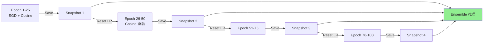
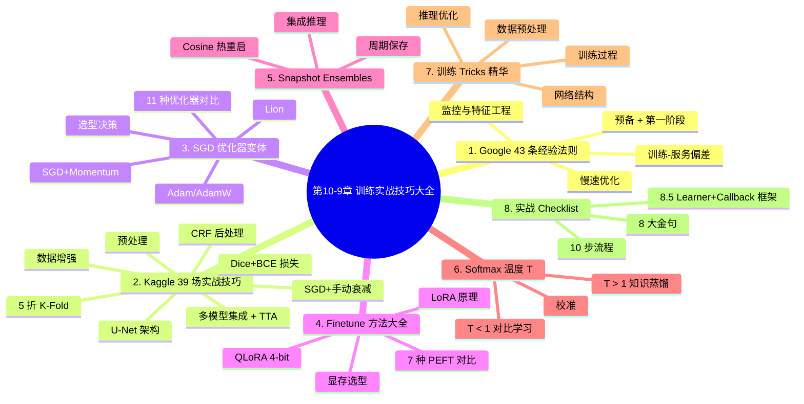

# 第10-9章 训练实战技巧大全：炼丹秘籍与工业经验

## 学习目标

- **掌握** Google 机器学习 43 条经验法则的精华（前 20 条）
- **学习** Kaggle 39 场图像分割竞赛的实战技巧
- **了解** SGD 优化器的十几种变体与选型
- **掌握** Finetune 方法大全（LoRA / Adapter / Prompt Tuning 等）
- **理解** Snapshot Ensembles 快照集成原理与实现
- **理解** Softmax 温度系数 T 在 蒸馏/对比学习/分类 中的作用
- **掌握** 深度学习训练 Tricks 总结精华
- **获得** 实战 10 步 Checklist

---

## 1. Google 机器学习 43 条经验法则（精华版）

> **来源**：Google 研究科学家 Martin Zinkevich 在 NIPS 2016 Workshop 分享。是工业级 ML 工程的"**最权威 43 条**"经验总结。本节精选前 20 条最实用的，按"机器学习项目生命周期"组织。

### 1.1 预备阶段（规则 1-3）

| 规则 | 内容 | 实战 |
|------|------|------|
| **1. 不要害怕发布一款没有用到 ML 的产品** | 先用启发式（规则）上线，验证数据后再上 ML | 90% 的项目应该先用 SQL/规则 |
| **2. 评估指标设计并落实优先处理** | **先设计指标，再写代码**——指标驱动迭代 | 离线指标 + 在线指标（点击/转化）|
| **3. 在复杂的启发式问题上使用 ML** | ML 适合"人写不出规则"的问题 | 图像识别、推荐排序、NLP |

### 1.2 第一阶段：你的第一个工作流（规则 4-7）

| 规则 | 内容 |
|------|------|
| **4. 第一个模型要保持简单** | 别上来就 Transformer！先线性回归 / 简单 DNN |
| **5. 基础架构可测试** | 单元测试、集成测试、回归测试 pipeline |
| **6. 复制数据时小心删除** | **ML 数据一旦删除无法恢复**，备份优先 |
| **7. 利用启发式设计特征** | 把"行业知识"编码成特征（如推荐中的"用户最近点击"）|

### 1.3 监控（规则 8-11）⭐ 工业核心

| 规则 | 内容 | 反例 |
|------|------|------|
| **8. 知道何时系统刷新** | 模型会"过期"（data drift），定期 retrain | 训练一次用 5 年 = 灾难 |
| **9. 输出前发现问题** | **Don't Deploy Surprises** | 上线前用验证集 + 影子流量 |
| **10. 当心未被报告的失败** | 静默错误（silent error）最可怕 | 加监控（accuracy 突降 1% 告警）|
| **11. 特征栏文档化** | 特征 owner + 创建日期 + 含义 + 异常 | 否则半年后没人知道特征是什么 |

### 1.4 目标与指标（规则 12-15）

| 规则 | 内容 |
|------|------|
| **12. 不要过度考虑选哪个目标** | 先优化一个直接指标（点击率），不要想太远 |
| **13. 第一个目标：简单 + 可观察 + 可归属** | 例：搜索结果点击率（不是用户满意度）|
| **14. 从可诠释的模型开始** | 线性回归 > 深度网络（前期）便于 debug |
| **15. 分层策略** | 垃圾过滤层 + 质量排序层，不要混在一起 |

### 1.5 特征工程（规则 16-21）

| 规则 | 内容 | 实战建议 |
|------|------|----------|
| **16. 计划发布和迭代** | 模型 v1 → v2 → v3，**定期迭代** | 不要等"完美模型"才上线 |
| **17. 从直接可观察特征开始** | 用户历史点击 > 抽象特征 | 80/20：80% 价值来自 20% 特征 |
| **18. 用能跨语境泛化的特征** | "用户最近点击" 比 "当前 query 词频" 更泛化 | |
| **19. 特别具体的特征** | "用户最近 1 分钟点击 5 次" > "用户平均点击" | 行为模式比统计平均好 |
| **20. 结合现有特征创造新特征** | 离散化、分桶、交叉特征 | 例如 age × income |
| **21. 特征数与数据量成正比** | 100 万样本最多用 100 万参数化特征 | 防止过拟合 |

### 1.6 训练-服务偏差（规则 29-37）⭐ 工业核心

| 规则 | 内容 | 后果 |
|------|------|------|
| **29. 训练时使用的特征必须可获取** | **训练-服务一致性** | 否则线上指标会爆降 |
| **30. 不要武断丢弃数据** | 重要性加权后再考虑 | 采样偏差会偏 |
| **31. join data 时注意 schema 变化** | 训练时的表 ≠ 上线时的表 | 静默错误 |
| **32. 训练流程与产品流程代码复用** | 一份代码，两个用途 | 避免实现差异 |
| **33. 用新数据测旧模型** | 检测 data drift | 验证集"过期" |
| **34. 二元分类的过滤牺牲** | 高 precision 换取数据质量 | spam detection |
| **35. 排序问题有固有偏差** | position bias（位置偏差）| 第一个位置点击率自然高 |
| **36. 用位置特征避免反馈循环** | feature = position, model = click | 破除反馈循环 |
| **37. 测量训练/服务偏差** | 训练指标 ≠ 服务指标时需排查 | **最重要的工业警示** |

### 1.7 慢速优化阶段（规则 38-43）

| 规则 | 内容 |
|------|------|
| **38. 目标不对齐时不加新特征** | 优化错目标 = 加速错误 |
| **39. 决策不基于单一标准** | 综合考虑 precision/recall/latency/成本 |
| **40. 保持组件简单** | 简单模型可调试、可维护 |
| **41. 性能高峰时找新信息源** | 精化现有信号收益递减 |
| **42. 不期望多样性 = 流行性** | 长尾 ≠ 头部 |
| **43. 不同产品用户可能偏好同一产品** | 你的兴趣 ≠ 用户兴趣 |

> **核心心法**：**ML 项目 80% 的工作是数据 + 特征 + 工程化，20% 才是模型**。Google 的 43 条法则反复强调这一点。

---

## 2. Kaggle 39 场图像分割实战技巧

> **来源**：Derrick Mwiti 团队总结的 Kaggle 39 场图像分割竞赛实战技巧。**这是工业级"炼丹秘笈"**。

### 2.1 十大实战板块

#### 2.1.1 预处理
- 高斯差分（DoG）斑点检测
- 基于图像块的训练（减少显存）
- cudf 替代 pandas（数据加载加速）
- OpenCV 统一方向（EXIF 旋转）
- 自主学习（self-training）半监督
- 分辨率统一化

#### 2.1.2 数据增强 ⭐ 关键
- **albumentations** 库（业界最常用）
- 90° 随机旋转
- 水平/垂直翻转
- 弹性变换 + 透视变换
- 随机 HSV
- 通道 shuffle
- 类别频率自适应增强（类别少的增强多）
- **Mosaic 4 图拼接**（YOLOv4/v5 标配）

#### 2.1.3 网络架构
- **U-Net** 及其变体（U-Net++, Attention U-Net）—— 分割首选
- **Inception-ResNet v2** 编码器
- **Siamese 网络**（对比学习）
- **ResNet50/Xception/Inception** + 全局最大池化
- **堆叠膨胀卷积**（DeepLab 风格）
- **LinkNet** 用 concat+conv1x1 替代 +
- **广义平均池化 (GeM)**

#### 2.1.4 损失函数
- **Dice 系数**（处理类别不均）
- **加权边界损失**（减少边界误差）
- **BCE + Dice 组合**（工业最常用）
- **Focal Loss**（极端不均）
- **Lovász Loss**（直接优化 mIoU）
- **Tversky Loss**（Dice 变体）

#### 2.1.5 训练技巧
- 尝试不同学习率（1e-3 ~ 1e-5）
- 不同 batch size（数据量而定）
- SGD + 手动衰减（图像任务首选）
- **数据增强不要过度**（验证集涨测试集跌）
- **裁剪训练 + 全图推理**
- ReduceLROnPlateau
- **冻结 backbone 微调**（few-shot）
- **类别感知采样**（class-aware sampling）
- 随机权重平均（SWA）

#### 2.1.6 评估与交叉验证
- **5 折 K-Fold 交叉验证**（小数据集必备）
- 训练集 + 验证集分布检查
- 类别 IoU 单独统计
- **不用"随机"划分**（医学图像按患者）

#### 2.1.7 集成方法
- **多模型平均**（YOLOv5/v8 默认）
- **TTA (Test Time Augmentation)**：推理时多角度增强再平均
- **Snapshot Ensembles**（见 §5）
- **Stacking**（用第一层模型的输出训练第二层）
- **伪标签**（半监督 + 集成）

#### 2.1.8 后处理
- **CRF（条件随机场）** 细化边界
- **NMS** 去重
- **形态学操作**（开/闭运算）
- **最大连通域**
- **多模型投票**

#### 2.1.9 硬件配置
- **数据加载** 通常是瓶颈（用 NVMe SSD）
- **混合精度**（FP16/BF16）
- **梯度累积** 模拟大 batch
- **多 GPU 训练**（DDP）
- **测试时关闭 augmentation**

#### 2.1.10 外部数据
- **预训练模型**（ImageNet 预训练 → fine-tune）
- 公开数据集（COCO, Cityscapes, LVIS）
- **合成数据**（虚拟引擎生成）

---

## 3. SGD 优化器变体大全

> **核心洞察**：**优化器的选择往往比模型结构更重要**。一个好的优化器可以让差模型超过一个烂优化器训练的好模型。

### 3.1 优化器家族图谱

```
                    ┌─ SGD (1951)
                    │
                    ├─ SGD with Momentum (1964)  ← 经典
                    │
                    ├─ Nesterov (1983)            ← 改进动量方向
                    │
                    ├─ AdaGrad (2011)             ← 自适应学习率
                    │
     ┌─ 动量系列 ──┼─ RMSProp (2012)             ← AdaGrad 改进
     │              │
     │              ├─ AdaDelta (2012)            ← 无需设学习率
     │              │
     │              ├─ Adam (2014)                ← 默认之王
     │              │
     │              ├─ Nadam                    ← Nesterov + Adam
     │              │
     │              ├─ AdamW (2017)               ← 修正权重衰减
     │              │
     │              └─ Lion (2023)                ← Google 新作
     │
     └─ 二阶方法 ──┼─ L-BFGS                     ← 经典但慢
                    └─ Shampoo / K-FAC           ← 大模型用
```

### 3.2 11 种优化器对比

| 优化器 | 核心思想 | 优点 | 缺点 | 适合 |
|--------|----------|------|------|------|
| **SGD** | 随机梯度 | 简单、泛化好 | 慢、需手动调 LR | CNN 经典 |
| **SGD + Momentum** | 引入动量（0.9）| 加速收敛 | 仍需调 LR | 图像任务首选 |
| **Nesterov** | 先按动量"看一步"再算梯度 | 比 momentum 更稳定 | 略慢 | RNN |
| **AdaGrad** | 自适应 LR（参数维度）| 稀疏特征友好 | LR 单调递减会过早停止 | NLP 早期 |
| **RMSProp** | 移动平均替代累计平方和 | 解决 AdaGrad 早停 | 仍有 LR 选择问题 | RNN |
| **AdaDelta** | RMSProp + 自适应 Δ | 无需设 LR | 收敛慢 | 理论优雅，实践少用 |
| **Adam** | Momentum + RMSProp 融合 | 几乎不用调参 | 可能不收敛 | ⭐ **深度学习默认** |
| **Nadam** | Nesterov + Adam | 比 Adam 快 | 计算量稍大 | RNN |
| **AdamW** | Adam + 修正的权重衰减 | 训练稳定、SOTA | 需调 β₁ β₂ | ⭐ **Transformer/LLM** |
| **Lion** | 符号函数做动量更新 | 内存减半（只存动量）| 新方法、生态少 | ⭐ **LLM 新趋势** |
| **Sophia** | 二阶 Hessian 估计 | 收敛快 2× | 复杂 | 大模型 |
| **LAMB** | 分层自适应 | 大 batch 训练 | 配合 LARS | BERT 预训练 |

### 3.3 实战选型

```python
# 1. 图像任务 (CNN 分类/检测/分割)
optimizer = torch.optim.SGD(model.parameters(), lr=0.01, momentum=0.9, weight_decay=1e-4)

# 2. NLP 任务 / Transformer
optimizer = torch.optim.AdamW(model.parameters(), lr=1e-3, weight_decay=0.01, betas=(0.9, 0.999))

# 3. LLM 训练 (>= 7B)
optimizer = torch.optim.AdamW(model.parameters(), lr=3e-4, betas=(0.9, 0.95), weight_decay=0.1)

# 4. 强化学习 (Policy Gradient)
optimizer = torch.optim.Adam(model.parameters(), lr=3e-4)

# 5. 快速实验 (调到合适 LR 再换)
optimizer = torch.optim.Adam(model.parameters(), lr=1e-3)
```

### 3.4 学习率策略组合

| 优化器 | 推荐 LR | 推荐调度 | 备注 |
|--------|---------|----------|------|
| SGD | 0.01-0.1 | CosineAnnealing | 图像 |
| Adam | 1e-3 | CosineAnnealingWarmRestarts | NLP |
| AdamW | 1e-4 ~ 5e-5 | Linear warmup + Cosine | LLM |
| Lion | 1e-4 ~ 1e-3 | Cosine | LLM 内存优化 |

---

## 4. Finetune 方法大全

> **核心洞察**：**预训练 + 微调**是 LLM 时代的核心范式。但微调方法的选择影响显存、速度和效果。

### 4.1 全量微调 vs 参数高效微调 (PEFT)

| 方法 | 训练参数 | 显存 (7B) | 速度 | 效果 |
|------|----------|-----------|------|------|
| **Full Fine-tune** | 100% | ~120GB | 慢 | ⭐⭐⭐⭐⭐ SOTA |
| **LoRA** | 0.1-5% | ~24GB | 快 | ⭐⭐⭐⭐ |
| **Adapter** | 1-5% | ~30GB | 中 | ⭐⭐⭐ |
| **Prefix Tuning** | 0.1% | ~20GB | 中 | ⭐⭐⭐ |
| **Prompt Tuning** | 0.001% | ~16GB | 快 | ⭐⭐ |
| **P-Tuning v2** | 0.1-1% | ~20GB | 中 | ⭐⭐⭐⭐ |
| **BitFit (bias only)** | 0.05% | ~14GB | 极快 | ⭐⭐ |

### 4.2 LoRA 详解（⭐ 工业最常用）

**核心思想**：在原权重旁加一个低秩分解矩阵：

$$
W_{\text{new}} = W + \Delta W = W + B \cdot A
$$

其中 $A \in \mathbb{R}^{r \times d}$, $B \in \mathbb{R}^{d \times r}$, $r \ll d$（rank 通常 8-64）。

```python
from peft import LoraConfig, get_peft_model, TaskType

config = LoraConfig(
    r=16,                     # rank
    lora_alpha=32,            # 缩放因子
    target_modules=["q_proj", "v_proj"],  # 作用层
    lora_dropout=0.05,
    bias="none",
    task_type=TaskType.CAUSAL_LM,
)
model = get_peft_model(base_model, config)
model.print_trainable_parameters()
# trainable params: 4,194,304 || all params: 6,742,609,920 || trainable%: 0.062%
```

**LoRA 变体**：
- **QLoRA**（4-bit 量化 + LoRA）—— 7B 模型只需 6GB
- **LoRA+** —— 不同层用不同 LR
- **AdaLoRA** —— 自适应 rank 分配
- **DoRA** —— 分解方向 + 幅度
- **rsLoRA** —— rank-stabilized LoRA

### 4.3 QLoRA：低显存微调

```python
from transformers import BitsAndBytesConfig
from peft import prepare_model_for_kbit_training, LoraConfig, get_peft_model

# 4-bit 量化配置
bnb_config = BitsAndBytesConfig(
    load_in_4bit=True,
    bnb_4bit_quant_type="nf4",
    bnb_4bit_compute_dtype=torch.bfloat16,
    bnb_4bit_use_double_quant=True,
)

model = AutoModelForCausalLM.from_pretrained(
    "meta-llama/Llama-2-7b-hf",
    quantization_config=bnb_config,
    device_map="auto",
)
model = prepare_model_for_kbit_training(model)

# 加 LoRA
lora_config = LoraConfig(r=16, lora_alpha=32, target_modules=["q_proj", "v_proj"], ...)
model = get_peft_model(model, lora_config)

# 训练：7B 模型只需 6GB 显存（vs 全量 120GB）
```

### 4.4 何时用哪种方法

| 场景 | 推荐方法 | 原因 |
|------|----------|------|
| **7B 模型 + 24GB 显卡** | QLoRA | 唯一可行 |
| **7B 模型 + 80GB 显卡** | LoRA | 效果好 |
| **13B 模型 + 单卡** | QLoRA | 显存紧 |
| **70B 模型 + 多卡** | LoRA | 不量化 |
| **全参数微调** | ≥4×A100 80G | 学术 SOTA |
| **领域适配** | Prefix Tuning / Adapter | 参数少 |
| **多任务共享** | Prompt Tuning / P-Tuning | 一个模型多任务 |

---

## 5. Snapshot Ensembles 快照集成

> **核心洞察**：**一个训练过程 = 多个模型**。通过周期性保存 + 余弦退火热重启，一个 SGD 训练可以产生 5-10 个不同模型，集成后效果**白嫖式提升**。

### 5.1 原理



**核心机制**：
1. 使用 **Cosine Annealing with Warm Restarts**（热重启）
2. 每次 LR 重启到最大值时，模型"跳出"当前局部最优
3. 在每个 cycle 末尾保存 snapshot
4. 推理时**所有 snapshot 的预测平均**

### 5.2 PyTorch 实现

```python
import torch
import torch.nn as nn
from torch.optim.lr_scheduler import CosineAnnealingWarmRestarts

def snapshot_ensemble_train(model, train_loader, n_cycles=5, epochs_per_cycle=20):
    optimizer = torch.optim.SGD(model.parameters(), lr=0.1, momentum=0.9, weight_decay=1e-4)
    scheduler = CosineAnnealingWarmRestarts(optimizer, T_0=epochs_per_cycle, T_mult=1)
    criterion = nn.CrossEntropyLoss()
    
    snapshots = []
    
    for cycle in range(n_cycles):
        for epoch in range(epochs_per_cycle):
            for x, y in train_loader:
                optimizer.zero_grad()
                loss = criterion(model(x), y)
                loss.backward()
                optimizer.step()
            scheduler.step()
        
        # 每个 cycle 末尾保存 snapshot
        snapshot = {k: v.clone() for k, v in model.state_dict().items()}
        snapshots.append(snapshot)
        print(f"Cycle {cycle+1}/{n_cycles}, LR={optimizer.param_groups[0]['lr']:.4f}, saved snapshot")
    
    return snapshots

def snapshot_ensemble_predict(snapshots, model, x):
    """推理时多个 snapshot 的预测平均"""
    preds = []
    for snap in snapshots:
        model.load_state_dict(snap)
        model.eval()
        with torch.no_grad():
            preds.append(torch.softmax(model(x), dim=1))
    return torch.stack(preds).mean(dim=0)
```

### 5.3 实战效果

| 指标 | 单个模型 | Snapshot Ensemble (5) |
|------|----------|---------------------|
| 训练成本 | 1× | 1×（同一训练）|
| 推理成本 | 1× | 5× |
| **CIFAR-10 错误率** | 4.5% | **3.6%**（-0.9%）|
| ImageNet Top-1 | 76.1% | **77.5%**（+1.4%）|
| 显存开销 | 1× | 5×（需保存 5 个模型）|

> **何时用**：当推理时间充裕（如离线批处理）+ 训练时间紧 + 想要免费提升精度时。

---

## 6. Softmax 温度系数 T 详解

> **核心洞察**：**温度 T 看似简单，但用途极广**——知识蒸馏、对比学习、置信度校准都离不开它。

### 6.1 温度 T 是什么

$$
\text{softmax}(z_i; T) = \frac{e^{z_i / T}}{\sum_j e^{z_j / T}}
$$

| T 值 | 效果 |
|------|------|
| **T = 1** | 标准 softmax |
| **T < 1** | 概率分布更"尖锐"（harder）|
| **T > 1** | 概率分布更"平滑"（softer）|
| **T → 0** | one-hot |
| **T → ∞** | 均匀分布 |

**PyTorch 实验**：
```python
import torch.nn.functional as F
x = torch.Tensor([[1.0, 2.0, 3.0]])
print(F.softmax(x / 1.0, dim=1))  # [0.090, 0.245, 0.665]  (T=1)
print(F.softmax(x / 0.5, dim=1))  # [0.016, 0.117, 0.867]  (T=0.5, 尖)
print(F.softmax(x / 2.0, dim=1))  # [0.186, 0.307, 0.507]  (T=2, 平)
```

### 6.2 三大应用场景

#### 6.2.1 知识蒸馏（Knowledge Distillation, T > 1）

**Hinton 2015 Distillation 论文核心**：

```python
# Teacher 模型的输出
teacher_logits = torch.tensor([[1.0, 2.0, 3.0]])
T = 4  # 蒸馏温度（>1，平滑分布）

# 软标签：除以 T 让学生学习类别间相似性
soft_target = F.softmax(teacher_logits / T, dim=1)
# [0.176, 0.307, 0.517] - 类别间差距被拉近，相似信息被放大

# 学生匹配软标签
student_loss = F.kl_div(F.log_softmax(student_logits / T, dim=1), soft_target) * T * T

# 同时匹配硬标签
hard_loss = F.cross_entropy(student_logits, labels)
total_loss = 0.7 * soft_loss + 0.3 * hard_loss
```

**为什么 T > 1？**
- 训练好的模型会"过度自信"（softmax 输出概率熵很小）
- 除以大 T 后，**类别间的相似信息被放大**（"狗"和"狼"的差异变大）
- 学生学习这些"暗知识"（dark knowledge）

#### 6.2.2 对比学习（Contrastive Learning, T < 1）

```python
# SimCLR / MoCo 风格的对比损失
def contrastive_loss(z_i, z_j, temperature=0.1):  # T < 1
    z = torch.cat([z_i, z_j], dim=0)            # 2N 个样本
    sim = F.cosine_similarity(z.unsqueeze(1), z.unsqueeze(0), dim=2) / temperature
    # 小的 T 放大困难负样本的梯度
    labels = torch.arange(2 * N).to(z.device)
    return F.cross_entropy(sim, labels)
```

**为什么 T < 1？**
- T 小 → softmax 差异放大 → **对困难负样本惩罚更重**
- 对比学习的核心是"挖掘 hard negative"
- 但 T 不能太小（会导致 Uniformity-Tolerance 困境）

#### 6.2.3 置信度校准（Calibration）

```python
# 在测试时用 T 校准模型输出
def calibrated_prediction(model, x, T=1.5):
    logits = model(x)
    return F.softmax(logits / T, dim=1)
```

**应用**：当模型"过度自信"时（max prob = 0.99 但实际只有 70% 准确），用 T > 1 校准。

### 6.3 T 的选型决策

| 任务 | 推荐 T | 原因 |
|------|--------|------|
| 知识蒸馏 (Hinton) | 3-20 | 放大暗知识 |
| 对比学习 (SimCLR) | 0.07-0.15 | 聚焦 hard negative |
| CLIP | 0.07-0.1 | 大规模对比 |
| 置信度校准 | 1.2-2.0 | 减少过度自信 |
| 多标签分类 | 0.5-1.0 | 防止概率全为 0 |

---

## 7. 训练 Tricks 总结精华

> **来源**：综合 467K 的 tricks 总结文档 + Google 43 条 + Kaggle 39 场实战经验 + 多个 SOTA 论文。

### 7.1 数据预处理 Tricks

| Trick | 说明 | 收益 |
|-------|------|------|
| **Mixup** | 两图按 α 混合 | +1% Acc |
| **CutMix** | 一图矩形区域替换另一图 | +1-2% Acc |
| **Cutout / RandomErasing** | 随机遮挡矩形 | +0.5% Acc |
| **Mosaic** | 4 图拼接（YOLO 标配）| +2-3% mAP |
| **Copy-Paste** | 复制粘贴实例到其他图 | 实例分割 +2 mAP |
| **RandAugment / AutoAugment** | 自动搜索增强策略 | +1% Acc |
| **GridMask** | 网格遮挡 | +0.5% Acc |

### 7.2 训练过程 Tricks

| Trick | 公式 / 思想 | 用途 |
|-------|-------------|------|
| **EMA (Exponential Moving Average)** | $\theta' = \alpha \theta' + (1-\alpha) \theta$ | 稳定 +0.5% |
| **SWA (Stochastic Weight Averaging)** | 多个 checkpoint 平均 | 提升泛化 |
| **SAM (Sharpness-Aware Minimization)** | 寻找平坦极小值 | +0.5-1% |
| **Lookahead Optimizer** | k 步 inner + 1 步 outer | 稳定收敛 |
| **Gradient Clipping** | $\|\|g\|\| \leq c$ | 防止爆炸 |
| **Warmup + Cosine** | 渐进 LR | 训练稳定 |
| **Label Smoothing** | 软化硬标签 | +0.5% |
| **Mixup + CutMix 组合** | 业界默认 | 图像任务 |

### 7.3 网络结构 Tricks

| Trick | 思想 | 适用 |
|-------|------|------|
| **Residual Connection** | 解决梯度消失 | 所有深度网络 |
| **Batch Normalization** | 归一化激活 | CNN（Transformer 不用）|
| **Layer Normalization** | 归一化激活 | Transformer |
| **Dropout** | 随机失活 | MLP / RNN |
| **DropPath (Stochastic Depth)** | 随机失活路径 | ResNet / Swin |
| **SE / ECA / CBAM** | 通道注意力 | CNN backbone |
| **Skip Connection in U-Net** | 编解码跳跃 | 分割 |
| **Multi-Head Attention** | 多头并行注意力 | Transformer |
| **FFN with GELU** | Transformer 标准 FFN | All |
| **Pre-Norm vs Post-Norm** | Pre-Norm 更稳定 | Transformer |

### 7.4 推理优化 Tricks（详见 10-4 / 10-3）

| Trick | 思想 | 加速比 |
|-------|------|--------|
| **混合精度 (FP16/BF16)** | 减半精度 | 2× |
| **TensorRT** | 图优化 + 量化 | 3-5× |
| **ONNX Runtime** | 跨平台 | 2-3× |
| **Pruning (剪枝)** | 去冗余权重 | 2× |
| **Quantization (量化)** | INT8/INT4 | 2-4× |
| **Knowledge Distillation** | 小模型学大模型 | 2× |
| **Batch Inference** | 批量推理 | 5-10× |

### 7.5 训练框架：Learner + Callback 架构

> **背景**：手写训练循环（for epoch → for batch → loss.backward() → optimizer.step()）在原型阶段没问题，但当你需要加早停、学习率调度、梯度裁剪、Checkpoint、TensorBoard 记录时，代码量暴增且容易出错。**训练框架（Learner / Trainer）就是封装这一切的高层抽象。**

#### 7.5.1 核心思想

**Learner = Model + Data + Loss + Optimizer + Callbacks**

你不用写训练循环，框架帮你做：

| 你的关注点 | 框架帮你做 |
|-----------|-----------|
| 选模型、数据、损失、优化器 | batch 循环、前向/反向、参数更新 |
| 声明"何时做什么"（回调） | 在正确的时机（epoch结束/loss爆炸）触发回调 |
| 监控指标 | 自动记录 accuracy、loss、grad norm 到 TensorBoard |

#### 7.5.2 三种主流实现

##### ① fastai Learner（最简洁）

```python
from fastai.vision.all import *

# 一行构建 Learner
learn = cnn_learner(dls, resnet34, metrics=accuracy)

# 自动包含的 callback：EarlyStoppingCallback, SaveModelCallback, ReduceLROnPlateau
learn.fine_tune(5, cbs=[
    EarlyStoppingCallback(monitor='accuracy', patience=3),
    SaveModelCallback(fname='best_model'),
])
# → 自动配置：SGD + momentum + Cosine LR + Warmup + 早停 + 最佳模型保存
```

**Learner 内部自动做的事**：
1. 根据 `dls` 推断输入输出维度
2. 给预训练模型附加新头（Head）
3. 配置 SGD + Momentum 优化器 + Cosine Annealing LR
4. 训练过程中按 callback 生命周期触发：`before_fit → before_epoch → before_batch → after_batch → after_epoch → after_fit`

##### ② PyTorch Lightning（最灵活）

```python
import pytorch_lightning as pl
from pytorch_lightning.callbacks import EarlyStopping, ModelCheckpoint

class CNNClassifier(pl.LightningModule):
    def __init__(self):
        super().__init__()
        self.model = resnet34(pretrained=True)
        self.criterion = nn.CrossEntropyLoss()

    def forward(self, x):
        return self.model(x)

    def training_step(self, batch, batch_idx):
        x, y = batch
        loss = self.criterion(self(x), y)
        self.log('train_loss', loss)
        return loss

    def configure_optimizers(self):
        return torch.optim.SGD(self.parameters(), lr=0.01, momentum=0.9)

# Callbacks 以声明方式"插件化"——不需要写到训练循环里
model = CNNClassifier()
trainer = pl.Trainer(
    max_epochs=50,
    callbacks=[
        EarlyStopping(monitor='val_loss', patience=5),
        ModelCheckpoint(dirpath='checkpoints', filename='{epoch}-{val_loss:.2f}'),
    ],
    log_every_n_steps=10,
)

trainer.fit(model, train_loader, val_loader)
```

##### ③ Hugging Face Trainer（NLP/LLM 标准）

```python
from transformers import Trainer, TrainingArguments, EarlyStoppingCallback

training_args = TrainingArguments(
    output_dir='./results',
    num_train_epochs=10,
    per_device_train_batch_size=16,
    save_strategy='epoch',
    logging_dir='./logs',
)

trainer = Trainer(
    model=model,
    args=training_args,
    train_dataset=train_dataset,
    eval_dataset=val_dataset,
    callbacks=[EarlyStoppingCallback(early_stopping_patience=3)],
)

trainer.train()
```

#### 7.5.3 Callback 生命周期对比

| 时机 | fastai | Lightning | HuggingFace |
|------|--------|-----------|-------------|
| 训练开始 | `before_fit` | `on_fit_start` | `on_train_begin` |
| 每个 epoch 开始 | `before_epoch` | `on_train_epoch_start` | `on_epoch_begin` |
| 每个 batch 前 | `before_batch` | `on_train_batch_start` | 自动 |
| 每个 batch 后 | `after_batch` | `on_train_batch_end` | 自动 |
| 每个 epoch 结束 | `after_epoch` | `on_train_epoch_end` | `on_epoch_end` |
| 验证开始 | `before_validate` | `on_validation_start` | 自动 |
| 验证结束 | `after_validate` | `on_validation_end` | 自动 |
| 训练结束 | `after_fit` | `on_fit_end` | `on_train_end` |
| 异常处理 | `after_cancel` | `on_exception` | 自动 |

> **为什么你需要知道这些**？当你需要"每 10 步打印一次学习率"、"loss 不下降时提前终止"、"保存验证集最好的模型"——这些都不需要手写循环，只需实现一个 Callback 方法。**这是现代训练框架的核心设计模式**。

#### 7.5.4 常用 Callback 速查

| Callback | 作用 | fastai | Lightning | HF |
|----------|------|--------|-----------|----|
| 早停 | val_loss 不再下降时终止 | ✅ | ✅ | ✅ |
| 模型保存 | 保存最佳 checkpoint | ✅ | ✅ | ✅ |
| LR 调度 | 学习率按策略调整 | ✅ | ✅ | ✅ |
| TensorBoard | 记录指标到 TB | ✅ | ✅ | ✅ |
| 梯度裁剪 | 防止梯度爆炸 | ✅ | ✅ | ✅ |
| 进度条 | 显示训练进度 | ✅ 内置 | ✅ 内置 | ✅ 内置 |
| 交换验证 | train/val 集互相验证 | ✅ | ❌ | ❌ |
| 冻结/解冻 | 逐层解冻训练 | ✅ (fine_tune) | 手写 | 手写 |

> **经验法则**：如果你的项目需要手写 `for epoch in range(100)`——除非你是在教学或做框架开发——否则说明你应该用一个训练框架。Learner / Trainer / Lightning 都是"训练循环就是配置"的践行者，也是 fast.ai 课程最核心的实战教学。

### 7.6 8 大实战金句

```
1. 数据 > 算法 (80/20 法则)
2. 基线 > 复杂模型 (先用 ResNet-50，不要上来 ViT-L)
3. 训练-服务一致性 (Train-Serving Skew 最致命)
4. 集成 > 单一模型 (Snapshot / TTA / Stacking)
5. 早停 + 模型保存 (避免过拟合)
6. 数据增强不要过度 (验证涨测试跌的陷阱)
7. 用 tensorboard / wandb 监控一切
8. 复现 SOTA 先从 GitHub 找代码, 不要从论文白手起家
```

---

## 8. 10 步训练 Checklist

```
□ 1. 明确任务 + 选定指标（离线 + 在线）
□ 2. 数据清洗 + 划分 (Train/Val/Test)
□ 3. 选 baseline 模型（轻量优先）
□ 4. 选优化器 + 学习率（Adam/SGD + Cosine）
□ 5. 选 batch size（不超过 GPU 显存 80%）
□ 6. 数据增强（Mixup + CutMix + RandAugment）
□ 7. EMA + Cosine + Warmup
□ 8. Tensorboard 监控（loss/acc/grad norm）
□ 9. 早停 + 保存 best checkpoint
□ 10. 复现 SOTA 前用 Snapshot Ensemble / TTA 提升
```

---

## 9. 参考资料汇总

| # | 来源 | 关键内容 |
|---|------|----------|
| 1 | Google "Rules of Machine Learning" | 43 条工业级经验 |
| 2 | Kaggle 39 场图像分割 (Derrick Mwiti) | 实战 10 板块 |
| 3 | Adam Optimizer (Kingma 2014) | 默认优化器 |
| 4 | AdamW (Loshchilov 2017) | 修正的权重衰减 |
| 5 | LoRA (Microsoft 2021) | 低秩适配 |
| 6 | QLoRA (Dettmers 2023) | 4-bit LoRA |
| 7 | Snapshot Ensembles (Huang 2017) | 余弦退火热重启 |
| 8 | Distillation (Hinton 2015) | 知识蒸馏 T>1 |
| 9 | SimCLR (Chen 2020) | 对比学习 T<1 |
| 10 | Mixup (Zhang 2017) | 图像混合增强 |
| 11 | CutMix (Yun 2019) | 区域替换增强 |
| 12 | EMA / SWA | 权重平均技巧 |
| 13 | Mosaic (Bochkovskiy 2020) | 4 图拼接 |
| 14 | Sharpness-Aware Minimization | 平坦极小值 |

---

## 本章小结

1. **Google 43 条经验法则** 是工业级 ML 项目最权威的指南。**核心原则**：
   - ML 项目 80% 是数据 + 特征 + 工程化
   - 训练-服务一致性（Train-Serving Skew）是最大的工程陷阱
   - 监控 + 简单模型 + 可测试性 是工程基线

2. **Kaggle 39 场实战技巧** 提炼了 10 大板块：**albumentations 数据增强**、**U-Net 架构**、**Dice+BCE 损失**、**SGD + 手动衰减**、**5 折 K-Fold**、**多模型平均 + TTA**、**CRF 后处理**、**预训练模型** 是工业最常用。

3. **SGD 优化器 11 种变体**：图像任务用 **SGD + Momentum**；NLP/LLM 用 **AdamW**；大模型用 **AdamW + Cosine + Warmup**。优化器选择比模型选择更重要。

4. **Finetune 方法大全**：QLoRA 是 24GB 显卡跑 7B 模型的唯一选择；LoRA 是 80GB 显卡的工业标准；全参微调只在 ≥4×A100 80G 才有意义。

5. **Snapshot Ensembles**：用 CosineAnnealingWarmRestarts + 周期保存，**一次训练得到 5-10 个模型**，集成后免费提升 0.5-1.5% 准确率（ImageNet +1.4%）。

6. **Softmax 温度 T 三大应用**：
   - **T > 1（3-20）** 用于**知识蒸馏**（放大暗知识）
   - **T < 1（0.07-0.15）** 用于**对比学习**（聚焦 hard negative）
   - **T > 1（1.2-2.0）** 用于**置信度校准**（减少过度自信）

7. **训练 Tricks 精华**：数据增强（Mixup+CutMix+RandAugment+Mosaic）、训练过程（EMA+SWA+SAM+Warmup+Label Smoothing）、网络结构（Residual+BN/LN+SE/CBAM）、推理优化（混合精度+TensorRT+剪枝+量化+蒸馏）四大类。

8. **8 大实战金句**：
   - 数据 > 算法 / 基线 > 复杂模型 / 训练-服务一致性
   - 集成 > 单一模型 / 早停 + 模型保存 / 数据增强不要过度
   - 监控一切 / 复现 SOTA 先找代码

### 8.5 训练循环的工程化：Learner + Callback 模式

当训练流程从"跑一次实验"变成"反复迭代调优"时，原始的 PyTorch 训练循环会变得臃肿且难以扩展。fast.ai 的 **Learner + Callback** 模式提供了一种优雅的解决方案。

**核心思想**：将训练循环拆分为**固定骨架**（Learner）+ **可插拔钩子**（Callback），每个训练阶段（batch 开始/结束、epoch 开始/结束、训练开始/结束）都有回调点，Callback 可以在这些点注入任意逻辑。

```python
# 最小 Callback 系统（PyTorch 实现）
class Callback:
    """回调基类——所有钩子默认空操作"""
    def before_fit(self): pass
    def after_fit(self): pass
    def before_epoch(self): pass
    def after_epoch(self): pass
    def before_batch(self): pass
    def after_batch(self): pass
    def after_loss(self): pass
    def before_backward(self): pass
    def before_step(self): pass
    def after_step(self): pass

class Learner:
    """训练循环骨架——逻辑固定，行为由 Callback 控制"""
    def __init__(self, model, dls, loss_fn, opt_fn, cbs=None):
        self.model, self.dls, self.loss_fn = model, dls, loss_fn
        self.opt = opt_fn(model.parameters())
        self.cbs = cbs or []
        for cb in self.cbs: cb.learn = self  # 回调可以访问 Learner
    
    def __call__(self, name):
        for cb in sorted(self.cbs):
            cb_method = getattr(cb, name, None)
            if cb_method is not None: cb_method()
    
    def fit(self, epochs):
        self.epochs = epochs
        self('before_fit')
        for epoch in range(epochs):
            self.epoch = epoch
            self('before_epoch')
            for xb, yb in self.dls.train:
                self.xb, self.yb = xb, yb
                self('before_batch')
                self.preds = self.model(self.xb)
                self.loss = self.loss_fn(self.preds, self.yb)
                self('after_loss')
                self('before_backward')
                self.loss.backward()
                self('before_step')
                self.opt.step()
                self.opt.zero_grad()
                self('after_step')
                self('after_batch')
            self('after_epoch')
        self('after_fit')
```

**常用 Callback 示例**：

```python
class DeviceCB(Callback):
    """自动将数据移到 GPU"""
    def before_batch(self):
        self.learn.xb = self.learn.xb.to('cuda')
        self.learn.yb = self.learn.yb.to('cuda')

class MetricsCB(Callback):
    """记录训练指标"""
    def __init__(self): self.losses = []
    def after_batch(self):
        self.losses.append(self.learn.loss.item())

class EarlyStoppingCB(Callback):
    """验证损失不下降则停止"""
    def __init__(self, patience=3): self.patience, self.wait, self.best = patience, 0, float('inf')
    def after_epoch(self):
        # 简化：用训练损失近似验证损失（实际应传入验证 DataLoader）
        val_loss = self.learn.loss.item()
        if val_loss < self.best: self.best, self.wait = val_loss, 0
        else:
            self.wait += 1
            if self.wait >= self.patience:
                print(f"Early stopping at epoch {self.learn.epoch}")
                raise CancelFitException()  # 中断训练

class CancelFitException(Exception): pass  # 用于中断训练的信号

# 使用：组合 Callback 构建完整训练流程
learn = Learner(model, dls, loss_fn, torch.optim.Adam, 
                cbs=[DeviceCB(), MetricsCB(), EarlyStoppingCB(patience=5)])
learn.fit(100)
```

**Callback 模式的优势**：

| 对比项 | 原始训练循环 | Learner + Callback |
|--------|------------|-------------------|
| 添加新功能 | 修改循环代码 | 写一个 Callback |
| 功能组合 | 代码耦合 | 自由组合 |
| 调试 | 在循环中加 print | 写 LogCB |
| 复用 | 复制粘贴 | import Callback |

> **实践建议**：即使不用 fast.ai 框架，也可以在自己的项目中采用这种模式。核心收益是**关注点分离**——训练循环只管"做什么"，Callback 管"额外做什么"。

---

## 知识图谱


