# 第11-1章 目标检测进阶

## 学习目标

- 理解两阶段检测器（R-CNN、Fast R-CNN、Faster R-CNN）的工作原理与发展脉络
- 掌握单阶段检测器（YOLO系列、SSD）的设计思路与性能特点
- 了解Anchor-Free检测器（CenterNet、FCOS）的核心创新
- 理解NMS（非极大值抑制）的原理与作用
- 掌握YOLOv8与YOLOv10的核心改进与工程实践

---

## 1. 目标检测概述

### 1.1 任务定义

目标检测（Object Detection）是计算机视觉的核心任务之一，其目标是在图像中定位出所有感兴趣的目标物体，并确定它们的类别。如图所示：

```
┌──────────────────────────────────────┐
│           图像输入                    │
│  ┌────┐ ┌────┐                       │
│  │猫  │ │狗  │                       │
│  └────┘ └────┘     ┌─────────────┐  │
│         ┌────┐      │ 检测结果    │  │
│         │人  │  ──→ │ 类别+位置   │  │
│         └────┘      └─────────────┘  │
└──────────────────────────────────────┘
```

### 1.2 核心指标

**IoU（Intersection over Union）**：衡量预测框与真实框的重合程度

$$
IoU = \frac{Area(b_p \cap b_t)}{Area(b_p \cup b_t)}
$$

**mAP（Mean Average Precision）**：多类别的平均精度均值，是目标检测最重要的评估指标

$$
mAP = \int_0^1 precision(r) dr
$$

其中：
- $Precision = \frac{TP}{TP+FP}$
- $Recall = \frac{TP}{TP+FN}$

### 1.3 目标检测数据标注原则

> **审核结论**：本教程在 0-3 / 2-4 章节介绍了标注工具（LabelMe、Label Studio、CVAT 等），但**目标检测的标注原则几乎没有系统覆盖**。标注质量直接决定模型上限（"garbage in, garbage out"），**比模型架构选择更重要**。本节系统总结工业级标注原则。

#### 1.3.1 Bounding Box 标注的 5 大核心原则

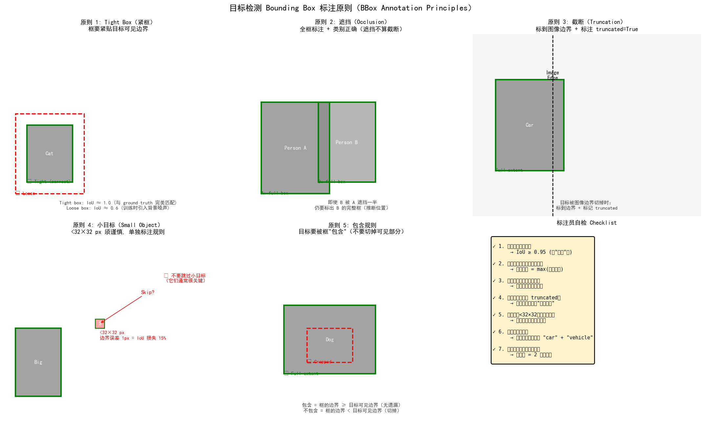

| 原则 | 规则 | 反例 |
|------|------|------|
| **1. Tight Box（紧框）** | 框必须紧贴目标可见边界，IoU ≥ 0.95 | 框留有大量背景 |
| **2. 遮挡处理** | 即使被遮挡也要标**完整推断框**，类别保持 | 遮挡就裁切框 |
| **3. 截断处理** | 目标被图像边界切掉时标到边界 + 标记 truncated | 漏标或只标可见部分 |
| **4. 小目标保留** | <32×32 px 也要标（边界 1px 误差 = IoU 损失 15%）| 跳过小目标 |
| **5. 包含规则** | 框的边界 ≥ 目标可见边界（不切掉任何像素）| 框切掉部分目标 |

**紧框 vs 松框的影响**：
- 紧框（IoU≈1.0）：训练时回归目标清晰，模型学得快
- 松框（IoU≈0.6）：引入背景噪声，AP 通常下降 2-5 个点

**遮挡与截断的区分**：
- **遮挡（Occlusion）**：目标被**其他目标**挡住，仍要标完整框
- **截断（Truncation）**：目标被**图像边界**切掉，标到边界 + 标记 truncated=1（COCO 字段）

#### 1.3.2 类别标签的 4 条原则

| 原则 | 说明 | 反例 |
|------|------|------|
| **1. 互斥** | 一个目标只能属于一个类别 | 一辆车同时标为 "car" 和 "vehicle" |
| **2. 层级清晰** | 定义 "animal" 还是 "dog"？选**叶节点** | 类别体系混乱导致标签分歧 |
| **3. 显式 ignore** | 不确定/边界类别用 `iscrowd=1` 或忽略类 | 强行标错类 |
| **4. 一致性** | 相同目标跨图像/标注员必须用同一类别 | 同一种猫有时标 "cat" 有时标 "kitten" |

**多标签场景**：
- 分类（单标签）：用 `category_id` 字段
- 多标签（如属性识别）：用多个 `category_id` 数组
- 互斥多选：拆成 N 个二分类问题

#### 1.3.3 三大标注格式详解

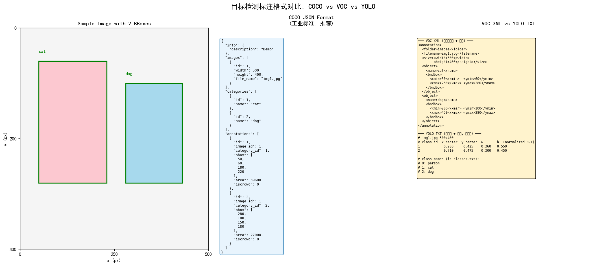

| 格式 | 坐标表示 | 文件结构 | 适用场景 |
|------|----------|----------|----------|
| **COCO JSON** | `[x, y, w, h]`（左上角 + 宽高）| JSON（含 images/annotations/categories）| 工业标准，MMDetection/PaddleDetection |
| **VOC XML** | `[xmin, ymin, xmax, ymax]`（对角点）| XML（每图一文件）| 教学示例，Pascal VOC 数据集 |
| **YOLO TXT** | `[cx, cy, w, h]`（中心 + 宽高，归一化 0-1）| TXT（每图一行 + 类别）| YOLO 系列训练 |
| **DOTA** | 旋转框 `(x, y, w, h, θ)` | TXT | 遥感/航空图像 |

**格式互转工具**：

```python
# labelme JSON → COCO JSON
!labelme2coco <input_dir> <output.json>

# COCO JSON → YOLO TXT
from ultralytics.data.converter import convert_coco
convert_coco(labels_dir='coco/annotations/', save_dir='yolo/')

# YOLO TXT → COCO JSON
from ultralytics.data.converter import convert_yolo_to_coco
```

#### 1.3.4 标注质量控制：Inter-Annotator Agreement (IAA)

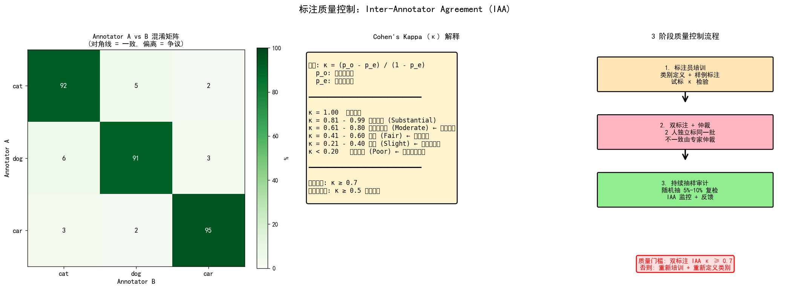

**Cohen's Kappa (κ)** 是工业标准的标注一致性指标：

$$
\kappa = \frac{p_o - p_e}{1 - p_e}
$$

其中 $p_o$ 是实际一致率，$p_e$ 是随机一致率。

| κ 值 | 解读 | 行动 |
|------|------|------|
| 0.81 - 0.99 | 几乎完美 (Substantial) | 接受 |
| 0.61 - 0.80 | 实质性一致 (Moderate) | 工业标准 ✓ |
| 0.41 - 0.60 | 中等 (Fair) | 需要核查 |
| 0.21 - 0.40 | 一般 (Slight) | 标注员培训 |
| < 0.20 | 一致性差 (Poor) | 重新定义类别 |

**完整可运行示例**见 [`assets/figures/11-1-cohen-kappa-demo.py`](../../assets/figures/11-1-cohen-kappa-demo.py)：

```python
from assets.figures.cohen_kappa_demo import cohens_kappa

# 两位标注员标注的 300 个目标
y_a = ['cat']*100 + ['dog']*100 + ['car']*100
y_b = y_a.copy()  # 添加 10% 噪声

kappa, p_o, p_e, cm = cohens_kappa(y_a, y_b)
print(f"κ = {kappa:.3f}")
# → κ = 0.85 (实质性一致, 工业可用)
```

#### 1.3.5 3 阶段质量控制流程

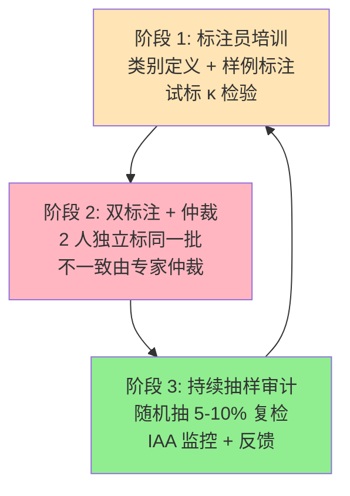

**工业标准 SOP**：
1. **培训阶段**：5-10 个样例，标注员试标，κ ≥ 0.7 才进入正式标注
2. **双标注阶段**：每张图 2 个标注员独立标，不一致由专家仲裁
3. **审计阶段**：每批随机抽 5-10% 复检，监控 IAA 趋势
4. **反馈循环**：每 200 张图回看一次，更新类别定义

#### 1.3.6 预标注 + 主动学习：降低标注成本

| 方法 | 节省成本 | 实施 |
|------|----------|------|
| **SAM 预标注** | 70-90% | SAM → 自动分割 → 人工微调 |
| **模型辅助** | 50-70% | 训练 baseline → 高置信预测自动接受 → 低置信人工标 |
| **主动学习** | 30-50% | 模型挑"最不确定"的样本给人工标 |
| **半监督** | 20-40% | 用小量标注 + 大量未标注联合训练 |

**SAM 预标注示例**（Segment Anything Model）：

```python
from segment_anything import sam_model_registry, SamPredictor
import cv2

sam = sam_model_registry["vit_b"](checkpoint="sam_vit_b_01ec64.pth")
predictor = SamPredictor(sam)

image = cv2.imread("image.jpg")
predictor.set_image(image)

# 给几个点 prompt → 自动分割
masks, _, _ = predictor.predict(
    point_coords=np.array([[500, 375]]),  # 中心点
    point_labels=np.array([1]),
)

# 转换 mask → bbox
for mask in masks:
    bbox = mask_to_bbox(mask)  # [x, y, w, h]
    # 人工微调 + 标类别
```

#### 1.3.7 标注常见错误与避坑

| 错误 | 影响 | 避坑 |
|------|------|------|
| **错标类** | 模型学错类别 | 双标注 + 仲裁 |
| **漏标** | 召回率永久降低 | 严格 7 步 Checklist |
| **框过松/紧** | IoU 下降 2-5 AP | 标注前看 5 个 gold standard |
| **跨图像不一致** | 模型泛化差 | 类别定义文档 + 培训 |
| **标签漂移** | 类别含义慢慢变化 | 定期审计 + 类别文档更新 |
| **不标截断** | 边界目标永远检测不到 | truncated=1 必须标 |

#### 1.3.8 标注成本估算

| 任务 | 单图标注时间 | 成本/千张 | 工业示例 |
|------|--------------|------------|----------|
| 分类（ImageNet） | 5-10 秒 | $30-50 | Amazon Mechanical Turk |
| 目标检测（边界框） | 30-60 秒 | $150-300 | Scale AI |
| 实例分割（Mask） | 3-10 分钟 | $1500-3000 | SAM 预标注可降至 $300-500 |
| 关键点（如人体） | 1-3 分钟 | $500-1500 | 需专业培训 |
| 3D 边界框（LiDAR） | 5-15 分钟 | $3000-8000 | 需专家 |

**总成本公式**：

$$
\text{总成本} = N_{\text{images}} \times T_{\text{per\_image}} \times R_{\text{hourly}} \times (1 + R_{\text{review}})
$$

其中 $R_{\text{review}} = 30-50\%$ 是审核返工率。

#### 1.3.9 标注 Checklist

```
□ 1. 类别定义文档（每类的"是什么 / 不是什么"）
□ 2. Gold Standard（5-10 个专家标注的样例）
□ 3. 标注员培训 + 试标 κ ≥ 0.7
□ 4. 双标注 + 仲裁流程
□ 5. 持续抽样审计（5-10%）
□ 6. 格式统一（COCO/VOC/YOLO 选一种）
□ 7. 预标注工具（SAM / 已有模型）
□ 8. IAA 监控 + 反馈循环
□ 9. 类别不平衡检查 + 主动学习
□ 10. 成本估算 + 时间表
```

---

## 2. 两阶段检测器（Two-Stage Detectors）

两阶段检测器的核心思想是"先找候选区域，再进行分类与定位"。这类方法通常精度较高，但速度相对较慢。

### 2.1 R-CNN（Region-based CNN）

**R-CNN**（2013年）是目标检测领域的开山之作，由Ross Girshick提出。

**核心流程**：

1. **候选区域生成（Region Proposal）**：使用Selective Search算法在图像中提取约2000个候选区域
2. **特征提取（Feature Extraction）**：对每个候选区域使用预训练的CNN（如AlexNet、VGG）提取特征
3. **分类（Classification）**：使用SVM分类器对特征进行分类
4. **边框回归（Bounding-box Regression）**：使用线性回归精修边框位置

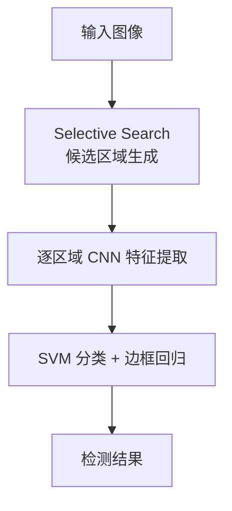

**论文**：Rich feature hierarchies for accurate object detection and semantic segmentation（2013）

**优缺点**：
- ✅ 精度显著提升（mAP从0.3提升至0.5）
- ❌ 速度极慢，每个候选区域都需单独通过CNN
- ❌ 每个步骤单独训练，难以端到端优化

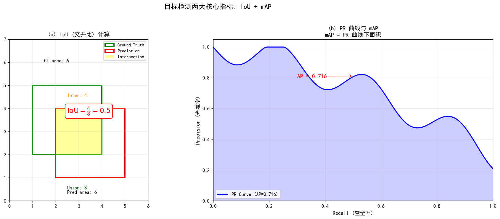

> 📊 完整代码：[`assets/figures/11-1-detection-metrics.py`](../../assets/figures/11-1-detection-metrics.py) — (a) IoU 计算可视化，(b) PR 曲线与 mAP 积分。

### 2.2 Fast R-CNN（2015）

Fast R-CNN对R-CNN进行了重大改进，实现了大部分计算的共享。

**核心创新**：

1. **RoI Pooling**：将不同大小的候选区域映射到固定大小的特征图，实现卷积计算的共享
2. **多任务损失**：将分类与边框回归统一到同一个网络中端到端训练

**网络结构**：

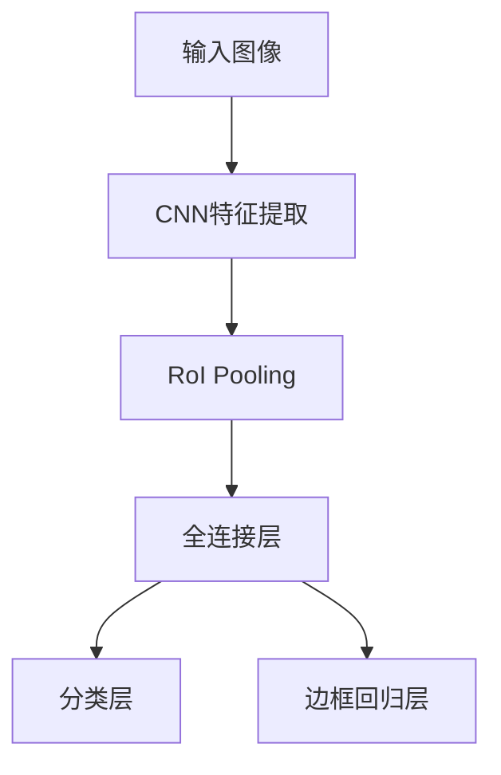

**论文**：Fast R-CNN（2015）

**改进点**：
- ✅ 训练速度提升约9倍，测试速度提升约213倍
- ✅ 精度进一步提升（mAP约0.6）
- ❌ 候选区域生成仍使用Selective Search，成为速度瓶颈

### 2.3 Faster R-CNN（2015）

Faster R-CNN的核心贡献是提出了**RPN（Region Proposal Network）**，用神经网络替代了耗时的Selective Search。

**RPN核心机制**：

- 在特征图上使用滑动窗口，每个位置预设k个锚框（Anchor）
- 每个锚框输出两个值：前景/背景置信度、边框偏移量
- 输出：cls层$(h, w, 2k)$，reg层$(h, w, 4k)$

**Faster R-CNN整体架构**：

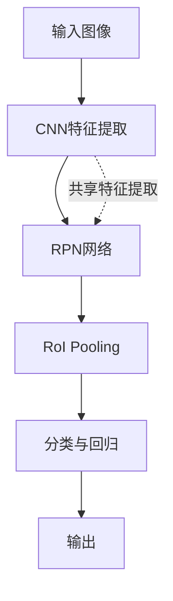

**论文**：Faster R-CNN: Towards Real-Time Object Detection with Region Proposal Networks（2015）

**核心作者**：任少卿、何凯明、Ross Girshick、孙剑

**改进点**：
- ✅ 用RPN替代Selective Search，大幅提速
- ✅ 精度提升至mAP约0.7
- ✅ 实现了真正端到端的目标检测

---

## 3. 单阶段检测器（One-Stage Detectors）

单阶段检测器直接在一个网络中同时预测类别与位置，速度快但精度略低于两阶段方法。

### 3.1 YOLO（You Only Look Once）

YOLO（2015）开创了单阶段检测器的先河，将目标检测重新定义为单一的回归问题。

**核心思想**：

1. 将输入图像划分为$S \times S$的网格
2. 每个网格预测B个边界框及其置信度
3. 每个框预测C个类别概率

**YOLOv1输出张量**：

$$
S \times S \times (B \times 5 + C)
$$

其中5代表$(x, y, w, h, confidence)$

**论文**：You Only Look Once: Unified, Real-Time Object Detection（2015）

**优缺点**：
- ✅ 速度极快，可达实时（45-90fps）
- ✅ 端到端优化，易于训练
- ❌ 对小目标和密集目标检测效果较差
- ❌ 每个网格只能预测一类物体

### 3.2 YOLO系列发展

**YOLOv2（2016）**：
- 引入Anchor机制，使用K-means聚类自动学习锚框
- 添加Batch Normalization，加快收敛
- 使用高分辨率分类器

**YOLOv3（2018）**：
- 引入FPN（特征金字塔网络），实现多尺度检测
- 使用Logistic替代Softmax，支持多标签分类
- 主干网络换成Darknet-53

**YOLOv4（2020）**：
- 集成了大量tricks：Mosaic数据增强、CIOU损失、Self-Adversarial Training等
- 引入CSPNet结构

**YOLOv5（2020）**：
- 工程化优化，易用性大幅提升
- 提供n/s/m/l/x多种模型规模

### 3.3 YOLOv8核心改进

YOLOv8是Ultralytics发布的最新版本，在架构和训练流程上都有重要改进。

**核心创新**：

1. **无锚框（Anchor-Free）**：解耦头部分类与回归，简化检测头设计
2. **CSP结构优化**：改进的Cross Stage Partial结构
3. **SIoU/GIoU损失**：更精确的损失函数提升定位精度
4. **马赛克增强**：延续YOLOv5的Mosaic增强策略

**YOLOv8网络结构**：

```
backbone: DarknetCSP → CSP → SPPF
neck: PANet（自底向上特征融合）
head: 解耦检测头（分类+回归）
```

**YOLO检测流程**：

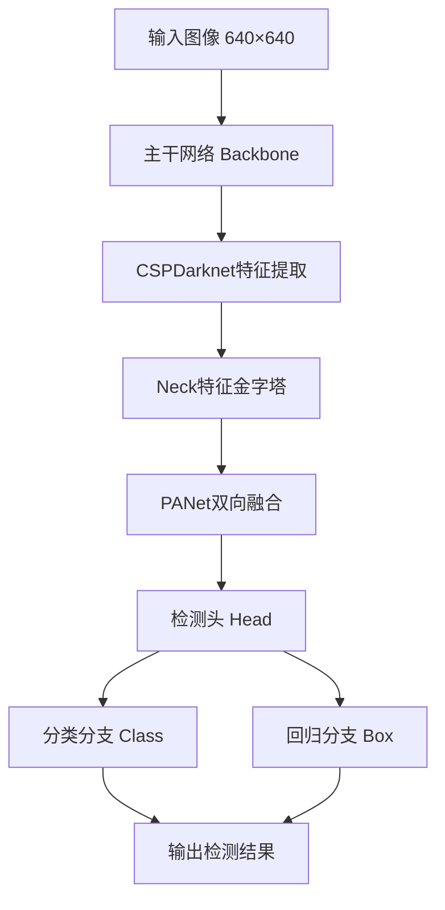

**两阶段 vs 一阶段检测器对比**：

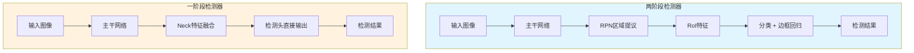

| 对比项 | 两阶段检测器 | 一阶段检测器 |
|--------|-------------|--------------|
| 代表模型 | Faster R-CNN | YOLO、SSD |
| 检测流程 | 区域提议 → 分类定位 | 一步到位 |
| 精度 | 较高 | 中等 |
| 速度 | 较慢 | 快 |
| 适用场景 | 精度优先 | 实时检测 |

**模型规模**：

| 模型 | 参数量 | COCO mAP | 速度（fps） |
|------|--------|----------|-------------|
| YOLOv8n | 3.2M | 37.3% | 280 |
| YOLOv8s | 11.2M | 44.9% | 220 |
| YOLOv8m | 25.9M | 50.2% | 90 |
| YOLOv8l | 43.7M | 52.9% | 60 |
| YOLOv8x | 68.2M | 53.9% | 40 |

### 3.4 YOLOv10（2024）- 端到端实时检测

**YOLOv10**由清华大学团队于2024年5月发布，是YOLO系列的最新里程碑之作。其核心创新是**端到端检测头**，彻底取消了NMS后处理，实现了真正的端到端推理。

#### 3.4.1 核心创新

1. **无NMS端到端检测**
   - 引入双标签分配（Dual Label Assignment）策略
   - 训练阶段使用一对一和多对一两种分配方式
   - 推理阶段无需NMS后处理，大幅降低推理延迟

2. **整体效率优化**
   - 延迟降低46%（相比YOLOv8）
   - 参数量减少25%
   - 清华大学提出，论文：YOLOv10: Real-Time End-to-End Object Detection

3. **网络结构改进**
   - 轻量化Neck设计
   - 秩引导块设计（Rank-Guided Block）
   - 空间通道解耦下采样

#### 3.4.2 YOLOv10网络结构

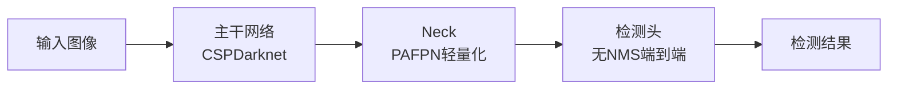

#### 3.4.3 YOLOv10 vs YOLOv8 对比

| 指标 | YOLOv8 | YOLOv10 |
|------|--------|---------|
| NMS后处理 | 有 | 无（端到端） |
| COCO mAP | ~53% | ~53% |
| 推理延迟 | 基线 | 降低46% |
| 参数量 | 基线 | 减少25% |
| 论文发布 | Ultralytics 2023 | 清华大学 2024.5 |
| 标签分配 | 单一分配 | 双标签分配 |

#### 3.4.4 YOLOv10模型规模

| 模型 | 参数量 | COCO mAP | 特点 |
|------|--------|----------|------|
| YOLOv10-N | 2.3M | 38.5% | 极致轻量 |
| YOLOv10-S | 7.2M | 46.7% | 高速检测 |
| YOLOv10-M | 15.4M | 51.8% | 均衡型 |
| YOLOv10-B | 19.5M | 52.8% | 精度型 |
| YOLOv10-L | 24.4M | 53.4% | 高精度 |
| YOLOv10-X | 56.9M | 54.4% | 最高精度 |

### 3.5 SSD（Single Shot MultiBox Detector）

SSD（2015）吸收了Faster R-CNN的Anchor思想，在多个尺度的特征图上进行检测。

**核心特点**：

1. **多尺度特征图检测**：从Conv4_3开始，在多个特征图上预测
2. **默认框（Default Box）**：类似Anchor，每个位置预设多个不同尺度和长宽比的框
3. **匹配策略**：与Ground Truth的IoU大于0.5的默认框视为正样本

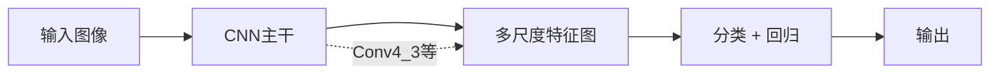

**论文**：SSD: Single Shot MultiBox Detector（2015）

**优缺点**：
- ✅ 速度与精度平衡较好
- ✅ 在小目标检测上优于YOLOv1/v2
- ❌ 需要大量手工设计默认框

---

## 4. Anchor-Free检测器

Anchor-Free方法摒弃了预设锚框的思路，直接预测目标中心点或关键点，简化了检测流程。

### 4.1 CenterNet（2019）

CenterNet将目标检测问题建模为关键点检测问题，不依赖预设的锚框。

**核心思想**：

1. 图像输入CNN，输出热力图（Heatmap）
2. 热力图的峰值点对应目标中心
3. 每个峰值点预测目标的宽高

**输出**：
- 热力图：$(H/4, W/4, C)$，C为类别数
- 尺寸图：$(H/4, W/4, 2)$

**论文**：Objects as Points（2019）

**优势**：
- ✅ 无需NMS后处理
- ✅ 简洁高效，易于部署
- ✅ 可扩展到3D检测、姿态估计等任务

### 4.2 FCOS（Fully Convolutional One-Stage Object Detector）

FCOS是完全基于FCN（全卷积网络）的检测器，逐像素预测目标。

**核心机制**：

1. 特征图每个位置预测$(classification, center-ness, regression)$
2. 使用FPN实现多尺度特征融合
3. center-ness用于过滤低质量检测框

**损失函数**：

$$
L = L_{cls} + L_{centerness} + L_{reg}
$$

**论文**：FCOS: Fully Convolutional One-Stage Object Detection（2019）

**优势**：
- ✅ 纯FCN设计，无需锚框和候选区域
- ✅ 可复用语义分割的思路和方法
- ✅ 检测精度与Faster R-CNN相当

---

## 5. NMS（非极大值抑制）

NMS是目标检测中不可或缺的后处理步骤，用于去除重复的检测框。

### 5.1 算法流程

```
输入：所有检测框及其置信度
1. 按置信度降序排列所有检测框
2. 选取置信度最高的框作为基准
3. 计算其余框与基准框的IoU
4. 删除IoU超过阈值的框
5. 重复步骤2-4，直至处理完所有框
```

### 5.2 核心作用

- **筛选检测框**：保留最准确的检测结果
- **合并重叠框**：去除高度重叠的冗余框
- **减少误报**：降低假阳性率

**伪代码**：

```python
def nms(boxes, scores, threshold=0.5):
    # boxes: [N, 4]，格式为[x1, y1, x2, y2]
    # scores: [N]，置信度
    # threshold: IoU阈值
    
    order = scores.argsort()[::-1]  # 按置信度降序
    keep = []
    
    while order.size > 0:
        i = order[0]  # 最高置信度
        keep.append(i)
        
        # 计算IoU
        iou = compute_iou(boxes[i], boxes[order[1:]])
        
        # 保留IoU小于阈值的框
        mask = iou <= threshold
        order = order[1:][mask]
    
    return keep
```

### 5.3 改进方向

- **Soft-NMS**：不完全删除高IoU框，而是降低其置信度
- **IoU-guided NMS**：使用预测的IoU替代分类置信度
- **Adaptive NMS**：根据密度自适应调整阈值

---

## 6. 目标检测总结与未来展望

### 6.1 技术路线对比

| 类别 | 代表模型 | 精度 | 速度 | 特点 |
|------|----------|------|------|------|
| 两阶段 | Faster R-CNN | 高 | 较慢 | 候选区域+分类，精度优先 |
| 单阶段 | YOLO、SSD | 中高 | 快 | 端到端回归，速度优先 |
| Anchor-Free | CenterNet、FCOS | 中高 | 快 | 无锚框设计，简洁高效 |

### 6.2 发展趋势

1. **Transformer架构**：DETR系列将Transformer引入检测
2. **自监督学习**：减少对标注数据的依赖
3. **轻量化模型**：Edge AI场景下的模型压缩与加速
4. **多模态融合**：结合LiDAR、Radar等传感器数据

### 6.3 进一步阅读章节

- **YOLOv4 详细技巧**：参见 10-3 模型压缩与优化
- **YOLOv8/v10/v11 实战**：参见 10-6 OpenMMLab 生态
- **目标跟踪 (ByteTrack)**：参见 11-7 目标跟踪与视频理解
- **Anchor-Free 三大代表**：见第 8 节
- **遮挡与密集场景**：见第 10 节
- **YOLT 卫星检测**：见第 12 节
- **20 年综述**：见第 13 节

---

## 7. 特征金字塔网络 FPN 深度专题

> **为什么 FPN 在目标检测中如此重要？** 真实场景中目标尺度差异极大（无人机看车辆 = 10×10 像素，卫星看飞机 = 500×500 像素），单尺度 backbone 无法同时检测所有尺度。FPN 用 1 次前向得到 4-5 个尺度的强特征，**已成为现代检测器的"颈部"标配**——从 Faster R-CNN、Mask R-CNN、RetinaNet 到 YOLOv3-v8、CenterNet、DETR 的所有主流检测器都离不开 FPN 或其变体。

### 7.1 多尺度检测的演进：从图像金字塔到 FPN

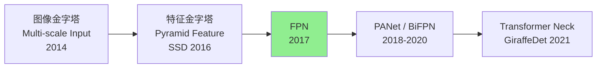

**三种多尺度方案对比**：

| 方案 | 思想 | 代表 | 推理成本 | 端到端 | 适用 |
|------|------|------|----------|--------|------|
| **图像金字塔** | 原图 resize 到多尺度分别送入 CNN | DPM, SNIP | N× | ✗ | 离线高精度 |
| **特征金字塔层次** | 直接用 backbone 不同 stage 的输出 | SSD, MS-CNN | 1× | ✓ | 实时（浅层语义弱）|
| **特征金字塔网络 FPN** | Top-down + Lateral 融合 | Faster R-CNN+FPN | 1× | ✓ | **通用标准** |
| **加权融合** | 学习融合权重 w₁, w₂ | BiFPN, ASFF | 1× | ✓ | 精度优先 |

> **FPN 的关键洞察**：深层特征（P5）富含"是什么"（语义），但缺乏"在哪里"（空间）；浅层特征（P2）富含"在哪里"（细节），但缺乏"是什么"（语义）。FPN 把两者融合，**所有尺度都同时拥有强语义 + 高分辨率**。

### 7.2 FPN 核心结构详解

FPN 由两条路径 + 一个融合组成，三大核心操作：

```mermaid
flowchart TD
    subgraph bottom_up[Bottom-up Pathway (骨干前向传播)]
        C2["C2<br>stride 1/4<br>256ch"]
        C3["C3<br>stride 1/8<br>512ch"]
        C4["C4<br>stride 1/16<br>1024ch"]
        C5["C5<br>stride 1/32<br>2048ch"]
        C2 --> C3
        C3 --> C4
        C4 --> C5
    end
    
    subgraph lateral[Step 1: 1×1 Lateral Convs (通道对齐到 256)]
        L2[L2]
        L3[L3]
        L4[L4]
        L5[L5]
    end
    
    C2 --> L2
    C3 --> L3
    C4 --> L4
    C5 --> L5
    
    subgraph topdown[Step 2: Top-down Upsample + Element-wise Add]
        P5_out[P5_in<br>256ch]
        P4_temp[P4_temp<br>256ch]
        P3_temp[P3_temp<br>256ch]
        P2_temp[P2_temp<br>256ch]
        P5_out -->|"2× Nearest\nUpsample"| P4_temp
        P4_temp -->|"2× Nearest\nUpsample"| P3_temp
        P3_temp -->|"2× Nearest\nUpsample"| P2_temp
    end
    
    L5 --> P5_out
    L4 --> P4_temp
    L3 --> P3_temp
    L2 --> P2_temp
    
    subgraph smooth[Step 3: 3×3 Smooth Convs (消除混叠)]
        P2[P2] 
        P3[P3] 
        P4[P4] 
        P5[P5] 
    end
    
    P2_temp --> P2
    P3_temp --> P3
    P4_temp --> P4
    P5_out --> P5
    
    P2 --> H2[Head / RPN]
    P3 --> H3[Head / RPN]
    P4 --> H4[Head / RPN]
    P5 --> H5[Head / RPN]
    
    style P5_out fill:#FFE4B5
    style H2 fill:#90EE90
    style H3 fill:#90EE90
    style H4 fill:#90EE90
    style H5 fill:#90EE90
```

**三大核心操作详解**：

1. **1×1 横向卷积（Lateral Conv）**
   - **作用**：把不同 stage 的特征图（C2-C5）通道数统一降到 256
   - **必要性**：C2 有 256 通道，C5 有 2048 通道，元素相加前必须统一通道
   - **额外成本**：256+512+1024+2048 个 1×1 卷积 ≈ 1M 参数

2. **2× 最近邻上采样（Top-down Upsample）**
   - **作用**：把深层特征（如 1/32）放大 2 倍，与浅层特征尺寸对齐
   - **为什么用最近邻**：FPN 只放大 2 倍，简单的最近邻 + 后续 3×3 卷积即可；转置卷积反而引入可学习参数和棋盘格伪影

3. **逐元素相加（Element-wise Add）+ 3×3 卷积**
   - **作用**：把上采样后的深层特征与同尺度的横向特征相加（融合语义 + 细节），再用 3×3 卷积平滑上采样的混叠
   - **为什么是 add 而不是 concat**：add 不增加通道数，参数量小；concat 保留更多信息但计算量翻倍

### 7.3 FPN 家族演进全景

FPN 之后，多尺度融合的演进经历了四代：

| 代际 | 方法 | 关键创新 | 代表模型 | COCO AP |
|------|------|----------|----------|---------|
| **第 1 代** | FPN (2017) | 单向 Top-down + Lateral | Faster R-CNN+FPN | 36.2 |
| **第 2 代** | PANet (2018) | + 额外 Bottom-up 路径 | Mask R-CNN+PANet | 42.0 |
| **第 3 代** | NAS-FPN (2019) | 神经架构搜索不规则连接 | RetinaNet+NAS-FPN | 45.4 |
| **第 4 代** | BiFPN (2020) | 双向 + 加权融合 + 多层堆叠 | EfficientDet-D4 | 49.2 |

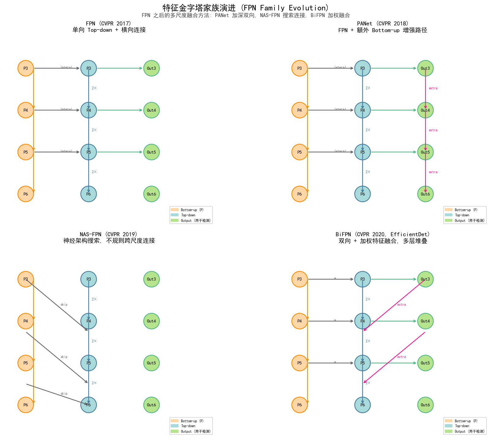

**四代演进的关键洞察**：

- **FPN (2017)**：单向 Top-down，融合 1 次，参数最少（~3M），最常用
- **PANet (2018)**：再加一条 Bottom-up 路径，融合 2 次（双向信息流），COCO +5.8 AP
- **NAS-FPN (2019)**：用 NAS 自动发现不规则跨尺度连接，灵活但训练慢
- **BiFPN (2020)**：每节点学习融合权重 w₁, w₂, w₃，多层堆叠，最强但参数多

> **BiFPN 加权融合公式**：
> 
> $$P_i^{\text{out}} = \text{Conv}\left(\frac{w_1 \cdot P_i^{\text{in}} + w_2 \cdot \text{Resize}(P_{i+1}^{\text{in}})}{w_1 + w_2 + \epsilon}\right)$$
> 
> 其中 $w_1, w_2$ 是可学习权重（用 ReLU 保证非负），$\epsilon=0.0001$ 防止除零。

### 7.4 FPN 在主流检测器中的应用

| 检测器 | FPN 类型 | 输出层数 | 关键设计 |
|--------|----------|----------|----------|
| **Faster R-CNN + FPN** | 标准 FPN | P2-P6 (5 层) | 每层独立 RPN |
| **Mask R-CNN** | 标准 FPN | P2-P5 (4 层) | RoIAlign 用 P2-P5 |
| **RetinaNet** | 标准 FPN | P3-P7 (5 层) | 每层独立分类+回归头 |
| **YOLOv3** | FPN 思想 | 3 scales (52², 26², 13²) | Darknet-53 backbone |
| **YOLOv4/v5/v7** | **PANet** (FPN 升级) | 3 scales | + Bottom-up 路径 |
| **YOLOv8** | **PANet** | 3 scales | + 任务对齐分配器 (TAL) |
| **CenterNet** | 不使用 FPN | - | Heatmap + 单尺度 |
| **DETR** | 不使用 FPN | - | Transformer 全局注意力 |
| **EfficientDet** | **BiFPN** × 6 层 | P3-P7 | 加权融合 + 复合缩放 |

### 7.5 FPN 关键超参与调优

| 超参 | 典型值 | 说明 |
|------|--------|------|
| **out_channels** | 256 | FPN 输出通道数 |
| **num_levels** | 4-5 | P2-P5 或 P3-P7 |
| **top_down_upsample** | Nearest | 比 Bilinear 快且无混叠 |
| **smooth_conv** | 3×3, padding=1 | 必需，否则有混叠 |
| **use_p6 / p7** | RetinaNet 用 | P6, P7 用于超大目标 |

**FPN 调试 Checklist**：

1. ✓ 检查 1×1 lateral conv 的输入通道数是否匹配 backbone 输出
2. ✓ 检查 Top-down 的上采样尺寸是否与目标 lateral 严格相等
3. ✓ 检查所有 P_i 的通道数是否一致（默认 256）
4. ✓ 可视化 P2-P5 的特征图，确认各尺度有不同的激活模式
5. ✓ 用 anchor 分配器（如 RetinaNet 的 anchors）验证 P2-P7 的尺寸匹配

### 7.6 FPN 实现（PyTorch 极简版）

```python
import torch
import torch.nn as nn
import torch.nn.functional as F

class FPN(nn.Module):
    """FPN: 输入 [C2, C3, C4, C5], 输出 [P2, P3, P4, P5]"""
    def __init__(self, in_channels=(256, 512, 1024, 2048), out_channels=256):
        super().__init__()
        # 1×1 lateral convs
        self.lateral = nn.ModuleList(
            nn.Conv2d(c, out_channels, 1) for c in in_channels
        )
        # 3×3 smooth convs
        self.smooth = nn.ModuleList(
            nn.Conv2d(out_channels, out_channels, 3, padding=1) for _ in in_channels
        )

    def forward(self, features):
        # Step 1: 1×1 lateral
        lat = [l(f) for l, f in zip(self.lateral, features)]
        # Step 2: top-down pathway
        out = [None] * len(lat)
        out[-1] = lat[-1]
        for i in range(len(lat) - 2, -1, -1):
            out[i] = lat[i] + F.interpolate(out[i+1], scale_factor=2, mode='nearest')
        # Step 3: 3×3 smooth
        return [s(o) for s, o in zip(self.smooth, out)]
```

**与 ResNet-50 配合的完整示例**：

```python
import torchvision.models as tvm

backbone = tvm.resnet50(weights='IMAGENET1K_V1').features
# 收集 layer1..layer4 的输出
fpn = FPN(in_channels=(256, 512, 1024, 2048), out_channels=256)

# Hook 提取多尺度特征
features = []
hooks = []
for name, module in backbone.named_children():
    if name in ['layer1', 'layer2', 'layer3', 'layer4']:
        hooks.append(module.register_forward_hook(
            lambda m, i, o: features.append(o)
        ))

x = torch.randn(2, 3, 224, 224)
_ = backbone(x)  # features 列表被填充
pyramid = fpn(features)  # [P2, P3, P4, P5]
```

### 7.7 FPN 的局限与替代方案

| 局限 | 替代方案 | 典型模型 |
|------|----------|----------|
| **最近邻上采样损失信息** | CARAFE (2023) 内容感知上采样 | YOLOv8-CARAFE |
| **固定 4 尺度** | 任意尺度 SFNet | SFNet |
| **加法融合信息损失** | Concat + 1×1（增加参数） | Libra FPN |
| **小目标仍弱** | 增加 P2 高分辨率层 | TPDet, SNIP |
| **大目标仍弱** | 增加 P6/P7 | RetinaNet |

> **FPN 至今未被超越**：尽管有各种改进，FPN 仍是性价比最高的方案。在 YOLOv8、ConvNeXt + FPN 等现代组合下，COCO mAP 仍能持续提升。

---

## 8. IoU 系列损失函数详解

IoU（Intersection over Union）损失是检测定位的核心。传统 L1/L2 损失对边界框尺度不敏感，IoU 损失直接优化几何一致性。

### 7.1 IoU 损失（最基础）

$$
L_{IoU} = 1 - IoU = 1 - \frac{|B \cap B^{gt}|}{|B \cup B^{gt}|}
$$

**问题**：当两个框不相交时，IoU=0，梯度为 0，无法优化。

### 7.2 GIoU 损失（Generalized IoU）

$$
L_{GIoU} = 1 - IoU + \frac{|C - (B \cup B^{gt})|}{|C|}
$$

其中 $C$ 是包含两个框的最小外接矩形。

**优势**：不相交时仍可优化（最大化最小外接矩形的利用）

### 7.3 DIoU 损失（Distance-IoU）

$$
L_{DIoU} = 1 - IoU + \frac{\rho^2(b, b^{gt})}{c^2}
$$

其中 $\rho$ 是两个框中心点的欧氏距离，$c$ 是最小外接矩形的对角线距离。

**优势**：直接最小化中心点距离，收敛更快

### 7.4 CIoU 损失（Complete IoU）

DIoU 的扩展，加入长宽比和形状一致性：

$$
L_{CIoU} = 1 - IoU + \frac{\rho^2(b, b^{gt})}{c^2} + \alpha v
$$

其中：
- $v = \frac{4}{\pi^2}(\arctan\frac{w^{gt}}{h^{gt}} - \arctan\frac{w}{h})^2$ 衡量长宽比一致性
- $\alpha = \frac{v}{(1-IoU) + v}$ 是权重

**优势**：综合考虑重叠、距离、形状，回归更精准

### 7.5 SIoU / WIoU（最新变体）

- **SIoU**：加入角度损失（Angle cost），考虑框之间的方向性
- **WIoU v3**：动态非单调聚焦机制，关注普通质量的锚框

### 7.6 损失函数对比

| 损失 | 年份 | 收敛速度 | 检测精度 | 计算开销 |
|------|------|----------|----------|----------|
| L1/L2 | 远古 | 慢 | 低 | 低 |
| IoU | 2016 | 中 | 中 | 低 |
| GIoU | 2019 | 中 | 中高 | 低 |
| DIoU | 2020 | 快 | 高 | 低 |
| CIoU | 2020 | 快 | **高** | 低 |
| SIoU | 2022 | 快 | 高 | 低 |
| WIoU | 2023 | 快 | 高 | 中 |

YOLOv8/YOLOv9 默认使用 CIoU。

---

## 9. Anchor-Based vs Anchor-Free 深度对比

目标检测在过去十年经历了从 Anchor-Based 到 Anchor-Free 的范式转变。

### 8.1 范式对比

| 维度 | Anchor-Based | Anchor-Free |
|------|--------------|-------------|
| **预定义框** | 需预设 k 个 anchor | 无需 |
| **超参** | 数量、尺寸、比例 | 极少 |
| **正负样本** | IoU 阈值匹配 | 中心点/关键点判定 |
| **超参敏感度** | 高（anchor 设计很关键） | 低 |
| **小目标** | 通过多尺度 anchor 改善 | 通过 FPN/特征融合 |
| **代表** | Faster R-CNN、YOLOv3-v7 | CenterNet、FCOS、YOLOv8 |

### 8.2 Anchor-Based 三大代表

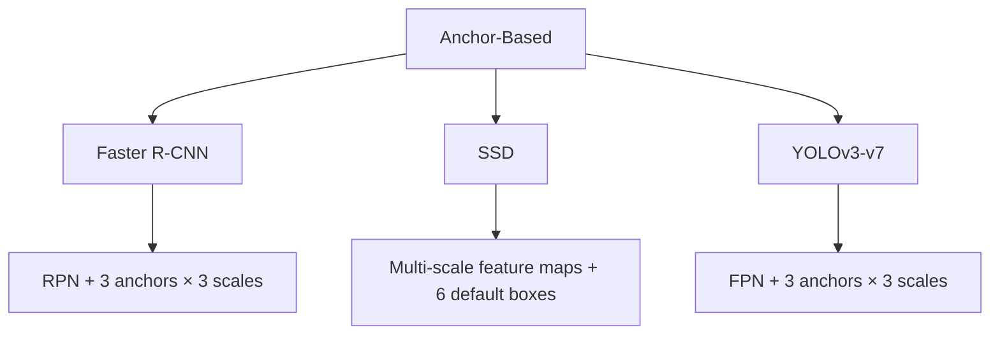

### 8.3 Anchor-Free 三大代表

#### CenterNet（2019）

**核心思想**：将检测问题转化为关键点估计

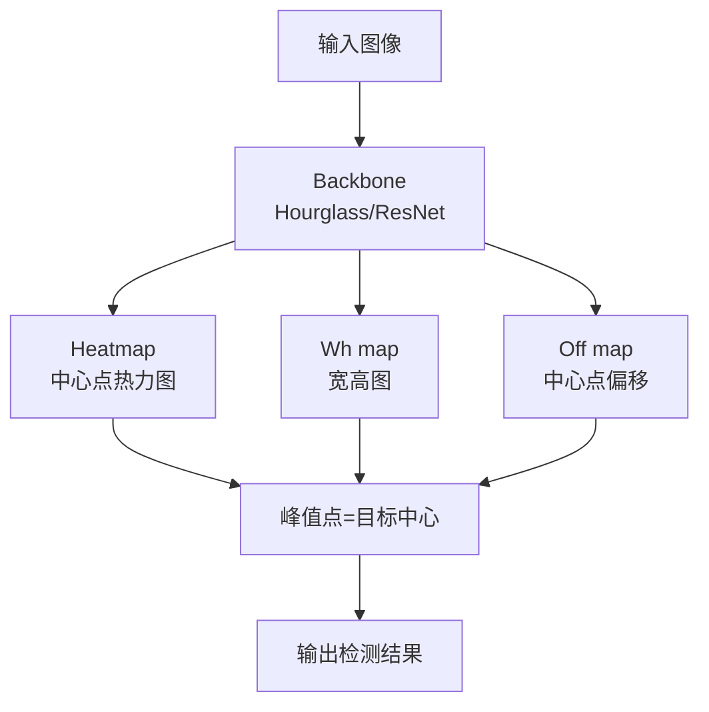

**输出**：
- Heatmap：$(H/4, W/4, C)$，C 为类别数
- Wh：$(H/4, W/4, 2)$，目标宽高
- Offset：$(H/4, W/4, 2)$，亚像素修正

**优点**：
- 无需 NMS 后处理（峰值天然唯一）
- 可扩展到 3D 检测、姿态估计
- 简洁优雅

#### FCOS（2019）

**核心思想**：逐像素预测，避免 anchor

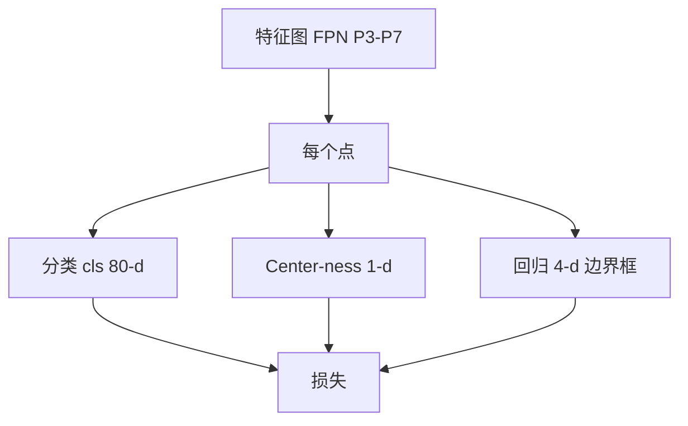

**Center-ness** 抑制远离中心的低质量预测：

$$
\text{center-ness} = \sqrt{\frac{\min(l, r)}{\max(l, r)} \times \frac{\min(t, b)}{\max(t, b)}}
$$

#### CornerNet（2018）

检测目标**左上角和右下角**两个关键点，配对得到检测框。

### 8.4 Anchor-Free 的核心优势

1. **超参少**：不需要设计 anchor 数量、尺寸、比例
2. **训练简单**：无需复杂的正负样本匹配策略
3. **可扩展性强**：扩展到 3D、姿态、视频检测更自然
4. **小目标友好**：通过 FPN 即可处理，不需要在 anchor 上做文章

---

## 10. YOLO 系列完整演进

YOLO 系列是工业界应用最广的检测器，每一代都有核心创新。

### 9.1 演进全景

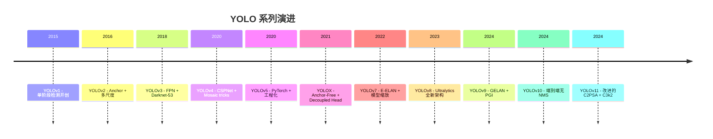

### 9.2 YOLOv4 Tricks 详解（2020）

YOLOv4 是"tricks 集大成者"，对工业界影响深远：

**Backbone**：
- **CSPDarknet53**：跨阶段部分连接，减少计算量 20%
- **Mish 激活**：相比 ReLU 更平滑

**Neck**：
- **SPP (Spatial Pyramid Pooling)**：多尺度池化
- **PANet (Path Aggregation Network)**：自顶向下 + 自底向上双向融合

**Head**：
- **YOLOv3 Head**

**Tricks（Bag of Freebies + Bag of Specials）**：

| 类别 | 技巧 | 说明 |
|------|------|------|
| **数据增强** | Mosaic | 4 张图拼接成 1 张 |
| | CutMix | 裁剪粘贴混合 |
| | MixUp | 像素级混合 |
| | Self-Adversarial Training (SAT) | 自对抗训练 |
| **正则化** | DropBlock | 块状 Dropout |
| | Label Smoothing | 软标签 |
| **损失** | CIoU Loss | 更好的定位损失 |
| **后处理** | DIoU-NMS | 基于中心距离的 NMS |
| **超参** | Cosine Annealing LR | 余弦退火 |
| **注意力** | SAM (Spatial Attention Module) | 空间注意力 |

### 9.3 YOLOv5 / YOLOv6 / YOLOv7 快速对比

| 模型 | 年份 | 框架 | 核心创新 | 速度 vs 精度 |
|------|------|------|----------|--------------|
| **YOLOv5** | 2020 | PyTorch | 工程化、多尺度、易用 | ⭐⭐⭐⭐ |
| **YOLOX** | 2021 | PyTorch | Anchor-Free、解耦头、SimOTA | ⭐⭐⭐⭐ |
| **PP-YOLOv2** | 2021 | PaddlePaddle | 工业实践优化 | ⭐⭐⭐ |
| **YOLOv6** | 2022 | PyTorch | 美团出品，RepBi-PAN | ⭐⭐⭐⭐ |
| **YOLOv7** | 2022 | PyTorch | E-ELAN、模型缩放 | ⭐⭐⭐⭐ |
| **Gold-YOLO** | 2023 | PyTorch | Gather-and-Distribute | ⭐⭐⭐⭐ |
| **DAMO-YOLO** | 2022 | PyTorch | 阿里达摩院，MAE-NAS | ⭐⭐⭐⭐ |

### 9.4 YOLOv9 核心创新（2024）

**GELAN (Generalized Efficient Layer Aggregation Network)**：新型骨干
**PGI (Programmable Gradient Information)**：可编程梯度信息，解决深度网络信息瓶颈

### 9.5 YOLOv11 简介（2024）

Ultralytics 2024 年发布，改进点：
- 新的 C2PSA (Cross Stage Partial with Self-Attention) 模块
- C3k2 瓶颈块（更高效）
- 进一步降低延迟
- COCO mAP 53.5%（YOLOv11m）

### 9.6 YOLOv8 vs YOLOv10 vs YOLOv11 选型

| 场景 | 推荐 |
|------|------|
| **生态成熟、社区大** | YOLOv8 |
| **极致低延迟** | YOLOv10 (无 NMS) |
| **最新 + 综合性能** | YOLOv11 |
| **超大规模数据集** | YOLOv8 (Ultralytics 生态) |
| **边缘部署** | YOLOv8n / YOLOv10-N |
| **高精度优先** | YOLOv8x / YOLOv11x |

---

## 11. 遮挡问题与 Repulsion Loss

密集场景中目标相互遮挡是检测的经典难题。

### 10.1 遮挡带来的挑战

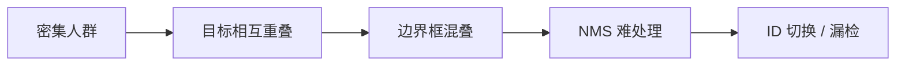

### 10.2 Repulsion Loss（排斥损失）

**核心思想**：除了让预测框接近自己的 GT，还要**远离其他目标的 GT**。

$$
L_{Rep} = L_{Attr} + \alpha \cdot L_{RepGT} + \beta \cdot L_{RepBox}
$$

- $L_{Attr}$：吸引项（接近自己 GT）
- $L_{RepGT}$：排斥项（远离其他 GT）
- $L_{RepBox}$：排斥项（远离其他预测框）

### 10.3 其他遮挡处理方法

| 方法 | 思路 |
|------|------|
| **Soft-NMS** | 不完全抑制高 IoU 框，降低其分数 |
| **DIoU-NMS** | 用中心距离代替 IoU |
| **遮挡感知 Backbone** | 设计能捕获遮挡关系的骨干 |
| **BCNet** (双图层) | 检测被遮挡的"前景+遮挡物"两个图层 |
| **CrowdHuman 数据集** | 专门为密集人群设计的基准 |

---

## 12. PP-YOLO 工业实践

**PP-YOLO**（PaddleDetection 团队）针对工业部署做了大量优化。

### 11.1 优化手段

1. **骨干替换**：ResNet50-vd
2. **EMA Model**：训练时用指数滑动平均
3. **DropBlock**：正则化
4. **IoU Loss**：精修定位
5. **IoU Aware**：预测 IoU 分数参与 NMS 评分
6. **Grid Sensitive**：增加中心点附近的预测
7. **Matrix NMS**：并行化 NMS
8. **CoordConv**：给卷积加坐标信息
9. **SPP**：多尺度池化
10. **Better Pretrain**：更好的预训练模型

### 11.2 工业指标

| 指标 | YOLOv3 baseline | PP-YOLO |
|------|-----------------|---------|
| mAP (COCO val) | 33.0 | **45.9** |
| FPS (V100) | 78 | **73** |
| 部署 | darknet | PaddleInference |

PP-YOLO 系列一直更新到 PP-YOLOE、PP-PicoDet（轻量化）。

---

## 13. YOLT 卫星图像检测

**YOLT**（You Only Look at the Sky）是针对卫星/遥感图像的目标检测方法。

### 12.1 卫星图像检测挑战

- 图像尺寸巨大（>10000×10000）
- 目标极小（车辆 < 10×10 像素）
- 方向任意（航拍视角）
- 背景复杂

### 12.2 YOLT 核心方法

1. **切片推理**：将大图切成 416×416 小图
2. **修改骨干**：用更深的网络捕获小目标语义
3. **多尺度融合**：FPN + 不同尺度特征
4. **后处理合并**：跨切片结果合并（NMS + IoU 阈值）

### 12.3 应用领域

- 舰船检测
- 车辆检测
- 储油罐检测
- 建筑物变化检测
- 农业（作物长势）

---

## 14. 目标检测 20 年综述脉络

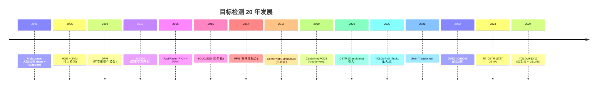

**关键拐点**：
- 2013：R-CNN 引入深度学习
- 2015：YOLO 开启单阶段
- 2017：FPN 解决多尺度
- 2019：Anchor-Free 简化设计
- 2020：DETR 引入 Transformer
- 2024：端到端无 NMS 成为新趋势

---

## 本章小结

0. **目标检测数据标注原则（详见 §1.3）**：标注质量决定模型上限。核心 5 大 BBox 原则：Tight Box（IoU ≥ 0.95）/ 遮挡全框 / 截断标记 truncated=1 / 小目标保留 / 包含规则。质量控制用 Cohen's κ ≥ 0.7 工业门槛。预标注（SAM）+ 双标注 + 仲裁 + 持续审计是工业级 SOP。格式优选 COCO JSON（MMDetection 标准）。

1. **两阶段检测器**：R-CNN开创了目标检测的深度学习方法，Fast R-CNN通过RoI Pooling实现卷积共享，Faster R-CNN引入RPN实现端到端检测，大幅提升精度与速度。

2. **单阶段检测器**：YOLO将检测重新定义为单次回归问题，实现实时检测；YOLOv8采用无锚框设计和解耦检测头，平衡精度与速度；YOLOv10引入端到端检测头，取消NMS后处理，延迟降低46%，参数量减少25%。SSD通过多尺度特征图检测提升小目标表现。

3. **Anchor-Free方法**：CenterNet将目标建模为关键点检测，无需NMS后处理；FCOS采用全卷积逐像素预测，center-ness机制过滤低质量框。

4. **FPN 特征金字塔网络（详见 §7）**：现代检测器的"颈部"标配，用 Bottom-up + Top-down + Lateral 三步融合多尺度特征。FPN 家族经历四代演进：FPN(2017) → PANet(2018) → NAS-FPN(2019) → BiFPN(2020)。Faster R-CNN + FPN 在 COCO 上 AP 提升 5-8 点。详见 [4-4 §5.4 特征金字塔网络](../PART4-卷积神经网络CNN/4-4-CNN应用.md#54-特征金字塔网络-fpnfeature-pyramid-network-cvpr-2017)。

5. **NMS后处理**：通过置信度排序和IoU阈值筛选，去除重复检测框。改进方向包括Soft-NMS、IoU-guided NMS和Adaptive NMS。

6. **发展趋势**：Transformer架构（DETR系列）、自监督学习、轻量化模型、多模态融合是未来重要方向。

---


## 知识图谱

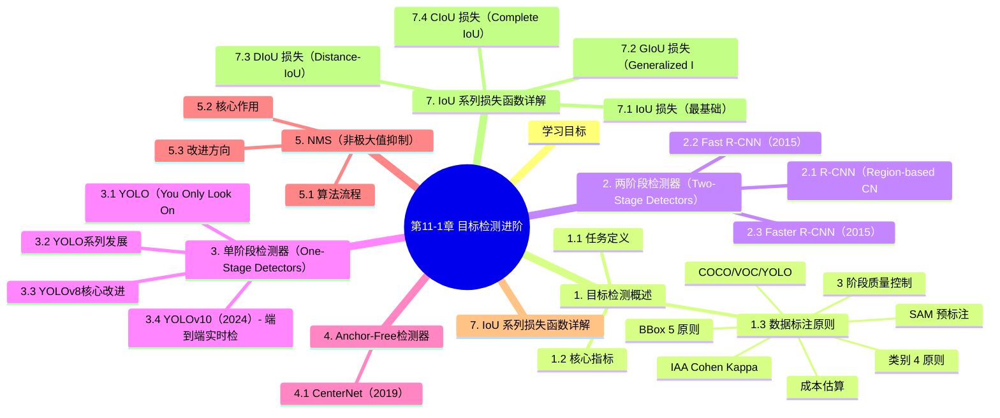

## 参考资料

### FPN 特征金字塔（详见第7节）

36. Lin, T.Y. et al. (2017). *Feature Pyramid Networks for Object Detection*. CVPR. (FPN)
37. Liu, S. et al. (2018). *Path Aggregation Network for Instance Segmentation*. CVPR. (PANet)
38. Ghiasi, G. et al. (2019). *NAS-FPN: Learning Scalable Feature Pyramid Architecture for Object Detection*. CVPR.
39. Tan, M. et al. (2020). *EfficientDet: Scalable and Efficient Object Detection*. CVPR. (BiFPN)
40. Wang, J. et al. (2020). *ASFF: Learning Spatial Fusion for Single-Shot Object Detection*. (ASFF)

### IoU 系列损失（详见第8节）

41. Yu, J. et al. (2016). *UnitBox: An Advanced Object Detection Network*. ACM MM. (IoU Loss)
42. Rezatofighi, H. et al. (2019). *Generalized Intersection over Union*. CVPR. (GIoU)
43. Zheng, Z. et al. (2020). *Distance-IoU Loss: Faster and Better Learning for Bounding Box Regression*. AAAI. (DIoU/CIoU)

1. Girshick R, et al. Rich feature hierarchies for accurate object detection and semantic segmentation. CVPR, 2014.
2. Girshick R. Fast R-CNN. ICCV, 2015.
3. Ren S, et al. Faster R-CNN: Towards Real-Time Object Detection with Region Proposal Networks. NeurIPS, 2015.
4. Redmon J, et al. You Only Look Once: Unified, Real-Time Object Detection. CVPR, 2016.
5. Liu W, et al. SSD: Single Shot MultiBox Detector. ECCV, 2016.
6. Zhou X, et al. Objects as Points. arXiv:1904.07850, 2019.
7. Tian Z, et al. FCOS: Fully Convolutional One-Stage Object Detection. ICCV, 2019.
8. Jocher G. YOLOv8. Ultralytics, 2023.
9. Wang A, et al. YOLOv10: Real-Time End-to-End Object Detection. arXiv:2405.14458, 2024.