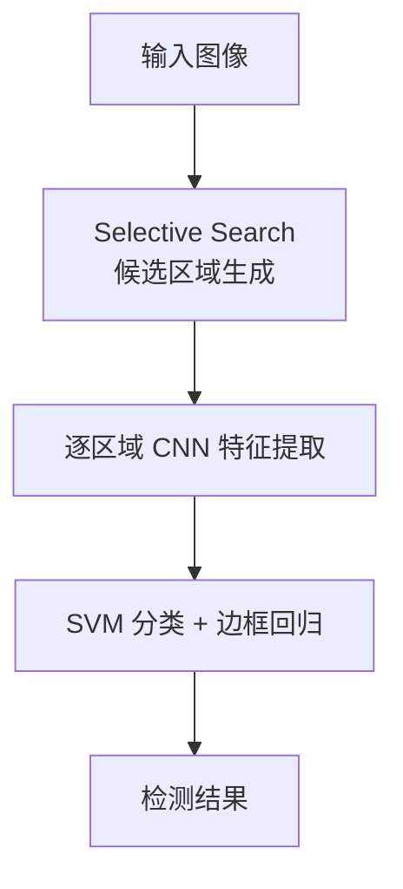
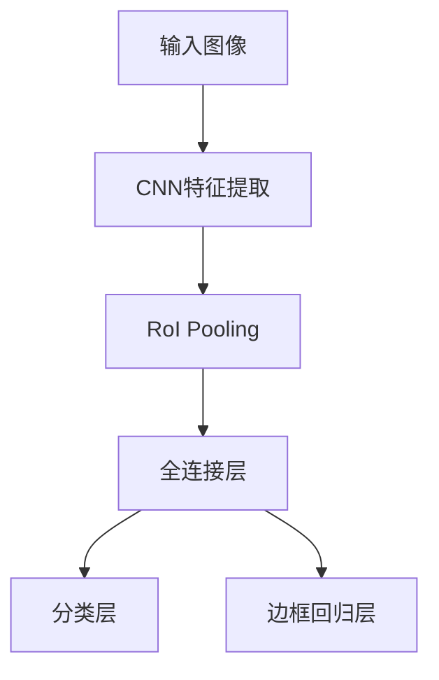
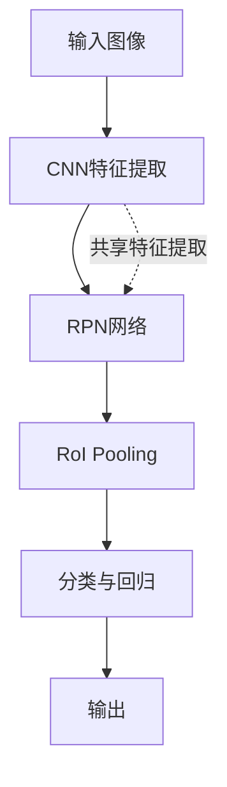
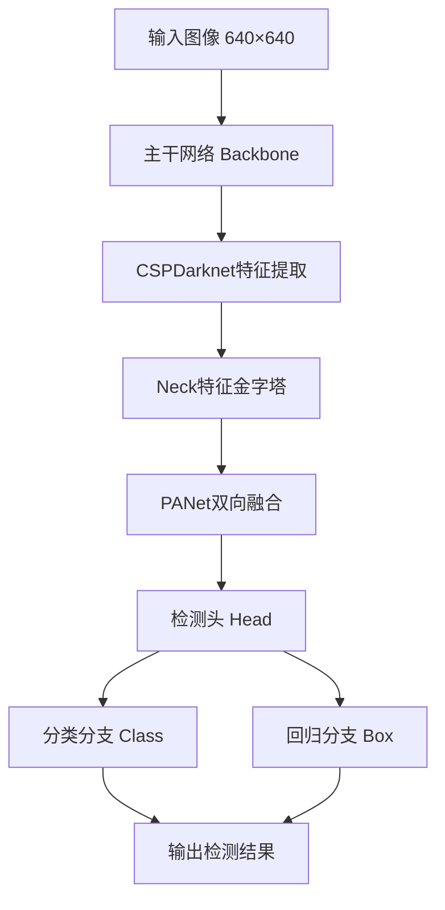
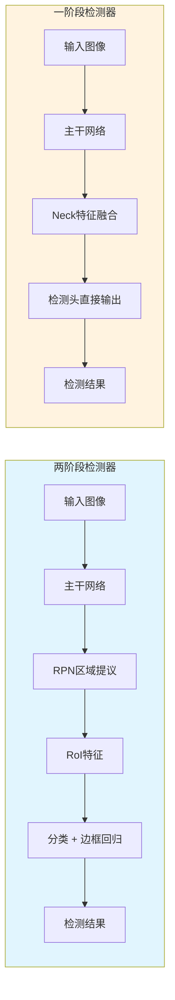
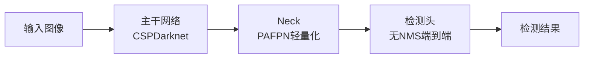
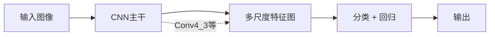
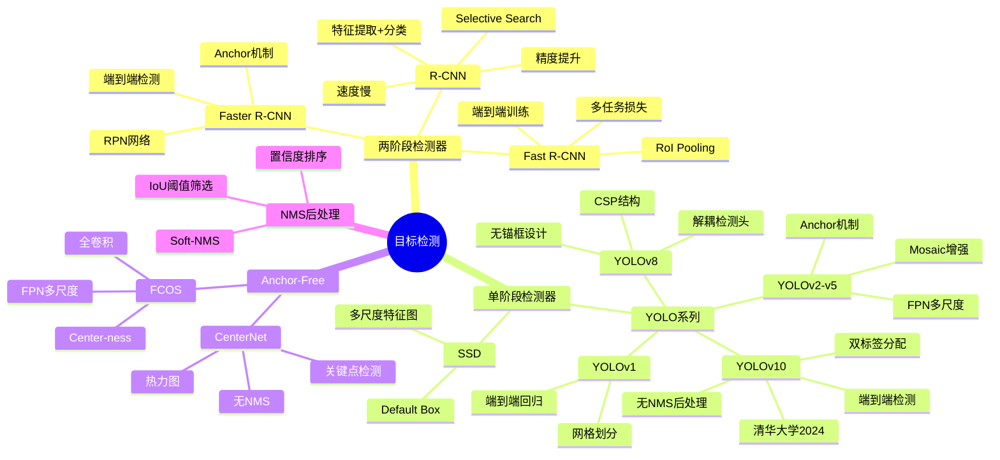

# 第11-1章 目标检测进阶

## 学习目标

- 理解两阶段检测器（R-CNN、Fast R-CNN、Faster R-CNN）的工作原理与发展脉络
- 掌握单阶段检测器（YOLO系列、SSD）的设计思路与性能特点
- 了解Anchor-Free检测器（CenterNet、FCOS）的核心创新
- 理解NMS（非极大值抑制）的原理与作用
- 掌握YOLOv8与YOLOv10的核心改进与工程实践

---

## 1. 目标检测概述

### 1.1 任务定义

目标检测（Object Detection）是计算机视觉的核心任务之一，其目标是在图像中定位出所有感兴趣的目标物体，并确定它们的类别。如图所示：

```
┌──────────────────────────────────────┐
│           图像输入                    │
│  ┌────┐ ┌────┐                       │
│  │猫  │ │狗  │                       │
│  └────┘ └────┘     ┌─────────────┐  │
│         ┌────┐      │ 检测结果    │  │
│         │人  │  ──→ │ 类别+位置   │  │
│         └────┘      └─────────────┘  │
└──────────────────────────────────────┘
```

### 1.2 核心指标

**IoU（Intersection over Union）**：衡量预测框与真实框的重合程度

$$
IoU = \frac{Area(b_p \cap b_t)}{Area(b_p \cup b_t)}
$$

**mAP（Mean Average Precision）**：多类别的平均精度均值，是目标检测最重要的评估指标

$$
mAP = \int_0^1 precision(r) dr
$$

其中：
- $Precision = \frac{TP}{TP+FP}$
- $Recall = \frac{TP}{TP+FN}$

---

## 2. 两阶段检测器（Two-Stage Detectors）

两阶段检测器的核心思想是"先找候选区域，再进行分类与定位"。这类方法通常精度较高，但速度相对较慢。

### 2.1 R-CNN（Region-based CNN）

**R-CNN**（2013年）是目标检测领域的开山之作，由Ross Girshick提出。

**核心流程**：

1. **候选区域生成（Region Proposal）**：使用Selective Search算法在图像中提取约2000个候选区域
2. **特征提取（Feature Extraction）**：对每个候选区域使用预训练的CNN（如AlexNet、VGG）提取特征
3. **分类（Classification）**：使用SVM分类器对特征进行分类
4. **边框回归（Bounding-box Regression）**：使用线性回归精修边框位置



**论文**：Rich feature hierarchies for accurate object detection and semantic segmentation（2013）

**优缺点**：
- ✅ 精度显著提升（mAP从0.3提升至0.5）
- ❌ 速度极慢，每个候选区域都需单独通过CNN
- ❌ 每个步骤单独训练，难以端到端优化

### 2.2 Fast R-CNN（2015）

Fast R-CNN对R-CNN进行了重大改进，实现了大部分计算的共享。

**核心创新**：

1. **RoI Pooling**：将不同大小的候选区域映射到固定大小的特征图，实现卷积计算的共享
2. **多任务损失**：将分类与边框回归统一到同一个网络中端到端训练

**网络结构**：



**论文**：Fast R-CNN（2015）

**改进点**：
- ✅ 训练速度提升约9倍，测试速度提升约213倍
- ✅ 精度进一步提升（mAP约0.6）
- ❌ 候选区域生成仍使用Selective Search，成为速度瓶颈

### 2.3 Faster R-CNN（2015）

Faster R-CNN的核心贡献是提出了**RPN（Region Proposal Network）**，用神经网络替代了耗时的Selective Search。

**RPN核心机制**：

- 在特征图上使用滑动窗口，每个位置预设k个锚框（Anchor）
- 每个锚框输出两个值：前景/背景置信度、边框偏移量
- 输出：cls层$(h, w, 2k)$，reg层$(h, w, 4k)$

**Faster R-CNN整体架构**：



**论文**：Faster R-CNN: Towards Real-Time Object Detection with Region Proposal Networks（2015）

**核心作者**：任少卿、何凯明、Ross Girshick、孙剑

**改进点**：
- ✅ 用RPN替代Selective Search，大幅提速
- ✅ 精度提升至mAP约0.7
- ✅ 实现了真正端到端的目标检测

---

## 3. 单阶段检测器（One-Stage Detectors）

单阶段检测器直接在一个网络中同时预测类别与位置，速度快但精度略低于两阶段方法。

### 3.1 YOLO（You Only Look Once）

YOLO（2015）开创了单阶段检测器的先河，将目标检测重新定义为单一的回归问题。

**核心思想**：

1. 将输入图像划分为$S \times S$的网格
2. 每个网格预测B个边界框及其置信度
3. 每个框预测C个类别概率

**YOLOv1输出张量**：

$$
S \times S \times (B \times 5 + C)
$$

其中5代表$(x, y, w, h, confidence)$

**论文**：You Only Look Once: Unified, Real-Time Object Detection（2015）

**优缺点**：
- ✅ 速度极快，可达实时（45-90fps）
- ✅ 端到端优化，易于训练
- ❌ 对小目标和密集目标检测效果较差
- ❌ 每个网格只能预测一类物体

### 3.2 YOLO系列发展

**YOLOv2（2016）**：
- 引入Anchor机制，使用K-means聚类自动学习锚框
- 添加Batch Normalization，加快收敛
- 使用高分辨率分类器

**YOLOv3（2018）**：
- 引入FPN（特征金字塔网络），实现多尺度检测
- 使用Logistic替代Softmax，支持多标签分类
- 主干网络换成Darknet-53

**YOLOv4（2020）**：
- 集成了大量tricks：Mosaic数据增强、CIOU损失、Self-Adversarial Training等
- 引入CSPNet结构

**YOLOv5（2020）**：
- 工程化优化，易用性大幅提升
- 提供n/s/m/l/x多种模型规模

### 3.3 YOLOv8核心改进

YOLOv8是Ultralytics发布的最新版本，在架构和训练流程上都有重要改进。

**核心创新**：

1. **无锚框（Anchor-Free）**：解耦头部分类与回归，简化检测头设计
2. **CSP结构优化**：改进的Cross Stage Partial结构
3. **SIoU/GIoU损失**：更精确的损失函数提升定位精度
4. **马赛克增强**：延续YOLOv5的Mosaic增强策略

**YOLOv8网络结构**：

```
backbone: DarknetCSP → CSP → SPPF
neck: PANet（自底向上特征融合）
head: 解耦检测头（分类+回归）
```

**YOLO检测流程**：



**两阶段 vs 一阶段检测器对比**：



| 对比项 | 两阶段检测器 | 一阶段检测器 |
|--------|-------------|--------------|
| 代表模型 | Faster R-CNN | YOLO、SSD |
| 检测流程 | 区域提议 → 分类定位 | 一步到位 |
| 精度 | 较高 | 中等 |
| 速度 | 较慢 | 快 |
| 适用场景 | 精度优先 | 实时检测 |

**模型规模**：

| 模型 | 参数量 | COCO mAP | 速度（fps） |
|------|--------|----------|-------------|
| YOLOv8n | 3.2M | 37.3% | 280 |
| YOLOv8s | 11.2M | 44.9% | 220 |
| YOLOv8m | 25.9M | 50.2% | 90 |
| YOLOv8l | 43.7M | 52.9% | 60 |
| YOLOv8x | 68.2M | 53.9% | 40 |

### 3.4 YOLOv10（2024）- 端到端实时检测

**YOLOv10**由清华大学团队于2024年5月发布，是YOLO系列的最新里程碑之作。其核心创新是**端到端检测头**，彻底取消了NMS后处理，实现了真正的端到端推理。

#### 3.4.1 核心创新

1. **无NMS端到端检测**
   - 引入双标签分配（Dual Label Assignment）策略
   - 训练阶段使用一对一和多对一两种分配方式
   - 推理阶段无需NMS后处理，大幅降低推理延迟

2. **整体效率优化**
   - 延迟降低46%（相比YOLOv8）
   - 参数量减少25%
   - 清华大学提出，论文：YOLOv10: Real-Time End-to-End Object Detection

3. **网络结构改进**
   - 轻量化Neck设计
   - 秩引导块设计（Rank-Guided Block）
   - 空间通道解耦下采样

#### 3.4.2 YOLOv10网络结构



#### 3.4.3 YOLOv10 vs YOLOv8 对比

| 指标 | YOLOv8 | YOLOv10 |
|------|--------|---------|
| NMS后处理 | 有 | 无（端到端） |
| COCO mAP | ~53% | ~53% |
| 推理延迟 | 基线 | 降低46% |
| 参数量 | 基线 | 减少25% |
| 论文发布 | Ultralytics 2023 | 清华大学 2024.5 |
| 标签分配 | 单一分配 | 双标签分配 |

#### 3.4.4 YOLOv10模型规模

| 模型 | 参数量 | COCO mAP | 特点 |
|------|--------|----------|------|
| YOLOv10-N | 2.3M | 38.5% | 极致轻量 |
| YOLOv10-S | 7.2M | 46.7% | 高速检测 |
| YOLOv10-M | 15.4M | 51.8% | 均衡型 |
| YOLOv10-B | 19.5M | 52.8% | 精度型 |
| YOLOv10-L | 24.4M | 53.4% | 高精度 |
| YOLOv10-X | 56.9M | 54.4% | 最高精度 |

### 3.5 SSD（Single Shot MultiBox Detector）

SSD（2015）吸收了Faster R-CNN的Anchor思想，在多个尺度的特征图上进行检测。

**核心特点**：

1. **多尺度特征图检测**：从Conv4_3开始，在多个特征图上预测
2. **默认框（Default Box）**：类似Anchor，每个位置预设多个不同尺度和长宽比的框
3. **匹配策略**：与Ground Truth的IoU大于0.5的默认框视为正样本



**论文**：SSD: Single Shot MultiBox Detector（2015）

**优缺点**：
- ✅ 速度与精度平衡较好
- ✅ 在小目标检测上优于YOLOv1/v2
- ❌ 需要大量手工设计默认框

---

## 4. Anchor-Free检测器

Anchor-Free方法摒弃了预设锚框的思路，直接预测目标中心点或关键点，简化了检测流程。

### 4.1 CenterNet（2019）

CenterNet将目标检测问题建模为关键点检测问题，不依赖预设的锚框。

**核心思想**：

1. 图像输入CNN，输出热力图（Heatmap）
2. 热力图的峰值点对应目标中心
3. 每个峰值点预测目标的宽高

**输出**：
- 热力图：$(H/4, W/4, C)$，C为类别数
- 尺寸图：$(H/4, W/4, 2)$

**论文**：Objects as Points（2019）

**优势**：
- ✅ 无需NMS后处理
- ✅ 简洁高效，易于部署
- ✅ 可扩展到3D检测、姿态估计等任务

### 4.2 FCOS（Fully Convolutional One-Stage Object Detector）

FCOS是完全基于FCN（全卷积网络）的检测器，逐像素预测目标。

**核心机制**：

1. 特征图每个位置预测$(classification, center-ness, regression)$
2. 使用FPN实现多尺度特征融合
3. center-ness用于过滤低质量检测框

**损失函数**：

$$
L = L_{cls} + L_{centerness} + L_{reg}
$$

**论文**：FCOS: Fully Convolutional One-Stage Object Detection（2019）

**优势**：
- ✅ 纯FCN设计，无需锚框和候选区域
- ✅ 可复用语义分割的思路和方法
- ✅ 检测精度与Faster R-CNN相当

---

## 5. NMS（非极大值抑制）

NMS是目标检测中不可或缺的后处理步骤，用于去除重复的检测框。

### 5.1 算法流程

```
输入：所有检测框及其置信度
1. 按置信度降序排列所有检测框
2. 选取置信度最高的框作为基准
3. 计算其余框与基准框的IoU
4. 删除IoU超过阈值的框
5. 重复步骤2-4，直至处理完所有框
```

### 5.2 核心作用

- **筛选检测框**：保留最准确的检测结果
- **合并重叠框**：去除高度重叠的冗余框
- **减少误报**：降低假阳性率

**伪代码**：

```python
def nms(boxes, scores, threshold=0.5):
    # boxes: [N, 4]，格式为[x1, y1, x2, y2]
    # scores: [N]，置信度
    # threshold: IoU阈值
    
    order = scores.argsort()[::-1]  # 按置信度降序
    keep = []
    
    while order.size > 0:
        i = order[0]  # 最高置信度
        keep.append(i)
        
        # 计算IoU
        iou = compute_iou(boxes[i], boxes[order[1:]])
        
        # 保留IoU小于阈值的框
        mask = iou <= threshold
        order = order[1:][mask]
    
    return keep
```

### 5.3 改进方向

- **Soft-NMS**：不完全删除高IoU框，而是降低其置信度
- **IoU-guided NMS**：使用预测的IoU替代分类置信度
- **Adaptive NMS**：根据密度自适应调整阈值

---

## 6. 目标检测总结与未来展望

### 6.1 技术路线对比

| 类别 | 代表模型 | 精度 | 速度 | 特点 |
|------|----------|------|------|------|
| 两阶段 | Faster R-CNN | 高 | 较慢 | 候选区域+分类，精度优先 |
| 单阶段 | YOLO、SSD | 中高 | 快 | 端到端回归，速度优先 |
| Anchor-Free | CenterNet、FCOS | 中高 | 快 | 无锚框设计，简洁高效 |

### 6.2 发展趋势

1. **Transformer架构**：DETR系列将Transformer引入检测
2. **自监督学习**：减少对标注数据的依赖
3. **轻量化模型**：Edge AI场景下的模型压缩与加速
4. **多模态融合**：结合LiDAR、Radar等传感器数据

---

## 本章小结

1. **两阶段检测器**：R-CNN开创了目标检测的深度学习方法，Fast R-CNN通过RoI Pooling实现卷积共享，Faster R-CNN引入RPN实现端到端检测，大幅提升精度与速度。

2. **单阶段检测器**：YOLO将检测重新定义为单次回归问题，实现实时检测；YOLOv8采用无锚框设计和解耦检测头，平衡精度与速度；YOLOv10引入端到端检测头，取消NMS后处理，延迟降低46%，参数量减少25%。SSD通过多尺度特征图检测提升小目标表现。

3. **Anchor-Free方法**：CenterNet将目标建模为关键点检测，无需NMS后处理；FCOS采用全卷积逐像素预测，center-ness机制过滤低质量框。

4. **NMS后处理**：通过置信度排序和IoU阈值筛选，去除重复检测框。改进方向包括Soft-NMS、IoU-guided NMS和Adaptive NMS。

5. **发展趋势**：Transformer架构（DETR系列）、自监督学习、轻量化模型、多模态融合是未来重要方向。

---

## 知识点思维导图



---

## 参考资料

1. Girshick R, et al. Rich feature hierarchies for accurate object detection and semantic segmentation. CVPR, 2014.
2. Girshick R. Fast R-CNN. ICCV, 2015.
3. Ren S, et al. Faster R-CNN: Towards Real-Time Object Detection with Region Proposal Networks. NeurIPS, 2015.
4. Redmon J, et al. You Only Look Once: Unified, Real-Time Object Detection. CVPR, 2016.
5. Liu W, et al. SSD: Single Shot MultiBox Detector. ECCV, 2016.
6. Zhou X, et al. Objects as Points. arXiv:1904.07850, 2019.
7. Tian Z, et al. FCOS: Fully Convolutional One-Stage Object Detection. ICCV, 2019.
8. Jocher G. YOLOv8. Ultralytics, 2023.
9. Wang A, et al. YOLOv10: Real-Time End-to-End Object Detection. arXiv:2405.14458, 2024.