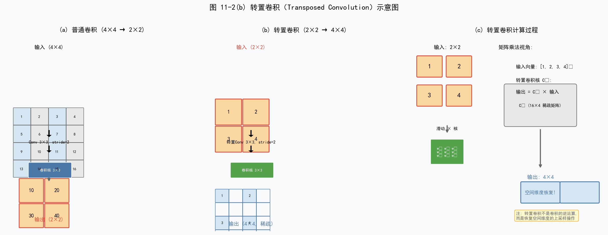
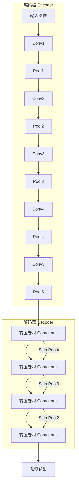
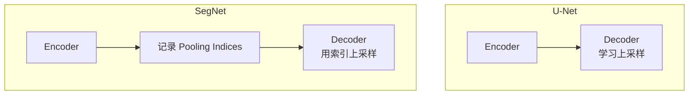
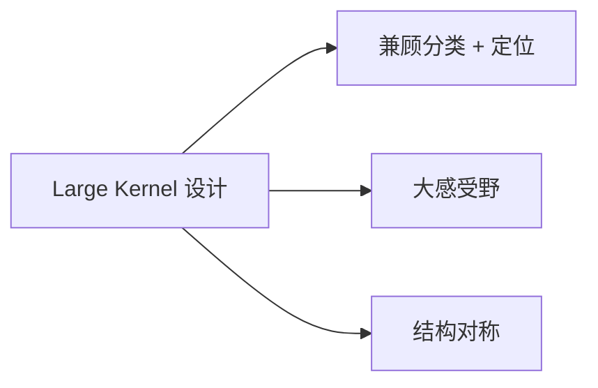
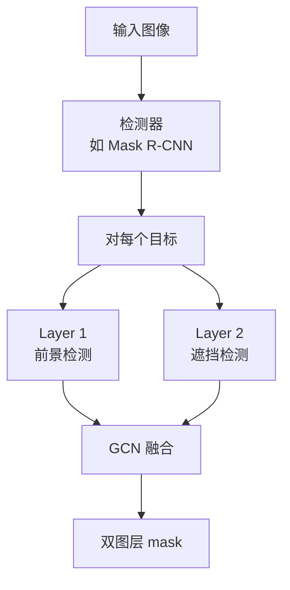
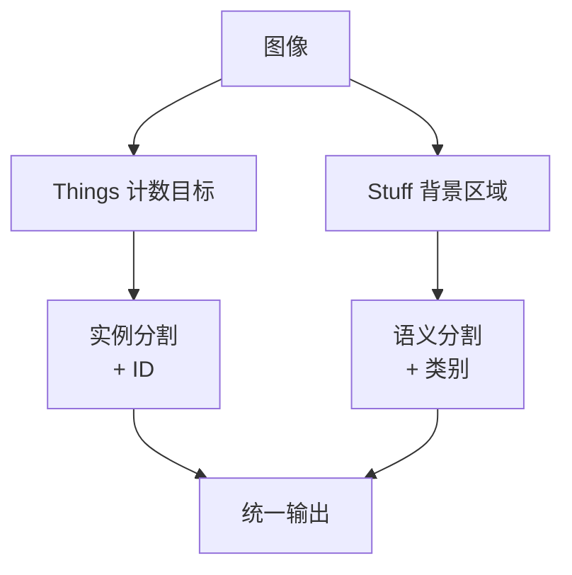
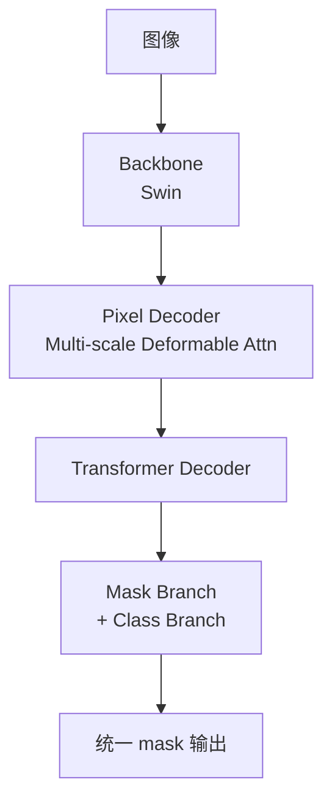
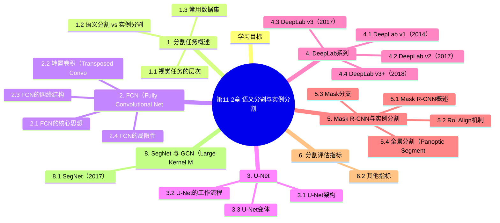

# 第11-2章 语义分割与实例分割

## 学习目标

- 理解语义分割与实例分割的区别与联系
- 掌握FCN（Fully Convolutional Networks）的工作原理
- 了解U-Net的结构设计与应用场景
- 掌握DeepLab系列的核心技术（空洞卷积、ASPP）
- 理解Mask R-CNN的实例分割流程与RoI Align机制
- 掌握mIoU评估指标的计算方法

---

## 1. 分割任务概述

### 1.1 视觉任务的层次

计算机视觉任务可以从不同粒度来理解：

```
┌────────────────────────────────────────────┐
│           图像级别(Image-level)             │
│              图像分类                       │
├────────────────────────────────────────────┤
│           区域级别(Region-level)            │
│           目标检测/实例分割                 │
├────────────────────────────────────────────┤
│           像素级别(Pixel-level)            │
│            语义分割                        │
└────────────────────────────────────────────┘
```

### 1.2 语义分割 vs 实例分割

**语义分割（Semantic Segmentation）**：
- 对图像中每个像素进行分类
- 同一类别的不同个体被视为同一整体
- 不区分同类物体的不同实例

**实例分割（Instance Segmentation）**：
- 目标检测 + 语义分割的结合
- 需要区分同一类别的不同实例
- 每个实例有独立的掩码

```
原始图像        语义分割         实例分割
┌────────┐    ┌────────┐     ┌────────┐
│🐱  🐱  │    │111222│     │111222│
│  🐱    │ →  │113333│     │114445│
│  🐱🐱  │    │156666│     │178888│
└────────┘    └────────┘     └────────┘
              (同类别统一编号)  (区分不同实例)
```

### 1.3 常用数据集

**PASCAL VOC**：
- 20个类别
- 包含分割标注

**MSCOCO**：
- 80个类别
- 实例分割标注
- 分割任务的benchmark

---

## 2. FCN（Fully Convolutional Networks）

### 2.1 FCN的核心思想

FCN（2014）是首个端到端的全卷积语义分割网络，将传统CNN的全连接层替换为卷积层。

**核心创新**：

1. **全卷积化**：将分类网络（如VGG-16）的全连接层转换为$1 \times 1$卷积
2. **跳级结构（Skip Architecture）**：结合不同深度的特征图，恢复空间细节
3. **转置卷积（Transposed Conv）**：上采样恢复分辨率

```
论文：Fully Convolutional Networks for Semantic Segmentation（CVPR 2015）
```

### 2.2 转置卷积（Transposed Convolution）

转置卷积不是卷积的逆运算，但可以恢复空间维度。



**数学定义**：转置卷积的输出尺寸为：

$$
H_{out} = H_{in} \times s - 2 \times p + k - s + output\_padding
$$

### 2.3 FCN的网络结构

**以VGG-16为骨干网络**：

```
VGG-16全连接层变换：
fc6: 4096 → 7×7×4096 卷积
fc7: 4096 → 1×1×4096 卷积
fc8: 1000 → 1×1×1000 卷积
```

**FCN编码器-解码器架构**：



**FCN-8s结构**（融合不同层级特征）：

```
conv7(32x upsampled) ─┐
                      ├─→ pool4(2x upsampled) ─┐
                                              ├─→ pool3(8x upsampled) ─┐
                                                                      ├─→ 预测输出
```

**三种配置**：

| 模型 | 上采样倍数 | 融合层 |
|------|-----------|--------|
| FCN-32s | 32x | 无 |
| FCN-16s | 16x | pool4 |
| FCN-8s | 8x | pool4 + pool3 |

### 2.4 FCN的局限性

- ❌ 多次上采样导致细节模糊
- ❌ 感受野固定，无法充分捕获多尺度信息
- ❌ 难以处理小目标

---

## 3. U-Net

### 3.1 U-Net架构

U-Net（2015）是医学图像分割的经典网络，采用对称的编码器-解码器结构。

**论文**：U-Net: Convolutional Networks for Biomedical Image Segmentation（MICCAI 2015）

**核心结构**：


**关键特点**：

1. **对称编码器-解码器**：左侧下采样，右侧上采样
2. **跳跃连接（Skip Connection）**：同层级特征拼接
3. **大量特征通道**：支持精确定位

### 3.2 U-Net的工作流程

**U-Net跳级连接（Skip Connection）结构**：

```mermaid
flowchart TB
    subgraph Encoder["编码器路径（左侧）"]
        A1[输入 572×572] --> B1[Conv3×3 ReLU<br/>64ch]
        B1 --> C1[Conv3×3 ReLU<br/>64ch]
        C1 --> D1[MaxPool 2×2<br/>64ch]
        
        D1 --> E1[Conv3×3 ReLU<br/>128ch]
        E1 --> F1[Conv3×3 ReLU<br/>128ch]
        F1 --> G1[MaxPool 2×2<br/>128ch]
        
        G1 --> H1[Conv3×3 ReLU<br/>256ch]
        H1 --> I1[Conv3×3 ReLU<br/>256ch]
        I1 --> J1[MaxPool 2×2<br/>256ch]
        
        J1 --> K1[Conv3×3 ReLU<br/>512ch]
        K1 --> L1[Conv3×3 ReLU<br/>512ch]
        L1 --> M1[MaxPool 2×2<br/>512ch]
    end
    
    subgraph Bottleneck["瓶颈层"]
        M1 --> N1[Conv3×3 ReLU<br/>1024ch]
        N1 --> O1[Conv3×3 ReLU<br/>1024ch]
    end
    
    subgraph Decoder["解码器路径（右侧）"]
        O1 --> P1[UpConv 2×2<br/>1024ch → 512ch]
        P1 --> Q1[与L1拼接<br/>512ch+512ch]
        Q1 --> R1[Conv3×3 ReLU<br/>512ch]
        R1 --> S1[Conv3×3 ReLU<br/>512ch]
        
        S1 --> T1[UpConv 2×2<br/>512ch → 256ch]
        T1 --> U1[与I1拼接<br/>256ch+256ch]
        U1 --> V1[Conv3×3 ReLU<br/>256ch]
        V1 --> W1[Conv3×3 ReLU<br/>256ch]
        
        W1 --> X1[UpConv 2×2<br/>256ch → 128ch]
        X1 --> Y1[与F1拼接<br/>128ch+128ch]
        Y1 --> Z1[Conv3×3 ReLU<br/>128ch]
        Z1 --> AA1[Conv3×3 ReLU<br/>128ch]
        
        AA1 --> AB1[UpConv 2×2<br/>128ch → 64ch]
        AB1 --> AC1[与B1拼接<br/>64ch+64ch]
        AC1 --> AD1[Conv3×3 ReLU<br/>64ch]
        AD1 --> AE1[Conv3×3 ReLU<br/>64ch]
        AE1 --> AF1[Conv1×1<br/>64ch → 2ch]
        AF1 --> AG1[输出分割图]
    end
```



**编码器路径**（收缩路径）：
- 重复应用两个$3 \times 3$卷积
- 每个卷积后接ReLU
- $2 \times 2$最大池化用于下采样
- 通道数逐层翻倍：64 → 128 → 256 → 512

**解码器路径**（扩展路径）：
- $2 \times 2$上卷积（转置卷积）翻倍分辨率
- 与对应编码器特征拼接
- 重复两个$3 \times 3$卷积
- 最后$1 \times 1$卷积输出分割结果

### 3.3 U-Net变体

**U-Net++**：
- 引入嵌套的密集跳跃连接
- 更好地融合多尺度特征

**ResU-Net**：
- 引入残差连接
- 缓解梯度消失

---

## 4. DeepLab系列

DeepLab系列是Google提出的高性能语义分割系统，核心创新包括空洞卷积和ASPP模块。

### 4.1 DeepLab v1（2014）

**论文**：Semantic Image Segmentation with Deep Convolutional Nets and Fully Connected CRFs

**核心创新**：
- **空洞卷积（Dilated/Atrous Conv）**：在标准卷积中插入0值，增大感受野
- **全连接CRF**：后处理优化边界

```
普通卷积(3×3, dilation=1): 感受野 3×3
空洞卷积(3×3, dilation=2): 感受野 7×7
空洞卷积(3×3, dilation=4): 感受野 15×15
```

### 4.2 DeepLab v2（2017）

**论文**：DeepLab: Semantic Image Segmentation with Deep Convolutional Nets, Atrous Convolution, and Fully Connected CRFs

**核心创新**：ASPP（Atrous Spatial Pyramid Pooling）

**ASPP模块**：
- 并行使用多个不同空洞率的空洞卷积
- 捕获多尺度上下文信息
- 有效应对多尺度目标问题

```
输入特征图
    ↓
┌─────────────────────────────────────┐
│ 空洞率=6  │ 空洞率=12 │ 空洞率=18  │  GAP  │
│ conv3×3   │  conv3×3  │  conv3×3  │  pool │
└─────────────────────────────────────┘
    ↓           ↓          ↓           ↓
    └───────────┴──────────┴───────────┘
                    ↓
              1×1 conv → 输出
```

### 4.3 DeepLab v3（2017）

**论文**：Rethinking Atrous Convolution for Semantic Image Segmentation

**改进点**：
- 改进的ASPP模块
- 引入全局上下文信息（Image Pooling）
- 无 CRF 后处理

### 4.4 DeepLab v3+（2018）

**论文**：Encoder-Decoder with Atrous Separable Convolution for Semantic Image Segmentation

**核心架构**：
- 改进的Xception作为编码器
- 解码器模块融合多尺度特征
- 结合深度可分离卷积

---

## 5. Mask R-CNN与实例分割

### 5.1 Mask R-CNN概述

Mask R-CNN（2017）是Faster R-CNN的扩展，在检测基础上增加了一个分支用于生成目标掩码。

**论文**：Mask R-CNN（ICCV 2017）

**核心作者**：Kaiming He, Georgia Gkioxari, Piotr Dollár, Ross Girshick

**网络架构**：

```
输入图像 → Backbone(CNN) → Feature Map
                              ↓
                         RPN网络
                              ↓
                         RoI Align
                              ↓
              ┌──────────────┴──────────────┐
              ↓                              ↓
         分类分支                      掩码分支
         (Class)                       (Mask)
              ↓                              ↓
          类别预测                    二值掩码生成
```

> **FPN 在 Mask R-CNN 中的关键作用**：Mask R-CNN 默认使用 **ResNet + FPN** 作为 backbone（论文 §4.1）。FPN 提供 4 个尺度的特征图（P2-P5），不同尺度的 RoI 从不同 FPN level 上 RoIAlign：小的目标用 P2（高分辨率），大的目标用 P5（强语义）。具体公式为 $P_k = \min(P_5, \lfloor 4 + \log_2(\sqrt{wh}/224) \rfloor)$，其中 $w, h$ 是 RoI 的宽和高。
> 
> FPN 的引入让 Mask R-CNN 在 COCO 上的 Mask AP 提升了约 3 个点，是 Mask R-CNN 成功的关键工程组件之一。FPN 的完整原理和家族演进详见 [11-1 §7 特征金字塔网络 FPN 深度专题](../PART11-计算机视觉进阶/11-1-目标检测进阶.md) 和 [4-4 §5.4 特征金字塔网络 FPN](../PART4-卷积神经网络CNN/4-4-CNN应用.md#54-特征金字塔网络-fpnfeature-pyramid-network-cvpr-2017)。

### 5.2 RoI Align机制

**问题**：RoI Pooling存在两次量化误差：
1. 第一次：候选区域边界量化
2. 第二次：池化后边界量化

**RoI Align解决方案**：
- 使用双线性插值计算浮点坐标的精确值
- 避免任何边界量化
- 保留空间精度

```
RoI Pooling: 边界被量化到整数
RoI Align:   保持浮点边界，使用双线性插值采样
```

### 5.3 Mask分支

**关键设计**：
- 对每个RoI预测一个$m \times m$的掩码
- 使用FCN（Fully Convolutional Network）生成掩码
- 掩码与类别解耦：每类独立的掩码模板

**损失函数**：

$$
L = L_{cls} + L_{box} + L_{mask}
$$

其中$L_{mask}$使用平均二元交叉熵损失。

### 5.4 全景分割（Panoptic Segmentation）

全景分割是语义分割与实例分割的结合，同时输出：
- **things**：可数的实例对象（用实例分割）
- **stuff**：不可数的背景区域（用语义分割）

---

## 6. 分割评估指标

### 6.1 mIoU（Mean Intersection over Union）

mIoU是语义分割最常用的评估指标。

**IoU计算**：

$$
IoU = \frac{TP}{TP + FP + FN} = \frac{Area_{pred} \cap Area_{gt}}{Area_{pred} \cup Area_{gt}}
$$

**mIoU计算**：

$$
mIoU = \frac{1}{N} \sum_{i=1}^{N} IoU_i
$$

其中$N$为类别数。

**多类别IoU矩阵**：

```
           预测类别
         │  猫   狗   背景
真 ─ 猫  │ 0.7  0.1  0.2
类 ─ 狗  │ 0.1  0.8  0.1
别 ─ 背景 │ 0.2  0.1  0.7

mIoU = (0.7 + 0.8 + 0.7) / 3 = 0.733
```

### 6.2 其他指标

**Pixel Accuracy（像素精度）**：

$$
PA = \frac{\sum_i TP_i}{\sum_i (TP_i + FP_i)}
$$

**Mean Pixel Accuracy（MPA）**：

$$
MPA = \frac{1}{N} \sum_i \frac{TP_i}{TP_i + FP_i}
$$

---

## 7. 分割技术总结

### 7.1 技术演进路线

```
FCN(2014) → U-Net(2015) → DeepLab v1/v2(2014-2017) → DeepLab v3/v3+(2017-2018)
                                    ↓
                            Mask R-CNN(2017)
```

### 7.2 方法对比

| 方法 | 特点 | 适用场景 |
|------|------|----------|
| FCN | 端到端全卷积，跳跃连接 | 通用语义分割 |
| U-Net | 对称编解码，医学图像友好 | 医学、显微镜图像 |
| DeepLab | 空洞卷积+ASPP，多尺度强 | 复杂场景，高精度 |
| Mask R-CNN | 实例分割，检测+分割 | 实例分割任务 |

### 7.3 进一步阅读章节

- **SegNet 与 GCN**：见第 8 节
- **BCNet 双图层实例分割**：见第 9 节
- **全景分割 Panoptic**：见第 10 节
- **Transformer 分割 (Mask2Former)**：见第 11 节
- **损失函数与评估指标扩展**：见第 12 节
- **实战指南**：见第 13 节

---

## 8. SegNet 与 GCN（Large Kernel Matters）

### 8.1 SegNet（2017）

SegNet 是与 U-Net 同时期提出的对称编解码分割网络，专注于**驾驶场景理解**。

**核心创新**：
- 使用 **Pooling Indices**（池化索引）进行上采样
- 不需要学习上采样参数，节省内存
- 适用于嵌入式/移动端部署

**架构对比**：



| 维度 | U-Net | SegNet |
|------|-------|--------|
| 上采样方式 | 转置卷积（可学习） | 池化索引（无参数） |
| 内存效率 | 较高 | 更优 |
| 精度 | 略高 | 略低 |
| 适用 | 医学图像 | 实时驾驶场景 |

### 8.2 GCN（Global Convolutional Network, 2017）

**Large Kernel Matters** 是 CVPR 2017 的关键观察：



**核心思想**：
- 用**大卷积核**（如 1×k + k×1 分解）增加感受野
- 同时获得分类所需的全局信息和定位所需的细节
- 提出 GCN 结构

**GCN Block**：

```python
# 1×k + k×1 分解的大核卷积
def gcn_block(x, k):
    out = Conv2D(x, filters, (1, k), padding='same')
    out = Conv2D(out, filters, (k, 1), padding='same')
    return out

# + 边界细化 BR (Boundary Refinement)
def br_block(x):
    out = Conv2D(x, filters, 3, padding='same')
    out = Conv2D(out, filters, 3, padding='same')
    return out + x  # 残差
```

**论文**：Large Kernel Matters — Improve Semantic Segmentation by Global Convolutional Network（CVPR 2017）

**与 FCN/U-Net 的对比**：

| 特性 | FCN | U-Net | GCN |
|------|-----|-------|-----|
| 感受野 | 受限 | 跳跃连接补充 | 大 |
| 分类能力 | 一般 | 中等 | 强 |
| 定位能力 | 弱 | 强（跳跃连接） | 强 |
| 全局信息 | 缺 | 缺 | 充分 |

---

## 9. BCNet：双图层实例分割（CVPR 2021）

**遮挡**是实例分割的经典难题。BCNet 提出**双图层**思路。

### 9.1 核心思想

把每个目标建模为**两个图层**：
- **前景图层（Occluder）**：被遮挡的目标
- **遮挡图层（Occluded）**：遮挡物



### 9.2 双图层 GCN

对每个目标：
1. **第一图层**：提取目标的整体 mask
2. **第二图层**：检测遮挡该目标的其他目标
3. **融合**：将两个图层合并，得到完整分割

### 9.3 实验效果

| 数据集 | Mask R-CNN | BCNet |
|--------|------------|-------|
| COCO test-dev | 37.5 AP | **39.8 AP** |
| Cityscapes | 32.0 AP | **38.4 AP** |

在密集遮挡场景下提升尤其明显。

### 9.4 应用场景

- 拥挤人群分割
- 餐具堆叠识别
- 货物堆放计数
- 动物群落分析

---

## 10. 全景分割（Panoptic Segmentation）

全景分割是语义分割和实例分割的结合。

### 10.1 任务定义



- **Things**：可数的实例对象（人、车、动物） → 用实例分割
- **Stuff**：不可数的背景区域（天空、草地、道路） → 用语义分割

### 10.2 Panoptic Quality（PQ）指标

$$
PQ = \frac{\sum_{(p, g) \in TP} IoU(p, g)}{|TP|} \times \frac{|TP|}{|TP| + \frac{1}{2}|FP| + \frac{1}{2}|FN|}
$$

简化为：$PQ = SQ \times RQ$（分割质量 × 识别质量）

### 10.3 代表方法

| 方法 | 思想 | PQ (COCO) |
|------|------|-----------|
| Panoptic FPN | FPN + 双分支（语义+实例）| 40.0 |
| UPSNet | 统一像素分割 | 42.5 |
| Panoptic-DeepLab | 无锚框双分支 | 44.1 |
| Mask2Former | 统一 mask 分类 | **57.8** |
| OneFormer | 单模型统一 | 58.0+ |

---

## 11. Transformer 分割时代

2021 年起，Transformer 架构开始主导分割任务。

### 11.1 Mask2Former（CVPR 2022）

**核心思想**：用 **Mask Attention** 统一分类、实例分割、语义分割。



**Mask Attention**：

$$
\text{MaskAttn}(X, M) = \text{Softmax}(M + \mathcal{Q}K^T) \mathcal{V}
$$

其中 $M$ 是上一轮的 mask 预测（用 -inf 屏蔽背景区域）。

**性能**：

| 任务 | Mask R-CNN | Mask2Former |
|------|-----------|-------------|
| 实例分割 (COCO) | 37.5 AP | **50.1 AP** |
| 语义分割 (ADE20K) | - | **57.7 mIoU** |
| 全景分割 (COCO) | 40.0 PQ | **57.8 PQ** |

### 11.2 OneFormer

- 单模型统一三类分割
- 文本条件化（text-conditioned）
- 性能更强

### 11.3 Segment Anything (SAM)

- Meta 2023 发布
- 提示驱动（点/框/mask）
- 零样本分割能力
- ViT-Huge 编码器

---

## 12. 损失函数与评估指标扩展

### 12.1 分割损失函数

| 损失 | 公式 | 适用 |
|------|------|------|
| **Cross Entropy** | $-\sum y \log(\hat{y})$ | 通用 |
| **Weighted CE** | 加权 CE | 类别不平衡 |
| **Focal Loss** | $(1-p)^\gamma \cdot CE$ | 极端不平衡 |
| **Dice Loss** | $1 - \frac{2|P \cap G|}{|P| + |G|}$ | 医学、小目标 |
| **Lovász Loss** | Lovász 凸包 | IoU 直接优化 |
| **Tversky Loss** | Tversky 指数 | 不平衡分割 |
| **Focal Tversky** | Tversky + Focal | 难样本 |

**Dice Loss**：

$$
L_{Dice} = 1 - \frac{2 \sum_i p_i g_i + \epsilon}{\sum_i p_i + \sum_i g_i + \epsilon}
$$

对小目标和类别不平衡场景特别有效。

### 12.2 评估指标扩展

| 指标 | 公式/说明 | 适用 |
|------|----------|------|
| **mIoU** | $\frac{1}{C} \sum \frac{TP}{TP+FP+FN}$ | 语义分割（最常用）|
| **Dice / F1** | $\frac{2 \cdot Precision \cdot Recall}{P+R}$ | 医学分割（边界敏感）|
| **Hausdorff Distance** | 边界最大距离 | 医学分割（边界质量）|
| **Boundary F-score** | 边界 F 值 | 边界精细度 |
| **PQ** | 见第 10 节 | 全景分割 |
| **mAP@Mask** | mask IoU 平均 | 实例分割 |

### 12.3 类别不平衡处理

分割任务中背景类通常占主导：

```python
# 1. 加权 Cross Entropy
class_weights = torch.tensor([1.0, 5.0, 10.0])  # 少数类权重大
criterion = nn.CrossEntropyLoss(weight=class_weights)

# 2. OHEM (Online Hard Example Mining)
# 只用难样本（loss 大的）计算梯度

# 3. Dice Loss（天然抗不平衡）
dice_loss = 1 - (2 * (pred * target).sum() + 1) / (pred.sum() + target.sum() + 1)
```

---

## 13. 实战指南与工具链

### 13.1 MMSegmentation 训练自定义数据集

```bash
# 安装
mim install mmengine mmcv mmsegmentation

# 数据集目录结构（以 VOC 为例）
data/VOCdevkit/
└── VOC2012/
    ├── JPEGImages/         # 图像
    ├── SegmentationClass/  # 标注 mask
    ├── ImageSets/Segmentation/{train,trainval,val}.txt
```

**自定义 Config**：

```python
# configs/segformer/segformer_mit-b5_8xb2-160k_ade20k-512x512_my.py
_base_ = ['./segformer_mit-b5_8xb2-160k_ade20k-512x512.py']

# 1. 改数据集配置
data_preprocessor = dict(
    size=(512, 512),
    mean=[123.675, 116.28, 103.53],
    std=[58.395, 57.12, 57.375],
    bgr_to_rgb=True,
    pad_val=0,
    seg_pad_val=255
)

dataset_type = 'PascalVOCDataset'
data_root = 'data/VOCdevkit/VOC2012'

train_dataloader = dict(
    dataset=dict(
        type=dataset_type,
        data_root=data_root,
        data_prefix=dict(
            img_path='JPEGImages',
            seg_map_path='SegmentationClass'
        ),
        ann_file='ImageSets/Segmentation/train.txt'
    )
)

# 2. 改类别数
model = dict(
    decode_head=dict(num_classes=21),  # VOC 20 + 背景
)
```

### 13.2 训练

```bash
# 单卡
python tools/train.py configs/segformer/segformer_mit-b5_8xb2-160k_ade20k-512x512_my.py

# 多卡
bash tools/dist_train.sh configs/segformer/segformer_mit-b5_8xb2-160k_ade20k-512x512_my.py 8
```

### 13.3 推理

```python
from mmseg.apis import init_model, inference_model, show_result_pyplot

config_file = 'configs/segformer/segformer_mit-b5_8xb2-160k_ade20k-512x512_my.py'
checkpoint_file = 'work_dirs/.../iter_160000.pth'

model = init_model(config_file, checkpoint_file, device='cuda:0')
result = inference_model(model, 'test.jpg')
show_result_pyplot(model, 'test.jpg', result, opacity=0.5)
```

### 13.4 部署（MMDeploy）

参见 10-6 章节，流程与检测相同。

---

## 本章小结

本章系统讲解了语义分割与实例分割的全景：

1. **任务层次**：图像级（分类）→ 区域级（检测/实例分割）→ 像素级（语义分割），从粗到细
2. **经典演进**：FCN（2015）→ U-Net（2015）→ DeepLab（2016-2018）→ Mask R-CNN（2017）→ SegNet/GCN（2017）→ Transformer 时代（2021+）
3. **Transformer 主导**：Mask2Former、OneFormer、SAM 等统一多种分割任务
4. **评估指标**：mIoU（语义）、AP（实例）、PQ（全景），各任务有侧重
5. **损失函数**：CE 基础 + Dice/Lovász/Tversky 等几何一致优化
6. **实战工具**：MMSegmentation + MMDeploy 完整工具链


## 知识图谱



## 参考资料

1. Long J, Shelhamer E, Darrell T. Fully convolutional networks for semantic segmentation. CVPR, 2015.
2. Ronneberger O, Fischer P, Brox T. U-Net: Convolutional Networks for Biomedical Image Segmentation. MICCAI, 2015.
3. Chen L C, et al. DeepLab: Semantic Image Segmentation with Deep Convolutional Nets, Atrous Convolution, and Fully Connected CRFs. TPAMI, 2017.
4. Chen L C, et al. Rethinking Atrous Convolution for Semantic Image Segmentation. arXiv, 2017.
5. Chen L C, et al. Encoder-Decoder with Atrous Separable Convolution for Semantic Image Segmentation. ECCV, 2018.
6. He K, et al. Mask R-CNN. ICCV, 2017.
