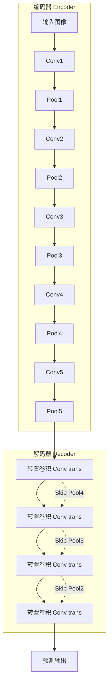
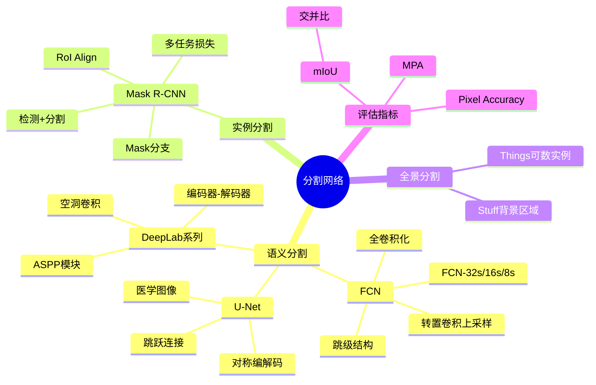

# 第11-2章 语义分割与实例分割

## 学习目标

- 理解语义分割与实例分割的区别与联系
- 掌握FCN（Fully Convolutional Networks）的工作原理
- 了解U-Net的结构设计与应用场景
- 掌握DeepLab系列的核心技术（空洞卷积、ASPP）
- 理解Mask R-CNN的实例分割流程与RoI Align机制
- 掌握mIoU评估指标的计算方法

---

## 1. 分割任务概述

### 1.1 视觉任务的层次

计算机视觉任务可以从不同粒度来理解：

```
┌────────────────────────────────────────────┐
│           图像级别(Image-level)             │
│              图像分类                       │
├────────────────────────────────────────────┤
│           区域级别(Region-level)            │
│           目标检测/实例分割                 │
├────────────────────────────────────────────┤
│           像素级别(Pixel-level)            │
│            语义分割                        │
└────────────────────────────────────────────┘
```

### 1.2 语义分割 vs 实例分割

**语义分割（Semantic Segmentation）**：
- 对图像中每个像素进行分类
- 同一类别的不同个体被视为同一整体
- 不区分同类物体的不同实例

**实例分割（Instance Segmentation）**：
- 目标检测 + 语义分割的结合
- 需要区分同一类别的不同实例
- 每个实例有独立的掩码

```
原始图像        语义分割         实例分割
┌────────┐    ┌────────┐     ┌────────┐
│🐱  🐱  │    │111222│     │111222│
│  🐱    │ →  │113333│     │114445│
│  🐱🐱  │    │156666│     │178888│
└────────┘    └────────┘     └────────┘
              (同类别统一编号)  (区分不同实例)
```

### 1.3 常用数据集

**PASCAL VOC**：
- 20个类别
- 包含分割标注

**MSCOCO**：
- 80个类别
- 实例分割标注
- 分割任务的benchmark

---

## 2. FCN（Fully Convolutional Networks）

### 2.1 FCN的核心思想

FCN（2014）是首个端到端的全卷积语义分割网络，将传统CNN的全连接层替换为卷积层。

**核心创新**：

1. **全卷积化**：将分类网络（如VGG-16）的全连接层转换为$1 \times 1$卷积
2. **跳级结构（Skip Architecture）**：结合不同深度的特征图，恢复空间细节
3. **转置卷积（Transposed Conv）**：上采样恢复分辨率

```
论文：Fully Convolutional Networks for Semantic Segmentation（CVPR 2015）
```

### 2.2 转置卷积（Transposed Convolution）

转置卷积不是卷积的逆运算，但可以恢复空间维度。


**数学定义**：转置卷积的输出尺寸为：

$$
H_{out} = H_{in} \times s - 2 \times p + k - s + output\_padding
$$

### 2.3 FCN的网络结构

**以VGG-16为骨干网络**：

```
VGG-16全连接层变换：
fc6: 4096 → 7×7×4096 卷积
fc7: 4096 → 1×1×4096 卷积
fc8: 1000 → 1×1×1000 卷积
```

**FCN编码器-解码器架构**：



**FCN-8s结构**（融合不同层级特征）：

```
conv7(32x upsampled) ─┐
                      ├─→ pool4(2x upsampled) ─┐
                                              ├─→ pool3(8x upsampled) ─┐
                                                                      ├─→ 预测输出
```

**三种配置**：

| 模型 | 上采样倍数 | 融合层 |
|------|-----------|--------|
| FCN-32s | 32x | 无 |
| FCN-16s | 16x | pool4 |
| FCN-8s | 8x | pool4 + pool3 |

### 2.4 FCN的局限性

- ❌ 多次上采样导致细节模糊
- ❌ 感受野固定，无法充分捕获多尺度信息
- ❌ 难以处理小目标

---

## 3. U-Net

### 3.1 U-Net架构

U-Net（2015）是医学图像分割的经典网络，采用对称的编码器-解码器结构。

**论文**：U-Net: Convolutional Networks for Biomedical Image Segmentation（MICCAI 2015）

**核心结构**：


**关键特点**：

1. **对称编码器-解码器**：左侧下采样，右侧上采样
2. **跳跃连接（Skip Connection）**：同层级特征拼接
3. **大量特征通道**：支持精确定位

### 3.2 U-Net的工作流程

**U-Net跳级连接（Skip Connection）结构**：

```mermaid
flowchart TB
    subgraph Encoder["编码器路径（左侧）"]
        A1[输入 572×572] --> B1[Conv3×3 ReLU<br/>64ch]
        B1 --> C1[Conv3×3 ReLU<br/>64ch]
        C1 --> D1[MaxPool 2×2<br/>64ch]
        
        D1 --> E1[Conv3×3 ReLU<br/>128ch]
        E1 --> F1[Conv3×3 ReLU<br/>128ch]
        F1 --> G1[MaxPool 2×2<br/>128ch]
        
        G1 --> H1[Conv3×3 ReLU<br/>256ch]
        H1 --> I1[Conv3×3 ReLU<br/>256ch]
        I1 --> J1[MaxPool 2×2<br/>256ch]
        
        J1 --> K1[Conv3×3 ReLU<br/>512ch]
        K1 --> L1[Conv3×3 ReLU<br/>512ch]
        L1 --> M1[MaxPool 2×2<br/>512ch]
    end
    
    subgraph Bottleneck["瓶颈层"]
        M1 --> N1[Conv3×3 ReLU<br/>1024ch]
        N1 --> O1[Conv3×3 ReLU<br/>1024ch]
    end
    
    subgraph Decoder["解码器路径（右侧）"]
        O1 --> P1[UpConv 2×2<br/>1024ch → 512ch]
        P1 --> Q1[与L1拼接<br/>512ch+512ch]
        Q1 --> R1[Conv3×3 ReLU<br/>512ch]
        R1 --> S1[Conv3×3 ReLU<br/>512ch]
        
        S1 --> T1[UpConv 2×2<br/>512ch → 256ch]
        T1 --> U1[与I1拼接<br/>256ch+256ch]
        U1 --> V1[Conv3×3 ReLU<br/>256ch]
        V1 --> W1[Conv3×3 ReLU<br/>256ch]
        
        W1 --> X1[UpConv 2×2<br/>256ch → 128ch]
        X1 --> Y1[与F1拼接<br/>128ch+128ch]
        Y1 --> Z1[Conv3×3 ReLU<br/>128ch]
        Z1 --> AA1[Conv3×3 ReLU<br/>128ch]
        
        AA1 --> AB1[UpConv 2×2<br/>128ch → 64ch]
        AB1 --> AC1[与B1拼接<br/>64ch+64ch]
        AC1 --> AD1[Conv3×3 ReLU<br/>64ch]
        AD1 --> AE1[Conv3×3 ReLU<br/>64ch]
        AE1 --> AF1[Conv1×1<br/>64ch → 2ch]
        AF1 --> AG1[输出分割图]
    end
```



**编码器路径**（收缩路径）：
- 重复应用两个$3 \times 3$卷积
- 每个卷积后接ReLU
- $2 \times 2$最大池化用于下采样
- 通道数逐层翻倍：64 → 128 → 256 → 512

**解码器路径**（扩展路径）：
- $2 \times 2$上卷积（转置卷积）翻倍分辨率
- 与对应编码器特征拼接
- 重复两个$3 \times 3$卷积
- 最后$1 \times 1$卷积输出分割结果

### 3.3 U-Net变体

**U-Net++**：
- 引入嵌套的密集跳跃连接
- 更好地融合多尺度特征

**ResU-Net**：
- 引入残差连接
- 缓解梯度消失

---

## 4. DeepLab系列

DeepLab系列是Google提出的高性能语义分割系统，核心创新包括空洞卷积和ASPP模块。

### 4.1 DeepLab v1（2014）

**论文**：Semantic Image Segmentation with Deep Convolutional Nets and Fully Connected CRFs

**核心创新**：
- **空洞卷积（Dilated/Atrous Conv）**：在标准卷积中插入0值，增大感受野
- **全连接CRF**：后处理优化边界

```
普通卷积(3×3, dilation=1): 感受野 3×3
空洞卷积(3×3, dilation=2): 感受野 7×7
空洞卷积(3×3, dilation=4): 感受野 15×15
```

### 4.2 DeepLab v2（2017）

**论文**：DeepLab: Semantic Image Segmentation with Deep Convolutional Nets, Atrous Convolution, and Fully Connected CRFs

**核心创新**：ASPP（Atrous Spatial Pyramid Pooling）

**ASPP模块**：
- 并行使用多个不同空洞率的空洞卷积
- 捕获多尺度上下文信息
- 有效应对多尺度目标问题

```
输入特征图
    ↓
┌─────────────────────────────────────┐
│ 空洞率=6  │ 空洞率=12 │ 空洞率=18  │  GAP  │
│ conv3×3   │  conv3×3  │  conv3×3  │  pool │
└─────────────────────────────────────┘
    ↓           ↓          ↓           ↓
    └───────────┴──────────┴───────────┘
                    ↓
              1×1 conv → 输出
```

### 4.3 DeepLab v3（2017）

**论文**：Rethinking Atrous Convolution for Semantic Image Segmentation

**改进点**：
- 改进的ASPP模块
- 引入全局上下文信息（Image Pooling）
- 无 CRF 后处理

### 4.4 DeepLab v3+（2018）

**论文**：Encoder-Decoder with Atrous Separable Convolution for Semantic Image Segmentation

**核心架构**：
- 改进的Xception作为编码器
- 解码器模块融合多尺度特征
- 结合深度可分离卷积

---

## 5. Mask R-CNN与实例分割

### 5.1 Mask R-CNN概述

Mask R-CNN（2017）是Faster R-CNN的扩展，在检测基础上增加了一个分支用于生成目标掩码。

**论文**：Mask R-CNN（ICCV 2017）

**核心作者**：Kaiming He, Georgia Gkioxari, Piotr Dollár, Ross Girshick

**网络架构**：

```
输入图像 → Backbone(CNN) → Feature Map
                              ↓
                         RPN网络
                              ↓
                         RoI Align
                              ↓
              ┌──────────────┴──────────────┐
              ↓                              ↓
         分类分支                      掩码分支
         (Class)                       (Mask)
              ↓                              ↓
         类别预测                    二值掩码生成
```

### 5.2 RoI Align机制

**问题**：RoI Pooling存在两次量化误差：
1. 第一次：候选区域边界量化
2. 第二次：池化后边界量化

**RoI Align解决方案**：
- 使用双线性插值计算浮点坐标的精确值
- 避免任何边界量化
- 保留空间精度

```
RoI Pooling: 边界被量化到整数
RoI Align:   保持浮点边界，使用双线性插值采样
```

### 5.3 Mask分支

**关键设计**：
- 对每个RoI预测一个$m \times m$的掩码
- 使用FCN（Fully Convolutional Network）生成掩码
- 掩码与类别解耦：每类独立的掩码模板

**损失函数**：

$$
L = L_{cls} + L_{box} + L_{mask}
$$

其中$L_{mask}$使用平均二元交叉熵损失。

### 5.4 全景分割（Panoptic Segmentation）

全景分割是语义分割与实例分割的结合，同时输出：
- **things**：可数的实例对象（用实例分割）
- **stuff**：不可数的背景区域（用语义分割）

---

## 6. 分割评估指标

### 6.1 mIoU（Mean Intersection over Union）

mIoU是语义分割最常用的评估指标。

**IoU计算**：

$$
IoU = \frac{TP}{TP + FP + FN} = \frac{Area_{pred} \cap Area_{gt}}{Area_{pred} \cup Area_{gt}}
$$

**mIoU计算**：

$$
mIoU = \frac{1}{N} \sum_{i=1}^{N} IoU_i
$$

其中$N$为类别数。

**多类别IoU矩阵**：

```
           预测类别
         │  猫   狗   背景
真 ─ 猫  │ 0.7  0.1  0.2
类 ─ 狗  │ 0.1  0.8  0.1
别 ─ 背景 │ 0.2  0.1  0.7

mIoU = (0.7 + 0.8 + 0.7) / 3 = 0.733
```

### 6.2 其他指标

**Pixel Accuracy（像素精度）**：

$$
PA = \frac{\sum_i TP_i}{\sum_i (TP_i + FP_i)}
$$

**Mean Pixel Accuracy（MPA）**：

$$
MPA = \frac{1}{N} \sum_i \frac{TP_i}{TP_i + FP_i}
$$

---

## 7. 分割技术总结

### 7.1 技术演进路线

```
FCN(2014) → U-Net(2015) → DeepLab v1/v2(2014-2017) → DeepLab v3/v3+(2017-2018)
                                    ↓
                            Mask R-CNN(2017)
```

### 7.2 方法对比

| 方法 | 特点 | 适用场景 |
|------|------|----------|
| FCN | 端到端全卷积，跳跃连接 | 通用语义分割 |
| U-Net | 对称编解码，医学图像友好 | 医学、显微镜图像 |
| DeepLab | 空洞卷积+ASPP，多尺度强 | 复杂场景，高精度 |
| Mask R-CNN | 实例分割，检测+分割 | 实例分割任务 |

---

## 本章小结

1. **语义分割与实例分割区别**：语义分割对每个像素分类但不区分同类不同实例；实例分割是目标检测+语义分割，需要区分同类不同实例并生成独立掩码。

2. **FCN网络**：首个端到端全卷积分割网络，将全连接层转换为卷积层，通过跳级结构融合不同层级特征，但存在细节模糊和多尺度能力不足的问题。

3. **U-Net架构**：对称编码器-解码器结构，跳跃连接保留空间细节，广泛应用于医学图像分割。U-Net++通过嵌套密集跳跃连接进一步提升性能。

4. **DeepLab系列**：核心创新包括空洞卷积（增大感受野）和ASPP模块（多尺度上下文），DeepLab v3+结合编码器-解码器结构达到最佳效果。

5. **Mask R-CNN**：Faster R-CNN的扩展，增加Mask分支预测目标掩码。RoI Align通过双线性插值避免量化误差，是实例分割的标杆方法。

6. **评估指标**：mIoU是语义分割最重要的指标，计算预测与真实区域的交并比；全景分割同时处理things和stuff。

---

## 知识点思维导图



---

## 参考资料

1. Long J, Shelhamer E, Darrell T. Fully convolutional networks for semantic segmentation. CVPR, 2015.
2. Ronneberger O, Fischer P, Brox T. U-Net: Convolutional Networks for Biomedical Image Segmentation. MICCAI, 2015.
3. Chen L C, et al. DeepLab: Semantic Image Segmentation with Deep Convolutional Nets, Atrous Convolution, and Fully Connected CRFs. TPAMI, 2017.
4. Chen L C, et al. Rethinking Atrous Convolution for Semantic Image Segmentation. arXiv, 2017.
5. Chen L C, et al. Encoder-Decoder with Atrous Separable Convolution for Semantic Image Segmentation. ECCV, 2018.
6. He K, et al. Mask R-CNN. ICCV, 2017.