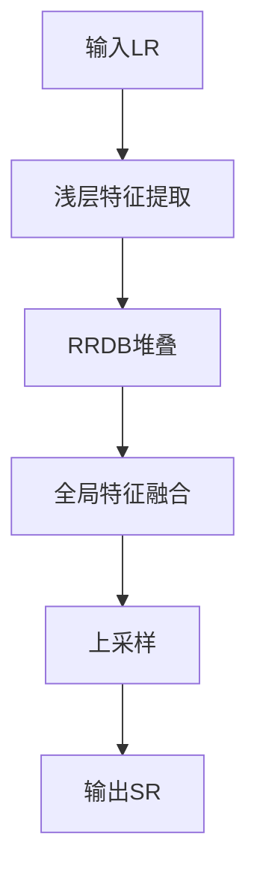
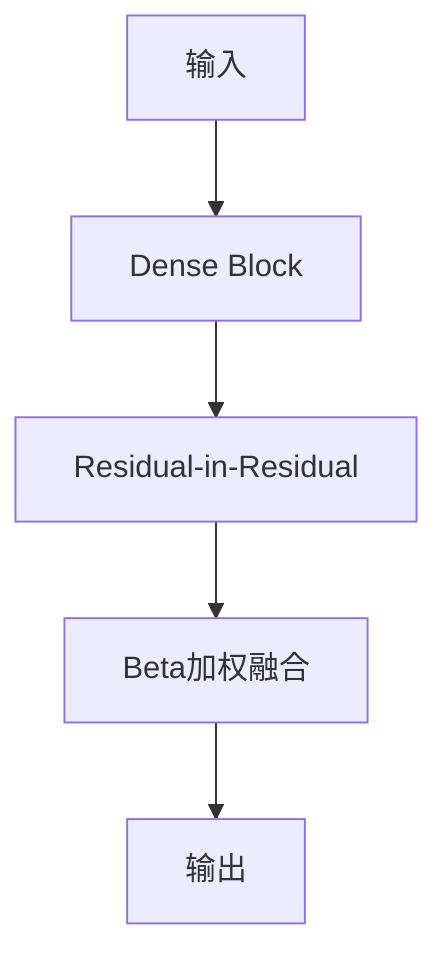
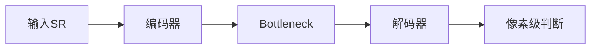
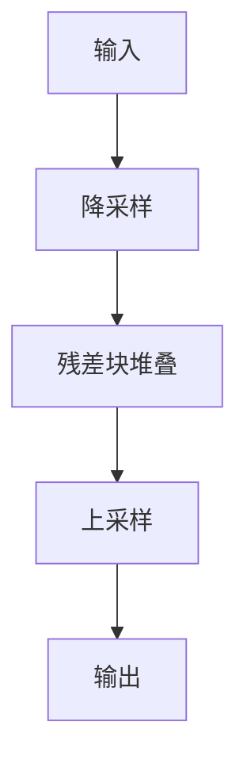
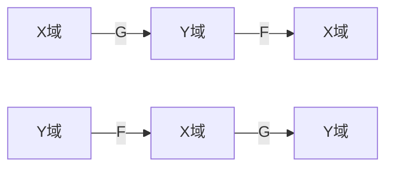
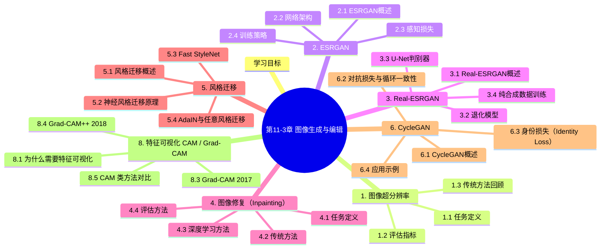

# 第11-3章 图像生成与编辑

## 学习目标

- 理解超分辨率重建的任务定义与评估指标
- 掌握ESRGAN、Real-ESRGAN的网络架构与核心创新
- 了解图像修复（Inpainting）的基本方法
- 理解风格迁移与CycleGAN的原理与应用
- 了解GAN在图像生成领域的发展脉络

---

## 1. 图像超分辨率

### 1.1 任务定义

图像超分辨率（Super Resolution, SR）是将低分辨率图像重建为高分辨率图像的技术。

**应用场景**：
- 老照片修复与增强
- 视频监控图像清晰化
- 医学影像质量提升
- 卫星遥感图像重建

**问题分类**：

| 类型 | 输入 | 输出 | 缩放因子 |
|------|------|------|----------|
| 单图超分(SISR) | 单张LR图像 | SR图像 | 2x, 4x, 8x |
| 多图超分(MISR) | 多张LR序列 | SR图像 | 通常2x |

### 1.2 评估指标

**峰值信噪比（PSNR）**：

$$
PSNR = 10 \cdot \log_{10}\left(\frac{MAX_I^2}{MSE}\right)
$$

其中$MSE$为均方误差，$MAX_I$为像素最大值（通常为255）。

**结构相似性（SSIM）**：

$$
SSIM = \frac{(2\mu_x\mu_y + c_1)(2\sigma_{xy} + c_2)}{(\mu_x^2 + \mu_y^2 + c_1)(\sigma_x^2 + \sigma_y^2 + c_2)}
$$

**LPIPS（Learned Perceptual Image Patch Similarity）**：
- 基于预训练网络提取特征计算感知相似度
- 更符合人类视觉感知

### 1.3 传统方法回顾

**插值方法**：
- 双线性插值（Bilinear）
- 双三次插值（Bicubic）
- Lanczos重采样

**问题**：会产生模糊、锯齿等Artifacts

---

## 2. ESRGAN

### 2.1 ESRGAN概述

ESRGAN（Enhanced SRGAN，2018）是SRGAN的升级版本，在图像质量上有显著提升。

**论文**：ESRGAN: Enhanced Super-Resolution Generative Adversarial Networks（ECCV 2018）

**核心贡献**：
- 引入Residual-in-Residual Dense Block（RRDB）
- 使用RaGAN（Relativistic GAN）
- 网络感知一致性优化

### 2.2 网络架构

**生成器（Generator）**：



**RRDB模块**：



**判别器（Discriminator）**：

使用RaGAN的相对判别器，不仅判断真伪，还比较真实图像比生成图像"更真实"的程度。

### 2.3 感知损失

**内容损失**：基于VGG网络提取特征

$$
L_{content} = \frac{1}{W_{i,j}H_{i,j}} \sum_{x=1}^{W_{i,j}} \sum_{y=1}^{H_{i,j}} (\phi_{i,j}(I^{SR})_{x,y} - \phi_{i,j}(I^{HR})_{x,y})^2
$$

**对抗损失**：

$$
L_G^{Ra} = -\mathbb{E}_{x_r}[\log(1 - D(x_r, x_f))] - \mathbb{E}_{x_f}[\log(D(x_f, x_r))]
$$

### 2.4 训练策略

1. **BN正则化**：训练时使用Batch Normalization，推理时可移除
2. **像素剪切**：避免训练过程中的数值问题
3. **感知锐化**：PSNR导向的预处理

---

## 3. Real-ESRGAN

### 3.1 Real-ESRGAN概述

Real-ESRGAN（2021）是针对真实世界退化的超分模型，解决ESRGAN在真实场景中的泛化问题。

**论文**：Real-ESRGAN: Training Real-World Blind Super-Resolution with Pure Synthetic Data

**核心挑战**：
- 真实图像退化复杂多样
- 无法获取理想配对数据

### 3.2 退化模型

**经典退化流程**：

```
HR → Noise → Blur → Resize → Noise → SR
```

**Real-ESRGAN扩展退化**：

1. **随机降采样**：$\times 2, \times 3, \times 4$混合
2. ** sinc滤波器**：模拟振铃和过冲
3. **模糊增强**：高斯模糊 + 线性模糊
4. **噪声增强**：高斯噪声 + 依赖像素噪声 + 依赖噪声
5. **JPEG压缩**：Quality因子随机

### 3.3 U-Net判别器

使用U-Net结构作为判别器，能输出像素级的真伪判断图，有助于恢复细节。



### 3.4 纯合成数据训练

**关键洞察**：通过精心设计的退化模型，即使只用合成数据训练，也能泛化到真实场景。

**退化模型配置**：
```python
blur_kernel_size = random.choice([7, 9, 11, 13, 15, 17, 19, 21])
blur_sigma = np.random.uniform(0.1, 2.3)
noise_level = np.random.uniform(0, 25)
jpeg_factor = np.random.uniform(60, 95)
```

---

## 4. 图像修复（Inpainting）

### 4.1 任务定义

图像修复（Image Inpainting）是用合理内容填充图像缺失区域的技术。

**应用场景**：
- 移除不需要的物体（水印、路人）
- 修复受损老照片
- 图像编辑（扩展画布）

### 4.2 传统方法

**基于纹理合成**：
- PatchMatch算法
- 从图像已知区域搜索匹配块填充缺失区域

**问题**：对于结构复杂的区域效果较差

### 4.3 深度学习方法

**Context Encoder（2016）**：
- 编码器-解码器架构
- 对抗训练
- 重建损失 + 对抗损失

**DeepFill v2（2018）**：
- 引入上下文注意力机制
- 两阶段粗细重建
- 自由形式修复

**LaMa（2021）**：
- 快速傅里叶卷积
- 感知损失优化
- 高效处理大区域缺失

### 4.4 评估方法

- **像素级指标**：PSNR、SSIM
- **感知指标**：FID、LPIPS
- **人工评估**：AMT（Amazon Mechanical Turk）

---

## 5. 风格迁移

### 5.1 风格迁移概述

风格迁移（Style Transfer）是将一种图像的艺术风格应用到另一图像内容上的技术。

**两类方法**：

| 类型 | 代表方法 | 特点 |
|------|----------|------|
| 慢速（Offline） | Neural Style | 每次迁移需优化 |
| 快速（Online） | Fast StyleNet | 前馈网络一次生成 |

### 5.2 神经风格迁移原理

**Gatys等人方法（2015）**：

核心思想：使用VGG网络分别提取内容和风格的特征表示。

**内容表示**：深层特征激活

$$
L_{content} = \frac{1}{2} \sum_{i,j} (F_{ij}^l - P_{ij}^l)^2
$$

**风格表示**：Gram矩阵

$$
G_{ij}^l = \sum_k F_{ik}^l \cdot F_{jk}^l
$$

$$
L_{style} = \sum_l \frac{1}{4N_l^2 M_l^2} \sum_{i,j} (G_{ij}^l - A_{ij}^l)^2
$$

**总损失**：

$$
L_{total} = \alpha L_{content} + \beta L_{style}
$$

### 5.3 Fast StyleNet

**Johnson等人方法（2016）**：

训练一个前馈网络，直接学习风格变换。



**优势**：
- ✅ 单次前向传播即可完成风格迁移
- ✅ 支持实时风格变换
- ✅ 可学习多种风格

### 5.4 AdaIN与任意风格迁移

**AdaIN（Adaptive Instance Normalization，2017）**：

通过自适应实例归一化，将内容特征的统计量替换为风格特征的统计量。

$$
AdaIN(z, \beta) = \sigma(z) \cdot \frac{z - \mu(z)}{\sigma(z)} + \beta
$$

**优势**：
- 无需预先定义风格网络
- 任意风格图像即时迁移
- 计算效率高

---

## 6. CycleGAN

### 6.1 CycleGAN概述

CycleGAN（2017）实现了无需配对数据的图像到图像转换。

**论文**：Unpaired Image-to-Image Translation using Cycle-Consistent Adversarial Networks

**核心任务**：在两个域之间建立映射，不需要配对训练数据

```
应用场景：
马 → 斑马
苹果 → 橙子
夏季 → 冬季
照片 → 油画
```

### 6.2 对抗损失与循环一致性

**双域对抗训练**：



**对抗损失**：

$$
L_{GAN}(G, D_Y, X, Y) = \mathbb{E}_{y \sim p_{data}(y)}[\log D_Y(y)] + \mathbb{E}_{x \sim p_{data}(x)}[\log(1 - D_Y(G(x)))]
$$

**循环一致性损失**：

$$
L_{cyc}(G, F) = \mathbb{E}_{x \sim p_{data}(x)}[|F(G(x)) - x|_1] + \mathbb{E}_{y \sim p_{data}(y)}[|G(F(y)) - y|_1]
$$

**总损失**：

$$
L = L_{GAN} + \lambda L_{cyc}
$$

### 6.3 身份损失（Identity Loss）

可选的附加损失，确保映射保持颜色属性：

$$
L_{identity}(G, F) = \mathbb{E}_{y \sim p_{data}(y)}[|G(y) - y|_1]
$$

### 6.4 应用示例

**图像转换**：
- 莫奈画作 → 照片风格
- 航拍图 ↔ 地图
- 人脸属性转换

**季节转换**：
- 冬季风景 → 夏季风景
- 白天 → 夜晚

---

## 7. 图像生成技术总结

### 7.1 方法对比

| 技术 | 核心方法 | 输入 | 输出 | 特点 |
|------|----------|------|------|------|
| ESRGAN | GAN+RRDB | LR图像 | SR图像 | 高质量，感知优先 |
| Real-ESRGAN | 扩展退化模型 | 真实LR | 清晰SR | 泛化能力强 |
| 图像修复 | 上下文注意力 | 缺失图像 | 修复图像 | 自由形式 |
| 风格迁移 | Gram矩阵/VGG | 内容+风格 | 合成图 | 艺术效果 |
| CycleGAN | 对抗+循环一致性 | 图像域A | 图像域B | 无配对转换 |

### 7.2 技术演进

```
2014-2015: GAN诞生，风格迁移基础
2016-2017: pix2pix, CycleGAN
2018-2019: ESRGAN, BigGAN
2020-2021: Real-ESRGAN, SwinIR
2022-至今: diffusion model崛起，GAN逐渐被替代
```

### 7.3 进一步阅读

- **特征可视化 (CAM/Grad-CAM)**：见第 8 节
- **可解释性方法体系**：见第 9 节
- **GAN 工业实践 (StyleGAN 微调)**：见第 10 节
- **Diffusion 入门**：参见 8-2 扩散模型

---

## 8. 特征可视化 (CAM / Grad-CAM)

深度学习"黑盒"问题长期被诟病。**特征可视化**通过可视化模型关注区域，提升可解释性。

### 8.1 为什么需要特征可视化

### 8.2 CAM (Class Activation Mapping, 2016)

**核心思想**：用最后一层卷积特征图的加权和表示类别激活区域。

**数学原理**：

对于类别 $c$，CAM 热力图为：

$$
L_{CAM}^c(x, y) = \sum_k w_k^c \cdot A_k(x, y)
$$

其中：
- $A_k$ 是最后一层卷积第 $k$ 个通道的特征图
- $w_k^c$ 是类别 $c$ 对第 $k$ 通道的权重（来自全连接层）

**计算步骤**：

1. 全局平均池化（GAP）得到每个通道的标量
2. 全连接层用 $w_k^c$ 预测类别
3. 用 $w_k^c$ 加权求和通道，得到热力图

```python
import torch
import torch.nn.functional as F
import cv2
import numpy as np

class CAM:
    def __init__(self, model, target_layer):
        self.model = model
        self.target_layer = target_layer
        self.activations = None
        self.gradients = None
        target_layer.register_forward_hook(self.save_activation)
        target_layer.register_full_backward_hook(self.save_gradient)
    
    def save_activation(self, module, input, output):
        self.activations = output.detach()
    
    def save_gradient(self, module, grad_input, grad_output):
        self.gradients = grad_output[0].detach()
    
    def __call__(self, x, class_idx):
        # 前向
        output = self.model(x)
        # 反向到目标类
        self.model.zero_grad()
        output[0, class_idx].backward(retain_graph=True)
        
        # 全局平均池化梯度
        weights = self.gradients.mean(dim=(2, 3), keepdim=True)
        # 加权求和
        cam = (weights * self.activations).sum(dim=1, keepdim=True)
        cam = F.relu(cam)
        # 归一化到 [0, 1]
        cam = cam / (cam.max() + 1e-8)
        return cam.squeeze().cpu().numpy()

# 使用
cam = CAM(model, model.layer4)
heatmap = cam(input_tensor, class_idx=243)  # 243 = ImageNet 'bull mastiff'
```

**CAM 的局限**：
- 必须有 GAP + FC 头部（限制了网络结构）
- 只能可视化最后一层

### 8.3 Grad-CAM (2017)

Grad-CAM 是 CAM 的通用化版本，**不要求 GAP + FC 结构**。

**数学原理**：

$$
L_{Grad-CAM}^c(x, y) = ReLU\left(\sum_k \alpha_k^c \cdot A_k(x, y)\right)
$$

其中权重来自梯度全局平均：

$$
\alpha_k^c = \frac{1}{Z} \sum_{x, y} \frac{\partial Y^c}{\partial A_k(x, y)}
$$

```python
def grad_cam(model, input_tensor, class_idx):
    # 启用梯度
    input_tensor.requires_grad_(True)
    
    # 前向
    output = model(input_tensor)
    
    # 反向
    model.zero_grad()
    output[0, class_idx].backward(retain_graph=True)
    
    # 获取目标层梯度和激活
    gradients = model.gradients  # (1, C, H, W)
    activations = model.activations  # (1, C, H, W)
    
    # 全局平均池化梯度
    weights = gradients.mean(dim=(2, 3), keepdim=True)  # (1, C, 1, 1)
    
    # 加权求和 + ReLU
    cam = (weights * activations).sum(dim=1, keepdim=True)  # (1, 1, H, W)
    cam = F.relu(cam)
    
    # 归一化
    cam = cam / (cam.max() + 1e-8)
    return cam.squeeze().cpu().numpy()
```

### 8.4 Grad-CAM++ (2018)

Grad-CAM 的改进版：
- 考虑同一像素多个目标重叠的情况
- 权重计算更复杂
- 同心多目标场景效果更好

### 8.5 CAM 类方法对比

| 方法 | 适用网络 | 适用任务 | 优点 | 缺点 |
|------|---------|---------|------|------|
| **CAM** | 必须 GAP+FC | 分类 | 简单 | 网络结构受限 |
| **Grad-CAM** | 任意 | 分类/检测/分割 | 通用 | 高分辨率细节弱 |
| **Grad-CAM++** | 任意 | 多目标/重叠 | 精细 | 略复杂 |
| **Score-CAM** | 任意 | 分类 | 不依赖梯度 | 慢 |
| **Eigen-CAM** | 任意 | 分类 | 极快 | 类别不区分 |
| **HiResCAM** | 任意 | 像素级 | 高分辨率 | 略复杂 |

### 8.6 应用示例

```python
# 检测模型的可视化（Faster R-CNN）
from pytorch_grad_cam import GradCAM

# 注意：检测模型需要自定义 target_layer
class DetectionTarget:
    def __init__(self, box, class_idx):
        self.box = box
        self.class_idx = class_idx
    
    def __call__(self, model_output):
        # 对于 Faster R-CNN，输出是 dict
        # 取对应类别、对应 box 的分数
        scores = model_output['scores']
        return scores[self.class_idx]

target_layers = [model.backbone.layer4]
targets = [DetectionTarget(box, cls) for box, cls in zip(boxes, classes)]

cam = GradCAM(model=model, target_layers=target_layers)
grayscale_cam = cam(input_tensor, targets=targets)
```

### 8.7 与 segmentation 的区别

| 维度 | CAM 类 | Segmentation |
|------|--------|--------------|
| **粒度** | 粗糙的激活图 | 像素级 mask |
| **监督** | 仅图像级标签 | 像素级标注 |
| **方法** | 梯度反传 | 端到端训练 |
| **速度** | 毫秒级 | 实时性差 |

---

## 9. 可解释性方法体系

### 9.1 三类方法

### 9.2 主流方法概览

| 方法 | 思路 | 适用 |
|------|------|------|
| **Grad-CAM** | 梯度全局平均加权 | 分类/检测 |
| **Integrated Gradients** | 沿路径积分梯度 | NLP/图像 |
| **LIME** | 局部线性近似 | 表格/文本/图像 |
| **SHAP** | Shapley 值分配 | 表格/图像 |
| **RISE** | 随机 mask 探测 | 图像 |
| **Occlusion** | 遮挡/删除部分输入 | 图像 |
| **SmoothGrad** | 加噪平滑梯度 | 图像 |
| **Attention Rollout** | 注意力可视化 | Transformer |
| **Captum** | PyTorch 综合库 | 各类 |

### 9.3 Captum（PyTorch 官方可解释性库）

```python
from captum.attr import IntegratedGradients, GradientShap, Occlusion
from captum.attr import visualization as viz

# Integrated Gradients
ig = IntegratedGradients(model)
attr_ig = ig.attribute(input, target=class_idx)

# GradientShap
gs = GradientShap(model)
attr_gs = gs.attribute(input, baselines=baseline_dist, target=class_idx)

# 可视化
viz.visualize_image_attr(attr_ig[0].cpu().permute(1, 2, 0).numpy(), original_image)
```

---

## 10. GAN 工业实践笔记

### 10.1 StyleGAN 微调实战

**关键技巧**：
- 仅微调 500 次迭代即可获得显著效果
- 冻结大部分权重，仅微调 mapping network
- 学习率要小（1e-5 ~ 1e-4）
- 损失加权：重建 + 感知 + 对抗

```python
# 加载预训练 StyleGAN2
generator = torch.hub.load('NVlabs/stylegan2-pytorch', 'generator', pretrained=True)

# 冻结大部分层
for p in generator.parameters():
    p.requires_grad = False

# 仅微调 mapping network
for p in generator.mapping.parameters():
    p.requires_grad = True

# 小学习率
optimizer = torch.optim.Adam(
    filter(lambda p: p.requires_grad, generator.parameters()),
    lr=2e-5
)

# 训练 500 步即可看到效果
for step in range(500):
    z = torch.randn(8, 512).cuda()
    img = generator(z, target=target_image)  # target_image 是要逼近的图
    
    # 损失
    l1_loss = F.l1_loss(img, target_image)
    lpips_loss = lpips_model(img, target_image)
    adv_loss = -discriminator(img).mean()
    
    loss = l1_loss + 0.8 * lpips_loss + 0.1 * adv_loss
    optimizer.zero_grad()
    loss.backward()
    optimizer.step()
```

### 10.2 工业缺陷生成

用 GAN 生成罕见缺陷样本以增强数据：

```python
# 用 Stable Diffusion 生成工业缺陷图
from diffusers import StableDiffusionPipeline

pipe = StableDiffusionPipeline.from_pretrained("runwayml/stable-diffusion-v1-5")
pipe = pipe.to("cuda")

prompt = "a close-up photo of a metal surface with a scratch defect, industrial inspection"
image = pipe(prompt, num_inference_steps=50).images[0]
```

**优点**：快速生成多样化缺陷样本，无需标注
**注意**：生成样本的物理合理性需要专家验证

---

## 11. 图像编辑前沿：InstructPix2Pix / DALL·E Edit

2022 年后，文本驱动的图像编辑成为新方向：

| 方法 | 输入 | 输出 |
|------|------|------|
| **InstructPix2Pix** | 图像 + 文本指令 | 编辑后的图像 |
| **DALL·E 2 Edit** | 图像 + mask + 文本 | 局部编辑 |
| **Stable Diffusion Inpainting** | 图像 + mask + prompt | 局部重绘 |
| **ControlNet** | 图像 + 边缘/深度 | 受控生成 |
| **SDEdit** | 噪声图像 + 文本 | 风格化编辑 |

```python
# InstructPix2Pix 示例
from diffusers import StableDiffusionInstructPix2PixPipeline

pipe = StableDiffusionInstructPix2PixPipeline.from_pretrained(
    "timbrooks/instruct-pix2pix", torch_dtype=torch.float16
).to("cuda")

prompt = "turn him into a cyborg"
image = pipe(prompt, image=input_image, num_inference_steps=20).images[0]
```

---

## 本章小结

本章覆盖了图像生成与编辑的完整知识体系：

1. **图像超分辨率**：ESRGAN (RRDB+RaGAN) 和 Real-ESRGAN (扩展退化) 是工业首选
2. **图像修复**：从传统 PatchMatch 到深度学习 (LaMa)
3. **风格迁移**：Gatys → Fast StyleNet → AdaIN
4. **CycleGAN**：无配对图像转换
5. **特征可视化**：CAM (需 GAP) → Grad-CAM (通用) → Grad-CAM++ (精细)，是模型可解释性的核心工具
6. **可解释性体系**：梯度类、扰动类、示例类三大流派
7. **GAN 工业实践**：StyleGAN 微调、缺陷数据增强
8. **前沿方向**：文本驱动的图像编辑 (InstructPix2Pix)、扩散模型


## 知识图谱



## 参考资料

1. Ledig C, et al. Photo-Realistic Single Image Super-Resolution Using a Generative Adversarial Network. CVPR, 2017.
2. Wang X, et al. ESRGAN: Enhanced Super-Resolution Generative Adversarial Networks. ECCV, 2018.
3. Wang X, et al. Real-ESRGAN: Training Real-World Blind Super-Resolution with Pure Synthetic Data. ICCV, 2021.
4. Pathak D, et al. Context Encoders: Feature Learning by Inpainting. CVPR, 2016.
5. Yu J, et al. Free-Form Image Inpainting with Gated Convolution. ICCV, 2019.
6. Gatys L A, et al. Image Style Transfer Using Convolutional Neural Networks. CVPR, 2016.
7. Johnson J, et al. Perceptual Losses for Real-Time Style Transfer and Super-Resolution. ECCV, 2016.
8. Huang X, et al. Arbitrary Style Transfer in Real-time with Adaptive Instance Normalization. ICCV, 2017.
9. Zhu J Y, et al. Unpaired Image-to-Image Translation Using Cycle-Consistent Adversarial Networks. ICCV, 2017.
