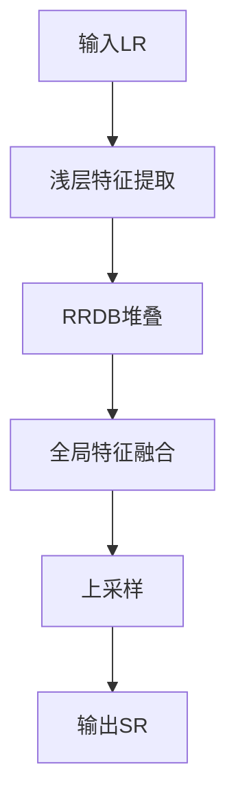
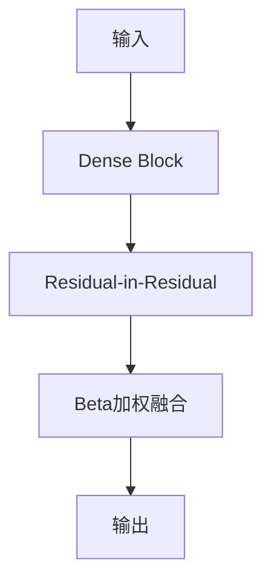
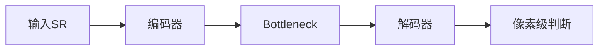
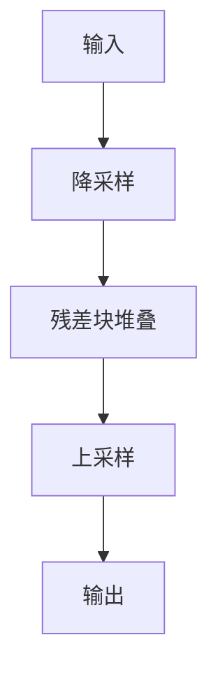
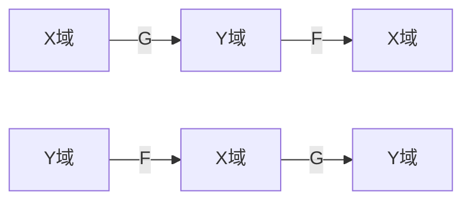
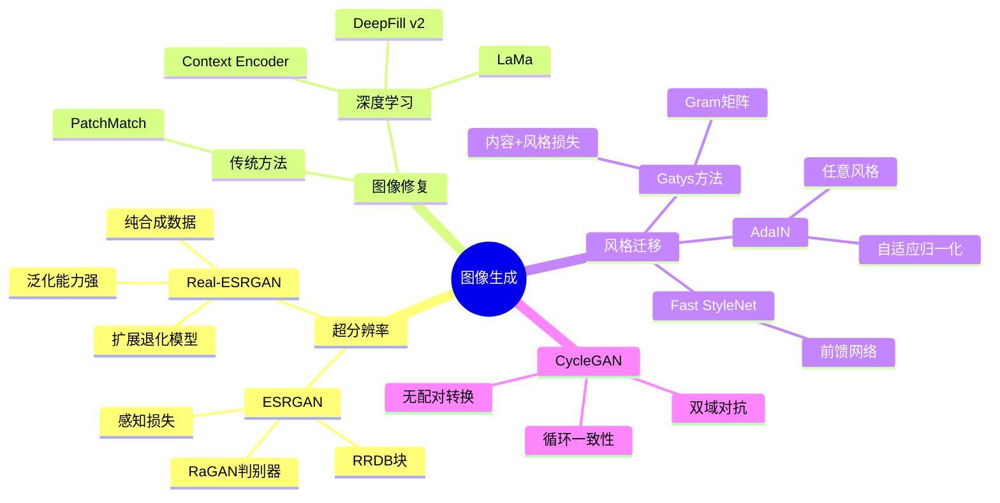

# 第11-3章 图像生成与编辑

## 学习目标

- 理解超分辨率重建的任务定义与评估指标
- 掌握ESRGAN、Real-ESRGAN的网络架构与核心创新
- 了解图像修复（Inpainting）的基本方法
- 理解风格迁移与CycleGAN的原理与应用
- 了解GAN在图像生成领域的发展脉络

---

## 1. 图像超分辨率

### 1.1 任务定义

图像超分辨率（Super Resolution, SR）是将低分辨率图像重建为高分辨率图像的技术。

**应用场景**：
- 老照片修复与增强
- 视频监控图像清晰化
- 医学影像质量提升
- 卫星遥感图像重建

**问题分类**：

| 类型 | 输入 | 输出 | 缩放因子 |
|------|------|------|----------|
| 单图超分(SISR) | 单张LR图像 | SR图像 | 2x, 4x, 8x |
| 多图超分(MISR) | 多张LR序列 | SR图像 | 通常2x |

### 1.2 评估指标

**峰值信噪比（PSNR）**：

$$
PSNR = 10 \cdot \log_{10}\left(\frac{MAX_I^2}{MSE}\right)
$$

其中$MSE$为均方误差，$MAX_I$为像素最大值（通常为255）。

**结构相似性（SSIM）**：

$$
SSIM = \frac{(2\mu_x\mu_y + c_1)(2\sigma_{xy} + c_2)}{(\mu_x^2 + \mu_y^2 + c_1)(\sigma_x^2 + \sigma_y^2 + c_2)}
$$

**LPIPS（Learned Perceptual Image Patch Similarity）**：
- 基于预训练网络提取特征计算感知相似度
- 更符合人类视觉感知

### 1.3 传统方法回顾

**插值方法**：
- 双线性插值（Bilinear）
- 双三次插值（Bicubic）
- Lanczos重采样

**问题**：会产生模糊、锯齿等Artifacts

---

## 2. ESRGAN

### 2.1 ESRGAN概述

ESRGAN（Enhanced SRGAN，2018）是SRGAN的升级版本，在图像质量上有显著提升。

**论文**：ESRGAN: Enhanced Super-Resolution Generative Adversarial Networks（ECCV 2018）

**核心贡献**：
- 引入Residual-in-Residual Dense Block（RRDB）
- 使用RaGAN（Relativistic GAN）
- 网络感知一致性优化

### 2.2 网络架构

**生成器（Generator）**：



**RRDB模块**：



**判别器（Discriminator）**：

使用RaGAN的相对判别器，不仅判断真伪，还比较真实图像比生成图像"更真实"的程度。

### 2.3 感知损失

**内容损失**：基于VGG网络提取特征

$$
L_{content} = \frac{1}{W_{i,j}H_{i,j}} \sum_{x=1}^{W_{i,j}} \sum_{y=1}^{H_{i,j}} (\phi_{i,j}(I^{SR})_{x,y} - \phi_{i,j}(I^{HR})_{x,y})^2
$$

**对抗损失**：

$$
L_G^{Ra} = -\mathbb{E}_{x_r}[\log(1 - D(x_r, x_f))] - \mathbb{E}_{x_f}[\log(D(x_f, x_r))]
$$

### 2.4 训练策略

1. **BN正则化**：训练时使用Batch Normalization，推理时可移除
2. **像素剪切**：避免训练过程中的数值问题
3. **感知锐化**：PSNR导向的预处理

---

## 3. Real-ESRGAN

### 3.1 Real-ESRGAN概述

Real-ESRGAN（2021）是针对真实世界退化的超分模型，解决ESRGAN在真实场景中的泛化问题。

**论文**：Real-ESRGAN: Training Real-World Blind Super-Resolution with Pure Synthetic Data

**核心挑战**：
- 真实图像退化复杂多样
- 无法获取理想配对数据

### 3.2 退化模型

**经典退化流程**：

```
HR → Noise → Blur → Resize → Noise → SR
```

**Real-ESRGAN扩展退化**：

1. **随机降采样**：$\times 2, \times 3, \times 4$混合
2. ** sinc滤波器**：模拟振铃和过冲
3. **模糊增强**：高斯模糊 + 线性模糊
4. **噪声增强**：高斯噪声 + 依赖像素噪声 + 依赖噪声
5. **JPEG压缩**：Quality因子随机

### 3.3 U-Net判别器

使用U-Net结构作为判别器，能输出像素级的真伪判断图，有助于恢复细节。



### 3.4 纯合成数据训练

**关键洞察**：通过精心设计的退化模型，即使只用合成数据训练，也能泛化到真实场景。

**退化模型配置**：
```python
blur_kernel_size = random.choice([7, 9, 11, 13, 15, 17, 19, 21])
blur_sigma = np.random.uniform(0.1, 2.3)
noise_level = np.random.uniform(0, 25)
jpeg_factor = np.random.uniform(60, 95)
```

---

## 4. 图像修复（Inpainting）

### 4.1 任务定义

图像修复（Image Inpainting）是用合理内容填充图像缺失区域的技术。

**应用场景**：
- 移除不需要的物体（水印、路人）
- 修复受损老照片
- 图像编辑（扩展画布）

### 4.2 传统方法

**基于纹理合成**：
- PatchMatch算法
- 从图像已知区域搜索匹配块填充缺失区域

**问题**：对于结构复杂的区域效果较差

### 4.3 深度学习方法

**Context Encoder（2016）**：
- 编码器-解码器架构
- 对抗训练
- 重建损失 + 对抗损失

**DeepFill v2（2018）**：
- 引入上下文注意力机制
- 两阶段粗细重建
- 自由形式修复

**LaMa（2021）**：
- 快速傅里叶卷积
- 感知损失优化
- 高效处理大区域缺失

### 4.4 评估方法

- **像素级指标**：PSNR、SSIM
- **感知指标**：FID、LPIPS
- **人工评估**：AMT（Amazon Mechanical Turk）

---

## 5. 风格迁移

### 5.1 风格迁移概述

风格迁移（Style Transfer）是将一种图像的艺术风格应用到另一图像内容上的技术。

**两类方法**：

| 类型 | 代表方法 | 特点 |
|------|----------|------|
| 慢速（Offline） | Neural Style | 每次迁移需优化 |
| 快速（Online） | Fast StyleNet | 前馈网络一次生成 |

### 5.2 神经风格迁移原理

**Gatys等人方法（2015）**：

核心思想：使用VGG网络分别提取内容和风格的特征表示。

**内容表示**：深层特征激活

$$
L_{content} = \frac{1}{2} \sum_{i,j} (F_{ij}^l - P_{ij}^l)^2
$$

**风格表示**：Gram矩阵

$$
G_{ij}^l = \sum_k F_{ik}^l \cdot F_{jk}^l
$$

$$
L_{style} = \sum_l \frac{1}{4N_l^2 M_l^2} \sum_{i,j} (G_{ij}^l - A_{ij}^l)^2
$$

**总损失**：

$$
L_{total} = \alpha L_{content} + \beta L_{style}
$$

### 5.3 Fast StyleNet

**Johnson等人方法（2016）**：

训练一个前馈网络，直接学习风格变换。



**优势**：
- ✅ 单次前向传播即可完成风格迁移
- ✅ 支持实时风格变换
- ✅ 可学习多种风格

### 5.4 AdaIN与任意风格迁移

**AdaIN（Adaptive Instance Normalization，2017）**：

通过自适应实例归一化，将内容特征的统计量替换为风格特征的统计量。

$$
AdaIN(z, \beta) = \sigma(z) \cdot \frac{z - \mu(z)}{\sigma(z)} + \beta
$$

**优势**：
- 无需预先定义风格网络
- 任意风格图像即时迁移
- 计算效率高

---

## 6. CycleGAN

### 6.1 CycleGAN概述

CycleGAN（2017）实现了无需配对数据的图像到图像转换。

**论文**：Unpaired Image-to-Image Translation using Cycle-Consistent Adversarial Networks

**核心任务**：在两个域之间建立映射，不需要配对训练数据

```
应用场景：
马 → 斑马
苹果 → 橙子
夏季 → 冬季
照片 → 油画
```

### 6.2 对抗损失与循环一致性

**双域对抗训练**：



**对抗损失**：

$$
L_{GAN}(G, D_Y, X, Y) = \mathbb{E}_{y \sim p_{data}(y)}[\log D_Y(y)] + \mathbb{E}_{x \sim p_{data}(x)}[\log(1 - D_Y(G(x)))]
$$

**循环一致性损失**：

$$
L_{cyc}(G, F) = \mathbb{E}_{x \sim p_{data}(x)}[|F(G(x)) - x|_1] + \mathbb{E}_{y \sim p_{data}(y)}[|G(F(y)) - y|_1]
$$

**总损失**：

$$
L = L_{GAN} + \lambda L_{cyc}
$$

### 6.3 身份损失（Identity Loss）

可选的附加损失，确保映射保持颜色属性：

$$
L_{identity}(G, F) = \mathbb{E}_{y \sim p_{data}(y)}[|G(y) - y|_1]
$$

### 6.4 应用示例

**图像转换**：
- 莫奈画作 → 照片风格
- 航拍图 ↔ 地图
- 人脸属性转换

**季节转换**：
- 冬季风景 → 夏季风景
- 白天 → 夜晚

---

## 7. 图像生成技术总结

### 7.1 方法对比

| 技术 | 核心方法 | 输入 | 输出 | 特点 |
|------|----------|------|------|------|
| ESRGAN | GAN+RRDB | LR图像 | SR图像 | 高质量，感知优先 |
| Real-ESRGAN | 扩展退化模型 | 真实LR | 清晰SR | 泛化能力强 |
| 图像修复 | 上下文注意力 | 缺失图像 | 修复图像 | 自由形式 |
| 风格迁移 | Gram矩阵/VGG | 内容+风格 | 合成图 | 艺术效果 |
| CycleGAN | 对抗+循环一致性 | 图像域A | 图像域B | 无配对转换 |

### 7.2 技术演进

```
2014-2015: GAN诞生，风格迁移基础
2016-2017: pix2pix, CycleGAN
2018-2019: ESRGAN, BigGAN
2020-2021: Real-ESRGAN, SwinIR
2022-至今: diffusion model崛起，GAN逐渐被替代
```

---

## 本章小结

1. **图像超分辨率**：ESRGAN通过RRDB块和RaGAN实现高质量感知优先的超分；Real-ESRGAN通过扩展退化模型提升真实场景泛化能力，使用纯合成数据训练即可泛化到真实退化。

2. **图像修复**：从传统PatchMatch到深度学习方法（Context Encoder、DeepFill v2、LaMa），从粗略重建到细粒度上下文感知，深度学习方法在结构复杂区域效果显著提升。

3. **风格迁移**：Gatys等人方法通过Gram矩阵分离风格与内容表示；Fast StyleNet通过前馈网络实现实时风格变换；AdaIN通过自适应实例归一化实现任意风格迁移。

4. **CycleGAN**：通过双域对抗训练和循环一致性损失实现无配对数据的图像到图像转换，解决了风格迁移中配对数据难以获取的问题。

5. **技术演进**：从2014年GAN诞生到风格迁移基础，再到pix2pix、CycleGAN、ESRGAN等发展，2022年后Diffusion Model逐渐崛起成为主流。

---

## 知识点思维导图



---

## 参考资料

1. Ledig C, et al. Photo-Realistic Single Image Super-Resolution Using a Generative Adversarial Network. CVPR, 2017.
2. Wang X, et al. ESRGAN: Enhanced Super-Resolution Generative Adversarial Networks. ECCV, 2018.
3. Wang X, et al. Real-ESRGAN: Training Real-World Blind Super-Resolution with Pure Synthetic Data. ICCV, 2021.
4. Pathak D, et al. Context Encoders: Feature Learning by Inpainting. CVPR, 2016.
5. Yu J, et al. Free-Form Image Inpainting with Gated Convolution. ICCV, 2019.
6. Gatys L A, et al. Image Style Transfer Using Convolutional Neural Networks. CVPR, 2016.
7. Johnson J, et al. Perceptual Losses for Real-Time Style Transfer and Super-Resolution. ECCV, 2016.
8. Huang X, et al. Arbitrary Style Transfer in Real-time with Adaptive Instance Normalization. ICCV, 2017.
9. Zhu J Y, et al. Unpaired Image-to-Image Translation Using Cycle-Consistent Adversarial Networks. ICCV, 2017.