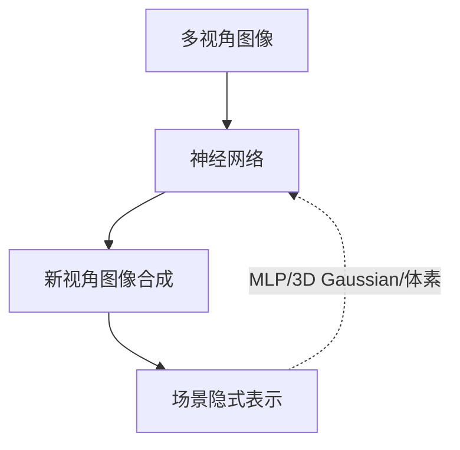
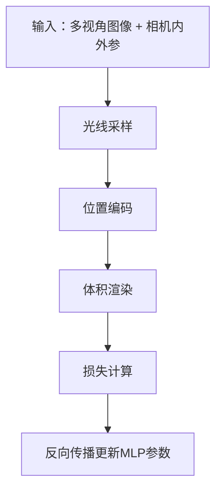
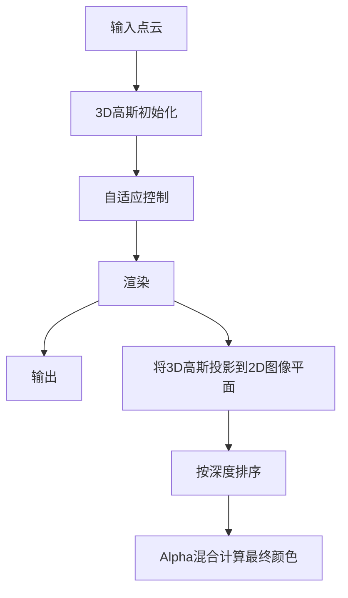
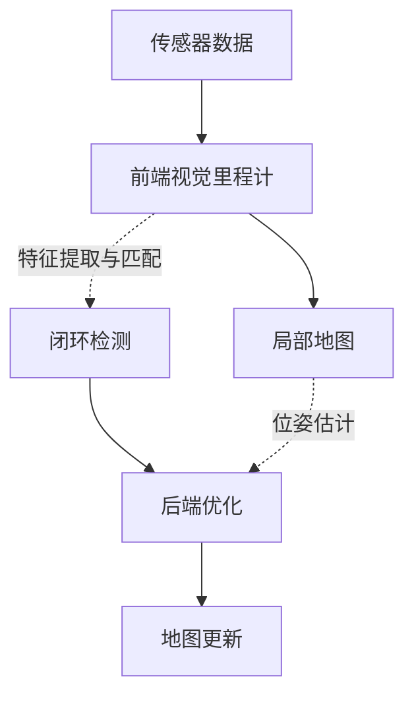
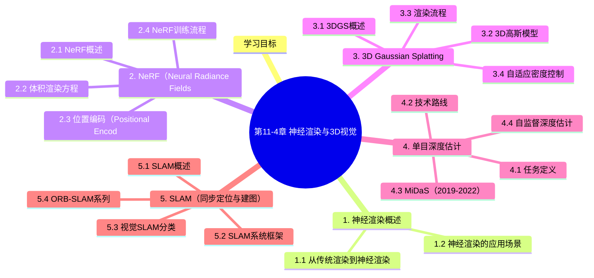

# 第11-4章 神经渲染与3D视觉

## 学习目标

- 理解神经渲染（Neural Rendering）的基本概念与意义
- 掌握NeRF（Neural Radiance Fields）的工作原理与局限性
- 了解3D Gaussian Splatting的核心创新与优势
- 理解单目深度估计的技术路线与应用场景
- 了解SLAM（同步定位与建图）的基本原理

---

## 1. 神经渲染概述

### 1.1 从传统渲染到神经渲染

**传统图形渲染**：
- 基于精确的几何建模与材质定义
- 需要人工设计光照模型
- 计算量大，难以处理复杂真实场景

**神经渲染（Neural Rendering）**：
- 用神经网络隐式或显式地表示场景
- 从图像中学习渲染，无需显式建模
- 能够处理复杂光照与遮挡



### 1.2 神经渲染的应用场景

| 应用 | 说明 |
|------|------|
| 新视角合成 | 从任意角度观察场景 |
| 物体建模 | 从图像创建3D模型 |
| 虚拟现实 | 低成本创建真实感场景 |
| 机器人导航 | 稠密3D地图构建 |
| 电影制作 | 特效与场景重建 |

---

## 2. NeRF（Neural Radiance Fields）

### 2.1 NeRF概述

NeRF（2020）是最具影响力的神经渲染方法，用MLP网络隐式表示三维场景。

**论文**：NeRF: Representing Scenes as Neural Radiance Fields for View Synthesis（ECCV 2020）

**核心思想**：
- 用一个神经网络$f: (\mathbf{x}, \mathbf{d}) \to (\mathbf{c}, \sigma)$表示场景
- $\mathbf{x} = (x, y, z)$：三维位置
- $\mathbf{d} = (\theta, \phi)$：观察方向
- $\mathbf{c} = (r, g, b)$：颜色
- $\sigma$：体积密度

### 2.2 体积渲染方程

**经典体渲染公式**：

$$
C(\mathbf{r}) = \int_{t_n}^{t_f} T(t) \cdot \sigma(\mathbf{r}(t)) \cdot \mathbf{c}(\mathbf{r}(t), \mathbf{d}) dt
$$

其中：
- $T(t) = \exp\left(-\int_{t_n}^{t} \sigma(\mathbf{r}(s)) ds\right)$：透射率
- $C(\mathbf{r})$：沿光线$\mathbf{r}$的累积颜色

**离散近似**：

```python
def render(rays, network_fn):
    # 对每条光线进行体渲染
    for ray in rays:
        t_vals = torch.linspace(0, 1, N_samples)  # 近平面到远平面采样
        # 重要性采样等优化策略...
        rgb, depth, acc = volume_render(ray, t_vals, network_fn)
    return rgb, depth, acc
```

### 2.3 位置编码（Positional Encoding）

**问题**：MLP难以学习高频变化（如纹理、边缘）

**解决方案**：对输入坐标进行高频编码

$$
\gamma(p) = (\sin(2^0 \pi p), \cos(2^0 \pi p), \sin(2^1 \pi p), \cos(2^1 \pi p), \ldots, \sin(2^{L-1} \pi p), \cos(2^{L-1} \pi p))
$$

**L=10时**：
- 3D位置$(x,y,z)$编码后变为$3 \times 2 \times 10 = 60$维
- 视角$(\theta,\phi)$编码后变为$3 \times 2 \times 4 = 24$维

### 2.4 NeRF训练流程



**损失函数**：

$$
L = \sum_{\mathbf{r}} \|\hat{C}(\mathbf{r}) - C(\mathbf{r})\|^2
$$

### 2.5 NeRF的局限性

- ❌ **渲染速度慢**：每像素需多次MLP前向传播
- ❌ **训练时间长**：收敛需数小时
- ❌ **泛化能力差**：每个场景需单独训练
- ❌ **无法处理动态场景**

### 2.6 NeRF改进工作

**Instant NGP（2022）**：
- 使用Multi-level Hash Encoding
- 训练时间从小时级降至秒级
- GPU并行加速

**NeRFstudio项目**：
- 统一的NeRF开发框架
- 集成多种NeRF变体

---

## 3. 3D Gaussian Splatting

### 3.1 3DGS概述

3D Gaussian Splatting（3DGS，2023）是一种高效的场景表示与渲染方法，使用显式的3D高斯分布来表示场景。

**论文**：3D Gaussian Splatting for Real-Time Radiance Field Rendering（SIGGRAPH 2023）

**核心创新**：
- 使用**3D高斯**作为场景基元
- **自适应密度控制**：生长与修剪高斯
- **基于Splatting的渲染**：将3D高斯投影到2D进行渲染

### 3.2 3D高斯模型

**高斯定义**：

每个3D高斯由以下参数定义：
- 位置$\boldsymbol{\mu} = (x, y, z)$
- 协方差矩阵$\boldsymbol{\Sigma}$（可分解为旋转$S$ × 缩放$R$）
- 颜色$\mathbf{c}$（SH系数）
- 透明度$\alpha$

$$
G(\mathbf{x}) = e^{-\frac{1}{2}(\mathbf{x}-\boldsymbol{\mu})^T \boldsymbol{\Sigma}^{-1}(\mathbf{x}-\boldsymbol{\mu})}
$$

### 3.3 渲染流程



**Splatting公式**：

$$
C = \sum_{i} c_i \alpha_i \prod_{j=1}^{i-1}(1 - \alpha_j)
$$

### 3.4 自适应密度控制

**关键步骤**：

1. **克隆（Clone）**：在高梯度区域新增高斯
2. **分裂（Split）**：将大的高斯分裂为多个小的高斯
3. **修剪（Prune）**：删除透明度过低或过小的高斯

### 3.5 与NeRF对比

| 特性 | NeRF | 3D Gaussian Splatting |
|------|------|------------------------|
| 表示形式 | 隐式（MLP） | 显式（高斯分布） |
| 渲染速度 | 慢（逐点查询） | 快（Splatting） |
| 训练时间 | 小时级 | 分钟级 |
| 存储形式 | 网络权重 | 高斯参数 |
| 新视角质量 | 极高 | 高 |
| 内存占用 | 较小 | 较大 |

### 3.6 应用扩展

**Gaussian Splatting SLAM**：
- 用于机器人建图
- 实时稠密重建

**可控生成**：
- 编辑高斯属性（位置、颜色）
- 场景编辑与组合

---

## 4. 单目深度估计

### 4.1 任务定义

单目深度估计（Monocular Depth Estimation）是从单张图像预测稠密深度图的任务。

**应用场景**：
- 自动驾驶感知
- 机器人抓取
- 3D建模
- AR/VR

### 4.2 技术路线

| 方法类型 | 代表模型 | 特点 |
|----------|----------|------|
| 监督学习 | MiDaS, DPT | 需要真实深度标注 |
| 自监督 | Monodepth2 | 无需真实标签 |
| 弱监督 | 深度+语义 | 部分标注 |
| 扩散模型 | Marigold | 基于扩散网络 |

### 4.3 MiDaS（2019-2022）

**论文**：Towards Robust Monocular Depth Estimation（PAMI 2022）

**核心方法**：
- 多数据集联合训练
- 鲁棒性损失函数
- 几何感知微调

**网络结构**：

```
输入图像 → 编码器（DINOv2/ViT）→ 多尺度解码器 → 深度图
```

### 4.4 自监督深度估计

**Monodepth2（2019）**：

核心思想：利用相邻帧间的几何一致性作为监督信号。

**损失项**：
- 外观匹配损失（Photometric）
- 边缘平滑损失（Edge-aware smoothness）
- 自动掩码损失（处理遮挡）

**训练过程**：

$$
L = \sum_{p} \min_{p'} \left| I_t(p) - I_{t'}(p') \right|_1
$$

### 4.5 扩散模型方法

**Marigold（2023）**：

基于Stable Diffusion微调的条件扩散模型。

```python
# 伪代码
depth_image = model(image, noise_timestep)
# 输出归一化深度图
```

**优势**：
- 零样本泛化能力强
- 细节丰富
- 推理速度相对较快

---

## 5. SLAM（同步定位与建图）

### 5.1 SLAM概述

SLAM（Simultaneous Localization and Mapping）是机器人在未知环境中同时进行自身定位与环境建图的核心技术。

**核心问题**：

$$
\text{已知：} \text{传感器数据} \quad \text{求解：} \text{机器人位姿} + \text{环境地图}
$$

### 5.2 SLAM系统框架



**前端（Frontend）**：
- 特征提取与匹配
- 相机位姿估计
- 稠密/半稠密建图

**后端（Backend）**：
- Bundle Adjustment
- 位姿图优化
- 回环检测

### 5.3 视觉SLAM分类

| 类型 | 特点 | 代表方案 |
|------|------|----------|
| 稀疏SLAM | 特征点地图 | ORB-SLAM |
| 半稠密SLAM | 梯度显著区域 | LSD-SLAM |
| 稠密SLAM | 完整深度估计 | DTAM, ElasticFusion |
| 语义SLAM | 融入语义信息 | SemanticFusion |

### 5.4 ORB-SLAM系列

**ORB-SLAM（2015）**：

首个完整的基于ORB特征的RGB-D SLAM系统。

**核心组件**：
- ORB特征提取与描述
- 三线程架构：跟踪、局部建图、回环
- Bag-of-Words位置识别

**ORB-SLAM2（2017）**：
- 支持单目、双目、RGB-D
- 更鲁棒的特征匹配

**ORB-SLAM3（2020）**：
- 视觉惯性里程计（VI-SLAM）
- 地图复用与合并

### 5.5 神经隐式SLAM

**Nerf-SLAM（2022）**：

将NeRF融入SLAM系统，实现稠密建图。

**优势**：
- 隐式表示，无需存储点云
- 可微分渲染端到端优化
- 高质量新视角合成

### 5.6 应用场景

| 领域 | 应用 |
|------|------|
| 自动驾驶 | 高精地图构建、定位 |
| 无人机 | 自主导航、避障 |
| 机器人 | 室内建图、路径规划 |
| AR/VR | 空间感知、虚实融合 |

---

## 6. 神经渲染与3D视觉总结

### 6.1 技术演进

```
传统几何 → 点云融合 → NeRF(2020) → 3DGS(2023) → Neural SLAM
  ↓           ↓           ↓            ↓
MVS/SfM    ElasticFusion  慢速渲染   实时渲染
```

### 6.2 关键突破点

| 技术 | 突破 | 影响 |
|------|------|------|
| NeRF | 隐式场景表示 | 开创神经渲染新范式 |
| Instant NGP | 快速训练 | 实用化关键一步 |
| 3DGS | 实时渲染 | 游戏/VR场景可行 |
| Marigold | 扩散模型 | 零样本深度估计 |

### 6.3 前沿方向

1. **大规模场景**：城市场景、室外环境
2. **动态场景**：人体、物体运动
3. **实时神经渲染**：移动端部署
4. **可编辑3D**：场景编辑与组合
5. **多模态融合**：语言+视觉+3D

---

## 本章小结

1. **神经渲染**：用神经网络隐式或显式表示场景，从图像中学习渲染。传统渲染依赖精确几何建模，神经渲染能处理复杂光照与遮挡，开创了新视角合成、物体建模等新应用。

2. **NeRF原理**：用MLP将三维位置和观察方向映射到颜色和体积密度，通过体积渲染方程累积颜色。位置编码解决MLP难以学习高频变化的问题。但存在渲染速度慢、训练时间长、泛化能力差的局限。

3. **3D Gaussian Splatting**：使用显式3D高斯分布表示场景，通过自适应密度控制（克隆、分裂、修剪）和Splatting渲染实现实时、高质量的场景表示，训练时间从小时级降至分钟级。

4. **单目深度估计**：MiDaS通过多数据集联合训练实现鲁棒深度估计；Monodepth2利用相邻帧几何一致性作为自监督信号；Marigold基于扩散模型实现零样本泛化。

5. **SLAM技术**：同步定位与建图，包括前端视觉里程计、后端优化、回环检测。ORB-SLAM系列是经典方案，Nerf-SLAM将NeRF融入SLAM实现隐式稠密建图。

---


## 知识图谱



## 参考资料

1. Mildenhall B, et al. NeRF: Representing Scenes as Neural Radiance Fields for View Synthesis. ECCV, 2020.
2. Kerbl B, et al. 3D Gaussian Splatting for Real-Time Radiance Field Rendering. SIGGRAPH, 2023.
3. Ranftl R, et al. Towards Robust Monocular Depth Estimation: Mixing Datasets for Zero-shot Cross-dataset Transfer. TPAMI, 2022.
4. Godard C, et al. Digging Into Self-Supervised Monocular Depth Estimation. ICCV, 2019.
5. Keisare K, et al. Marigold: Denoising Diffusion Models for Zero-Shot Natural Image to Image Translation. arXiv, 2023.
6. Mur-Artal R, Tardós J D. ORB-SLAM: A Versatile and Accurate Monocular SLAM System. TRO, 2015.
7. Mur-Artal R, Tardós J D. ORB-SLAM2: An Open-Source SLAM System for Monocular, Stereo and RGB-D Cameras. TRO, 2017.
8. Campos C, et al. ORB-SLAM3: An Accurate Open-Source SLAM System for Robust Visual Inertial Localization. PIEEE, 2021.
9. Sucar E, et al. iMAP: Implicit Mapping and Positioning in Real-Time. ICCV, 2021.