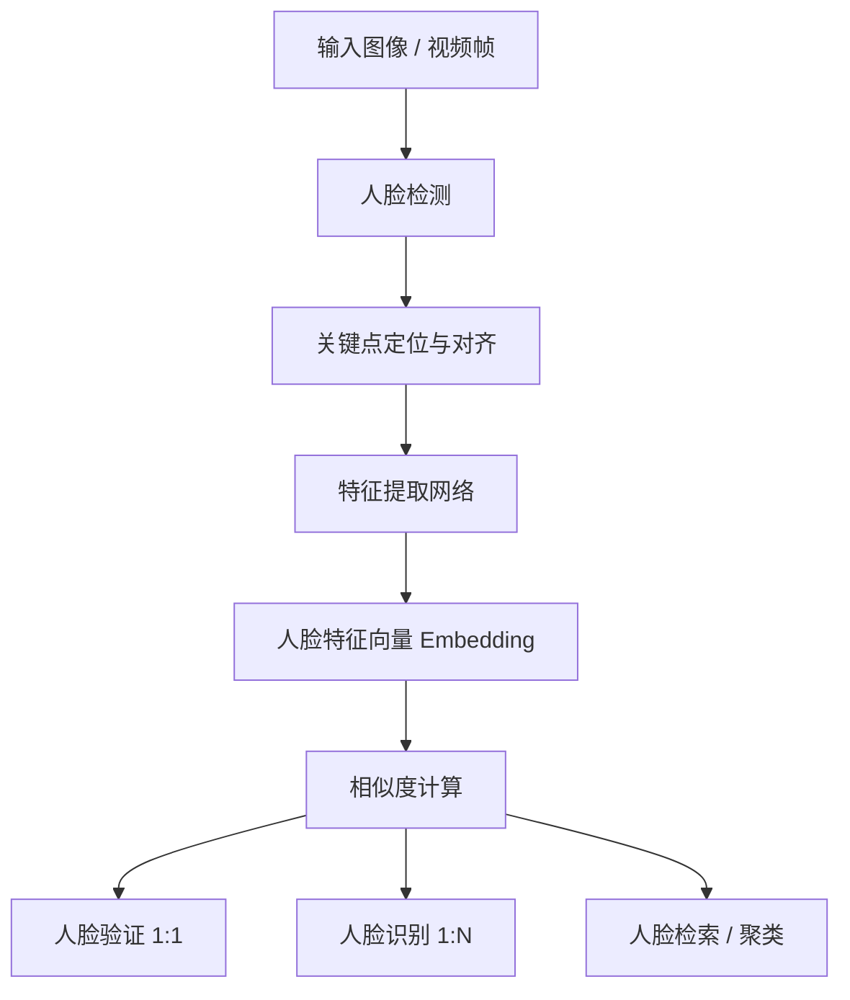
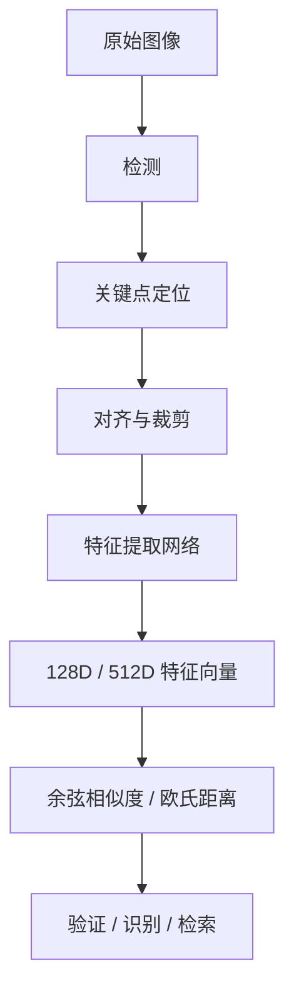
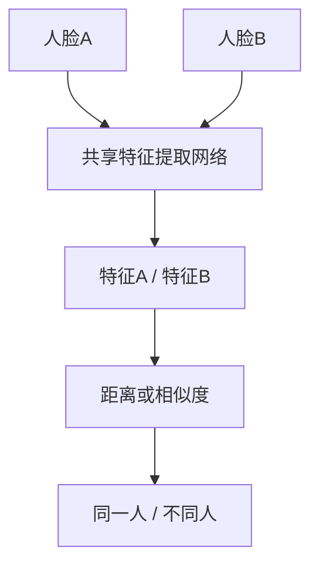
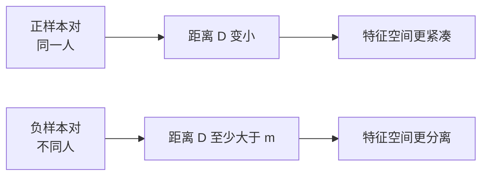
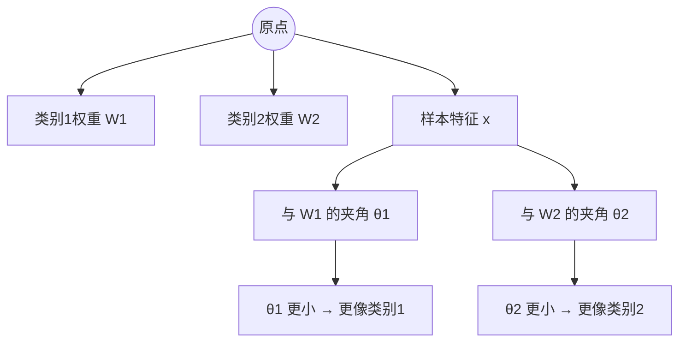
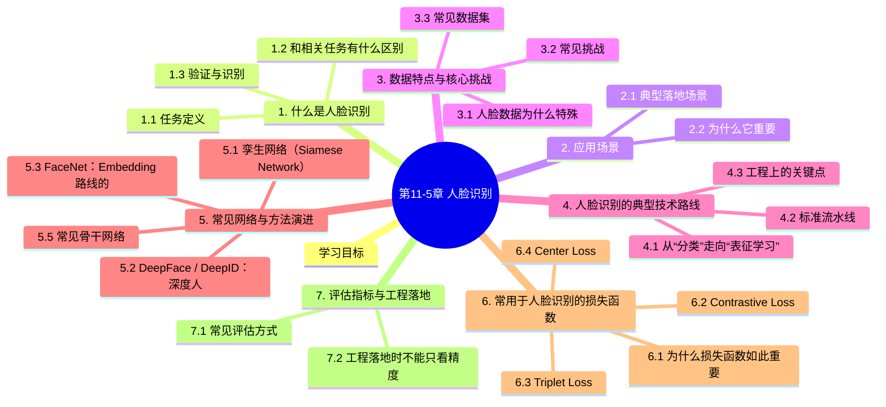

# 第11-5章 人脸识别

## 学习目标

- 理解人脸识别与人脸检测、关键点定位、人脸验证、人脸检索之间的区别
- 掌握现代人脸识别系统的典型流水线：检测、对齐、表征学习、相似度匹配
- 了解人脸数据的典型特点与难点，包括类间相似、类内变化、长尾分布与安全风险
- 熟悉人脸识别常见网络结构与方法演进主线
- 掌握常用于人脸识别的典型损失函数及其设计动机

---

## 1. 什么是人脸识别

### 1.1 任务定义

人脸识别（Face Recognition, FR）是根据人脸图像判断“这是谁”的技术。它的核心不是简单检测出一张脸，而是从人脸中提取具有区分性的身份特征，并据此进行比对、验证或检索。

一个完整的人脸识别系统通常不是单一模型，而是一条处理链路：

1. **人脸检测**：先在图像或视频中找到人脸位置
2. **关键点定位 / 对齐**：估计眼角、鼻尖、嘴角等关键点，把人脸规范化
3. **特征提取**：用神经网络把人脸映射成低维特征向量（embedding）
4. **相似度匹配**：计算两张脸或一张脸与图库之间的相似度
5. **决策输出**：完成验证、识别、检索或聚类



### 1.2 和相关任务有什么区别

| 任务 | 输入 | 输出 | 关注点 |
|------|------|------|--------|
| 人脸检测 | 图像 | 人脸框 | 有没有脸、脸在哪里 |
| 关键点定位 | 人脸图像 | 五点/六十八点等坐标 | 眼鼻口等结构位置 |
| 人脸验证 | 两张人脸 | 是否为同一人 | 1:1 匹配 |
| 人脸识别 | 一张脸 + 身份库 | 属于谁 / 是否在库中 | 1:N 分类或检索 |
| 人脸检索 | 一张脸 + 大图库 | 最相似的若干人脸 | 排序与召回 |

很多场景中，“人脸识别”被口语化地泛指整条链路，但严格来说，检测、对齐、表征和匹配是不同子任务。

### 1.3 验证与识别

**人脸验证（Face Verification）** 是判断两张人脸是否属于同一个人，属于 **1:1** 问题。

**人脸识别 / 鉴别（Face Identification）** 是把一张查询人脸与身份库比较，判断其属于哪个身份，属于 **1:N** 问题。

验证更像“刷脸解锁手机”，识别更像“在监控画面中判断这个人是谁”。

---

## 2. 应用场景

### 2.1 典型落地场景

- **消费电子**：手机解锁、电脑登录、相册人物分类
- **支付与门禁**：刷脸支付、园区门禁、考勤签到
- **安防监控**：重点人员布控、出入口稽核、跨镜追踪
- **互联网平台**：真人认证、账号安全、内容审核中的人物归档
- **影像与娱乐**：照片整理、美颜、换脸、AR 特效
- **金融与政务**：远程开户、实名认证、证件核验

### 2.2 为什么它重要

人脸是最自然的生物特征之一，不需要用户额外记忆口令，也不需要主动携带卡片或设备。因此它在“便捷身份认证”上优势明显。

但正因为它高度敏感、可被远距离采集，也带来了隐私、误识别、偏见和安全风险，因此人脸识别从来不是“只有精度”的任务。

---

## 3. 数据特点与核心挑战

### 3.1 人脸数据为什么特殊

与通用图像分类相比，人脸识别数据具有几个典型特征：

1. **类间差异小**：不同人的脸往往长得很像
2. **类内差异大**：同一个人会受姿态、表情、年龄、光照、遮挡影响
3. **每类样本不均衡**：有些身份有大量照片，有些只有极少样本
4. **身份数极多**：工程场景常常面对数万到数百万身份
5. **隐私敏感度高**：采集、存储、训练和部署都受合规约束

### 3.2 常见挑战

- **姿态变化**：正脸、侧脸、俯仰角变化会改变外观
- **光照变化**：逆光、弱光、彩光会严重影响纹理
- **遮挡问题**：口罩、眼镜、帽子、头发遮挡关键区域
- **表情变化**：微笑、张嘴、闭眼会改变局部结构
- **年龄变化**：儿童到成人、长期时间跨度会导致显著变化
- **成像差异**：监控、手机、证件照、红外图像属于不同域
- **活体攻击**：照片翻拍、视频回放、3D 面具会欺骗系统
- **数据偏差**：不同性别、肤色、年龄段上的分布不均可能引发偏见

### 3.3 常见数据集

| 数据集 | 用途 / 特点 |
|------|-------------|
| LFW | 早期经典验证基准，适合入门理解 |
| CASIA-WebFace | 常用训练集，推动早期深度人脸识别发展 |
| VGGFace / VGGFace2 | 身份多、姿态和年龄变化丰富 |
| MS-Celeb-1M / MS1M | 大规模身份训练数据，工业研究中常见 |
| MegaFace | 强调大规模干扰身份下的识别能力 |
| CFP / AgeDB | 更关注跨姿态、跨年龄挑战 |

这些数据集的共同点是：**身份数多、分布长尾、同人多样、异人相似**。这正是人脸识别比普通分类更难的根源。

---

## 4. 人脸识别的典型技术路线

### 4.1 从“分类”走向“表征学习”

如果把每个人都当成一个类别，那么人脸识别似乎可以直接做成普通多分类问题。但在真实世界中，身份数量巨大且不断变化，测试时还会出现训练中从未见过的人。因此，人脸识别的核心逐渐转向：

> 学习一个特征空间，让同一个人的特征更接近，不同人的特征更远离。

也就是说，模型最终学到的不是“固定类别标签”，而是**可比较、可泛化的人脸 embedding**。

### 4.2 标准流水线

1. **检测**：找到人脸框
2. **对齐**：根据关键点做仿射变换，把脸对齐到统一模板
3. **裁剪与归一化**：统一尺寸、通道、亮度等预处理
4. **特征提取**：通过 CNN 或其变体输出固定维度 embedding
5. **相似度计算**：常见为余弦相似度或欧氏距离
6. **阈值 / 检索决策**：完成验证、识别、检索



### 4.3 工程上的关键点

- 训练与推理阶段的**预处理必须一致**
- 对齐质量会显著影响后续特征稳定性
- 大规模识别场景不能只看分类精度，还要关注**检索速度、存储成本、阈值设置**
- 真正落地时往往要加上 **活体检测（anti-spoofing）** 和 **质量评估**

---

## 5. 常见网络与方法演进

### 5.1 孪生网络（Siamese Network）

Siamese Network 是人脸验证中非常经典的思路。它用两个共享参数的分支分别处理两张人脸，然后比较特征距离。

它的意义在于：
- 不再强依赖固定类别分类
- 直接学习“相似 / 不相似”关系
- 为后来的度量学习路线奠定了基础



### 5.2 DeepFace / DeepID：深度人脸识别的早期代表

- **DeepFace**：强调 3D 对齐与深层网络结合，是深度学习在人脸识别上的里程碑之一
- **DeepID / DeepID2**：通过深层特征学习和监督信号提升人脸区分能力

这些方法说明：**更好的对齐 + 更强的深层特征**，能够显著提升人脸识别效果。

### 5.3 FaceNet：Embedding 路线的代表

FaceNet 的核心思想非常清晰：直接学习一个 embedding 空间，使得

- 同一个人的人脸距离更小
- 不同人的人脸距离更大

它常输出 **128 维特征向量**，并使用 Triplet Loss 进行训练，是现代人脸识别“表征学习路线”的代表工作。

### 5.4 基于分类边界优化的方法：SphereFace / CosFace / ArcFace

随着研究深入，很多工作发现：仅靠传统 softmax 或简单距离约束还不够。于是出现了一系列**基于角度间隔（margin）的损失设计**，本质上是在特征空间里把不同身份分得更开。

- **SphereFace / A-Softmax**：引入角度 margin
- **CosFace / AM-Softmax**：在 cosine 决策边界上加入 margin
- **ArcFace / AAM-Softmax**：在角度空间直接加入加性角度 margin，解释性强、效果稳定

这条路线已经成为现代高性能人脸识别的主流之一。

### 5.5 常见骨干网络

在人脸识别中，很多网络并不是“专门为人脸设计”的，但经过改造后被广泛采用：

| 网络 / 框架 | 特点 |
|------------|------|
| AlexNet / VGG | 早期深度特征提取 backbone |
| ResNet | 结构稳定，工业与研究中很常见 |
| Inception | FaceNet 等工作中曾广泛使用 |
| MobileFaceNet | 面向移动端、轻量化部署 |
| InsightFace | 更准确地说是一个体系 / 框架，常与 ArcFace 等损失结合 |

因此，人脸识别的进步并不只来自“网络更大”，还来自：

- 更好的数据清洗
- 更合适的对齐与预处理
- 更有效的损失函数
- 更符合任务特点的训练策略

---

## 6. 常用于人脸识别的损失函数

### 6.1 为什么损失函数如此重要

人脸识别的难点之一在于：

- 不同身份之间往往只差细微特征
- 同一身份内部变化却很大

因此，损失函数不仅要让模型“分对类别”，还要让特征空间有良好的几何结构。近些年人脸识别的大量突破，都和损失函数设计密切相关。

### 6.2 Contrastive Loss

Contrastive Loss 常用于孪生网络。它要求：

- 正样本对距离尽量小
- 负样本对距离至少大于某个 margin

适合做验证任务，但训练效果依赖样本对构造策略。

其常见形式可以写成：

$$
L = y \cdot D^2 + (1-y) \cdot \max(0, m-D)^2
$$

其中：

- $y \in \{0,1\}$ 表示是否为同一身份
- $D = \|f(x_i)-f(x_j)\|_2$ 表示两张脸的特征距离
- $m$ 是人为设定的负样本间隔（margin）

直观理解是：

- 若两张脸属于同一人，就把距离往 0 拉
- 若两张脸不属于同一人，就要求它们至少相隔 $m$



### 6.3 Triplet Loss

Triplet Loss 使用三元组：

- Anchor（锚点）
- Positive（同一人）
- Negative（不同人）

目标是让：

$$
d(a, p) + \alpha < d(a, n)
$$

其中 $\alpha$ 是 margin。

它直接优化 embedding 空间，非常符合人脸识别的目标，但难点在于**triplet mining**：三元组采样不好，训练效率会很低。

更常见的损失写法是：

$$
L = \max\big(0, d(a,p)-d(a,n)+\alpha\big)
$$

其中：

- $a$ 是 Anchor
- $p$ 是 Positive
- $n$ 是 Negative
- $d(\cdot, \cdot)$ 通常表示欧氏距离或余弦距离

只有当负样本还不够远时，损失才会大于 0，这也是 Triplet Loss 特别依赖“难样本挖掘”的原因。

```mermaid
flowchart TD
    A[Anchor] --> B[和 Positive 距离尽量小]
    A --> C[和 Negative 距离尽量大]
    B --> D[要求 d(a,p) + α < d(a,n)]
    C --> D
```

### 6.4 Center Loss

Center Loss 的思想是：

- 每个类别维护一个特征中心
- 让样本尽量靠近本类中心

它通常和 softmax 一起使用，用于减少类内方差。虽然它不是专门为人脸识别提出的终极方案，但在人脸任务中被广泛使用过。

其损失形式通常写成：

$$
L_c = \frac{1}{2}\sum_{i=1}^{N} \|x_i - c_{y_i}\|_2^2
$$

其中：

- $x_i$ 是第 $i$ 个样本的特征
- $c_{y_i}$ 是该样本所属类别的中心向量

它的作用不是直接拉开类间边界，而是让同一类样本围绕各自类别中心收拢，因此常与 softmax 联合使用：

$$
L = L_{softmax} + \lambda L_c
$$

这里 $\lambda$ 用于平衡分类损失与类内紧凑约束。


### 6.5 Softmax 及其变体

传统 Softmax 更偏向“分类正确”，但对特征间隔的约束不够强。因此很多改进版被大量用于人脸识别。

#### （1）NormFace

通过特征与权重归一化，把分类边界解释到角度空间中，为后续 margin-based loss 铺路。

核心思想是对特征和分类权重做 $L_2$ 归一化：

$$
\|x\| = 1, \quad \|W_j\| = 1
$$

于是分类得分可写成：

$$
W_j^T x = \cos\theta_j
$$

这说明分类不再主要由向量长度决定，而更多由**角度**决定。这样就把人脸识别中的“类间分离”问题转移到了超球面上的角度几何中。

#### （2）A-Softmax / SphereFace

在角度空间引入乘性 margin，推动不同身份之间形成更大间隔。

其代表性形式可以写成：

$$
\psi(\theta_{y_i}) = \cos(m\theta_{y_i})
$$

再把它代入 softmax 的目标类别 logit 中。这里的 $m$ 是乘性角度 margin。

它的直觉是：

- 原本只要角度小即可分类正确
- 现在要求角度更小，才能跨过更严格的决策边界

因此同类样本会被迫聚得更紧，不同类之间的角度间隔会被拉大。

#### （3）AM-Softmax / CosFace

在 cosine 空间加入加性 margin，训练相对稳定，判别性更强。

其常见形式为：

$$
L = -\frac{1}{N}\sum_i \log
\frac{e^{s(\cos\theta_{y_i}-m)}}{e^{s(\cos\theta_{y_i}-m)} + \sum_{j \ne y_i} e^{s\cos\theta_j}}
$$

其中：

- $m$ 是加性 cosine margin
- $s$ 是缩放因子（scale），用于让归一化后的 logits 保持足够梯度

CosFace 的特点是：直接在 $\cos\theta$ 上减去一个 margin，使正确类别需要更大的相似度才能被判对。

#### （4）AAM-Softmax / ArcFace

ArcFace 把 margin 直接加入角度上：

$$
\cos(\theta + m)
$$

它的几何含义清晰，工程效果稳定，已经成为现代人脸识别最常见的损失之一。

更完整地写，ArcFace 的目标形式通常是：

$$
L = -\frac{1}{N}\sum_i \log
\frac{e^{s\cos(\theta_{y_i}+m)}}{e^{s\cos(\theta_{y_i}+m)} + \sum_{j \ne y_i} e^{s\cos\theta_j}}
$$

其中：

- $m$ 是加性角度 margin
- $s$ 是缩放因子

和 CosFace 相比，ArcFace 不是在 cosine 值上平移，而是在**角度空间**直接增加一个间隔，因此几何解释更自然。

### 6.6 参数空间 / 特征空间可视化理解

在人脸识别里，很多损失函数最终都可以理解为：

1. 把特征映射到单位超球面上
2. 让每个类别对应一个参数向量（分类权重）
3. 用样本特征与类别权重之间的夹角 $\theta$ 来定义分类边界

可以把分类权重 $W_1, W_2$ 理解成两个“类别中心方向”，把样本特征 $x$ 理解成落在超球面上的一个点。



若不加 margin，模型只需让正确类别角度比错误类别略小即可；而加了 margin 后，决策条件会被进一步收紧。

#### （1）普通 Softmax 的角度边界

普通归一化 softmax 的决策边界可以近似理解为：

$$
\cos\theta_1 = \cos\theta_2
$$

也就是两个类别谁的夹角更小，样本就更偏向谁。

#### （2）CosFace 的边界变化

CosFace 把正确类别变成：

$$
\cos\theta_{y} - m
$$

于是分类条件变成：

$$
\cos\theta_y - m > \cos\theta_j
$$

含义是：

- 仅仅“比别的类更近一点”已经不够
- 必须额外留出一个 margin，才算分对

#### （3）ArcFace 的边界变化

ArcFace 把正确类别变成：

$$
\cos(\theta_y + m)
$$

于是分类条件变成：

$$
\cos(\theta_y + m) > \cos\theta_j
$$

直观上，就是把正确类别允许的角度区域缩小了。样本若想被判成正确类别，就必须更靠近该类别中心方向。

```mermaid
flowchart TD
    A[普通 Softmax<br/>只要求 θy 更小] --> B[分类边界较宽]
    C[CosFace<br/>要求 cosθy - m 更大] --> D[相似度边界更严格]
    E[ArcFace<br/>要求 cos(θy + m) 更大] --> F[角度边界更严格]
    B --> G[类间分离一般]
    D --> H[类间更分离]
    F --> H
```

#### （4）从二维示意理解类内与类间变化

如果我们把高维特征空间简化成二维示意图，那么：

- **Contrastive / Triplet** 更像直接操作样本点之间的距离
- **Center Loss** 更像把每一类的点往类中心收缩
- **CosFace / ArcFace** 更像改变类别方向之间的判别边界

### 6.7 怎么理解这些损失函数

可以把它们大致分成两类：

| 类别 | 代表 | 核心思路 |
|------|------|----------|
| 度量学习类 | Contrastive、Triplet | 直接约束样本间距离 |
| 分类边界增强类 | Center Loss、SphereFace、CosFace、ArcFace | 通过更强判别边界优化特征空间 |

需要特别注意的是：

> 很多损失函数并不是专门为“人脸识别”这个单一任务发明的，但由于它们特别适合“类内紧凑、类间分离”的需求，所以在人脸识别中被频繁采用。

---

## 7. 评估指标与工程落地

### 7.1 常见评估方式

- **验证准确率**：如 LFW 上常见的 pair 验证准确率
- **ROC / TAR / FAR**：在不同误报率下观察通过率
- **识别率 / Rank-k**：检索或身份识别场景中常见
- **大规模检索性能**：身份库很大时，要同时看召回率与检索效率

### 7.2 工程落地时不能只看精度

一个真正可用的人脸识别系统，通常还要考虑：

- **阈值怎么设**：太松会误识别，太严会误拒绝
- **实时性**：摄像头与移动端要求低延迟
- **模型大小**：边缘设备需要轻量化网络
- **隐私与合规**：数据采集、存储、授权要符合规范
- **安全性**：要配合活体检测、防攻击机制
- **公平性**：不同群体上的性能差异要被监控

因此，人脸识别是一个“算法 + 数据 + 系统 + 合规”共同决定效果的任务。

---

## 本章小结
1. **人脸识别不是单一步骤**，而是由检测、对齐、表征学习和匹配决策组成的完整流水线。

2. **人脸数据具有类间差异小、类内变化大、身份多且长尾明显的特点**，这使它比普通图像分类更难。

3. **人脸识别的主线演进** 可以概括为：从孪生网络与度量学习，到 FaceNet 的 embedding 路线，再到 SphereFace、CosFace、ArcFace 等 margin-based 分类边界优化方法。

4. **损失函数在人脸识别中极其关键**。很多损失函数虽然不是专门为人脸识别提出，但由于能更好地塑造特征空间，因此被广泛采用。

5. **真实落地场景不能只关注精度**，还要同时考虑活体安全、实时性、隐私合规和群体公平性。


## 知识图谱



## 参考资料

1. Taigman, Y., et al. DeepFace: Closing the Gap to Human-Level Performance in Face Verification. CVPR, 2014.
2. Schroff, F., Kalenichenko, D., Philbin, J. FaceNet: A Unified Embedding for Face Recognition and Clustering. CVPR, 2015.
3. Wen, Y., et al. A Discriminative Feature Learning Approach for Deep Face Recognition. ECCV, 2016. （Center Loss）
4. Liu, W., et al. SphereFace: Deep Hypersphere Embedding for Face Recognition. CVPR, 2017.
5. Wang, H., et al. CosFace: Large Margin Cosine Loss for Deep Face Recognition. CVPR, 2018.
6. Deng, J., et al. ArcFace: Additive Angular Margin Loss for Deep Face Recognition. CVPR, 2019.
7. Wang, M., Deng, W. Deep Face Recognition: A Survey. Neurocomputing, 2021.
8. Li, S., Deng, W. A Survey of Face Recognition. arXiv:2212.13038, 2022.
