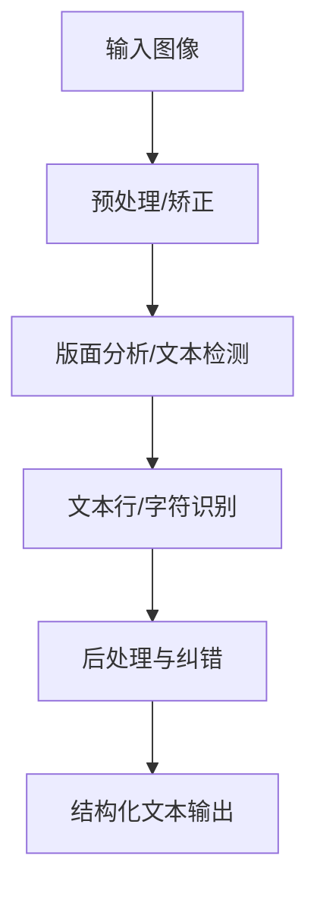
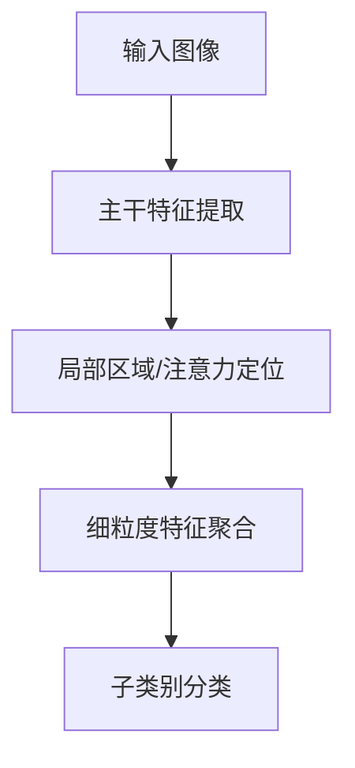
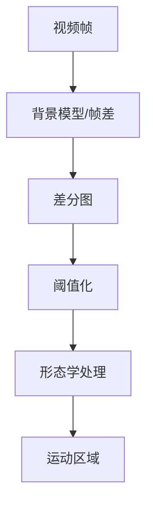
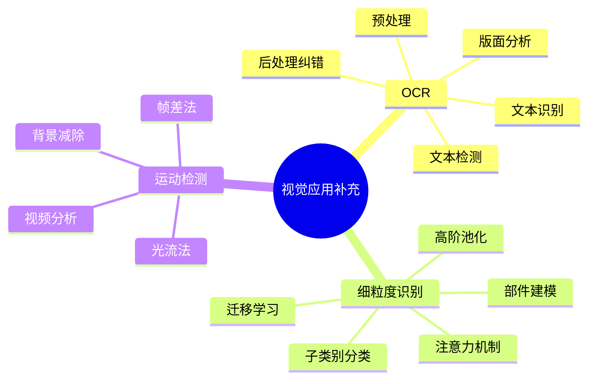

# 第11-5章 视觉应用补充阅读

## 学习目标

- 理解 OCR 的完整处理流水线与典型技术路线
- 掌握细粒度识别的任务特点、难点与常见建模思路
- 了解运动检测在固定摄像机场景下的经典方法与局限
- 能区分这三类视觉应用与目标检测、分割、生成之间的边界

---

## 1. OCR（光学字符识别）

### 1.1 任务定义

OCR（Optical Character Recognition）是把图像中的文字转换为可编辑、可检索文本的技术。它不仅是“识别字符”，通常还包括整条处理链路。

**常见输入**：
- 扫描文档
- 手机拍照的票据、证件、书页
- 场景文字（招牌、路牌、包装）
- 手写文字

### 1.2 为什么 OCR 不只是识别

一个实用 OCR 系统往往包含：

1. **图像预处理**：去噪、增强对比度、倾斜校正
2. **方向校正**：判断文本朝向，必要时旋转
3. **版面分析**：定位段落、表格、标题、文本块
4. **文本检测**：找出文字区域
5. **文本识别**：把字符序列转成文本
6. **后处理**：词典纠错、格式修复、语言模型校正

### 1.3 为什么难

- **版式复杂**：文档、表格、票据、海报混在一起
- **字体多样**：印刷体、手写体、艺术字、倾斜字
- **退化明显**：模糊、反光、压缩噪声、遮挡
- **场景变化大**：自然背景中的文本容易和环境混淆

### 1.4 常见方法家族

| 方法 | 特点 |
|------|------|
| 模板匹配 | 早期方案，简单但泛化弱 |
| 传统特征 + 分类器 | 依赖字符分割与手工特征 |
| OCR 引擎/API | 集成检测、识别、语言模型 |
| 深度学习 OCR | 检测 + 序列识别，当前主流 |

**深度学习 OCR 常见思路**：
- 检测端：找文本框或文本行
- 识别端：把图像特征映射到字符序列
- 常见骨干：CNN、Transformer、CTC/Attention 解码

### 1.5 典型应用

- 票据/发票自动录入
- 证件识别与信息抽取
- 车牌识别
- 文档电子化与检索
- 场景文字翻译

---

## 2. 细粒度识别

### 2.1 任务定义

细粒度识别（Fine-Grained Recognition）是区分**外观非常相似**的子类别，例如：

- 鸟类不同品种
- 狗的不同犬种
- 汽车型号
- 工业零件的具体规格

它本质上是“高难度分类”：类别间差异很小，但类内差异却可能很大。

### 2.2 为什么难

- **类间差异小**：只差局部纹理、颜色块、形状细节
- **类内差异大**：姿态、视角、光照变化明显
- **背景干扰强**：主体只占图像一小部分
- **标注成本高**：需要专家知识才能区分类别

### 2.3 常见建模思路

| 方法族 | 思路 |
|------|------|
| 局部/部件建模 | 先找关键部位，再做分类 |
| 注意力机制 | 自动关注最有区分度的区域 |
| 高阶池化 | 聚合细微纹理与通道交互信息 |
| 迁移学习 | 借助大模型特征，再做小样本微调 |

### 2.4 典型应用

- 动植物物种识别
- 商品型号识别
- 工业质检中的零件分类
- 车辆品牌/款式识别
- 文物与标本识别

---

## 3. 运动检测

### 3.1 任务定义

运动检测（Motion Detection）是判断视频或连续图像中是否存在运动目标，并定位变化区域。

它通常是视频分析的第一步，常用于：
- 监控告警
- 交通流量分析
- 实验视频分析
- 机器人感知

### 3.2 经典前提与基本方法

经典运动检测通常默认：
- **摄像机基本固定**
- **背景相对稳定**
- 前景目标是“变化源”

最常见的两类起点是：

1. **帧差法**：比较相邻帧或隔帧像素差
2. **背景建模/背景减除**：建立静态或缓慢更新的背景模型，再找偏离部分

### 3.3 为什么难

- **动态背景**：树叶、水面、屏幕闪烁
- **光照变化**：阴影、曝光、昼夜切换
- **摄像机运动**：手持拍摄、抖动、自动跟随
- **细微目标**：小目标或慢速运动容易被漏检
- **特殊场景**：显微镜、医疗视频中背景并不“静止”

### 3.4 常见方法家族

| 方法 | 说明 |
|------|------|
| 帧差法 | 简单快速，适合变化明显场景 |
| 背景减除 | 适合固定摄像机，工程常用 |
| 光流法 | 根据像素运动向量检测运动 |
| 深度学习视频理解 | 学习时空特征，适合复杂场景 |

### 3.5 典型应用

- 安防监控报警
- 交通车辆/行人检测的前处理
- 体育视频分析
- 显微镜下细胞/颗粒运动分析
- 机器视觉中的流水线异常检测

---

## 4. 三类视觉应用对比

| 任务 | 输入 | 输出 | 核心难点 |
|------|------|------|----------|
| OCR | 图像/文档/场景 | 文字序列 | 检测、识别、版面与纠错 |
| 细粒度识别 | 图像 | 子类别标签 | 类间极近、局部差异细微 |
| 运动检测 | 视频/帧序列 | 运动区域/变化事件 | 背景稳定性与时序变化 |

---

## 本章小结

1. **OCR** 不是单纯识字，而是包含预处理、版面分析、检测、识别和后处理的完整流水线，适用于文档、票据、场景文字等任务。

2. **细粒度识别** 关注外观非常相似的子类别，常通过部件建模、注意力机制、高阶池化和迁移学习来提升区分能力。

3. **运动检测** 多从固定摄像机和稳定背景出发，经典方法包括帧差法和背景减除，但在动态背景、摄像机运动和特殊成像场景下容易失效。

4. 这三类任务都属于重要的视觉应用补充，和目标检测、分割、生成形成互补。

---

## 知识点思维导图

---

## 参考资料

1. Smith, R. An Overview of the Tesseract OCR Engine. ICDAR, 2007.
2. Shi, B., et al. An End-to-End Trainable Neural Network for Image-Based Sequence Recognition and Its Application to Scene Text Recognition. TPAMI, 2017.
3. Lin, T.-Y., et al. Bilinear CNN Models for Fine-grained Visual Recognition. ICCV, 2015.
4. Stauffer, C., Grimson, W. E. L. Adaptive Background Mixture Models for Real-Time Tracking. CVPR, 1999.
5. Zivkovic, Z. Improved Adaptive Gaussian Mixture Model for Background Subtraction. ICPR, 2004.
