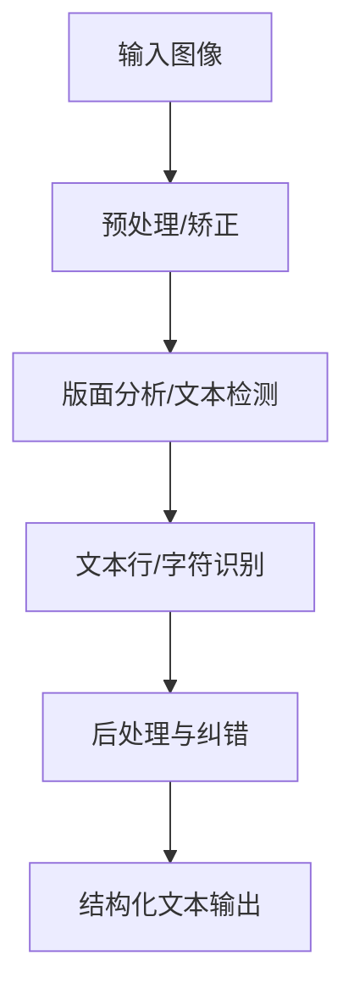
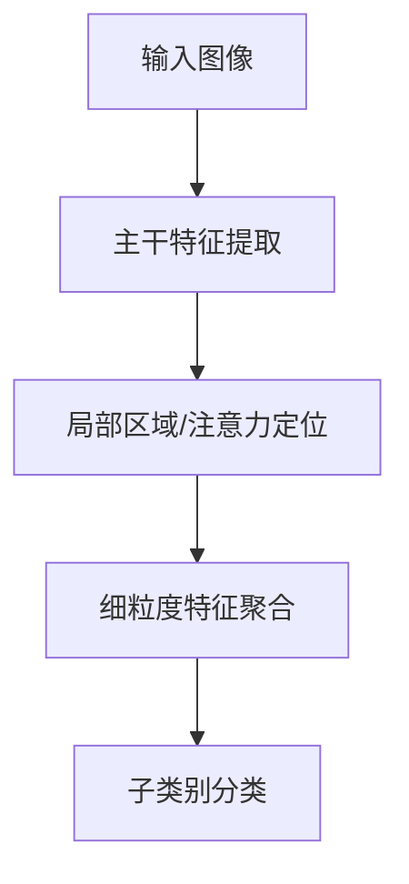
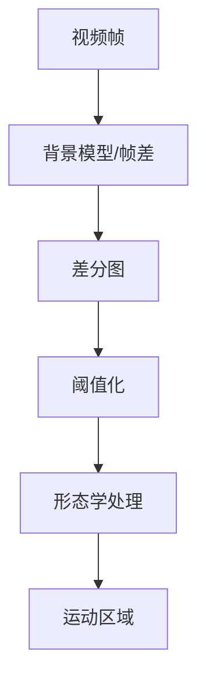
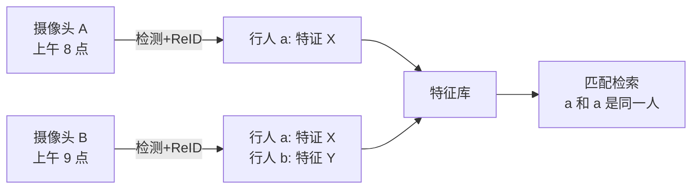
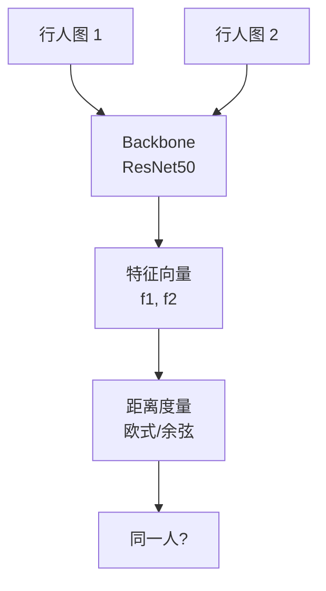
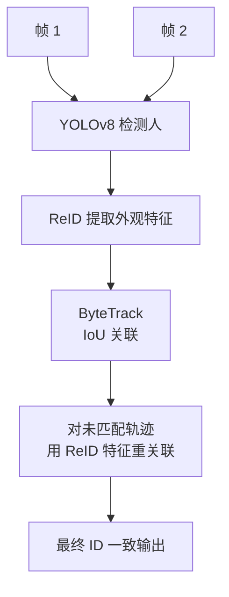
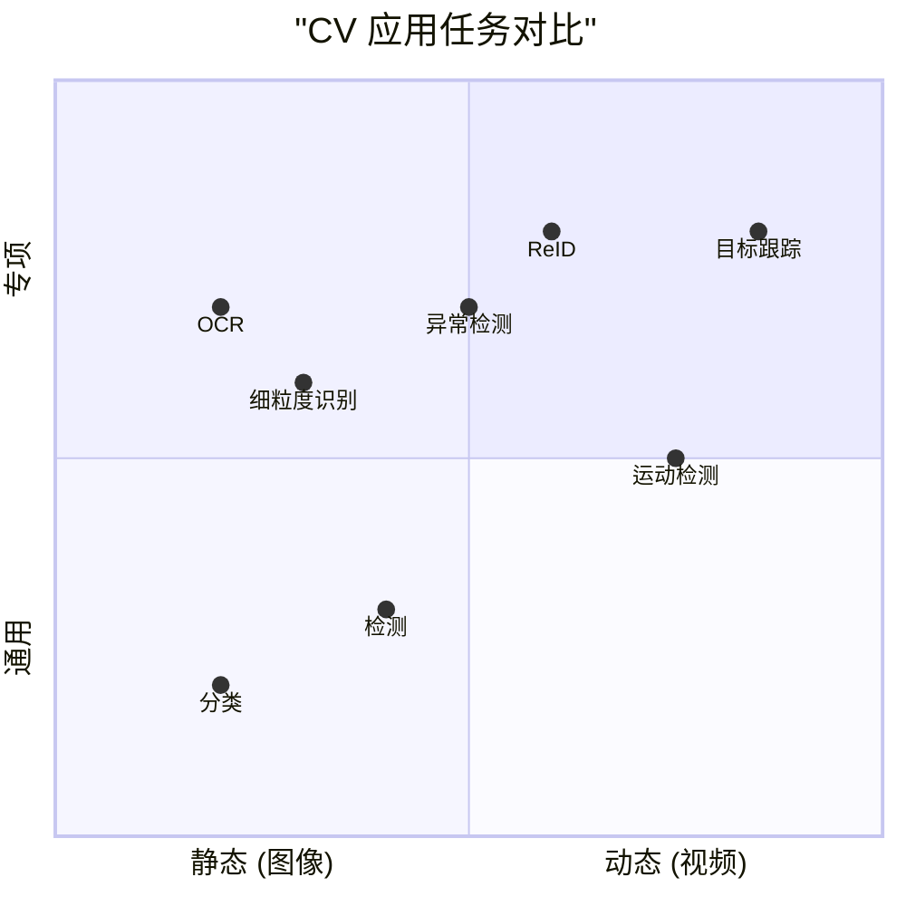
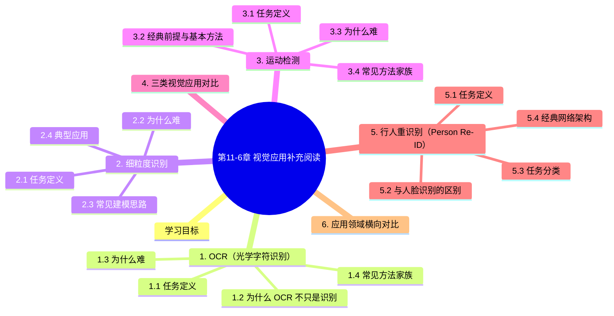

# 第11-6章 视觉应用补充阅读

## 学习目标

- 理解 OCR 的完整处理流水线与典型技术路线
- 掌握细粒度识别的任务特点、难点与常见建模思路
- 了解运动检测在固定摄像机场景下的经典方法与局限
- 能区分这三类视觉应用与目标检测、分割、生成之间的边界

---

## 1. OCR（光学字符识别）

### 1.1 任务定义

OCR（Optical Character Recognition）是把图像中的文字转换为可编辑、可检索文本的技术。它不仅是“识别字符”，通常还包括整条处理链路。

**常见输入**：
- 扫描文档
- 手机拍照的票据、证件、书页
- 场景文字（招牌、路牌、包装）
- 手写文字

### 1.2 为什么 OCR 不只是识别

一个实用 OCR 系统往往包含：

1. **图像预处理**：去噪、增强对比度、倾斜校正
2. **方向校正**：判断文本朝向，必要时旋转
3. **版面分析**：定位段落、表格、标题、文本块
4. **文本检测**：找出文字区域
5. **文本识别**：把字符序列转成文本
6. **后处理**：词典纠错、格式修复、语言模型校正



### 1.3 为什么难

- **版式复杂**：文档、表格、票据、海报混在一起
- **字体多样**：印刷体、手写体、艺术字、倾斜字
- **退化明显**：模糊、反光、压缩噪声、遮挡
- **场景变化大**：自然背景中的文本容易和环境混淆

### 1.4 常见方法家族

| 方法 | 特点 |
|------|------|
| 模板匹配 | 早期方案，简单但泛化弱 |
| 传统特征 + 分类器 | 依赖字符分割与手工特征 |
| OCR 引擎/API | 集成检测、识别、语言模型 |
| 深度学习 OCR | 检测 + 序列识别，当前主流 |

**深度学习 OCR 常见思路**：
- 检测端：找文本框或文本行
- 识别端：把图像特征映射到字符序列
- 常见骨干：CNN、Transformer、CTC/Attention 解码

### 1.5 典型应用

- 票据/发票自动录入
- 证件识别与信息抽取
- 车牌识别
- 文档电子化与检索
- 场景文字翻译

---

## 2. 细粒度识别

### 2.1 任务定义

细粒度识别（Fine-Grained Recognition）是区分**外观非常相似**的子类别，例如：

- 鸟类不同品种
- 狗的不同犬种
- 汽车型号
- 工业零件的具体规格

它本质上是“高难度分类”：类别间差异很小，但类内差异却可能很大。

### 2.2 为什么难

- **类间差异小**：只差局部纹理、颜色块、形状细节
- **类内差异大**：姿态、视角、光照变化明显
- **背景干扰强**：主体只占图像一小部分
- **标注成本高**：需要专家知识才能区分类别

### 2.3 常见建模思路

| 方法族 | 思路 |
|------|------|
| 局部/部件建模 | 先找关键部位，再做分类 |
| 注意力机制 | 自动关注最有区分度的区域 |
| 高阶池化 | 聚合细微纹理与通道交互信息 |
| 迁移学习 | 借助大模型特征，再做小样本微调 |



### 2.4 典型应用

- 动植物物种识别
- 商品型号识别
- 工业质检中的零件分类
- 车辆品牌/款式识别
- 文物与标本识别

---

## 3. 运动检测

### 3.1 任务定义

运动检测（Motion Detection）是判断视频或连续图像中是否存在运动目标，并定位变化区域。

它通常是视频分析的第一步，常用于：
- 监控告警
- 交通流量分析
- 实验视频分析
- 机器人感知

### 3.2 经典前提与基本方法

经典运动检测通常默认：
- **摄像机基本固定**
- **背景相对稳定**
- 前景目标是“变化源”

最常见的两类起点是：

1. **帧差法**：比较相邻帧或隔帧像素差
2. **背景建模/背景减除**：建立静态或缓慢更新的背景模型，再找偏离部分



### 3.3 为什么难

- **动态背景**：树叶、水面、屏幕闪烁
- **光照变化**：阴影、曝光、昼夜切换
- **摄像机运动**：手持拍摄、抖动、自动跟随
- **细微目标**：小目标或慢速运动容易被漏检
- **特殊场景**：显微镜、医疗视频中背景并不“静止”

### 3.4 常见方法家族

| 方法 | 说明 |
|------|------|
| 帧差法 | 简单快速，适合变化明显场景 |
| 背景减除 | 适合固定摄像机，工程常用 |
| 光流法 | 根据像素运动向量检测运动 |
| 深度学习视频理解 | 学习时空特征，适合复杂场景 |

### 3.5 典型应用

- 安防监控报警
- 交通车辆/行人检测的前处理
- 体育视频分析
- 显微镜下细胞/颗粒运动分析
- 机器视觉中的流水线异常检测

---

## 4. 三类视觉应用对比

| 任务 | 输入 | 输出 | 核心难点 |
|------|------|------|----------|
| OCR | 图像/文档/场景 | 文字序列 | 检测、识别、版面与纠错 |
| 细粒度识别 | 图像 | 子类别标签 | 类间极近、局部差异细微 |
| 运动检测 | 视频/帧序列 | 运动区域/变化事件 | 背景稳定性与时序变化 |

---

## 5. 行人重识别（Person Re-ID）

### 5.1 任务定义

**行人重识别（Person Re-Identification, ReID）**：在跨摄像头、跨时间、跨场景的视频网络中，根据行人的**外观特征**检索同一行人。

应用场景：
- 安防监控（找人）
- 智能交通（车辆也算 ReID）
- 零售分析（顾客轨迹）
- 走失老人/儿童查找



### 5.2 与人脸识别的区别

| 维度 | 人脸识别 | ReID |
|------|----------|------|
| **数据源** | 高清人脸 | 全身/半身监控 |
| **分辨率** | 高 | 低（常常 < 100px 脸）|
| **遮挡** | 少见 | 频繁（帽子、口罩、背包）|
| **姿态** | 正面/接近正面 | 任意角度 |
| **数据集** | 公开标准 | 公开（Market-1501、DukeMTMC）|
| **核心模型** | ArcFace、CosFace | 基于 CNN 提取全身特征 |

### 5.3 任务分类

### 5.4 经典网络架构

**ReID 的本质是度量学习**：



**关键组件**：

1. **Backbone**：ResNet50 / IBN-Net / OSNet
2. **注意力模块**：提升关键区域权重
3. **全局特征**：整图池化（AvgPool / GeM）
4. **局部特征**：水平切分（PCB）、姿态关键点
5. **损失函数**：分类 CE + 度量 Triplet / Contrastive

### 5.5 损失函数

**分类损失**（Cross Entropy）：
- 把 ReID 当成"身份分类"问题
- 类别数 = 数据集中的不同行人 ID 数

**Triplet Loss**（三元组损失）：

$$
L_{triplet} = \max(0, d(f_a, f_p) - d(f_a, f_n) + \text{margin})
$$

- Anchor $f_a$：基准
- Positive $f_p$：与 anchor 同一 ID
- Negative $f_n$：与 anchor 不同 ID
- 目标：拉近 anchor 与 positive，推远 anchor 与 negative

**Circle Loss**（2020）：统一度量学习目标，更稳定

**InfoNCE / Contrastive**：对比学习形式

### 5.6 常用数据集

| 数据集 | 行人 ID | 图像数 | 摄像头 | 特点 |
|--------|---------|--------|--------|------|
| **Market-1501** | 1501 | 32K | 6 | 通用 ReID 基准 |
| **DukeMTMC-reID** | 1812 | 36K | 8 | 已下线（隐私）|
| **CUHK03** | 1467 | 14K | 10 | 早期数据集 |
| **MSMT17** | 4101 | 126K | 15 | 大规模多场景 |
| **MARS** | 1261 | 视频 | 6 | 视频 ReID |
| **VehicleID** | 26267 | 车辆 | - | 车辆 ReID |

### 5.7 评估指标

**Rank-K Accuracy**：

- **Rank-1**：Top-1 检索正确率（最重要）
- **Rank-5 / Rank-10**：Top-5/10 包含正确结果的比例

**mAP (mean Average Precision)**：

对每个 query，计算 PR 曲线下面积，再对所有 query 取平均。综合反映检索质量。

### 5.8 SOTA 方法一览

| 方法 | 年份 | Rank-1 (Market) | mAP (Market) | 核心创新 |
|------|------|-----------------|--------------|----------|
| **BoT** | 2019 | 94.1 | 85.9 | BNNeck + 多种损失 |
| **OSNet** | 2019 | 94.8 | 84.9 | 全尺度残差块 |
| **PCB** | 2018 | 93.8 | 81.6 | 局部水平切分 |
| **MGN** | 2018 | 95.7 | 86.9 | 多粒度网络 |
| **TransReID** | 2021 | **96.2** | **89.5** | Transformer + 滑动窗口 |
| **CLIP-ReID** | 2023 | 96.5 | 90.0 | CLIP 零样本 |
| **PersonViT** | 2024 | 97.0+ | 91.0+ | 大规模预训练 |

### 5.9 实战：基于 PyTorch 训练一个 ReID 模型

```python
import torch
import torch.nn as nn
import torch.nn.functional as F
from torchvision import models

class ReIDModel(nn.Module):
    def __init__(self, num_classes=1501, feature_dim=2048):
        super().__init__()
        # Backbone
        resnet = models.resnet50(pretrained=True)
        self.backbone = nn.Sequential(*list(resnet.children())[:-2])
        # Global Average Pooling
        self.gap = nn.AdaptiveAvgPool2d(1)
        # BNNeck: 分类前加 BN
        self.bnneck = nn.BatchNorm1d(2048)
        self.bnneck.bias.requires_grad_(False)  # 推理时直接用
        # 分类器
        self.classifier = nn.Linear(2048, num_classes, bias=False)
    
    def forward(self, x):
        feat = self.backbone(x)  # (B, 2048, H, W)
        global_feat = self.gap(feat).flatten(1)  # (B, 2048)
        bn_feat = self.bnneck(global_feat)
        if self.training:
            cls_score = self.classifier(bn_feat)
            return global_feat, cls_score
        else:
            return bn_feat

# Triplet Loss
class TripletLoss(nn.Module):
    def __init__(self, margin=0.3):
        super().__init__()
        self.margin = margin
    
    def forward(self, feat, labels):
        # 计算 pairwise 距离
        dist = torch.cdist(feat, feat)
        # 找 hard positive / hard negative
        # 简化：BatchHard
        # ...
        return loss

# 训练
model = ReIDModel(num_classes=1501).cuda()
ce_loss = nn.CrossEntropyLoss()
triplet_loss = TripletLoss(margin=0.3)
optimizer = torch.optim.Adam(model.parameters(), lr=3e-4)

for images, pids, cam_ids in dataloader:
    global_feat, cls_score = model(images.cuda())
    
    loss_ce = ce_loss(cls_score, pids.cuda())
    loss_tri = triplet_loss(global_feat, pids.cuda())
    loss = loss_ce + loss_tri
    
    optimizer.zero_grad()
    loss.backward()
    optimizer.step()
```

### 5.10 ReID 与多目标跟踪的结合

实际应用中，ReID 与 MOT 通常组合：



**DeepSORT 实质上是** MOT + 简化 ReID 的组合。

### 5.11 工业落地挑战

| 挑战 | 说明 | 缓解 |
|------|------|------|
| 跨域泛化 | 源域训练的模型在目标摄像头效果差 | 无监督域适应、伪标签 |
| 遮挡 | 帽子、口罩、行李遮挡 | 局部特征、姿态估计 |
| 长时间跨度 | 衣着变化、配饰变化 | 时序建模、增量更新 |
| 隐私 | GDPR 等法规约束 | 特征存储而非原始图像 |
| 实时性 | 城市级监控数百万摄像头 | 边缘部署 + 分布式检索 |

### 5.12 ReID 在自动驾驶中的应用

**车端 ReID（Vehicle ReID）** 在车路协同、自动驾驶中用于：
- 车辆轨迹补全
- 跨摄像头跟踪
- 套牌车检测
- 异常行为分析

**数据集**：VehicleID、VeRi-776、VERI-Wild

---

## 6. 应用领域横向对比



---

## 本章小结

本章在原有 OCR/细粒度/运动检测基础上，新增 ReID 共四类视觉应用补充：

1. **OCR**：完整的"预处理→版面→检测→识别→后处理"流水线，处理文档、票据、场景文字
2. **细粒度识别**：区分外观极近的子类别，部件建模 + 注意力 + 高阶池化是关键
3. **运动检测**：经典方法（帧差法、背景减除）+ 深度学习（时空特征）
4. **行人重识别 (ReID)** ⭐新增：从跨摄像头图像中检索同一人，度量学习 + 注意力 + 局部特征
5. **共同点**：都是**特定行业场景**的深度学习应用，相比通用检测/分类更关注领域知识

**相关阅读**：
- 目标跟踪 (SORT/ByteTrack)：[11-7 目标跟踪与视频理解](./11-7-目标跟踪与视频理解.md)
- 异常检测 (PatchCore/DRAEM)：[11-8 异常检测与工业缺陷](./11-8-异常检测与工业缺陷.md)
- 通用目标检测：[11-1 目标检测进阶](./11-1-目标检测进阶.md)
- 特征可视化：[11-3 图像生成与编辑](./11-3-图像生成与编辑.md)


## 知识图谱



## 参考资料

1. Smith, R. An Overview of the Tesseract OCR Engine. ICDAR, 2007.
2. Shi, B., et al. An End-to-End Trainable Neural Network for Image-Based Sequence Recognition and Its Application to Scene Text Recognition. TPAMI, 2017.
3. Lin, T.-Y., et al. Bilinear CNN Models for Fine-grained Visual Recognition. ICCV, 2015.
4. Stauffer, C., Grimson, W. E. L. Adaptive Background Mixture Models for Real-Time Tracking. CVPR, 1999.
5. Zivkovic, Z. Improved Adaptive Gaussian Mixture Model for Background Subtraction. ICPR, 2004.
