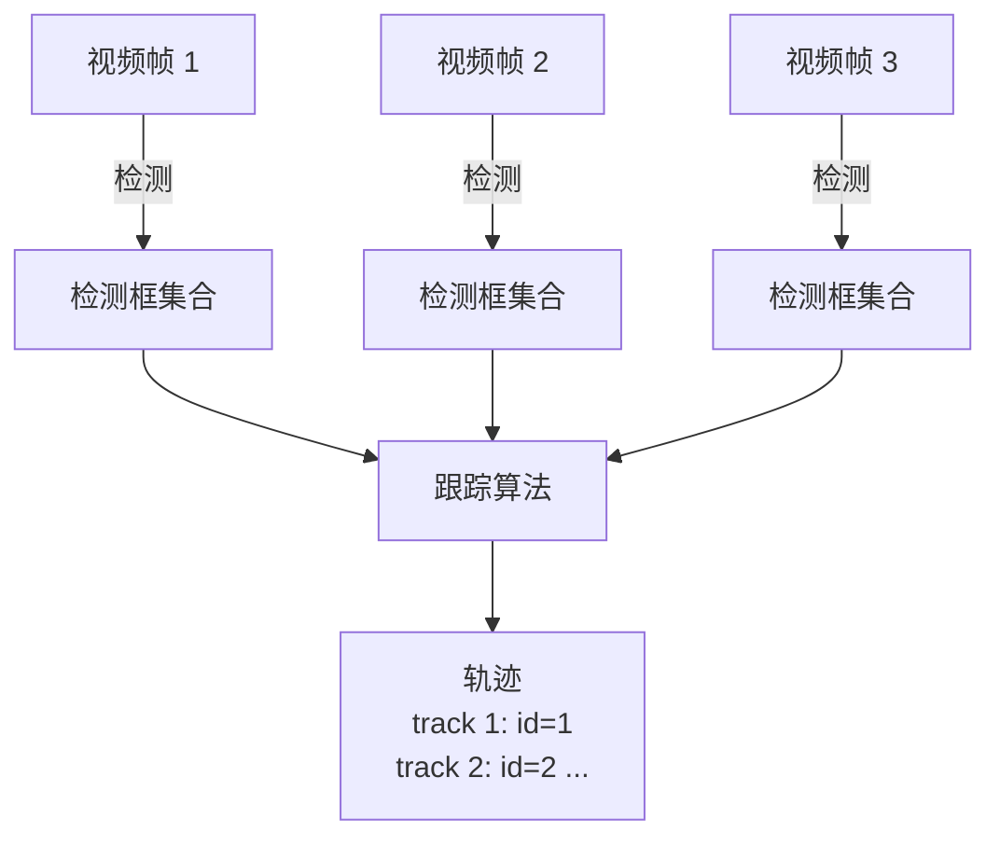
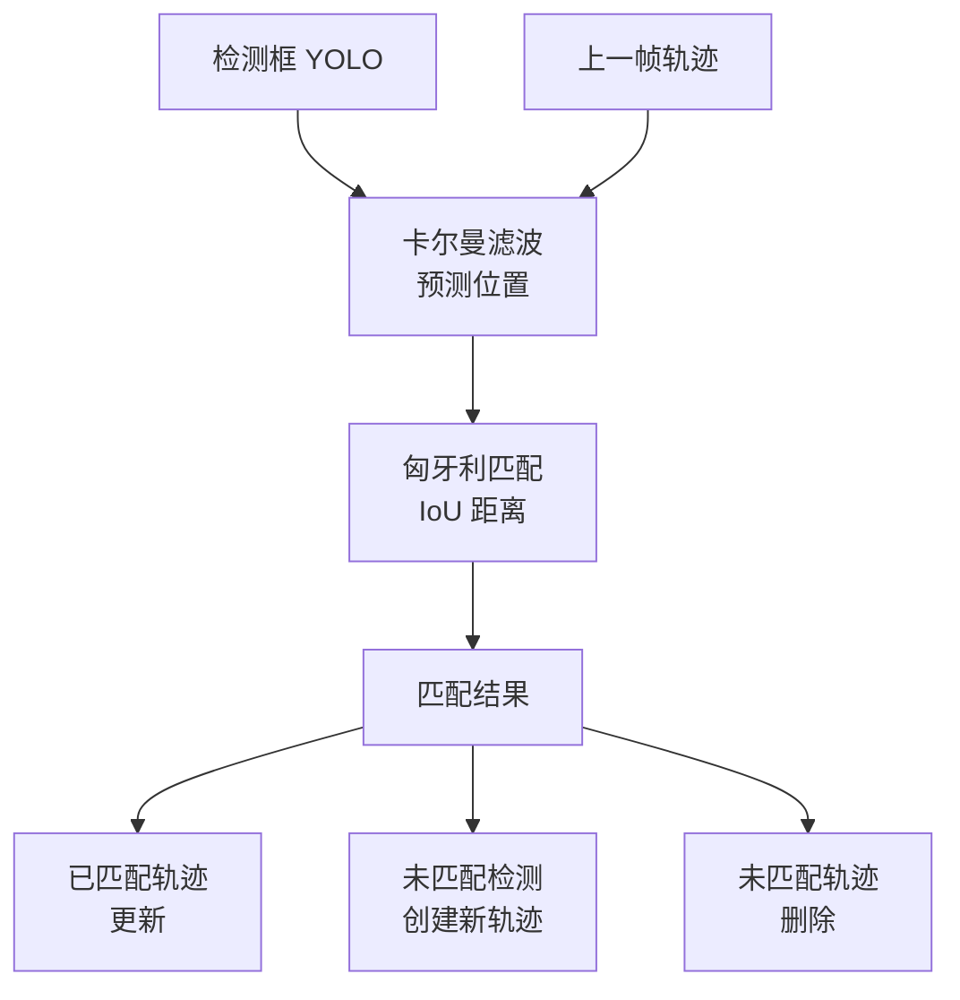
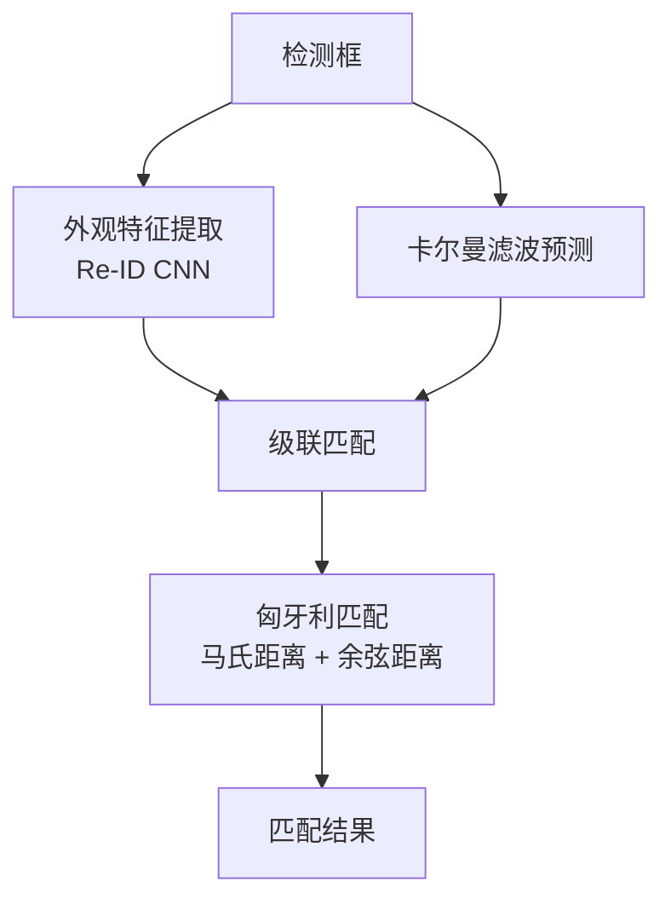
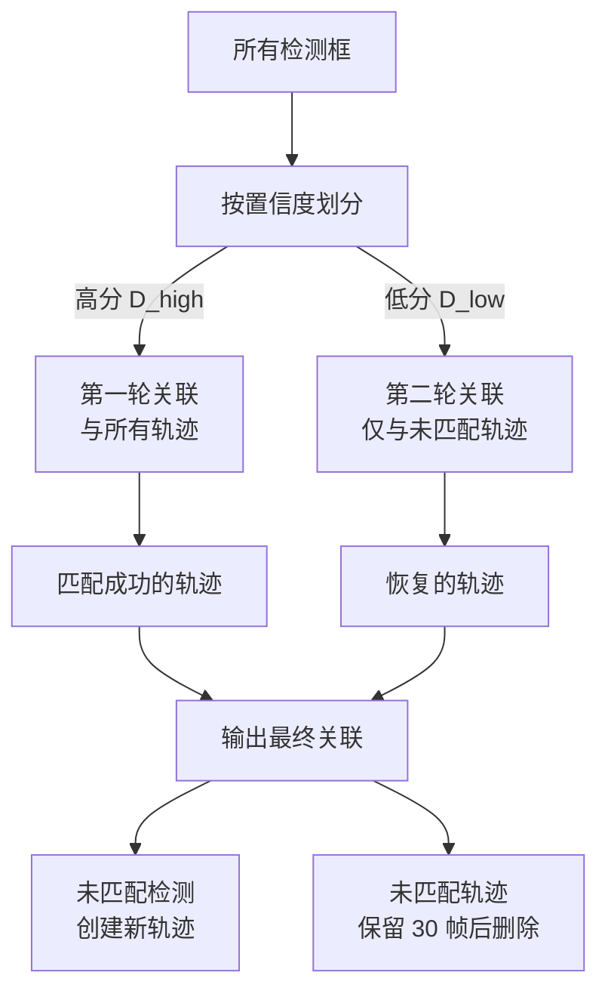
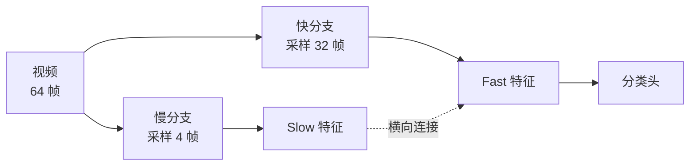
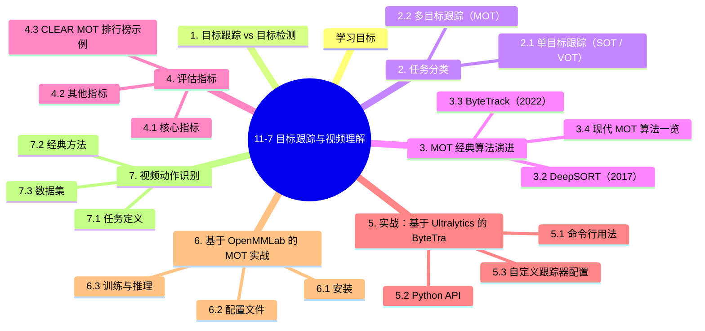

# 11-7 目标跟踪与视频理解

## 学习目标

- 理解目标跟踪（Object Tracking）与目标检测（Detection）的区别与联系
- 掌握单目标跟踪（VOT）与多目标跟踪（MOT）任务定义
- 理解 SORT、DeepSORT、ByteTrack 等经典 MOT 算法的演进
- 掌握多目标跟踪评估指标（MOTA、MOTP、IDF1、IDSW）
- 了解视频动作识别与视频理解的基本方法
- 能够在 OpenMMLab 生态下实战 MOT 项目

---

## 1. 目标跟踪 vs 目标检测



**关键区别：**

| 维度 | 目标检测 | 目标跟踪 |
|------|----------|----------|
| **输入** | 单张图像 | 视频序列 |
| **输出** | 类别 + 位置 | 类别 + 位置 + 跨帧 ID |
| **核心挑战** | 多尺度、遮挡、类别 | 跨帧关联、ID 切换、长时间遮挡 |
| **典型算法** | YOLO、Faster R-CNN | SORT、ByteTrack、TransTrack |

---

## 2. 任务分类

### 2.1 单目标跟踪（SOT / VOT）

- **任务**：给定初始帧中目标的 bounding box，预测后续帧中该目标的位置
- **典型应用**：视频标注、视频编辑、视觉特效
- **代表数据集**：OTB、VOT、LaSOT、TrackingNet
- **代表算法**：SiameseFC、SiamRPN、TransT、OSTrack

### 2.2 多目标跟踪（MOT）

- **任务**：在视频序列中同时跟踪多个目标，为每个目标分配唯一 ID
- **典型应用**：自动驾驶感知、视频监控、体育分析
- **代表数据集**：MOT16/17/20、BDD100K、Waymo
- **代表算法**：SORT、DeepSORT、ByteTrack、TransTrack、MOTR

本节重点关注 **MOT**（应用更广、研究更活跃）。

---

## 3. MOT 经典算法演进

### 3.1 SORT（Simple Online and Realtime Tracking，2016）

SORT 是最经典的 MOT 算法之一，核心思想是**检测 + 卡尔曼滤波 + 匈牙利匹配**。



**核心组件：**

1. **检测（Detection）**：用 YOLO 等检测器获取每帧的检测框
2. **卡尔曼滤波（Kalman Filter）**：预测目标在下一帧的位置（基于线性运动模型）
3. **匈牙利匹配（Hungarian Algorithm）**：用 IoU 作为代价矩阵，将检测框与预测框进行最优匹配
4. **生命周期管理**：
   - 匹配的检测 → 更新对应轨迹
   - 未匹配的检测 → 创建新轨迹
   - 未匹配的轨迹 → 保留 N 帧后删除

**优点**：
- 简单、实时（>200 FPS on GPU）
- 在线跟踪，无需未来帧

**缺点**：
- 仅用 IoU 关联，对遮挡敏感
- ID 切换频繁
- 完全忽略外观信息

### 3.2 DeepSORT（2017）

DeepSORT 在 SORT 基础上引入**外观特征（Re-ID 特征）**，大幅减少 ID 切换。

**核心改进**：



**级联匹配（Matching Cascade）**：
- 优先匹配最近出现的目标
- 解决长时间遮挡后突然重现的问题
- 避免卡尔曼滤波的不确定性扩散

**马氏距离**衡量运动一致性：

$$
d_{\text{mahalanobis}} = (z - Hx)^T S^{-1} (z - Hx)
$$

**余弦距离**衡量外观一致性：

$$
d_{\text{cosine}}(a, b) = 1 - \frac{a \cdot b}{\|a\| \cdot \|b\|}
$$

**总代价矩阵**：

$$
c = \lambda \cdot d_{\text{mahalanobis}} + (1 - \lambda) \cdot d_{\text{cosine}}
$$

**优点**：
- ID 切换大幅减少
- 外观信息增强鲁棒性

**缺点**：
- Re-ID 模型需要预训练，增加复杂度
- 计算量较 SORT 略大

### 3.3 ByteTrack（2022）

ByteTrack 是当前 MOT 领域 SOTA 之一，发表于 ECCV 2022。

**核心洞察**：传统方法（SORT、DeepSORT）只关联高置信度检测框，**丢弃所有低分检测框**，但低分检测往往是遮挡后重新出现目标的真实信号。

**两阶段关联**：



**关键创新**：

1. **保留低分检测**：把低分检测当作遮挡恢复的信号
2. **两次关联**：先高分，后低分
3. **简单即高效**：无需 Re-ID 模型，仅靠 IoU 关联

**性能对比（MOT17 test）**：

| 算法 | MOTA | IDF1 | FPS | 特点 |
|------|------|------|-----|------|
| SORT | 59.8 | 53.8 | 143 | 简单快速 |
| DeepSORT | 60.3 | 63.1 | 18 | 外观 ReID |
| ByteTrack | **80.3** | **77.3** | 105 | 高低分两轮 |

ByteTrack 在保持实时性的同时，精度大幅超越前两代。

### 3.4 现代 MOT 算法一览

| 算法 | 年份 | 核心思想 | 性能（MOTA） |
|------|------|---------|--------------|
| SORT | 2016 | IoU + Kalman | 59.8 |
| DeepSORT | 2017 | + ReID 外观 | 60.3 |
| Tracktor++ | 2019 | 用检测回归做跟踪 | 67.6 |
| CenterTrack | 2020 | 中心点偏移预测 | 67.8 |
| TransTrack | 2021 | Transformer 关联 | 75.2 |
| ByteTrack | 2022 | 高低分两轮 | 80.3 |
| OC-SORT | 2023 | 观测中心化 SORT | 80.4 |
| BoT-SORT | 2022 | + Camera Motion + ReID | 80.5 |
| MotionTrack | 2024 | Motion-Centric 框架 | 81.0+ |

---

## 4. 评估指标

### 4.1 核心指标

**MOTA（Multiple Object Tracking Accuracy）**：

$$
\text{MOTA} = 1 - \frac{FN + FP + IDSW}{GT}
$$

- **FN**：漏检（False Negative）
- **FP**：误检（False Positive）
- **IDSW**：身份切换（ID Switch）次数
- **GT**：真实目标数

**MOTP（Multiple Object Tracking Precision）**：

$$
\text{MOTP} = \frac{\sum_{t,i} d_{t,i}}{\sum_t c_t}
$$

衡量检测框与 GT 框的对齐程度（IoU / 中心距离）

**IDF1（Identity F1 Score）**：

$$
\text{IDF1} = \frac{2 \cdot \text{IDTP}}{2 \cdot \text{IDTP} + \text{IDFP} + \text{IDFN}}
$$

衡量 ID 关联的准确性（更关注 ID 一致性）

### 4.2 其他指标

| 指标 | 含义 |
|------|------|
| **MT (Mostly Tracked)** | 80% 以上时间被跟踪的目标比例 |
| **ML (Mostly Lost)** | 20% 以下时间被跟踪的目标比例 |
| **Frag (Fragmentation)** | 轨迹被打断的次数 |
| **Hz (FPS)** | 跟踪速度 |

### 4.3 CLEAR MOT 排行榜示例

| 算法 | MOTA ↑ | IDF1 ↑ | MOTP ↑ | FPS ↑ |
|------|--------|--------|--------|-------|
| ByteTrack | 80.3 | 77.3 | 78.3 | 105 |
| OC-SORT | 80.4 | 77.5 | 78.4 | 35 |
| BoT-SORT | 80.5 | 80.2 | 78.2 | 12 |

---

## 5. 实战：基于 Ultralytics 的 ByteTrack

Ultralytics YOLOv8 内置了 ByteTrack 支持，5 行代码即可启动 MOT。

### 5.1 命令行用法

```bash
# 视频文件
yolo track model=yolov8n.pt source='video.mp4' tracker='bytetrack.yaml'

# 摄像头
yolo track model=yolov8n.pt source=0 tracker='bytetrack.yaml'

# 输出结果
yolo track model=yolov8n.pt source='video.mp4' tracker='bytetrack.yaml' save=True
```

### 5.2 Python API

```python
from ultralytics import YOLO

# 加载模型
model = YOLO('yolov8n.pt')

# 启动跟踪
results = model.track(
    source='video.mp4',
    tracker='bytetrack.yaml',  # 或 botsort.yaml
    persist=True,                # 跨帧保持 ID
    show=True,                   # 实时显示
    save=True,                   # 保存结果视频
    classes=[0, 2, 5]            # 只跟踪 person(0), car(2), bus(5)
)

# 逐帧处理
for result in results:
    boxes = result.boxes
    if boxes.id is not None:
        track_ids = boxes.id.int().cpu().tolist()
        for box, track_id in zip(boxes, track_ids):
            x1, y1, x2, y2 = box.xyxy[0].cpu().numpy()
            conf = box.conf[0].cpu().numpy()
            cls = int(box.cls[0])
            print(f"Frame {result.frame_idx}: ID={track_id} Class={cls} Conf={conf:.2f} BBox=({x1},{y1},{x2},{y2})")
```

### 5.3 自定义跟踪器配置

`bytetrack.yaml` 内容：

```yaml
# bytetrack.yaml
tracker_type: bytetrack
track_high_thresh: 0.5      # 高分阈值
track_low_thresh: 0.1       # 低分阈值
new_track_thresh: 0.6       # 创建新轨迹阈值
track_buffer: 30            # 轨迹保留帧数
match_thresh: 0.8           # IoU 匹配阈值
fuse_score: True            # 是否融合分数
```

---

## 6. 基于 OpenMMLab 的 MOT 实战

OpenMMLab 提供 **MMTracking** 库，覆盖 SOT、MOT、VID 等任务。

### 6.1 安装

```bash
mim install mmengine mmcv mmtracking
```

### 6.2 配置文件

```python
# configs/mot/bytetrack/bytetrack_yolox_x_8xb4-amp-80e_crowdhuman-mot17half.py
model = dict(
    type='ByteTrack',
    detector=dict(
        type='YOLOX',
        backbone=dict(type='CSPDarknet', deepen_factor=1.33, widen_factor=1.25),
        head=dict(type='YOLOXHead', num_classes=1)
    ),
    tracker=dict(
        type='ByteTracker',
        obj_score_thrs=dict(high=0.6, low=0.1),
        init_track_thr=0.7,
        weight_iou_with_det_scores=True,
        match_iou_thr=0.3,
        num_frames_retain=30
    )
)
```

### 6.3 训练与推理

```bash
# 训练
bash tools/dist_train.sh \
    configs/mot/bytetrack/bytetrack_yolox_x_8xb4-amp-80e_crowdhuman-mot17half.py \
    4

# 推理
python demo/demo_mot_vis.py \
    configs/mot/bytetrack/bytetrack_yolox_x_8xb4-amp-80e_crowdhuman-mot17half.py \
    checkpoints/bytetrack_yolox_x_crowdhuman_mot17.pth \
    demo/demo.mp4 \
    --out-dir demo/output
```

---

## 7. 视频动作识别

目标跟踪关注"**谁在哪**"，动作识别则关注"**在做什么**"。

### 7.1 任务定义

给定一段视频片段，输出动作类别：
- 输入：T 帧 RGB 序列
- 输出：动作类别（如"跑步"、"挥手"）

### 7.2 经典方法

#### SlowFast（Facebook AI, 2019）

SlowFast 用**两个分支**处理视频：
- **Slow 分支**：低帧率（如 4 fps），捕获空间语义
- **Fast 分支**：高帧率（如 32 fps），捕获运动细节
- 通过 lateral connections 融合



#### TimeSformer（2021）

**纯 Transformer 架构**，将视频分成时空 patch，self-attention 跨时空建模。

#### Video Swin Transformer（2022）

Swin Transformer 的视频版本，引入时空窗口注意力。

### 7.3 数据集

| 数据集 | 类别数 | 视频数 | 任务 |
|--------|--------|--------|------|
| UCF-101 | 101 | 13K | 动作识别 |
| HMDB51 | 51 | 7K | 动作识别 |
| Kinetics-400 | 400 | 300K | 动作识别 |
| Kinetics-700 | 700 | 650K | 动作识别 |
| Something-Something | 174 | 220K | 时序推理 |
| AVA | 80 | 430 | 时空动作检测 |

---

## 8. 视频理解的扩展任务

### 8.1 视频目标分割（VOS）

- **任务**：在第一帧给定目标的 mask，跟踪其后续帧的分割
- **代表方法**：STM、SiamMask、Space-Time Correspondence Networks

### 8.2 视频实例分割（VIS）

- **任务**：跟踪 + 实例分割，输出 mask + ID
- **代表方法**：MaskTrack R-CNN、SipMask、STEm-Seg

### 8.3 时空动作检测

- **任务**：在未剪辑视频中，定位动作发生的时间区间 + 空间位置
- **代表方法**：SlowFast + Action Detection、VideoMAE

---

## 9. 工程实践：跟踪+计数+行为分析

### 9.1 流量统计

```python
# 跟踪 + 跨线计数
import cv2
from ultralytics import YOLO

model = YOLO('yolov8n.pt')
cap = cv2.VideoCapture('road.mp4')

# 定义虚拟计数线
LINE_Y = 300
track_history = {}
crossed_ids = set()

while cap.isOpened():
    ret, frame = cap.read()
    if not ret: break
    
    results = model.track(frame, persist=True, classes=[0])  # 只跟踪人
    boxes = results[0].boxes
    
    if boxes.id is not None:
        for box, track_id in zip(boxes, boxes.id.int().tolist()):
            x, y, w, h = box.xywh[0].cpu().numpy()
            track = track_history.setdefault(track_id, [])
            track.append((float(x), float(y)))
            
            # 简化计数：检查轨迹是否跨越计数线
            if len(track) > 1:
                if track[-2][1] < LINE_Y <= track[-1][1] and track_id not in crossed_ids:
                    crossed_ids.add(track_id)
                    cv2.line(frame, (0, LINE_Y), (frame.shape[1], LINE_Y), (0, 0, 255), 2)
                    cv2.putText(frame, f'Count: {len(crossed_ids)}', (50, 50),
                                cv2.FONT_HERSHEY_SIMPLEX, 1, (0, 255, 0), 2)
    
    cv2.imshow('Counter', frame)
    if cv2.waitKey(1) & 0xFF == ord('q'): break
```

### 9.2 行为识别 Pipeline

```python
# 跟踪 + 短时动作识别
# 1. 用 YOLO + ByteTrack 跟踪人
# 2. 提取每个人最近 16 帧 ROI
# 3. 用 SlowFast 模型分类动作
# 4. 输出：track_id + action_label
```

---

## 10. 适用场景与算法选择

| 场景 | 推荐算法 | 理由 |
|------|----------|------|
| **实时监控 (>30 FPS)** | SORT、ByteTrack | 简单快速 |
| **复杂遮挡场景** | ByteTrack、OC-SORT | 抗遮挡 |
| **跨摄像头跟踪** | DeepSORT + ReID | 外观鲁棒 |
| **自动驾驶** | ByteTrack、AB3DMOT | 实时 + 鲁棒 |
| **体育分析** | DeepSORT、Tracktor++ | 复杂动作 |
| **离线精确跟踪** | TransTrack、MOTR | 更高精度 |
| **多类别跟踪** | ByteTrack + 类条件 | 按类别独立跟踪 |

---

## 本章小结

1. **目标跟踪**在视频序列中维持目标跨帧 ID，区别于单帧目标检测。
2. **MOT 经典演进**：SORT（IoU+Kalman）→ DeepSORT（+外观 ReID）→ ByteTrack（高低分两轮，保留低分检测），每代都在解决前代痛点。
3. **ByteTrack** 已成为当前 MOT 主流方案：保留低分检测作为遮挡恢复信号，精度大幅超越前两代，同时保持实时性。
4. **评估指标**包括 MOTA（综合准确性）、IDF1（ID 一致性）、MOTP（位置精度）、IDSW（ID 切换次数），关注重点不同。
5. **实战首选** Ultralytics YOLOv8 + ByteTrack：5 行代码启动跟踪，生态成熟、易部署。
6. **视频动作识别**是视频理解的延伸，主流方法从 Two-Stream → 3D CNN → SlowFast → TimeSformer → Video Swin Transformer 持续演进。
7. **工程场景**中常组合目标检测 + 跟踪 + 短时动作识别，构建完整视频分析 Pipeline。

---


## 知识图谱



## 参考资料

1. Bewley A, et al. Simple Online and Realtime Tracking. ICIP, 2016.
2. Wojke N, et al. Simple Online and Realtime Tracking with a Deep Association Metric. ICIP, 2017.
3. Zhang Y, et al. ByteTrack: Multi-Object Tracking by Associating Every Detection Box. ECCV, 2022.
4. Cao J, et al. Observation-Centric SORT: Rethinking SORT for Robust Multi-Object Tracking. CVPR, 2023.
5. Aharon N, et al. BoT-SORT: Robust Associations Multi-Pedestrian Tracking. arXiv:2206.14651, 2022.
6. Ultralytics YOLOv8 Tracking：https://docs.ultralytics.com/modes/track/
7. MMTracking：https://github.com/open-mmlab/mmtracking
8. Feichtenhofer C, et al. SlowFast Networks for Video Recognition. ICCV, 2019.
9. Bertasius G, et al. Is Space-Time Attention All You Need for Video Understanding? ICML, 2021.
10. Liu Z, et al. Video Swin Transformer. CVPR, 2022.
