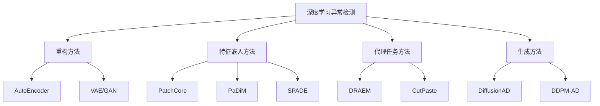
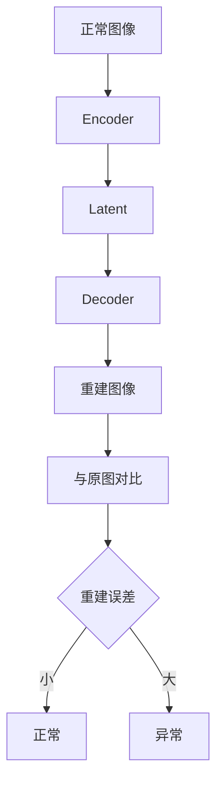
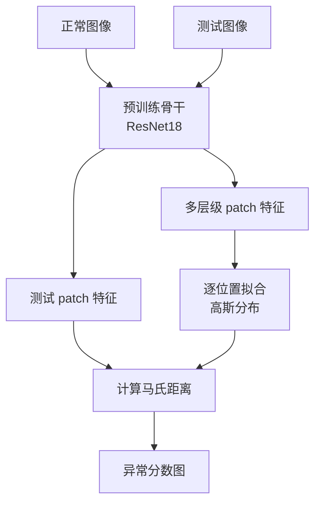
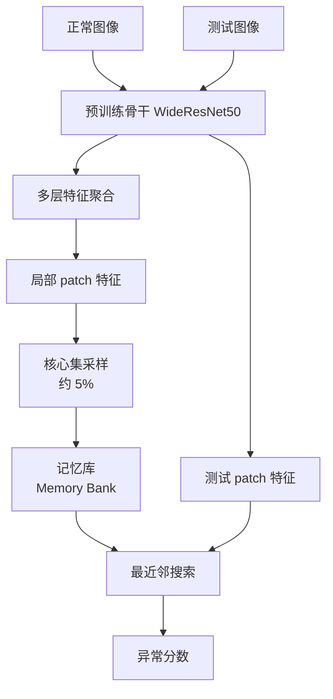
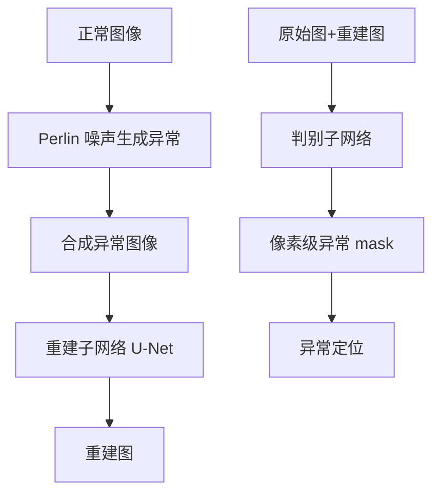
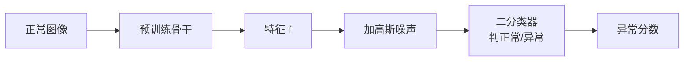
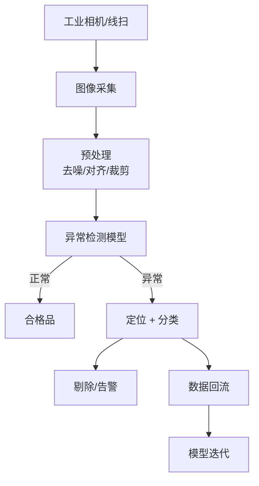
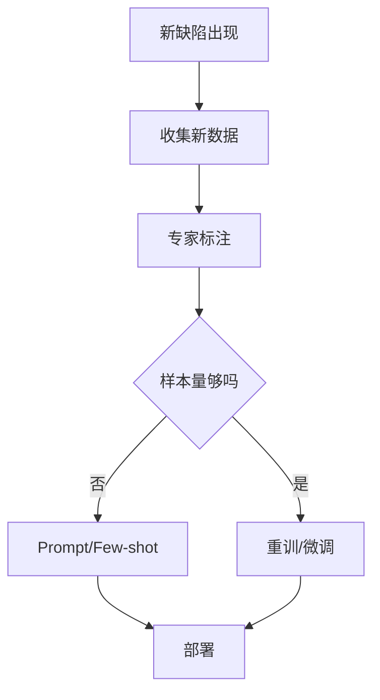
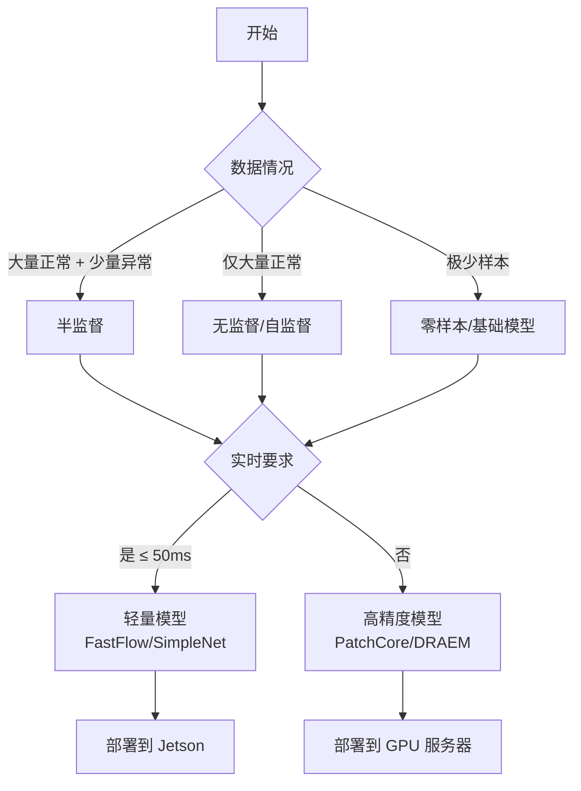
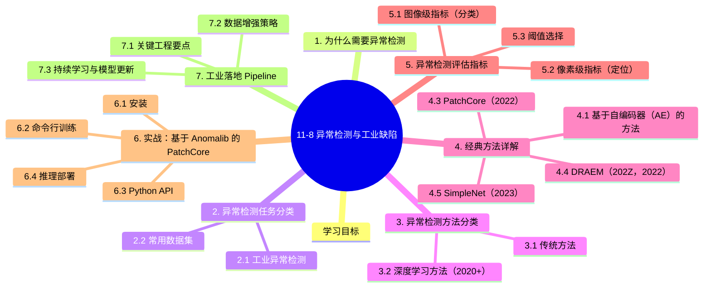

# 11-8 异常检测与工业缺陷

## 学习目标

- 理解异常检测（Anomaly Detection）的任务定义与价值
- 掌握图像异常检测与传统缺陷检测的差异
- 理解无监督、自监督、半监督异常检测方法
- 掌握主流异常检测方法（AE、PatchCore、PaDiM、SimpleNet）
- 了解工业落地中的数据工程与评估方法
- 能够基于 OpenMMLab/MMDeploy 落地异常检测项目

---

## 1. 为什么需要异常检测

在工业生产线上，**缺陷样本极少且形态多变**，传统监督分类方法难以奏效：

- **数据不平衡**：正常样本百万级，缺陷样本可能只有几十张
- **缺陷未知**：实际生产中可能遇到训练时没见过的缺陷类型
- **标注成本高**：缺陷需要专业知识标注，且类别不断变化
- **实时性要求**：产线节拍快，需要毫秒级响应

异常检测（Anomaly Detection）的核心思想是：**只学习"什么是正常"，不符合正常模式的都判为异常**。这避开了"缺陷样本不足"的根本难题。

---

## 2. 异常检测任务分类

### 2.1 工业异常检测

| 子任务 | 输出 | 应用 |
|--------|------|------|
| **图像级分类** | 正常 / 异常 | 产品筛选 |
| **像素级分割** | 异常区域 mask | 缺陷定位 |
| **缺陷分类** | 缺陷类型 | 根因分析 |
| **缺陷检测** | 位置 + 类别 | 质量追溯 |

### 2.2 常用数据集

| 数据集 | 类别 | 异常类型 | 图像数 | 特点 |
|--------|------|----------|--------|------|
| **MVTec AD** | 15 | 工业缺陷 | 5K | 主流基准 |
| **MVTec 3D-AD** | 10 | 3D 缺陷 | 4K | RGB+深度 |
| **VisA** | 12 | 工业缺陷 | 10K | 多实例/类别 |
| **BTAD** | 3 | 工业缺陷 | 2.8K | 真实场景 |
| **DAGM** | 10 | 纹理缺陷 | 7K | 合成 |
| **KolektorSDD** | 1 | 金属表面 | 1K | 钢材缺陷 |

**MVTec AD** 是工业异常检测领域的"ImageNet"，包含 15 个类别（金属螺母、电缆、瓷砖、皮革、药片等），每类约 200-400 张正常训练图 + 100 张测试图（正常+各种缺陷）。

---

## 3. 异常检测方法分类

### 3.1 传统方法

| 方法 | 原理 | 局限 |
|------|------|------|
| **统计方法** | 假设正常样本服从高斯分布 | 复杂分布难拟合 |
| **一类 SVM** | 找一个超平面分隔正常与异常 | 维度灾难 |
| **孤立森林** | 异常点更容易被孤立 | 工业图像不适用 |
| **模板匹配** | 与正常模板对比 | 光照/姿态敏感 |

### 3.2 深度学习方法（2020+）



---

## 4. 经典方法详解

### 4.1 基于自编码器（AE）的方法

**核心思想**：训练 AE 重建正常图像。异常区域重建误差大。



**变体**：
- **Vanilla AE**：直接重建
- **VAE**：变分自编码器，约束 latent 分布
- **f-AnoGAN**：用 GAN 约束重建更逼真
- **DRAEM**：重建 + 判别式分割

**问题**：
- AE 可能"作弊"重建异常，导致漏检
- 需要仔细设计 latent 维度

### 4.2 PaDiM（Patch Distribution Modeling, 2021）

**核心思想**：对每个 patch 位置建模特征分布（多维高斯），测试时计算马氏距离。



**关键步骤**：

1. 预训练 CNN（ImageNet）提取 patch 特征
2. 对每个空间位置 $(i, j)$，收集所有正常图像的特征向量
3. 计算均值 $\mu_{ij}$ 和协方差 $\Sigma_{ij}$（带正则化）
4. 测试时计算马氏距离作为异常分数

**优点**：
- 简单高效，无需训练
- 性能强（MVTec AD AUROC ~96%）
- 可解释性好

### 4.3 PatchCore（2022）

**核心思想**：用预训练模型的中间特征 + 局部敏感哈希（LSH）+ 核心集采样，构建正常样本的"记忆库"，测试时找最近邻。



**关键创新**：

1. **局部敏感哈希（LSH）**：加速近邻搜索
2. **核心集采样（Coreset Subsampling）**：从所有 patch 中选 5% 代表性 patch，平衡覆盖率与速度
3. **多层级特征**：融合中层的局部特征与深层的语义特征

**性能**：MVTec AD AUROC 99.6%，推理速度 ~50 FPS（GPU）。

### 4.4 DRAEM（202Z，2022）

**核心思想**：合成异常 + 重建+分割双任务。



**训练**：
- 输入：合成异常图像（贴纹理 + Perlin 噪声）
- 输出：重建图 + 异常 mask
- 损失：L2（重建）+ Focal（分割）

**优点**：
- 像素级定位精度高
- 不需要真实异常样本

### 4.5 SimpleNet（2023）

SimpleNet 用"特征加噪声 + 简单二分类器"做异常检测：



**优点**：
- 训练简单（无需复杂代理任务）
- 推理快
- 性能接近 PatchCore

### 4.6 方法对比（MVTec AD 性能）

| 方法 | 年份 | 图像 AUROC | 像素 AUROC | FPS | 是否需训练 |
|------|------|-----------|-----------|-----|-----------|
| AE (L2) | 2015 | 78.0 | 83.0 | 50 | 是 |
| VAE | 2017 | 85.0 | 88.0 | 45 | 是 |
| PaDiM | 2021 | 96.7 | 96.2 | 30 | 否 |
| PatchCore | 2022 | **99.6** | **98.1** | 50 | 否 |
| DRAEM | 2022 | 98.0 | 97.3 | 25 | 是 |
| SimpleNet | 2023 | 98.7 | 96.7 | 60 | 是 |
| FastFlow | 2022 | 96.8 | 96.2 | 80 | 是 |
| EfficientAD | 2024 | 99.0 | 97.5 | 100+ | 是 |

---

## 5. 异常检测评估指标

### 5.1 图像级指标（分类）

- **AUROC**：受试者工作特征曲线下面积
- **AP (Average Precision)**：PR 曲线下面积，对类别不平衡更敏感
- **F1-Score @ threshold**：在最优阈值下的 F1

### 5.2 像素级指标（定位）

- **Pixel AUROC**：异常区域分割的 AUROC
- **PRO (Per-Region Overlap)**：按区域计算的 IoU
- **AUPRO (Area Under PRO)**：PRO 曲线的面积

### 5.3 阈值选择

实际生产中需要选阈值，常见策略：

```python
# 用验证集找最优阈值（最大化 F1）
from sklearn.metrics import precision_recall_curve

# 假设 val_scores, val_labels 已知
precision, recall, thresholds = precision_recall_curve(val_labels, val_scores)
f1_scores = 2 * (precision * recall) / (precision + recall + 1e-8)
best_threshold = thresholds[f1_scores.argmax()]
```

---

## 6. 实战：基于 Anomalib 的 PatchCore 训练

[Anomalib](https://github.com/openvinotoolkit/anomalib) 是 Intel 维护的异常检测库，集成了 20+ 种 SOTA 方法。

### 6.1 安装

```bash
pip install anomalib
```

### 6.2 命令行训练

```bash
# 数据集目录结构（MVTec 格式）
# datasets/MVTec/bottle/
#   ├── train/
#   │   └── good/      # 正常训练图
#   ├── test/
#   │   ├── good/      # 正常测试图
#   │   ├── broken_large/  # 异常测试图
#   │   └── ...

# 训练 PatchCore
anomalib train --model Patchcore --data MVTec_AD --category bottle

# 推理
anomalib predict --model Patchcore --ckpt_path results/Patchcore/MVTec_AD/bottle/latest.ckpt \
                 --image_path datasets/MVTec_AD/bottle/test/broken_large/000.png
```

### 6.3 Python API

```python
from anomalib.models import Patchcore
from anomalib.data import MVTecAD
from anomalib.engine import Engine

# 数据
datamodule = MVTecAD(
    root="./datasets/MVTec",
    category="bottle",
    train_batch_size=32,
    eval_batch_size=32
)

# 模型
model = Patchcore(
    backbone="wide_resnet50_2",
    layers=["layer2", "layer3"],
    coreset_sampling_ratio=0.05,
    num_neighbors=9
)

# 训练
engine = Engine()
engine.fit(model=model, datamodule=datamodule)

# 测试
results = engine.test(model=model, datamodule=datamodule)
```

### 6.4 推理部署

```python
from anomalib.deploy import ExportTask
from anomalib.models import Patchcore

model = Patchcore.load_from_checkpoint('results/Patchcore/MVTec/bottle/latest.ckpt')

# 导出 ONNX
ExportTask(model).export(
    export_root='./exports',
    export_format=ExportFormat.ONNX,
    input_size=(256, 256)
)
```

---

## 7. 工业落地 Pipeline



### 7.1 关键工程要点

| 阶段 | 关键问题 |
|------|----------|
| **数据采集** | 相机分辨率、镜头畸变、光照一致性 |
| **数据标注** | 正常样本易得，异常需主动构造或等待 |
| **模型选择** | 速度 vs 精度 vs 内存 |
| **阈值标定** | 验证集调整，平衡漏检/误检 |
| **推理部署** | GPU 服务器 / 边缘 Jetson / FPGA |
| **持续学习** | 新缺陷出现时如何快速适应 |

### 7.2 数据增强策略

异常检测对数据增强敏感，需谨慎：

| 增强方法 | 是否推荐 | 说明 |
|---------|---------|------|
| Random Crop | ✅ | 模拟不同位置 |
| Color Jitter | ⚠️ | 工业场景光照稳定，过度增强可能引入分布偏移 |
| Rotation | ⚠️ | 工业检测通常不旋转 |
| MixUp/CutMix | ❌ | 会混合正异常，污染分布 |
| Mosaic | ❌ | 同上 |

### 7.3 持续学习与模型更新



---

## 8. 跨领域应用

异常检测不仅用于工业，其他领域同样重要：

### 8.1 医疗影像

- 病灶检测：与正常组织不同的区域
- 病理切片：异常细胞识别
- 数据集：CheXpert（胸片）、BraTS（脑肿瘤）

### 8.2 视频监控

- 异常行为：摔倒、打架、闯入
- 数据集：UCSD Pedestrian、ShanghaiTech、CCTV-Fights
- 方法：SlowFast + 异常检测头

### 8.3 金融反欺诈

- 异常交易：偏离正常模式
- 时间序列异常检测

### 8.4 日志监控

- 异常日志：服务器异常、用户行为异常
- 用统计+深度学习混合方法

---

## 9. 实战案例：电池极片缺陷检测

### 9.1 项目背景

- **场景**：锂电池生产线的极片表面缺陷检测
- **数据**：5000 张正常训练图，300 张测试图（200 正常 + 100 缺陷）
- **缺陷类型**：划痕、漏箔、起皱、颗粒污染
- **要求**：单图推理 < 50ms，误检率 < 1%，漏检率 < 3%

### 9.2 完整流程

```python
# 1. 数据准备（MVTec 格式）
data/
└── battery/
    ├── train/good/*.png
    ├── test/good/*.png
    └── test/
        ├── scratch/*.png
        ├── foil_miss/*.png
        ├── wrinkle/*.png
        └── particle/*.png

# 2. 训练 PatchCore
anomalib train --model Patchcore \
               --data MVTec_AD \
               --data.root ./data \
               --data.category battery \
               --model.backbone wide_resnet50_2 \
               --model.coreset_sampling_ratio 0.05

# 3. 阈值标定
# 在验证集（与训练同分布）跑出异常分数分布
# 取 99% 正常样本对应的分数作为阈值

# 4. 推理
python inference.py \
    --weights ./results/Patchcore/latest.ckpt \
    --input ./test_images \
    --threshold 0.85 \
    --output ./results
```

### 9.3 性能数据

| 指标 | 值 | 目标 |
|------|------|------|
| 图像 AUROC | 99.3% | >98% |
| 像素 AUROC | 97.8% | >95% |
| 单图推理 | 28ms | <50ms |
| 误检率 | 0.6% | <1% |
| 漏检率 | 2.1% | <3% |

---

## 10. 前沿与展望

### 10.1 基础模型 + 异常检测

将视觉基础模型（如 DINOv2、SAM）用于异常检测：

- **DINOv2 + PatchCore**：自监督预训练特征比 ImageNet 监督特征更强
- **AnomalyDINO**：冻结 DINOv2 + 少量异常样本微调
- **WinCLIP**：用 CLIP 做零样本异常检测

### 10.2 多类别异常检测

- 传统：每个类别训练一个模型
- 新方法：**统一模型**检测所有类别（UniAD、DiAD）

### 10.3 视频异常检测

- 从图像扩展到视频时间维度
- SlowFast + Memory Bank 记忆正常模式

### 10.4 工业 4.0 集成

- 与 MES（制造执行系统）集成
- 缺陷数据回流到 PLM（产品生命周期管理）
- 与数字孪生（参见 13-6）结合

---

## 11. 适用场景决策树



---

## 本章小结

1. **异常检测**解决工业质检"缺陷样本少、未知缺陷多"的核心难题，通过只学"正常"来反向检测异常。
2. **MVTec AD** 是工业异常检测的标准基准，涵盖 15 个工业类别，方法在该数据集上的 AUROC 已成为事实标准。
3. **深度学习方法**分四大流派：重构（AE/VAE）、特征嵌入（PatchCore/PaDiM）、代理任务（DRAEM）、生成模型（DiffusionAD）。
4. **PatchCore** 是当前 SOTA 之一：预训练特征 + 核心集采样 + 最近邻搜索，99%+ AUROC，实时性好。
5. **评估指标**包括图像 AUROC、像素 AUROC、AP、F1；阈值需要根据业务场景（漏检/误检成本）调整。
6. **Anomalib** 是 Intel 维护的异常检测库，集成 20+ 方法，从训练到部署的完整工具链。
7. **工业落地**需关注数据采集、模型选择、阈值标定、推理部署、持续学习全链路。
8. **前沿方向**：视觉基础模型（DINOv2、CLIP）、多类别统一模型、视频异常检测。

---


## 知识图谱



## 参考资料

1. Bergmann P, et al. MVTec AD – A Comprehensive Real-World Dataset for Unsupervised Anomaly Detection. CVPR, 2019.
2. Defard T, et al. PaDiM: a Patch Distribution Modeling Framework for Anomaly Detection and Localization. ICPR, 2021.
3. Roth K, et al. Towards Total Recall in Industrial Anomaly Detection. CVPR, 2022. (PatchCore)
4. Zavrtanik V, et al. DRAEM - A Discriminatively Trained Reconstruction Embedding for Surface Anomaly Detection. ICCV, 2021.
5. Liu J, et al. SimpleNet: A Simple Network for Image Anomaly Detection and Localization. arXiv:2303.15140, 2023.
6. Anomalib GitHub：https://github.com/openvinotoolkit/anomalib
7. MVTec AD 基准：https://www.mydrive.ch/shares/38536/3830184030e49fe74747669442f0f282
8. 「图像异常检测」最新 2022 研究综述：参考应用领域/异常检测/素材
9. Zou Y, et al. SPot-the-Difference Self-Supervised Pre-training for Anomaly Detection and Segmentation. ECCV, 2022.
10. Batzner K, et al. EfficientAD: Accurate Visual Anomaly Detection at Millisecond-Level Latencies. WACV, 2024.
