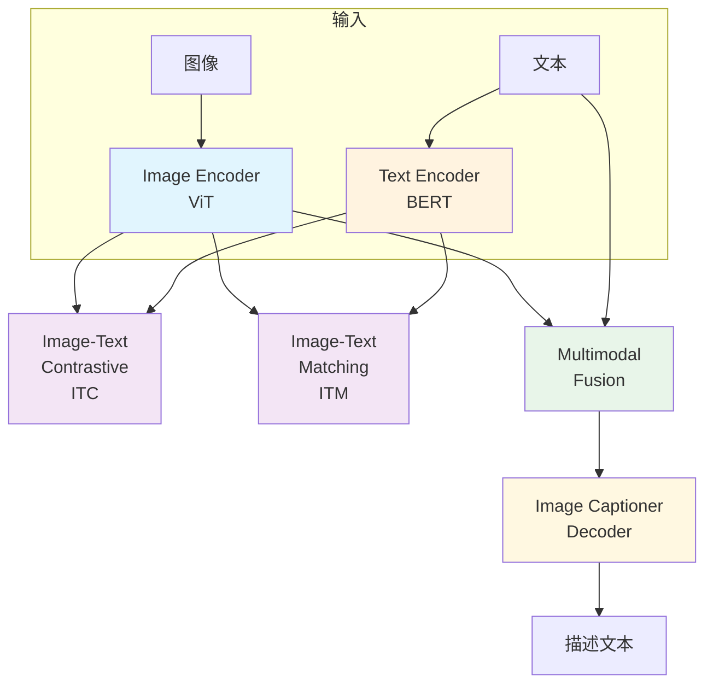
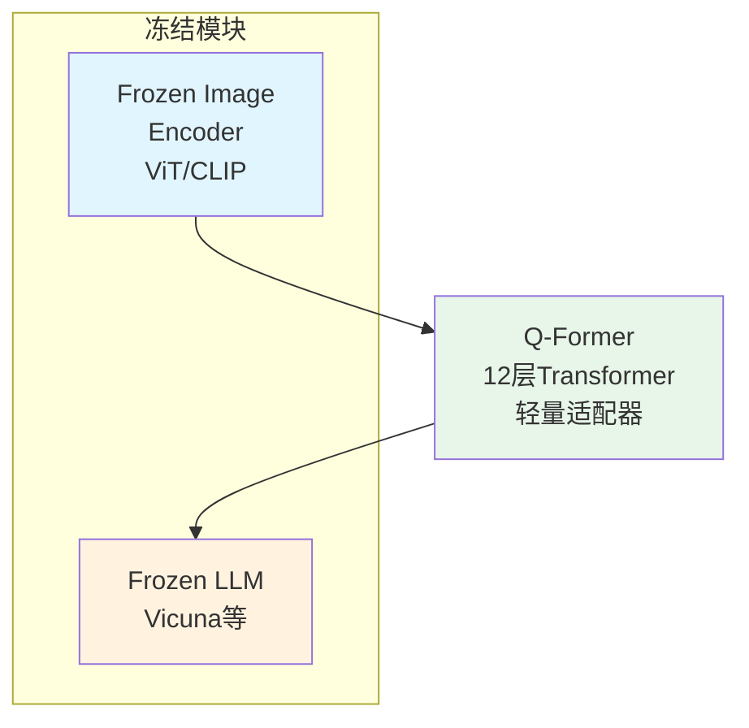
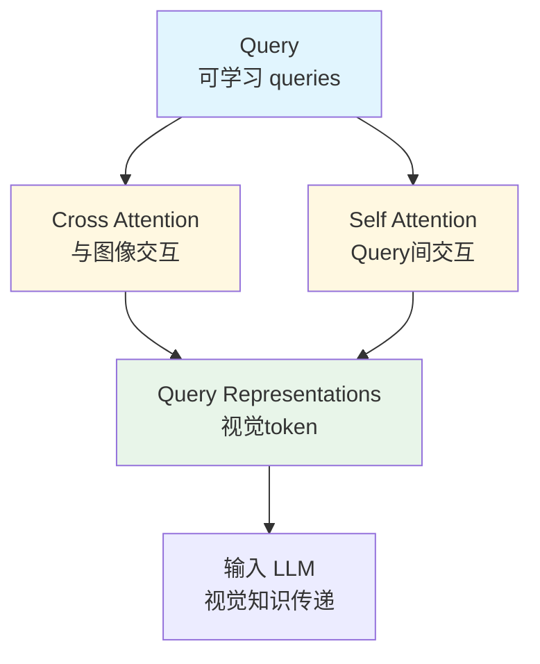
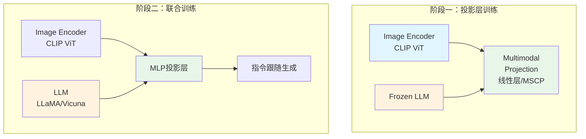
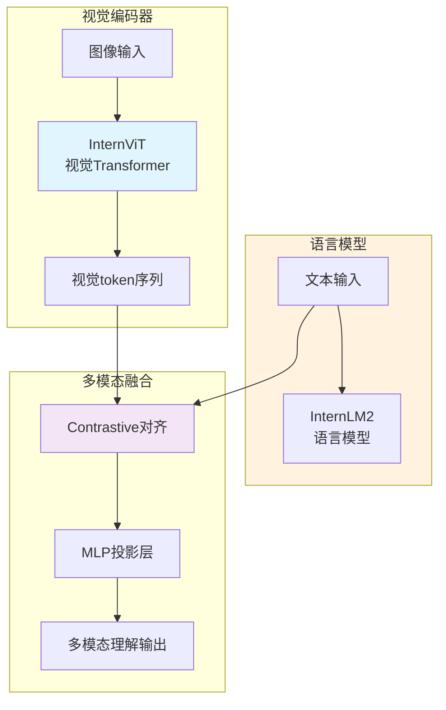
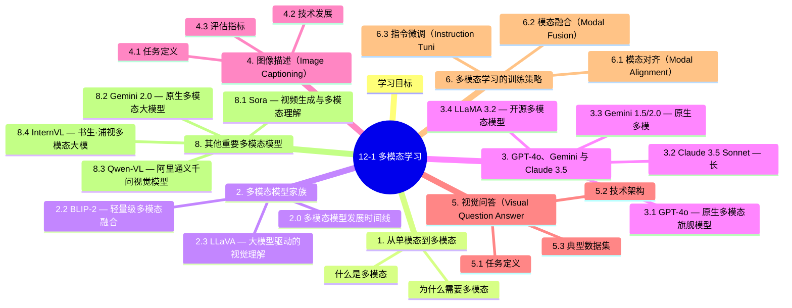

# 12-1 多模态学习

## 学习目标

- 理解多模态学习的核心概念与意义
- 掌握主流多模态模型 BLIP、BLIP-2、LLaVA 的架构与特点
- 了解 GPT-4V、GPT-4o 与 Gemini Vision 的能力与应用场景
- 掌握 Claude 3.5 Sonnet、LLaMA 3.2 等开源多模态模型的特点
- 掌握图像描述（Image Captioning）与视觉问答（VQA）的原理与实现
- 理解"原生多模态"与"嫁接多模态"的技术路线差异

---

## 1. 从单模态到多模态

### 什么是多模态

**多模态（Multimodal）** 指同时处理和理解多种类型数据（模态）的技术，常见模态包括：

- **文本（Text）**：自然语言描述
- **图像（Image）**：视觉信息
- **音频（Audio）**：语音、音乐
- **视频（Video）**：时序视觉 + 音频
- **表格（Table）**：结构化数据

多模态学习的核心目标是让 AI 能够像人类一样，同时利用多种感官信息进行感知和推理。

### 为什么需要多模态

| 能力 | 单模态局限 | 多模态优势 |
|------|-----------|-----------|
| 图像理解 | 只能识别类别标签 | 可用自然语言解释图像内容 |
| 文档理解 | 只处理文本或只处理图像 | 同时理解图文混合的文档 |
| 人机交互 | 依赖键盘输入 | 支持语音、图像、手势等多通道交互 |
| 内容生成 | 仅生成单一模态 | 联动生成图文、音频视频等 |

---

## 2. 多模态模型家族

### 2.0 多模态模型发展时间线

#### 主流多模态模型发布 timeline

| 模型 | 发布时间 | 机构 | 核心特点 |
|------|----------|------|----------|
| GPT-4V | 2023.9 | OpenAI | 首个大规模商业多模态模型 |
| GPT-4o | 2024.5 | OpenAI | 原生多模态，支持音频/视频，128K上下文 |
| Claude 3.5 Sonnet | 2024.6 | Anthropic | 200K超长上下文，代码能力突出 |
| Gemini 1.5 Pro | 2024.2 | Google | 100万token上下文，原生多模态 |
| Gemini 2.0 Flash | 2024.12 | Google | 200万token，Agent原生支持 |
| LLaMA 3.2 | 2024.9 | Meta | 开源多模态，90B参数视觉版本 |

#### 多模态能力综合对比

| 模型 | 图像理解 | 音频处理 | 视频理解 | 上下文窗口 | 开源 | 原生多模态 |
|------|---------|---------|---------|-----------|------|-----------|
| GPT-4V | ✅ | ❌ | 弱 | 128K | ❌ | 嫁接 |
| GPT-4o | ✅ | ✅ | ✅ | 128K | ❌ | 原生 |
| Claude 3.5 Sonnet | ✅ | ❌ | ❌ | 200K | ❌ | 嫁接 |
| Gemini 1.5 Pro | ✅ | ✅ | ✅ | 1M | ❌ | 原生 |
| Gemini 2.0 Flash | ✅ | ✅ | ✅ | 2M | ❌ | 原生 |
| LLaMA 3.2 | ✅ | ❌ | ❌ | 128K | ✅ | 嫁接 |

#### 原生多模态 vs 嫁接多模态

| 维度 | 原生多模态（Native Multimodal） | 嫁接多模态（ Grafting Multimodal） |
|------|-------------------------------|----------------------------------|
| **代表模型** | Gemini、GPT-4o | GPT-4V、Claude、LLaVA |
| **架构特点** | 从预训练开始统一建模所有模态 | 视觉编码器 + LLM 分别预训练后拼接 |
| **模态融合** | 深度融合，跨模态注意力从底层共享 | 浅层融合，视觉token作为LLM输入 |
| **优势** | 模态间协同更强，涌现能力更多 | 训练成本低，复用单模态SOTA模型 |
| **劣势** | 训练成本极高 | 跨模态理解深度有限 |
| **音频/视频** | 原生支持 | 需额外适配 |

> **技术解读**：原生多模态模型在预训练阶段就将所有模态（文本、图像、音频、视频）统一建模，模态间的表示可以深度交互；而嫁接多模态通常是先训练好视觉编码器和LLM，再通过适配层（如Q-Former、MLP投影）将视觉特征映射到语言空间。

---

### 2.1 BLIP — Bootstrap Language-Image Pre-training

**BLIP**（Salesforce, 2022）是早期多模态模型的代表性工作，提出了**Captioner-Filter 联合训练框架**。

#### 核心架构

BLIP 由三个模块组成：

```
┌─────────────┐     ┌─────────────┐     ┌─────────────┐
│  Image     │     │  Text      │     │  Image     │
│  Encoder   │────▶│  Encoder   │────▶│  Decoder   │
│  (ViT)     │     │  (BERT)    │     │  (Caption) │
└─────────────┘     └─────────────┘     └─────────────┘
      │                   │
      │                   ▼
      │            ┌─────────────┐
      └───────────▶│  Multimodal│
                   │  Fusion    │
                   │  (ITC+ITM) │
                   └─────────────┘
```

- **Image Encoder（ViT）**：将图像编码为特征向量
- **Text Encoder（BERT）**：将文本编码为特征向量
- **Image-grounded Text Encoder**：融合图像与文本信息
- **Image Captioner（Decoder）**：基于图像生成自然语言描述

#### 训练目标

1. **ITC（Image-Text Contrastive）**：对齐图像与文本的特征空间
2. **ITM（Image-Text Matching）**：判断图像与文本是否匹配（二分类）
3. **LM（Language Modeling）**：给定图像，生成文本描述（自回归）

#### 创新点

- 提出了**CapFilt**（Captioning + Filtering）方法：
  - 用 Captioner 为互联网图像生成候选描述
  - 用 Filter 去除噪声描述
  - 联合训练提升数据质量

#### BLIP 架构流程图



---

### 2.2 BLIP-2 — 轻量级多模态融合

**BLIP-2**（Salesforce, 2023）在 BLIP 基础上大幅降低训练成本，核心思路是**冻结预训练视觉编码器和LLM，仅训练轻量级适配层**。

#### 架构

```
┌──────────────┐       ┌───────────────┐       ┌──────────────┐
│  Frozen      │       │  Q-Former    │       │  Frozen      │
│  Image       │──────▶│  (轻量适配器) │──────▶│  LLM        │
│  Encoder     │       │  12层Transformer│    │  (Vicuna等) │
│  (ViT/CLIP)  │       │               │       │              │
└──────────────┘       └───────────────┘       └──────────────┘
```

#### Q-Former 结构

Q-Former 是 BLIP-2 的核心创新，由 **12 层 Transformer** 组成，包含：

- **Query**：学习从图像中提取与文本相关的视觉 tokens
- **Cross-Attention**：Query 与图像特征交互
- **Self-Attention**：Query 之间的自注意力

#### 工作流程

1. 冻结视觉编码器（ViT），冻结 LLM
2. 仅训练 Q-Former，实现视觉到语言的对齐
3. 通过间接蒸馏，将视觉知识传递给 LLM

#### 性能优势

BLIP-2 在保持较低训练成本的同时，在 VQA、Image Captioning 等任务上达到了当时 SOTA 水平。

#### BLIP-2 架构流程图



#### Q-Former 工作机制



---

### 2.3 LLaVA — 大模型驱动的视觉理解

**LLaVA**（Large Language and Vision Assistant, 2023）是多模态领域的重要突破，首次将 LLaMA/LLaMA-2 与视觉编码器直接连接。

#### 核心思路

LLaVA 提出了**多模态指令跟随（Multimodal Instruction Following）**训练范式：

```
┌─────────────┐     ┌──────────────────┐     ┌─────────────┐
│  Image      │     │  Multimodal      │     │  LLaMA      │
│  Encoder    │────▶│  Projection      │────▶│  (Vicuna)  │
│  (CLIP ViT) │     │  (线性层)        │     │  文本生成   │
└─────────────┘     └──────────────────┘     └─────────────┘
```

#### 训练方法

1. **阶段一**：冻住图像编码器和 LLM，只训练投影层（Projection），实现初步对齐
2. **阶段二**：联合训练投影层和 LLM，提升指令跟随能力

#### 关键创新

- **多模态指令数据集**：构造图像-描述-问答 triplet 训练数据
- **端到端联合训练**：视觉理解与语言生成联合优化
- **开源可复现**：LLaVA-1.5 仅用线性投影层，在多项基准上超越 BLIP-2

#### LLaVA-1.5 改进

- 增加 **MLP 投影层**（两层MLP替代单层线性）
- 增加 **学术数据集** 训练（ScienceQA 等）
- 支持 **高分辨率图像** 处理
- 在 MMBench 等基准上达到接近 GPT-4V 的性能

#### LLaVA 架构流程图



---

## 3. GPT-4o、Gemini 与 Claude 3.5

### 3.1 GPT-4o — 原生多模态旗舰模型

**GPT-4o**（OpenAI, 2024年5月）是 OpenAI 首个原生多模态模型，"o"代表"omni"（全能），支持文本、图像、音频、视频的实时理解和生成。

#### 核心能力

| 能力 | 描述 |
|------|------|
| 图像理解 | 识别图像内容、物体、场景、图表 |
| 音频处理 | 实时语音对话，语调情感识别 |
| 视频理解 | 逐帧分析，支持视频问答 |
| 跨模态生成 | 图文结合的内容创作 |
| 实时交互 | 低延迟流式响应 |

#### 能力特点

| 能力 | 描述 |
|------|------|
| 图像理解 | 识别图像内容、物体、场景 |
| 文档解析 | 读取截图、表格、图表、手写内容 |
| 视觉推理 | 基于图像进行逻辑推理与问答 |
| 多图像比较 | 同时理解多张图像的关系 |
| 视觉锚点 | 在图像上定位指定区域 |

#### 技术特点

GPT-4V 采用 **视觉编码器 + LLM 融合** 架构：
- 图像经过视觉编码器转换为 token 序列
- 与文本 token 拼接后输入 LLM 自回归生成

#### 应用场景

- 文档处理：自动解析截图、发票、合同
- 医疗影像：辅助影像诊断
- 自动驾驶：场景理解与安全判断
- 视频理解：逐帧分析视频内容

---

### 3.2 Claude 3.5 Sonnet — 长上下文多模态

**Claude 3.5 Sonnet**（Anthropic, 2024年6月）是 Anthropic 旗舰多模态模型，以超长上下文窗口和卓越的代码能力著称。

#### 核心能力

| 能力 | 描述 |
|------|------|
| 图像理解 | 高精度图表、文档、截图理解 |
| 超长上下文 | 200K token 上下文窗口 |
| 代码能力 | 多模态代码生成与调试 |
| 文档分析 | PDF、PPT、Excel 等复杂文档 |

#### 技术特点

- **200K 超长上下文**：可一次处理数百页文档
- **卓越的代码能力**：在多模态场景下代码生成领先
- **安全对齐**： Anthropic 特有的 Constitutional AI 安全框架

#### 应用场景

- 复杂文档理解与分析
- 多模态代码助手
- 长篇论文与报告处理

---

### 3.3 Gemini 1.5/2.0 — 原生多模态大模型

**Gemini**（Google DeepMind）是 Google 全力打造的原生多模态大模型系列，Gemini 1.5 Pro 于2024年2月发布，Gemini 2.0 Flash 于2024年12月发布。

#### Gemini 1.5 Pro

| 维度 | 规格 |
|------|------|
| 上下文窗口 | 100万 token |
| 多模态 | 原生支持文本、图像、音频、视频 |
| 核心特点 | 长上下文理解能力强 |

#### Gemini 2.0 Flash

| 维度 | 规格 |
|------|------|
| 上下文窗口 | 200万 token |
| 多模态 | 原生支持 + 工具调用 |
| Agent 能力 | 内置 ReAct 规划循环 |
| 推理速度 | 显著提升 |

#### Gemini 架构特点

Gemini 采用 **多模态原生（Native Multimodal）** 设计：
- 不同于"拼接"视觉编码器和 LLM，Gemini 从一开始就将所有模态统一建模
- 原生支持文本、图像、音频、视频的统一输入
- 跨模态注意力机制实现深度模态融合

---

### 3.4 LLaMA 3.2 — 开源多模态模型

**LLaMA 3.2**（Meta, 2024年9月）是 Meta 开源的多模态大模型，包含视觉版本（Vision Models），是开源社区重要的多模态里程碑。

#### 模型规格

| 模型 | 参数量 | 多模态能力 |
|------|--------|-----------|
| LLaMA 3.2-11B-Vision | 11B | 图像理解 |
| LLaMA 3.2-90B-Vision | 90B | 图像理解（对标 GPT-4V） |

#### 核心特点

| 特点 | 描述 |
|------|------|
| 开源可商用 | 基于 Llama 3.1 许可，支持商业使用 |
| 视觉支持 | 首次在 LLaMA 系列中加入视觉理解 |
| 高性能 | 90B 版本在多模态基准上接近 GPT-4o |
| 长上下文 | 支持 128K token 上下文 |

#### 技术架构

LLaMA 3.2 视觉版本采用**嫁接多模态**架构：
- **视觉编码器**：基于 SigLIP 的视觉编码器
- **语言模型**：LLaMA 3.1 语言模型主体
- **适配层**：两层 MLP 投影层实现模态对齐

#### 开源优势

- 完全开源权重和代码
- 支持本地部署，隐私友好
- 社区可自由微调和优化
- 降低多模态应用开发门槛

#### 能力对比

| 基准 | LLaMA 3.2 90B | GPT-4o | 说明 |
|------|---------------|--------|------|
| MMMU | 55.1% | 69.1% | 多学科理解 |
| MMBench | 80.3% | 86.4% | 综合能力 |
| DocVQA | 88.8% | 92.8% | 文档理解 |

---

## 4. 图像描述（Image Captioning）

### 4.1 任务定义

**图像描述（Image Captioning）** 是指给定一张图像，自动生成一段自然语言描述该图像的内容。

#### 典型示例

```
输入：一张狗在海滩上奔跑的照片
输出："A golden retriever running joyfully on a sunny beach, 
      with waves crashing in the background"
```

### 4.2 技术发展

#### 早期方法（CNN + RNN）

```
图像 ──▶ CNN(特征提取) ──▶ RNN(语言生成) ──▶ 描述句子
```

- CNN 负责提取图像特征
- RNN（LSTM/GRU）负责逐词生成描述

#### 注意力机制

**Show, Attend and Tell**（2016）引入空间注意力：
- 让模型在生成每个词时关注图像的不同区域
- 显著提升描述质量

#### 预训练模型方法（BLIP/Captioner）

利用大规模预训练模型：
- BLIP 的 Image Captioner 模块
- CLIP 视觉特征 + 语言模型
- 可通过微调适配特定领域

### 4.3 评估指标

| 指标 | 说明 |
|------|------|
| **BLEU** | n-gram 精确度，偏向短句 |
| **METEOR** | 考虑同义词匹配 |
| **CIDEr** | 专门为图像描述设计，tf-idf 加权 |
| **SPICE** | 基于语法树，评估语义完整性 |
| **GPT 评估** | 用大模型判断描述质量（新兴方法） |

---

## 5. 视觉问答（Visual Question Answering, VQA）

### 5.1 任务定义

**VQA** 是指给定一张图像和一个关于该图像的问题，自动生成答案。

#### 示例

```
输入：图像（房间场景）+ 问题："桌子上有几个杯子？"
输出："三个"
```

### 5.2 技术架构

#### 联合编码架构

```
图像特征(CNN/ViT) + 问题特征(Text) ──▶ 联合融合 ──▶ 答案预测
```

#### 双流架构（Two-Stream）

- **图像流**：提取视觉特征
- **问题流**：提取文本特征
- **多模态融合**：使用注意力机制融合双流信息

#### 预训练方法

 современные VQA 模型基于大规模预训练多模态模型（BLIP-2、LLaVA 等），通过指令微调实现 VQA 能力。

### 5.3 典型数据集

| 数据集 | 规模 | 特点 |
|--------|------|------|
| VQA v2.0 | ~110万问题 | 强调需要推理的问题 |
| GQA | ~170万问题 | 结构化组合问题 |
| OK-VQA | ~1.4万问题 | 需要外部知识 |
| ScienceQA | ~21万问题 | 科学领域多模态问答 |

---

## 6. 多模态学习的训练策略

### 6.1 模态对齐（Modal Alignment）

让不同模态的数据在特征空间中对齐：
- **对比学习**：CLIP 使用图像-文本对比损失
- **掩码重建**：MAE-style 自监督重建缺失模态

### 6.2 模态融合（Modal Fusion）

融合多个模态信息进行联合推理：
- **早期融合**：在输入层融合
- **晚期融合**：在各模态独立编码后融合
- **交叉注意力融合**：Q-Former 等交叉注意力机制

### 6.3 指令微调（Instruction Tuning）

```
┌──────────────────────────────────────────┐
│  预训练多模态模型 + 指令微调数据集        │
│  （图像+问题+理想答案 triplet）           │
│                    ↓                     │
│         指令跟随能力提升                 │
└──────────────────────────────────────────┘
```

---

## 本章小结
本章介绍了多模态学习的核心概念与主流模型：

1. **BLIP 系列**：从 Bootstrap 联合训练到轻量级 Q-Former 适配
2. **LLaVA**：将 LLM 能力引入视觉理解的先驱工作
3. **GPT-4V / Gemini Vision**：大厂多模态能力的集中体现
4. **Image Captioning**：从 CNN+RNN 到预训练模型的演进
5. **VQA**：视觉问答的核心技术与评估体系

多模态学习是通向通用人工智能（AGI）的必经之路，下一章我们将介绍 AI Agent 如何利用多模态能力实现自主感知、推理与行动。

---

## 7. 其他重要多模态模型

### 7.1 Sora — 视频生成与多模态理解

**Sora**（OpenAI, 2024年2月）是 OpenAI 发布的文本到视频生成模型，能够根据文本描述生成长达60秒的高清视频。

#### 核心能力

| 能力 | 描述 |
|------|------|
| 视频生成 | 根据文本描述生成连贯视频 |
| 图像动画 | 将静态图像转化为视频 |
| 视频扩展 | 向前或向后延伸视频内容 |
| 世界模拟 | 模拟物理世界交互与动态 |

#### 技术特点

- **扩散变换器（Diffusion Transformer）**：将 DALL-E 的扩散模型与 Transformer 结合
- **统一视觉表示**：将不同尺寸、分辨率的视频和图像统一处理为时空 patches
- **涌现能力**：长视频生成中自然涌现出复杂的物体交互和物理规律理解

#### 应用场景

- 影视制作与内容创作
- 游戏与虚拟世界构建
- 模拟训练环境生成
- 艺术创作与概念可视化

---

### 7.2 Gemini 2.0 — 原生多模态大模型

**Gemini 2.0**（Google DeepMind, 2024年12月）是 Google Gemini 系列的最新一代模型，主打原生多模态与 Agent 能力。

#### 核心升级

| 维度 | Gemini 1.5 | Gemini 2.0 |
|------|------------|------------|
| 多模态 | 视觉+文本+音频 | 原生多模态+工具调用 |
| 上下文 | 100万 token | 200万 token |
| 工具使用 | API 调用 | 原生 Agent 能力 |
| 推理速度 | 较慢 | 显著提升 |

#### 技术特点

- **原生工具使用**：内置代码执行、搜索、文件操作能力
- **Agent 原生支持**：内置 ReAct 规划循环，无需额外框架
- **多模态记忆**：跨文本、图像、视频的统一记忆系统
- **实时交互**：低延迟流式输出，支持多轮对话

---

### 8.3 Qwen-VL — 阿里通义千问视觉模型

**Qwen-VL**（阿里云, 2023年起）是阿里自研的多模态大模型系列，具备强大的中文视觉理解能力。

#### 模型家族

| 模型 | 参数量 | 特点 |
|------|--------|------|
| Qwen-VL | 9.6B | 基础视觉语言模型 |
| Qwen-VL-Chat | 9.6B | 对话优化版本 |
| Qwen-VL-Plus | 9.6B | 性能增强版 |
| Qwen-VL-Max | 72B+ | 超大杯，支持更高分辨率 |

#### 核心能力

- **中文优化**：针对中文语境深度优化，中文 OCR 和理解能力领先
- **高分辨率支持**：最大支持 448×448 像素输入
- **多语言支持**：覆盖中英日韩等 20+ 语言
- **视频理解**：Qwen-VL-Video 支持视频问答与描述

#### 开源优势

Qwen-VL 系列全面开源（Apache 协议），提供了从 7B 到 72B 的多种尺寸选择，便于部署和微调。

---

### 8.4 InternVL — 书生·浦视多模态大模型

**InternVL**（上海人工智能实验室, 2024年）是书生（InternLM）系列的多模态扩展，在多项 benchmark 上达到 SOTA 水平。

#### 核心架构

InternVL 采用**渐进式多模态融合**架构：



#### 关键创新

1. **InternViT-6B**：6B 参数量的大视觉编码器，提供强视觉表征
2. **对比学习对齐**：大规模图像-文本对比预训练实现模态对齐
3. **高质量数据集**：基于 书生·万象 数据集，包含 6B 图像-文本对
4. **持续训练**：支持从多模态到纯语言的迁移训练

#### 性能表现

| 基准 | InternVL 2.0 成绩 | 说明 |
|------|------------------|------|
| MMMU | 62.0% | 多学科多模态理解 |
| MMBench | 86.3% | 综合多模态能力 |
| DocVQA | 96.3% | 文档理解 |
| ChartQA | 84.5% | 图表理解 |

## 8. VLM 评测基准全景（2024-2025）

多模态大模型（VLM）的评测已从"演示"走向"量化"。2024-2025 年涌现的标准化基准覆盖了从感知到推理、从通用到专业的全谱系。

**主流 VLM 基准**：

| 基准 | 题目数 | 评估能力 | 满分 | 代表 SOTA 模型 |
|------|--------|---------|------|----------------|
| **MMMU** | 11.5K | 多学科理解（大学级） | 81.3% (GPT-5) | GPT-5, Claude 4.7 |
| **MMBench** | 3.2K | 综合感知 + 推理 | 92.1% (Gemini 2.5) | Gemini 2.5, GPT-4o |
| **MMStar** | 1.5K | 视觉必需项（去偏置） | 71.4% (Qwen3-VL) | Qwen3-VL, InternVL 2.5 |
| **MathVista** | 6.1K | 数学视觉推理 | 73.9% (GPT-5) | GPT-5, Qwen3-VL |
| **MME-RealWorld** | 1.2K | 真实场景（自动驾驶、监控） | 76.5% (InternVL 2.5) | InternVL 2.5, GPT-4o |
| **MMVet** | 218 | 集成能力（识别+推理+OCR） | 76.2% (GPT-5) | GPT-5, Claude 4.7 |
| **DocVQA** | 5K | 文档理解 | 96.8% (InternVL 2.5) | InternVL 2.5, Qwen3-VL |
| **ChartQA** | 1.8K | 图表理解 | 90.1% (Gemini 2.5) | Gemini 2.5, Qwen3-VL |
| **AI2D** | 5K | 科学图示理解 | 87.3% (GPT-4o) | GPT-4o, Qwen3-VL |

**关键评测发现**：
- **MMStar 偏差校正**：传统基准中，30-50% 的题目**不需要看图**就能答对。MMStar 通过精心设计消除了这种"语言捷径"
- **Lost-in-the-Image**：把图缩小到 64×64 仍能答对 60%+，说明 VLM 高度依赖 OCR 而非视觉推理
- **Bench Overfitting**：在 2024-2025 基准上训练会导致数据污染，GPT-5/Gemini 2.5 团队已开始使用**动态题库**（每月新增题目）

**VLM 选型决策树**：
```
任务类型？
├─ 通用理解 / 视觉问答 → MMBench / MMMU 优先
├─ 数学 / 科学图表 → MathVista 优先
├─ 文档 / OCR → DocVQA 优先
├─ 中文场景 → Qwen3-VL, InternVL 2.5 (中文 OCR 强)
├─ 实时 / 边缘 → LLaVA-Phi-3-mini (小模型)
└─ 长视频理解 → VideoLLaMA 3, Qwen3-VL (256 帧)
```

**VLM 训练新范式**：
1. **RLHF-V**（2024）：用人类反馈提升 VLM 输出的"视觉忠实度"
2. **Direct Preference Optimization (DPO) for VLM**：在多模态对齐上直接用 DPO
3. **Visual Instruction Tuning 2.0**：用 LLM 自动生成高质量指令数据
4. **Process Supervision**：对 VQA 推理链逐步监督

**参考资料**：
- Yue, X. et al. (2024). *MMMU: A Massive Multi-discipline Multimodal Understanding Benchmark*. ECCV.
- Liu, Y. et al. (2024). *MMStar: Are We on the Right Way to Evaluating Large Vision-Language Models?* arXiv.
- Lu, P. et al. (2023). *MathVista: Evaluating Mathematical Reasoning of Foundation Models in Visual Contexts*. arXiv.


## 知识图谱



## 参考资料

1. Li, J., et al. (2023). BLIP-2: Bootstrapping Language-Image Pre-training with Frozen Image Encoders and Large Language Models. *ICML*.
2. Liu, H., et al. (2024). LLaVA-1.5: Unified Vision-Language Understanding with Visual Instruction Tuning. *arXiv*.
3. OpenAI. (2023). GPT-4V System Card.
4. Google DeepMind. (2023). Gemini: A Family of Highly Capable Multimodal Models.
5. Yu, J., et al. (2022). BLIP: Bootstrap Language-Image Pre-training for Unified Vision-Language Understanding and Generation. *ICML*.
6. Antol, S., et al. (2015). VQA: Visual Question Answering. *ICCV*.
7. Hudson, D. A., & Manning, C. D. (2019). GQA: A New Dataset for Real-World Visual Reasoning and Compositional Question Answering. *CVPR*.
