# 12-2 AI Agent 基础

## 学习目标

- 理解 AI Agent 的定义：感知→推理→行动的核心循环
- 掌握 ReAct（Reasoning + Acting）自主规划范式
- 理解工具调用（Function Calling / Tool Use）的机制与实现
- 掌握 Agent 记忆系统：短期记忆与长期记忆的设计

---

## 1. 什么是 AI Agent

### 1.1 Agent 的定义

**AI Agent（人工智能智能体）** 是一种能够自主感知环境、做出决策并执行行动的智能系统。与传统被动响应的 AI 模型不同，Agent 具有**主动性**和**目标导向性**。

#### 核心循环：感知→推理→行动

```
┌─────────────────────────────────────────┐
│                                         │
│    感知 ──▶ 推理 ──▶ 行动              │
│      ▲                        │        │
│      │        反馈             ▼        │
│      └────── (结果) ←────────┘        │
│                                         │
└─────────────────────────────────────────┘
```

- **感知（Perception）**：接收外部信息（用户指令、工具返回、环境状态）
- **推理（Reasoning）**：分析当前状态，制定行动计划
- **行动（Action）**：调用工具、执行操作、生成响应

### 1.2 Agent 与 LLM 的区别

| 维度 | 大语言模型（LLM） | AI Agent |
|------|------------------|----------|
| 输入输出 | 接收文本输入，输出文本响应 | 接收多源输入，执行多步操作 |
| 自主性 | 被动响应，每次独立 | 主动规划，连续决策 |
| 工具使用 | 不可调用外部工具 | 可调用工具、API、代码 |
| 记忆能力 | 无状态（上下文窗口内） | 具备短期/长期记忆 |
| 目标导向 | 无明确目标 | 围绕目标持续行动 |

### 1.3 Agent 的核心能力

一个完整的 AI Agent 应具备以下能力：

1. **规划能力**：将复杂任务分解为可执行的子步骤
2. **工具使用**：调用外部工具（搜索、计算、代码执行）
3. **记忆管理**：保存和检索历史信息与知识
4. **自我反思**：评估行动效果，修正错误策略
5. **多模态感知**：处理文本、图像、音频等多种输入

---

## 2. ReAct — 自主规划范式

### 2.1 什么是 ReAct

**ReAct**（Reasoning + Acting, 2023）是一种让 LLM 进行自主规划的方法，由 Princeton 和 Google 的研究团队提出。

核心思想：让模型在执行任务时，**交替进行推理（Reasoning）和行动（Acting）**，而不是一次性生成完整答案。

### 2.2 ReAct 的核心循环

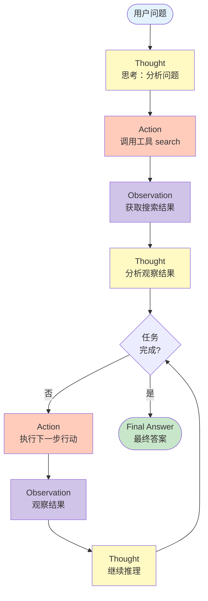

### 2.3 ReAct 示例

#### 场景：回答"2024年奥运会金牌榜前五名是哪些国家？"

```
Thought: 用户想知道2024年奥运会金牌榜前五名。
         我需要先搜索最新的奖牌榜信息。

Action: search(query="2024 Olympics medal table top countries")

Observation: 根据搜索结果，2024年巴黎奥运会按金牌数排名前五的代表团为：
            美国、中国、日本、澳大利亚、法国。

Thought: 我已经获得了答案，可以给用户总结了。

Final Answer: 2024年巴黎奥运会按金牌数排名前五的代表团为：
              1. 美国  2. 中国  3. 日本  4. 澳大利亚  5. 法国
```

### 2.4 ReAct 的优势

- **可解释性**：每一步决策都有清晰的 Thought 记录
- **自我纠错**：通过 Observation 发现错误，可以回退重试
- **灵活组合**：工具可以任意组合，适应复杂任务
- **长程规划**：通过多轮循环完成复杂任务

---

## 3. 工具调用（Function Calling / Tool Use）

### 3.1 为什么需要工具调用

LLM 本身只能处理文本，无法直接与外部世界交互。**工具调用**让 Agent 能够：

- 实时获取信息（搜索、数据库查询）
- 执行实际操作（发送邮件、操作文件）
- 进行复杂计算（数学运算、代码执行）
- 访问最新知识（RAG 知识库检索）

### 3.2 Function Calling 机制

主流 LLM（GPT-4、Claude、Gemini 等）都支持 Function Calling 接口：

#### Step 1：定义工具 Schema

```json
{
  "name": "search",
  "description": "搜索互联网获取实时信息",
  "parameters": {
    "type": "object",
    "properties": {
      "query": {
        "type": "string",
        "description": "搜索关键词"
      }
    },
    "required": ["query"]
  }
}
```

#### Step 2：LLM 输出工具调用

当 LLM 判断需要调用工具时，会输出结构化的调用请求：

```json
{
  "name": "search",
  "arguments": {
    "query": "2024年诺贝尔物理学奖获得者"
  }
}
```

#### Step 3：执行并返回结果

外部系统执行搜索，返回结果给 LLM，LLM 再生成最终响应。

### 3.3 常用工具类型

| 工具类型 | 示例 | 用途 |
|---------|------|------|
| 搜索 | Web Search、API 检索 | 获取实时信息 |
| 计算 | Python REPL、数学工具 | 复杂计算 |
| 代码执行 | Code Interpreter | 运行代码、处理数据 |
| 文件操作 | Read/Write File | 读写本地文件 |
| API 调用 | HTTP Request | 访问第三方服务 |
| 知识检索 | RAG、向量数据库 | 获取专业知识 |
| 数据库 | SQL Query | 查询结构化数据 |

### 3.4 工具调用的实现框架

主流 Agent 开发框架都提供了工具调用能力：

- **LangChain**：通过 `tool` 装饰器定义工具，Agent 自动选择调用
- **LlamaIndex**：丰富的索引 + 检索工具集
- **AutoGPT**：自主任务分解与工具执行
- **CrewAI**：多 Agent 协作框架，支持工具共享
- **Dify**：可视化 Agent编排，支持 100+ 工具插件

---

## 4. 记忆系统

### 4.1 为什么 Agent 需要记忆

传统 LLM 的"记忆"仅存在于单次对话的上下文窗口内：
- 对话结束后，信息全部丢失
- 无法跨会话积累知识
- 无法记住用户的长期偏好

Agent 的**记忆系统**解决了这一问题，实现了类似人类的**短期记忆 + 长期记忆**架构。

### 4.2 记忆系统的三层架构

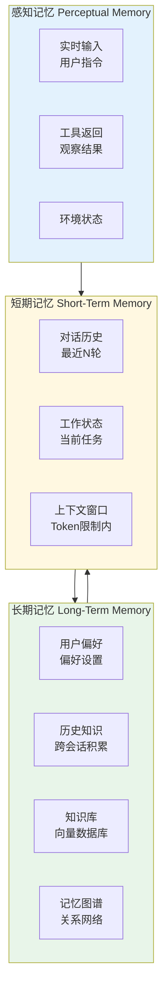

### 4.3 短期记忆（Working Memory）

#### 定义
短期记忆存储当前任务的即时信息，类似于人类的工作记忆。

#### 实现方式
- **对话历史**：保留最近 N 轮对话
- **上下文窗口**：LLM 的输入 token 限制内存储信息
- **会话状态**：当前任务进度、待办事项

#### 管理策略
- **对话摘要**：将长对话压缩为摘要，节省 token
- **重要性过滤**：丢弃低价值信息，保留关键内容
- **滑动窗口**：自动过期过于陈旧的信息

### 4.4 长期记忆（Long-Term Memory）

#### 定义
长期记忆负责跨会话持久化的信息：用户偏好、历史经验、经过验证的事实与知识。长期记忆由 Agent 决定何时将信息写入并保留，以便在未来检索和复用。

#### 与工作记忆、外脑的关系
- 工作记忆（见 4.3） = 当前执行上下文（临时、即时、受 token 限制）。
- 长期记忆 = 被持久化的知识 / 偏好 / 经验（Agent 主动写入与维护）。
- 外脑（见 4.5） = 外部存储/检索/工具基座 —— 它可以承载长期记忆的存储后端（如向量数据库、知识库、记忆图谱、文档库），但也包含更广泛的语料库、搜索引擎与工具接口，不仅限于“记忆”本身。

#### 常见实现示例（示例，不互斥）
- 向量数据库（Vector DB）：用于相似性检索，便于召回与当前上下文相关的记忆。
- 记忆图谱（Memory Graph）：以实体与关系形式存储结构化记忆，便于复杂关系推理。
- 文档库 / 知识库：保存长文本、手册、常见问答等，可作为事实性参考。

（下节为记忆检索策略）

#### 记忆检索策略

| 策略 | 说明 |
|------|------|
| **最近检索** | 优先返回最近添加的记忆 |
| **重要性检索** | 优先返回高权重记忆（用户强调过） |
| **相关性检索** | 向量相似度匹配，召回相关内容 |
| **时间衰减** | 越久远的记忆权重越低 |

### 4.5 外脑（External Brain）

外脑是 Agent 连接的外部知识与工具层。它既可以作为长期记忆的后端（存储被 Agent 持久化的记忆），也可以承载更大规模的语料、文档集合、搜索引擎与各类工具 API。换言之，外脑是一个通用的存储、检索与执行平台；长期记忆是其上的一类数据，由 Agent 按策略写入和管理。

常见组成示例：向量数据库、知识库/KB、记忆图谱、文档库、全文检索/搜索引擎，以及外部工具与 API。

使用模式：在任务执行中，Agent 会维护并压缩工作记忆，从外脑按需检索相关信息（包括长期记忆或更广泛的文档/工具结果），然后把必要的结果回填到工作记忆以支持当前推理与决策。

### 4.6 记忆工程的最佳实践

#### 记忆写入时机
- 对话结束时提取关键信息
- 用户明确表达偏好时
- 完成重要任务后记录结果

#### 记忆检索时机
- 新会话开始时加载相关记忆
- 任务执行过程中按需检索
- 用户提到相关话题时激活

#### 记忆容量管理
- 设置记忆上限（超过则压缩或遗忘）
- 定期合并相似记忆
- 主动遗忘低价值信息

---

## 5. Agent Harness Engine（Agent 运行时 / 编排引擎）

### 5.1 为什么需要 Harness Engine

前面的章节里我们谈了"什么是 Agent"（感知→推理→行动）、ReAct 范式、工具调用、记忆系统。但这些只是**逻辑层**的描述——真正让一个 Agent 在生产环境稳定运行，需要一套完整的**运行时基础设施**。这就是 **Harness Engine**（中文常译"代理引擎"或"Agent 编排器"）。

```
┌──────────────────────────────────────────────────────────────┐
│                    一个朴素 Agent 循环                         │
│                                                              │
│   while True:                                                │
│       response = llm(messages)                               │
│       if response.has_tool_call():                           │
│           result = execute_tool(response.tool_call)          │
│           messages.append(tool_result)                       │
│       else:                                                  │
│           return response.text                               │
│                                                              │
│   —— 看起来简单，但生产环境 100 个细节要处理                    │
└──────────────────────────────────────────────────────────────┘
```

**Harness Engine 是什么**：它是把 LLM（大脑）、工具（双手）、记忆（记忆）、权限系统（免疫系统）整合在一起的**运行时层**。Anthropic 在 Claude Code 源代码里把它称为 "the harness that makes the model useful"。

> **The model is the brain, but the harness is the body, the memory, the workflow engine, the checkpoint ledger, the recovery system, and the quality control layer.** —— Deep Agents 论文

#### Agent 内部 ≠ 模型本身

| 层级 | 谁负责 | 例子 |
|------|--------|------|
| **模型（大脑）** | 推理、生成 | Claude Sonnet 4.5、GPT-5 |
| **Harness（身体）** | 工具调用、上下文管理、权限 | Claude Code、Manus、AutoGPT |
| **应用层（皮肤）** | 业务逻辑、UI | Cursor、Devin、Coze |

> 📌 同一个 Claude Sonnet 模型，套上不同的 Harness 能力差异巨大：作为聊天机器人 vs 作为 Claude Code（自主编程）。LangChain 团队在 Terminal Bench 2.0 中**只改 harness 不换模型**，排名从 Top 30 跃升到 **Top 5**。

---

### 5.2 Harness Engine 的核心组件

一个生产级 Harness 通常包含 **8 大子系统**：

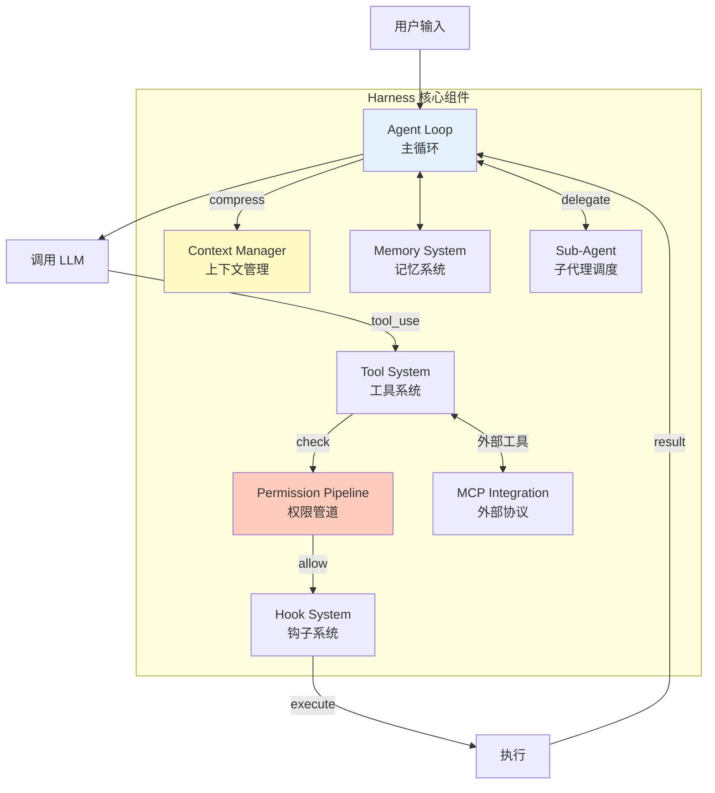

| 子系统 | 职责 | 关键问题 |
|--------|------|----------|
| **Agent Loop** | 反复调 LLM → 执行工具 → 收集结果 | 何时终止？失败如何恢复？ |
| **Tool System** | 工具注册、参数校验、并发执行 | 工具爆炸如何处理？权限怎么控制？ |
| **Context Manager** | 上下文压缩、KV-Cache 优化 | 上下文爆炸了怎么办？ |
| **Memory System** | 长期记忆持久化、检索 | 哪些该记、怎么存、怎么取？ |
| **Permission Pipeline** | 多层级安全检查 | 谁能执行什么？高危操作如何拦截？ |
| **Hook System** | 生命周期事件回调 | 如何插入自定义逻辑？ |
| **Sub-Agent** | 子任务委派、上下文隔离 | 何时分治？子 Agent 怎么协调？ |
| **MCP / 协议** | 外部工具标准化接入 | 如何对接生态？ |

---

### 5.3 案例剖析：Claude Code 的 Harness 架构

Claude Code 是 Anthropic 官方发布的终端编程 Agent，**完全开源其 TypeScript 源码**（v2.1.88）。它代表了当前 Harness 工程的最佳实践。

#### 5.2.1 整体架构图

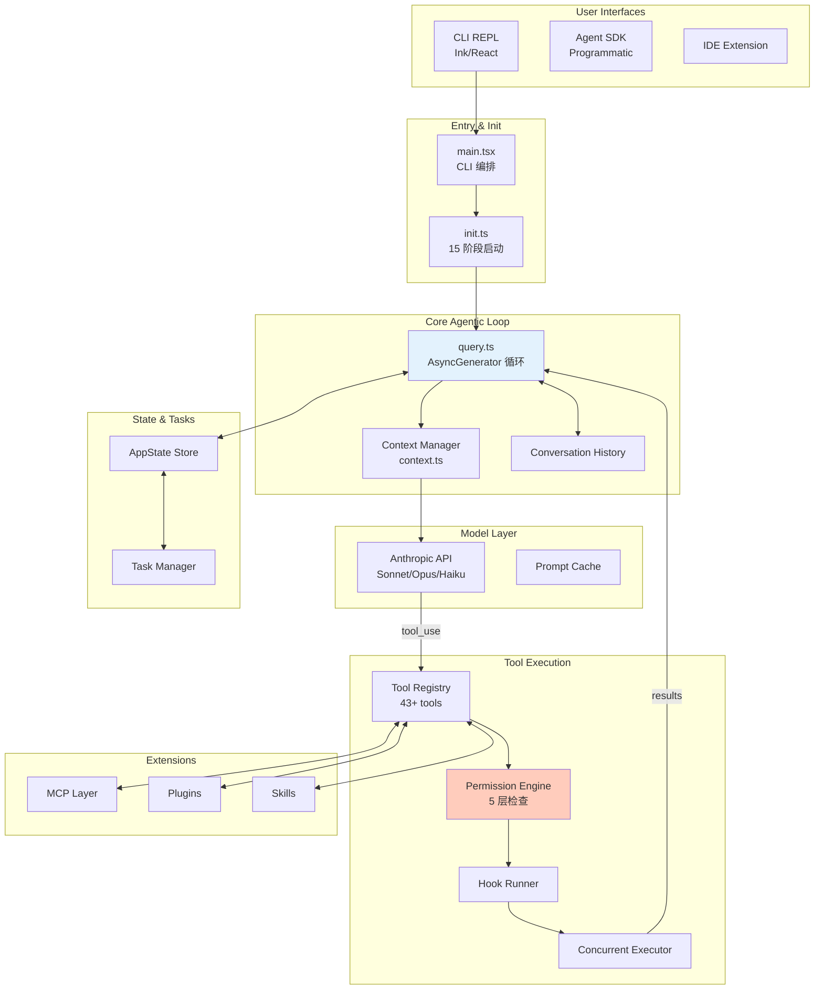

#### 5.2.2 主循环：`while(tool_call)` 的极简实现

Claude Code 的"心脏"是一个出奇简单的 `AsyncGenerator` 循环：

```typescript
// query.ts 简化版
async function* queryLoop(messages: Message[]): AsyncGenerator<Event> {
  while (true) {
    // 1. 上下文压缩（5 阶段管道）
    const compacted = await compactionPipeline(messages);
    
    // 2. 调用 LLM
    const response = await api.messages.create({
      model: 'claude-sonnet-4.5',
      messages: compacted,
      tools: toolPool  // 内置 + MCP 合并
    });
    
    // 3. 检查是否有工具调用
    for (const block of response.content) {
      if (block.type === 'tool_use') {
        // 4. 权限检查（5 层）
        const verdict = await permissionSystem.check(block);
        if (verdict === 'deny') continue;
        if (verdict === 'ask') await promptUser(block);
        
        // 5. Hook 拦截
        await hooks.run('PreToolUse', block);
        
        // 6. 执行
        const result = await toolRegistry.execute(block);
        
        // 7. Hook 后处理
        await hooks.run('PostToolUse', result);
        
        // 8. 把结果追加到消息
        messages.push({ role: 'user', content: result });
        yield { type: 'tool_result', result };
      }
    }
    
    // 9. 没有工具调用 → 终止
    if (response.stop_reason === 'end_turn') return;
  }
}
```

> 💡 **关键洞察**：核心循环**不到 100 行代码**，但**周围 290+ 工具模块、50+ 命令、87+ 钩子**让它成为一个完整的 Harness。

#### 5.2.3 8 个核心内置工具

| 工具 | 用途 | Token 成本 |
|------|------|------------|
| `Bash` | 执行 shell 命令（万能适配器） | 低（命令）+ 可变（输出） |
| `Read` | 读文件（最大 2000 行） | 高（大文件） |
| `Edit` | 增量修改（diff-based） | 中 |
| `Write` | 创建/覆盖文件 | 中 |
| `Grep` | ripgrep 搜索 | 低 |
| `Glob` | 文件名模式匹配 | 低 |
| `Task` | **派生子 Agent** | 高（新上下文） |
| `TodoWrite` | 任务进度跟踪 | 低 |

> 📌 整个 Claude Code **只有 8 个核心工具**——所有复杂功能（如 git、数据库、Playwright 浏览器）都通过 MCP 服务器注入。

#### 5.2.4 五层权限管道

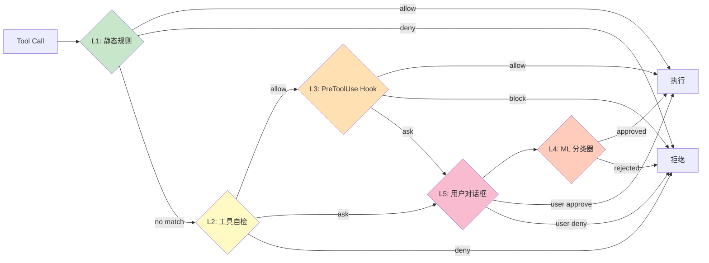

**5 个权限模式**（按授权强度）：

| 模式 | 行为 | 适用 |
|------|------|------|
| `default` | 首次使用弹窗确认 | 个人使用 |
| `acceptEdits` | 文件编辑自动批准 | 编码任务 |
| `plan` | 只读浏览，不修改文件 | 探索阶段 |
| `auto` | ML 分类器自动批准（研究预览） | 批量任务 |
| `bypassPermissions` | 全部放行（但 `rm -rf /` 仍弹窗） | 容器/沙箱环境 |

#### 5.2.5 上下文压缩：四层管道

Claude Code 的上下文管理**是单一最影响输出质量的子系统**（Anthropic 官方原话）。

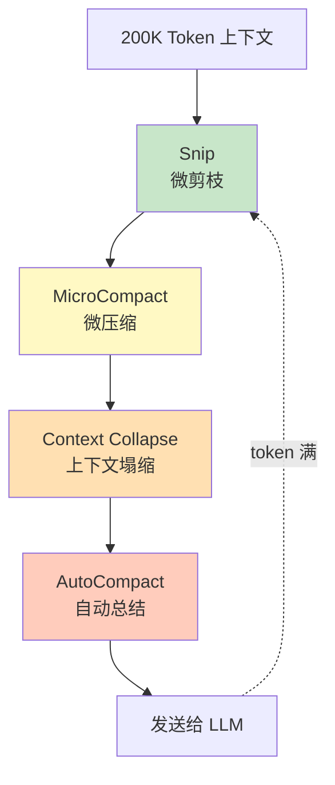

| 阶段 | 触发条件 | 行为 |
|------|----------|------|
| **Snip** | 工具输出过大 | 截断（保留前 N 行 + "..."） |
| **MicroCompact** | 单次工具结果占满 1/4 窗口 | 替换为 placeholder + 摘要 |
| **Context Collapse** | 历史消息变冗余 | 合并相邻 tool 结果 |
| **AutoCompact** | 接近窗口上限（85%） | LLM 总结整个对话为新 context |

---

### 5.4 案例剖析：Manus AI 的 Harness 架构

Manus 是 2025 年爆火的通用 Agent，其工程团队公开了"Context Engineering for AI Agents"博客，揭秘了背后的核心设计哲学。

#### 5.3.1 五大设计原则

#### 5.3.2 KV-Cache 命中率：第一指标

> "If I had to choose just one metric, I'd argue that the KV-cache hit rate is the single most important metric for a production-stage AI agent." —— Manus 工程博客

**为什么**：Agent 的输入输出 token 比约为 **100:1**（每次模型调用要"看"完整历史），KV-Cache 命中率直接决定**延迟**和**成本**。

**三条实操**：
1. **保持系统提示词稳定**——任何改动都让缓存失效
2. **保持上下文 append-only**——不要修改历史消息
3. **显式标记缓存断点**（cache_control）—— 在 system prompt 末尾插入

#### 5.3.3 工具爆炸对策：屏蔽而非删除

> 一个真实生产 Agent 可能挂载 100+ 工具（MCP 风潮后更甚）。但更多工具 = 更笨的 Agent。

Manus 不用 RAG 动态加载工具，而是**用状态机 + logit mask 屏蔽**：

```python
# 简化版：使用 response prefill 约束工具选择
# Hermes 格式的三种模式
# 1. Auto：模型可调可不调
prefill = "<|im_start|>assistant"

# 2. Required：必须调，但不限制调哪个
prefill = "<|im_start|>assistant <|tool_call|>"

# 3. Specified：必须调，但限定子集
prefill = '<|im_start|>assistant {"name": "browser_'
#  ↑ 用工具名前缀做约束
```

**命名规范**也很关键：
- 所有浏览器工具以 `browser_` 开头
- 所有 shell 工具以 `shell_` 开头
- ……这样可以轻松"按前缀"约束

#### 5.3.4 文件系统作为外部记忆

Manus 把**文件系统**当作"无限容量、持久化、可被 Agent 自我操作"的外部记忆：

```python
# 典型工作流
def run_task(task):
    # 1. 写入计划到 todo.md
    write_file("todo.md", generate_plan(task))
    
    # 2. 边执行边更新 todo.md
    while not done:
        action = plan_next_step()
        result = sandbox.execute(action)
        update_todo_mark_done(current_step)
        
        # 3. 中间结果存文件，不入上下文
        if is_large_output(result):
            save_to_file(f"results/step_{n}.json", result)
            context_result = "结果已存到 results/step_n.json"
        else:
            context_result = result
```

#### 5.3.5 通过复述操纵注意力（"todo.md 魔法"）

长循环（典型任务 ~50 步）会**lost-in-the-middle**——LLM 忘记早期目标。Manus 的解法：

```markdown
# todo.md 持续被改写
# 任务：研究 2025 年中国 AIGC 行业格局

- [x] 搜索 2025 中国 AIGC 报告
- [x] 收集头部 10 家公司
- [x] 整理市场份额数据
- [ ] 撰写行业洞察
- [ ] 输出最终报告
```

**机制**：每完成一步就重写 todo.md，把它放在**上下文的最后**——LLM 的"最近注意力"集中在计划上，**不会走偏**。这是一种用自然语言"操纵"注意力机制的方法，无需架构改动。

#### 5.3.6 保留错误（不要清理失败痕迹）

> "Don't clean up the context when something fails. Leave the wrong turns in."

```python
# ❌ 错误做法
if action_failed:
    messages.remove(failed_action)  # 删掉失败记录

# ✅ Manus 做法
if action_failed:
    messages.append(error_traceback)  # 留下失败
    # LLM 看到错误 → 调整先验 → 减少重犯
```

**为什么有效**：模型从错误信息中**更新内部信念**（internal belief），下次遇到类似情况会做不同选择。

---

### 5.5 案例剖析：Deep Agents（LangChain 开源 Harness）

LangChain 在 2025 年开源了 **Deep Agents**——MIT 协议、复刻 Claude Code/Manus/Codex 的工程模式。

#### 5.4.1 四层架构

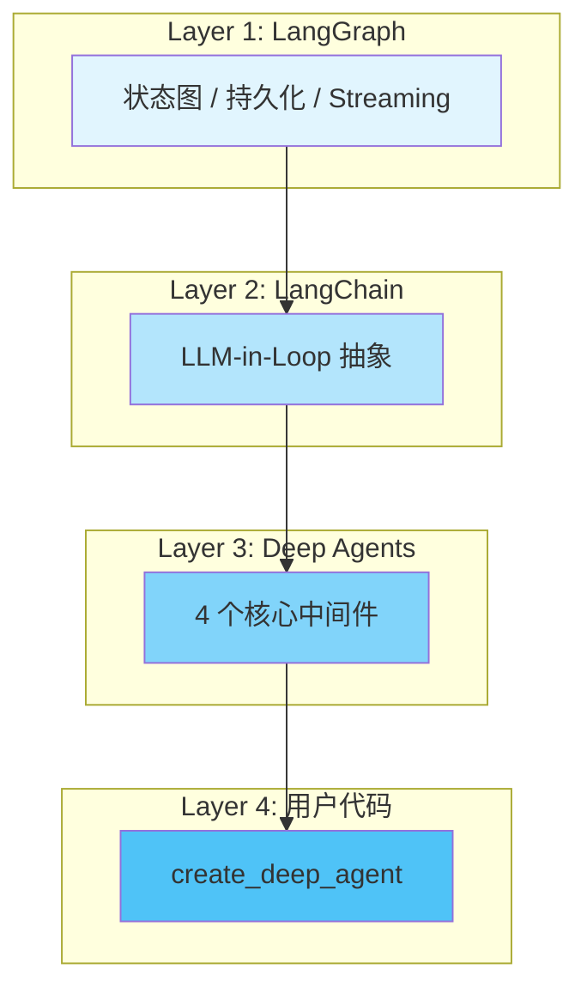

#### 5.4.2 四个核心原语（所有顶级 Harness 都收敛于此）

```python
from deepagents import create_deep_agent
from langchain.tools import tool

@tool
def my_tool(query: str) -> str:
    """我的工具描述"""
    return f"Result: {query}"

agent = create_deep_agent(
    model="anthropic:claude-sonnet-4-5",
    tools=[my_tool],
    system_prompt="你是一个有帮助的助手"
)
```

| 原语 | 作用 | 中间件 |
|------|------|--------|
| **1. TodoList 计划** | 任务分解、进度跟踪 | `TodoListMiddleware` |
| **2. Filesystem 文件系统** | 外部记忆、上下文管理 | `FilesystemMiddleware` |
| **3. Sub-Agent 委派** | 上下文隔离、并行 | `SubAgentMiddleware` |
| **4. 详细 System Prompt** | 行为模式（4 阶段问题解决） | 内置 |

#### 5.4.3 Ralph Loop：长时自治模式

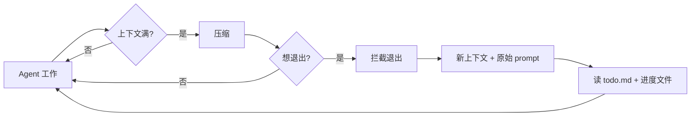

**Ralph Loop** 命名来自《辛普森一家》永远摔不死的角色 Ralph——**拦截 agent 提前退出**，强制它在新上下文里读 todo.md 继续干。

#### 5.4.4 Deep Agents 的中间件系统

```python
# Deep Agents 中间件一览
default_middlewares = [
    TodoListMiddleware(),          # 任务跟踪
    FilesystemMiddleware(),        # 文件操作
    SubAgentMiddleware(),          # 子代理
    MemoryMiddleware(),            # 长期记忆
    SkillsMiddleware(),            # 技能按需加载
    HumanInTheLoopMiddleware(),    # 人类审批
    SummarizationMiddleware(),     # 摘要压缩
]
```

**自定义中间件示例**：

```python
from deepagents.middleware import wrap_tool_call

@wrap_tool_call
def loop_detection(tool_call, next_handler):
    """检测对同一文件的循环编辑，超过 5 次强制反思"""
    file = tool_call.input.get("file_path", "")
    edit_count = state.get("edit_count", {}).get(file, 0) + 1
    
    if edit_count > 5:
        return "⚠️ 你已编辑该文件 5 次，建议先回顾整体设计"
    
    state.setdefault("edit_count", {})[file] = edit_count
    return next_handler(tool_call)
```

---

### 5.6 MCP（Model Context Protocol）— 工具的 USB-C

**MCP** 是 Anthropic 在 2024 年提出的**开放协议**，让任何工具/数据源以标准化方式接入 LLM。

#### 5.5.1 为什么需要 MCP

```
没有 MCP 的世界：
  Claude Code ↔ 自定义集成 GitHub
  Claude Code ↔ 自定义集成 Slack
  Claude Code ↔ 自定义集成 DB
  ... 1000 个集成 = 1000 个适配器

有 MCP 的世界：
  GitHub MCP Server
  Slack MCP Server
  DB MCP Server
  Claude Code ↔ 协议 ↔ 所有 Server
  "工具的 USB-C"
```

#### 5.5.2 协议架构

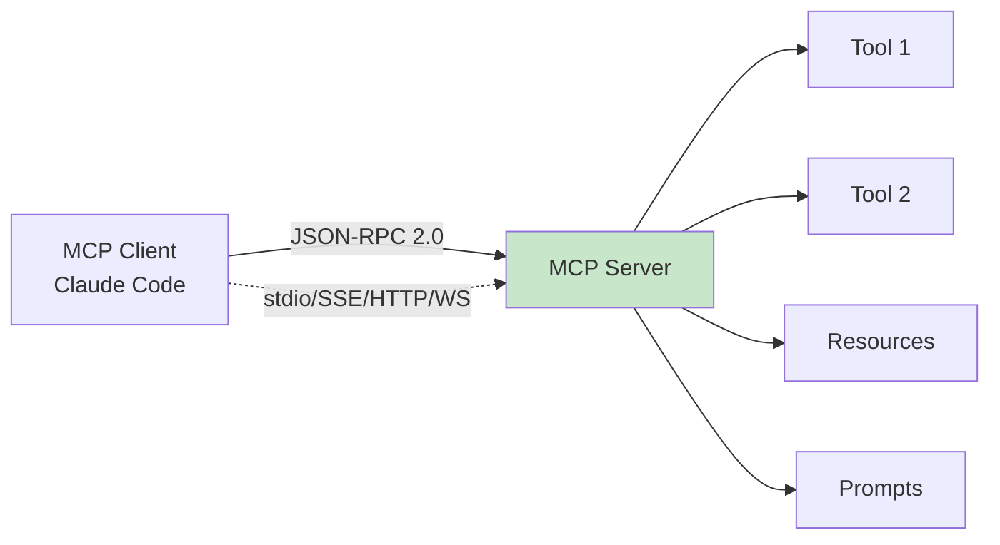

| 传输 | 场景 |
|------|------|
| **stdio** | 本地进程 |
| **SSE** | Server-Sent Events（长连接） |
| **HTTP** | 远程服务 |
| **WebSocket** | 双向通信 |
| **SDK** | 嵌入式 |

#### 5.5.3 工具命名规范

```python
# MCP 工具命名：mcp__<server>__<tool>
mcp__github__create_issue
mcp__puppeteer__browser_navigate
mcp__context7__get_library_docs
```

#### 5.5.4 关键限制

| 限制 | 说明 |
|------|------|
| **无对话历史访问** | 工具只看到自己的参数和返回 |
| **无状态** | 每次调用独立（除非 server 自己做缓存） |
| **不能改 system prompt** | 只能注册工具 |
| **不绕过权限** | 走和内置工具一样的权限管道 |

#### 5.5.5 流行 MCP Server 速查

| Server | 用途 | 适用 |
|--------|------|------|
| **Serena** | 符号感知代码导航 | 大型项目 |
| **grepai** | 语义搜索 + 调用图 | 代码理解 |
| **Context7** | 官方库文档查询 | 依赖查询 |
| **Playwright** | 浏览器自动化 | E2E 测试 |
| **Sequential** | 结构化多步推理 | 复杂任务 |
| **PostgreSQL/SQLite** | 数据库操作 | 数据查询 |

---

### 5.7 Hooks（钩子）— 生命周期事件系统

Hooks 是 Harness 中**拦截生命周期事件**的机制，让你插入自定义逻辑而无需修改主循环。

#### 5.6.1 Claude Code 的 5 类 Hook 事件

| 事件 | 触发时机 | 能力 |
|------|----------|------|
| `SessionStart` | 会话初始化 | 环境校验、初始化 |
| `UserPromptSubmit` | 消息发到 LLM 前 | 改写、增强、阻断 |
| `PreToolUse` | 工具执行前 | 审批/阻断/改输入 |
| `PostToolUse` | 工具执行后 | 改输出、日志 |
| `Stop` | Agent 终止 | 清理、通知 |

#### 5.6.2 Hook 配置示例（settings.json）

```json
{
  "hooks": {
    "PreToolUse": [
      {
        "matcher": "Bash",
        "hooks": [
          {
            "type": "command",
            "command": "/usr/local/bin/check-dangerous-rm.sh",
            "timeout": 5000
          }
        ]
      }
    ],
    "PostToolUse": [
      {
        "matcher": "Edit|Write",
        "hooks": [
          {
            "type": "command",
            "command": "prettier --write \"$CLAUDE_TOOL_FILE_PATH\""
          }
        ]
      }
    ]
  }
}
```

#### 5.6.3 Hook 决策矩阵

| Hook 返回 | PreToolUse | PostToolUse | UserPromptSubmit |
|-----------|------------|-------------|------------------|
| **allow** | 继续（不弹窗） | - | 放行 |
| **deny/block** | 阻断 | - | 阻断 |
| **ask** | 弹窗 | - | - |
| **modify** | 改 tool 输入 | 改 tool 输出 | 改 prompt |

> ⚠️ **Hook 不绕过权限规则**：即使 hook 返回 "allow"，匹配的 deny 规则仍会阻断。

---

### 5.8 Sub-Agent（子代理）— 上下文隔离的艺术

子 Agent 是 Harness 中**最重要也最危险**的能力——用得好是分治利器，用不好是失控之源。

#### 5.7.1 为什么需要子 Agent

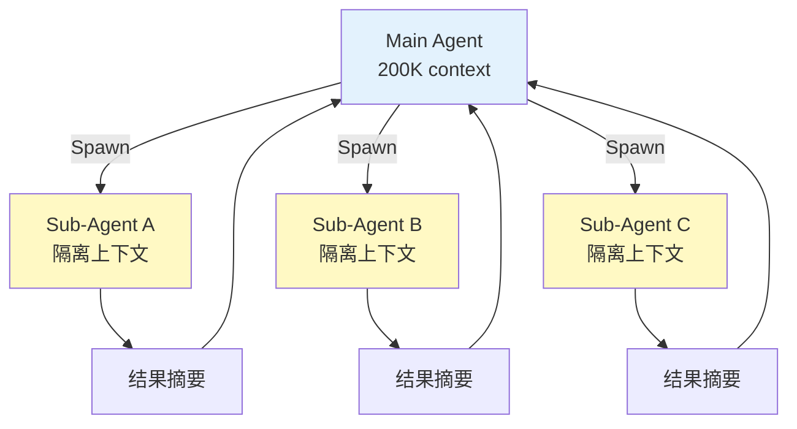

**核心问题**：主 Agent 的上下文是宝贵资源。如果让它直接做 50 步的子任务，context 会爆炸。

**解法**：spawn 一个**隔离上下文**的子 Agent，让它跑完只返回**摘要**。

#### 5.7.2 Claude Code 的 5 类内置 Sub-Agent

| Type | 模型 | 工具 | 用途 |
|------|------|------|------|
| `general-purpose` | 继承父级 | 全部 | 通用 |
| `Explore` | **Haiku**（快） | 只读（Read/Glob/Grep） | 快速代码扫描 |
| `Plan` | 继承父级 | 只读 | 架构规划 |
| `Verification` | 继承父级 | 测试相关 | 测试验证 |
| `CRI` | 继承父级 | 文档查询 | 文档辅助 |

#### 5.7.3 Hub-and-Spoke 模式

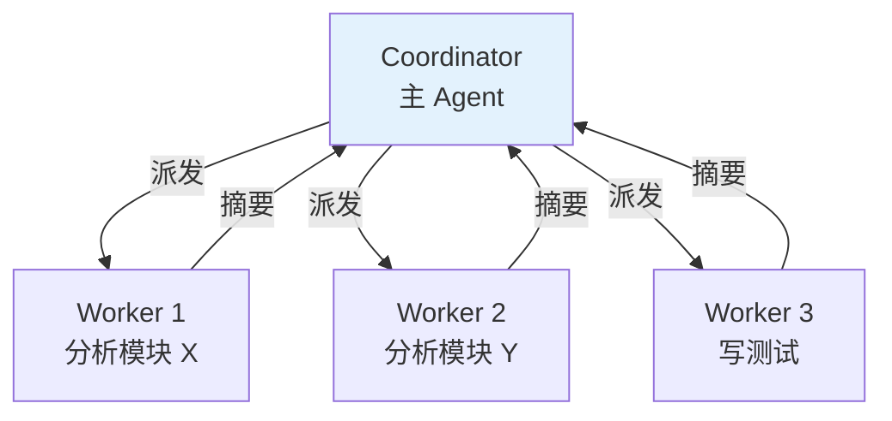

**关键规则**：**Worker 之间不共享上下文**。如果 Worker B 需要 Worker A 的结果，必须由 Coordinator **显式传递**。

#### 5.7.4 自定义 Sub-Agent（.claude/agents/*.md）

```markdown
---
name: code-reviewer
description: 审查 PR 中的代码变更
model: claude-sonnet-4-5
permissionMode: plan
tools:
  - Read
  - Grep
  - Glob
disallowedTools:
  - Write
  - Edit
maxTurns: 30
---

# Code Reviewer

你是一位严格的代码审查者。审查 {input} 中的代码变更，按以下维度输出：

1. 正确性（bug、边界、并发）
2. 性能（O(n²) → O(n)）
3. 安全性
4. 可维护性

只读不写，给出结构化建议。
```

---

### 5.9 上下文工程（Context Engineering）vs Prompt Engineering

Prompt Engineering 关注**单次输入**的优化，Context Engineering 关注**整个 Agent 生命周期**中"什么信息该出现在 context 里"。

#### 5.8.1 Context Engineering 四大原语（来自 LangChain）

| 原语 | 描述 | Manus 案例 |
|------|------|----------|
| **Write** | 写到外部（文件、todo.md） | plan 持久化 |
| **Select** | 拉取相关上下文 | 知识检索 |
| **Compress** | 摘要、截断 | Context Collapse |
| **Isolate** | 拆窗口 | Sub-Agent |

#### 5.8.2 Lost-in-the-Middle 问题

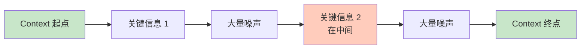

**问题**：LLM 对**上下文开头和结尾**的信息最敏感，中间信息**容易丢失**。

**解法**：
- **Recitation 复述**：把关键 plan 写到 todo.md（push 到 context 末尾）
- **Reordering 重排序**：把重要内容移到 context 末尾
- **Compression 压缩**：减少噪声

#### 5.8.3 Few-Shot 的陷阱：过拟合

> "Don't Get Few-Shotted" —— Manus

如果系统 prompt 中有大量**固定格式的示例**，模型会**机械模仿**——一旦用户输入和示例不完全一致，模型表现下降。

**解法**：故意引入**结构化多样性**——
- 不同的序列化模板
- 不同的措辞
- 顺序的微小变化

```python
# ❌ 固定格式
"{action_type}\n{tool_name}\n{parameters}"

# ✅ 多样化格式
# Format 1
"Action: {action_type}\nTool: {tool_name}\nArgs: {params}"

# Format 2
"[{action_type}] calling {tool_name}({params})"

# Format 3
"// {action_type} call
{tool_name}({params})"
```

---

### 5.10 主流 Harness 框架对比

| 框架 | 核心抽象 | 上下文管理 | Sub-Agent | MCP | 开源 | 适合 |
|------|----------|------------|-----------|-----|------|------|
| **Claude Code / Agent SDK** | tool_use + 钩子 | 5 阶段压缩 | depth=1 隔离 | ✅ | 客户端开源 | 编程 / 通用 |
| **Manus** | CodeAct + 文件系统 | todo.md + 外部文件 | 多 sandbox | ✅ | 闭源 | 通用 Agent |
| **LangChain Deep Agents** | 中间件 | FilesystemMiddleware | SubAgent | ✅ | MIT | 通用 |
| **LangGraph** | 状态图 | 自定义 | 自定义 | ✅ | MIT | 复杂流程 |
| **CrewAI** | Role-based 协作 | 简单 | 多 Agent 协作 | ❌ | MIT | 多角色 |
| **AutoGen (Microsoft)** | 对话 | 简单 | GroupChat | 部分 | MIT | 学术 / 研究 |
| **OpenHands** | Docker + 工具 | 简单 | 是 | ❌ | MIT | 编程 |
| **Smolagents (HuggingFace)** | Code Agent | 简单 | ❌ | 部分 | MIT | 轻量 |
| **PydanticAI** | 类型化 Agent | 简单 | ❌ | ❌ | MIT | 类型安全 |

#### 选择建议

| 场景 | 推荐 |
|------|------|
| **通用研究/编码** | Claude Code / Manus |
| **生产 RAG** | LangChain + Deep Agents |
| **复杂多步流程** | LangGraph |
| **快速多角色协作** | CrewAI |
| **学术 / 对话研究** | AutoGen |
| **类型安全** | PydanticAI |
| **轻量 Code Agent** | Smolagents |
| **企业级** | LangGraph + 自定义中间件 |

---

### 5.11 如何自建一个最小 Harness

#### 5.10.1 核心 50 行

```python
import json
import subprocess
from typing import Callable

class MiniHarness:
    def __init__(self, llm, tools: dict, max_iter=20):
        self.llm = llm
        self.tools = tools  # {"name": (description, func)}
        self.max_iter = max_iter
    
    def run(self, user_msg, history=None):
        history = history or []
        history.append({"role": "user", "content": user_msg})
        
        for i in range(self.max_iter):
            # 1. 调用 LLM
            response = self.llm.chat(
                messages=history,
                tools=[{"name": n, "description": d} for n, (d, _) in self.tools.items()]
            )
            
            # 2. 处理工具调用
            tool_calls = response.get("tool_calls", [])
            if not tool_calls:
                # 3. 没有工具调用 → 完成
                history.append({"role": "assistant", "content": response["content"]})
                return response["content"]
            
            # 4. 执行所有工具调用
            history.append({"role": "assistant", "content": response["content"], "tool_calls": tool_calls})
            for tc in tool_calls:
                name, args = tc["name"], tc["arguments"]
                if name not in self.tools:
                    result = f"Error: tool {name} not found"
                else:
                    try:
                        result = self.tools[name][1](**args)
                    except Exception as e:
                        result = f"Error: {e}"
                history.append({"role": "tool", "tool_call_id": tc["id"], "content": str(result)})
        
        return "Error: max iterations exceeded"

# 使用
def shell(cmd: str) -> str:
    return subprocess.run(cmd, shell=True, capture_output=True, text=True).stdout

harness = MiniHarness(
    llm=my_llm,
    tools={"shell": ("执行 shell 命令", shell)}
)

print(harness.run("列出当前目录文件"))
```

#### 5.10.2 进阶：加上权限、压缩、子 Agent

```python
class ProHarness(MiniHarness):
    def __init__(self, *args, dangerous_patterns=None, **kwargs):
        super().__init__(*args, **kwargs)
        self.dangerous_patterns = dangerous_patterns or ["rm -rf", "sudo", "> /dev/"]
    
    def check_permission(self, tool_name, args):
        if tool_name == "shell":
            cmd = args.get("cmd", "")
            for p in self.dangerous_patterns:
                if p in cmd:
                    return f"DENIED: '{p}' not allowed"
        return "ALLOW"
    
    def run(self, user_msg, history=None):
        history = history or []
        history.append({"role": "user", "content": user_msg})
        
        for i in range(self.max_iter):
            # 上下文压缩
            if self._count_tokens(history) > 100_000:
                history = self._compress_history(history)
            
            response = self.llm.chat(...)
            
            for tc in response.get("tool_calls", []):
                # 1. 权限检查
                verdict = self.check_permission(tc["name"], tc["arguments"])
                if verdict != "ALLOW":
                    history.append({"role": "tool", "content": verdict})
                    continue
                
                # 2. 执行
                result = self._execute(tc)
                history.append({"role": "tool", "content": result})
        
        return response["content"]
    
    def _compress_history(self, history):
        # 简单策略：保留 system + 最近 10 轮
        return [history[0]] + history[-10:]
```

#### 5.10.3 工业级建议

1. **不要重新发明轮子**：基于 LangGraph / Deep Agents / Claude Agent SDK 起步
2. **从 observability 开始**：先有 trace，再谈优化
3. **权限是头等大事**：5 层管道 + hook 拦截 + 沙箱
4. **上下文是核心瓶颈**：把 KV-Cache 命中率当北极星指标
5. **Sub-Agent 谨慎使用**：depth=1 限制 + 显式上下文传递
6. **MCP 是未来方向**：所有新工具集成走 MCP

---

## 6. Agent 的工具与框架

### 6.1 LangChain Agent

```python
from langchain.agents import AgentType, initialize_agent
from langchain.tools import Tool
from langchain.chat_models import ChatOpenAI

# 定义工具
tools = [
    Tool(name="search", func=search_func, description="搜索信息"),
    Tool(name="calculator", func=calc_func, description="数学计算"),
]

# 初始化 Agent
agent = initialize_agent(
    tools=tools,
    llm=ChatOpenAI(temperature=0),
    agent=AgentType.CHAT_CONVERSATIONAL,
    verbose=True
)

# 执行任务
result = agent.run("2024年奥运会金牌榜前五名是哪些国家？")
```

### 6.2 CrewAI 多 Agent 协作

```python
from crewai import Agent, Task, Crew

# 定义多个 Agent
researcher = Agent(role="研究员", goal="调研最新AI进展", tools=[search])
writer = Agent(role="作家", goal="撰写科技文章", tools=[write])

# 定义任务
task1 = Task(description="搜索2024年AI领域突破性进展", agent=researcher)
task2 = Task(description="基于研究结果写一篇报道", agent=writer)

# 启动协作
crew = Crew(agents=[researcher, writer], tasks=[task1, task2])
result = crew.kickoff()
```

### 6.3 CrewAI 多 Agent 协作

```python
from crewai import Agent, Task, Crew

# 定义多个 Agent
researcher = Agent(role="研究员", goal="调研最新AI进展", tools=[search])
writer = Agent(role="作家", goal="撰写科技文章", tools=[write])

# 定义任务
task1 = Task(description="搜索2024年AI领域突破性进展", agent=researcher)
task2 = Task(description="基于研究结果写一篇报道", agent=writer)

# 启动协作
crew = Crew(agents=[researcher, writer], tasks=[task1, task2])
result = crew.kickoff()
```

---

## 7. Agent 评测基准与 Leaderboard（2024-2026）

一个 Agent 真正能不能用，**必须用标准 benchmark 测**。这一节覆盖 6 大主流 Agent 基准——从代码到 GUI，从单步到长程。

### 7.1 SWE-Bench：代码 Agent 的金标准

**SWE-Bench**（2023, Princeton）测试 AI 解决**真实 GitHub Issue** 的能力——给定一个 issue，Agent 需要：
1. 理解问题
2. 找到相关文件
3. 编辑代码
4. 写/跑测试
5. 通过所有单元测试

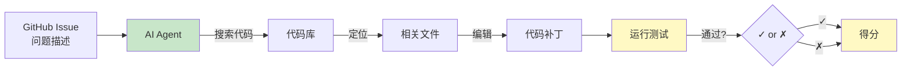

**SWE-Bench 三个版本**：

| 版本 | 任务数 | 来源 | 难度 |
|------|--------|------|------|
| **SWE-Bench** | 2,294 | 12 个热门 Python 仓库的真实 issue | 较易（部分任务能"猜"） |
| **SWE-Bench Verified** | 500 | 人工验证可解 | 主流 benchmark |
| **SWE-Bench Lite** | 300 | 验证集中较简单的子集 | 入门 |

**2024-2026 SOTA 演进**：

| 时间 | 顶级模型/Agent | SWE-Bench Verified |
|------|----------------|-------------------|
| 2023.10 | GPT-4 + 简单 Agent | 1.96% |
| 2024.01 | AutoCodeRover | 22-26% |
| 2024.04 | SWE-Agent + GPT-4 | 12.5%（官方） |
| 2024.08 | Devin (Cognition) | 13.86% |
| 2024.10 | Codestral + scaffolding | ~30% |
| 2024.12 | Claude Sonnet 3.5 + Agent | 49% |
| **2025.03** | **Claude Sonnet 4.5 + SWE-Agent** | **65%** |
| **2025.06** | **Claude Opus 4.5 + scaffold** | **75%+** |
| **2026** | **Claude Mythos / Opus 4.8 + 顶级 scaffold** | **90%+** |

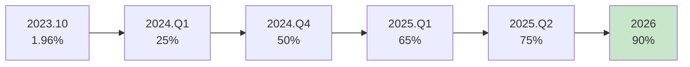

**核心洞察**：**模型权重不是决定因素，scaffold（脚手架）才是关键**。

| 模型 | 简单 Agent | 顶级 Scaffold | 差距 |
|------|-----------|--------------|------|
| Claude Sonnet 4.5 | 43% | 65% | **+22 分** |
| GPT-5 Codex | 51% | 70% | +19 分 |
| DeepSeek V3 | 32% | 50% | +18 分 |

> **关键启示**：投资优秀的 harness / scaffold 比等更好的模型**回报更高**。

**主流 Scaffold 工具栈**（2025-2026）：

| Scaffold | 描述 | 特点 |
|----------|------|------|
| **mini-SWE-agent** | 100 行 Python | **新基准的标配**，简单可复现 |
| **SWE-Agent** | Princeton 出品 | 学术标准 |
| **OpenHands** (OpenDevin) | 开源 | Docker 沙箱、完整工具链 |
| **CodeAct** | ICML 2024 | 模型写代码执行而非 JSON tool call |
| **Aider** | 终端 pair programming | Git 集成 |
| **Claude Code / Cline / Roo Code** | 商业产品 | IDE 集成 |
| **Manus / Devin** | 商业产品 | GUI 通用 Agent |

#### 实战：用 mini-SWE-agent 跑 SWE-Bench

```bash
# 安装
pip install mini-swe-agent

# 跑 SWE-Bench Verified
mini-swe-agent \
    --task swebench-verified \
    --model anthropic/claude-sonnet-4.5 \
    --output-dir ./swe-results

# 单个 issue
mini-swe-agent \
    --instance django__django-11179 \
    --model anthropic/claude-sonnet-4.5
```

### 7.2 GAIA：通用 AI 助手基准

**GAIA**（2024, Meta + HuggingFace）测试**通用助手**能力——需要**推理 + 多模态 + 工具使用 + 长程规划**。

**任务类型**：

| 级别 | 任务数 | 描述 |
|------|--------|------|
| Level 1 | 155 | 简单问答，2-5 步 |
| Level 2 | 165 | 中等难度，5-15 步 |
| Level 3 | 95 | 复杂任务，需要规划+组合工具 |

**典型任务**：
- "打开这个 PDF，找出第 3 页第 2 张图的作者是谁？"
- "这张图（一张图表）显示了 X 公司过去 5 年的营收，计算 2023 年的同比增长率"
- "阅读这个网页，找到所有提到 'transformer' 的链接，按出现顺序排列"

**2024-2026 SOTA**：

| 模型 | GAIA Pass@1 |
|------|-------------|
| GPT-4 + ReAct | 15% |
| AutoGPT-4 + Tools | 32% |
| Claude Sonnet 4 + Agent | 65% |
| **Claude Sonnet 4.5 + 顶级 scaffold** | **75%+** |

### 7.3 WebArena / VisualWebArena：Web 浏览器 Agent

**WebArena**（2023, CMU）测试在**真实网站**上执行任务的能力——GitHub、Reddit、地图、购物、办公套件。

**典型任务**：
- "在 GitHub 上创建一个新 issue，标题是...，标签是..."
- "在购物网站上找到价格低于 $50 的红色 T 恤，按评分排序"
- "在地图上找出从 A 到 B 的最短驾车路线，避开高速"

**VisualWebArena**（2023）增加视觉元素——需要**截图理解**。

### 7.4 AgentBench / τ-bench / GAIA 全景

| 基准 | 年份 | 测什么 | 难度 | SOTA |
|------|------|--------|------|------|
| **SWE-Bench Verified** | 2024 | 真实代码任务 | 中-高 | 80-90% |
| **GAIA** | 2024 | 通用助手推理 | 中-高 | 70-80% |
| **WebArena** | 2023 | 浏览器操作 | 中 | 60-70% |
| **VisualWebArena** | 2023 | 视觉+Web | 中-高 | 50-60% |
| **AgentBench** | 2023 | 综合（8 子任务） | 混合 | 60-70% |
| **τ-bench** | 2024 | 工具 Agent 真实场景 | 中-高 | 50-60% |
| **OSWorld** | 2024 | 真实 OS 操作 | 高 | 40-50% |
| **MobileAgent** | 2024 | 手机 UI 操作 | 高 | 30-40% |
| **SWE-Bench Multimodal** | 2024 | 多模态代码 | 中 | 30-40% |

### 7.5 Agent 评估的 4 大维度

```mermaid
graph TB
    Eval[Agent 评估] --> D1[任务完成率<br/>是否成功?]
    Eval --> D2[效率<br/>步数 / 时间 / 成本]
    Eval --> D3[鲁棒性<br/>失败后能否恢复?]
    Eval --> D4[可解释性<br/>决策可追溯?]
    
    D1 --> M1[Pass@1, Pass@k]
    D2 --> M2[平均步数, token 成本]
    D3 --> M3[异常恢复率]
    D4 --> M4[Thought 质量评分]
    
    style D1 fill:#c8e6c9
    style D2 fill:#fff9c4
    style D3 fill:#ffccbc
    style D4 fill:#e3f2fd
```

| 维度 | 指标 | 怎么测 |
|------|------|--------|
| **任务完成率** | Pass@1, Pass@k | benchmark 得分 |
| **效率** | 平均步数、token 数、时长 | 工具调用日志 |
| **鲁棒性** | 失败后恢复率 | 故意制造错误 |
| **可解释性** | 决策可追溯 | Thought 评估 / 人工 |

### 7.6 自建 Agent 评估的 4 步法

```python
# 1. 准备评估集
test_cases = [
    {"input": "...", "expected_output": "...", "tools_available": [...]},
    ...  # 50-500 个真实场景
]

# 2. 运行 Agent
for case in test_cases:
    result = agent.run(case["input"])
    case["actual_output"] = result
    case["trajectory"] = agent.get_trajectory()  # 完整 trace
    case["tool_calls"] = agent.get_tool_calls()

# 3. 自动评估
def evaluate(test_cases):
    for case in test_cases:
        # Pass@1: 输出是否匹配
        case["passed"] = check_output(case["actual_output"], case["expected_output"])
        # 效率
        case["steps"] = len(case["tool_calls"])
        case["cost"] = calculate_cost(case["trajectory"])
        # 用 LLM-as-judge 评估轨迹质量
        case["judge_score"] = judge_agent(case["trajectory"])

# 4. 报告
results = evaluate(test_cases)
print(f"Pass@1: {mean([c['passed'] for c in test_cases]):.1%}")
print(f"平均步数: {mean([c['steps'] for c in test_cases]):.1f}")
print(f"平均成本: ${mean([c['cost'] for c in test_cases]):.3f}")
```

### 7.7 Agent Scaffold 比模型权重更重要的实证

| 模型 | 简单 ReAct | 顶级 Scaffold | 提升 |
|------|-----------|--------------|------|
| Claude Sonnet 4.5 | 43% | 65% | +22 |
| GPT-5 Codex | 51% | 70% | +19 |
| DeepSeek V3 | 32% | 50% | +18 |
| Qwen3-32B | 25% | 45% | +20 |

> 📌 **关键启示**：对于想做 Agent 产品的团队，**工程能力比模型选型更重要**。一个好的 scaffold 可以让中等模型达到顶级效果，反之亦然。

---

> **评测方法**：上面这些基准衡量「结果好不好」，但 Agent 还要看「过程对不对」（工具参数、越权、死循环）。轨迹级评测与 pass@k 见 [16-2 RAG 与 Agent 评测](../PART16-评测监控与治理/16-2-RAG与Agent评测.md)。

## 8. Computer Use / Deep Research / Operator：2024-2025 新范式

2024-2025 年，Agent 领域诞生了三类全新产品形态，代表了"通用 AI 助手"的未来方向。

### 8.1 Computer Use（OpenAI，2024-10）

**OpenAI Operator / Claude Computer Use** 让 Agent 直接**操控图形界面**（鼠标、键盘、屏幕截图），无需 API。

**核心能力**：
- 屏幕截图 + VLM 理解当前界面
- 鼠标点击 / 拖拽 / 滚动
- 键盘输入 / 快捷键
- 跨应用操作（浏览器、Office、桌面应用）

**技术栈**：
1. **视觉感知**：用 GPT-4V / Claude 3.5 Sonnet 理解截图
2. **动作空间**：鼠标坐标 (x, y) + 操作类型 + 文本输入
3. **闭环控制**：截图 → 推理 → 动作 → 截图 → 推理 → ...

**典型应用**：
- 自动填写复杂表单
- 跨网站数据迁移
- 在线订餐、订票
- 企业 ERP 操作（替代 RPA）

**安全挑战**：
- 错误操作风险高（误删文件、误付款）
- 需要"人在回路"确认
- 沙盒化执行（Docker 隔离）

**代表评测**：WebArena（真实网站任务）、OSWorld（桌面级）、ScreenAgent。

### 8.2 Deep Research（OpenAI，2025-02 / Gemini 2024-12）

**Deep Research** 是"长程研究型 Agent"，能在 5-30 分钟内完成需要人类数小时的研究任务。

**与 ChatGPT 的区别**：
- 传统 ChatGPT：单轮对话，一次性输出
- **Deep Research**：自主规划研究路径 → 多轮搜索 → 交叉验证 → 综合报告

**工作流程**：
```
用户提问 → 任务分解 → 多轮搜索（10-50 次）
       ↓
   交叉验证（多源对比） → 整理引用 → 生成报告
       ↓
   （每步用户可中断、纠偏）
```

**典型能力**：
- "对比 2025 年最值得买的 5 款新能源汽车" → 检索 100+ 网页 → 交叉对比参数、价格、评测 → 生成带引用的报告
- "分析我的细分赛道的竞争格局" → 搜索行业报告 → 提取关键数据 → SWOT 分析

**SOTA 模型对比（2025）**：

| 模型 | 报告长度 | 引用准确率 | 平均耗时 |
|------|---------|-----------|---------|
| OpenAI Deep Research | 5000+ 字 | 92% | 8 分钟 |
| Gemini Deep Research | 4000+ 字 | 88% | 12 分钟 |
| Perplexity Pro Search | 2000+ 字 | 75% | 3 分钟 |
| Qwen3 Deep Research | 4500+ 字 | 85% | 10 分钟 |

**Harness Engine 视角**：
- **记忆**：长程任务需要 KV Cache 复用 + 文件系统外存
- **工具**：搜索 / 阅读器 / 代码执行 / 引用验证
- **规划**：自适应的研究树（不是固定 DAG）
- **可中断**：用户可随时纠偏（增加"人机协同"模式）

### 8.3 Operator（OpenAI，2025-01）

**Operator** 是 Computer Use 的**产品化版本**，核心是"在浏览器中执行任务"：
- 浏览器作为沙盒环境
- 用户可随时接管（Take Over）
- 任务完成后给出完整执行日志

**与 Computer Use 的区别**：
- Computer Use：通用桌面 / 任意软件
- Operator：限定在浏览器内（更安全）

**商业模式**：
- Pro 版：$200/月，包含 400 次任务
- API 开放给企业（按 token 计费）

### 8.4 工程实现模式

这三个新范式都遵循**三层架构**：

```
┌─────────────────────────────────────┐
│  Application Layer（任务层）          │
│  Deep Research / Computer Use        │
├─────────────────────────────────────┤
│  Harness Engine（编排层）            │
│  Task Decomposition / Tool Routing  │
│  Memory Management / Error Recovery │
├─────────────────────────────────────┤
│  Foundation Model（基座层）          │
│  VLM + Reasoning LLM + Code Model   │
└─────────────────────────────────────┘
```

**关键技术**：
- **任务分解**：把"研究 X"拆解为 50-100 个子任务
- **工具路由**：根据子任务选合适的工具（搜索/计算/代码）
- **错误恢复**：网页失败 → 切换搜索源；网络超时 → 指数退避重试
- **成本控制**：单次任务可能消耗 $1-10 的 token，需要精细计费

**参考资料**：
- OpenAI. (2024). *Computer-Using Agent*. OpenAI.
- OpenAI. (2025). *Deep Research: An Agent that Searches and Synthesizes Information*. OpenAI.
- Anthropic. (2024). *Computer Use (Claude 3.5 Sonnet)*. Anthropic.
- Google. (2024). *Gemini Deep Research*. Google.

---

## 9. 编程 Agent 生态全景（2024-2026）

编程 Agent（Code Agent / Coding Agent）是 2024-2026 年增长最快的 Agent 品类，从"代码补全"进化到"自主完成整个工程任务"。本节梳理主流工具的能力边界与定位。

### 9.1 主流编程 Agent 对比

| 工具 | 厂商 | 形态 | 核心模型 | SWE-Bench Verified | 特点 |
|------|------|------|---------|-------------------|------|
| **Claude Code** | Anthropic | CLI Agent | Claude 4.7/4.5 | ~65% | Harness 标杆、Harness 范式的代表 |
| **OpenAI Codex CLI** | OpenAI | CLI Agent | GPT-5/o3 | ~50% | 原 Codex 复活，2025 年开源 |
| **OpenCode** | 开源社区 | CLI Agent | 多模型 | 依模型 | SST / Pipe 模式、断点续传 |
| **Cursor** | Cursor Inc. | IDE (VSCode Fork) | 多模型 | ~50% | Tab 补全 + Composer 多文件编辑 |
| **Cline** | 开源 | VSCode 扩展 | 多模型 | 依模型 | 完全开源、人气最高 |
| **Aider** | 开源 | CLI Agent | 多模型 | 依模型 | Git 集成强、repo map |
| **Continue** | 开源 | IDE 扩展 | 多模型 | 依模型 | VSCode + JetBrains |
| **OpenClaw** | 开源 | CLI Agent | 多模型 | 依模型 | 强调工具调用 + 浏览器 |
| **Hermes Agent** | Nous Research | 开源框架 | Hermes 系列 | 依模型 | 可本地部署、隐私优先 |
| **Roo Code / Cline Pro** | 开源 | VSCode 扩展 | 多模型 | ~50% | Cline 商业版 |

### 9.2 Claude Code（Anthropic，2024-2025）

Anthropic 推出的官方 CLI 编程 Agent，是当前 Harness 范式的标杆（已在 5.2 节详述）。

- **GitHub**: <https://github.com/anthropics/claude-code>
- **官网**: <https://www.claude.com/product/claude-code>
- **核心能力**: 多文件编辑、Bash 执行、Sub-Agent 委派、MCP 工具协议
- **SOTA**: SWE-Bench Verified ~65%（2026 年 6 月）

### 9.3 OpenAI Codex CLI（2025 年开源复活）

OpenAI 在 2021 年推出 Codex（基于 GPT-3 的代码补全）后沉寂多年，**2025 年以全新形式复活**：
- 形态：CLI 工具 + IDE 插件 + 云端沙盒
- 核心模型：基于 GPT-5 / o3 的 codex-1 模型
- 特色：云端执行（Codex Cloud），本地仅做编排
- 开源：[openai/codex](https://github.com/openai/codex)

### 9.4 OpenCode（开源，2024-）

**SST 模式**（Single-shot / Steady / Tweak）的代表性开源编程 Agent：
- **GitHub**: <https://github.com/sst/opencode>
- **核心理念**：把"编程 Agent"拆成 3 个独立命令：`opencode`（生成）、`opencode -c`（续接）、`opencode --share`（分享）
- **多模型支持**：Claude / GPT / Gemini / 本地 Ollama
- **特点**：极简 CLI、断点续传强、AGPL-3.0 开源

### 9.5 Cursor（VSCode Fork，2024-2025 现象级产品）

首个 AI-native IDE，把 VSCode 改造为 Agent 中心：
- **官网**: <https://www.cursor.com>
- **核心功能**：
  - **Tab 补全**：超越 Copilot 的多行/跨文件补全
  - **Cmd-K**：内联编辑（选中代码 → 自然语言修改）
  - **Composer**：多文件 Agent 编辑（最常用功能）
  - **@Docs / @Web / @Code**：上下文感知 RAG
- **商业模式**：Pro $20/月、Business $40/月
- **争议**：涉嫌抄 VSCode、开源协议问题、2025 年估值 90 亿美元

### 9.6 Cline（开源 VSCode 扩展，2024-2025）

GitHub 增长最快的 AI 编程项目（star 数 30k+）：
- **GitHub**: <https://github.com/cline/cline>
- **核心理念**：完全开源、可自托管、支持任意模型
- **架构**：Plan/Act 双模式、MCP 原生支持、浏览器内嵌
- **差异化**：Cline 是 IDE 扩展（不改 VSCode 本身），Cursor 是 Fork

### 9.7 Aider（开源，2024）

以 **Repo Map**（代码库结构图）著称的 CLI Agent：
- **GitHub**: <https://github.com/Aider-AI/aider>
- **核心理念**：把整个 repo 喂给 LLM（通过 ctags/treesitter 生成结构图）
- **优势**：多文件编辑准确率高、原生 Git 集成（自动 commit）
- **Benchmark**：在 Polyglot benchmark 上表现优于多数商业产品

### 9.8 OpenClaw（开源 CLI Agent）

强调**真实工具调用**与**浏览器自动化**的开源编程 Agent：
- **GitHub**: <https://github.com/openclaw/openclaw>
- **核心能力**：Bash 沙盒、Playwright 浏览器、文件编辑、测试运行
- **差异化**：与 LangChain / LlamaIndex 等框架解耦，专注 Harness 本身
- **使用场景**：CI/CD 集成、批量化代码任务

### 9.9 Hermes Agent（Nous Research，2024-2025）

**Nous Research** 发布的开源 Agent 框架，以 **Hermes 系列模型** 为基座：
- **官网**: <https://nousresearch.com>
- **GitHub**: <https://github.com/NousResearch/hermes-agent>
- **核心模型**：Hermes 4（70B / 405B），基于 Llama 3.1 微调
- **核心理念**：
  - 完全开源（Apache 2.0 / MIT）
  - **Function Calling** 数据集（业内最大开源 FC 训练集）
  - 支持 **本地部署**（Ollama / vLLM）
  - **隐私优先**：模型权重 + Agent 框架都自托管
- **典型场景**：
  - 企业内部代码 Agent（数据不出网）
  - 离线编程（无网络环境）
  - 学术研究（可复现）

### 9.10 选型决策树

```
场景？
├─ 极致性能 + 不差钱 → Claude Code / Cursor Pro
├─ 完全开源 + VSCode → Cline / Continue
├─ 完全开源 + CLI → OpenCode / Aider / OpenClaw
├─ 数据不出网（合规）→ Hermes（本地部署）
├─ IDE 内多文件编辑 → Cursor / Cline / Roo Code
├─ 脚本/CI 场景 → Aider / OpenClaw / OpenCode
└─ 学术研究 / 可复现 → Hermes + Llama
```

---

## 10. 国产 Agent / Claw 平台（2024-2026）

中国 AI Agent 生态在 2024-2026 年呈爆发式增长，每个大厂都推出了自有 Agent 平台或产品。

### 10.1 主流国产 Agent / Claw 平台对比

| 平台 | 厂商 | 形态 | 核心模型 | 特点 |
|------|------|------|---------|------|
| **Manus** | Butterfly Effect | 通用 Agent | Claude + 多模型 | 首个现象级通用 Agent，GAIA 87% |
| **扣子 Coze** | 字节跳动 | Bot/Agent 平台 | 豆包/Doubao | 低代码工作流、生态最丰富 |
| **GLM-PC** | 智谱 AI | 桌面 Agent | GLM-4.5 | "AI 帮你操作电脑"，对标 Anthropic Computer Use |
| **Qwen-Agent** | 阿里 | 开源框架 | Qwen3 | Apache 2.0、Tool Calling 优秀 |
| **AppBuilder** | 百度 | 企业 Agent 平台 | 文心 4.0 | 政企市场强势、工作流拖拽 |
| **腾讯元宝** | 腾讯 | C 端 Agent | 混元 + DeepSeek | 接入微信生态（公众号/小程序） |
| **Kimi Agent** | 月之暗面 | 通用 Agent | Moonshot | 长上下文（200K+）+ 搜索 |
| **DeepSeek Agent** | 深度求索 | 通用 Agent | DeepSeek-V3/R1 | 极致性价比、开源 |
| **豆包 MarsCode** | 字节 | IDE 编程 Agent | 豆包 | 对标 Cursor，云端沙盒 |
| **Trae** | 字节 | AI IDE | Claude/Doubao | 2025 推出的对标 Cursor 的 IDE |
| **通义灵码** | 阿里 | VSCode/JetBrains | Qwen3-Coder | 阿里官方编程助手，对标 Copilot |
| **CodeGeeX** | 智谱 | VSCode/JetBrains | CodeGeeX 多语言 | 清华系、开源、支持 20+ 语言 |
| **iflycode** | 科大讯飞 | VSCode | 讯飞星火 | 教育市场、政企 |

### 10.2 Manus（Butterfly Effect，2025-03）

**首个现象级国产通用 Agent**：
- 官网: <https://manus.im>
- 发布：2025-03，4 个月内邀请码炒到 10 万元
- 架构：KV-Cache 命中率为北极星指标、文件系统作外存、todo.md 复述操纵注意力（已在 5.3 节详述）
- 性能：GAIA benchmark 87%（2025-04），超越 OpenAI Deep Research
- 争议：被质疑"套壳 Claude"（官方未否认底层使用 Claude）

### 10.3 扣子 Coze（字节跳动，2024-2025）

字节跳动推出的 **Bot/Agent 低代码平台**：
- 官网: <https://www.coze.cn>（国内）/ <https://www.coze.com>（海外）
- 核心能力：
  - 可视化工作流编排（拖拽式）
  - 插件市场（搜索、计算、代码、图像生成……）
  - 多模态 Bot（图文音视频）
  - 一键发布到飞书、微信、抖音
- 模型：豆包（Doubao）/ DeepSeek / 自定义
- 用户：截至 2025 年底，**企业+个人开发者 100 万+ Bot**
- 商业模式：免费 + 企业版（¥999/月起）

### 10.4 GLM-PC（智谱 AI，2025-2025）

**"AI 帮你操作电脑"**的国产对标 Anthropic Computer Use：
- 模型：GLM-4.5（多模态 + 工具调用）
- 能力：屏幕截图理解、鼠标键盘操作、跨软件任务
- 场景：自动填表、跨软件数据迁移、办公自动化
- 与 Anthropic Computer Use 对比：国产合规 + 中文界面 + 微信/钉钉生态

### 10.5 Qwen-Agent（阿里，开源）

**阿里达摩院**开源的 Agent 框架：
- GitHub: <https://github.com/QwenLM/Qwen-Agent>
- 协议：Apache 2.0
- 核心能力：
  - Tool Calling（业内最强开源之一）
  - 浏览器自动化
  - RAG（内置向量数据库）
  - 多模态
- 模型：Qwen3（0.6B / 4B / 8B / 32B / 235B）
- 优势：完全开源、可商用、中文优化、与阿里云深度集成

### 10.6 百度 AppBuilder（企业级，2024-2025）

**政企市场 Agent 平台**：
- 官网: <https://cloud.baidu.com/product/appbuilder>
- 模型：文心 4.0（ERNIE）
- 特色：
  - 工作流拖拽（类似 Coze）
  - 企业知识库 / RAG
  - 行业模板（教育/医疗/金融/政务）
  - **私有化部署**（满足政企合规）
- 商业模式：按 API 调用付费 + 私有化 license

### 10.7 腾讯元宝（2024-2025）

**C 端 Agent + 搜索**：
- 接入微信生态：公众号文章解析、小程序跳转
- 模型：混元（Hunyuan）+ 接入 DeepSeek（2025）
- 特色：腾讯文档、QQ 邮箱、视频号内容深度整合
- 用户：2025 年底月活 5000 万+

### 10.8 Kimi Agent（月之暗面，2024-2025）

**长上下文 + 搜索**的 Agent 路线：
- 官网: <https://kimi.moonshot.cn>
- 模型：Moonshot V1（200K 上下文）
- 特色：
  - 长文档解析（论文/合同/财报）
  - 联网搜索 + 多跳推理
  - 2025 年推出 K2（开源）
- 用户：学生/研究人员占比高

### 10.9 DeepSeek Agent（深度求索，2024-2025）

**极致性价比 + 强推理**：
- 模型：DeepSeek-V3（671B MoE）、R1（推理）
- Agent 能力：Function Calling、代码执行、搜索
- 优势：API 价格仅为 GPT-5 的 1/20，性能接近
- 生态：被腾讯元宝、扣子等多家平台接入

### 10.10 编程 Agent 国产版（豆包 MarsCode / Trae / 通义灵码 / CodeGeeX）

| 工具 | 厂商 | 形态 | 对标 | 特点 |
|------|------|------|------|------|
| **豆包 MarsCode** | 字节 | 云端 IDE | GitHub Codespaces | 字节豆包驱动 |
| **Trae** | 字节 | AI IDE | Cursor | 2025 年新发布，海外名 Trae.ai |
| **通义灵码** | 阿里 | VSCode/JetBrains | GitHub Copilot | 阿里官方、完全免费 |
| **CodeGeeX** | 智谱 | 多 IDE 插件 | Tabnine | 20+ 编程语言、清华大学开源 |
| **iflycode** | 科大讯飞 | VSCode | Copilot | 教育市场强势 |

### 10.11 选型决策树（国产）

```
场景？
├─ 通用 Agent（GAIA 类）→ Manus / 扣子 / 元宝
├─ 企业/政企（私有化）→ AppBuilder（百度）/ GLM-PC（智谱）
├─ 编程助手 → 通义灵码 / CodeGeeX / MarsCode / Trae
├─ 长文档/研究 → Kimi
├─ 极致性价比 API → DeepSeek
├─ 完整开源框架 → Qwen-Agent
├─ 微信生态 → 元宝（腾讯）
└─ 抖音/飞书生态 → 扣子（字节）
```

---

## 本章小结
1. **Agent 定义**：AI Agent 是感知→推理→行动的核心循环系统，与被动响应的传统 LLM 相比，具有主动性和目标导向性，能够自主规划并持续行动。

2. **ReAct 范式**：推理（Reasoning）与行动（Acting）交替进行，通过 Thought-Action-Observation 循环实现可解释的自主规划，是 Agent 规划能力的重要基础。

3. **工具调用**：Function Calling / Tool Use 机制让 Agent 能够调用外部工具（搜索、计算、代码执行等），突破了 LLM 自身能力的边界。

4. **记忆系统**：分为短期记忆（上下文窗口内的当前会话信息）和长期记忆（向量数据库/知识图谱中持久化的历史知识），共同支撑 Agent 的连续推理能力。

5. **Harness Engine（Agent 运行时）**：把 LLM、工具、记忆、权限整合的**基础设施层**。8 大核心组件（主循环、工具系统、上下文管理、记忆、权限、钩子、子 Agent、MCP）。Claude Code / Manus / Deep Agents 的工程模式已成为业界标杆。
6. **Agent 评测**：SWE-Bench Verified 是代码 Agent 金标准（2026 SOTA ~90%），GAIA、WebArena、OSWorld 覆盖不同场景。**Scaffold 比模型权重更关键**：同一模型差距可达 20+ 分。**mini-SWE-agent** 是新基准的标配 harness。
   - **Claude Code**：5 层权限管道、4 层上下文压缩、5 类内置子 Agent
   - **Manus**：KV-Cache 命中率为北极星指标、文件系统作外存、todo.md 复述操纵注意力
   - **Deep Agents**：中间件架构 + 4 大原语（TodoList/Filesystem/SubAgent/System Prompt）
   - **MCP**：工具集成的 USB-C 标准，JSON-RPC 2.0
   - **Ralph Loop**：拦截 agent 提前退出，长时自治模式
   - **Context Engineering 四大原语**：Write / Select / Compress / Isolate

6. **多 Agent 架构**：通过角色分工、消息传递实现复杂任务协作，适用于软件工程、报告撰写、企业分析等需要多领域知识的场景。

7. **新范式（2024-2025）**：Computer Use 让 Agent 直接操控图形界面；Deep Research 实现长程研究任务（5-30 分钟）；Operator 是产品化的浏览器内执行。三者都遵循"应用层 + Harness 层 + 基座模型层"的三层架构。

8. **编程 Agent 生态（2024-2026）**：
   - **CLI 系**：Claude Code（Harness 标杆）、OpenAI Codex CLI（云端沙盒）、OpenCode（SST 模式开源）、Aider（Repo Map）、OpenClaw（工具调用）
   - **IDE 系**：Cursor（VSCode Fork）、Cline（开源 VSCode 扩展）、Continue
   - **本地部署系**：Hermes Agent（Nous Research、Apache 2.0、隐私优先）
   - **选型**：性能→Claude Code；开源→Cline/OpenCode；合规→Hermes 本地；IDE→Cursor

9. **国产 Agent 生态（2024-2026）**：
   - **通用 Agent**：Manus（GAIA 87%）、扣子 Coze（字节低代码平台）、腾讯元宝（微信生态）
   - **企业 Agent**：百度 AppBuilder（政企私有化）、智谱 GLM-PC（Computer Use 国产对标）
   - **编程 Agent**：通义灵码（阿里）、CodeGeeX（清华开源）、豆包 MarsCode、Trae（字节）
   - **开源框架**：Qwen-Agent（Apache 2.0、Tool Calling 强）
   - **API 性价比**：DeepSeek（价格仅 GPT-5 的 1/20）

掌握这些基础概念后，下一章我们将深入了解 **Multi-Agent 协作** 与 **具身智能（Embodied AI）**，探索 Agent 系统的更高阶能力。


## 知识图谱

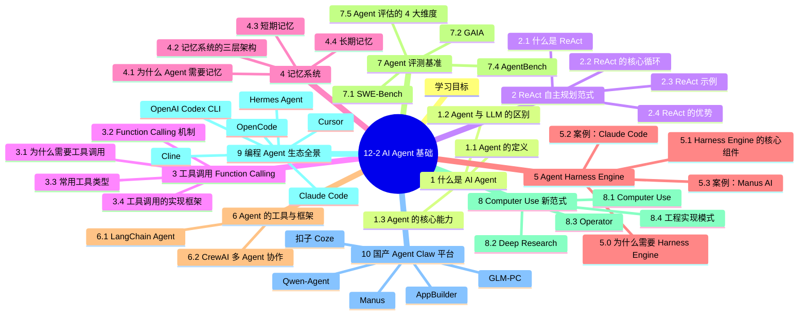

## 参考资料

### 基础 Agent
1. Yao, S., et al. (2022). [ReAct: Synergizing Reasoning and Acting in Language Models](https://arxiv.org/abs/2210.03629). *arXiv*.
2. Wei, J., et al. (2022). [Chain-of-Thought Prompting Elicits Reasoning in Large Language Models](https://arxiv.org/abs/2201.11903). *NeurIPS*.
3. Park, J., et al. (2023). [Generative Agents: Interactive Simulacra of Human Behavior](https://arxiv.org/abs/2304.03442). *UIST*.
4. Schella, M., et al. (2024). [Memory Engineering for LLM-based Agents](https://arxiv.org/abs/2401.01088). *arXiv*.

### Harness Engine / Context Engineering
5. Ji, Y. (Peak), et al. (2025). [Context Engineering for AI Agents: Lessons from Building Manus](https://manus.im/blog/Context-Engineering-for-AI-Agents-Lessons-from-Building-Manus). *Manus AI Blog*.
/@pankaj_pandey/inside-manus-the-architecture-that-replaced-tool-calls-with-executable-code-d89e1caea678). *Medium*.
7. Wang, R. et al. (2024). [CodeAct: Your LLM Agent Can Execute Python Code](https://arxiv.org/abs/2402.01030). *ICML*.
/blog/claude-code-harness-engineering). *DuoCode Tech Blog*.
9. Dive into Claude Code Research Team. (2026). [Dive into Claude Code: The Design Space of Today's and Future AI Agent Systems](https://arxiv.org/html/2604.14228v1). *arXiv*.
10. Anthropic Engineering. (2024-2026). [Claude Code Best Practices](https://code.claude.com/docs/en/best-practices).
11. Anthropic. (2024). [Building Effective Agents](https://www.anthropic.com/research/building-effective-agents).
12. Anthropic. (2024). [Model Context Protocol Specification](https://modelcontextprotocol.io/).
/99-%E5%B7%A5%E5%85%B7%E4%B8%8E%E5%8F%82%E8%80%83/repos/claude-code-book/en/README). *Claude Code Book*.
/deep-agents-the-harness-behind-claude-code-codex-manus-and-openclaw-bdd94688dfdb). *Medium*.
15. LangChain. (2025). [Deep Agents (Open Source)](https://github.com/langchain-ai/deepagents).
16. Miessler, D. (2025). [Harness Engineering for AI Agents](https://github.com/danielmiessler/HarnessEngineering). *Harness Engineering Specification*.

### 框架
17. [LangChain Documentation](https://docs.langchain.com/).
18. [LlamaIndex Documentation](https://docs.llamaindex.ai/).
19. [CrewAI Documentation](https://docs.crewai.com/).
20. [AutoGen (Microsoft)](https://github.com/microsoft/autogen).
21. [LangGraph](https://langchain-ai.github.io/langgraph/).
22. [PydanticAI](https://ai.pydantic.dev/).
23. [Smolagents (HuggingFace)](https://github.com/huggingface/smolagents).

### 编程 Agent（2024-2026）
24. [Claude Code (Anthropic)](https://www.claude.com/product/claude-code) — Harness 标杆
25. [OpenAI Codex CLI](https://github.com/openai/codex) — 2025 年开源复活
26. [OpenCode (SST)](https://github.com/sst/opencode) — 极简开源
27. [Cursor](https://www.cursor.com) — VSCode Fork
28. [Cline](https://github.com/cline/cline) — 开源 VSCode 扩展
29. [Aider](https://github.com/Aider-AI/aider) — Repo Map 著称
30. [Continue](https://www.continue.dev/) — 多 IDE 插件
31. [OpenClaw](https://github.com/openclaw/openclaw) — 工具调用 + 浏览器
32. [Hermes Agent (Nous Research)](https://nousresearch.com) — 本地部署、Apache 2.0
33. [CodeGeeX (智谱)](https://codegeex.cn/) — 清华开源、多语言

### 国产 Agent / Claw 平台
34. [Manus](https://manus.im) — 首个现象级通用 Agent（GAIA 87%）
35. [扣子 Coze（字节）](https://www.coze.cn) — 低代码 Bot 平台
36. [GLM-PC（智谱）](https://www.zhipuai.cn) — Computer Use 国产对标
37. [Qwen-Agent（阿里）](https://github.com/QwenLM/Qwen-Agent) — Apache 2.0 开源
38. [百度 AppBuilder](https://cloud.baidu.com/product/appbuilder) — 政企私有化
39. [腾讯元宝](https://yuanbao.tencent.com) — 微信生态 Agent
40. [Kimi Agent（月之暗面）](https://kimi.moonshot.cn) — 长上下文
41. [DeepSeek Agent](https://www.deepseek.com) — 极致性价比
42. [豆包 MarsCode（字节）](https://www.marscode.com) — 云端 IDE
43. [Trae（字节）](https://www.trae.ai) — AI IDE
44. [通义灵码（阿里）](https://lingma.aliyun.com) — VSCode 编程助手
