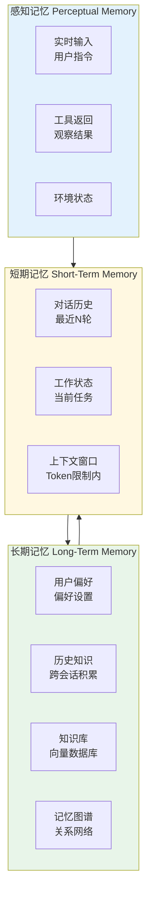
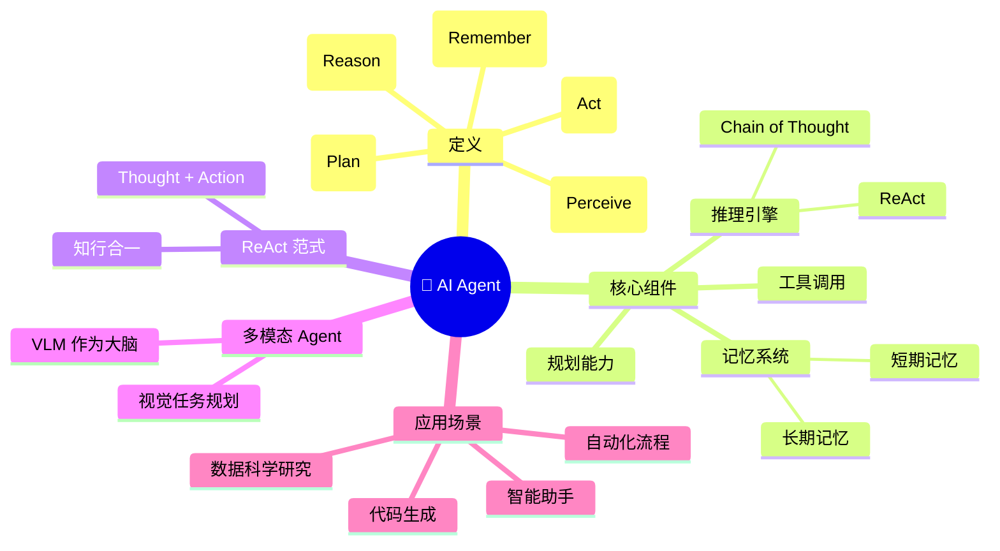

# 12-2 AI Agent 基础

## 学习目标

- 理解 AI Agent 的定义：感知→推理→行动的核心循环
- 掌握 ReAct（Reasoning + Acting）自主规划范式
- 理解工具调用（Function Calling / Tool Use）的机制与实现
- 掌握 Agent 记忆系统：短期记忆与长期记忆的设计

---

## 1. 什么是 AI Agent

### 1.1 Agent 的定义

**AI Agent（人工智能智能体）** 是一种能够自主感知环境、做出决策并执行行动的智能系统。与传统被动响应的 AI 模型不同，Agent 具有**主动性**和**目标导向性**。

#### 核心循环：感知→推理→行动

```
┌─────────────────────────────────────────┐
│                                         │
│    感知 ──▶ 推理 ──▶ 行动              │
│      ▲                        │        │
│      │        反馈             ▼        │
│      └────── (结果) ←────────┘        │
│                                         │
└─────────────────────────────────────────┘
```

- **感知（Perception）**：接收外部信息（用户指令、工具返回、环境状态）
- **推理（Reasoning）**：分析当前状态，制定行动计划
- **行动（Action）**：调用工具、执行操作、生成响应

### 1.2 Agent 与 LLM 的区别

| 维度 | 大语言模型（LLM） | AI Agent |
|------|------------------|----------|
| 输入输出 | 接收文本输入，输出文本响应 | 接收多源输入，执行多步操作 |
| 自主性 | 被动响应，每次独立 | 主动规划，连续决策 |
| 工具使用 | 不可调用外部工具 | 可调用工具、API、代码 |
| 记忆能力 | 无状态（上下文窗口内） | 具备短期/长期记忆 |
| 目标导向 | 无明确目标 | 围绕目标持续行动 |

### 1.3 Agent 的核心能力

一个完整的 AI Agent 应具备以下能力：

1. **规划能力**：将复杂任务分解为可执行的子步骤
2. **工具使用**：调用外部工具（搜索、计算、代码执行）
3. **记忆管理**：保存和检索历史信息与知识
4. **自我反思**：评估行动效果，修正错误策略
5. **多模态感知**：处理文本、图像、音频等多种输入

---

## 2. ReAct — 自主规划范式

### 2.1 什么是 ReAct

**ReAct**（Reasoning + Acting, 2023）是一种让 LLM 进行自主规划的方法，由 Princeton 和 Google 的研究团队提出。

核心思想：让模型在执行任务时，**交替进行推理（Reasoning）和行动（Acting）**，而不是一次性生成完整答案。

### 2.2 ReAct 的核心循环


### 2.3 ReAct 示例

#### 场景：回答"2024年奥运会金牌榜前五名是哪些国家？"

```
Thought: 用户想知道2024年奥运会金牌榜前五名。
         我需要先搜索最新的奖牌榜信息。

Action: search(query="2024 Olympics medal table top countries")

Observation: 根据搜索结果，2024年巴黎奥运会按金牌数排名前五的代表团为：
            美国、中国、日本、澳大利亚、法国。

Thought: 我已经获得了答案，可以给用户总结了。

Final Answer: 2024年巴黎奥运会按金牌数排名前五的代表团为：
              1. 美国  2. 中国  3. 日本  4. 澳大利亚  5. 法国
```

### 2.4 ReAct 的优势

- **可解释性**：每一步决策都有清晰的 Thought 记录
- **自我纠错**：通过 Observation 发现错误，可以回退重试
- **灵活组合**：工具可以任意组合，适应复杂任务
- **长程规划**：通过多轮循环完成复杂任务

---

## 3. 工具调用（Function Calling / Tool Use）

### 3.1 为什么需要工具调用

LLM 本身只能处理文本，无法直接与外部世界交互。**工具调用**让 Agent 能够：

- 实时获取信息（搜索、数据库查询）
- 执行实际操作（发送邮件、操作文件）
- 进行复杂计算（数学运算、代码执行）
- 访问最新知识（RAG 知识库检索）

### 3.2 Function Calling 机制

主流 LLM（GPT-4、Claude、Gemini 等）都支持 Function Calling 接口：

#### Step 1：定义工具 Schema

```json
{
  "name": "search",
  "description": "搜索互联网获取实时信息",
  "parameters": {
    "type": "object",
    "properties": {
      "query": {
        "type": "string",
        "description": "搜索关键词"
      }
    },
    "required": ["query"]
  }
}
```

#### Step 2：LLM 输出工具调用

当 LLM 判断需要调用工具时，会输出结构化的调用请求：

```json
{
  "name": "search",
  "arguments": {
    "query": "2024年诺贝尔物理学奖获得者"
  }
}
```

#### Step 3：执行并返回结果

外部系统执行搜索，返回结果给 LLM，LLM 再生成最终响应。

### 3.3 常用工具类型

| 工具类型 | 示例 | 用途 |
|---------|------|------|
| 搜索 | Web Search、API 检索 | 获取实时信息 |
| 计算 | Python REPL、数学工具 | 复杂计算 |
| 代码执行 | Code Interpreter | 运行代码、处理数据 |
| 文件操作 | Read/Write File | 读写本地文件 |
| API 调用 | HTTP Request | 访问第三方服务 |
| 知识检索 | RAG、向量数据库 | 获取专业知识 |
| 数据库 | SQL Query | 查询结构化数据 |

### 3.4 工具调用的实现框架

主流 Agent 开发框架都提供了工具调用能力：

- **LangChain**：通过 `tool` 装饰器定义工具，Agent 自动选择调用
- **LlamaIndex**：丰富的索引 + 检索工具集
- **AutoGPT**：自主任务分解与工具执行
- **CrewAI**：多 Agent 协作框架，支持工具共享
- **Dify**：可视化 Agent编排，支持 100+ 工具插件

---

## 4. 记忆系统

### 4.1 为什么 Agent 需要记忆

传统 LLM 的"记忆"仅存在于单次对话的上下文窗口内：
- 对话结束后，信息全部丢失
- 无法跨会话积累知识
- 无法记住用户的长期偏好

Agent 的**记忆系统**解决了这一问题，实现了类似人类的**短期记忆 + 长期记忆**架构。

### 4.2 记忆系统的三层架构



### 4.3 短期记忆（Working Memory）

#### 定义
短期记忆存储当前任务的即时信息，类似于人类的工作记忆。

#### 实现方式
- **对话历史**：保留最近 N 轮对话
- **上下文窗口**：LLM 的输入 token 限制内存储信息
- **会话状态**：当前任务进度、待办事项

#### 管理策略
- **对话摘要**：将长对话压缩为摘要，节省 token
- **重要性过滤**：丢弃低价值信息，保留关键内容
- **滑动窗口**：自动过期过于陈旧的信息

### 4.4 长期记忆（Long-Term Memory）

#### 定义
长期记忆负责跨会话持久化的信息：用户偏好、历史经验、经过验证的事实与知识。长期记忆由 Agent 决定何时将信息写入并保留，以便在未来检索和复用。

#### 与工作记忆、外脑的关系
- 工作记忆（见 4.3） = 当前执行上下文（临时、即时、受 token 限制）。
- 长期记忆 = 被持久化的知识 / 偏好 / 经验（Agent 主动写入与维护）。
- 外脑（见 4.5） = 外部存储/检索/工具基座 —— 它可以承载长期记忆的存储后端（如向量数据库、知识库、记忆图谱、文档库），但也包含更广泛的语料库、搜索引擎与工具接口，不仅限于“记忆”本身。

#### 常见实现示例（示例，不互斥）
- 向量数据库（Vector DB）：用于相似性检索，便于召回与当前上下文相关的记忆。
- 记忆图谱（Memory Graph）：以实体与关系形式存储结构化记忆，便于复杂关系推理。
- 文档库 / 知识库：保存长文本、手册、常见问答等，可作为事实性参考。

（下节为记忆检索策略）

#### 记忆检索策略

| 策略 | 说明 |
|------|------|
| **最近检索** | 优先返回最近添加的记忆 |
| **重要性检索** | 优先返回高权重记忆（用户强调过） |
| **相关性检索** | 向量相似度匹配，召回相关内容 |
| **时间衰减** | 越久远的记忆权重越低 |

### 4.5 外脑（External Brain）

外脑是 Agent 连接的外部知识与工具层。它既可以作为长期记忆的后端（存储被 Agent 持久化的记忆），也可以承载更大规模的语料、文档集合、搜索引擎与各类工具 API。换言之，外脑是一个通用的存储、检索与执行平台；长期记忆是其上的一类数据，由 Agent 按策略写入和管理。

常见组成示例：向量数据库、知识库/KB、记忆图谱、文档库、全文检索/搜索引擎，以及外部工具与 API。

使用模式：在任务执行中，Agent 会维护并压缩工作记忆，从外脑按需检索相关信息（包括长期记忆或更广泛的文档/工具结果），然后把必要的结果回填到工作记忆以支持当前推理与决策。

### 4.6 记忆工程的最佳实践

#### 记忆写入时机
- 对话结束时提取关键信息
- 用户明确表达偏好时
- 完成重要任务后记录结果

#### 记忆检索时机
- 新会话开始时加载相关记忆
- 任务执行过程中按需检索
- 用户提到相关话题时激活

#### 记忆容量管理
- 设置记忆上限（超过则压缩或遗忘）
- 定期合并相似记忆
- 主动遗忘低价值信息

---

## 5. Agent 的工具与框架

### 5.1 LangChain Agent

```python
from langchain.agents import AgentType, initialize_agent
from langchain.tools import Tool
from langchain.chat_models import ChatOpenAI

# 定义工具
tools = [
    Tool(name="search", func=search_func, description="搜索信息"),
    Tool(name="calculator", func=calc_func, description="数学计算"),
]

# 初始化 Agent
agent = initialize_agent(
    tools=tools,
    llm=ChatOpenAI(temperature=0),
    agent=AgentType.CHAT_CONVERSATIONAL,
    verbose=True
)

# 执行任务
result = agent.run("2024年奥运会金牌榜前五名是哪些国家？")
```

### 5.2 CrewAI 多 Agent 协作

```python
from crewai import Agent, Task, Crew

# 定义多个 Agent
researcher = Agent(role="研究员", goal="调研最新AI进展", tools=[search])
writer = Agent(role="作家", goal="撰写科技文章", tools=[write])

# 定义任务
task1 = Task(description="搜索2024年AI领域突破性进展", agent=researcher)
task2 = Task(description="基于研究结果写一篇报道", agent=writer)

# 启动协作
crew = Crew(agents=[researcher, writer], tasks=[task1, task2])
result = crew.kickoff()
```

---

## 6. 本章小结

1. **Agent 定义**：AI Agent 是感知→推理→行动的核心循环系统，与被动响应的传统 LLM 相比，具有主动性和目标导向性，能够自主规划并持续行动。

2. **ReAct 范式**：推理（Reasoning）与行动（Acting）交替进行，通过 Thought-Action-Observation 循环实现可解释的自主规划，是 Agent 规划能力的重要基础。

3. **工具调用**：Function Calling / Tool Use 机制让 Agent 能够调用外部工具（搜索、计算、代码执行等），突破了 LLM 自身能力的边界。

4. **记忆系统**：分为短期记忆（上下文窗口内的当前会话信息）和长期记忆（向量数据库/知识图谱中持久化的历史知识），共同支撑 Agent 的连续推理能力。

5. **多 Agent 架构**：通过角色分工、消息传递实现复杂任务协作，适用于软件工程、报告撰写、企业分析等需要多领域知识的场景。

掌握这些基础概念后，下一章我们将深入了解 **Multi-Agent 协作** 与 **具身智能（Embodied AI）**，探索 Agent 系统的更高阶能力。

## 知识点思维导图



---

## 参考资料

1. Yao, S., et al. (2022). ReAct: Synergizing Reasoning and Acting in Language Models. *arXiv:2210.03629*.
2. Wei, J., et al. (2022). Chain-of-Thought Prompting Elicits Reasoning in Large Language Models. *NeurIPS*.
3. Park, J., et al. (2023). Generative Agents: Interactive Simulacra of Human Behavior. *UIST*.
4. LangChain Documentation. https://docs.langchain.com/
5. LlamaIndex Documentation. https://docs.llamaindex.ai/
6. CrewAI Documentation. https://docs.crewai.com/
7. Schella, M., et al. (2024). Memory Engineering for LLM-based Agents. *arXiv:2401.01088*.
