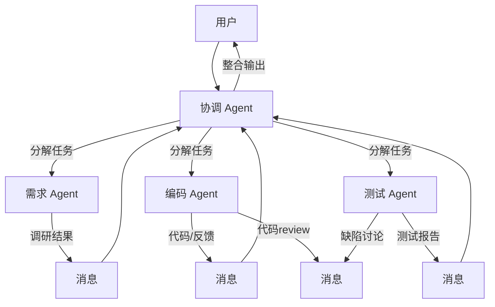
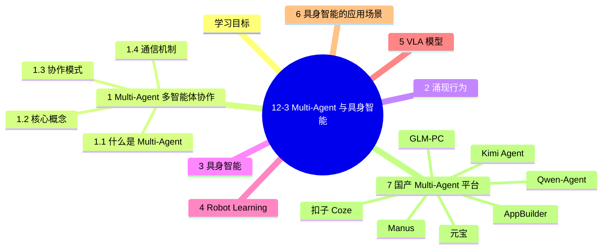

# 12-3 Multi-Agent 与具身智能

## 学习目标

- 理解多智能体协作的核心机制：角色分工、消息传递
- 掌握涌现行为（Emergent Behavior）的概念与案例
- 理解具身智能（Embodied AI）的定义与研究范式
- 了解 Robot Learning 与 VLA（Vision-Language-Action）模型

---

## 1. Multi-Agent — 多智能体协作

### 1.1 为什么需要多智能体

当任务复杂度超过单个 Agent 的能力边界时，需要引入**多智能体协作（Multi-Agent）**：

| 任务复杂度 | 单 Agent 局限 | 多 Agent 优势 |
|-----------|-------------|--------------|
| 复杂报告撰写 | 领域知识有限 | 分工调研，各尽其能 |
| 软件项目开发 | 全栈能力不足 | 需求、设计、编码、测试分工 |
| 企业运营分析 | 信息维度单一 | 财务、市场、技术多视角协作 |
| 科研探索 | 知识边界有限 | 多领域专家联合攻关 |

### 1.2 多智能体的核心要素

#### 角色分工（Role Assignment）

每个 Agent 应有明确的角色定位：

```
┌─────────────┐    ┌─────────────┐    ┌─────────────┐
│  需求 Agent │    │  编码 Agent │    │  测试 Agent │
│             │    │             │    │             │
│ - 理解需求  │    │ - 编写代码  │    │ - 编写用例 │
│ - 分解任务  │    │ - 代码review │    │ - 执行测试 │
│ - 优先级排序│    │ - 重构优化  │    │ - 缺陷报告 │
└─────────────┘    └─────────────┘    └─────────────┘
       │                  │                  │
       └──────────────────┴──────────────────┘
                           │
                    ┌─────────────┐
                    │  协调 Agent  │
                    │  （你在这里） │
                    └─────────────┘
```

#### 消息传递（Message Passing）

Agent 之间通过消息传递进行协作，常见模式：

**1. 层级传递（Hierarchical）**
```
用户 → 协调者 → 执行者 → 反馈 → 协调者 → 用户
```

**2. 对等协作（Peer-to-Peer）**
```
Agent A ←──消息──→ Agent B
           ↓
         Agent C
```

**3. 共享黑板（Blackboard）**
```
         ┌──────────────┐
         │  共享黑板    │
         │  （共享信息） │
         └──────────────┘
              ↑    ↑    ↑
         Agent A  Agent B  Agent C
```

#### 协作策略

| 策略 | 说明 | 适用场景 |
|------|------|---------|
| **顺序执行** | 任务流水线，上一步输出下一步输入 | 依赖性强的任务 |
| **并行执行** | 多个 Agent 同时处理独立子任务 | 独立性强的任务 |
| **协商协作** | Agent 之间讨论达成共识 | 需要多视角决策 |
| **层级管控** | 协调者分配任务，Agent 执行 | 复杂项目管理 |

#### Multi-Agent 协作架构



---

## 2. 涌现行为（Emergent Behavior）

### 2.1 什么是涌现

**涌现（Emergence）** 是指复杂系统中自发产生的新颖特性和行为，这些特性无法从单个组件的行为中预测，但却是组件交互的结果。

#### 经典比喻：蚂蚁群

- 单只蚂蚁行为简单（随机游走、留下信息素）
- 蚁群整体展现出复杂智能行为（筑巢、觅食路径优化、群体决策）
- 这些能力不存在于任何单只蚂蚁中，是**集体智慧的涌现**

### 2.2 LLM Multi-Agent 中的涌现行为

在多智能体系统中，当 Agent 数量和能力达到临界点时，会涌现出**超越单 Agent 能力边界**的行为：

#### 涌现类型

| 类型 | 描述 | 示例 |
|------|------|------|
| **角色专精** | Agent 自发深化专业能力 | 测试 Agent 自学性能分析 |
| **自发协调** | 无中央控制时自主分工协作 | 编码者等待设计完成后开工 |
| **知识整合** | 分散知识自发整合为连贯报告 | 各领域调研自动融合 |
| **自我修正** | 系统级纠错，无需外部干预 | 测试发现缺陷，编码者自动修复 |
| **创意涌现** | 跨领域碰撞产生创新想法 | 市场+技术 Agent 碰撞出新品类 |

#### 典型案例：ChatDev 虚拟软件公司

```python
# ChatDev 多 Agent 协作案例
# 角色：需求分析师 → 架构师 → 程序员 → 测试工程师 → 审查员

# 涌现行为 1：自动需求澄清
用户: "做一个商城"
需求Agent: "请确认：B2C还是B2B？移动端还是PC端？"

# 涌现行为 2：自发代码review
程序员A: "这段支付代码有个bug..."
程序员B: "我来修复，同时优化一下安全相关逻辑"

# 涌现行为 3：自发测试扩展
测试Agent: "原计划测试5个用例，
           自动扩展到12个（覆盖边界场景和安全测试）"
```

#### 涌现的条件

1. **足够数量的 Agent**：角色多样化，信息交互面广
2. **有效的消息传递机制**：Agent 之间能顺畅沟通
3. **共享目标**：所有 Agent 围绕同一任务协作
4. **反馈机制**：行动结果能影响后续决策

---

## 3. 具身智能（Embodied AI）

### 3.1 什么是具身智能

**具身智能（Embodied AI）** 是指具有身体并能与物理世界交互的智能系统。与纯软件 Agent 不同，具身智能需要：

- **感知真实环境**：通过传感器（摄像头、麦克风、触觉）获取真实世界信息
- **执行物理动作**：通过执行器（机械臂、轮子、腿）影响物理世界
- **理解时空连续性**：在三维空间中导航、理解物体的物理属性

```
┌──────────────────────────────────────────────────┐
│              具身智能核心循环                     │
│                                                  │
│   感知 ──▶ 推理 ──▶ 规划 ──▶ 控制 ──▶ 执行       │
│     ▲                                         │ │
│     └────────────── 反馈 ──────────────────────┘ │
└──────────────────────────────────────────────────┘
```

### 3.2 具身智能 vs. 纯软件 Agent

| 维度 | 纯软件 Agent（LLM Agent） | 具身智能 Agent |
|------|--------------------------|---------------|
| 感知方式 | 文本、图像（静态） | 实时传感器流（动态） |
| 行动空间 | 离散 Token 输出 | 连续动作空间（关节控制） |
| 时间维度 | 被动响应，无时序连续性 | 持续运行，状态连续变化 |
| 物理约束 | 无 | 需遵循物理定律、安全边界 |
| 错误成本 | 低（可重试） | 高（可能损坏硬件/环境） |
| 典型载体 | ChatGPT、Claude | 人形机器人、无人机、自动驾驶 |

### 3.3 具身智能的研究范式

#### 经典范式：感知→规划→执行

```
摄像头图像 ──▶ 目标检测/语义分割 ──▶ 任务规划 ──▶ 运动规划 ──▶ 机械臂控制
                   (CV)              (LLM/符号)      (MPC/RL)      (低层控制)
```

#### 新范式：端到端视觉-动作控制

随着多模态大模型的发展，出现**端到端联合建模**的新范式：

```
┌─────────────────────────────────────────────┐
│         VLA 模型（Vision-Language-Action）    │
│                                             │
│  视觉输入 + 语言指令 ──▶ 统一模型 ──▶ 动作输出  │
│                                             │
│  例：摄像头图像 + "拿起红色积木"              │
│      ──────────────────────▶ 机械臂执行动作   │
└─────────────────────────────────────────────┘
```

---

## 4. Robot Learning — 机器人学习

### 4.1 模仿学习（Imitation Learning）

**模仿学习**通过人类演示让机器人学会技能：

#### 行为克隆（Behavior Cloning）

```
人类演示（状态-动作对）→ 监督学习 → 策略网络 π(状态) → 动作输出
```

- 优点：简单直接，适合演示数据丰富
- 缺点：分布偏移问题，遇到未见过的状态容易失败

#### DAgger（Dataset Aggregation）

```
循环：
  1. 用当前策略收集数据
  2. 让人类标注数据
  3. 合并数据集，重新训练策略
```

### 4.2 强化学习（Reinforcement Learning）

**强化学习**通过与环境交互学习最优策略：

```
策略网络 π(a|s) 
    │
    ▼
与环境交互 ──▶ 获取奖励 r ──▶ 策略优化（PPO/SDP）──▶ 更好的策略
```

#### 机器人 RL 的挑战

- **样本效率低**：机器人数据采集慢，成本高
- **reward 设计困难**：复杂任务的奖励函数难以定义
- **安全约束**：物理世界中试错成本高
- ** sim-to-real 迁移**：仿真环境中训练难以直接迁移到真实机器人

### 4.3 视觉-动作控制

#### 视觉导航（Visual Navigation）

让机器人在未知环境中仅靠视觉到达目标位置：

```
当前图像 ──▶ CNN编码 ──▶ 策略网络 ──▶ 运动指令（左转/前进/右转）
                  ↑                          │
                  └─────── 目标图像 ─────────┘
```

#### 物体操纵（Object Manipulation）

```
RGB-D图像 ──▶ 6D姿态估计 ──▶ 抓取规划 ──▶ 机械臂控制
                        │
                        ▼
                  力量/位置控制（Hybrid）
```

---

## 5. VLA 模型 — 视觉-语言-动作联合模型

### 5.1 VLA 的定义

**VLA（Vision-Language-Action）模型** 是一类将视觉感知、语言理解和动作控制统一建模的深度学习模型。

#### 与 LLM 的区别

| 维度 | 大语言模型（LLM） | VLA 模型 |
|------|------------------|----------|
| 输出 | 文本 Token | 连续动作控制信号 |
| 反馈 | 无物理反馈 | 实时感知反馈 |
| 目标 | 生成文本 | 控制物理系统 |
| 安全边界 | 无 | 需遵守物理约束 |

#### VLA 模型流程

```mermaid
graph TD
    subgraph input_layer[输入]
        VI[视觉输入<br/>摄像头图像]
        LI[语言指令<br/>如"拿起红色积木"]
    end
    
    VI --> VE[视觉编码器<br/>Vision Encoder]
    LI --> LE[语言编码器<br/>Language Encoder]
    
    VE --> Fusion[特征融合]
    LE --> Fusion
    
    Fusion --> LLM[大语言模型<br/>LLM / VLM]
    LLM --> AP[动作预测<br/>Action Prediction]
    AP --> Robot[机器人执行]
```

### 5.2 典型 VLA 模型

#### RT-2（Robotic Transformer 2）

Google DeepMind 2023年的工作，将 VLM（视觉-语言模型）直接输出机器人动作：

```
图像输入 + 语言指令 "拾起香蕉" 
    │
    ▼
┌──────────────────────────────────┐
│  ViT Encoder → LLM（PaLM-E）→ 动作│
│  动作空间：end-effector位姿+夹爪状态│
└──────────────────────────────────┘
```

#### 能力特点

- **泛化能力**：在仿真中预训练，可泛化到真实场景
- **语义推理**：继承 LLM 的语义理解能力
- **零样本操控**：可处理训练中未见的物体

#### 葡萄藤机器人（RT-1的演进）

RT-2 展示了emergent capabilities（涌现能力）：
- 在没有明确训练的情况下，能够根据"将香蕉放到印有数字的纸上"指令行动
- 说明 VLM 预训练带来的泛化和推理能力能够迁移到机器人控制

### 5.3 其他 VLA 模型

| 模型 | 机构 | 特点 |
|------|------|------|
| **RT-2** | Google DeepMind | VLM + 动作输出，泛化能力强 |
| **RT-X** | Google DeepMind | 跨机器人版本的 RT-2 |
| **PaLM-E** | Google | 多模态大模型，机器人控制专用 |
| **VoxPoser** | Stanford | 基于 LLM 生成机器人轨迹 |
| **SayCan** | Google + Everyday Robots | 价值函数引导的语言控制 |
| **台积电/华为 VLA** | 工业界 | 针对特定场景优化 |

---

## 6. 具身智能的应用场景

### 6.1 自动驾驶

```
感知（摄像头/LiDAR）→ 场景理解（VLM）→ 轨迹规划 → 车辆控制
```

- **感知层**：多模态传感器融合
- **决策层**：VLM 理解交通场景
- **控制层**：轨迹跟踪与车辆动力学控制

### 6.2 具身对话机器人

结合语音、多模态感知和动作执行的家庭/服务机器人：

```
用户指令 → 语音识别 → LLM 理解 → 视觉感知 → 机器人执行 → 反馈
```

应用：老人陪护、导览讲解、餐厅服务

### 6.3 工业制造

```
视觉检测（缺陷识别）→ 任务规划（工艺选择）→ 机械臂控制（精密操作）
```

应用：汽车装配、电子产品组装、物流分拣

---

## 7. 国产 Multi-Agent 平台

2024-2026 年中国 Multi-Agent 生态呈多元化发展，既有面向 C 端用户的低代码平台，也有面向 B 端的企业级方案，以及面向开发者的开源框架。

### 7.1 主流国产 Multi-Agent 平台

| 平台 | 厂商 | 形态 | 核心模型 | 特点 |
|------|------|------|---------|------|
| **Manus** | Butterfly Effect | 通用 Agent | Claude + 多模型 | 首个现象级通用 Agent，KV-Cache 优化 |
| **扣子 Coze** | 字节 | 低代码 Bot/Agent 平台 | 豆包 + DeepSeek | 拖拽工作流、生态最丰富 |
| **Qwen-Agent** | 阿里 | 开源框架 | Qwen3 | Apache 2.0、Tool Calling 强 |
| **AppBuilder** | 百度 | 企业 Agent 平台 | 文心 4.0 | 政企私有化、行业模板 |
| **GLM-PC** | 智谱 | 桌面 Agent | GLM-4.5 | Computer Use 国产对标 |
| **元宝** | 腾讯 | C 端 Agent | 混元 + DeepSeek | 微信生态整合 |
| **Kimi Agent** | 月之暗面 | 通用 Agent | Moonshot V1 | 长上下文 200K+ |

### 7.2 国产 Multi-Agent 编排模式

- **层级模式（Hierarchical）**：一个 Manager Agent 调度多个 Worker Agent，扣子 / AppBuilder 的工作流即此模式
- **对等模式（Peer-to-Peer）**：Agent 之间消息传递、投票决策，MetaGPT / CrewAI 即此模式
- **市场模式（Market）**：任务发布→多 Agent 竞标→最优中标，国产平台尚未广泛采用
- **共享黑板模式（Blackboard）**：所有 Agent 操作共享数据结构，类似 OpenAI Deep Research 内部实现

### 7.3 与 12-2 编程/通用 Agent 的关系

12-2 介绍的编程 Agent（Claude Code / OpenCode / Cline 等）和通用 Agent（Manus / GLM-PC 等）都可以纳入 Multi-Agent 框架：
- **编程 Multi-Agent**：Claude Code 的 Sub-Agent、Cline 的 Plan/Act 双 Agent
- **通用 Multi-Agent**：Manus 的研究-执行多 Agent 协作

---

## 本章小结
1. **Multi-Agent 协作**：通过角色分工（Role Assignment）和消息传递（Message Passing）实现复杂任务协作，常见模式包括层级传递、对等协作和共享黑板，适用于软件工程、报告撰写、企业分析等多领域知识融合场景。

2. **涌现行为（Emergent Behavior）**：多智能体交互中自发涌现的超越单 Agent 能力的复杂行为，是当前 LLM Multi-Agent 研究的重要方向。

3. **具身智能（Embodied AI）**：有物理身体的智能系统，核心循环为感知→推理→行动→反馈，通过传感器感知环境并执行物理动作，是 AI 从"数字世界"向"物理世界"延伸的关键技术。

4. **Robot Learning**：包括模仿学习（从专家演示中学习）、强化学习（在环境中试错优化）和视觉-动作控制三大方法范式。

5. **VLA 模型（Vision-Language-Action）**：将视觉、语言、动作统一建模，实现端到端控制。RT-2、PaLM-E 等工作展示了 VLA 模型在机器人控制中的巨大潜力。

6. **具身智能与多模态/Agent 的关系**：具身智能需要多模态感知（理解视觉/触觉/本体感觉）和 Agent 规划（制定行动序列）能力，与前两章内容紧密关联，共同构成通向 AGI 的重要组成部分。

7. **国产 Multi-Agent 生态**：2024-2026 年中国 Multi-Agent 呈多元化发展。**通用 Agent**（Manus / 扣子 / 元宝）面向 C 端和中小企业；**企业级**（AppBuilder / GLM-PC）满足政企合规与私有化部署；**开源框架**（Qwen-Agent）适合二次开发。编排模式覆盖层级（Manager-Worker）、对等（Peer-to-Peer）、共享黑板（Blackboard），与 12-2 的编程/通用 Agent 形成互补的生态。


## 知识图谱



## 参考资料

1. Park, J., et al. (2023). Generative Agents: Interactive Simulacra of Human Behavior. *UIST*.
2. Li, G., et al. (2023). ChatDev: Interactive Software Development via Multi-Agent Collaboration. *arXiv*.
3. Brohan, A., et al. (2023). RT-2: Vision-Language-Action Models Transfer Web Knowledge to Robotic Control. *arXiv*.
4. Driess, D., et al. (2023). PaLM-E: An Embodied Multimodal Language Model. *ICML*.
5. Huang, W., et al. (2022). VoxPoser: Composable 3D Value Maps for Robotic Manipulation with Language Models. *CoRL*.
6. Liang, J., et al. (2022). Code as Policies: Language Model Programs for Embodied Control. *Human-Compatible AI*.
7. Io, A., et al. (2023). A Survey on Embodied AI: From Simulators to Research Efforts. *arXiv*.
8. Zhao, Y., et al. (2023). A Study on Emergent Capabilities of LLM Multi-Agent Systems. *arXiv*.
