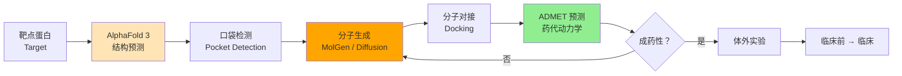
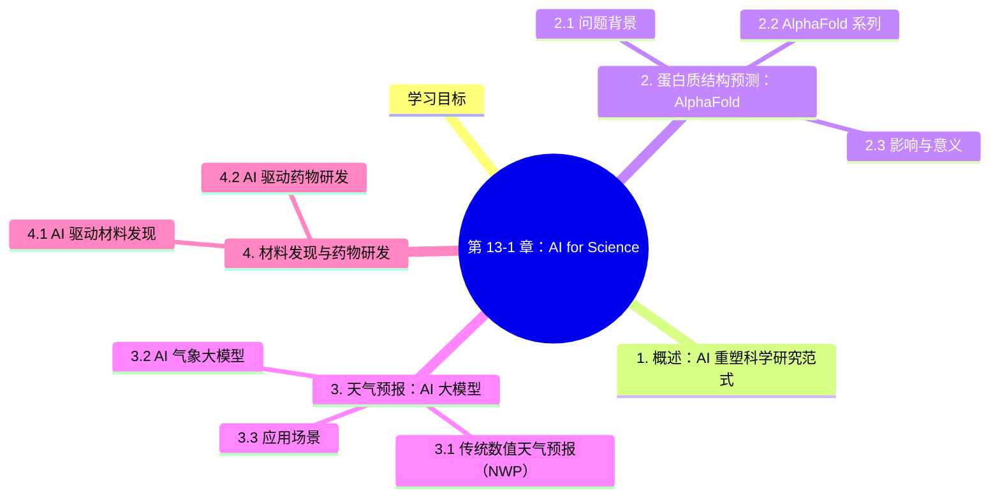

# 第 13-1 章：AI for Science

## 学习目标

- 理解 AI 在科学研究中的三大主流应用场景：蛋白质结构预测、天气预报、材料发现
- 掌握 AlphaFold 系列模型的核心思想与影响
- 了解 GraphCast、Pangu-Weather 等气象大模型的技术路线
- 了解 AI 驱动药物研发的基本流程与前沿进展

---

## 1. 概述：AI 重塑科学研究范式

传统科学发现依赖"假设 → 实验 → 验证"的漫长循环。深度学习的崛起为自然科学带来了第四范式：**数据驱动的科学发现（Data-Driven Discovery）**。2010 年代后期至今，AI 在生物、物理、化学、气象等领域不断取得里程碑式突破，有些甚至超越了人类科学家数十年的积累。

---

## 2. 蛋白质结构预测：AlphaFold

### 2.1 问题背景

蛋白质是由氨基酸序列折叠而成的三维功能大分子。氨基酸序列由基因编码决定，但从序列预测其三维结构（"折叠问题"）是结构生物学长达 50 年的难题。实验方法（X 射线晶体学、冷冻电镜）成本高、耗时长，无法规模化。

### 2.2 AlphaFold 系列

| 年份 | 模型 | 里程碑 |
|------|------|--------|
| 2018 | AlphaFold 1 | CASP13 冠军，首次证明深度学习可以预测蛋白质结构 |
| 2020 | AlphaFold 2 | CASP14 冠军，预测精度接近实验水平，颠覆结构生物学 |
| 2022 | AlphaFold-DB | 发布超过 2 亿种蛋白质的预测结构数据库 |
| 2023 | AlphaFold 3 | 扩展到蛋白质复合物、核酸、小分子结合预测 |

**核心技术（AlphaFold 2）：**

1. **Evoformer** 注意力模块：同时处理氨基酸序列特征和多序列比对（MSA）信息
2. **几何深度学习**：通过"不变点注意力（Invariant Point Attention）"保证三维坐标的几何一致性
3. **端到端训练**：直接从序列→三维坐标，中间无需人工干预

### 2.3 影响与意义

- 将原本需要数年的结构解析缩短到几分钟
- 彻底改变了结构生物学、药物靶点发现、酶工程等领域的研究方式
- 被 Science 杂志评为 2021 年年度科学突破
- DeepMind 公开 AlphaFold 数据库，向全球科研人员开放

---

## 3. 天气预报：AI 大模型

### 3.1 传统数值天气预报（NWP）

传统天气预报基于**数值天气预报**（Numerical Weather Prediction, NWP）方法：
- 求解大气偏微分方程组（Navier-Stokes 方程等）
- 需要超级计算机，算一次预报需数小时
- 受困于参数化近似带来的误差累积

### 3.2 AI 气象大模型

| 模型 | 机构 | 特点 |
|------|------|------|
| **GraphCast** | Google DeepMind（2023） | 基于图神经网络的全球中期天气预报，10 天预报 35 秒完成 |
| **Pangu-Weather** | 华为云（2023） | 3D 非等距 transformer，预报时效达 7 天，支持 39 万公里网格 |
| **盘古气象大模型** | 华为云 | 在天气预报所有核心指标上超越 NWP 方法 |
| **ClimaX** | 微软 NVIDIA（2023） | 多任务基础模型，可处理气候模拟、极端天气预测等 |
| **NowcastNet** | 清华大学 | 短时降水预报（0-2h），在极端降水事件上超越传统方法 |

**核心思想：**
- 将气象数据视为 4D 张量（经度、纬度、垂直高度、时间）
- 用 Transformer 或图神经网络学习大气数据的时空依赖
- 在数十年历史再分析数据上做监督学习
- 推理速度比传统 NWP 快 3 个数量级

### 3.3 应用场景

- **极端天气预警**：提前数小时预测台风、暴雨、寒潮
- **农业保险**：精细化气象风险评估
- **能源调度**：风光功率预测，支撑电网调度

---

## 4. 材料发现与药物研发

### 4.1 AI 驱动材料发现

传统新材料研发周期长达 10-20 年。AI 通过以下方式加速：

**性质预测模型：**
- **Graph Neural Network (GNN)**：将材料的晶体结构建模为图，预测带隙、弹性模量等性质
- **CHARGNet**、**CGCNN**（Crystal Graph Convolutional Neural Networks）：从材料成分和结构直接预测物理性质

**主动学习 + 第一性原理计算：**
1. 用 AI 快速筛选数百万候选材料
2. 对高潜力材料做精度高的 DFT（密度泛函理论）计算验证
3. 将新结果加入训练集，循环迭代

**代表性成果：**
- 2020 年 Nature Materials：用 GNN 发现 BaFe₂S₃ 等新型超导候选材料
- 2023 年：Google DeepMind 发布 GNoME（Graph Networks for Materials Exploration），预测 220 万种稳定材料结构

### 4.2 AI 驱动药物研发

**药物研发全流程中的 AI 渗透：**

```
靶点发现 → 苗头化合物筛选 → 先导化合物优化 → 临床前评估 → 临床试验
     ↑            ↑                ↑              ↑             ↑
  AlphaFold    AlphaFold        图神经网络      PK/PD 预测    患者分层
  序列分析     结构预测        分子生成         ADMET 预测    AI 生物标志物
```

**关键技术：**

| 阶段 | AI 技术 | 代表工作 |
|------|---------|---------|
| 靶点结构 | AlphaFold 蛋白结构预测 | 人类蛋白质组结构预测 |
| 分子生成 | 基于 SMILES 的生成模型、 Diffusion 模型 | ChatDD（antibody design） |
| 分子对接 | 图神经网络 + 物理启发评分 | AutoDock Vina AI 版 |
| ADMET 预测 | QSAR 模型、深度学习 | AdmetAI 数据库 |
| 临床试验 | 因果推断、患者分层 | GSK、Roche AI 平台 |

**里程碑案例：**
- **AlphaFold + Drug Design**：多家制药公司用 AlphaFold 结构数据加速新冠药物研发
- **Insilico Medicine**：用 AI 在 18 个月内从靶点发现到提名临床前候选分子（传统方式平均 5 年）

---

## 5. AlphaFold 3 与 AI 蛋白设计的 2024-2025 新进展

> **本节核心**：AlphaFold 2 已经改变了结构生物学，2024 年发布的 **AlphaFold 3** 进一步把范围从蛋白扩展到**蛋白 + 小分子 + DNA + RNA + 修饰** 的全生物分子复合体预测。本节汇总这一波最新进展。

### 5.1 AlphaFold 3（2024.5）：全生物分子预测

**AlphaFold 3 相比 AlphaFold 2 的核心升级**：

| 维度 | AlphaFold 2 (2020) | AlphaFold 3 (2024) |
|------|-------------------|-------------------|
| **预测范围** | 蛋白单链 | 蛋白 + DNA + RNA + 小分子 + 修饰 |
| **架构** | Evoformer + Structure Module | **Pairformer + Diffusion** |
| **输入** | MSA + 模板 | MSA + 模板 + SMILES + 序列 |
| **精度** | 蛋白-蛋白中等 | **蛋白-配体小分子提升 50%**（无 MSA 时）|
| **速度** | 几小时/蛋白 | **分钟级**（DDPM 扩散）|
| **发布** | 2021 完整开放 | 2024.5 Nature 公开（但代码受限）|

**架构创新**：
- 弃用 AlphaFold 2 的"结构模块（Structure Module）"
- 改用 **去噪扩散模型（DDPM）**：从随机原子位置开始，逐步去噪
- 加入 **Pairformer 块**：更高效的三角注意力（Pair Attention）
- **跨分子类型统一表示**：蛋白/小分子/DNA 全部用原子图表示

**局限**：
- 论文不公开训练代码（Nature 论文争议）
- 预测时**未使用 MSA**（MSA 难配体场景）的精度提升最大
- 生物学解释性有限（仍是"黑箱预测"）

### 5.2 Boltz-1（2024.11）：开源版 AlphaFold 3

**MIT Jameel Clinic + Recursion** 发布的开源复现：

| 维度 | Boltz-1 | AlphaFold 3 |
|------|---------|-------------|
| 性能 | 接近 AF3 90% | SOTA |
| 代码 | ⭐ 完全开源 | 受限 |
| 训练数据 | 公开 PDB + 自采 | 内部 |
| 商用许可 | ⭐ 商业可用 | 受限 |
| 推理时间 | 较慢（小时级） | 分钟级 |

> **意义**：Boltz-1 让学术界和中小公司**第一次**能完整复现 AlphaFold 3 级别模型，**加速了 AI 制药的民主化**。

### 5.3 ESM-3（Meta，2024）：蛋白语言模型的突破

**ESM-3**（Evolutionary Scale Modeling v3）：
- **650M 参数 Transformer**，在 2.78 亿条蛋白序列上预训练
- 引入**多模态对齐**：序列 + 结构 + 功能注释
- **"蛋白 ChatGPT"**：可以生成全新蛋白序列

**应用**：
- 设计**新功能蛋白**（如新型荧光蛋白 mNeonGreen）
- 预测蛋白**点突变效应**（蛋白质工程）
- 抗原-抗体结合预测

### 5.4 其他 2024-2025 重要进展

| 模型/工具 | 机构 | 时间 | 特点 |
|----------|------|------|------|
| **AlphaFold Server** | DeepMind | 2024.5 | AF3 推理平台（限学术）|
| **RoseTTAFold All-Atom** | Baker Lab | 2024 | 全原子（DNA+RNA+小分子）|
| **ESM-3** | Meta | 2024 | 蛋白语言模型 SOTA |
| **Boltz-1** | MIT Jameel + Recursion | 2024.11 | 开源 AF3 复现 |
| **Chai-1** | Chai Discovery | 2024 | 全原子 + 开源 |
| **Protenix** | ByteDance | 2024 | 字节跳动开源 AF3 复现 |
| **AlphaProteo** | DeepMind | 2024 | 蛋白设计（结合） |
| **RFdiffusion3** | Baker Lab | 2024 | 蛋白从头设计 |

### 5.5 AI 制药：从结构到分子的完整链路



**AI 制药代表公司**（2024-2025）：
- **Isomorphic Labs**（Alphabet 子公司，AF3 商用）
- **Recursion**（Boltz-1 团队）
- **Insilico Medicine**（英矽智能，全球首个 AI 药物进入临床 2 期）
- **XtalPi**（晶泰科技，已上市）
- **Chai Discovery**（Chai-1）

### 5.6 实际节省时间对比

| 阶段 | 传统耗时 | AI 辅助后 | 加速比 |
|------|----------|-----------|--------|
| **靶点结构解析** | 6-18 月 | 1-2 周 | 30-50× |
| **苗头化合物发现** | 2-3 年 | 3-6 月 | 4-8× |
| **先导化合物优化** | 1-2 年 | 3-6 月 | 4-8× |
| **临床前研究** | 1-2 年 | 6-12 月 | 2-4× |
| **完整药物开发** | **5-10 年** | **2-3 年**（乐观）| 3-5× |

> **关键提醒**：AI 制药**目前还不能**完全替代临床试验（最贵最慢的环节），但能**大幅压缩早期阶段**。

### 5.7 AI for Science 关键经验

> **经验 1**：**"先有结构，再有药物"**——AlphaFold 解决了第一棒，但下游对接/合成/试验仍需传统药化。
> 
> **经验 2**：**AlphaFold 3 + Boltz-1 + ESM-3 = 蛋白科学的"基础设施"**——但具体应用（如酶活性、抗体设计）仍需 fine-tune。
> 
> **经验 3**：**AI 制药最大的瓶颈不是模型，是数据**——高质量的"蛋白-配体亲和力"数据稀缺。
> 
> **经验 4**：**跨学科团队至关重要**——AI 科学家 + 结构生物学家 + 药化家 + 临床医生。
> 
> **经验 5**：**AI for Science ≠ AI 替代科学**——AI 是"加速器"，最终的科学发现仍需人类洞察。

---

## 本章小结
AI for Science 正在从根本上改变科学研究的节奏：

| 领域 | 传统方式 | AI 方式 | 效率提升 |
|------|---------|---------|---------|
| 蛋白质结构解析 | 数月～数年（实验） | 分钟级（AlphaFold 3）| 1000x+ |
| 蛋白-配体对接 | 数小时/对接 | 秒级（Boltz-1）| 100×+ |
| 新药研发 | 5-10 年 | 2-3 年（部分环节）| 3-5× |
| 天气预报 | 数小时（NWP） | 秒级（GraphCast / Pangu）| 1000x+ |
| 新材料发现 | 10-20 年 | 数年 | 5-10× |

这些突破的共同特征是：**用海量数据训练大模型，学习领域特定规律，再反哺科学发现**。AI 不是替代科学家，而是提供了前所未有的"加速器"。**AlphaFold 3 (2024) + Boltz-1 (2024) + ESM-3 (2024) 标志着"AI 制药元年"**。


## 知识图谱



## 参考资料

1. Jumper, J. et al. (2021). "Highly accurate protein structure prediction with AlphaFold." *Nature* 596, 583–589.
2. Abramson, J. et al. (2024). "Accurate structure prediction of biomolecular interactions with AlphaFold 3." *Nature* 620, 1269–1277.
3. Pathak, J. et al. (2022). "GraphCast: Learning skillful medium-range global weather forecasting." *arXiv* (Google DeepMind).
4. Bi, K. et al. (2023). "Pangu-Weather: A 3D high-resolution model for fast and accurate global weather forecast." *Nature* 619, 533–538.
5. Kirkpatrick, J. et al. (2021). "Mapping the dark matter of the drug discovery universe with AI." *Nature* 585, S48–S51.
6. Merchant, A. et al. (2023). "Scaling language models for molecules and materials." *arXiv*.
7. Zhou, G. et al. (2023). "GNoME: Graph Networks for Materials Exploration." *Nature* 624, 570–578.
