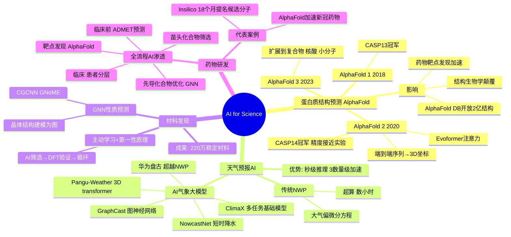

# 第 13-1 章：AI for Science

## 学习目标

- 理解 AI 在科学研究中的三大主流应用场景：蛋白质结构预测、天气预报、材料发现
- 掌握 AlphaFold 系列模型的核心思想与影响
- 了解 GraphCast、Pangu-Weather 等气象大模型的技术路线
- 了解 AI 驱动药物研发的基本流程与前沿进展

---

## 1. 概述：AI 重塑科学研究范式

传统科学发现依赖"假设 → 实验 → 验证"的漫长循环。深度学习的崛起为自然科学带来了第四范式：**数据驱动的科学发现（Data-Driven Discovery）**。2010 年代后期至今，AI 在生物、物理、化学、气象等领域不断取得里程碑式突破，有些甚至超越了人类科学家数十年的积累。

---

## 2. 蛋白质结构预测：AlphaFold

### 2.1 问题背景

蛋白质是由氨基酸序列折叠而成的三维功能大分子。氨基酸序列由基因编码决定，但从序列预测其三维结构（"折叠问题"）是结构生物学长达 50 年的难题。实验方法（X 射线晶体学、冷冻电镜）成本高、耗时长，无法规模化。

### 2.2 AlphaFold 系列

| 年份 | 模型 | 里程碑 |
|------|------|--------|
| 2018 | AlphaFold 1 | CASP13 冠军，首次证明深度学习可以预测蛋白质结构 |
| 2020 | AlphaFold 2 | CASP14 冠军，预测精度接近实验水平，颠覆结构生物学 |
| 2022 | AlphaFold-DB | 发布超过 2 亿种蛋白质的预测结构数据库 |
| 2023 | AlphaFold 3 | 扩展到蛋白质复合物、核酸、小分子结合预测 |

**核心技术（AlphaFold 2）：**

1. **Evoformer** 注意力模块：同时处理氨基酸序列特征和多序列比对（MSA）信息
2. **几何深度学习**：通过"不变点注意力（Invariant Point Attention）"保证三维坐标的几何一致性
3. **端到端训练**：直接从序列→三维坐标，中间无需人工干预

### 2.3 影响与意义

- 将原本需要数年的结构解析缩短到几分钟
- 彻底改变了结构生物学、药物靶点发现、酶工程等领域的研究方式
- 被 Science 杂志评为 2021 年年度科学突破
- DeepMind 公开 AlphaFold 数据库，向全球科研人员开放

---

## 3. 天气预报：AI 大模型

### 3.1 传统数值天气预报（NWP）

传统天气预报基于**数值天气预报**（Numerical Weather Prediction, NWP）方法：
- 求解大气偏微分方程组（Navier-Stokes 方程等）
- 需要超级计算机，算一次预报需数小时
- 受困于参数化近似带来的误差累积

### 3.2 AI 气象大模型

| 模型 | 机构 | 特点 |
|------|------|------|
| **GraphCast** | Google DeepMind（2023） | 基于图神经网络的全球中期天气预报，10 天预报 35 秒完成 |
| **Pangu-Weather** | 华为云（2023） | 3D 非等距 transformer，预报时效达 7 天，支持 39 万公里网格 |
| **盘古气象大模型** | 华为云 | 在天气预报所有核心指标上超越 NWP 方法 |
| **ClimaX** | 微软 NVIDIA（2023） | 多任务基础模型，可处理气候模拟、极端天气预测等 |
| **NowcastNet** | 清华大学 | 短时降水预报（0-2h），在极端降水事件上超越传统方法 |

**核心思想：**
- 将气象数据视为 4D 张量（经度、纬度、垂直高度、时间）
- 用 Transformer 或图神经网络学习大气数据的时空依赖
- 在数十年历史再分析数据上做监督学习
- 推理速度比传统 NWP 快 3 个数量级

### 3.3 应用场景

- **极端天气预警**：提前数小时预测台风、暴雨、寒潮
- **农业保险**：精细化气象风险评估
- **能源调度**：风光功率预测，支撑电网调度

---

## 4. 材料发现与药物研发

### 4.1 AI 驱动材料发现

传统新材料研发周期长达 10-20 年。AI 通过以下方式加速：

**性质预测模型：**
- **Graph Neural Network (GNN)**：将材料的晶体结构建模为图，预测带隙、弹性模量等性质
- **CHARGNet**、**CGCNN**（Crystal Graph Convolutional Neural Networks）：从材料成分和结构直接预测物理性质

**主动学习 + 第一性原理计算：**
1. 用 AI 快速筛选数百万候选材料
2. 对高潜力材料做精度高的 DFT（密度泛函理论）计算验证
3. 将新结果加入训练集，循环迭代

**代表性成果：**
- 2020 年 Nature Materials：用 GNN 发现 BaFe₂S₃ 等新型超导候选材料
- 2023 年：Google DeepMind 发布 GNoME（Graph Networks for Materials Exploration），预测 220 万种稳定材料结构

### 4.2 AI 驱动药物研发

**药物研发全流程中的 AI 渗透：**

```
靶点发现 → 苗头化合物筛选 → 先导化合物优化 → 临床前评估 → 临床试验
     ↑            ↑                ↑              ↑             ↑
  AlphaFold    AlphaFold        图神经网络      PK/PD 预测    患者分层
  序列分析     结构预测        分子生成         ADMET 预测    AI 生物标志物
```

**关键技术：**

| 阶段 | AI 技术 | 代表工作 |
|------|---------|---------|
| 靶点结构 | AlphaFold 蛋白结构预测 | 人类蛋白质组结构预测 |
| 分子生成 | 基于 SMILES 的生成模型、 Diffusion 模型 | ChatDD（antibody design） |
| 分子对接 | 图神经网络 + 物理启发评分 | AutoDock Vina AI 版 |
| ADMET 预测 | QSAR 模型、深度学习 | AdmetAI 数据库 |
| 临床试验 | 因果推断、患者分层 | GSK、Roche AI 平台 |

**里程碑案例：**
- **AlphaFold + Drug Design**：多家制药公司用 AlphaFold 结构数据加速新冠药物研发
- **Insilico Medicine**：用 AI 在 18 个月内从靶点发现到提名临床前候选分子（传统方式平均 5 年）

---

## 5. 本章小结

AI for Science 正在从根本上改变科学研究的节奏：

| 领域 | 传统方式 | AI 方式 | 效率提升 |
|------|---------|---------|---------|
| 蛋白质结构解析 | 数月～数年（实验） | 分钟级（计算） | 1000x+ |
| 新药研发 | 5-10 年 | 2-3 年（部分环节） | 3-5x |
| 天气预报 | 数小时（NWP） | 秒级（AI 大模型） | 1000x+ |
| 新材料发现 | 10-20 年 | 数年 | 5-10x |

这些突破的共同特征是：**用海量数据训练大模型，学习领域特定规律，再反哺科学发现**。AI 不是替代科学家，而是提供了前所未有的"加速器"。

---

## 知识点思维导图



---

## 参考资料

1. Jumper, J. et al. (2021). "Highly accurate protein structure prediction with AlphaFold." *Nature* 596, 583–589.
2. Abramson, J. et al. (2024). "Accurate structure prediction of biomolecular interactions with AlphaFold 3." *Nature* 620, 1269–1277.
3. Pathak, J. et al. (2022). "GraphCast: Learning skillful medium-range global weather forecasting." *arXiv* (Google DeepMind).
4. Bi, K. et al. (2023). "Pangu-Weather: A 3D high-resolution model for fast and accurate global weather forecast." *Nature* 619, 533–538.
5. Kirkpatrick, J. et al. (2021). "Mapping the dark matter of the drug discovery universe with AI." *Nature* 585, S48–S51.
6. Merchant, A. et al. (2023). "Scaling language models for molecules and materials." *arXiv*.
7. Zhou, G. et al. (2023). "GNoME: Graph Networks for Materials Exploration." *Nature* 624, 570–578.