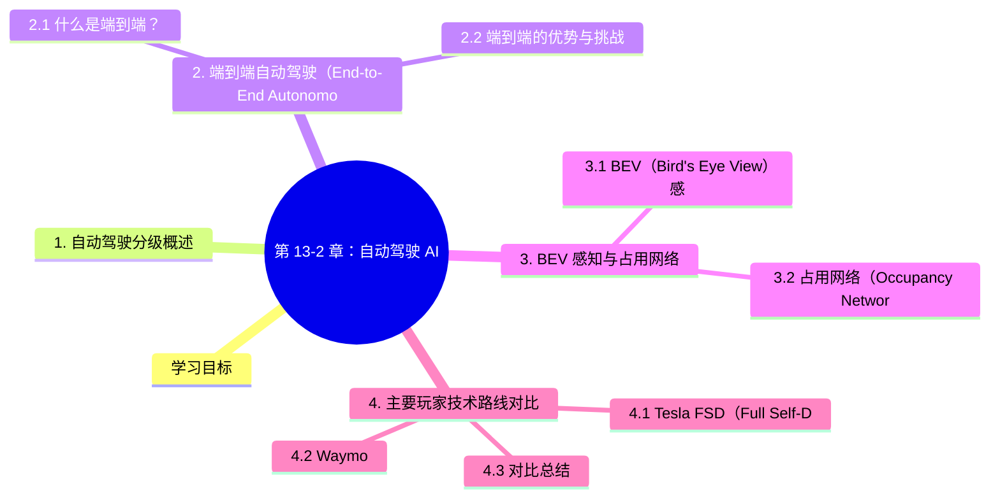

# 第 13-2 章：自动驾驶 AI

## 学习目标

- 了解自动驾驶的技术分级（SAE L0-L5）及其含义
- 掌握端到端自动驾驶的基本概念与技术路线
- 理解 BEV 感知、占用网络（Occupancy Network）等核心感知技术
- 了解 Tesla FSD 和 Waymo 的技术路线差异

---

## 1. 自动驾驶分级概述

国际汽车工程师学会（SAE）定义了自动驾驶级别：

| 等级 | 名称 | 人类驾驶参与度 | 系统职责 | 典型场景 |
|------|------|--------------|---------|---------|
| L0 | 无自动化 | 100% | 无 | 纯人工驾驶 |
| L1 | 驾驶辅助 | 监督 | 纵向控制（加减速）或横向（车道）之一 | ACC 自适应巡航 |
| L2 | 部分自动化 | 持续监督 | 纵向+横向，但需人类随时接管 | Tesla Autopilot、NOA |
| L3 | 条件自动化 | 特殊情况接管 | 在限定场景下完全自主，遇到未知场景请求人类 | Waymo One（特定区域） |
| L4 | 高度自动化 | 无需人类 | 在设计运行域内完全自主 | Robotaxi（无安全员） |
| L5 | 完全自动化 | 无需人类 | 任意场景、任意条件 | 尚未实现 |

**行业现状：**
- 绝大多数量产乘用车处于 L2 阶段（辅助驾驶）
- L4 主要在 Robotaxi、无人配送、特定封闭园区落地
- L5 是长期愿景，目前无法预期时间节点

---

## 2. 端到端自动驾驶（End-to-End Autonomous Driving）

### 2.1 什么是端到端？

传统自动驾驶系统采用**模块化流水线**：
```
感知 → 定位 → 预测 → 规划 → 控制
```

每个模块独立模型，模块之间通过人工定义的接口传递信息（如 3D 边界框、轨迹）。

**端到端自动驾驶**将感知到控制整合为一个可微分的神经网络：
```
传感器输入（图像/LiDAR/雷达）→ 神经网络 → 车辆控制指令（转向/油门/刹车）
```

代表工作：

| 年份 | 工作 | 机构 | 核心思想 |
|------|------|------|---------|
| 1988 | ALVINN | CMU | 最早的端到端自动驾驶，用神经网络从相机图像预测转向 |
| 2016 | NVIDIA DAVE-2 | NVIDIA | 用卷积网络从dashcam视频预测转向 |
| 2023 | UniAD | 上海人工智能实验室 | 全栈 transformer 端到端，提出"追踪一切以规划" |
| 2023 | Tesla FSD v12 | Tesla | 端到端规划，取消规则代码，输入图像直接输出控制 |
| 2024 | Wayve LINGO-2 | Wayve | 视觉-语言-动作模型，可解释的端到端驾驶 |

### 2.2 端到端的优势与挑战

**优势：**
- 信息损失少：避免模块间接口的信息瓶颈
- 全局优化：可从最终驾驶行为反向梯度优化所有模块
- 系统简洁：减少人工规则，降低维护成本

**挑战：**
- **可解释性差**：事故分析困难，无法精确定位问题根源
- **数据需求大**：需要海量真实驾驶数据
- **安全性验证难**：无法穷举所有长尾场景

---

## 3. BEV 感知与占用网络

### 3.1 BEV（Bird's Eye View）感知

BEV 感知是当前自动驾驶感知的主流范式。核心思想是将来自多个相机（或多种传感器）的特征统一转换到**俯视图坐标系**，再进行目标检测、车道线分割等任务。

**为什么需要 BEV？**

- 相机图像是透视投影（2D），存在远近遮挡问题
- BEV 坐标下可以直接做路径规划所需的 2D 地图表示
- 便于与 LiDAR、雷达等传感器融合

**技术路线：**

1. **基于深度估计的 IPM（Inverse Perspective Mapping）**：用几何方法做透视变换，受限于地面平面假设
2. **基于 Transformer 的 BEV 融合**：用 cross-attention 将多相机特征融合到 BEV  Query，典型工作：DETR3D（2021）、BEVFormer（2022）、Tesla BEV Net

### 3.2 占用网络（Occupancy Network）

传统目标检测只能识别训练时见过的类别（如车辆、行人、自行车）。**占用网络**将驾驶环境建模为 3D 体素网格，预测每个体素是否被占用。

**核心思想（Tesla 方案）：**
```
多相机图像 → 特征提取 → 3D 空间queries → 占用体积预测（每个体素：空/占用）
```

**优势：**
- 不受限于固定类别列表，可检测任意形状障碍物（如翻倒的卡车、散落物）
- 可预测运动物体的未来轨迹（通过时序占用变化）
- 弥补了长尾目标检测的数据不足问题

**后续发展：** Tesla Occupancy Network → Occupancy Flow（预测每个体素的运动矢量）→ 进一步演化为 **FSD v12 的 World Model** 基础

---

## 4. 主要玩家技术路线对比

### 4.1 Tesla FSD（Full Self-Driving）

Tesla 采用**纯视觉**方案，不使用 LiDAR 和高精地图：

| 要素 | Tesla 方案 |
|------|-----------|
| 感知传感器 | 8 个环绕摄像头（无 LiDAR、无毫米波雷达） |
| 感知框架 | BEV + Occupancy Network + 占用流 |
| 地图 | 众包建图（基于车队数据实时更新） |
| 规划 | 端到端（FSD v12 起用神经网络替代规则代码） |
| 技术路线 | 数据驱动、规模法则（scaling law），用海量行驶视频训练 |
| 核心芯片 | HW3.0 / HW4.0 自研 FSD 芯片 |

**核心特点：** 通过海量行驶数据（已收集数十亿英里）不断迭代，用影子模式收集 Corner Case。

### 4.2 Waymo

Waymo 采用**多传感器融合**方案，依赖高精地图：

| 要素 | Waymo 方案 |
|------|-----------|
| 感知传感器 | LiDAR + 摄像头 + 毫米波雷达 |
| 地图 | 高精地图（提前绘制，厘米级精度） |
| 定位 | 预制地图 + 实时点云配准 |
| 技术路线 | 传感器融合 + 规则引擎 + AI 感知 |
| 安全设计 | 多重冗余、远程操控员（ RCS ） |

**运营区域：** 凤凰城、旧金山、洛杉矶等，已实现无安全员商业运营（特定区域）。

### 4.3 对比总结

| 维度 | Tesla | Waymo |
|------|-------|-------|
| 传感器 | 纯视觉 | LiDAR + 摄像头 + 雷达 |
| 地图 | 众包实时地图 | 高精地图（离线制作） |
| 技术路线 | 数据驱动的规模法则 | 传感器融合 + 规则验证 |
| 商业化 | L2 辅助驾驶（乘用车） | L4 Robotaxi（出行服务） |
| 优势 | 成本低、数据多 | 精度高、安全冗余强 |
| 挑战 | L2 责任归属（驾驶员负责） | 成本高、扩张慢 |

---

## 本章小结
自动驾驶 AI 的技术演进呈现两条主要路径：

1. **渐进式（Tesla 路线）**：从 L2 辅助驾驶逐步逼近 L4，靠数据规模和端到端模型迭代
2. **跨越式（Waymo 路线）**：直接瞄准 L4 落地，用高精地图和高安全性冗余设计

**BEV 感知 + 占用网络**是当前感知模块的核心范式。**端到端神经网络**正在逐步替代传统模块化流水线，但安全性验证仍是大规模落地的核心挑战。


## 知识图谱



## 参考资料

1. SAE International (2021). "SAE J3016: Taxonomy and Definitions for Terms Related to Driving Automation Systems."
2. Hu, Y. et al. (2023). "UniAD: Unified Autonomous Driving." *arXiv* / 上海 AI Lab.
3. Wang, Y. et al. (2022). "BEVFormer: Learning Bird's-Eye-View Representation from Multi-Camera Images via Spatiotemporal Transformers." *ECCV 2022*.
4. Wang, Y. et al. (2023). "DETR3D: 3D Object Detection from Multi-View Images via 3D-to-2D Querys." *CoRL 2022*.
5. Tesla AI Day (2022). "Occupancy Networks." Tesla, Inc.
6. Waymo Safety Report (2024). "Waymo Fifth Generation Driver." 
7. Censi, A. et al. (2023). "End-to-End Autonomous Driving: Motivation, Progress, and Open Problems." *IEEE IV*.
8. Chen, D. et al. (2024). "LINGO-2: Vision-Language Models for Driving Scenes." *Wayve*.
