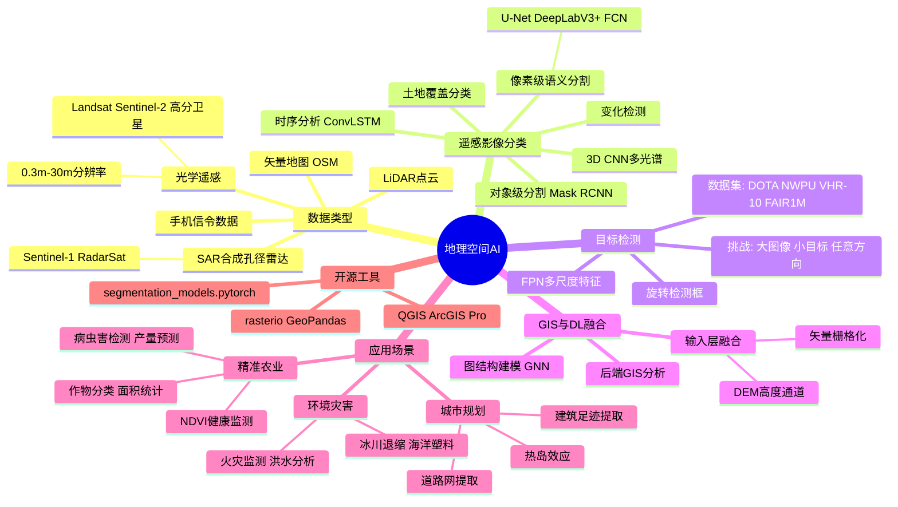

# 第 13-3 章：地理空间 AI（Geospatial AI）

## 学习目标

- 理解遥感影像与地理信息系统（GIS）的基本概念
- 掌握基于深度学习的遥感影像分类与目标检测方法
- 了解 GeoAI 在城市规划、农业监测中的典型应用
- 熟悉主流遥感数据集和开源工具

---

## 1. 什么是地理空间 AI？

**地理空间 AI（GeoAI）** 是地理信息系统（GIS）与人工智能的交叉领域，利用机器学习特别是深度学习技术，从地理空间数据中提取有价值的知识。

**核心数据类型：**

| 数据类型 | 来源 | 典型分辨率 |
|---------|------|-----------|
| 光学遥感影像 | Landsat、Sentinel-2、高分卫星、航拍 | 0.3m - 30m |
| SAR（合成孔径雷达）影像 | Sentinel-1、RadarSat | 1m - 25m |
| LiDAR 点云 | 机载/车载激光扫描 | 点密度可变 |
| 矢量地图数据 | OSM、高精地图 | 道路、建筑边界 |
| 社交媒体地理位置数据 | 手机信令、签到数据 | 用户级别 |

---

## 2. 遥感影像分类与目标检测

### 2.1 遥感影像分类

**传统方法：** 目视解译、基于像素的光谱分类（最大似然分类、决策树）

**深度学习方法：**

| 方法 | 核心思想 | 典型网络 |
|------|---------|---------|
| **像素级分类** | 给每个像素打标签（语义分割） | U-Net、DeepLabV3+、FCN |
| **多光谱特征提取** | 利用多光谱信息（红/绿/近红外/短波红外） | 3D CNN、Spectral Transformer |
| **对象级分类** | 先分割对象（超像素/分割块），再分类 | Mask R-CNN（面向对象） |
| **时序分析** | 利用多时相数据捕捉变化 | ConvLSTM、时空transformer |

**典型任务：**
- **土地覆盖分类**：区分耕地、森林、城市、水体、裸土
- **变化检测**：对比两个时相的影像，检测新增建筑、毁林等

### 2.2 目标检测

遥感目标检测用于从大范围影像中定位特定目标（车辆、船舶、飞机、建筑）。

**特点 vs. 自然图像检测：**
- 影像尺寸极大（可能达到 20000×20000 像素），无法整图输入
- 小目标检测是核心难题（车辆仅占几个像素）
- 任意方向目标（船只、飞机沿任意角度停放）

**解决思路：**

1. **滑动窗口 + CNN 分类**：将大图切为小图块逐一检测
2. **FPN（Feature Pyramid Network）**：多尺度特征融合，检测不同尺寸目标
3. **旋转检测头（Rotated Bounding Box）**：用带角度的检测框替代水平框
4. **大图像推理（TIde）**：高分辨率图像的遥感专用检测器

**代表性数据集：**

| 数据集 | 规模 | 主要目标类别 |
|--------|------|------------|
| DOTA（航拍目标检测） | 2806 图像，15 类 | 飞机、船舶、车辆、游泳池 |
| NWPU VHR-10 | 800 图像，10 类 | 飞机、舰船、车辆 |
| UCAS-A10 | 600 图像，3 类 | 飞机、舰船、车辆 |
| FAIR1M | 4200+ 图像，5 大类 37 小类 | 细粒度目标 |

---

## 3. GIS 与深度学习的结合

### 3.1 从 GIS 数据到深度学习

传统 GIS（ArcGIS、QGIS）擅长矢量数据分析；深度学习擅长从栅格数据中提取模式。两者结合的方式：

**输入层融合：**
- 将矢量数据（如道路网络）栅格化为"距离变换图"或"二进制掩膜"，与遥感影像叠加
- 将 DEM（数字高程模型）作为额外输入通道（提供高度信息）

**图结构建模：**
- 将道路交叉口、POI（兴趣点）建模为图节点，用 Graph Neural Network（GNN）学习空间依赖
- 用于交通流量预测、选址优化

**后端 GIS 分析：**
- 将深度学习输出（变化检测图、分类图）导入 GIS 进行面积统计、缓冲分析

### 3.2 开源工具链

| 工具 | 用途 | 语言 |
|------|------|------|
| **segmentation_models.pytorch** | 遥感影像语义分割骨干网络 | Python |
| **rasterio** | 读写遥感影像（GeoTIFF） | Python |
| **GeoPandas** | 矢量地理数据分析 | Python |
| **QGIS** | 桌面 GIS，可调用深度学习插件 | C++/Python |
| **ArcGIS Pro (Deep Learning Toolkit)** | Esri 商业 GIS 的深度学习支持 | Python |
| **smp (segmentation_models_pytorch)** | 预训练遥感分割模型 | Python |
| **Solaris** | Photon AI 的地理空间深度学习框架 | Python |
| **OpenEarthSet** | 开放遥感数据集集 | 多种 |

---

## 4. 应用场景

### 4.1 城市规划

**建筑足迹自动提取：**
- 从高分辨率航拍影像自动绘制建筑边界（语义分割）
- 提取城市建筑密度、高度（结合 LiDAR 或 SAR）
- 支撑城市扩张监测、违法建筑识别

**交通路网提取：**
- 自动从卫星影像提取道路中心线
- 结合众包地图（OpenStreetMap）进行质量验证
- 支撑导航数据更新（MapBox、Here Technologies）

**热岛效应分析：**
- 用 Landsat 热红外影像计算城市地表温度（LST）
- 结合建筑密度、绿地覆盖率，分析热岛分布

### 4.2 农业监测

**作物类型分类与面积统计：**
- 用 Sentinel-2 多光谱影像识别小麦、玉米、水稻、大豆等
- 每年 USDA（美国农业部）用此方法做农作物种植面积估测

**作物健康监测：**
- **植被指数（NDVI）** 是最常用的健康指标：通过 (NIR - Red)/(NIR + Red) 计算
- 深度学习可预测NDVI空间分布，指导精准灌溉、施肥

**病虫害早期检测：**
- 无人机多光谱影像 + CNN 分类，提前发现病虫害发生区域
- 减少农药使用量，降低环境压力

**产量预测：**
- 结合作物生长期时序影像 + 气象数据 + GNN 预测产量
- 多国政府粮食部门用于早期产量预警

### 4.3 环境与灾害监测

| 应用 | 数据源 | 方法 |
|------|-------|------|
| 森林火灾监测 | Sentinel-2 热红外 | 温度异常检测 + 火情蔓延预测 |
| 洪水淹没分析 | Sentinel-1 SAR | 变化检测 + 水体分割 |
| 冰川退缩监测 | Landsat 时序 | 冰川边界时序对比 |
| 海洋塑料检测 | 高分辨率航拍 | 目标检测 + 语义分割 |
| 空气质量预测 | 遥感 AOD + 地面站数据 | 图神经网络时空预测 |

---

## 5. 本章小结

GeoAI 将遥感数据的"宏观视野"与深度学习的"模式识别"能力结合，在**城市规划**（建筑/道路提取）、**精准农业**（长势监测、产量预测）、**环境监测**（灾害、气候变化）三大领域产生了规模化应用。

核心技术趋势：
- **多源数据融合**：光学 + SAR + LiDAR + 时序数据的联合学习
- **预训练大模型**：遥感大模型（如 SatMAE、Prithvi 等）用自监督学习从海量遥感数据预训练，下游任务微调
- **实时化**：与流式数据处理结合，实现近乎实时的灾害预警

---

## 知识点思维导图

---

## 参考资料

1. Zhu, X. X. et al. (2017). "Deep Learning in Remote Sensing: A Comprehensive Review." *IEEE GRSM*.
2. Cheng, G. et al. (2017). "DOTA: A Large-scale Dataset for Object Detection in Aerial Images." *CVPR 2017*.
3. Long, J. et al. (2015). "Fully Convolutional Networks for Semantic Segmentation." *CVPR 2015*.
4. Ronneberger, O. et al. (2015). "U-Net: Convolutional Networks for Biomedical Image Segmentation." *MICCAI 2015*.
5. Zhang, Y. et al. (2024). "Prithvi: A Foundation Model for Earth Observation." *arXiv* / IBM Research.
6. Wang, Z. et al. (2024). "SatMAE: Pre-training Transformers for Temporal and Multi-spectral Satellite Imagery." *NeurIPS 2022*.
7. ESA Sentinel Online. "Sentinel-2 User Handbook." European Space Agency.
8. QGIS. "QGIS Geographic Information System." Open Source Geospatial Foundation.