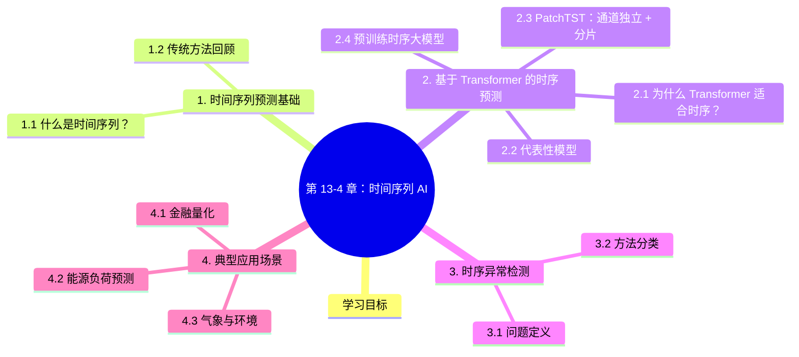

# 第 13-4 章：时间序列 AI

## 学习目标

- 理解时间序列预测的核心问题与常用评价指标
- 掌握 Transformer 在时间序列预测中的建模方式
- 了解时序异常检测的主要方法
- 熟悉 AI 在金融量化、气象预测、能源负荷预测中的应用场景

---

## 1. 时间序列预测基础

### 1.1 什么是时间序列？

**时间序列**是按时间顺序排列的观测值序列，广泛存在于金融（股价）、气象（温度）、能源（负荷）、医疗（心电图）等领域。

**任务分类：**

| 任务 | 定义 | 示例 |
|------|------|------|
| **预测（Forecasting）** | 给定历史数据，预测未来值 | 预测下周股价、明日气温 |
| **分类（Classification）** | 识别时序所属类别 | ECG 心电图异常分类 |
| **异常检测（Anomaly Detection）** | 识别偏离正常模式的点/段 | 工业设备故障预警 |
| ** imputation（补全）** | 填充缺失数据 | 传感器数据缺失值填补 |

### 1.2 传统方法回顾

| 方法 | 原理 | 优缺点 |
|------|------|--------|
| ARIMA | 自回归移动平均模型 | 线性假设，简单高效；无法捕捉非线性 |
| 指数平滑（Holt-Winters） | 加权历史观测值 | 适合有趋势/季节性数据 |
| 状态空间模型（Kalman Filter） | 隐状态估计 | 理论基础好；计算开销大 |
| 向量自回归（VAR） | 多变量时序联合建模 | 可捕捉变量间依赖；维度灾难 |

---

## 2. 基于 Transformer 的时序预测

### 2.1 为什么 Transformer 适合时序？

- **长程依赖捕捉**：自注意力机制可直接建模任意两个时间点之间的关系
- **并行计算**：相比 RNN 不受串行限制，训练效率高
- **多变量融合**：可自然处理多变量时序

### 2.2 代表性模型

| 模型 | 年份 | 核心贡献 |
|------|------|---------|
| **Transformer** (Vaswani et al., 2017) | 2017 | 自然语言处理基础架构，时序领域的基础 |
| **LogTrans** (Li et al., 2019) | 2019 | 首次引入 Transformer 做时序预测，用 LogSparse 注意力 |
| **Informer** (Zhou et al., 2021) | 2021 | Probsparse 注意力 + 蒸馏，提出 ELU 预测 |
| **Autoformer** (Wu et al., 2021) | 2021 | 季节性趋势分解 + 自相关注意力 |
| **FEDformer** (Zhou et al., 2022) | 2022 | 频域注意力 + 傅里叶/小波变换 |
| **PatchTST** (Nie et al., 2023) | 2023 | 通道独立 + Patch（分片）思想，效果优秀 |
| **iTransformer** (Liu et al., 2024) | 2024 | 将注意力施加在变量维度而非时间维度 |
| **Chronos** (Amazon, 2024) | 2024 | 预训练时序大模型，超大规模预训练 |

### 2.3 PatchTST：通道独立 + 分片

PatchTST（2023）是当前最流行的 Transformer 时序模型之一：

```
核心思想：
1. Patch：将输入序列切分为固定长度的分片（patch），如每个patch长16
2. 通道独立：每个变量单独建模，共享权重
3. 使用 2D 卷积将每个变量的 (patch数 × patch长度) → (C × L) 张量
4. 输入标准 Transformer 编码器
```

**优势：** 通道独立设计大幅降低参数量，同时通过 Patch 提取局部模式，提升长期预测精度。

### 2.4 预训练时序大模型

**Chronos（Amazon, 2024）：**
- 在数亿条来自各领域（金融、能源、医疗等）的时间序列上预训练
- 可直接 zero-shot 预测新时序，无需微调
- 展示了预训练规模化在时序领域的潜力

---

## 3. 时序异常检测

### 3.1 问题定义

异常（Anomaly）指时间序列中偏离正常模式的观测值或区段：
- **点异常**：单个异常值（如传感器故障读数）
- **上下文异常**：在特定语境下才异常（如冬天气温 30°C）
- **集体异常**：一组连续异常（如设备故障期间持续异常）

### 3.2 方法分类

| 方法类别 | 代表算法 | 原理 |
|---------|---------|------|
| **统计方法** | 3σ 原则、分位数 | 假设正常数据服从某分布，偏离则为异常 |
| **重建方法** | 自编码器（AE/VAE） | 正常数据重建误差小，异常数据误差大 |
| **预测方法** | LSTM/Transformer 预测 | 预测值与真实值差异大为异常 |
| **密度方法** | LOF、DBSCAN | 异常点位于低密度区域 |
| **图方法** | GNN 时序图模型 | 节点行为异常检测 |

**深度学习异常检测代表工作：**

| 工作 | 方法 | 特点 |
|------|------|------|
| **Luminol** | 时序分解 + 变化点检测 | 轻量级，适合运维监控 |
| **OmniAnomaly** (2019) | 变分自编码器 + 重构概率 | 多变量时序异常检测 |
| **An Transformer** (2020) | Transformer 预测 + 误差 | 用 Transformer 做时序预测，误差大处判定异常 |
| **USAD** (2020) | 对抗自编码器 | 双阶段训练，从正常数据中分离异常 |

---

## 4. 典型应用场景

### 4.1 金融量化

**股价/资产价格预测：**
- 时序模型预测短期价格走势，作为量化策略的信号源
- 注意：股价预测是弱有效市场假设下的难题，AI 能捕捉统计规律但难以预测基本面驱动的拐点

**算法交易中的风控：**
- 异常检测识别市场闪崩、异常波动
- 实时监控持仓风险

**因子挖掘：**
- 用时序 Transformer 从市场数据中自动挖掘有效因子

### 4.2 能源负荷预测

**电网调度：**
- 预测未来 24h-72h 的电力负荷，支撑发电计划安排
- 结合气象数据（温度、湿度）、日历特征（节假日）做精细化预测
- 误差 1% 的提升可节省数百万运营成本

**可再生能源预测：**
- **风电功率预测**：用 WRF 气象模型 + 时序 NN 预测风场功率
- **光伏功率预测**：结合辐照度模型和历史发电数据

**需求侧管理：**
- 预测用户侧负荷曲线，支撑峰谷电价策略、虚拟电厂调度

### 4.3 气象与环境

| 应用 | 方法 | 提升 |
|------|------|------|
| 温度/降水预测 | 时序 transformer | 提前数小时预警 |
| 空气质量预测 | 多变量时序 + GNN | PM2.5 预报 |
| 极端天气检测 | 时序异常检测 | 提前发现极端事件苗头 |
| 海浪周期预测 | 深度学习 + 物理约束 | 海洋工程支撑 |

---

## 5. 时间序列基础模型：Chronos / Mamba / TimeGPT（2024-2025）

> **本节核心**：时间序列 AI 正在从"单任务单模型"走向**"基础模型化"**——用海量时序数据预训练一个大模型，下游任务（预测/异常检测/分类）zero-shot 即可。

### 5.1 时间序列基础模型全景

| 模型 | 机构 | 时间 | 参数量 | 范式 | 适合 |
|------|------|------|--------|------|------|
| **TimeGPT-1** | Nixtla | 2024.3 | ~50M (推测) | Transformer | 通用预测 |
| **Chronos-Bolt** | Amazon | 2024.10 | 20M-200M | T5 + 离散化 | 通用预测 |
| **Chronos** | Amazon | 2024.2 | 20M-710M | T5 + 离散化 | 通用预测 |
| **Mamba-TS** | 多家 | 2024 | ~100M | 状态空间 | 长序列 |
| **Time-LLM** | Monash | 2024 | 7B (LLM) | LLM 适配 | 跨模态 |
| **Time-300B** | Salesforce | 2024 | 300M | 简化 Transformer | 通用 |
| **Lag-Llama** | 牛津 | 2024 | 概率 Transformer | 概率预测 | 概率预测 |
| **TimesFM** | Google | 2024 | 200M | Decoder-only | 通用 |
| **Timer** | 清华 | 2024 | 1B+ | Decoder Transformer | 通用 |
| **AutoTimes** | 清华 | 2024 | LLM-based | LLM 适配 | zero-shot |

### 5.2 Mamba for Time Series：线性复杂度的新王

**Mamba**（状态空间模型，SSM）相比 Transformer 的核心优势：

$$
\text{复杂度} = \begin{cases}
O(n^2) & \text{Transformer Self-Attn} \\
O(n) & \text{Mamba/SSM}
\end{cases}
$$

**时间序列 Mamba 代表**：

| 模型 | 任务 | 性能 vs Transformer |
|------|------|---------------------|
| **Mamba-TS** | 单变量预测 | +5-10% 精度，快 3-5× |
| **TimeMamba** | 多变量预测 | +2-3% MSE |
| **TimeMixer**（清华）| 长期预测 | SOTA on 6 datasets |
| **S-Mamba** | 长时序分类 | +1-2% Acc |

### 5.3 Time-LLM：把时序当语言处理

**核心思想**：把时间序列**转换为文本 token**（"数字形式"），用 LLM 处理。

```python
# Time-LLM 简化示例
def time_series_to_text(series, prompt):
    """把数值序列转成自然语言描述"""
    text = f"时间序列数据：{series}。问题：{prompt}"
    return text

# LLM 推理
series = [1.2, 1.5, 1.3, 1.8, 2.0, 2.3]
prompt = "未来 3 个时间步的值是多少？"
text = time_series_to_text(series, prompt)
answer = llm(text)  # "1.7, 1.9, 2.1"
```

**优势**：
- 复用 LLM 的预训练知识
- 可以用自然语言"问"时序问题（异常检测、分类、预测）
- zero-shot 即可

**局限**：
- LLM 的 token 数限制（4096-32K）
- 长时序量化精度损失
- 计算成本高

### 5.4 Chronos（Bolt）：亚马逊开源的时序基础模型

**核心思想**：把时间序列**离散化为"词表"**（类似 NLP 的 tokenization），用 T5 架构预训练。

```python
from chronos import ChronosPipeline

# 加载预训练模型
pipeline = ChronosPipeline.from_pretrained(
    "amazon/chronos-bolt-base",
    device_map="cuda"
)

# 预测未来 10 个时间步
context = torch.tensor([1.0, 1.2, 1.5, 1.3, 1.8, 2.0, 2.1, 2.3])
quantiles, mean = pipeline.predict_quantiles(
    context=context,
    prediction_length=10,
    quantile_levels=[0.1, 0.5, 0.9]
)
# 输出：[10%] [50%] [90%] 分位数 + 均值
```

**Chronos-Bolt 变体**：

| 变体 | 参数量 | 速度 | 精度 |
|------|--------|------|------|
| **Chronos-Bolt-tiny** | 20M | 极快 | 基线 |
| **Chronos-Bolt-mini** | 50M | 极快 | 中等 |
| **Chronos-Bolt-small** | 200M | 快 | 良好 |
| **Chronos-Bolt-base** | 200M | 中 | 优秀 |

### 5.5 时间序列异常检测前沿

| 方法 | 思想 | 适合 |
|------|------|------|
| **Anomaly Transformer** | 关联差异 | 多变量异常 |
| **TimesNet** | 时序 → 2D 张量 | 长序列异常 |
| **MOMENT** | 基础模型 zero-shot | 通用异常 |
| **Lag-Llama** | 概率预测异常 | 罕见异常 |
| **D3R** | 解耦表示 | 复杂系统 |

### 5.6 时序 AI 实战 5 大挑战

| 挑战 | 现状 | 趋势 |
|------|------|------|
| **长序列** | Transformer 平方复杂度爆 | Mamba / Linear Attention |
| **数据稀缺** | 很多场景只有 1K 样本 | 时序基础模型 zero-shot |
| **分布漂移** | 季节性、突发异常 | 在线学习 + 数据增强 |
| **多变量耦合** | 几十个特征相互依赖 | 因果发现 + 图神经网络 |
| **不确定性** | 真实场景需要置信区间 | 概率预测（贝叶斯、quantile）|

### 5.7 时序 AI 选型决策

| 场景 | 推荐方法 | 原因 |
|------|----------|------|
| **股票预测** | LSTM / N-BEATS / Lag-Llama | 长期依赖 + 概率输出 |
| **销量预测** | Prophet / DeepAR / TFT | 季节性 + 多变量 |
| **设备异常** | Anomaly Transformer / TimesNet | 时序 + 异常定位 |
| **金融风控** | XGBoost + LSTM 集成 | 特征 + 时序 |
| **电力负荷** | Transformer / Chronos | 长序列 + 通用 |
| **金融量化** | Mamba / SSM | 超长序列（毫秒级）|

> **核心经验**：**时序 AI 首选专用模型（TimesNet / Anomaly Transformer）**，LLM 适配（Time-LLM）适合少样本场景，**Mamba 是长序列的"未来"**。

---

## 本章小结
时间序列 AI 的核心进展：

| 方向 | 关键突破 |
|------|---------|
| 预测 | Transformer 架构主导 + 预训练大模型（Chronos）|
| 异常检测 | 自编码器重建 + 预测误差联合判断 |
| 多变量建模 | 通道独立设计（PatchTST）、变量维度注意力（iTransformer）|

在实际应用中，**领域知识融合**（如气象的物理方程、金融的事件数据）是提升效果的关键，纯数据驱动的模型在某些场景下存在局限。


## 知识图谱



## 参考资料

1. Vaswani, A. et al. (2017). "Attention Is All You Need." *NeurIPS 2017*.
2. Zhou, H. et al. (2021). "Informer: Beyond Efficient Transformer for Long Sequence Time-Series Forecasting." *AAAI 2021*.
3. Wu, H. et al. (2021). "Autoformer: Decomposition Transformers with Auto-Correlation for Long-Term Series Forecasting." *NeurIPS 2021*.
4. Nie, Y. et al. (2023). "Time Series as Images: A Large-scale Approach." *ICLR 2023* (PatchTST).
5. Liu, Y. et al. (2024). "iTransformer: Inverted Transformers Are Effective for Time Series Forecasting." *ICLR 2024*.
6. Zhang, T. et al. (2024). "Chronos: Learning the Language of Time Series." *arXiv* / Amazon.
7. Xu, W. et al. (2020). "OmniAnomaly: Robust Multivariate Time Series Anomaly Detection." *KDD 2019* / 2020.
8. Audibert, J. et al. (2020). "USAD: UnSupervised Anomaly Detection on Multivariate Time Series." *KDD 2020*.
