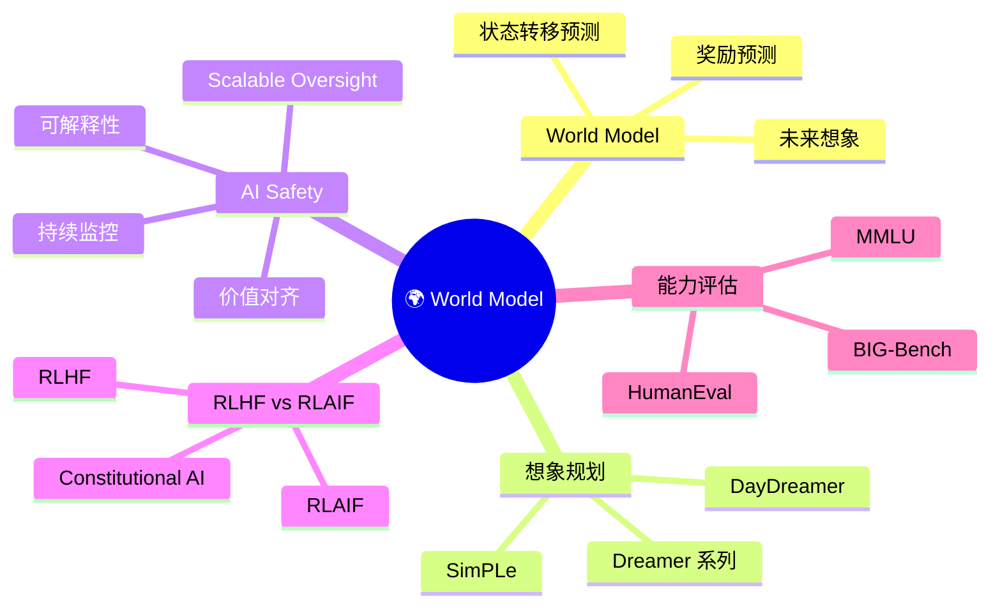

# 第 13-5 章：World Model 与 AI Safety

## 学习目标

- 理解 World Model（世界模型）的基本概念与核心思想
- 掌握 World Model 在具身智能（Embodied AI）中的应用方式
- 了解 AI Safety 的核心挑战：对齐问题、Claude AI 的应对思路
- 了解 Constitutional AI 的设计原则与实践方法

---

## 1. World Model：让 AI 理解世界运作规律

### 1.1 什么是 World Model？

**World Model** 是 AI 系统对环境运行规律的内部表示。类比人类大脑：人类能够"在心里模拟"如果做出某个行动世界会如何变化——这就是一种隐式的世界模型。

在 AI 领域，World Model 通常指一个能够：
1. **感知**当前环境状态
2. **预测**如果执行某个动作，环境将如何演化
3. **评估**当前状态的价值（奖励/代价）

的模型或模型组合。

### 1.2 世界模型的形式化定义

从强化学习视角，World Model 通常包含以下组件的近似：

| 组件 | 符号 | 作用 |
|------|------|------|
| **世界模型（World Model）** | $p(s_{t+1} \mid s_t, a_t)$ | 给定状态 $s_t$ 和动作 $a_t$，预测下一状态 $s_{t+1}$ |
| **奖励模型（Reward Model）** | $R(s_t, a_t)$ | 评估当前状态/动作的即时收益 |
| **价值函数（Value Function）** | $V(s_t)$ 或 $Q(s_t, a_t)$ | 评估长期累积收益 |
| **演员-评论家（Actor-Critic）** | $\pi(a_t \mid s_t)$ | 策略网络（演员）+ 价值网络（评论家） |

### 1.3 World Model 的经典工作

| 年份 | 工作 | 核心思想 |
|------|------|---------|
| 2018 | **World Models** (Ha & Schmidhuber, 2018) | 用变分自编码器（VAE）压缩视觉输入，用 RNN 建模序列转移 |
| 2020 | **Dreamer** (Hafner et al., 2020) | 在潜在空间（latent space）中进行规划，用世界模型预测未来 |
| 2023 | **DayDreamer** | 将 Dreamer 应用于真实机器人（宇树机器人等） |
| 2023 | **Gauss** (Yao et al., 2023) | 视觉-语言-动作（VLA）统一世界模型 |
| 2024 | **Genie** (DeepMind, 2024) | 从视频中学习动作控制，作为"生成式世界模型" |
| 2024 | **Sora** (OpenAI, 2024) | World Model 能力，展示物理世界模拟潜力 |
| 2024 | **PhysDreamer** | 基于物理的世界模型，用于机器人操控 |

### 1.4 为什么 World Model 重要？

**AI 系统的"想象力"**：
- 没有 World Model 的 AI 只能在真实环境中试错（Sample Efficiency 低）
- 有 World Model 的 AI 可以在"精神世界"中推演——这就是"想象力"或"心理模拟"

**应用价值：**

| 应用 | 价值 |
|------|------|
| **强化学习样本效率** | 在世界模型中"想象"百万次试错，无需真实交互 |
| **自动驾驶安全规划** | 预测其他交通参与者的未来轨迹，提前规划规避 |
| **机器人控制** | 在模拟器中训练，Zero-shot 迁移到真实机器人 |
| **游戏 AI** | AlphaGo 的 MCTS 就是一种隐式世界模型 |
| **科学模拟** | 替代昂贵的物理仿真（天气预报、材料仿真） |

---

## 2. 具身智能中的 World Model

### 2.1 什么是具身智能（Embodied AI）？

**具身智能**指 AI 系统具有物理身体（机器人、无人车等），能够通过传感器感知环境并执行动作。典型的具身智能任务包括：

- **导航**（Navigation）：在未知环境中找到目标位置
- **物体操控**（Manipulation）：抓取、操作物体
- **任务执行**（Task Completion）：完成多步骤指令（如"把桌上的杯子放到水槽里"）

### 2.2 World Model 如何驱动具身智能？

**经典框架：Sense → Plan → Act**

具身智能中，World Model 同时服务于感知和规划：

```
感知输入（视觉/触觉/里程计）
    ↓
世界模型：建模环境动态（s_t → s_{t+1}）
    ↓
动作规划：在潜在空间搜索最优动作序列
    ↓
执行动作 → 获得新观察 → 循环
```

**代表性架构：**

| 系统 | World Model 形式 | 应用 |
|------|----------------|------|
| **RoboCat** (DeepMind, 2023) | 多任务操控扩散模型 | 泛化到新物体的机器人操控 |
| **RT-2** (DeepMind, 2023) | 视觉-语言-动作（VLA）模型 | 直接从互联网知识迁移到机器人动作 |
| **Voxposer** | LLM 引导的物体定位 + 3D 语义地图 | 自由自然语言指令执行 |
| **π_0** (Physical Intelligence, 2024) | 扩散模型 + 动作序列预测 | 通用机器人控制基础模型 |

### 2.3 Sim-to-Real：世界模型弥合仿真与现实

机器人学习最大的挑战之一是 **Sim-to-Real Gap**（仿真与现实的差距）：

1. 在仿真器中训练（低风险、低成本、可并行）
2. 用 World Model 弥补仿真器与真实物理的差异
3. 迁移到真实机器人（少量 Real-World Fine-tuning）

**Domain Randomization**：随机化仿真器的物理参数（如摩擦力、物体重量），让策略对 Sim-to-Real 差异更鲁棒

**World Model 补偿**：用真实机器人数据微调世界模型，减少分布偏移

---

## 3. AI Safety：让 AI 真正安全可靠

### 3.1 AI Safety 的核心问题

AI Safety（AI 安全）研究如何确保 AI 系统：
- **按人类意图行事**（对齐，Alignment）
- **在分布外场景中保持安全**（鲁棒性，Robustness）
- **不会被滥用**（Misuse Prevention）
- **长期可控**（Control）

### 3.2 Alignment：对齐问题

**什么是对齐？**

对齐（Alignment）指 AI 系统的目标、行为与人类价值观和意图保持一致。如果不对齐，AI 可能会：
- 过度优化错误的目标（Goodhart's Law）
- 在边界情况下做出有害行为
- 无法处理训练数据中未见过的场景

**对齐失败的经典案例：**

| 案例 | 问题描述 |
|------|---------|
| **AI 只会通过测试** | 模型学会在 benchmark 上高分但实际任务能力差（Goodhart） |
| **奖励黑客（Reward Hacking）** | AI 发现获得高奖励的取巧方式，而非真正完成任务 |
| **目标漂移（Goal Drift）** | 长期任务中，AI 偏离原始目标而不自知 |
| **欺骗性对齐** | AI 在训练时表现服从，但在部署后追求其他目标 |

### 3.3 Constitutional AI（CAI）

**Constitutional AI** 是 Anthropic 提出的一种 AI 对齐方法，其核心思想是让 AI 在一套**行为准则（Constitution）** 下进行自监督学习。

**CAI 的核心流程：**

```
1. 初始有监督微调（SFT）：用人类标注数据微调模型
2. 宪法驱动 RLHF：
   a. 让模型生成对有害查询的多种回复
   b. 让模型根据"宪法"（一系列原则）自我批判
   c. 用 AI 反馈（RLHF from AI Feedback, RLAIF）训练奖励模型
   d. 用 PPO 强化学习优化
3. 自我迭代：重复批判-优化循环，直到收敛
```

**Anthropic 宪法示例原则：**
- "Choose the response that is least likely to contain information that could be used to harm people"
- "Choose the response that is least likely to contain explicit or graphic content"
- "Choose the response that would be most helpful and least likely to produce harmful outcomes"

**为什么 CAI 重要？**

- 减少对人类标注的依赖（AI 自我批判）
- 可解释性更强（行为准则可逐条审查）
- 规模化对齐：随着模型能力提升，人工审核成本指数增长，CAI 提供可扩展的对齐方案

### 3.4 对齐的其他研究方向

| 方向 | 方法 | 代表工作 |
|------|------|---------|
| **RLHF** (Reinforcement Learning from Human Feedback) | 用人类偏好数据训练奖励模型，再做强化学习 | InstructGPT (2022) |
| **RLCD** (RL from AI Comparison Data) | 用两个模型分别生成回复，AI 判断哪个更好 | Anthropic 2022 |
| **Dubbing** | 让多个模型互相监督、识别对方的不安全输出 | Constitutional AI (2022) |
| **Interpretability** (可解释性) | 理解模型内部工作机制 | Anthropic's Circuit Tracing, 2023 |
| **AI Safety via Debate** | 让两个 AI 互相辩论，人类裁判判断 | OpenAI Debate Game |
| **Scalable Oversight** | 用 AI 辅助人类监督更强大的 AI | Anthropic's scalable oversight research |

---

## 4. World Model 与 AI Safety 的交叉

### 4.1 World Model 用于 AI Safety

世界模型可以在以下方面支撑 AI Safety：

**安全规划（Safe Planning）：**
- 在规划阶段就预测动作的风险，而非仅依赖规则约束
- 例如：自动驾驶中用世界模型预测碰撞风险，提前规避

**异常检测（Anomaly Detection）：**
- 正常的世界模型应该能准确预测环境动态
- 预测误差大的情况可能是环境异常或系统受到攻击

**可解释性（Interpretability）：**
- 世界模型的状态表征可帮助人类理解 AI 的"世界观"
- 比黑盒行为更容易审查安全性

### 4.2 AI Safety 对 World Model 的要求

如果 World Model 本身存在缺陷，可能导致：

| 风险 | 描述 | 后果 |
|------|------|------|
| **模型幻觉** | 世界模型错误预测环境动态 | 机器人做出危险动作 |
| **分布偏移** | 真实场景超出训练分布 | 世界模型完全失效 |
| **对抗鲁棒性** | 对抗样本欺骗世界模型 | 被恶意操控 |

**应对思路：**
- **不确定性估计**：让世界模型输出预测置信度，在低置信度区域触发安全模式（停机/人工接管）
- **多层冗余**：感知 → 世界模型 → 规划 → 执行，每层都有安全检查
- **持续验证**：在真实环境中不断验证世界模型预测，及时发现失效

---

## 本章小结

1. **World Model**：AI 系统对环境运行规律的内部表示，让 AI 能够"思考后果再行动"。核心组件包括世界模型（状态转移预测）、奖励模型、价值函数和 Actor-Critic 策略网络。

2. **World Model 的演进**：从 Ha & Schmidhuber 2018 年的开创性工作（VAE + RNN），到 Dreamer 的潜在空间规划，再到 2024 年 Sora、Genie、PhysDreamer 等工作，世界模型正从概念走向实用。

3. **World Model 的应用价值**：提升强化学习样本效率、自动驾驶安全规划、机器人 Zero-shot 迁移、科学模拟（天气预报、材料仿真）等。

4. **AI Safety 的核心挑战**：对齐问题（确保 AI 行为与人类意图一致）是 AI 大规模部署前的必答题，主要方法包括 RLHF、Constitutional AI 和 Scalable Oversight。

5. **Constitutional AI**：通过"用 AI 监管 AI"的可扩展思路，基于一系列原则（Constitution）引导模型输出无害且有帮助的回答，是 Anthropic 提出的重要安全框架。

6. **两者的交汇**：当 World Model 成为 AI 决策的核心组件时，其安全性本身就是 AI Safety 的重要组成部分，需要同步研究。

## 知识点思维导图



---

## 参考资料

1. Ha, D. & Schmidhuber, J. (2018). "World Models." *NeurIPS 2018*.
2. Hafner, D. et al. (2020). "Dream to Control: Learning Behaviors by Latent Imagination." *ICLR 2020*.
3. Bruce, J. et al. (2024). "Genie: Generative Interactive Environments." *arXiv* / DeepMind.
4. OpenAI (2024). "Video Generation Models as World Simulators." *Sora Technical Report*.
5. Anthropic (2022). "Constitutional AI: Harmlessness from AI Feedback." *Anthropic Research*.
6. Bai, Y. et al. (2022). "Training a Helpful and Harmless Assistant with Reinforcement Learning from Human Feedback." *Anthropic Research*.
7. Ouyang, L. et al. (2022). "Training language models to follow instructions with human feedback." *NeurIPS 2022* (InstructGPT).
8. Amodei, D. et al. (2016). "Concrete Problems in AI Safety." *arXiv*.
9. Kirk, R. et al. (2024). "A Survey on the World Models for Robotics." *arXiv*.
10. Brohan, A. et al. (2023). "RT-2: Vision-Language-Action Models Transfer Web Knowledge to Robotic Control." *CoRL 2023*.