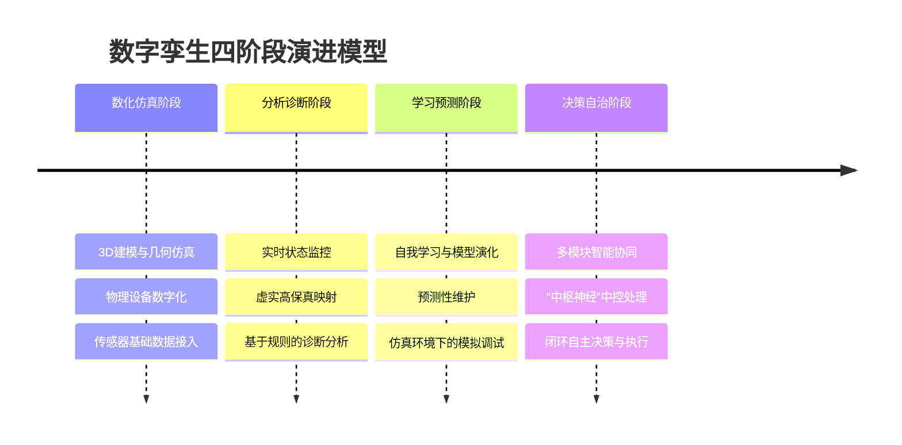
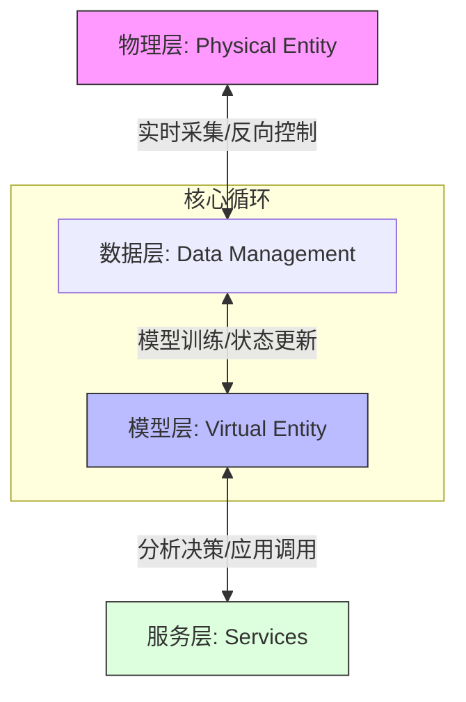
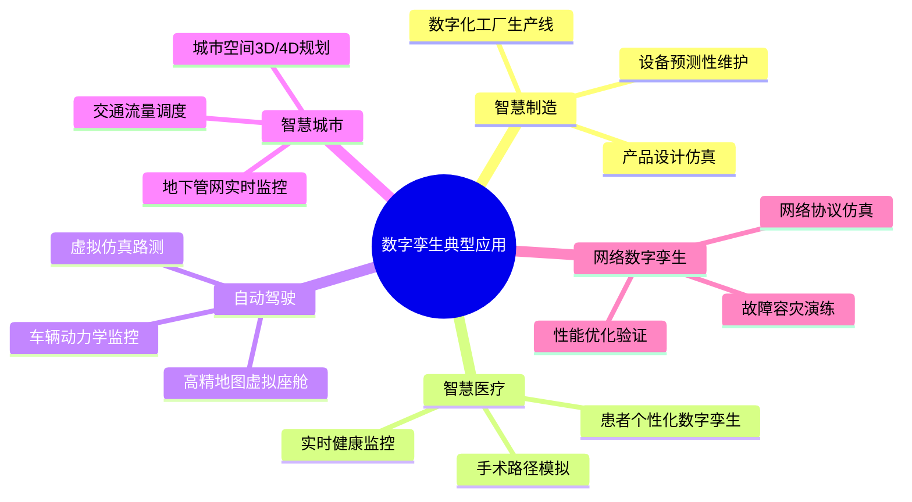

# 13-6 数字孪生

## 学习目标
- 理解数字孪生（Digital Twin）的核心定义与演进历史。
- 掌握数字孪生的五维模型架构与核心要素。
- 了解数字孪生发展的四个阶段及其关键特征。
- 探讨数字孪生在各行业中的应用场景及与AI/ML的深度融合。

---

## 1. 什么是数字孪生？

**数字孪生（Digital Twin）** 是物理对象、过程或系统的虚拟模型，能够精准、实时地反映其对应物理实体的状态。它不仅仅是 3D 建模，更是通过数据链路实现虚实交融的“活”系统。

### 1.1 Gartner 的四要素
Gartner 将数字孪生概括为以下四个核心要素：
1.  **模型（Model）**：物理实体的数字表现形式。
2.  **数据（Data）**：来自物理实体的实时运行数据和环境数据。
3.  **监控（Monitoring）**：对物理实体状态的持续观察与捕捉。
4.  **唯一性（Uniqueness）**：每个数字孪生与其特定的物理实体一一对应。

### 1.2 数字孪生五维模型
学术界广泛认可的五维模型由五个部分构成：$M_{DT} = \{PE, VE, Ss, DD, CN\}$

| 维度 | 缩写 | 定义 | 说明 |
| :--- | :--- | :--- | :--- |
| **物理实体** | PE | Physical Entity | 真实存在的物理对象、设备或系统。 |
| **虚拟实体** | VE | Virtual Entity | 物理实体在数字空间的镜像，包含几何、物理、行为模型。 |
| **服务** | Ss | Services | 为用户提供的应用功能，如预测性维护、优化控制等。 |
| **孪生数据** | DD | Twin Data | 物理层、模型层和服务层产生的所有数据的集合。 |
| **连接** | CN | Connection | 实现各层级之间实时交互与反馈的链路（如 5G/IoT）。 |

---

## 2. 发展历史

数字孪生的概念演进经历了从“镜像空间”到“成熟工业应用”的过程：

- **1991年：David Gelernter** 在其著作《Mirror Worlds》中首次提出了数字空间的镜像世界概念，这是数字孪生的思想萌芽。
- **2002年：Michael Grieves** 在密歇根大学的演讲中正式将这一概念应用于制造业，提出了“物理空间、虚拟空间、数据链接”的三维结构。
- **2010年：NASA** 在《2010版技术路线图》中正式将其命名为 **"Digital Twin"**，用于提高飞行器的寿命预测与任务成功率。

---

## 3. 数字孪生发展模型

数字孪生的演进并非一蹴而就，通常被划分为四个核心阶段：

---

## 4. 技术架构

数字孪生的技术架构通常遵循“物理层-数据层-模型层-服务层”的层级结构，实现虚实世界的闭环交互。

---

## 5. 核心要素与特点

### 5.1 核心要素
| 要素 | 核心内容 | 关键点 |
| :--- | :--- | :--- |
| **数据** | 统一数据仓库，整合历史离线数据与传感器实时数据。 | **“全周期性”**：覆盖从设计到报废全过程。 |
| **模型** | 结合机理模型（物理公式）与数据驱动模型（AI）。 | **“动态性”**：模型随物理实体状态的变化而更新。 |
| **映射** | 实现虚实空间的精确对齐与同步。 | **“保真度”**：映射关系多元化，确保高精度一致性。 |
| **交互** | 标准化数据接口，实现低延迟的实时采集与闭环控制。 | **“闭环性”**：虚拟空间的结果能反馈至物理实体。 |

### 5.2 技术特点
1.  **互操作性**：支持不同系统、不同厂商之间的模型与数据交换。
2.  **可扩展性**：能够随着物理系统的升级而不断迭代增加功能。
3.  **实时性**：数据的采集、分析与指令下达需满足工业级的实时要求。
4.  **高保真性**：虚拟模型与物理实体在外观、属性、行为上保持高度一致。
5.  **闭环性**：通过“感知-诊断-预测-决策-控制”实现完整的控制回路。

---

## 6. 典型应用场景

- **智慧制造**：参见13-1（AI for Science，机理建模部分）。
- **自动驾驶**：参见13-2（自动驾驶，仿真测试平台）。

---

## 7. 与 AI/ML 的深度融合

人工智能与机器学习是赋予数字孪生“智慧”的核心引擎：

1.  **数据驱动模型的崛起**：当物理机理过于复杂难以通过传统公式描述时，ML 模型可以从海量传感器数据中学习物理实体的行为模式。
2.  **混合建模（Hybrid Modeling）**：将物理机理（ODE/PDE 等公式）与深度学习模型相结合。物理模型保证结果符合基本科学定律，AI 模型负责捕捉数据中的非线性细节。
3.  **合成数据生成**：利用数字孪生系统生成的仿真数据来训练 AI 模型。在自动驾驶等高风险领域，这种方式可以低成本、安全地获取极端场景（Corner Cases）下的训练样本。
4.  **在线学习与自适应**：随着物理实体的磨损或环境改变，ML 模型可以在线不断更新其参数，确保数字孪生模型始终保持“保真”。

---

## 延伸阅读
- **工业互联网白皮书**：了解数字孪生与工业 4.0 的宏观愿景。
- **仿真技术标准 (IEEE P2888)**：关注数字孪生与物理空间的接口标准。
