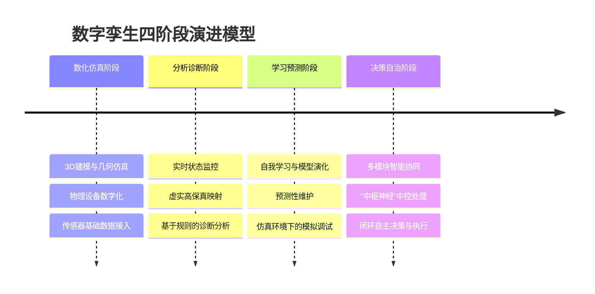
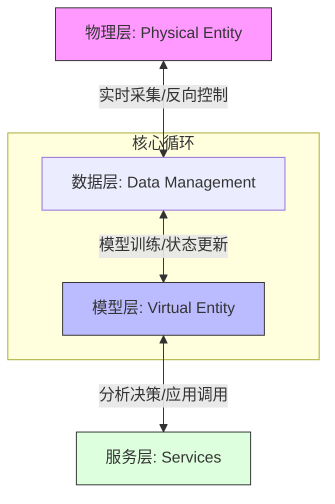
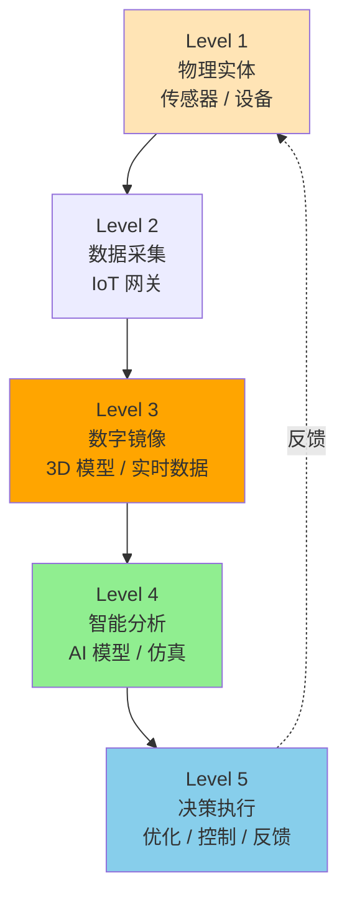
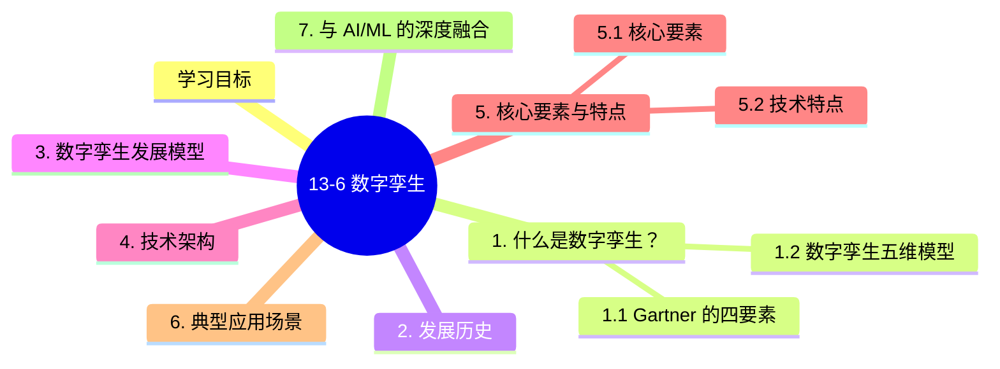

# 13-6 数字孪生

## 学习目标
- 理解数字孪生（Digital Twin）的核心定义与演进历史。
- 掌握数字孪生的五维模型架构与核心要素。
- 了解数字孪生发展的四个阶段及其关键特征。
- 探讨数字孪生在各行业中的应用场景及与AI/ML的深度融合。

---

## 1. 什么是数字孪生？

**数字孪生（Digital Twin）** 是物理对象、过程或系统的虚拟模型，能够精准、实时地反映其对应物理实体的状态。它不仅仅是 3D 建模，更是通过数据链路实现虚实交融的“活”系统。

### 1.1 Gartner 的四要素
Gartner 将数字孪生概括为以下四个核心要素：
1.  **模型（Model）**：物理实体的数字表现形式。
2.  **数据（Data）**：来自物理实体的实时运行数据和环境数据。
3.  **监控（Monitoring）**：对物理实体状态的持续观察与捕捉。
4.  **唯一性（Uniqueness）**：每个数字孪生与其特定的物理实体一一对应。

### 1.2 数字孪生五维模型
学术界广泛认可的五维模型由五个部分构成：$M_{DT} = \{PE, VE, Ss, DD, CN\}$

| 维度 | 缩写 | 定义 | 说明 |
| :--- | :--- | :--- | :--- |
| **物理实体** | PE | Physical Entity | 真实存在的物理对象、设备或系统。 |
| **虚拟实体** | VE | Virtual Entity | 物理实体在数字空间的镜像，包含几何、物理、行为模型。 |
| **服务** | Ss | Services | 为用户提供的应用功能，如预测性维护、优化控制等。 |
| **孪生数据** | DD | Twin Data | 物理层、模型层和服务层产生的所有数据的集合。 |
| **连接** | CN | Connection | 实现各层级之间实时交互与反馈的链路（如 5G/IoT）。 |

---

## 2. 发展历史

数字孪生的概念演进经历了从“镜像空间”到“成熟工业应用”的过程：

- **1991年：David Gelernter** 在其著作《Mirror Worlds》中首次提出了数字空间的镜像世界概念，这是数字孪生的思想萌芽。
- **2002年：Michael Grieves** 在密歇根大学的演讲中正式将这一概念应用于制造业，提出了“物理空间、虚拟空间、数据链接”的三维结构。
- **2010年：NASA** 在《2010版技术路线图》中正式将其命名为 **"Digital Twin"**，用于提高飞行器的寿命预测与任务成功率。

---

## 3. 数字孪生发展模型

数字孪生的演进并非一蹴而就，通常被划分为四个核心阶段：



---

## 4. 技术架构

数字孪生的技术架构通常遵循“物理层-数据层-模型层-服务层”的层级结构，实现虚实世界的闭环交互。



---

## 5. 核心要素与特点

### 5.1 核心要素
| 要素 | 核心内容 | 关键点 |
| :--- | :--- | :--- |
| **数据** | 统一数据仓库，整合历史离线数据与传感器实时数据。 | **“全周期性”**：覆盖从设计到报废全过程。 |
| **模型** | 结合机理模型（物理公式）与数据驱动模型（AI）。 | **“动态性”**：模型随物理实体状态的变化而更新。 |
| **映射** | 实现虚实空间的精确对齐与同步。 | **“保真度”**：映射关系多元化，确保高精度一致性。 |
| **交互** | 标准化数据接口，实现低延迟的实时采集与闭环控制。 | **“闭环性”**：虚拟空间的结果能反馈至物理实体。 |

### 5.2 技术特点
1.  **互操作性**：支持不同系统、不同厂商之间的模型与数据交换。
2.  **可扩展性**：能够随着物理系统的升级而不断迭代增加功能。
3.  **实时性**：数据的采集、分析与指令下达需满足工业级的实时要求。
4.  **高保真性**：虚拟模型与物理实体在外观、属性、行为上保持高度一致。
5.  **闭环性**：通过“感知-诊断-预测-决策-控制”实现完整的控制回路。

---

## 6. 典型应用场景

- **智慧制造**：参见13-1（AI for Science，机理建模部分）。
- **自动驾驶**：参见13-2（自动驾驶，仿真测试平台）。

---

## 7. 与 AI/ML 的深度融合

人工智能与机器学习是赋予数字孪生“智慧”的核心引擎：

1.  **数据驱动模型的崛起**：当物理机理过于复杂难以通过传统公式描述时，ML 模型可以从海量传感器数据中学习物理实体的行为模式。
2.  **混合建模（Hybrid Modeling）**：将物理机理（ODE/PDE 等公式）与深度学习模型相结合。物理模型保证结果符合基本科学定律，AI 模型负责捕捉数据中的非线性细节。
3.  **合成数据生成**：利用数字孪生系统生成的仿真数据来训练 AI 模型。在自动驾驶等高风险领域，这种方式可以低成本、安全地获取极端场景（Corner Cases）下的训练样本。
4.  **在线学习与自适应**：随着物理实体的磨损或环境改变，ML 模型可以在线不断更新其参数，确保数字孪生模型始终保持"保真"。

---

## 8. 数字孪生与 AI 大模型：2024-2025 新范式

> **本节核心**：数字孪生从"工业场景"扩展到"城市/医疗/教育"等全场景，AI 大模型（LLM/World Model/Physics-Informed Neural Networks）让数字孪生从"被动可视化"升级为"主动决策"。

### 8.1 数字孪生的 5 层架构



### 8.2 数字孪生的 5 大典型应用

| 场景 | 案例 | 价值 |
|------|------|------|
| **智能制造** | 西门子 / GE Predix / 树根互联 | 设备预测性维护、产能优化 |
| **智慧城市** | 新加坡 Virtual Singapore、上海"一网统管" | 城市运行模拟、应急响应 |
| **医疗** | 心脏数字孪生、个性化手术规划 | 个性化医疗、术前模拟 |
| **能源** | 电网数字孪生、风电场仿真 | 电网调度、故障预测 |
| **教育** | 虚拟实验室、训练仿真 | 安全教育、技能培训 |

### 8.3 AI 大模型 + 数字孪生：3 大范式

#### 范式 1：LLM 作为"指挥中心"

```python
# LLM 控制数字孪生
class DigitalTwinLLM:
    def __init__(self, twin_model, llm):
        self.twin = twin_model
        self.llm = llm
    
    def analyze(self, query, current_state):
        """用户问问题 → LLM 推理 → 调用孪生模型"""
        # 1. LLM 理解意图
        intent = self.llm.parse_intent(query)
        
        # 2. 调用孪生模型做仿真
        if intent == "predict":
            result = self.twin.predict(current_state, steps=intent.horizon)
        elif intent == "optimize":
            result = self.twin.optimize(current_state, goal=intent.goal)
        elif intent == "what_if":
            result = self.twin.simulate(current_state, action=intent.action)
        
        # 3. LLM 把结果翻译成自然语言
        return self.llm.explain(result, query)
```

**应用**：
- **车间主任**问："如果把 3 号机床的速度调高 10%，产能会提高多少？"
- LLM 解析 → 调用数字孪生仿真 → LLM 解释

#### 范式 2：World Model 作为"预演场"

```python
# World Model 让孪生能"想象未来"
class WorldModelTwin:
    def __init__(self, env_model):
        self.env = env_model  # 视频扩散模型 / 物理仿真器
    
    def imagine(self, current, action, horizon=10):
        """生成"如果这么做，未来 10 步会怎样"的视频"""
        return self.env.predict_video(current, action, horizon)
    
    def best_action(self, current, candidates):
        """从候选动作中选最优（用想象仿真）"""
        best = None
        best_score = -inf
        for action in candidates:
            video = self.imagine(current, action)
            score = self.evaluate(video)  # 目标函数
            if score > best_score:
                best = action
        return best
```

**应用**：
- **自动驾驶**：Wayve GAIA-2、Tesla FSD v13（详见 13-2）
- **机器人**：DeepMind DreamerV3、Genie 2
- **工业控制**：预演控制策略

#### 范式 3：PINN 作为"物理一致性约束"

**Physics-Informed Neural Networks**（PINNs, Raissi 2019）：

```python
import torch
import torch.nn as nn

class PINN(nn.Module):
    """物理信息神经网络：损失函数包含 PDE 残差"""
    def __init__(self):
        super().__init__()
        self.net = nn.Sequential(
            nn.Linear(2, 32), nn.Tanh(),
            nn.Linear(32, 32), nn.Tanh(),
            nn.Linear(32, 1)
        )
    
    def forward(self, x, t):
        return self.net(torch.cat([x, t], dim=1))
    
    def loss(self, x, t, pde_residual_fn):
        u = self.forward(x, t)
        # 自动微分求 PDE 残差
        u_t = torch.autograd.grad(u, t, grad_outputs=torch.ones_like(u), create_graph=True)[0]
        u_x = torch.autograd.grad(u, x, grad_outputs=torch.ones_like(u), create_graph=True)[0]
        # 残差 = 物理方程 (如热方程 u_t = α*u_xx)
        residual = pde_residual_fn(u, u_t, u_x)
        return (residual ** 2).mean()
```

**应用**：
- 流体仿真（CFD 替代）
- 结构力学
- 天气预报（GraphCast / Pangu）
- 电池 / 化学反应

### 8.4 工业级数字孪生平台（2024-2025）

| 平台 | 厂商 | 特点 |
|------|------|------|
| **NVIDIA Omniverse** | NVIDIA | GPU + USD + 物理仿真 |
| **Siemens Xcelerator** | Siemens | 工业数字孪生 + MindSphere IoT |
| **PTC ThingWorx** | PTC | 工业 IoT + AR |
| **Ansys Twin Builder** | Ansys | 物理仿真数字孪生 |
| **Bentley iTwin.js** | Bentley | 基础设施数字孪生 |
| **华为 FusionPlant** | 华为云 | 工业互联网 + 数字孪生 |
| **阿里云 supET** | 阿里云 | 工业互联网平台 |
| **树根互联 ROOTCLOUD** | 树根互联 | 设备级数字孪生 |
| **腾讯 WeMake** | 腾讯云 | 工业 + 数字孪生 |
| **百度智能云** | 百度 | 开物工业互联网 |

### 8.5 数字孪生 5 大关键技术

| 技术 | 在数字孪生中的角色 |
|------|-------------------|
| **3D 建模** | 数字镜像的几何表示（CAD/激光扫描/摄影测量）|
| **IoT / 边缘计算** | 实时数据采集 + 本地预处理 |
| **物理仿真** | 多物理场（结构 / 流体力学 / 热）|
| **AI / 机器学习** | 预测 / 异常检测 / 优化 |
| **AR / VR** | 数字与物理的"叠加显示" |

### 8.6 数字孪生落地 5 大挑战

| 挑战 | 现状 | 趋势 |
|------|------|------|
| **数据孤岛** | 各系统不互通 | 数字主线（Digital Thread）|
| **建模成本** | 复杂系统建 1 模型要 6 月 | 自动化建模 + 模板化 |
| **实时性** | 毫秒级仿真难 | 边缘 + 降阶模型 |
| **准确性** | 仿真 vs 现实 5-10% 误差 | 数据同化（DA）+ 贝叶斯 |
| **跨域协同** | 工厂 / 城市 / 医疗标准不一 | 统一孪生平台（USD）|

### 8.7 数字孪生 vs 元宇宙 vs 数字主线

| 概念 | 核心 | 关系 |
|------|------|------|
| **数字孪生** | 物理实体的高保真实时镜像 | 起点 |
| **数字主线** | 数据在产品全生命周期的流动 | 横向（时序）|
| **元宇宙** | 沉浸式虚拟世界 | 应用层 |
| **元宇宙 + 数字孪生** | **工业元宇宙**（数字孪生 + AR/VR）| 融合 |

> **核心经验**：**数字孪生不是"3D 可视化"**，而是**"可分析 / 可仿真 / 可优化"**的虚拟副本。AI 让孪生从"看"变成"想"（仿真 + 预测）。

---

## 本章小结

1. **数字孪生定义**：物理实体在数字空间的高保真实时镜像，通过数据、模型、连接三大要素实现双向同步。
2. **发展历史**：从 2003 年 Grieves 教授的 PLM 概念，到 2014 年 NASA 的正式命名，再到 2017-2020 年与 AI/IoT 融合进入工业落地。**2024-2025 与 LLM/World Model/PINN 融合进入"主动决策"时代**。
3. **技术架构**：5 层（设备-连接-数据-模型-服务）+ 3 大闭环（数据闭环、模型闭环、业务闭环）+ 数字线程贯穿全生命周期。
4. **核心特征**：高保真、实时同步、可预测、可交互、可进化的 5 大特征。
5. **应用场景**：智慧制造（数字工厂）、自动驾驶（仿真测试）、智慧城市（城市规划）、能源（电网调度）、医疗（数字病人）。
6. **AI 融合**：数据驱动模型 + 混合建模 + 合成数据生成 + 在线学习，是 AI 赋予数字孪生"智慧"的 4 大路径。

---

## 延伸阅读
- **工业互联网白皮书**：了解数字孪生与工业 4.0 的宏观愿景。
- **仿真技术标准 (IEEE P2888)**：关注数字孪生与物理空间的接口标准。

## 知识图谱


