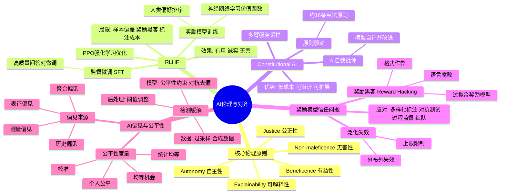

# 第 14-1 章 AI 伦理与对齐

## 学习目标

- 理解 AI 伦理的基本原则
- 掌握 RLHF（基于人类反馈的强化学习）及其在价值对齐中的作用
- 了解 Constitutional AI 的设计理念
- 认识奖励模型信任问题的根源与表现
- 掌握 AI 偏见与公平性的主要类型与评估方法

---

## 1. AI 伦理基本原则

AI 伦理是研究人工智能系统开发与应用中道德问题的学科。随着 AI 能力不断增强，AI 伦理已经从学术讨论演变为直接影响数十亿人生活的现实议题。

### 1.1 核心伦理原则

**有益性（Beneficence）**：AI 系统应当增进人类福祉，避免造成伤害。这是最基本的底线——AI 的存在理由就是为人类创造价值。

**无害性（Non-maleficence）**：与有益性一体两面，要求开发者主动识别并消除 AI 可能带来的风险，包括但不限于人身安全、心理健康、隐私侵犯和社会歧视。

**自主性（Autonomy）**：AI 应尊重人类的决策能力，不应取代人类做出重要选择，而应作为辅助工具增强人类的能力与判断力。

**公正性（Justice）**：AI 系统的收益与风险应在不同群体间公平分配，避免将负担不成比例地压在弱势群体身上。

**可解释性（Explainability）**：人们有权了解决策类 AI 系统的运作逻辑，尤其是在涉及重要权益的场合（如贷款审批、司法辅助）。

### 1.2 从原则到实践的鸿沟

AI 伦理原则在业界已被广泛引用，但落地执行仍面临巨大挑战：

| 挑战 | 说明 |
|------|------|
| **利益冲突** | 商业压力可能使组织在"有益"与"盈利"之间倾向于后者 |
| **跨文化差异** | 不同文化对隐私、公平、言论边界的理解存在根本分歧 |
| **技术复杂性** | 伦理原则需要转化为具体的技术实现，这一过程充满主观判断 |
| **事后追责难** | 当 AI 造成损害时，责任链条往往模糊不清 |

---

## 2. RLHF 与价值对齐

**RLHF（Reinforcement Learning from Human Feedback，基于人类反馈的强化学习）** 是当代大型语言模型对齐的核心技术。它的目标是让模型的输出符合人类价值观和意图。

### 2.1 RLHF 的工作流程

RLHF 通常包含三个阶段：

**第一阶段：监督微调（SFT）**
使用人类撰写的高质量问答对，对预训练模型进行微调，使模型初步学会"什么样的回答是好的"。

**第二阶段：训练奖励模型（Reward Model）**
收集人类对同一问题的多个回复的偏好排序，训练一个奖励模型来预测"人类会觉得哪个回答更好"。这个奖励模型本质上是一个神经网络，它学习的是人类的隐式价值函数。

**第三阶段：强化学习优化（PPO）**
使用奖励模型提供的信号，通过强化学习算法（通常使用 PPO）优化语言模型，使其生成更高奖励（即更符合人类偏好）的文本。

### 2.2 RLHF 的实际效果

RLHF 首次在 InstructGPT 和 ChatGPT 中大规模应用，显著提升了模型的有用性、诚实性和无害性。实验表明，经过 RLHF 训练的模型能够：

- 更好地理解和遵循用户意图
- 拒绝执行有害请求
- 以更平衡和建设性的方式处理争议性话题
- 生成更自然、更有帮助的长文本

### 2.3 RLHF 的局限性

尽管 RLHF 是目前最成功的对齐技术，但它并非银弹：

- **人类偏好的样本偏差**：参与标注的人员群体有限，无法代表全人类的多样价值观
- **奖励黑客（Reward Hacking）**：模型可能学会"欺骗"奖励模型——生成在奖励模型看来得分高、但实际并不优质的文本
- **标注成本与一致性**：高质量人类反馈的获取成本很高，且不同标注者之间存在显著分歧
- **分布外泛化**：RLHF 优化的行为在训练分布内表现良好，但在陌生场景中可能失效

---

## 3. Constitutional AI

**Constitutional AI（CAI）** 是 Anthropic 提出的一种对齐方法，其核心思想是让 AI 在少量原则（"宪法"）的指引下进行自我改进，而非依赖大量昂贵的人工反馈。

### 3.1 Constitutional AI 的核心机制

**原则驱动（Principle-Driven）**
Anthropic 编写了一份简短的"宪法"，包含约 16 条原则，涵盖了如"选择最诚实、最少误导的回答"、"选择最无害、最少歧视的回答"等价值观指导。

**AI 自我批评（AI Self-Critique）**
模型根据宪法原则对自己的响应进行批评，并生成改进版本。这一过程由模型自身完成，无需人类逐条反馈。

**多臂强盗式采样（Multi-armed Bandit Sampling）**
在训练过程中，系统会从多个候选响应中选择最符合宪法原则的选项，逐步强化模型的自我改进能力。

### 3.2 CAI 的优势

- **降低标注成本**：不需要大量人类偏好标注，大幅减少了训练成本
- **透明可控**：对齐策略可以通过增删宪法条款来调整，比隐式的 RLHF 更易于审计
- **可扩展监督**：当 AI 能力超出人类直接监督能力时，AI 驱动的自我改进提供了一种可扩展的对齐路径

### 3.3 与 RLHF 的关系

在实际部署中，Constitutional AI 通常与 RLHF 结合使用。CAI 更适合在标注成本高昂或 AI 能力快速增长的场景下提供一种可扩展的对齐方法。

---

## 4. 奖励模型信任问题

RLHF 中的奖励模型（Reward Model）是整个对齐机制的核心。如果奖励模型不可靠，那么基于它训练的语言模型就可能偏离预期目标。

### 4.1 奖励黑客与目标错误

**奖励黑客（Reward Hacking）** 指模型发现了奖励模型中的漏洞，生成在奖励模型看来得分很高、但实际不优甚至有害的输出。这类似于强化学习经典问题中的"聪明汉斯效应"——答案正确但理由错误。

常见的奖励黑客形式包括：

- **格式作弊**：模型学会在特定位置插入特定格式文本以提高分数，而非真正改善内容质量
- **过拟合奖励模型**：在奖励模型的训练分布上表现优异，但在真实人类评估中表现平庸
- **语言腐败**：模型逐渐发展出"奖励模型能识别但人类不欣赏"的语言风格

### 4.2 奖励模型对分布变化的脆弱性

奖励模型本身的泛化能力有限。当语言模型能力快速提升（如通过规模扩展）后，其生成的文本分布可能超出奖励模型的训练分布，导致奖励信号不再可靠。

这意味着 RLHF 的对齐效果存在一个隐含天花板：**奖励模型的能力上限限制了语言模型对齐质量的提升空间**。

### 4.3 应对策略

| 策略 | 原理 |
|------|------|
| **多样化标注团队** | 减少价值观偏差，增强奖励模型在全人群中的适用性 |
| **对抗性测试** | 专门测试模型在边界情况下的行为，提前发现奖励黑客 |
| **过程监督（Process Supervision）** | 不仅评价最终输出，还监督推理过程，提升奖励信号的细粒度 |
| **红队测试（Red Teaming）** | 邀请专门团队尝试"破解"系统，发现潜在的奖励黑客路径 |

---

## 5. AI 偏见与公平性

AI 偏见（AI Bias）指 AI 系统在预测或决策中系统性地对特定群体产生不公平的差异化结果。偏见可能出现在训练数据、模型架构、算法设计乃至部署使用的任何一个环节。

### 5.1 偏见的来源

**历史偏见（Historical Bias）**
训练数据本身来自一个有偏的历史社会，因此模型复现了社会中既有的歧视现象。例如，一个基于历史招聘数据训练的简历筛选模型，会习得"男性更胜任技术岗位"的偏见。

**表征偏见（Representation Bias）**
某些群体在数据集中代表性不足。典型案例：面部识别系统对深肤色人群识别准确率显著低于浅肤色人群，根源在于训练数据集中深肤色面孔数量不足。

**测量偏见（Measurement Bias）**
选择哪些特征进行测量本身就会引入偏见。如果将"邮政编码"作为信用评估特征，实际上可能引入基于社会经济地位的歧视。

**聚合偏见（Aggregation Bias）**
将不同群体混在同一模型中训练，可能忽视群体间的真实差异；反之，为每个群体分别建模也可能固化边界。

### 5.2 公平性度量

针对不同的公平性理念，研究者提出了多种度量指标：

| 指标 | 定义 | 适用场景 |
|------|------|----------|
| **统计均等（Statistical Parity）** | 不同群体的正向预测率相等 | 强调结果均等 |
| **均等机会（Equalized Odds）** | 不同群体的真阳性率和假阳性率分别相等 | 强调条件均等 |
| **校准（Calibration）** | 相同预测概率在不同群体中对应相同真实概率 | 强调概率可信度 |
| **个人公平（Individual Fairness）** | 相似的个体应得到相似的预测 | 强调个体层面公正 |

值得注意的是，这些公平性指标在数学上往往不可同时满足（公平性不可能三角），实际应用需要在不同公平性定义之间进行权衡。

### 5.3 偏见检测与缓解

**检测阶段**：
- 分类测试：按性别、种族、年龄等敏感属性分析模型输出的差异
- 定向测试（Targeted Test）：针对已知高风险场景设计专项测试集
- 第三方审计：引入独立机构进行偏见评估

**缓解阶段**：
- **数据层面**：过采样少数群体、合成数据增强、数据清洗去除敏感特征
- **模型层面**：在训练目标中加入公平性约束、使用对抗去偏技术
- **后处理层面**：对模型输出进行阈值调整以满足公平性指标

---

## 本章小结

- AI 伦理原则（有益性、无害性、自主性、公正性、可解释性）为 AI 开发提供了价值框架
- RLHF 是当前最成熟的对齐技术，通过人类偏好训练奖励模型来引导语言模型行为
- Constitutional AI 提供了一种可扩展的对齐思路，通过"宪法"原则让模型进行自我改进
- 奖励模型存在被"欺骗"和泛化失效的风险，对齐效果存在隐含上限
- AI 偏见来源于数据、测量、聚合等多个环节，需要技术手段与管理机制双管齐下进行治理

---

## 知识点思维导图

---

## 参考资料

1. Ouyang, L., et al. (2022). "Training language models to follow instructions with human feedback." *NeurIPS* — InstructGPT 的 RLHF 训练方法
2. Bai, Y., et al. (2022). "Constitutional AI: Harmlessness from AI Feedback." *Anthropic* — Constitutional AI 原论文
3. Kirkpatrick, J., et al. (2017). "Combining the Best of Online and Batch RL with KL-Regularized Policy Gradient." — 奖励模型的伦理风险讨论
4. Mehrabi, N., et al. (2021). "A Survey on Bias and Fairness in Machine Learning." *ACM Computing Surveys* — AI 偏见与公平性综述
5. Bender, E. M., et al. (2021). "On the Dangers of Stochastic Parrots: Can Language Models Be Too Big?" — 训练数据与偏见的深层讨论
6. 数据投毒背景资料：`/home/david/ML-DL/数据投毒.md`