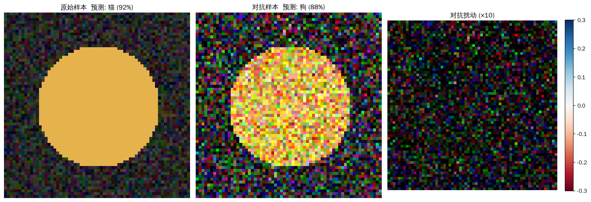
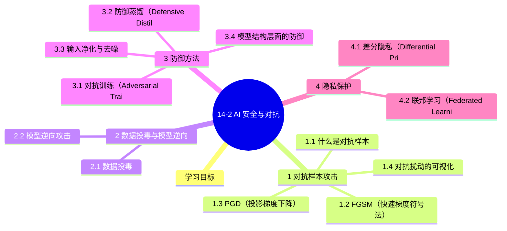

# 14-2 AI 安全与对抗

## 学习目标

- 了解对抗样本攻击原理（FGSM、PGD）
- 了解数据投毒、模型逆向攻击
- 掌握对抗防御方法

---

## 1. 对抗样本攻击

### 1.1 什么是对抗样本

对抗样本（Adversarial Example）是指在原始输入中添加微小的、人眼几乎不可察觉的扰动，导致深度学习模型产生错误预测的输入样本。这类攻击利用了深度神经网络在输入空间中的**线性特性**——在高维空间中，微小的方向性扰动可以被放大，使模型给出完全不同的预测结果。

> **经典案例**：在一张熊猫图片中添加轻微扰动，模型将熊猫识别为"长臂猿"，置信度高达99.3%，而人眼几乎看不出任何变化。

### 1.2 FGSM（快速梯度符号法）

FGSM（Fast Gradient Sign Method）是最经典的对抗样本生成方法，由 Goodfellow 等人于2014年提出。其核心思想是沿着梯度的符号方向，对输入进行最小扰动，使模型损失最大化：

$$
x' = x + \varepsilon \cdot \text{sign}(\nabla_x J(\theta, x, y))
$$

其中：
- $x$：原始输入
- $x'$：生成的对抗样本
- $\varepsilon$：扰动幅度（通常取0.01～0.3）
- $\nabla_x J(\theta, x, y)$：损失函数对输入的梯度
- $\text{sign}(\cdot)$：取符号函数（-1, 0, +1）

**算法步骤**：

1. 输入原始样本 $(x, y)$，计算模型损失 $J(\theta, x, y)$
2. 计算梯度 $\nabla_x J$，获取每个像素的梯度方向
3. 取梯度的符号，叠加到原始输入上
4. 限制扰动范围不超过 $\varepsilon$（通常通过 $L_\infty$ 范数裁剪）

**Python 实现示例**：

```python
import numpy as np

def fgsm_attack(model, x, y, epsilon=0.03):
    """FGSM 对抗攻击"""
    x = x.clone().detach().requires_grad_(True)
    # 前向传播
    outputs = model(x)
    loss = F.cross_entropy(outputs, y)
    # 反向传播
    model.zero_grad()
    loss.backward()
    # 获取梯度，生成对抗样本
    gradient = x.grad.data
    x_adv = x + epsilon * torch.sign(gradient)
    # 裁剪到合法范围 [0, 1]
    x_adv = torch.clamp(x_adv, 0, 1)
    return x_adv
```

**特点**：
- 计算速度快，只需一次梯度计算
- 扰动方向指向损失上升最快的方向
- 对线性模型效果较好，对非线性模型可能需要多次迭代

### 1.3 PGD（投影梯度下降）

PGD（Projected Gradient Descent）是 FGSM 的迭代增强版，通过多次小步梯度更新来生成更强的对抗样本。其核心思想是：在每个迭代步骤中，沿梯度方向进行小幅更新，然后将结果投影回原始样本周围的 $L_\infty$ 球内：

$$
x_{t+1} = \text{Proj}_{S} \left( x_t + \alpha \cdot \text{sign}(\nabla_x J(\theta, x_t, y)) \right)
$$

其中 $\text{Proj}_{S}$ 表示投影操作，将结果映射回允许的扰动范围。

**算法步骤**：

1. 初始化对抗样本 $x_0 = x$
2. 迭代 $t = 1, 2, \ldots, N$：
   - 计算梯度 $\nabla_x J(\theta, x_t, y)$
   - 更新 $x_{t+1} = x_t + \alpha \cdot \text{sign}(\nabla_x J)$
   - 投影回 $L_\infty$ 球：$x_{t+1} = \text{clip}(x_{t+1}, x - \varepsilon, x + \varepsilon)$
3. 返回最后一个迭代结果

**Python 实现示例**：

```python
def pgd_attack(model, x, y, epsilon=0.03, alpha=0.003, steps=10):
    """PGD 对抗攻击"""
    x_adv = x.clone().detach()
    for i in range(steps):
        x_adv.requires_grad = True
        outputs = model(x_adv)
        loss = F.cross_entropy(outputs, y)
        model.zero_grad()
        loss.backward()
        # 梯度上升（使损失增大）
        x_adv = x_adv + alpha * x_adv.grad.sign()
        # 投影回扰动约束范围
        x_adv = torch.maximum(x_adv, x - epsilon)
        x_adv = torch.minimum(x_adv, x + epsilon)
        x_adv = x_adv.detach()
    return x_adv
```

**与 FGSM 的对比**：

| 特性 | FGSM | PGD |
|------|------|-----|
| 迭代次数 | 1次 | 多次（通常5～40步） |
| 攻击强度 | 较弱 | 较强 |
| 计算成本 | 低 | 较高 |
| 探索范围 | 固定步长 | 小步探索，更全面 |

> **重要结论**：FGSM 生成的对抗样本可能只是 PGD 搜索空间中的一个点，PGD 通常能找到更强的对抗样本。研究表明，PGD 对抗样本可以作为**鲁棒性验证的标准攻击方法**。

### 1.4 对抗扰动的可视化

将对抗扰动可视化，可以直观理解攻击者如何在像素层面操控模型：



> 完整代码（`visualize_adversarial()` 函数 + 示例数据）：[`assets/figures/14-2-adversarial-visualization.py`](../../assets/figures/14-2-adversarial-visualization.py)

可视化结果显示：对抗扰动通常是**结构化的**，沿模型的决策边界方向对齐，而非随机噪声。这一特性使得对抗样本具有较强的迁移性（Transferability），即在一个模型上生成的对抗样本，往往也能欺骗其他类似模型。

### 1.5 对抗样本的迁移性

对抗样本的迁移性是指：在模型 A 上生成的对抗样本，有一定概率能成功欺骗模型 B。这一特性使得**黑盒攻击**成为可能——攻击者无需了解目标模型的结构和参数，只需构建一个替代模型，通过查询获得输入输出对，训练替代模型后生成对抗样本，再迁移到目标模型。

| 攻击类型 | 所需信息 | 难度 |
|----------|----------|------|
| 白盒攻击 | 完整的模型结构和参数 | 低 |
| 灰盒攻击 | 模型输出概率分布 | 中 |
| 黑盒攻击 | 模型预测标签（Top-1） | 高 |

---

## 2. 数据投毒与模型逆向

### 2.1 数据投毒

#### 什么是数据投毒

数据投毒（Data Poisoning）是指以某种方式改变用于构建机器学习模型的训练数据，从而改变模型的行为。这种影响仅限于训练过程，一旦模型被篡改，损害就无法挽回——模型将出现不可逆转的偏差，甚至可能完全失效。唯一的真正解决办法是使用干净的数据重新训练模型。

数据投毒的核心威胁在于：**训练数据的改变通常对普通观察者来说是不可见的**。研究表明，当特定概念的数据被掺假仅0.001%时，有害内容增加了4.8%；而15名临床医生被要求确定掺假后的结果和基线结果时，审阅者无法确定两者之间的差异。

#### 数据投毒的三种动机

**（1）犯罪活动**

- **目标**：通过篡改训练数据，使模型做出攻击者期望的错误预测，或削弱模型的正常功能
- **工作原理**：攻击者会在输入数据中引入难以察觉的扰动，导致模型做出置信度很高的错误预测。对训练数据进行统计分析也很难发现这些更改。研究表明，**仅需250份文档**就足以在多种应用场景下，针对不同规模的文本模型训练集实施投毒攻击
- **后果**：
  - 削弱模型性能，例如网络安全模型无法识别网络入侵
  - 虚假预测——仅向极少数人提供条件苛刻的高额贷款，而大部分时间表现正常，缺陷更难被发现

> 想象一个贷款审批模型：如果它只向极少数人提供条件苛刻的高额贷款，而大部分时间表现正常，这可能是一次非常有利可图的攻击。

**（2）防止知识产权盗窃**

- **目标**：并非改变模型的特定行为，而是试图让模型训练失败，使窃取知识产权的行为变得无利可图
- **工作原理**：这是内容创作者的一种防御机制

| 工具 | 功能 |
|------|------|
| **Nightshade** | 添加肉眼几乎无法察觉的效果，对神经网络训练过程却意义重大 |
| **Glaze** | 阻止模型复现图像风格，但通常不会干扰训练过程 |
| **AntiFake** | 改变录音中声波，防止个人声音被用于模型训练 |

- **后果**：基于被污染数据训练的模型变得毫无用处，窃取知识产权的行为对生成式人工智能公司而言无利可图。

**（3）营销（SEO 的新演变）**

- **目标**：向训练数据中添加对客户品牌有利的内容，使模型产生微妙的品牌偏好
- **工作原理**：
  - AI 优化（AIO）：营销人员创建会被抓取用于生成式人工智能模型开发的训练数据内容
  - LLM 生成内容：如今生成海量看似真人撰写的文本内容比以往任何时候都更加便捷且成本更低
  - 微妙偏袒：模型可能会偏袒特定品牌和/或以微妙的方式对竞争对手表现出偏见

#### 如何应对数据投毒

1. **不要窃取数据**：道德上站得住脚，且无法保证数据不会被篡改
2. **监控和控制数据收集**：对训练数据进行审核和清理，养成良好的数据卫生习惯，不要把垃圾数据直接扔进训练集
3. **管理和观察训练过程**：对训练数据进行测试，运用科学方法识别模型是否受到"毒害"，这是一个新兴的研究领域，相关技术会不断改进
4. **在实际环境中测试模型**：尽可能在接近真实世界的场景中评估和测试模型，切勿盲目信任模型输出

### 2.2 模型逆向攻击

#### 成员推断攻击（Membership Inference Attack）

成员推断攻击的目标是判断某个数据样本是否被用于训练特定模型。攻击者通过观察模型在特定输入上的行为差异来推断成员身份。

**原理**：模型对训练数据往往表现出"过拟合"特征——对训练样本的预测置信度高于对非训练样本的预测置信度。

```python
def membership_inference_attack(model, target_data, shadow_models):
    """成员推断攻击"""
    # 训练阴影模型
    for shadow_model in shadow_models:
        # 使用与目标模型类似的架构
        shadow_model = train_shadow_model(shadow_model, target_data)
    
    # 构建攻击数据集
    attack_labels = []  # 1 = 成员，0 = 非成员
    
    # 为每个阴影模型生成攻击训练数据
    for shadow_model in shadow_models:
        # 正样本：阴影模型的训练数据
        for x in shadow_model.train_data:
            confidence = torch.softmax(shadow_model(x), dim=1).max()
            attack_labels.append((confidence, 1))
        
        # 负样本：非训练数据
        for x in non_member_data:
            confidence = torch.softmax(shadow_model(x), dim=1).max()
            attack_labels.append((confidence, 0))
    
    # 训练攻击分类器
    attack_classifier = train_attack_classifier(attack_labels)
    
    # 对目标模型执行成员推断
    results = []
    for x in target_data:
        confidence = torch.softmax(model(x), dim=1).max()
        prediction = attack_classifier.predict([confidence])
        results.append(prediction)
    
    return results
```

#### 模型逆向攻击（Model Inversion Attack）

模型逆向攻击是指攻击者通过反复查询模型输出，反推模型的训练数据或数据分布特征。

**典型场景**：
- 医疗模型：攻击者试图还原患者的敏感医疗记录
- 人脸识别模型：攻击者试图还原训练集中的人脸图像

**防御措施**：
- 限制模型输出的信息量（如不返回原始概率向量）
- 添加差分隐私噪声
- 限制查询频率和次数

---

## 3. 防御方法

### 3.1 对抗训练（Adversarial Training）

对抗训练是当前最有效的对抗样本防御方法之一。其核心思想是：在训练过程中，将对抗样本作为额外的训练数据，使模型学会正确分类对抗样本。

**标准对抗训练流程（PGD 对抗训练）**：

```python
def adversarial_training(model, train_loader, epsilon=0.03, alpha=0.003, steps=10):
    """PGD 对抗训练"""
    optimizer = optim.Adam(model.parameters(), lr=0.01)
    
    for epoch in range(num_epochs):
        for x, y in train_loader:
            # 生成 PGD 对抗样本
            x_adv = pgd_attack(model, x, y, epsilon, alpha, steps)
            
            # 原始样本和对抗样本一起训练
            optimizer.zero_grad()
            outputs_clean = model(x)
            outputs_adv = model(x_adv)
            
            loss = F.cross_entropy(outputs_clean, y) + \
                   F.cross_entropy(outputs_adv, y)
            
            loss.backward()
            optimizer.step()
    
    return model
```

**关键参数**：
- $\varepsilon$：扰动上界，值越大，模型越鲁棒，但精度可能下降
- $\alpha$：每步步长，通常设为 $\varepsilon / 4$
- $steps$：迭代次数，通常10～40步

> **实测结论**：使用 PGD-10 对抗训练（steps=10）能在保持较高精度的同时，显著提升模型对多种对抗攻击的鲁棒性。

### 3.2 防御蒸馏（Defensive Distillation）

防御蒸馏利用知识蒸馏的思想，用第一个模型（教师网络）的软标签（softmax 输出）来训练第二个模型（学生网络），使模型输出更加平滑，减少对抗扰动的影响。

**原理**：
- 原始模型：输出锐利的概率分布，小扰动即可导致预测跳转
- 蒸馏模型：输出平滑的概率分布，对小扰动的敏感度降低

```python
def defensive_distillation(train_loader, teacher_model, T=10, alpha=0.5):
    """防御蒸馏"""
    student_model = SmallModel()  # 与教师模型结构类似或更小
    
    soft_targets = []
    for x, y in train_loader:
        with torch.no_grad():
            soft = F.softmax(teacher_model(x) / T, dim=1)
            soft_targets.append((x, soft))
    
    # 使用软标签训练学生模型
    optimizer = optim.Adam(student_model.parameters())
    for x, soft in soft_targets:
        optimizer.zero_grad()
        student_output = F.softmax(student_model(x) / T, dim=1)
        
        # 蒸馏损失：软标签的 KL 散度
        distill_loss = F.kl_div(student_output, soft, reduction='batchmean') * (T ** 2)
        # 硬标签损失
        hard_loss = F.cross_entropy(student_model(x), y)
        
        loss = alpha * hard_loss + (1 - alpha) * distill_loss
        loss.backward()
        optimizer.step()
    
    return student_model
```

**效果**：蒸馏温度 $T$ 越高，输出分布越平滑，防御效果越好，但精度可能略有下降。

### 3.3 输入净化与去噪

#### 去噪自编码器（Denoising Autoencoder）

训练一个去噪自编码器，将对抗样本映射回干净样本的空间：

```python
class DenoisingAutoencoder(nn.Module):
    def __init__(self):
        super().__init__()
        self.encoder = nn.Sequential(
            nn.Conv2d(3, 64, 3, padding=1),
            nn.ReLU(),
            nn.Conv2d(64, 128, 3, padding=1),
            nn.ReLU(),
        )
        self.decoder = nn.Sequential(
            nn.ConvTranspose2d(128, 64, 3, padding=1),
            nn.ReLU(),
            nn.ConvTranspose2d(64, 3, 3, padding=1),
        )
    
    def forward(self, x):
        return self.decoder(self.encoder(x))

# 训练时，给输入添加噪声（模拟对抗扰动），让模型学习去噪
def denoising_loss(model, x_clean, noise_level=0.1):
    x_noisy = x_clean + noise_level * torch.randn_like(x_clean)
    x_denoised = model(x_noisy)
    return F.mse_loss(x_denoised, x_clean)
```

#### 输入梯度正则化

在训练损失中加入输入梯度的正则项，使模型对输入的小扰动不那么敏感：

```python
def gradient_regularized_loss(model, x, y, beta=0.1):
    outputs = model(x)
    loss = F.cross_entropy(outputs, y)
    
    # 梯度正则化项
    grad = torch.autograd.grad(loss, x, retain_graph=True)[0]
    reg_loss = loss + beta * torch.mean(grad ** 2)
    
    return reg_loss
```

### 3.4 模型结构层面的防御

| 防御方法 | 原理 | 优点 | 缺点 |
|----------|------|------|------|
| 深度压缩（DeepShield） | 在模型中插入去噪层 | 兼容性好 | 计算开销增加 |
| 随机化（Randomized Smoothing） | 在推理时对输入添加随机噪声 | 对多种攻击有效 | 精度略有下降 |
| 特征剪枝 | 移除对对抗扰动敏感的神经元 | 模型更小更快 | 需要重新训练 |

---

> **延伸阅读**：本节以 CV 对抗样本为主。大模型时代更高频的攻击是 Prompt Injection 与过度代理，防御手段完全不同，见 [16-4 AI 治理与红队测试](../PART16-评测监控与治理/16-4-AI治理与红队测试.md)。

## 4. 隐私保护

### 4.1 差分隐私（Differential Privacy）

差分隐私是一种数学框架，通过向查询结果中添加精心设计的噪声，确保单个数据记录的存在或缺失不会显著影响输出结果，从而保护个体隐私。

**核心定义**（$\varepsilon$-差分隐私）：

一个随机化机制 $M$ 满足 $\varepsilon$-差分隐私，当且仅当对于任意两个相邻数据集 $D$ 和 $D'$（差一个样本），以及任意输出集合 $S$：

$$
\Pr[M(D) \in S] \leq e^\varepsilon \cdot \Pr[M(D') \in S]
$$

**差分隐私在机器学习中的应用——DP-SGD**：

```python
def dp_sgd_training(model, train_loader, noise_multiplier=1.0, max_grad_norm=1.0):
    """差分隐私随机梯度下降"""
    optimizer = DPOptimizer(
        optimizer_class=torch.optim.Adam,
        noise_multiplier=noise_multiplier,
        max_grad_norm=max_grad_norm,
        expected_batch_size=batch_size
    )
    
    for epoch in range(num_epochs):
        for x, y in train_loader:
            optimizer.zero_grad()
            outputs = model(x)
            loss = F.cross_entropy(outputs, y)
            loss.backward()
            
            # 裁剪梯度并添加噪声
            optimizer.step()
    
    return model
```

**隐私预算 $\varepsilon$ 的选择**：
- $\varepsilon \leq 1$：强隐私保证
- $\varepsilon \approx 8$：中等隐私保证
- $\varepsilon > 10$：弱隐私保证，实际应用中需谨慎

> 隐私预算越小，隐私保护越强，但可用性（精度）通常越低。

### 4.2 联邦学习（Federated Learning）

联邦学习是一种分布式机器学习范式，允许多个客户端（如移动设备）在不共享原始数据的情况下，协作训练一个共享模型。

**标准联邦学习流程**：

1. **服务器下发模型**：中央服务器将当前模型参数分发给参与的客户端
2. **本地训练**：每个客户端使用自己的本地数据对模型进行训练
3. **梯度上报**：客户端将本地训练的模型更新（梯度或参数）发送回服务器
4. **聚合更新**：服务器使用联邦平均（FedAvg）等算法聚合所有客户端的更新
5. **迭代**：重复步骤1～4，直至模型收敛

```python
def federated_averaging(client_models, client_weights):
    """联邦平均算法"""
    global_model = {}
    
    # 初始化为零
    for key in client_models[0].state_dict().keys():
        global_model[key] = torch.zeros_like(client_models[0].state_dict()[key])
    
    # 加权平均
    total_weight = sum(client_weights)
    for i, model in enumerate(client_models):
        weight = client_weights[i] / total_weight
        for key in model.state_dict().keys():
            global_model[key] += weight * model.state_dict()[key]
    
    return global_model
```

**隐私优势**：
- 原始数据从不离开客户端
- 结合差分隐私，可以实现更强的隐私保护
- 支持 Secure Aggregation，服务器只能看到聚合结果，看不到单个客户端的更新

**安全威胁与缓解**：

| 威胁 | 描述 | 缓解措施 |
|------|------|----------|
| 投毒攻击 | 恶意客户端上传破坏性更新 | 拜占庭容错聚合、异常检测 |
| 推理攻击 | 攻击者从梯度反推训练数据 | 差分隐私噪声、安全聚合 |
| 模型篡改 | 中间人攻击篡改模型更新 | 加密通信、模型签名验证 |

---

## 本章小结

1. **对抗样本攻击**：通过在输入中添加微小扰动（FGSM 和 PGD 等方法），能够有效欺骗深度学习模型。迁移性使得黑盒攻击成为可能，攻击者可无需了解模型内部结构即可实施攻击。

2. **数据投毒**：通过污染训练数据，攻击者可以在模型中植入隐蔽的偏差或使其完全失效。三种主要动机包括犯罪活动（勒索）、知识产权保护（破坏自身数据）和营销操纵（扭曲推荐结果）。

3. **对抗防御**：对抗训练通过在训练中加入对抗样本提升模型鲁棒性；防御蒸馏利用知识蒸馏平滑模型输出；去噪自编码器可直接净化对抗扰动。不同防御方法针对不同攻击场景，需组合使用。

4. **隐私保护**：差分隐私通过添加数学可证明的噪声保护个体数据；联邦学习通过数据不出本地的分布式训练范式，在协同建模的同时保护数据隐私，成为医疗、金融等敏感数据场景的重要解决方案。

5. **AI 安全的多维性**：AI 安全涵盖从输入层的对抗攻击、训练层的数据投毒到输出层的隐私保护，需要从算法、数据、系统和监管多个维度综合应对。


## 知识图谱



## 参考资料

- Goodfellow, I. J., Shlens, J., & Szegedy, C. (2015). Explaining and Harnessing Adversarial Examples. *ICLR*.
- Madry, A., Makelov, A., Schmidt, L., Tsipras, D., & Vladu, A. (2019). Towards Deep Learning Models Resistant to Adversarial Attacks. *ICLR*.
- Carlini, N., & Wagner, D. (2017). Towards Evaluating the Robustness of Neural Networks. *IEEE S&P*.
- Biggio, B., & Roli, F. (2018). Wild Patterns: Ten Years After the Rise of Adversarial Machine Learning. *Pattern Recognition*.
- Papernot, N., McDaniel, P., Jha, S., Fredrikson, M., Celik, Z. B., & Swami, A. (2016). The Limitations of Deep Learning in Adversarial Settings. *Euro S&P*.
- Shokri, R., Stronati, M., Song, C., & Shmatikoff, V. (2017). Membership Inference Attacks Against Machine Learning Models. *IEEE S&P*.
- Abadi, M., Chu, A., Goodfellow, I., McMahan, H. B., Mironov, I., Papernot, N., ... & Zhang, T. (2016). Deep Learning with Differential Privacy. *CCS*.
- McMahan, B., Moore, E., Ramage, D., Hampson, S., & Arcas, B. A. (2017). Communication-Efficient Learning of Deep Networks from Decentralized Data. *AISTATS*.