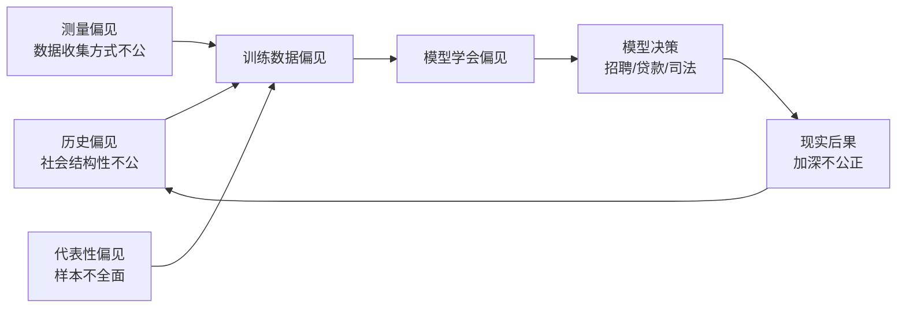
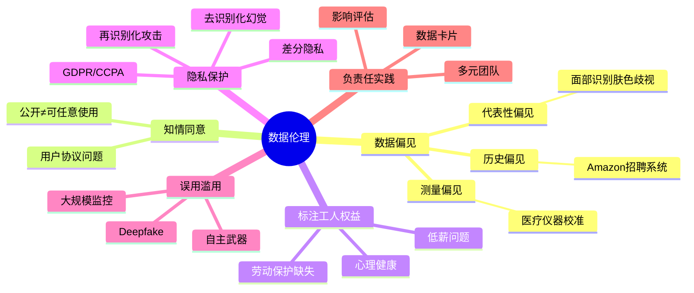

# 14-3 数据伦理

## 学习目标

- 理解数据伦理的核心议题：偏见、隐私、同意与责任
- 掌握数据偏见的三种主要类型及其现实案例
- 认识数据标注工人的劳动权益问题
- 了解去识别化与再识别化攻击的风险
- 理解负责任 AI 的实践框架（数据卡片、影响评估、多元团队）
- 能够识别 AI 应用中的伦理红线并提出改进建议

---

## 1. 数据伦理概述

### 1.1 为什么数据伦理至关重要

**数据伦理（Data Ethics）** 是研究数据收集、处理、使用和共享过程中道德问题的学科。在深度学习时代，数据既是燃料，也可能是隐患。

> **fast.ai 联合创始人 Rachel Thomas 的观点**："AI 不是凭空出现的魔法，它是用数据训练出来的。如果数据有问题，模型就会有问题——而且问题往往会被放大。"

**核心事实**：
- 训练一个大型语言模型可能需要处理**数万亿词**的互联网文本
- 面部识别系统的训练数据往往以**浅色皮肤男性**为主
- 数据标注产业支撑着全球数百万工人，其中许多人工作条件堪忧

### 1.2 数据伦理 vs AI 伦理

| 维度 | 数据伦理（本章） | AI 伦理（14-1） | AI 安全（14-2） |
|------|-----------------|----------------|----------------|
| **关注点** | 数据本身的道德问题 | 模型的价值观对齐 | 对抗攻击与防御 |
| **核心问题** | 偏见、隐私、 consent | RLHF、奖励黑客 | FGSM、数据投毒 |
| **涉及主体** | 数据提供者、标注工人 | 模型开发者、用户 | 攻击者、防御者 |
| **时间阶段** | 数据收集与处理阶段 | 模型训练与部署阶段 | 模型运行阶段 |

数据伦理是 AI 伦理的**前置条件**——如果训练数据本身不公正，后续无论如何对齐模型，都难以消除根本性的偏见。

---

## 2. 数据偏见（Bias in Data）

数据偏见是数据伦理中最普遍、最隐蔽的问题。它让 AI 系统"学会"并放大人类社会中的不公正。

### 2.1 代表性偏见（Representation Bias）

**定义**：训练数据不能代表目标人群的多样性。

**典型案例：面部识别的肤色偏见**

2018 年 MIT 研究人员 Buolamwini 和 Gebru 的研究发现：

| 群体 | 商业面部识别系统错误率 |
|------|----------------------|
| 深色皮肤女性 | **34.7%** |
| 深色皮肤男性 | 12.0% |
| 浅色皮肤女性 | 7.1% |
| 浅色皮肤男性 | 0.8% |

**原因**：训练数据集中**81-83%** 的面部图像是浅肤色，**75%** 是男性。模型"见多识广"的是浅色皮肤男性，对其他群体的识别能力自然低下。

**后果**：
- 执法机构使用面部识别时，深色皮肤人群被**错误逮捕**的风险更高
- 2019 年底特律一名黑人男子因面部识别错误被**错误监禁 30 小时**
- 这促使 IBM、Microsoft、Amazon 先后宣布暂停向警方出售面部识别技术

### 2.2 历史偏见（Historical Bias）

**定义**：数据反映了历史上的不公正和结构性歧视，即使数据是"准确"的，也包含不公正的"真相"。

**典型案例：Amazon 招聘系统**

Amazon 曾开发一个简历筛选 AI 系统：
- 用过去 10 年的简历数据训练
- 这些数据反映了科技行业的**性别不平衡**（男性占主导）
- 系统学会了** penalize（惩罚）包含"女性"相关词汇的简历**
- 例如，女子大学的毕业生会被系统性降分

**关键洞察**：数据是"真实的"——它确实反映了历史上的招聘决策。但历史本身带有偏见，模型只是**把历史偏见编码成了算法**。

### 2.3 测量偏见（Measurement Bias）

**定义**：数据收集的方式本身就有偏见，导致测量结果不能公平反映所有群体。

**典型案例：医疗 AI 的脉搏血氧仪**

COVID-19 期间发现：
- 脉搏血氧仪在深色皮肤患者上**读数偏高**（即显示血氧正常，实际已低氧）
- 原因是设备校准时主要使用了**浅色皮肤**的测试样本
- 导致深色皮肤患者延误治疗，死亡率更高

**本质问题**：数据收集的"标准"本身是为特定群体设计的，对其他群体不公平。

### 2.4 偏见的放大效应

> **恶性循环**：偏见数据 → 偏见模型 → 偏见决策 → 产生更多偏见数据 → ... 这是一个自我强化的反馈环。

---

## 3. 数据收集与知情同意

### 3.1 用户真的"同意"了吗

现代互联网服务的用户协议通常有几万字，**99% 的用户不会阅读**。当我们点击"同意"时，我们真的知道数据会被如何使用吗？

**关键问题**：
- 你的社交媒体照片可能被用来训练面部识别系统，而你从未被告知
- 你的医疗记录可能被"去标识化"后出售给 AI 公司
- 你的聊天记录可能被用于训练对话模型

**"公开"不等于"可以任意使用"**：
- 用户把照片发到网上，不代表同意用于人脸识别训练
- 学术论文公开发表，不代表同意用于大模型预训练
- 法律上的"公开"与伦理上的"同意"是两回事

### 3.2 数据标注工人的权益

AI 系统的背后是**全球数据标注产业链**：

| 事实 | 说明 |
|------|------|
| 规模 | 全球有数百万数据标注工人 |
| 薪资 | 发展中国家的标注工人时薪可能低于 2 美元 |
| 内容 | 需要过滤暴力、色情、仇恨言论，造成心理创伤 |
| 合同 | 大量工人是"独立承包商"，没有社保和劳动保护 |
| 透明性 | 终端用户几乎不知道自己的数据由谁标注 |

**TIME 杂志 2023 年调查**：OpenAI 雇佣肯尼亚外包工人标注有害内容，时薪不到 2 美元，许多工人出现 PTSD 症状。

**伦理反思**：
- 当 AI 被宣传为"造福人类"时，谁在为这种"造福"付出代价？
- 我们是否应该在模型成本计算中加入标注工人的合理薪酬？
- 平台是否有责任为标注工人提供心理健康支持？

---

## 4. 隐私保护

### 4.1 去识别化的幻觉

**去识别化（De-identification）**：移除数据中的直接标识符（姓名、身份证号）。

**再识别化攻击（Re-identification）**：通过交叉多个数据集，重新识别出"匿名"的个体。

**经典案例**：
- 2006 年 Netflix 举办推荐算法竞赛，发布了"匿名化"的用户评分数据
- 研究人员将 Netflix 数据与 IMDb 公开评分进行交叉比对
- 成功**识别出多名用户的真实身份**
- Netflix 因此面临集体诉讼

> **教训**：在大数据时代，真正的匿名几乎不可能。多个"无害"的数据点组合在一起，就像拼图一样能还原出你的身份。

### 4.2 差分隐私的应用

**差分隐私（Differential Privacy）** 提供了一种数学上可证明的隐私保护（详见 14-2 中的介绍）。

**应用案例**：
- 苹果在 iOS 中使用差分隐私收集用户行为统计
- 美国 2020 年人口普查首次使用差分隐私保护个人信息
- Google 的 TensorFlow Privacy 库让开发者可以训练差分隐私的机器学习模型

### 4.3 法规框架

| 法规 | 地区 | 核心要求 |
|------|------|----------|
| **GDPR** | 欧盟 | 数据最小化、用户知情权、被遗忘权、违规罚款可达全球营收 4% |
| **CCPA** | 美国加州 | 用户有权知道数据被收集了什么、卖给谁，有权拒绝出售 |
| **个人信息保护法** | 中国 | 告知-同意原则、最小必要原则、跨境传输限制 |

---

## 5. AI 的误用与滥用

### 5.1 深度伪造（Deepfake）

**Deepfake** 技术用生成对抗网络（GAN）或扩散模型，将一个人的面部替换到另一个人的身体上，生成以假乱真的视频。

**滥用场景**：
- 伪造政治人物言论，干扰选举
- 制作色情内容，侵犯女性权益
- 伪造证据，用于诈骗或勒索

**检测与应对**：
-  Facebook、Twitter 等平台已禁止未经同意的深度伪造内容
-  研究人员开发了 Deepfake 检测 AI，但这是一场"猫鼠游戏"
-  一些国家立法将恶意 Deepfake 定为刑事犯罪

### 5.2 大规模监控

**人脸识别 + 摄像头网络** 的结合，使大规模自动监控成为可能：

- 中国"天网"系统拥有数亿个摄像头
- 伦敦警察局的实时面部识别系统被批评**准确率低且歧视性强**
- 美国移民与海关执法局（ICE）使用面部识别追踪 undocumented immigrants

**伦理争议**：
- 公共安全 vs 个人隐私的边界在哪里？
- 当政府能实时追踪每个人的行动时，民主社会如何保障异议者的安全？
- 这些系统的训练数据从何而来？是否经过被监控者的同意？

### 5.3 自主武器

**致命自主武器系统（LAWS）**：能够在没有人类干预的情况下选择并攻击目标的 AI 武器。

联合国已就此展开多年讨论，但国际社会尚未达成禁止协议。核心伦理问题：
- 谁为 AI 武器的误判负责？
- 机器是否有权决定生死？
- 这会不会降低发动战争的门槛？

---

## 6. 负责任的 AI 实践

### 6.1 数据卡片（Data Cards）

**数据卡片**类似于食品的营养成分表，它系统记录数据集的关键信息：

| 信息类别 | 内容 |
|----------|------|
| **来源** | 数据从哪里来？如何收集？ |
| **人口统计** | 覆盖了哪些群体？缺少哪些群体？ |
| **标注过程** | 谁标注的？标注指南是什么？一致性如何？ |
| **已知偏见** | 数据中存在哪些已知的偏见或局限？ |
| **使用建议** | 适合什么任务？不适合什么任务？ |

**Google 的 Data Cards 项目**和 **Hugging Face 的 Data Statements** 都在推动这一实践。

### 6.2 影响评估

在部署 AI 系统前，进行**伦理影响评估（Ethical Impact Assessment）**：

1. **识别利益相关者**：谁会受影响？谁会受益？谁会受损？
2. **评估风险**：偏见、隐私、安全、就业等方面的潜在风险
3. **制定缓解措施**：如何降低风险？有什么后备方案？
4. **持续监控**：部署后如何检测和应对新出现的问题？

### 6.3 多元团队的重要性

**同质团队容易忽视盲点**：
- 如果开发团队全是年轻男性工程师，可能意识不到产品对老年用户或女性用户的不友好
- 如果训练数据标注团队来自单一文化背景，可能误解其他文化的语境

**解决方案**：
- 在产品设计和数据收集阶段纳入多元视角
- 邀请伦理学家、社会学家、法律专家参与 AI 项目
- 建立内部伦理审查委员会

### 6.4 fast.ai 的数据伦理准则

fast.ai 在课程中强调的数据伦理原则：
1. **数据不是中立的**——它总是带有收集者的视角和偏见
2. **公开数据 ≠ 可以自由使用**——考虑数据来源和收集者的意图
3. **标注工人是价值链上的关键一环**——应给予合理报酬和尊重
4. **技术本身不是价值中立的**——设计选择体现了价值观
5. **工程师有责任思考后果**——"我只是写代码的"不是免责理由

---

## 7. 案例研究

### 7.1 面部识别禁令运动

2019-2020 年，美国多个城市（旧金山、波特兰等）通过法律**禁止政府部门使用面部识别技术**。这是世界上首批全面禁止面部识别的城市法规。

**支持理由**：
- 准确率低，尤其对深色皮肤人群
- 侵犯隐私和公民自由
- 可能导致大规模监控社会

**反对理由**：
- 有助于抓捕罪犯和寻找失踪人员
- 技术可以改进，不应一刀切禁止

**启示**：当技术的风险明显大于收益，且缺乏有效的监管框架时，社会有权选择暂停或限制其使用。

### 7.2 医疗 AI 中的种族偏见

**案例 1：脉搏血氧仪**（见 2.3 节）

**案例 2：优化肾功能的算法**
- 美国多家医院使用算法决定患者是否能获得肾移植优先权
- 算法在估算肾功能时，对黑人患者自动乘以一个"种族校正系数"
- 这导致黑人患者的肾功能被**高估**，被认为"不够严重"而无法优先获得移植
- 2021 年研究曝光后，多个医学机构移除了该种族校正

**核心问题**："种族"作为一个生物学变量被编码进算法，但种族是**社会建构**而非生物学本质。这种"科学客观"的外衣让歧视更难被识别和质疑。

### 7.3 推荐系统的信息茧房

社交媒体和短视频平台的推荐系统：
- 优化目标是**用户停留时长**和**互动率**
- 结果是：用户越看极端内容，系统越推极端内容
- 形成**信息茧房**和**极化效应**

**伦理反思**：
- 当推荐系统的优化目标与公共利益冲突时，平台应如何取舍？
- 算法是否应该承担"信息多样性"的责任？
- 用户是否有权选择"不优化"的推荐？

---

## 本章小结
1. **数据伦理是 AI 伦理的前置条件**。如果训练数据本身带有偏见、缺乏 consent 或侵犯隐私，后续无论如何优化模型，都难以消除根本性问题。

2. **数据偏见有三种主要形式**：代表性偏见（样本不全面）、历史偏见（数据反映过去的不公）、测量偏见（收集方式本身不公）。它们形成自我强化的恶性循环。

3. **知情同意不仅仅是法律合规**。真正的同意需要用户理解数据用途，而现实中大多数用户协议无人阅读。"公开"不等于"可以任意使用"。

4. **数据标注产业存在严重的劳工伦理问题**。数百万标注工人为 AI 系统提供基础劳动，但许多人面临低薪、无保障和心理创伤。

5. **隐私保护面临去识别化幻觉**。多个"匿名"数据集交叉比对可以重新识别个体，差分隐私提供了数学上可证明的保护方案。

6. **负责任的 AI 需要制度性保障**：数据卡片提高透明度、伦理影响评估降低风险、多元团队减少盲点。

7. **工程师不是价值中立的**。技术设计选择体现了价值观，"我只是写代码的"不能成为回避伦理责任的借口。

## 知识图谱

---

## 参考资料

1. Buolamwini, J., & Gebru, T. (2018). Gender Shades: Intersectional Accuracy Disparities in Commercial Gender Classification. *FAccT*.
2. Dastin, J. (2018). Amazon Scraps Secret AI Recruiting Tool that Showed Bias against Women. *Reuters*.
3. Kahn, J. (2023). OpenAI Used Kenyan Workers on Less Than $2 Per Hour to Make ChatGPT Less Toxic. *TIME*.
4. Narayanan, A., & Shmatikov, V. (2008). Robust De-anonymization of Large Sparse Datasets. *IEEE S&P*.
5. Obermeyer, Z., et al. (2019). Dissecting Racial Bias in an Algorithm Used to Manage the Health of Populations. *Science*, 366(6464), 447-453.
6. fast.ai: Data Ethics Lesson (Lesson 8a). https://course.fast.ai/
7. Rachel Thomas: "Algorithms are Not Neutral" (2017). https://www.youtube.com/watch?v=hlzoH08S-M0
8. 欧盟 GDPR 全文：https://gdpr.eu/
9. 中国《个人信息保护法》：https://www.gov.cn/

---
