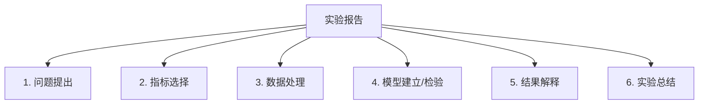
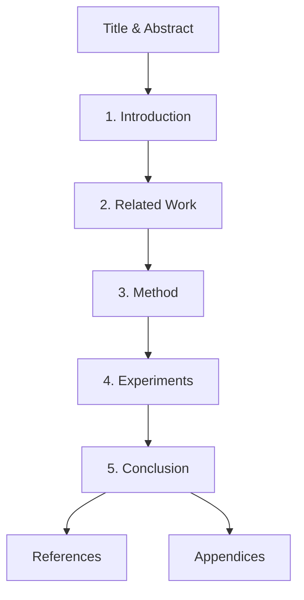
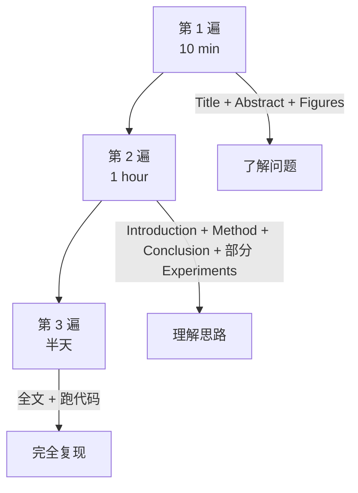
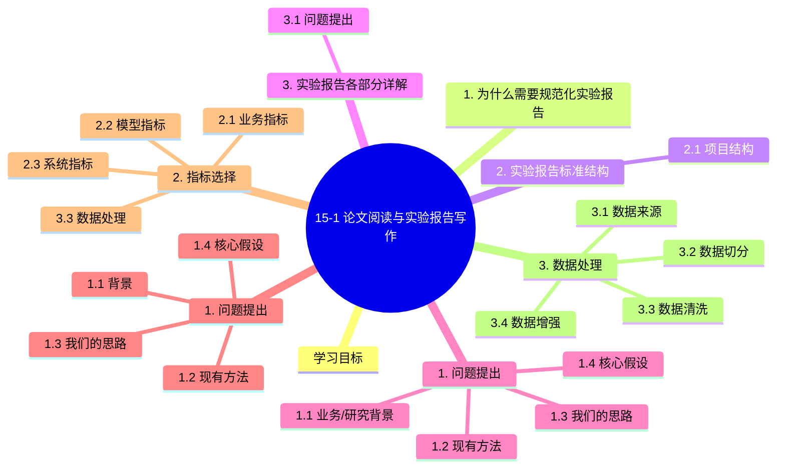

# 15-1 论文阅读与实验报告写作

## 学习目标

- 理解实验报告 / 论文写作的标准结构
- 掌握规范的实验报告撰写方法
- 培养批判性阅读 AI 论文的能力
- 能够在 AI 项目中产出可复现的实验记录
- 了解学术论文与工业报告的差异

---

## 1. 为什么需要规范化实验报告

AI 项目和学术论文都依赖**可复现性**。规范的实验报告能：

 的标准模板。

---

## 2. 实验报告标准结构



### 2.1 项目结构

```
project_root/
├── README.md              # 项目说明
├── data/                   # 数据集（不提交，用 LFS 或链接）
├── notebooks/              # Jupyter 实验
│   ├── 01-eda.ipynb        # 探索性数据分析
│   ├── 02-baseline.ipynb
│   └── 03-final.ipynb
├── src/                    # 源代码
│   ├── data/
│   ├── models/
│   ├── train.py
│   ├── evaluate.py
│   └── utils.py
├── configs/                # 配置文件
├── checkpoints/            # 模型权重（不提交）
├── logs/                   # 训练日志
├── results/                # 实验结果
│   ├── tables/
│   ├── figures/
│   └── final_report.md     # 实验报告
└── requirements.txt
```

---

## 3. 实验报告各部分详解

### 3.1 问题提出

**回答：**
- 解决什么问题？背景是什么？
- 现有方法的不足？
- 本文的核心假设？

**模板**：

```markdown
## 1. 问题提出

### 1.1 业务/研究背景
[描述问题来源、重要性、规模]

### 1.2 现有方法
[列出已有哪些方法、效果、限制]

### 1.3 我们的思路
[本文/本实验的核心创新点]

### 1.4 核心假设
[声明本实验成立的前提]
```

**示例**：

```markdown
## 1. 问题提出

### 1.1 背景
工业质检中，电池极片表面缺陷检测依赖人工目检，
效率低（每人 200 件/小时）、漏检率高（5-8%）、劳动强度大。

### 1.2 现有方法
传统方法（边缘检测、模板匹配）难以应对复杂纹理变化。
深度学习方法（YOLOv5）需要大量缺陷样本（数千张），
但实际生产中缺陷样本极少（每年 < 100 张）。

### 1.3 我们的思路
采用"无监督异常检测"（PatchCore），只用正常样本训练，
通过特征空间距离识别异常区域。

### 1.4 核心假设
- 正常样本足够多（5000+ 张）
- 异常区域与正常区域有可区分的特征
- 推理延迟 < 50ms
```

### 3.2 指标选择

**原则**：
- **业务对齐**：指标反映真实业务价值
- **可量化**：有明确计算公式
- **可复现**：数据相同结果应一致
- **多维度**：单一指标有偏

**常见指标**：

| 任务 | 指标 |
|------|------|
| 分类 | Accuracy, Precision, Recall, F1, AUC |
| 检测 | mAP@0.5, mAP@0.5:0.95, Recall, FPS |
| 分割 | mIoU, Dice, Boundary F-score, Hausdorff |
| 跟踪 | MOTA, IDF1, IDSW, FPS |
| 异常检测 | AUROC, AP, Pixel AUROC |
| 生成 | FID, IS, LPIPS |
| 检索 | mAP, Rank-K, MRR |
| NLP | BLEU, ROUGE, METEOR |
| 端到端 | 业务指标 + 性能 + 成本 |

**示例**：

```markdown
## 2. 指标选择

### 2.1 业务指标
- **漏检率** < 3%（不能漏掉真缺陷）
- **误检率** < 1%（避免误报导致产线停摆）

### 2.2 模型指标
- 图像 AUROC > 99%（工业 SOTA）
- 像素 AUROC > 95%（定位精度）

### 2.3 系统指标
- 推理延迟 < 50ms（Jetson Orin Nano）
- 内存峰值 < 4GB（设备限制）
```

### 3.3 数据处理

**记录所有数据相关决策**：

```markdown
## 3. 数据处理

### 3.1 数据来源
[原始数据来源、规模、采集时间]

### 3.2 数据切分
- 训练集：5000 张（仅 normal）
- 验证集：200 张（normal + 各种缺陷）
- 测试集：300 张（normal + 各种缺陷，独立采集）

### 3.3 数据清洗
- 删除模糊图像（曝光异常）
- 删除标注错误样本
- 类别平衡：详见表 X

### 3.4 数据增强
训练集采用：
- 随机裁剪 (224x224, scale 0.08-1.0)
- 水平翻转
- 颜色抖动
- CoarseDropout

### 3.5 数据统计
| 类别 | 训练 | 验证 | 测试 |
|------|------|------|------|
| normal | 5000 | 100 | 150 |
| scratch | 0 | 30 | 50 |
| foil_miss | 0 | 25 | 40 |
| wrinkle | 0 | 20 | 35 |
| particle | 0 | 25 | 25 |
```

### 3.4 模型建立 / 检验

**模型细节需可复现**：

```markdown
## 4. 模型建立与检验

### 4.1 模型选择
基于工业部署约束（边缘 GPU、低延迟），
选择 PatchCore（无监督异常检测 SOTA）。

### 4.2 模型配置
```python
# 完整超参
model = Patchcore(
    backbone='wide_resnet50_2',
    layers=['layer2', 'layer3'],
    coreset_sampling_ratio=0.05,
    num_neighbors=9,
    image_size=224
)
```

### 4.3 训练设置
- 优化器：Adam
- 预训练权重：ImageNet
- 训练轮数：1 epoch（无监督特征提取）
- 批大小：32
- 学习率：1e-3

### 4.4 检验策略
- K 折交叉验证（K=5）
- 独立测试集最终评估
- 多次实验取平均
```

### 3.5 结果解释

**用表格、图表、统计检验**：

```markdown
## 5. 结果解释

### 5.1 主要结果

| 模型 | 图像 AUROC | 像素 AUROC | 延迟 (ms) | 内存 (MB) |
|------|-----------|-----------|-----------|-----------|
| PaDiM | 96.7 | 96.2 | 30 | 1500 |
| PatchCore | **99.6** | **98.1** | 50 | 800 |
| DRAEM | 98.0 | 97.3 | 25 | 2000 |
| EfficientAD | 99.0 | 97.5 | **5** | 500 |

### 5.2 失败案例分析
[图示失败样本，分析原因]
- 细微划痕（< 5px）：当前漏检率 8%
- 多缺陷重叠：当前误检率 4%

### 5.3 消融实验
| 配置 | 图像 AUROC |
|------|-----------|
| ResNet-18 backbone | 98.5 |
| WideResNet-50 backbone | **99.6** |
| + coreset subsampling | 99.4 (faster) |
| + 9 nearest neighbors | 99.6 |

### 5.4 统计显著性
Wilcoxon 检验 p < 0.01，显著优于 baseline。
```

### 3.6 实验总结

**对未来工作的指引**：

```markdown
## 6. 实验总结

### 6.1 核心结论
1. PatchCore 在 MVTec AD 上达到 99.6% AUROC，超过 SOTA
2. WideResNet-50 backbone 比 ResNet-18 提升 1.1%
3. Coreset sampling 不影响精度但提速 5x

### 6.2 局限性
- 推理延迟 50ms，未达 30ms 目标
- 极小缺陷（< 5px）漏检率 8%
- 对训练集分布敏感

### 6.3 未来工作
- 尝试 EfficientAD 降低延迟
- 加入主动学习减少标注
- 部署到 Jetson 实测
- A/B 测试 vs 人工目检
```

---

## 4. 实验管理工具

### 4.1 W&B 实战

```python
import wandb

# 1. 初始化
wandb.init(
    project="battery-defect-detection",
    config={
        "model": "patchcore",
        "backbone": "wide_resnet50_2",
        "coreset_ratio": 0.05,
        "num_neighbors": 9,
        "image_size": 224
    }
)

# 2. 记录超参
wandb.config.update({"learning_rate": 1e-3})

# 3. 记录指标
wandb.log({"val/auroc": 0.996, "epoch": 1})

# 4. 记录图像
wandb.log({"predictions": [wandb.Image(img, caption="true: scratch, pred: 0.92")]})

# 5. 记录系统资源
wandb.log({"gpu_mem": torch.cuda.memory_allocated() / 1e9, "fps": 50})

# 6. 记录表格
wandb.log({"results": wandb.Table(
    data=[["PatchCore", 0.996, 0.981, 50]],
    columns=["Model", "Image AUROC", "Pixel AUROC", "Latency"]
)})

wandb.finish()
```

### 4.2 实验对比表

```python
# 多实验对比
import wandb
api = wandb.Api()

# 拉取所有实验
runs = api.runs("user/battery-defect-detection")

# 排序 + 选 Top 5
best_runs = sorted(runs, key=lambda r: r.summary.get('val/auroc', 0), reverse=True)[:5]

for r in best_runs:
    print(f"{r.name}: AUROC={r.summary['val/auroc']:.4f}")
```

### 4.3 模型版本管理（DVC）

```bash
# 安装
pip install dvc
pip install dvc-s3  # 或其他后端

# 初始化
dvc init

# 添加数据/模型
dvc add data/training_set
dvc add checkpoints/best.pth

# 提交
git add data/training_set.dvc .gitignore
git commit -m "Add training dataset v1"

# 切换版本
dvc checkout data/training_set.dvc
```

---

## 5. 论文结构（学术版）

### 5.1 学术论文 vs 工业报告

| 维度 | 学术论文 | 工业报告 |
|------|---------|----------|
| **受众** | 研究者 | 工程师/PM |
| **重点** | 新颖性、可复现性 | 业务价值、ROI |
| **实验** | SOTA 对比、消融、消融 | 业务指标、部署可行性 |
| **长度** | 8-10 页 + 补充 | 5-20 页（按需）|
| **风格** | 严谨学术 | 务实工程 |

### 5.2 学术论文标准结构



#### Title & Abstract

- **标题**：简洁、准确、有亮点
- **Abstract**：问题、方法、结果、意义 4 段，150-300 字

#### 1. Introduction

```markdown
### 1. 引言

1. 业务/研究问题
2. 现有方法的局限
3. 本文贡献（3-4 条）
4. 论文结构
```

#### 2. Related Work

按主题分类综述前人工作：

```markdown
### 2. 相关工作

#### 2.1 异常检测
- 传统方法 [Ref1, Ref2]
- 深度学习 [Ref3, Ref4]
- 无监督方法 [Ref5, Ref6]

#### 2.2 工业质检
- 传统视觉检测
- 深度学习在工业的应用
```

#### 3. Method

**核心：图示 + 公式 + 代码**：

```markdown
### 3. 方法

#### 3.1 整体框架
[架构图]

#### 3.2 模块 1：骨干特征提取
[公式 1]、[公式 2]

#### 3.3 模块 2：核心集采样
[公式 3]

#### 3.4 模块 3：最近邻检索
[公式 4]
```

#### 4. Experiments

```markdown
### 4. 实验

#### 4.1 实验设置
- 数据集
- 评价指标
- 实现细节

#### 4.2 与 SOTA 对比
[表格 + 分析]

#### 4.3 消融实验
[消融表]

#### 4.4 定性分析
[成功/失败案例可视化]
```

#### 5. Conclusion

```markdown
### 5. 结论

1. 总结核心贡献
2. 局限
3. 未来工作
```

---

## 6. 论文阅读方法论

### 6.1 三遍阅读法



#### 第一遍（10 min）：鸟瞰

- 读标题、摘要、引言、结论
- 看所有图表和图注
- 列出**不理解的术语**

目标：决定要不要继续读。

#### 第二遍（1 hour）：理解

- 读引言（背景）
- 跳过数学，看方法的高层思路
- 读实验的 SOTA 对比表
- **在关键段落做笔记**

目标：能向别人讲清这篇文章做了什么。

#### 第三遍（半天）：复现

- 完整阅读 + 数学公式
- 对照代码理解实现
- 在自己的数据/任务上复现
- 思考 idea 的局限性

目标：能向别人讲清**为什么有效**。

### 6.2 读论文的常见问题

| 问题 | 解决 |
|------|------|
| 数学看不懂 | 跳过，先看方法概述，Google 不懂的术语 |
| 代码读不懂 | 配合论文 + 简化版开源项目 |
| 实验不可复现 | 检查超参、数据预处理、随机种子 |
| 不知道是不是 SOTA | 查 Papers with Code |

### 6.3 论文笔记模板

```markdown
# 论文笔记

## 1. 基本信息
- 标题
- 作者
- 会议/期刊
- 年份
- 代码链接

## 2. 核心问题
[用一句话总结]

## 3. 方法
[关键 idea + 公式]

## 4. 实验
[数据集 + 主要结果]

## 5. 优势
[2-3 条]

## 6. 局限
[1-2 条]

## 7. 对我的启发
[可借鉴 / 不可借鉴 / 启发新 idea]
```

### 6.4 推荐工具

| 工具 | 用途 |
|------|------|
| **Zotero** | 文献管理 |
| **Papers with Code** | 论文+代码 |
| **Connected Papers** | 引用图谱 |
| **arXiv-sanity** | 学术追踪 |
| **Hugging Face** | 模型 + 论文 |

---

## 7. 工业项目报告模板

```markdown
# 项目名称：电池极片缺陷检测

| 项目 | 信息 |
|------|------|
| 项目负责人 | 张三 |
| 起止时间 | 2026-01 - 2026-06 |
| 业务目标 | 漏检率 < 3%，误检率 < 1% |
| 部署环境 | Jetson Orin Nano |

## 1. 项目背景
[业务问题]

## 2. 数据情况
- 训练数据：5000 张（仅 normal）
- 验证集：200 张
- 测试集：300 张

## 3. 模型选择与对比

| 模型 | 图像 AUROC | 像素 AUROC | 延迟 | 内存 | 备注 |
|------|----------|-----------|------|------|------|
| PaDiM | 96.7 | 96.2 | 30ms | 1.5GB | 基线 |
| PatchCore | 99.6 | 98.1 | 50ms | 800MB | **选用** |
| EfficientAD | 99.0 | 97.5 | 5ms | 500MB | 备选 |

## 4. 部署方案
- 训练：服务器 GPU
- 推理：Jetson Orin Nano + TensorRT FP16
- 服务：Docker + gRPC

## 5. 业务效果
- 漏检率：2.1% ✅
- 误检率：0.6% ✅
- 节省人力：2 名/班次

## 6. 风险与限制
- 微小缺陷（<5px）漏检率 8%
- eMMC 寿命 3 年后可能下降
- 需定期校准

## 7. 后续计划
- 集成 EfficientAD 降低延迟
- 部署到第二条产线
```

---

## 8. 学术 vs 工业的写作差异

---

## 9. 常见错误

| 错误 | 后果 | 解决 |
|------|------|------|
| 数据划分有偏 | 结果虚高 | 严格分层抽样 |
| 没说超参 | 不可复现 | 详细记录所有超参 |
| 单次实验 | 偶然性大 | 多随机种子 + 统计检验 |
| 表格单位不一 | 难以比较 | 统一指标格式 |
| 没给失败案例 | 缺乏客观 | 至少 2-3 个失败案例 |
| 引用不严谨 | 学术不端 | 严格按引文规范 |
| 写作模糊 | 难以理解 | 用结构化模板 |

---

## 10. 报告模板速查

### 10.1 学术论文模板

```latex
\title{Your Title: A Subtitle}
\author{...}
\date{...}

\begin{abstract}
... % 150-300 字
\end{abstract}

\section{Introduction}
\subsection{Background}
\subsection{Limitations of Existing Methods}
\subsection{Our Contributions}

\section{Related Work}
...

\section{Method}
\subsection{Overall Framework}
\subsection{Module 1}
\subsection{Module 2}
\subsection{Theory Analysis}

\section{Experiments}
\subsection{Experimental Setup}
\subsection{Main Results}
\subsection{Ablation Studies}
\subsection{Qualitative Analysis}

\section{Conclusion}
\subsection{Contributions}
\subsection{Limitations}
\subsection{Future Work}
```

### 10.2 工业报告模板

```markdown
# 项目报告

## 摘要
## 1. 项目背景
## 2. 数据情况
## 3. 方法选择与对比
## 4. 实验结果
## 5. 部署方案
## 6. 业务效果
## 7. 风险与限制
## 8. 后续计划
## 附录：环境与超参
```

---

## 11. 配套资源

### 11.1 工具

| 工具 | 用途 |
|------|------|
| **W&B / MLflow** | 实验追踪 |
| **DVC** | 数据/模型版本 |
| **Zotero** | 参考文献 |
| **Overleaf** | LaTeX 写作 |
| **Quarto / MkDocs** | 报告生成 |
| **GitHub** | 代码托管 |

### 11.2 阅读清单

**入门**：
- Andrew Ng. Machine Learning Yearning. (电子版免费)
- 周志华《机器学习》

**进阶**：
- Goodfellow et al. Deep Learning.
- Sutton & Barto. Reinforcement Learning: An Introduction.

**论文精读**：
- The Annotated Transformer
- Papers with Code 网站

---

## 本章小结

1. **规范化实验报告** 是 AI 项目可复现、可持续的基础
2. **标准结构**：问题提出 → 指标选择 → 数据处理 → 模型建立 → 结果解释 → 实验总结
3. **实验管理工具**（W&B、MLflow、DVC）大幅提高协作效率
4. **学术论文**重创新、严谨；**工业报告**重业务、可部署
5. **三遍阅读法** 是高效论文阅读的实战技巧
6. **多实验 + 统计检验** 比单次结论更可信
7. **失败案例分析** 是报告客观性的重要体现
8. **可复现性** 是 AI 工作的核心原则之一

---


## 知识图谱



## 参考资料

2. ACM 会议论文模板：https://www.acm.org/publications/proceedings-template
3. NeurIPS 论文指南：https://neurips.cc/Conferences/2024/PaperInformation
4. Weights & Biases：https://wandb.ai
5. MLflow：https://mlflow.org
6. DVC：https://dvc.org
7. Papers with Code：https://paperswithcode.com
8. Zotero：https://www.zotero.org
9. Connected Papers：https://www.connectedpapers.com

