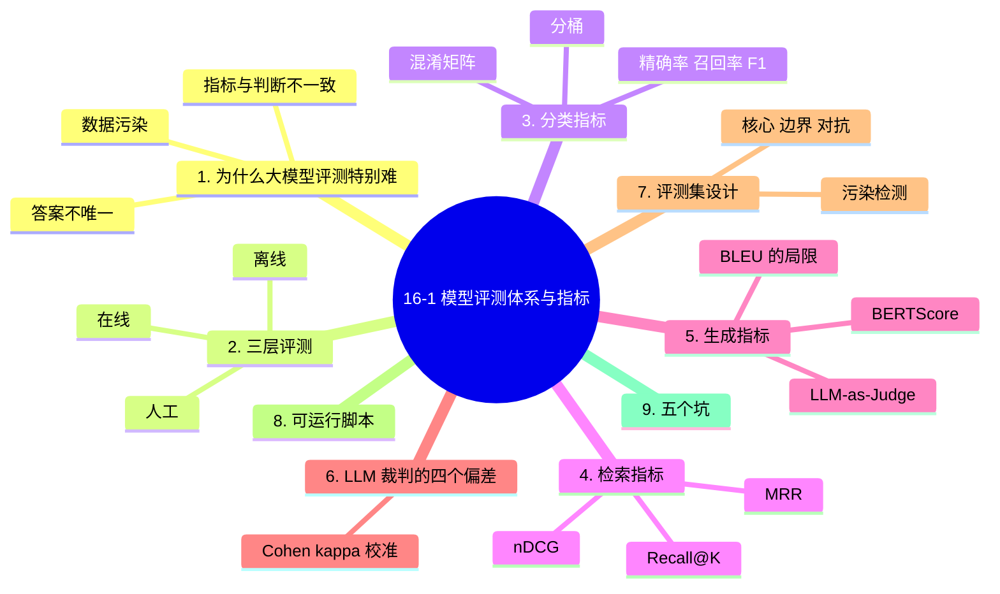

# 16-1 模型评测体系与指标

## 学习目标

- 理解大模型评测为什么比传统 ML 评测难
- 掌握离线 / 人工 / 在线三层评测的成本与适用边界
- 能手算分类、检索、生成三类核心指标
- 会用 LLM-as-Judge 并知道它的偏差从哪来
- 能设计一个不被"污染"、可长期回归的评测集

---
## 1. 为什么大模型评测特别难

传统机器学习只要一个测试集就能说清好坏：输入固定、答案唯一、指标确定。大模型把这三条全打破了。

| 差异 | 传统 ML | 大模型 |
|------|---------|--------|
| 答案 | 唯一 | 开放，多个答案都算对 |
| 指标 | 准确率就够 | 准确率高 ≠ 好用 |
| 数据 | 测试集干净 | 训练语料可能已含测试题 |
| 失败形态 | 分错类 | 幻觉、跑题、超长、拒答、越权 |

这带来三个具体后果，后文逐一处理：

1. **无法只用单一分数**。同一模型在 MMLU 上 88 分，在你自己的业务上可能一塌糊涂。
2. **"评测集污染"是常态**。公开榜单的题大多进了训练语料，分数虚高。
3. **过程也需要评测**。Agent 的结果对了，但中间调错了接口，明天就会出事。

> **一句话**：评测的目标不是给模型打分，而是**判断它能不能上你的线**。

---
## 2. 三层评测：成本差 1000 倍


| 层级 | 单次成本 | 反馈周期 | 可信度 | 适合判断 |
|------|---------|---------|--------|---------|
| 离线（自动指标） | 几乎为 0 | 秒 | 中 | 模型/提示词改动的**相对好坏** |
| 人工（标注员） | 1-5 元/条 | 小时-天 | 高 | 开放式质量、风格、有害性 |
| 在线（A/B） | 流量成本 | 天-周 | 最高 | **真实业务收益** |

**正确用法不是三选一，而是漏斗**：

1. 离线跑全量回归，拦住 80% 的明显退化
2. 人工只抽检离线分数波动大的样本（成本可控）
3. 上线用小流量 A/B 验证真实收益

> 常见错误：只做离线，把公开榜单分数当结论。榜单分高的模型在你业务上翻车，是行业日常。

---
## 3. 分类指标：会算才不会被忽悠

混淆矩阵是地基：

|  | 预测正 | 预测负 |
|---|---|---|
| **实际正** | TP | FN |
| **实际负** | FP | TN |

$$
P=\frac{TP}{TP+FP},\quad R=\frac{TP}{TP+FN},\quad F_1=\frac{2PR}{P+R}
$$

**手算一遍**：TP=40, FP=10, FN=20, TN=930。

- 准确率 = (40+930)/1000 = **97%**，看起来很漂亮
- 精确率 = 40/50 = **80%**
- 召回率 = 40/60 = **67%**
- F1 = 2×0.8×0.67/(0.8+0.67) = **0.73**

同一个模型，"97% 准确率"和"F1 只有 0.73"是天壤之别。类别不平衡时，**永远不要只报准确率**。

---
### 3.1 为什么还要看分桶

总量指标会掩盖局部崩溃。典型做法是按**难度 / 语种 / 长度 / 业务线**分桶：

| 桶 | 样本数 | 准确率 | 结论 |
|---|---:|---:|---|
| 简单 | 600 | 99% | 正常 |
| 中等 | 300 | 95% | 正常 |
| 困难 | 80 | 62% | ⚠️ 需要看 |
| 超长文本 | 20 | **15%** | 🔴 已崩溃 |

总量仍有 94%，但真实风险在最后一行。**分桶是发现"局部失效"的唯一手段**。

---
## 4. 检索指标：RAG 的成败在这里

检索排序质量决定了 RAG 天花板。三个最常用指标，一定要能手算。

**场景**：一个问题有 2 篇相关文档（A、B）。系统返回的排序是 `[X, A, Y, B]`（X、Y 不相关）。

### 4.1 Recall@K

前 K 个结果里召回了多少比例的相关文档：

$$
\text{Recall@}K=\frac{\text{前 K 个中的相关文档数}}{\text{相关文档总数}}
$$

- Recall@1 = 0/2 = 0
- Recall@2 = 1/2 = 0.5
- Recall@3 = 1/2 = 0.5
- Recall@4 = 2/2 = **1.0**

> Recall@K 只关心"有没有捞到"，不管顺序。K 取多大取决于你的上下文预算。

---
### 4.2 MRR（平均倒数排名）

第一个相关文档出现的位置越靠前越好：

$$
\text{RR}=\frac{1}{\text{第一个相关文档的位置}},\qquad \text{MRR}=\frac{1}{N}\sum_{i=1}^{N}\text{RR}_i
$$

本例中第一个相关文档 A 在第 2 位，所以 RR = 1/2 = **0.5**。

如果有三个问题，RR 分别是 1、0.5、0.25，则 MRR = (1+0.5+0.25)/3 = **0.583**。

> MRR 适合"只需要一篇证据就能回答"的场景（如事实问答）。多篇证据的任务用 nDCG 更合适。

---
### 4.3 nDCG（归一化折损累计增益）

nDCG 同时考虑**位置**和**相关性等级**，是搜索/RAG 最标准的排序指标。

$$
\text{DCG}@K=\sum_{i=1}^{K}\frac{2^{rel_i}-1}{\log_2(i+1)},\qquad
\text{nDCG}=\frac{\text{DCG}}{\text{IDCG}}
$$

其中 IDCG 是"理想排序"的 DCG（把所有相关文档排在最前面算一遍）。

**手算**：返回 `[X(rel=0), A(rel=2), Y(rel=0), B(rel=1)]`。

- 实际 DCG@4 = 0/log₂2 + (2²−1)/log₂3 + 0 + (2¹−1)/log₂5 = 0 + 3/1.585 + 0 + 1/2.322 = **2.32**
- 理想排序 `[A, B, X, Y]` 的 IDCG@4 = 3/1 + 1/1.585 = 3.63
- nDCG@4 = 2.32 / 3.63 = **0.64**

> 三者的分工：**Recall@K 看漏没漏，MRR 看第一篇准不准，nDCG 看整体排序好不好。**

---
## 5. 生成指标：为什么 BLEU/ROUGE 不能当结论

BLEU/ROUGE 本质是**词重叠率**。它们能反映"用词像不像参考答案"，但测不出"意思对不对"。

一个经典反例：

| 输出 | 参考 | BLEU | 人工判断 |
|---|---|---|---|
| "梯度下降是一种优化算法" | "梯度下降是一种优化算法" | 满分 | 正确 |
| "梯度下降是一种迭代优化方法" | 同上 | 偏低 | **同样正确** |
| "梯度上升是一种优化算法" | 同上 | 很高 | **完全相反** |

第三行说明问题：**换一个字，意思反了，但重叠率几乎不变**。

实践中的替代方案：

| 指标 | 测什么 | 成本 | 适用 |
|------|-------|------|------|
| BLEU / ROUGE | 词面重叠 | 免费 | 机器翻译、摘要的粗略回归 |
| BERTScore | 语义相似 | 低 | 有参考答案的生成 |
| **LLM-as-Judge** | 语义正确性 | 中 | 开放式问答（当前主流） |
| **人工** | 真实质量 | 高 | 最终验收、争议样本 |

---
## 6. LLM-as-Judge：好用，但有系统性偏差

让一个强模型（如 GPT-6 / Claude）当裁判给输出打分，是当前最实用的自动评测方式。但它有四个可复现的偏差：

| 偏差 | 表现 | 缓解方法 |
|------|------|---------|
| **位置偏差** | 倾向于选第一个/最后一个 | 交换 A/B 顺序各评一次，取一致结果 |
| **长度偏差** | 越长的答案分越高 | 明确要求"简洁性"评分维度 |
| **自我偏好** | 偏爱同家族模型的输出 | 用第三方模型当裁判 |
| **格式偏好** | 偏好 Markdown / 列表 | 统一输出格式后再评 |

**校准裁判的方法**：拿 100-200 条人工标注做对照，算一致性。

$$
\kappa=\frac{p_o-p_e}{1-p_e}
$$

其中 $p_o$ 是裁判与人工的**实际一致率**，$p_e$ 是**随机情况下的一致率**。

经验门槛：**κ < 0.4 时，裁判不可信，必须换 prompt 或换裁判模型**；κ > 0.6 才适合用于回归门禁。

---
## 7. 评测集设计：污染是最大杀手

### 7.1 三层结构

好的评测集不是一堆题，而是三个层次：

| 层 | 占比 | 作用 | 来源 |
|---|---|---|---|
| **核心集** | 60% | 覆盖主流程，长期固定 | 真实业务抽样 |
| **边界集** | 30% | 难例、长尾、歧义、多跳 | 线上失败样本回流 |
| **对抗集** | 10% | 注入、越权、诱导 | 红队构造（见 16-4） |

### 7.2 污染检测

如果评测题出现在训练语料里，分数就没有意义。做一个简单的 n-gram 重叠检查：

```python
def is_contaminated(question, corpus, n=8, thresh=0.5):
    """若问题的大部分 n-gram 能在语料里找到，视为疑似污染"""
    def grams(s):
        s = "".join(s.split())
        return {s[i:i+n] for i in range(len(s) - n + 1)}
    q = grams(question)
    if not q:
        return False
    hit = sum(1 for g in q if g in corpus)
    return hit / len(q) > thresh
```

> 对开源模型自建评测时，这一步几乎必做——否则你测的是"记忆"，不是"能力"。

---
## 8. 一个能跑的评测脚本

下面这段不依赖任何大模型，可直接运行，用来验证上面三个检索指标的实现是否和手算一致：

```python
import math

def recall_at_k(ranked, relevant, k):
    top = ranked[:k]
    return len(set(top) & set(relevant)) / len(relevant)

def mrr(ranked, relevant):
    for i, d in enumerate(ranked, start=1):
        if d in relevant:
            return 1 / i
    return 0.0

def ndcg_at_k(ranked, rels, k):
    dcg = sum((2 ** rels.get(d, 0) - 1) / math.log2(i + 2)
              for i, d in enumerate(ranked[:k]))
    ideal = sorted(rels.values(), reverse=True)[:k]
    idcg = sum((2 ** r - 1) / math.log2(i + 2)
               for i, r in enumerate(ideal))
    return dcg / idcg if idcg else 0.0

# 校验：与第 4 节手算结果一致
ranked, relevant, rels = ["X", "A", "Y", "B"], {"A", "B"}, {"A": 2, "B": 1}
assert recall_at_k(ranked, relevant, 2) == 0.5
assert recall_at_k(ranked, relevant, 4) == 1.0
assert mrr(ranked, relevant) == 0.5
assert abs(ndcg_at_k(ranked, rels, 4) - 0.64) < 0.01
print("全部指标实现与手算一致 ✓")
```

## 9. 五个最容易踩的坑

| 坑 | 现象 | 正确做法 |
|---|---|---|
| **只看总分** | 总准确率 94%，超长输入只有 15% | 必须分桶，看最差的桶 |
| **评测集被污染** | 开源模型分数异常高 | 做 n-gram 重叠检测 |
| **样本太少** | 100 条测出 2% 差异就下结论 | 见下方"最小样本量" |
| **标准漂移** | 上个月认为"合格"这个月认为"不合格" | 固定标注手册 + 定期双标校验 |
| **不可复现** | 说不清上次的分数怎么来的 | 记录：模型版本+提示词版本+数据版本+裁判版本 |

**最小样本量**：如果要判断两个模型 2% 的差异是否真实，粗略要求每组 ≥ 1000 条；判断 5% 差异，≥ 200 条；判断 10% 差异，≥ 60 条。样本太少时，波动会淹没真实差异。

---
## 本章小结

1. **大模型评测难在三点**：答案不唯一、指标与人类判断不一致、评测数据可能已被训练污染。
2. **三层漏斗**：离线（便宜、拦退化）→ 人工（抽检争议样本）→ 在线（验证真实收益），成本差上千倍但不可互相替代。
3. **分类指标要会手算**：97% 准确率可能对应 F1 只有 0.73；必须看精确率/召回率，并按难度分桶。
4. **检索三指标分工**：Recall@K 看漏没漏，MRR 看第一篇准不准，nDCG 看整体排序（已给出可运行实现并验证与手算一致）。
5. **BLEU/ROUGE 测不出语义**：改一个字就能把结论说反而不影响重叠率，开放式任务应改用 LLM-as-Judge + 人工验收。
6. **LLM-as-Judge 有四种系统性偏差**（位置、长度、自我偏好、格式），用 Cohen's κ 校准，κ<0.4 不可信。
7. **评测集三层结构**：核心 60% / 边界 30% / 对抗 10%，并做 n-gram 污染检测。

---
## 知识图谱



## 参考资料

1. Järvelin, K., & Kekäläinen, J. (2002). *Cumulated Gain-based Evaluation of IR Techniques*. ACM TOIS.（nDCG 原始论文）
2. Papineni, K., et al. (2002). *BLEU: a Method for Automatic Evaluation of Machine Translation*. ACL.
3. Lin, C.-Y. (2004). *ROUGE: A Package for Automatic Evaluation of Summaries*. ACL Workshop.
4. Zhang, T., et al. (2020). *BERTScore: Evaluating Text Generation with BERT*. ICLR.
5. Zheng, L., et al. (2023). *Judging LLM-as-a-Judge with MT-Bench and Chatbot Arena*. NeurIPS.
6. Landis, J. R., & Koch, G. G. (1977). *The Measurement of Observer Agreement for Categorical Data*. Biometrics.（κ 的经验门槛出处）
7. 周志华.《机器学习》第 2 章（评估方法）。
