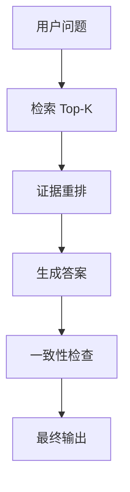

# 16-2 RAG 与 Agent 评测

## 学习目标

- 掌握 RAG 的检索与生成两段式评测
- 理解 Agent 任务评测与工具调用评测
- 学会把“答对”拆成“找对、用对、说对”

---

## 1. RAG 评测看什么

RAG 不是单一模型，而是**检索 + 生成**系统。

| 层级 | 指标 |
|---|---|
| 检索 | Recall@K、MRR、nDCG、Hit Rate |
| 生成 | EM、F1、ROUGE、Faithfulness |
| 引用 | Groundedness、Citation Accuracy |
| 端到端 | Answer Correctness、Task Success Rate |

### 核心判断

- **找对了吗**：检索到相关证据
- **用对了吗**：生成内容与证据一致
- **说清楚了吗**：答案可读、可追踪

---

## 2. RAG 的典型错误

| 错误 | 表现 | 处理 |
|---|---|---|
| 检索不到 | 答案空、泛化 | 改索引、改切分、改召回 |
| 检索错了 | 证据相关性低 | 加 rerank、改 embedding |
| 生成编造 | 引用存在但结论不一致 | 加 groundedness 检查 |
| 引用乱飞 | 看似有出处，实际不支持结论 | 约束引用格式 |

### 推荐评测样本

- 问句改写
- 长问题
- 多跳检索问题
- 冲突证据问题
- 需要引用原文的问题

---

## 3. Agent 评测看什么

Agent 不只是“回答”，还要“做事”。

| 维度 | 指标 |
|---|---|
| 任务完成 | Success Rate |
| 步骤效率 | Steps / Tool Calls |
| 工具正确性 | Tool Call Precision |
| 纠错能力 | Error Recovery Rate |
| 安全性 | 越权率、危险动作率 |
| 成本 | Token、时延、API 调用成本 |

### 典型任务

- 查资料并总结
- 调接口并填表
- 多步规划并执行
- 失败后重试

### 评测建议

1. 给每个任务定义成功标准
2. 记录每一步工具调用
3. 检查最终结果和过程是否一致
4. 对失败样本做错误分类

---

## 4. 一个简单的评测表

| 任务 | 成功 | 工具正确 | 引用正确 | 备注 |
|---|---:|---:|---:|---|
| 问答检索 | 1 | 1 | 1 | 通过 |
| 订单查询 | 1 | 0 | 1 | 工具参数错误 |
| 资料总结 | 0 | 1 | 0 | 幻觉较多 |

**结论**：RAG/Agent 评测的关键不是单点分数，而是端到端可用性。
