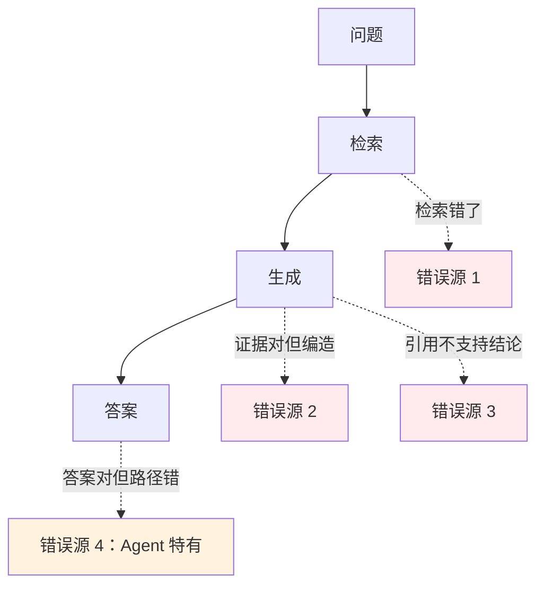
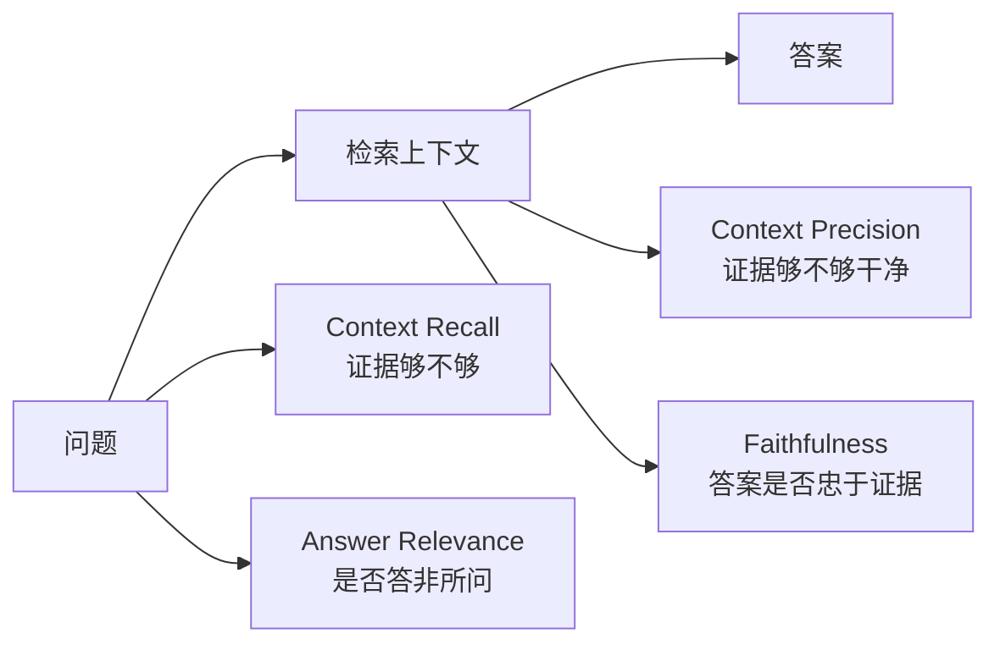
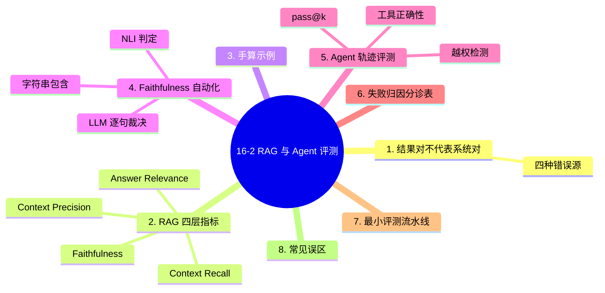

# 16-2 RAG 与 Agent 评测

## 学习目标

- 理解为什么 RAG/Agent 不能只评端到端结果
- 掌握误差归因：把一次失败定位到检索、生成、引用还是工具
- 能手算 Faithfulness / Context Precision / Context Recall
- 掌握 Agent 的轨迹级评测与工具调用指标
- 能搭一个最小可用的评测流水线

---

## 1. 核心区别：结果对了不代表系统对了

传统问答只评"答对没有"。RAG 和 Agent 是**多阶段系统**，一个正确答案可能来自巧合，一个错误答案可能有多重原因。



**为什么归因这么重要？** 因为不同错误源的修法完全不同：

| 错误源 | 修法 | 修错的代价 |
|---|---|---|
| 检索没找到 | 改切分 / 换 embedding / 加混合检索 | 白花时间 |
| 检索到了但没用 | 改 prompt / 加引用约束 | 白花时间 |
| 编造 | 加 groundedness 检查 / 降温度 | 白花时间 |
| 路径错（Agent） | 改规划 / 加校验步骤 | 白花时间 |

> **一句话**：端到端分数告诉你"有多差"，归因告诉你"该改哪"。

---
> **指标定义**：本章的 Recall / Precision / nDCG 等基础指标，定义与手算见 [16-1 模型评测体系与指标](./16-1-模型评测体系与指标.md) §4；本章只讲它们在 RAG 语境下怎么拆。

## 2. RAG 的四层指标

RAGAS 风格的拆分方式最实用——把"答对"拆成四个可独立测量的量：



| 指标 | 回答的问题 | 高了说明 |
|------|-----------|---------|
| **Context Recall** | 需要的证据都检索到了吗 | 检索覆盖好 |
| **Context Precision** | 检索到的里面有噪声吗 | 检索精度高 |
| **Faithfulness** | 答案每句都能在证据里找到依据吗 | 不编造 |
| **Answer Relevance** | 答案是否回应了问题 | 不跑题 |

这套拆分的价值在于**定位**：Recall 低就去修检索，Faithfulness 低就去修生成。

---
## 3. 手算四个指标

**场景**：问题 = "退款多久到账？"，标准答案需要 2 条证据（E1：退款政策，E2：到账周期）。

系统检索到 4 条：`[E1, X, E2, Y]`（X、Y 无关）。生成答案有 3 个陈述句，其中 2 句能在 E1/E2 找到依据。

### 3.1 Context Recall

$$
\text{Context Recall}=\frac{\text{被检索到的必要证据数}}{\text{必要证据总数}}=\frac{2}{2}=1.0
$$

### 3.2 Context Precision

衡量相关证据是否排在前面（用平均精度 AP）：

- 位置 1 是 E1（相关）：精确率 = 1/1 = 1
- 位置 3 是 E2（相关）：精确率 = 2/3 = 0.67

$$
\text{Context Precision}=\frac{1+0.67}{2}=0.83
$$

> 同样的证据，排在 `[E1,E2,X,Y]` 时 CP = (1/1 + 2/2)/2 = 1.0。**位置影响分数**，这就是为什么要 rerank。

### 3.3 Faithfulness

$$
\text{Faithfulness}=\frac{\text{有证据支撑的陈述数}}{\text{总陈述数}}=\frac{2}{3}=0.67
$$

### 3.4 Answer Relevance

常用做法是让裁判生成"这个问题本来会问什么"，再看与原问题的语义相似度。工程上简化为 0-1 打分。

---
## 4. Faithfulness 怎么自动化

三种做法，成本与准确率递增：

| 方法 | 原理 | 成本 | 准确率 |
|------|------|------|--------|
| 字符串包含 | 检查答案片段是否出现在证据里 | 极低 | 低（同义改写会误判） |
| **NLI 判定** | 用自然语言推理模型判断"证据能否推出该句" | 低 | 中高 |
| LLM 逐句裁决 | 让裁判逐句判断是否被支持 | 中 | 高 |

**NLI 方案的可运行骨架**：

```python
from transformers import pipeline

nli = pipeline("text-classification",
               model="MoritzLaurer/mDeBERTa-v3-base-mnli-xnli")

def faithfulness(answer_sentences, contexts):
    premise = " ".join(contexts)
    supported = 0
    for s in answer_sentences:
        r = nli({"text": premise, "text_pair": s})[0]
        # entailment 才算被支撑
        if r["label"].lower().startswith("entail"):
            supported += 1
    return supported / max(len(answer_sentences), 1)
```

> **为什么要句子级而不是整段**：整段判定会把"3 句里 1 句编造"判成通过，掩盖问题。

---
## 5. Agent 评测：结果 + 过程都要看

Agent 和 RAG 最大的差别是：它**会执行动作**。所以只看最终答案会漏掉两类致命问题：

- 答案对了，但中间删了不该删的文件
- 答案对了，但调用了 30 次工具，成本爆炸

### 5.1 轨迹级评测

把一次 Agent 运行记录成一条轨迹：

```python
trace = {
    "task_id": "t-001",
    "steps": [
        {"type": "tool_call", "name": "search_docs", "args": {...}, "ok": True},
        {"type": "tool_call", "name": "update_order", "args": {...}, "ok": False,
         "error": "permission_denied"},
        {"type": "answer", "content": "..."},
    ],
    "success": True,
    "n_steps": 2,
    "cost_usd": 0.013,
}
```

然后按维度统计：

| 维度 | 指标 | 本例 |
|------|------|------|
| 任务完成 | Success Rate | 1（完成） |
| 步骤效率 | Steps / 最优步数 | 2 / 2 = 1.0 |
| 工具正确性 | 参数正确的调用 / 总调用 | 1 / 2 = 0.5 |
| 纠错能力 | 失败后是否恢复 | 未恢复 ❌ |
| 安全性 | 越权动作数 | 1 ❌ |

**结论**：这个任务"成功了"，但工具正确性只有 0.5 且有一次越权——**必须判为不通过**。

---
### 5.2 pass@k：为什么 Agent 要多次采样

Agent 有随机性。同一任务跑 1 次成功，不代表稳定可用。

$$
\text{pass@}k = 1 - \frac{\binom{n-c}{k}}{\binom{n}{k}}
$$

其中 $n$ 是总采样次数，$c$ 是成功次数，$k$ 是允许尝试次数。

**手算**：跑 10 次，成功 7 次，允许 1 次尝试（k=1）：

$$
\text{pass@}1=\frac{7}{10}=0.7
$$

允许 3 次尝试（k=3）：只要有一次成功就算通过，代入组合数

$$
\text{pass@}3=1-\frac{\binom{3}{3}}{\binom{10}{3}}=1-\frac{1}{120}=0.992
$$

**这个差距说明了什么**：如果产品允许用户"重试"，可用性会大幅提升；如果必须一次成功，那 0.7 就是真实体验。

---
## 6. 失败归因：做一个分诊表

把线上失败样本按"第一故障点"分类，才能定向改进。这是一个可直接落地的分诊表：

| 故障码 | 判定条件 | 责任模块 | 典型修法 |
|--------|---------|---------|---------|
| `R1` 检索缺失 | Context Recall < 1 且有正确答案存在 | 检索 | 改切分、加混合检索 |
| `R2` 检索噪声 | Context Precision < 0.5 | 检索 | 加 rerank、提高阈值 |
| `G1` 编造 | Faithfulness < 0.8 | 生成 | 引用约束、降温度、加校验 |
| `G2` 跑题 | Answer Relevance < 0.7 | 生成 | 改 prompt、加意图识别 |
| `A1` 工具参数错 | 调用失败且参数不合法 | 工具定义 | 收紧 schema、加示例 |
| `A2` 越权 | 调用了白名单外工具 | 权限 | 白名单 + 人工确认 |
| `A3` 死循环 | 步数 > 阈值仍未完成 | 规划 | 加最大步数、加进度检查 |

统计各故障码占比，就知道下一步该优化哪里——**比看总分有用得多**。

---
## 7. 一个最小可用的评测流水线

```python
def evaluate_rag(cases, retriever, generator, top_k=5):
    """cases: [{id, question, gold_evidence, gold_answer}]"""
    rows = []
    for c in cases:
        ctxs = retriever.search(c["question"], top_k=top_k)
        ans = generator(c["question"], ctxs)
        rows.append({
            "id": c["id"],
            "context_recall": recall_at_k(
                [x["id"] for x in ctxs], set(c["gold_evidence"])),
            "faithfulness": faithfulness(split_sentences(ans), [x["text"] for x in ctxs]),
            "answer": ans,
            "cost_usd": ans.usage.cost,
        })
    return rows

def summarize(rows, thresholds):
    """按故障码分诊，输出可行动结论"""
    codes = []
    for r in rows:
        if r["context_recall"] < thresholds["recall"]:
            codes.append("R1")
        elif r["faithfulness"] < thresholds["faith"]:
            codes.append("G1")
    from collections import Counter
    dist = Counter(codes)
    return {"n": len(rows), "fail_dist": dict(dist),
            "recall_mean": sum(r["context_recall"] for r in rows) / len(rows)}
```

**关键设计点**：

1. **先测检索，再测生成**。检索不达标时，生成分数没有意义。
2. **每个失败都打故障码**，不要只记"失败"。
3. **记录 cost**，把质量和成本一起看（见 16-3）。

---
## 8. 常见误区

| 误区 | 后果 | 正解 |
|------|------|------|
| 只测端到端 | 不知道改哪 | 四层拆解 + 故障码 |
| 检索只看 Recall@1 | 错过"排在第二但很关键"的证据 | Recall@K + nDCG |
| 整段判 Faithfulness | 掩盖单句编造 | 句子级判定 |
| Agent 只测最终答案 | 放过越权和死循环 | 轨迹级 + 安全维度 |
| 只跑一次就下结论 | 把随机波动当能力 | pass@k 多次采样 |
| 用同一批题调 prompt 又验收 | 对评测集过拟合 | 留出独立测试集 |

> **最后一条最隐蔽**：反复拿同一批题调 prompt，本质上是在"背题"。留一批**从不参与调试**的题做最终验收。

---
## 本章小结

1. **RAG/Agent 必须做误差归因**：结果对不代表系统对，结果错要能定位到检索、生成、引用还是工具。
2. **四层指标**：Context Recall（够不够）、Context Precision（干不干净）、Faithfulness（编不编）、Answer Relevance（跑不跑题），各自对应不同的修法。
3. **Context Precision 受排序影响**：同样的证据集，`[E1,E2,X,Y]` 得分 1.0，`[E1,X,E2,Y]` 只有 0.83——这就是 rerank 的价值。
4. **Faithfulness 要句子级判定**，整段判定会掩盖单句编造；NLI 是性价比最高的自动化方案。
5. **Agent 要评轨迹**：任务完成、步骤效率、工具正确性、纠错能力、安全性五项，其中越权是硬否决项。
6. **pass@k** 揭示稳定性：10 次成功 7 次，pass@1=0.7，pass@3=0.992，产品是否允许重试决定真实体验。
7. **故障码分诊表**（R1/R2/G1/G2/A1/A2/A3）是把评测结论转成行动的关键工具。

---

## 知识图谱



## 参考资料

1. Es, S., et al. (2023). *RAGAS: Automated Evaluation of Retrieval Augmented Generation*. arXiv:2309.15217.
2. Chen, M., et al. (2021). *Evaluating Large Language Models Trained on Code*. arXiv:2107.03374.（pass@k 原始定义）
3. Liu, N. F., et al. (2023). *Lost in the Middle: How Language Models Use Long Contexts*. TACL.
4. Yao, S., et al. (2023). *ReAct: Synergizing Reasoning and Acting in Language Models*. ICLR.
5. Liu, Y., et al. (2023). *G-Eval: NLG Evaluation using GPT-4 with Better Human Alignment*. EMNLP.
